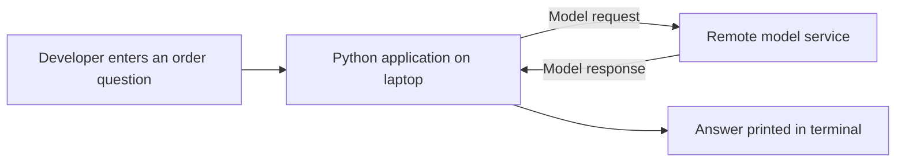
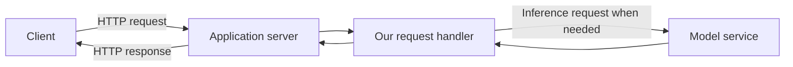
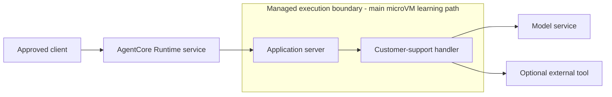
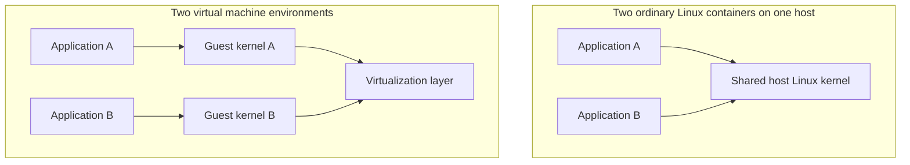
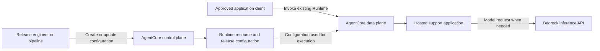
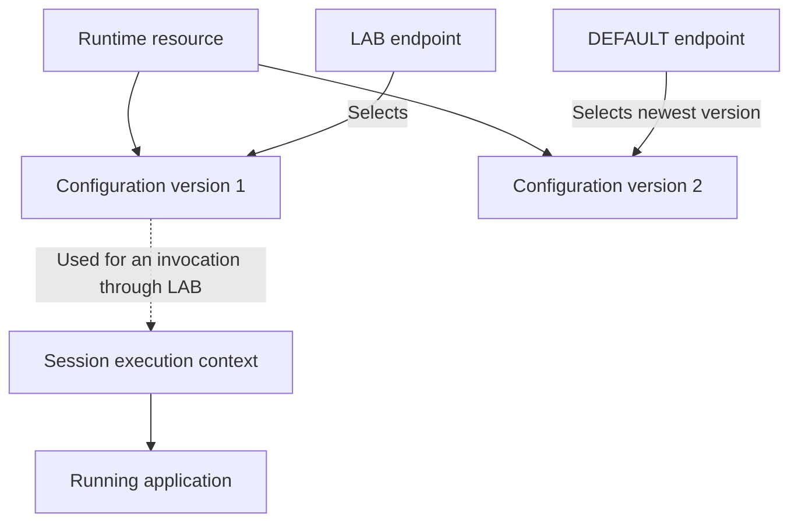
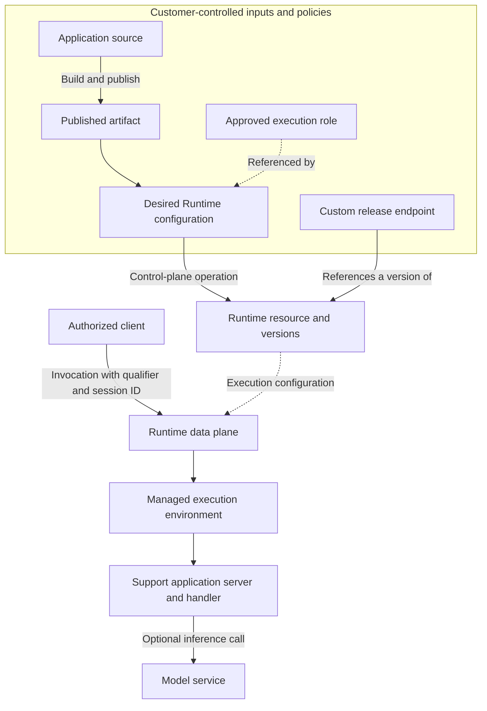

# Phase 1 - Infrastructure Foundations

**AgentCore Runtime Infrastructure Learning Project**  
**Edition:** 4 November 2026.

We will begin with a running Python program, discover why hosting requires more than code, examine the boundaries around that process, and finally identify the managed resources that describe its deployment. No cloud deployment is needed to study this phase.

## Reading path

- [Module 1 - From a Python Agent to Managed Infrastructure](#module-1)
- [Module 2 - What Is Actually Isolated When an Agent Runs?](#module-2)
- [Module 3 - What Have We Created When We Create a Runtime?](#module-3)

These are the complete chapters, not summaries of the individual module files. Read this document or the smaller module files; there is no need to read both copies. Source references are collected at the end.


---

<a id="module-1"></a>

## Module 1 - From a Python Agent to Managed Infrastructure

**Phase 1: Infrastructure foundations**  
**The question we are answering:** What must exist around an agent before other people can use it reliably?

**Reading context.** The supplied transcript begins with the gap between a working laptop demo and production hosting, then develops a customer-support application. We retain that problem and example. The infrastructure reasoning in this chapter is an educational expansion, not a claim that the lecturer demonstrated every system discussed here. Relevant transcript passages: **00:00-01:24, 11:12-13:55, and 19:54-27:36**. Current AWS behavior is identified with linked references.

<details>
<summary>Module contents</summary>

- [1.1 Start with something ordinary: a running program](#m1-1-1)
- [1.2 A local success does not create a remotely usable service](#m1-1-2)
- [1.3 Production is a collection of responsibilities, not a destination URL](#m1-1-3)
- [1.4 Why agent workloads make some of these boundaries especially visible](#m1-1-4)
- [1.5 What would we have to manage without AgentCore Runtime?](#m1-1-5)
- [1.6 Introduce AgentCore Runtime as the hosting boundary](#m1-1-6)
- [1.7 Keep hosting, inference, memory, and tools separate](#m1-1-7)
- [1.8 Reconstruct the problem before examining the mechanism](#m1-1-8)

</details>

<a id="m1-1-1"></a>

### 1.1 Start with something ordinary: a running program

Imagine that we have a file called `agent.py`. A customer asks, "Can you help me check order 10?" Our Python code receives that text, prepares a request for a language model, waits for the response, and prints the answer.

At this point, calling the program an *agent* describes its purpose. It does not give the program a new category of physical infrastructure. Instructions still execute on a processor. Working data still occupies memory. Reading a file and opening a network connection still require operating-system services.

This is the first mental model to hold onto: **an agent application is software that needs an execution environment**. The language model may be a remote service, but the code deciding what to send to that model must run somewhere too.

Our example has two different pieces of computation. The Python application assembles the request and interprets the result. The remote model performs inference: it processes the supplied input and produces a response. For example, Amazon Bedrock's `Converse` API accepts a model identifier and messages; that operation is separate from hosting our Python process. [A02]

The following diagram deliberately excludes memory services, tools, authentication, and cloud deployment. Those are not necessary to understand the first interaction.



Notice that the response returns to the Python application before it reaches the person reading the terminal. The application is not simply another name for the model. It is the software coordinating the interaction.

We can now describe our starting state precisely. We have a program, a place where the program runs, and an external dependency. We do not yet have a service that other customers can reach.

<a id="m1-1-2"></a>

### 1.2 A local success does not create a remotely usable service

Suppose a colleague wants to ask the same question from a browser. They cannot send an HTTP request to the Python function merely because that function exists in a file. A function call inside a process and a request arriving over a network are different interfaces.

We need a component that accepts network requests, decodes the input, calls the relevant application logic, and sends a response. In our example, that component is an application server. It can be part of the same Python process; it does not have to be a separate machine.

The transcript makes this visible when it creates a `BedrockAgentCoreApp`, registers an entry point, starts the server, and returns a static greeting. That is an important teaching step: the first successful response proves that requests can reach application code. It does not require a model call. **Transcript: 23:18-27:36.**

Our architecture therefore grows by one responsibility, not by an arbitrary list of products.



The server gives the application a network interface. It still has to execute somewhere. If that somewhere remains the laptop, the service is dependent on the laptop's availability, network configuration, and local environment.

This distinction prevents a common confusion later: starting a development server is not the same action as creating a cloud Runtime resource. The local server can implement the correct protocol without any AWS-hosted session existing.

For now, do not solve this by exposing your laptop to the internet. We are identifying the missing responsibility, not prescribing a public deployment. The question has changed from "Does my function work?" to "Who will keep this network-facing application available?"

<a id="m1-1-3"></a>

### 1.3 Production is a collection of responsibilities, not a destination URL

Move the same application onto an always-on machine. Our colleague can now reach it through an approved network path. That solves the laptop availability problem, but consider the next ordinary event: the Python process crashes.

The machine may still be running while the application is no longer serving requests. Something must detect the failure and decide what to do. Restarting the process may restore availability, but it will not necessarily restore the work that existed only in its memory.

Now consider a deployment. We change a dependency, copy files to the machine, and restart the application. Which customers receive the new behavior? Can we identify exactly which code is running? Can we restore the previous release? A reachable machine alone does not answer these questions.

Next, imagine two customers arrive together. The application must keep their requests and data separate. If one request consumes a large amount of memory, we also need to understand whether it can affect the other request. Separating customer identifiers in a dictionary is one part of application design; establishing infrastructure boundaries is another.

Finally, the application must reach other services. A successful request depends on network access and permission to use the destination. These are independent conditions. A process can have a valid credential and still lack a route to a private service. It can also have a working network connection and receive an authorization failure.

We can now group the missing responsibilities without treating the grouping as the explanation itself:

| Responsibility | The concrete question it answers in our example |
|---|---|
| Execution | Where does the Python process run, and what starts it? |
| Reachability | How does an approved client reach the application? |
| Isolation | Which resources and data can one execution affect? |
| Lifecycle | What happens on startup, failure, inactivity, and termination? |
| Release management | Which artifact and configuration serve a request? |
| Access control | Who may invoke the application, and what may it access? |
| State and evidence | What survives a restart, and how do we investigate a failure? |

These are not seven sequential services that every request must visit. They are parallel responsibilities surrounding the same application. That matters: a network setting does not replace an IAM policy, and a log does not replace durable application state.

The point of managed infrastructure is not that these responsibilities disappear. It is that some of them can be implemented and operated by another party behind a documented interface.

<a id="m1-1-4"></a>

### 1.4 Why agent workloads make some of these boundaries especially visible

A simple web handler might validate input, query a database, and return a response. Our support agent may instead make several model and tool calls before it knows what answer to give.

For example, the model may indicate that order details are needed. The application interprets that result, invokes an order lookup tool, sends the result back to the model, and waits for a final answer. The transcript demonstrates this general loop later in the Gateway section. **Transcript: 1:17:50-1:20:16 and 1:34:31-1:45:30.** We are using it here only to understand the infrastructure consequences.

The consequence is that one interaction can alternate between local work and waiting for remote systems. A long elapsed duration does not necessarily mean that the local process has used the processor continuously. This is a useful performance distinction even before we discuss a particular service's billing rules.

The application may also accumulate intermediate state. It might remember the order identifier, hold the previous model response, or create a temporary file. If the execution environment disappears, those items need an explicitly chosen recovery strategy. Saying "the agent is stateful" does not tell us where the state is stored.

A further complication is that model-selected actions must still be constrained by ordinary software controls. The model proposing a refund is not equivalent to a trusted system authorizing the refund. Application validation, permission boundaries, and tool-side checks remain necessary design concerns.

Our first infrastructure lesson is therefore not that agents require an entirely new operating system. It is that multi-step, sometimes long-running, state-carrying interactions make execution boundaries, lifecycle, and authority particularly important to reason about.

Do not infer that every agent needs persistent compute, every request needs a tool, or every application needs all AgentCore services. Those are decisions driven by the workload. Our support example begins with a small request handler precisely so that we can see each responsibility before adding another one.

<a id="m1-1-5"></a>

### 1.5 What would we have to manage without AgentCore Runtime?

We could host the application ourselves. This is a thought experiment about responsibility, not a recommendation to replace an existing platform.

In one design, we place the application on an EC2 instance and arrange its startup, access, logging, and updates. In another design, we package it as a container and use an existing ECS or EKS platform to run it. These are alternatives; the application does not have to pass through EC2, then ECS, then EKS as learning stages.

The useful question is not "Which product has the longest feature list?" It is "Which responsibilities does our chosen platform already handle, and which responsibilities remain with our team?" An organization with a mature Kubernetes platform may already have excellent release automation, policy enforcement, and observability. A workload needing session-oriented execution may still require additional design around that platform.

Imagine that our team implements a session router. It accepts a customer request, determines the correct execution environment, starts one when necessary, and returns later requests to the appropriate environment. That router needs to cooperate with the compute lifecycle. It must not continue directing traffic to an environment that no longer exists.

Now the team must decide when to reclaim idle environments, how to report failed startups, how to separate sessions, and how to avoid creating unlimited work under a burst of requests. This is where "run my Python file" becomes an infrastructure system.

None of this proves that a managed service is always preferable. It identifies what a managed service must actually take over for it to be valuable. We can evaluate a product more accurately once the missing responsibilities are visible.

We will use this same method throughout the course. Before learning an AWS resource name, identify the job that must be done. Then ask which documented AWS resource or behavior performs that job.

<a id="m1-1-6"></a>

### 1.6 Introduce AgentCore Runtime as the hosting boundary

We now have a reason to introduce AgentCore Runtime. AWS describes it as a hosting environment for agent and tool code, with managed execution and isolation. It can host applications using different frameworks and model providers. Our application therefore remains our application; it is not transformed into an AWS-owned reasoning engine. [A01]

For the main learning path, picture a boundary around our application server and its execution environment. We supply code and configuration. AWS provides the managed Runtime capability that hosts and executes that code according to its service contract.

The word *managed* should now be concrete. We are not promising to operate the underlying server fleet for the microVM-backed path. We are still responsible for the application artifact, its dependencies, its configuration, and the permissions it is allowed to exercise. The exact patching division also depends on whether we supply a container or use direct code deployment; Module 5 will make that distinction explicit. [A10]

There is also an important contemporary scope distinction. AWS documents both microVM compute and Instances compute. Instances uses AWS-managed EC2 resources in the customer's account through a capacity provider. We will introduce that branch in Module 3, but the initial execution picture in these notes is the microVM-backed path. Do not apply every statement about that path to Instances. [A05]

The diagram below shows responsibilities rather than a claim about AWS's unpublished internal fleet design.



The application handler remains the component that decides when to call a model or tool. Runtime provides the hosting environment and invocation integration; it does not automatically know our order schema or refund policy.

That distinction also explains why a static greeting is a useful first experiment. We can validate the hosting path independently from model access, prompt design, and business integrations.

<a id="m1-1-7"></a>

### 1.7 Keep hosting, inference, memory, and tools separate

The transcript introduces several AgentCore capabilities near the beginning. It is tempting to draw one large box called "AgentCore" and assume that everything inside it is created when we deploy an agent. That would make the infrastructure harder to understand.

Our support application's first requirement is execution. Its second requirement, when we replace the static reply, is model inference. Those are separate interactions. In a Bedrock-based implementation, the hosted application makes a Bedrock request using an appropriate model identifier and permissions. Deploying the application does not itself make that request. [A02]

Now a customer asks, "What is the status of my order?" and follows with "Order 10." To interpret the second message, the application needs the relevant context. The transcript solves this by writing and retrieving messages using a Memory resource. **Transcript: 33:58-49:38.** This is an application integration added to the hosting design, not proof that every Runtime automatically stores every conversation.

Similarly, an order lookup needs access to business data. The transcript introduces Gateway to discover and invoke an external Lambda-backed tool. **Transcript: 1:09:08-1:16:53.** That tool is not the same object as the Runtime that hosts the support application.

We can therefore draw a boundary around the scope of this course. Runtime is our main subject. Bedrock, Memory, and Gateway appear when they help explain a Runtime interaction or ownership boundary. We will not pause the infrastructure learning to build a complete customer-support product.

This also protects our future platform design. Optional capabilities should remain optional unless a platform requirement deliberately makes them part of a baseline. A service being available in the AgentCore family is not sufficient reason to provision it for every workspace.

<a id="m1-1-8"></a>

### 1.8 Reconstruct the problem before examining the mechanism

Return to the original laptop demonstration. We now understand why a successful answer was only the beginning.

The Python process carried out application logic. The application server gave that logic a network interface. A hosting platform was needed to start and manage execution outside the laptop. Isolation, identity, state, and release management introduced additional responsibilities. AgentCore Runtime is one managed way to provide the hosting boundary while retaining application ownership.

We can also reason through failures without yet knowing every AWS detail. If the server never starts, a model permission change will not repair it. If the server responds but the application cannot call Bedrock, rebuilding the session router may be irrelevant. If the wrong customer's history is loaded, compute isolation alone cannot correct the application's lookup key.

These are not troubleshooting recipes to memorize. They follow from keeping responsibilities separate.

**Transcript clarification.** At 11:44-12:06, the lecturer describes Runtime using a proxy analogy. The analogy is helpful for seeing that requests do not go straight from the user to the model. It is incomplete as an infrastructure model: Runtime is a managed hosting environment for application code, not merely a transparent model-forwarding proxy. [A01]

We are now ready for the next question. When AWS says that an execution environment is isolated, what is actually being isolated? Is it a process, a container, an operating system, a machine, or some combination? Module 2 develops those boundaries before we attach them to AWS resource names.

### Pause and reason

1. Our static handler returns a greeting successfully, but we have not configured a model. What has the test proved, and what has it not proved?
2. A support agent generates a convincing refund response without calling an order system. Why does that not demonstrate that a refund occurred?
3. Two customers have isolated execution environments but use the same database key for conversation history. Which boundary is broken?
4. A team already has EKS. What should it compare with AgentCore Runtime: the existence of containers, or the responsibilities and guarantees around their execution?

<details>
<summary>Reasoning guide - open after forming your own answer</summary>

The greeting validates only the exercised request-and-handler path. It says nothing about model access, durable state, or business operations. A refund requires an authorized action against the relevant system; generated text is not evidence of that action. A shared history key is an application/data-authorization problem even when compute separation works. An existing platform should be evaluated against workload responsibilities, not dismissed or accepted because it can start containers.

</details>

---

<a id="module-2"></a>

## Module 2 - What Is Actually Isolated When an Agent Runs?

**Phase 1: Infrastructure foundations**  
**The question we are answering:** How do processes, containers, and microVMs provide different boundaries around the same application?

**Reading context.** Module 1 established the need for managed execution. The transcript names microVM isolation at **01:24-02:02**, but does not explain Linux or virtualization internals. This chapter is explicitly **supplemental foundation material**, supported by Linux, Docker, and virtualization-project documentation. Its generic diagrams explain mechanisms; they are not reverse-engineered diagrams of AWS's private implementation.

<details>
<summary>Module contents</summary>

- [2.1 Begin inside the application, not with a container diagram](#m2-2-1)
- [2.2 Why Linux needs more than one kind of namespace](#m2-2-2)
- [2.3 A private view does not limit resource consumption](#m2-2-3)
- [2.4 A container assembles a constrained process environment](#m2-2-4)
- [2.5 Separate the image from the running container](#m2-2-5)
- [2.6 What changes when we add a virtual machine boundary?](#m2-2-6)
- [2.7 Why a microVM is still a virtual machine](#m2-2-7)
- [2.8 Combine the concepts without collapsing them](#m2-2-8)
- [2.9 Apply the boundary to sessions, not just to users in general](#m2-2-9)
- [2.10 What we can safely say about AgentCore at this stage](#m2-2-10)

</details>

<a id="m2-2-1"></a>

### 2.1 Begin inside the application, not with a container diagram

Our customer-support application is now running. Somewhere, an operating system has a process executing its instructions. That process has an identity within the operating system, an address space for its working memory, and access to resources such as open files and network sockets.

Think about the variable holding "Order 10." It is not floating in a Runtime resource or stored inside an ARN. It exists in the running program's memory unless the program deliberately writes it somewhere else. Similarly, a file the program creates exists on a filesystem that the process can access. These are different forms of state.

Suppose the program starts a helper process to parse a document. We now have two processes, not automatically two containers or two virtual machines. A child process normally begins within the parent's existing execution context; new namespace boundaries require deliberate creation or joining operations. A separate process can have separate memory while still sharing other resource views with its parent. [L01] [L07]

This resolves a useful question before we go further: **creating a child process is not equivalent to creating a new sandbox**. A child may still see the same filesystem mounts and network environment. We must examine the surrounding boundaries rather than infer them from the process tree.

Our first distinction is therefore between the *thing doing work* and the *environment constraining that work*. The process does the work. Isolation mechanisms shape what it can see, use, and affect.

<a id="m2-2-2"></a>

### 2.2 Why Linux needs more than one kind of namespace

Imagine two copies of the same support application on one Linux system. Both expect to listen on port 8080. Both may use a temporary path called `/tmp/order.json`. Both may launch helper processes.

The problem is not simply that there are two programs. Ordinary operating systems already run many programs. The problem is that each application may need a controlled view of resources that would otherwise be shared at the system level.

Linux namespaces provide separate views of particular classes of resources. Different namespace types exist because a process's network view, process identifiers, filesystem mounts, and user identity are not the same resource. We can separate one without automatically separating all the others. [L01]

#### The first view: which processes are visible?

A PID namespace gives processes a distinct process-number space. The same process can have a different PID when observed from a containing namespace, and two separate namespaces can each contain a process numbered 1. Seeing PID 1 therefore does not establish that a program owns a physical machine. [L02]

For our application, this means a process listing can present a constrained view rather than every process on the underlying host. The benefit is easier to understand than the kernel terminology: the application is given a local-looking process environment instead of a global host-wide one.

PID namespaces are not symmetric secrecy boundaries in every direction. A containing namespace can have visibility into descendant namespaces. This is one reason the position of the observer matters when interpreting process information. [L02]

We have separated the process-number view, but our two application servers could still conflict over networking. That is a different problem.

#### The second view: whose port 8080 is this?

A network namespace has its own network interfaces, routing-related state, and port/socket space. Two processes in different network namespaces can therefore use the same listening port number without that alone creating a conflict. [L03]

The port number is meaningful within a network context. "Port 8080 is occupied" is incomplete unless we know where the check was made. Likewise, `localhost` refers to the local network environment of the process making the connection; it is not a universal address for the host or another container.

Giving the application a separate network namespace does not automatically provide a working route to Bedrock or a database. Isolation and connectivity are separate jobs. Later, when we inspect Runtime networking, this distinction will stop us from interpreting "isolated" as "unable to communicate with anything."

#### The third view: what does a path refer to?

A mount namespace controls the set of filesystem mounts visible to a process. It can make two processes see different directory trees or different content at the same path. It does not, by itself, guarantee that the underlying stored data has been copied. [L04]

This distinction matters for our temporary order file. Two processes can see `/data` through different mount arrangements. Conversely, two otherwise isolated applications can be deliberately given access to the same external filesystem. Whether their files are independent depends on the actual backing storage and access rules, not merely on the spelling of the path.

Do not turn a filesystem *view* into an assumption about storage durability either. A private-looking directory can be temporary. A shared filesystem can be durable. Visibility, sharing, and lifetime must be reasoned about separately.

#### The fourth view: what does user identity mean inside the boundary?

A user namespace can map user and group identifiers differently inside and outside the namespace. A process can appear as user ID 0 inside a namespace without holding equivalent privilege outside it. This is a mechanism that can support restricted execution, not a guarantee that every container deployment uses a particular mapping. [L05]

This gives us a more precise question than "Does the process run as root?" We need to ask which user namespace, which capabilities, and which resources are involved. We are not learning every Linux privilege rule here; we are learning why a single identity label is insufficient to describe the security boundary.

The namespace lesson is now complete enough for our purposes. A container is not one magical namespace. Its runtime can combine several kinds of resource separation. The particular combination and other security controls determine the resulting environment.

<a id="m2-2-3"></a>

### 2.3 A private view does not limit resource consumption

Assume we have separated the process, network, and filesystem views of our two support applications. One application now enters a computation loop or loads an unexpectedly large document.

The namespace design does not answer how much CPU time or memory that application may consume. It shapes resource views; it is not the entire resource-allocation policy. We need a second mechanism.

Linux control groups, usually called cgroups, organize processes into hierarchies and apply resource controls through controllers. In cgroup v2, for example, CPU bandwidth and memory usage can be controlled using interfaces such as `cpu.max` and `memory.max`. Child processes inherit cgroup membership at creation unless subsequently moved through the appropriate mechanisms. [L06] [L09]

An illustrative CPU setting helps explain what a limit means. A quota of 50,000 microseconds in a 100,000-microsecond period describes a CPU-time budget over that interval. It is not a promise of a dedicated physical core, and it is not a request to manufacture half of a processor. The point of the example is to distinguish an accounting-and-enforcement rule from hardware ownership.

Similarly, a memory boundary concerns the group's charged memory usage and the kernel's enforcement behavior. A namespace may hide unrelated processes while the cgroup limits how much memory the grouped workload can consume. These mechanisms solve different concerns and are often used together. [L06]

If a helper process is launched inside the same controlled group, we should not casually assume it escapes the budget. The infrastructure question is which group the process belongs to, not whether it has a different PID.

We now have a useful pair of questions: **What can this workload see? How much may it consume?** They are related, but neither answer substitutes for the other.

<a id="m2-2-4"></a>

### 2.4 A container assembles a constrained process environment

We can now introduce a container without treating it as a smaller physical server.

A Linux container runs application processes using a packaged filesystem and configured isolation/resource controls. Containers on the same Linux host normally share that host's kernel. The application may see a private-looking environment, but it is not necessarily running its own independent kernel. [D01]

Return to the support application. We package Python, our dependencies, and our code. A container runtime prepares the filesystem view and process environment, then starts the configured command. The application still executes as processes. What has changed is the repeatability and boundary configuration around those processes.

This explains two observations that otherwise seem contradictory. A container can look like a small standalone system from inside, while the host can still account for its processes. And two containers can run different user-space packages while using the same underlying Linux kernel.

The combination is useful, but it is not absolute protection against every possible failure. Security also depends on privilege configuration, kernel protections, access to host resources, and external permissions. We should not reduce a production security review to "it runs in a container."

There is one local-development detail worth making explicit. Linux containers on a Mac need a Linux kernel. Docker Desktop provides a Linux virtual machine for that purpose. The containers share the Linux kernel in that environment, not the macOS kernel. This is a local Docker arrangement, not evidence about the internals of AgentCore. [D07]

<a id="m2-2-5"></a>

### 2.5 Separate the image from the running container

Our next distinction is about time. Before the application starts, what exactly do we have?

A container image contains filesystem layers and configuration used to create a container. A running container is an execution of that packaged definition with runtime state. The image is not itself a running Python process. [D02]

This matters immediately when a release engineer pushes an image to a registry. Publishing the artifact makes it available for retrieval. It does not, by itself, prove that any customer request is being served by it.

Now start two containers from the same image. They begin with the same packaged application content, but their subsequent writable state can differ. One can create `/tmp/order.json` without changing the original image into a new release. Image layers and runtime writable changes are different objects. [D03]

A useful thought experiment is to stop the container, discard its writable layer, and start again from the image. The original code and dependencies are still available from the image. A temporary file created only during the discarded execution is not automatically part of that image.

This is the foundation for two later ideas. Module 5 will study artifact publication. Phase 4 will study which runtime state must survive compute termination. We need both because a reproducible application package and a durable conversation store solve different problems.

<a id="m2-2-6"></a>

### 2.6 What changes when we add a virtual machine boundary?

Containers explain process environments that can share a kernel. Suppose our security and tenancy requirements call for a boundary where separate workloads also have separate guest kernels.

A virtual machine provides a virtualized machine environment in which a guest operating system can run. A virtualization layer manages the guest's access to CPU, memory, and devices. The application runs on the guest operating system rather than treating another application's kernel as its own.

Linux KVM provides interfaces for creating virtual machines, virtual CPUs, and associated device/memory configuration. A virtual machine monitor uses such facilities to manage the guest. You do not need to implement KVM to understand our architecture; the important new boundary is between guest environments. [L08]

Compare the two simplified arrangements below. The arrows represent dependency on a kernel, not network requests.



The diagram does not say that every container is insecure or every VM is perfectly secure. It shows why the isolation mechanisms are different. Moving from shared-kernel process isolation to separate guest environments changes the boundary that a failure would have to cross.

It also does not mean each virtual machine owns a dedicated physical server. Virtualization is specifically useful because multiple guest environments can be managed on underlying infrastructure. Logical separation and exclusive physical hardware are different properties.

<a id="m2-2-7"></a>

### 2.7 Why a microVM is still a virtual machine

We now understand why a VM boundary may be attractive. The next concern is operational overhead: how much machinery must be initialized and managed around a relatively small application?

A microVM design aims to keep the virtual-machine environment lightweight and focused on the workload. It is not simply a container renamed to sound more isolated. It retains a virtual-machine boundary while reducing unnecessary machinery compared with a general-purpose virtual-machine configuration.

Firecracker is a concrete open-source example. Its userspace virtual machine monitor uses KVM and a deliberately limited device model to run microVMs. This illustrates how a lightweight VM can combine guest isolation with a design optimized for service workloads. [V01]

**Evidence boundary:** this discussion teaches a general mechanism. We are not using Firecracker's public implementation or benchmarks to assert the exact VMM, fleet topology, startup sequence, or latency of AgentCore Runtime. Product-specific claims need product-specific evidence.

For the support application, the important architectural possibility is that a packaged application can run inside a lightweight guest boundary. Packaging and isolation can be combined. We do not have to choose between "container image" and "microVM" as though they were competing answers to the same question.

The image tells us what software is supplied. The microVM tells us something about the execution boundary around that software. Confusing those roles would make the rest of Runtime deployment unnecessarily difficult.

<a id="m2-2-8"></a>

### 2.8 Combine the concepts without collapsing them

Consider the statement, "My agent runs in a container inside an isolated microVM." We now have enough foundations to unpack it.

The *agent* is application logic. Its *processes* execute instructions. The *container artifact and execution setup* package and start the user-space application. The *microVM* provides a guest-level execution boundary. The underlying service manages the infrastructure required to create and run that environment.

The following table is a consolidation of the distinctions we have already developed, not a replacement for them.

| Concept | What it describes | What it does not prove by itself |
|---|---|---|
| Process | A running program and its operating-system execution context | A new VM or container for every child process |
| Namespace | A particular resource view or identity scope | Durable storage or a complete consumption limit |
| Cgroup | Grouped resource accounting and controls | A separate guest kernel |
| Container image | Packaged files and startup configuration | A currently running workload |
| Running container | Processes executing from a configured container environment | Exclusive ownership of a physical host |
| MicroVM | A lightweight virtual-machine execution boundary | A particular vendor fleet design or guaranteed request latency |

Now consider a network request inside this layered model. The application initiates it. The guest/container networking environment determines how the process sees interfaces and addresses. The surrounding platform provides the connectivity integration. Permissions at the destination decide whether the requested operation is allowed.

A single sentence such as "the container has internet" hides all of those distinct concerns. Our goal is not to make every explanation lengthy; it is to know when a short phrase is concealing the part we are trying to debug.

<a id="m2-2-9"></a>

### 2.9 Apply the boundary to sessions, not just to users in general

Our support agent serves two customers. Customer A asks about order 10. Customer B asks about order 25. We want their working execution state separated.

For the microVM compute path, AWS documents a dedicated execution environment for each Runtime session. That is a session boundary. It is not a statement that one customer can only have one session, or that every individual HTTP request necessarily creates a new microVM. [A04]

This is why we must resist using *user*, *request*, and *session* interchangeably. One person may open multiple conversations. One conversation may involve several requests. A Runtime session is the service's execution-context concept, and the application must deliberately decide how that relates to its own user and conversation model.

Infrastructure separation also does not fix an incorrect authorization decision. Suppose Customer B can supply Customer A's valid session identifier and the application forwards it without checking ownership. The problem is not that the compute boundary has physically disappeared. The application has selected the wrong authorized context. AWS explicitly places session-to-user mapping responsibility on the client backend. [A04]

Likewise, both isolated environments might have credentials that can read the same external bucket. Their local filesystems can be separate while their external authority overlaps. That may be intentional, but it must be designed rather than assumed safe because the word *microVM* appears in the architecture.

The useful conclusion is that isolation has a scope. Always name the resource or authority being separated.

<a id="m2-2-10"></a>

### 2.10 What we can safely say about AgentCore at this stage

We can now return to the transcript's Runtime introduction with a more accurate foundation.

The lecture says that a request leads to a microVM, describes a Spot fleet, and mentions an approximately 20-millisecond cold start. Those are transcript claims at **01:24-02:02**. The documentation reviewed for these notes supports session-level microVM execution, but it does not establish that particular Spot-fleet implementation or a universal end-to-end 20-millisecond startup guarantee. We will not use those claims as architectural facts. [A03] [A04]

We also refine "new request, new microVM." Follow-up requests can use the same live session environment. If its compute has stopped, a subsequent invocation can require fresh compute. Whether particular files survive depends on configured storage; whether RAM survives is a different question. We will examine the detailed lifecycle in Phase 3. [A24] [A28]

The infrastructure knowledge gained here is therefore stronger than a product slogan. We understand what a process is doing, why isolation mechanisms differ, why packaging is not execution, and why session identifiers have to be interpreted carefully.

#### A read-only observation exercise

On a Linux machine or a Linux container you are permitted to inspect, the following commands display information about the current shell. They do not change namespaces or cgroup settings.

```bash
uname -s
printf 'Shell PID: %s\n' "$$"
for ns in pid net mnt user; do
  printf '%s: ' "$ns"
  readlink "/proc/$$/ns/$ns"
done
cat /proc/$$/cgroup
```

The namespace links identify the shell's namespace memberships. Comparing them with another permitted process can show which views are shared. The cgroup output identifies membership, not a complete report of every effective resource limit. The `/proc` interfaces are part of the Linux documentation. [L01] [L09]

Do not run this in macOS Terminal expecting Linux `/proc` to exist. Do not treat the exercise as an instruction to log into AWS-managed Runtime hosts. It is a local observation of the general mechanisms we have learned.

### Reconstruct the model and move forward

The application has not become mysterious because it is hosted by an agent service. It still executes as processes, uses memory, accesses files, and sends requests. Containers make software packaging and process environments repeatable. MicroVMs add a guest-level boundary around execution. The managed service coordinates the product-specific use of those mechanisms.

We are now ready to move above the kernel and inspect the cloud objects. When we click "create Runtime," which object have we actually created? Is it the artifact, the execution environment, a version, or a stable endpoint? Module 3 separates those identities.

### Pause and reason

1. A parent Python process starts three child processes. What additional evidence would you need before calling them four isolated containers?
2. Two application processes both report PID 1 and listen on port 8080. Why is that not automatically a conflict?
3. Two containers use the same image. Must a temporary file written by one appear in the other?
4. A session has its own microVM but can call an API that exposes every customer's records. Which isolation statement remains true, and which security requirement is still unsatisfied?

<details>
<summary>Reasoning guide</summary>

The process tree does not establish container or namespace membership. PID and port numbers are interpreted within their respective namespaces. A shared image supplies common packaged content; runtime writes depend on writable layers and explicitly shared mounts. MicroVM separation can protect local execution state while an overly broad external API permission still permits unauthorized data access. These questions concern different boundaries.

</details>

---

<a id="module-3"></a>

## Module 3 - What Have We Created When We Create a Runtime?

**Phase 1: Infrastructure foundations**  
**The question we are answering:** Which cloud resources describe the application, which objects select a release, and which environments actually execute requests?

**Reading context.** Modules 1 and 2 established the hosting problem and the meaning of isolation. The transcript explains the broad position of Runtime at **11:12-13:55** and spends considerable time on local development. The resource model, ownership analysis, and current compute alternatives below are **verified AWS supplementation**. We are not implying that the transcript performed these cloud-management operations.

<details>
<summary>Module contents</summary>

- [3.1 First separate the two different meanings of "runtime"](#m3-3-1)
- [3.2 Creation and invocation belong to different planes](#m3-3-2)
- [3.3 A Runtime resource is not one permanently running machine](#m3-3-3)
- [3.4 Names, identifiers, ARNs, Regions, and accounts answer different questions](#m3-3-4)
- [3.5 Artifact, version, endpoint, and session are four different objects](#m3-3-5)
- [3.6 Identity must be attached to the action being performed](#m3-3-6)
- [3.7 A session binds execution context, not business identity by itself](#m3-3-7)
- [3.8 Separate the two current compute ownership models](#m3-3-8)
- [3.9 Draw the responsibility boundary before choosing platform modules](#m3-3-9)
- [3.10 Reconstruct the first complete infrastructure map](#m3-3-10)

</details>

<a id="m3-3-1"></a>

### 3.1 First separate the two different meanings of "runtime"

Our support application will eventually use Amazon Bedrock to call a model. In Python, the client for that service is commonly created with the service name `bedrock-runtime`. That name can easily lead us to confuse model inference with application hosting.

The distinction is a responsibility distinction. A Bedrock inference operation asks a model to produce a result. An AgentCore Runtime hosts the application that decides when and how to ask. Our Python handler can call a model several times during one user interaction, or return a diagnostic greeting without calling a model at all. [A01] [A02]

There is a second overloaded meaning. Python 3.13 is a *language runtime*: software that executes Python programs. It is not an AgentCore Runtime resource. A managed hosting resource can run an artifact that includes a particular language runtime, or use a managed language environment with direct code deployment. [A22]

Keep the layers attached to concrete questions. "Where is my application hosted?" concerns AgentCore Runtime. "Which interpreter runs the code?" concerns Python. "Which model generates the answer?" concerns the inference target. Using the right question often prevents using the wrong API.

<a id="m3-3-2"></a>

### 3.2 Creation and invocation belong to different planes

Imagine two requests arriving at AWS.

The first says, "Create a support-agent Runtime using this artifact and execution role." The second says, "Ask the existing support agent about order 10." The first changes infrastructure configuration. The second uses deployed infrastructure to do application work.

We call the management side the **control plane** and the execution-facing side the **data plane**. These names describe responsibilities, not necessarily a specific internal set of physical servers.

AWS exposes `CreateAgentRuntime` through the AgentCore control-plane API and `InvokeAgentRuntime` through the data-plane API. With Boto3, the corresponding service names are `bedrock-agentcore-control` for management and `bedrock-agentcore` for invocation. The Bedrock model client remains a third service client, `bedrock-runtime`. [A13] [A20] [A21]

The diagram shows how different callers can participate. A release pipeline is not part of the normal path of every customer question.



Now consider a permission error. If creation fails, we investigate the management caller and the requested infrastructure configuration. If invocation is denied, we investigate the calling identity and the Runtime's inbound authorization. If a model call fails inside the application, we investigate the application's outbound access. All three can occur under the same broad project, but they are different requests.

<a id="m3-3-3"></a>

### 3.3 A Runtime resource is not one permanently running machine

When we create a Runtime, we create a managed resource describing the application and its configuration. The create API accepts an artifact, a name, an execution role, and network configuration, with additional options for protocol, authorization, lifecycle, and other capabilities. [A13]

The resource is the stable object that we manage. It is not equivalent to one particular Python process that must remain alive forever. A resource can exist before we have invoked it, and it can support multiple execution sessions over its lifetime.

For our example, imagine a resource named `support_agent_lab`. We supply a release artifact and choose how AWS should host it. Later, several clients invoke that resource. The configured application is the same logical service, but its live execution environments need not be one shared process.

This distinction gives us two independent status questions. "Does the Runtime resource exist and have a usable configuration?" is not the same as "Is a particular session currently processing a request?" We will inspect resource status in Phase 2 and session lifecycle in Phase 3.

Do not use a console card labeled "Runtime" as evidence that a specific microVM is continuously running. The control-plane object and the execution environment have related but different lifecycles.

<a id="m3-3-4"></a>

### 3.4 Names, identifiers, ARNs, Regions, and accounts answer different questions

We need a reliable way to refer to the resource after creation. AWS returns identifiers rather than requiring us to guess the internal naming scheme. A Runtime ARN contains the service, Region, account, and resource identifier. The API reference documents the ARN structure. [A14]

Here is a **synthetic example**, not a resource in your account:

```text
arn:aws:bedrock-agentcore:us-west-2:111122223333:runtime/support_agent_lab-AbCdEf1234
```

Read this as an address in the AWS resource system. It identifies the service and regional resource ownership context. It does not tell us the IP address of a microVM, the location of a private host, or the route by which an HTTP packet reaches the application.

A human-readable name and a returned Runtime ID also serve different purposes. The name helps people recognize a resource; the returned identifier is what management APIs may require. In actual automation, capture the response or query the existing resource. Do not reconstruct IDs by concatenating strings.

The Region matters because resource availability and integration configuration are regional concerns. The account matters because it establishes the administrative ownership context. Neither alone tells us which physical machines AWS uses internally.

For our future workspace platform, the useful design implication is that the platform should preserve explicit identifiers and ownership metadata. A logical workspace name is not a substitute for the ARN of the Runtime provisioned for that workspace.

<a id="m3-3-5"></a>

### 3.5 Artifact, version, endpoint, and session are four different objects

We already learned what an artifact is: the packaged application supplied for execution. Now suppose we change the code. We need to retain a record of which configuration belonged to the earlier release.

AgentCore Runtime maintains immutable configuration versions. Creation produces the first version, and updates produce subsequent versions. A Runtime endpoint references a version. The automatically created `DEFAULT` endpoint follows the newest version; a custom endpoint provides an independently controlled version reference. [A07]

That is the core mechanism. Consider its consequences using our support application. Version 1 returns one diagnostic build label. Version 2 returns another. We can create a custom `LAB` endpoint that selects version 1 while the newest version is evaluated elsewhere. The endpoint is a reference to a release; it is not a copy of the source repository.

The final object is the session. A client invocation uses a Runtime and may specify an endpoint qualifier and a session identifier. The session is the execution context for the interaction. It is neither the immutable artifact nor the stable endpoint name. [A20]

The following diagram separates configuration references from live execution. The dashed relationship is conceptual; it is not a claim that a version object itself sends requests.



There is another naming trap. A *Runtime endpoint* selects an application version. A *VPC endpoint* provides private network access to a service API. They are not two spellings for the same object. Private connectivity is covered later; at this stage, keep release selection and network access separate. [A23]

A custom endpoint named `PROD` also does not magically create a separate production account, subnet, or security policy. It is a release-management label and reference. Strong environment isolation is a broader architecture decision.

<a id="m3-3-6"></a>

### 3.6 Identity must be attached to the action being performed

The support application needs to call AWS services. It should not carry a developer's long-lived keys inside its image. AgentCore Runtime uses a configured execution IAM role, with a trust relationship allowing the service to assume it and permission policies governing permitted actions. [A06]

We should distinguish three actors in the story. A deployment identity configures the Runtime. An invoking identity submits a customer interaction. The hosted workload uses its execution identity for authorized outbound AWS operations. In a real organization those actors may be represented by multiple systems, but they remain different responsibilities.

The execution role does not automatically inherit every permission of the person who invoked the agent. Nor does permission to invoke the Runtime necessarily grant permission to change its deployed code. These are separate authorization decisions attached to separate operations.

A further permission, `iam:PassRole`, lets a deployment principal configure a service with an approved role. It is not the same operation as the application assuming a role during execution. This separation prevents a creator with limited authority from casually assigning a more powerful role to a service. [A29]

The Runtime resource response can also expose a workload-identity ARN. That service identity should not be confused with the execution-role ARN or an authenticated customer's identity. Detailed token and identity flows belong to the security phase; here we need to recognize that the resource model contains distinct identity objects. [A14]

For our simple greeting example, we have no need to grant order-system access or model invocation merely because a later version might use them. The architectural principle is to authorize the operations the workload actually performs, not every capability mentioned in the tutorial.

<a id="m3-3-7"></a>

### 3.7 A session binds execution context, not business identity by itself

A customer may send several messages while discussing order 10. The application needs a way to identify the ongoing execution context. That is the purpose of the Runtime session identifier in the invocation flow.

For the microVM-backed path, a live session can be reused across invocations. The application is responsible for relating session identifiers to authorized users. A stopped session can receive new compute on a later invocation; this does not mean that all previous process memory is restored. [A04]

We can now ask a precise question about state: "Which state should persist only while this process is alive, which should survive a compute replacement, and which belongs in long-term application storage?" That question will guide the storage phase. It is premature to answer all of it by saying "we have sessions."

An application conversation identifier can also differ from a Runtime session identifier. For example, a product might retain a conversation record long after the compute serving its last message has stopped. That is an illustrative application design, not a requirement imposed by Runtime.

The same logic applies to framework objects. A Python SDK client session, an HTTP connection, an MCP session, and a Runtime execution session need not have identical lifetimes. When a document uses the word *session*, identify which subsystem owns it before reasoning about persistence or cleanup.

<a id="m3-3-8"></a>

### 3.8 Separate the two current compute ownership models

Until now, our main picture has been the microVM-backed managed path. AWS also documents Instances compute, where AgentCore provisions and operates EC2 managed instances in the customer's account using a capacity provider. That provider describes the infrastructure choices associated with the runtime. [A05]

This alternative deserves a place in the resource model now because it changes what "in my account" can mean. A Runtime resource belongs to our account in either design, but Instances adds customer-account EC2 resources managed by the service. The ownership and operating model is therefore not identical to the serverless microVM path.

Do not jump from this distinction to a detailed hardware design yet. We need only enough orientation to avoid treating every Runtime as the same compute topology. The main Phase 2 walkthrough does not create a capacity provider or Instances resources.

| Question | Main microVM learning path | Instances orientation |
|---|---|---|
| What defines the application? | Runtime artifact and configuration | Runtime artifact and configuration |
| What additional compute resource do we select? | Managed microVM service behavior | A capacity provider for service-managed EC2 |
| Is this ordinary manual EC2 administration? | No customer-managed host fleet in this path | No; EC2 resources are service-managed |
| Where do we study the detailed lifecycle? | Phase 3 | The explicit Instances comparison in Phase 3 |

Instances security documentation separates provisioning roles, instance-level roles, and runtime execution roles. That reinforces our earlier point: seeing an EC2 instance does not mean every permission attached to the surrounding infrastructure is granted to the agent application. [A35]

Our learning sequence therefore branches only where the actual product branches. We will not intermingle the two networking, persistence, or lifecycle models into one misleading universal diagram.

<a id="m3-3-9"></a>

### 3.9 Draw the responsibility boundary before choosing platform modules

We can now classify the pieces of our example by responsibility.

The team or platform owns the application release, the chosen configuration, the policies it permits, and the business behavior. AWS operates the managed service within its documented responsibility. Some supporting resources, such as artifact repositories, roles, and network resources, are customer-account resources even when a deployment tool creates them on the team's behalf.

That last point is important. "The CLI created it" does not mean "AWS owns all ongoing responsibility for it." Automation can create a resource while the customer remains responsible for its intended configuration, retention, permissions, and cost.

| Object or concern | Ownership question we should record |
|---|---|
| Source code and dependencies | Which team reviews and releases changes? |
| ECR image or S3 deployment archive | Which pipeline publishes it, and how is a release identified? |
| Runtime configuration and custom endpoints | Which deployment authority may create and promote versions? |
| Execution IAM role | Which platform or security owner approves its trust and permissions? |
| Session-to-user mapping | Which application backend validates the mapping? |
| Managed compute internals | Which behavior does AWS document, and what is not exposed? |
| Network and storage integrations | Which resources are dedicated, and which are shared? |

This table is a proposed design-record structure, not a claim that your organization has already assigned those owners.

For the microVM VPC integration, AWS documents ENIs in selected customer subnets. That is evidence of connectivity into the VPC, not by itself proof that the entire underlying managed compute fleet lives inside that VPC. We will examine the actual network path in Phase 4. [A23]

Similarly, a *workspace* in our future platform is a logical ownership and provisioning boundary that we design. We must not silently equate it with a Kubernetes namespace or assume that creating one workspace automatically creates every AgentCore capability. Module 15 will use the resource model developed here to define the baseline deliberately.

<a id="m3-3-10"></a>

### 3.10 Reconstruct the first complete infrastructure map

We can now draw our first integrated map without inventing AWS's internal implementation. Read it in two passes: first the management relationships, then the execution relationships.



The dotted role edge is a configuration relationship, not a claim that IAM receives the entire customer payload as an application hop. The artifact is a deployment input, not a participant that runs business logic. The Runtime resource is a management object, while the execution environment contains running work.

Imagine that our artifact is correct but the execution role lacks access to a dependency. The graph tells us why publication can succeed while an invocation fails. Imagine that the role is correct but the server listens on the wrong address. The graph tells us why permission is not the missing layer.

This is the purpose of the foundations phase: not to memorize service names, but to acquire a map that supports those deductions.

#### Read-only inspection after a lab Runtime exists

There is no need to create anything to finish Phase 1. Later, after an approved lab resource exists, the following read-only command can connect the conceptual model to actual returned fields:

```bash
: "${AWS_REGION:?Set the lab Region}"
: "${RUNTIME_ID:?Set an existing approved Runtime ID}"
aws bedrock-agentcore-control get-agent-runtime \
  --region "$AWS_REGION" \
  --agent-runtime-id "$RUNTIME_ID" \
  --query '{id:agentRuntimeId,version:agentRuntimeVersion,status:status,role:roleArn}'
```

The fields come from the `GetAgentRuntime` response. This query intentionally avoids printing all environment variables or other configuration that may contain sensitive information. It confirms management metadata; it is not a live dump of a microVM. [A14]

### Phase 1 consolidation

Start from the original support question and explain the layers in one connected story.

Our Python application is software executing as processes. An application server lets clients invoke its logic. Containers package the user-space software, while microVMs provide a different kind of execution boundary. AgentCore Runtime gives us a managed hosting resource with release configuration. Versions preserve that configuration history, endpoints select releases, and sessions identify execution contexts. IAM roles, network integrations, and storage must each be understood within their own responsibility and lifecycle.

We have intentionally not yet built an image or created a Runtime in AWS. That is the next problem, and now it is a well-formed one: **How do we turn the application into an artifact that satisfies the service contract, publish that artifact, and provision a versioned Runtime that can execute it?** Phase 2 answers that question.

### Pause and reason

1. A Runtime ARN exists, but no customer has invoked it. Which object is definitely present, and which execution details cannot be inferred from the ARN alone?
2. `DEFAULT` selects version 2 while `LAB` selects version 1. Are there necessarily two separate AWS accounts or two independent source repositories?
3. Which identity should you inspect for a failed create operation, a denied invocation, and an unauthorized model call inside the handler?
4. An ENI appears in your subnet after enabling connectivity. What does that establish, and what does it not establish about managed compute ownership?

<details>
<summary>Reasoning guide</summary>

The ARN identifies a managed resource, not proof of an always-running particular machine. Endpoint references select releases; they do not establish independent security environments. Creation, invocation, and outbound workload activity have different authorization contexts. An ENI establishes a network integration in the customer VPC; it is not a complete map of AWS's hosting infrastructure.

</details>


## Source references

Source identifiers in the text link to the official material below. The broader provenance and transcript clarifications are documented in the accompanying source map.

- **A01** - [AWS - Host agents or tools with AgentCore Runtime](https://docs.aws.amazon.com/bedrock-agentcore/latest/devguide/agents-tools-runtime.html)
- **A02** - [AWS - Bedrock Converse API](https://docs.aws.amazon.com/bedrock/latest/APIReference/API_runtime_Converse.html)
- **A03** - [AWS - MicroVMs and platform versions](https://docs.aws.amazon.com/bedrock-agentcore/latest/devguide/runtime-how-it-works.html)
- **A04** - [AWS - Isolated sessions and lifecycle](https://docs.aws.amazon.com/bedrock-agentcore/latest/devguide/runtime-sessions.html)
- **A05** - [AWS - Instances compute and capacity providers](https://docs.aws.amazon.com/bedrock-agentcore/latest/devguide/runtime-instances-how-it-works.html)
- **A06** - [AWS - Runtime permissions and execution-role trust](https://docs.aws.amazon.com/bedrock-agentcore/latest/devguide/runtime-permissions.html)
- **A07** - [AWS - Runtime versions and endpoints](https://docs.aws.amazon.com/bedrock-agentcore/latest/devguide/agent-runtime-versioning.html)
- **A10** - [AWS - Direct code deployment and patching responsibilities](https://docs.aws.amazon.com/bedrock-agentcore/latest/devguide/runtime-get-started-code-deploy.html)
- **A13** - [AWS - CreateAgentRuntime API](https://docs.aws.amazon.com/bedrock-agentcore-control/latest/APIReference/API_CreateAgentRuntime.html)
- **A14** - [AWS - GetAgentRuntime API](https://docs.aws.amazon.com/bedrock-agentcore-control/latest/APIReference/API_GetAgentRuntime.html)
- **A20** - [AWS - InvokeAgentRuntime data-plane API](https://docs.aws.amazon.com/bedrock-agentcore/latest/APIReference/API_InvokeAgentRuntime.html)
- **A21** - [AWS - Boto3 invoke_agent_runtime](https://docs.aws.amazon.com/boto3/latest/reference/services/bedrock-agentcore/client/invoke_agent_runtime.html)
- **A22** - [AWS - CodeConfiguration API type](https://docs.aws.amazon.com/bedrock-agentcore-control/latest/APIReference/API_CodeConfiguration.html)
- **A23** - [AWS - Configure VPC connectivity](https://docs.aws.amazon.com/bedrock-agentcore/latest/devguide/agentcore-vpc.html)
- **A24** - [AWS - Lifecycle configuration](https://docs.aws.amazon.com/bedrock-agentcore/latest/devguide/runtime-lifecycle-settings.html)
- **A28** - [AWS - Filesystem configurations](https://docs.aws.amazon.com/bedrock-agentcore/latest/devguide/runtime-filesystem-configurations.html)
- **A29** - [AWS - PassRole permissions](https://docs.aws.amazon.com/IAM/latest/UserGuide/id_roles_use_passrole.html)
- **A35** - [AWS - Runtime Instances security](https://docs.aws.amazon.com/bedrock-agentcore/latest/devguide/runtime-instances-security.html)
- **D01** - [Docker - What is a container?](https://docs.docker.com/get-started/docker-concepts/the-basics/what-is-a-container/)
- **D02** - [Docker - What is an image?](https://docs.docker.com/get-started/docker-concepts/the-basics/what-is-an-image/)
- **D03** - [Docker - Image layers](https://docs.docker.com/get-started/docker-concepts/building-images/understanding-image-layers/)
- **D07** - [Docker - Desktop virtual machine managers](https://docs.docker.com/desktop/features/vmm/)
- **L01** - [Linux man-pages - Namespace overview](https://man7.org/linux/man-pages/man7/namespaces.7.html)
- **L02** - [Linux man-pages - PID namespaces](https://man7.org/linux/man-pages/man7/pid_namespaces.7.html)
- **L03** - [Linux man-pages - Network namespaces](https://man7.org/linux/man-pages/man7/network_namespaces.7.html)
- **L04** - [Linux man-pages - Mount namespaces](https://man7.org/linux/man-pages/man7/mount_namespaces.7.html)
- **L05** - [Linux man-pages - User namespaces](https://man7.org/linux/man-pages/man7/user_namespaces.7.html)
- **L06** - [Linux kernel - Control group v2](https://docs.kernel.org/admin-guide/cgroup-v2.html)
- **L07** - [Linux man-pages - fork](https://man7.org/linux/man-pages/man2/fork.2.html)
- **L08** - [Linux kernel - KVM API](https://docs.kernel.org/virt/kvm/api.html)
- **L09** - [Linux man-pages - cgroups](https://man7.org/linux/man-pages/man7/cgroups.7.html)
- **V01** - [Firecracker - Generic microVM design background](https://firecracker-microvm.github.io/)

[A01]: https://docs.aws.amazon.com/bedrock-agentcore/latest/devguide/agents-tools-runtime.html "AWS - Host agents or tools with AgentCore Runtime"
[A02]: https://docs.aws.amazon.com/bedrock/latest/APIReference/API_runtime_Converse.html "AWS - Bedrock Converse API"
[A03]: https://docs.aws.amazon.com/bedrock-agentcore/latest/devguide/runtime-how-it-works.html "AWS - MicroVMs and platform versions"
[A04]: https://docs.aws.amazon.com/bedrock-agentcore/latest/devguide/runtime-sessions.html "AWS - Isolated sessions and lifecycle"
[A05]: https://docs.aws.amazon.com/bedrock-agentcore/latest/devguide/runtime-instances-how-it-works.html "AWS - Instances compute and capacity providers"
[A06]: https://docs.aws.amazon.com/bedrock-agentcore/latest/devguide/runtime-permissions.html "AWS - Runtime permissions and execution-role trust"
[A07]: https://docs.aws.amazon.com/bedrock-agentcore/latest/devguide/agent-runtime-versioning.html "AWS - Runtime versions and endpoints"
[A10]: https://docs.aws.amazon.com/bedrock-agentcore/latest/devguide/runtime-get-started-code-deploy.html "AWS - Direct code deployment and patching responsibilities"
[A13]: https://docs.aws.amazon.com/bedrock-agentcore-control/latest/APIReference/API_CreateAgentRuntime.html "AWS - CreateAgentRuntime API"
[A14]: https://docs.aws.amazon.com/bedrock-agentcore-control/latest/APIReference/API_GetAgentRuntime.html "AWS - GetAgentRuntime API"
[A20]: https://docs.aws.amazon.com/bedrock-agentcore/latest/APIReference/API_InvokeAgentRuntime.html "AWS - InvokeAgentRuntime data-plane API"
[A21]: https://docs.aws.amazon.com/boto3/latest/reference/services/bedrock-agentcore/client/invoke_agent_runtime.html "AWS - Boto3 invoke_agent_runtime"
[A22]: https://docs.aws.amazon.com/bedrock-agentcore-control/latest/APIReference/API_CodeConfiguration.html "AWS - CodeConfiguration API type"
[A23]: https://docs.aws.amazon.com/bedrock-agentcore/latest/devguide/agentcore-vpc.html "AWS - Configure VPC connectivity"
[A24]: https://docs.aws.amazon.com/bedrock-agentcore/latest/devguide/runtime-lifecycle-settings.html "AWS - Lifecycle configuration"
[A28]: https://docs.aws.amazon.com/bedrock-agentcore/latest/devguide/runtime-filesystem-configurations.html "AWS - Filesystem configurations"
[A29]: https://docs.aws.amazon.com/IAM/latest/UserGuide/id_roles_use_passrole.html "AWS - PassRole permissions"
[A35]: https://docs.aws.amazon.com/bedrock-agentcore/latest/devguide/runtime-instances-security.html "AWS - Runtime Instances security"
[D01]: https://docs.docker.com/get-started/docker-concepts/the-basics/what-is-a-container/ "Docker - What is a container?"
[D02]: https://docs.docker.com/get-started/docker-concepts/the-basics/what-is-an-image/ "Docker - What is an image?"
[D03]: https://docs.docker.com/get-started/docker-concepts/building-images/understanding-image-layers/ "Docker - Image layers"
[D07]: https://docs.docker.com/desktop/features/vmm/ "Docker - Desktop virtual machine managers"
[L01]: https://man7.org/linux/man-pages/man7/namespaces.7.html "Linux man-pages - Namespace overview"
[L02]: https://man7.org/linux/man-pages/man7/pid_namespaces.7.html "Linux man-pages - PID namespaces"
[L03]: https://man7.org/linux/man-pages/man7/network_namespaces.7.html "Linux man-pages - Network namespaces"
[L04]: https://man7.org/linux/man-pages/man7/mount_namespaces.7.html "Linux man-pages - Mount namespaces"
[L05]: https://man7.org/linux/man-pages/man7/user_namespaces.7.html "Linux man-pages - User namespaces"
[L06]: https://docs.kernel.org/admin-guide/cgroup-v2.html "Linux kernel - Control group v2"
[L07]: https://man7.org/linux/man-pages/man2/fork.2.html "Linux man-pages - fork"
[L08]: https://docs.kernel.org/virt/kvm/api.html "Linux kernel - KVM API"
[L09]: https://man7.org/linux/man-pages/man7/cgroups.7.html "Linux man-pages - cgroups"
[V01]: https://firecracker-microvm.github.io/ "Firecracker - Generic microVM design background"

---

[Master roadmap](../00_Master_Learning_Roadmap.md) | [Source map and clarifications](../Reference/Source_Map_and_Clarifications.md)
