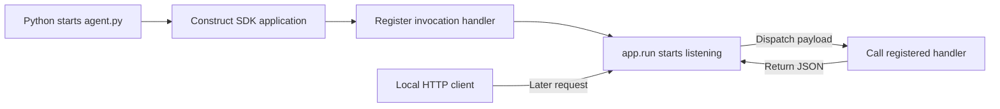
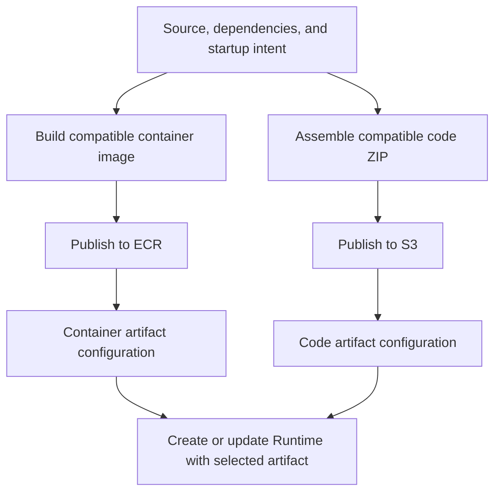
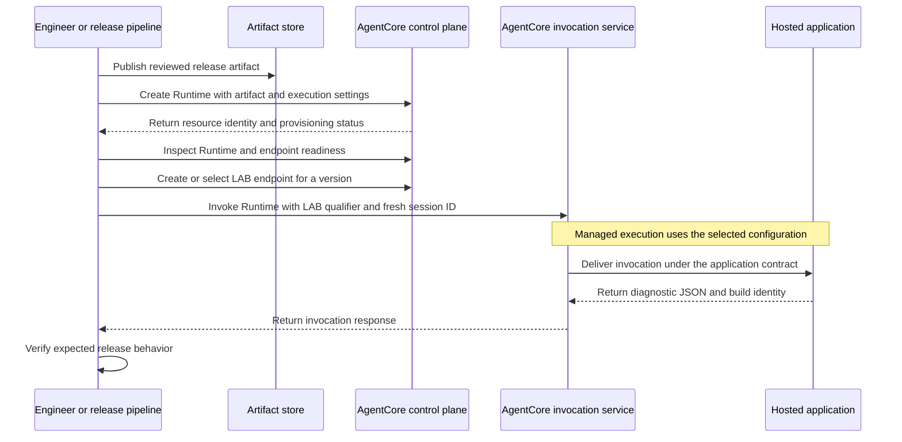

# Phase 2 - Deployment and Provisioning

**AgentCore Runtime Infrastructure Learning Project**  
**Edition:** 4 November 2026.

Phase 1 established the hosting and ownership model. We now give the application a serving contract, package it, and follow the management operations that make a chosen release invocable. The commands are optional learning labs, not a record of a deployment performed for you.

## Reading path

- [Module 4 - How the Managed Service Talks to Our Application](#module-4)
- [Module 5 - Turn a Working Local Server into a Deployable Artifact](#module-5)
- [Module 6 - From an Artifact to a Versioned, Invocable Runtime](#module-6)

These are the complete chapters, not summaries of the individual module files. Read this document or the smaller module files; there is no need to read both copies. Source references are collected at the end.

Start only after you can distinguish a process, an artifact, a Runtime resource, a version, an endpoint, and a session. [Return to Phase 1](Phase_1_Complete.md) when one of those boundaries is unclear.


---

<a id="module-4"></a>

## Module 4 - How the Managed Service Talks to Our Application

**Phase 2: Deployment and provisioning**  
**The question we are answering:** What must our process expose so that AgentCore Runtime can send it work and assess its health?

**Reading context.** Phase 1 gave us the infrastructure map. This chapter returns to the transcript's concrete server demonstration at **23:18-27:48**. The local experiment below is newly authored educational code, not a verbatim reconstruction of code visible only in the video. Current protocol behavior comes from AWS documentation. The exercise does not deploy AWS resources or invoke a model.

<details>
<summary>Module contents</summary>

- [4.1 A hosting environment cannot guess how to call a Python function](#m4-4-1)
- [4.2 Three tools in our workflow have three different jobs](#m4-4-2)
- [4.3 Register the handler, then start the server](#m4-4-3)
- [4.4 A server must listen where the platform expects it](#m4-4-4)
- [4.5 Follow the payload through the invocation boundary](#m4-4-5)
- [4.6 Health reporting is a conversation about lifecycle](#m4-4-6)
- [4.7 A complete response, a stream, and background work are different choices](#m4-4-7)
- [4.8 Other protocols change the interface, not the need for hosting](#m4-4-8)
- [4.9 Diagnose the layer that has actually failed](#m4-4-9)
- [4.10 Build one observable application, without a model dependency](#m4-4-10)

</details>

<a id="m4-4-1"></a>

### 4.1 A hosting environment cannot guess how to call a Python function

We have an application artifact in mind, but imagine handing AWS a file containing an arbitrary function called `answer_order_question`. How would the hosting environment know when to call it, what arguments to supply, or whether the process is ready?

A local Python caller can import the function and call it directly. A managed hosting service needs a stable interface across a process and network boundary. This is why an application server and a service contract are necessary.

The contract describes how Runtime communicates with the hosted application. It is not a description of our refund rules or a requirement that we use a particular agent framework. The service needs a predictable way to deliver work; our code remains responsible for the meaning of that work. [A08]

The transcript's initial static greeting isolates this concern nicely. Before connecting Bedrock, the lecturer proves that a request reaches a handler and a result comes back. **Transcript: 24:05-27:36.** We will preserve that sequence because it prevents model access errors from obscuring a basic hosting mistake.

Think of the application server as the adapter between a network request and ordinary application logic. It can run in the same Python process as the handler. The infrastructure does not require a separate machine merely because our architecture diagram uses a separate box.

<a id="m4-4-2"></a>

### 4.2 Three tools in our workflow have three different jobs

We have already seen Boto3 service clients. Those clients make AWS API calls. They are not automatically a server that accepts incoming Runtime requests.

The AgentCore Python SDK can provide that application-side integration. `BedrockAgentCoreApp` helps expose the expected server behavior around our Python handler. The AgentCore CLI, meanwhile, is a developer/deployment tool. It can generate a project, run local development workflows, and deploy project resources. [A32]

The practical distinction is worth consolidating before we write code:

| Tool or component | Where it participates in our example |
|---|---|
| AgentCore Python application SDK | Inside the application process, exposing the handler through the serving contract |
| Boto3 / AWS SDK | In a client or script that creates, inspects, invokes, or otherwise calls AWS APIs |
| AgentCore CLI | In the development and deployment workflow around the project |
| Managed AgentCore Runtime service | In AWS, hosting and managing execution after cloud deployment |

Running SDK code locally does not instantiate the managed hosting service. Likewise, installing a CLI does not create a cloud resource. These tools reduce work around specific interfaces; they do not collapse every layer into one component.

We will use the SDK for the minimal application and ordinary AWS APIs for the later infrastructure walkthrough. This makes the control-plane objects visible instead of hiding them behind project scaffolding. It is a teaching choice, not a requirement to avoid the CLI.

<a id="m4-4-3"></a>

### 4.3 Register the handler, then start the server

Suppose our handler is a Python function named `invoke`. Python itself has no reason to know that AWS should call that function when an HTTP request arrives. We need to register the association.

The transcript uses the `@app.entrypoint` decorator for this purpose. It associates the function with the application's invocation handling. Calling `app.run()` starts the application server. Defining a function and starting a server are different actions. **Transcript: 24:28-25:20.**

This gives us a local execution sequence. Python imports the module. The code constructs the application object and registers the handler. When the module is run as the program, the main block calls `app.run()`. The process can then wait for incoming requests.

We should also resolve the word *entry point* now. The Python decorator identifies the request handler. A container startup command identifies which process to launch. A direct-code deployment's `entryPoint` identifies how the supplied code should be started. These are related layers, not one interchangeable setting. [A22] [D05]

If a container command starts the wrong file, the correctly decorated handler in another file may never be imported. If a file is imported but the server is never started, the functions may exist without any listening socket. Following the startup sequence is more useful than merely searching the code for the decorator.

The diagram separates startup from handling a later request. Registering the function prepares the dispatch relationship; it does not create AWS resources or start a server by itself.



Our later cloud deployment changes who hosts this process and delivers requests. It does not eliminate the process's need to start and register the handler correctly.

<a id="m4-4-4"></a>

### 4.4 A server must listen where the platform expects it

Starting a server is not sufficient unless the platform can reach its listening address and port. For the normal HTTP path, AWS documents `0.0.0.0` binding and default serving port `8080`. The current documentation also describes configurable serving ports and invocation paths. Our walkthrough deliberately uses the defaults. [A09] [A33]

Why does the address matter? A server bound only to loopback may be reachable from another process in its own network environment but not through the platform's connection to the application. Binding to `0.0.0.0` tells an IPv4 server to listen on the available interfaces in its environment. It is not an authorization policy and does not, by itself, make the application anonymously accessible on the public internet.

There are multiple port contexts during local container testing. The server might listen on container port 8080, while Docker publishes it on port 8080 of the developer machine. That mapping is a local development arrangement. It is not the same thing as selecting a Runtime release endpoint in AWS.

This is also why a Dockerfile's `EXPOSE 8080` line is not the mechanism that starts the server or publishes the port. It documents the port the container intends to use. The actual process must bind it, and the surrounding networking must provide the desired access path. [D05]

In Module 5, our local container command binds the published port to `127.0.0.1` on the developer machine. That avoids casually publishing the demonstration to every host interface while still allowing the application to listen correctly inside its container.

<a id="m4-4-5"></a>

### 4.5 Follow the payload through the invocation boundary

With the server listening, a request needs a destination path and a payload format. The default HTTP contract uses `POST /invocations`; JSON input and JSON or server-sent-event output are documented options. [A09]

For our learning application, we choose this body:

```json
{
  "prompt": "Please check order 10"
}
```

The word `prompt` is part of our example's application schema. Do not treat it as proof that every possible hosted application must accept exactly that key. The hosting contract gets a request to our application; the handler determines which fields its business interface requires.

Now trace the local call. `curl` sends HTTP bytes. The application server receives and parses the body. The registered function obtains the parsed payload. Our function validates that `prompt` is a nonempty string and returns an application result. The server serializes that result back to the caller.

The hosted call adds an outer service boundary. An authorized client calls `InvokeAgentRuntime`, identifying the Runtime and optionally its endpoint qualifier and session. The service delivers the work to the application according to its configured protocol. The cloud API path and the inner application path are different layers even when both contain the word `invocations`. [A20]

This explains why a successful `curl` to `localhost:8080` does not validate cloud authorization. It exercises the inner application contract, not the outer AWS service boundary.

<a id="m4-4-6"></a>

### 4.6 Health reporting is a conversation about lifecycle

The platform also needs to know whether the application is operational. The HTTP contract includes `GET /ping`, with a health response handled automatically when using the SDK's normal server behavior. [A09]

Imagine the application has not finished loading a required local dependency. Claiming readiness before it can handle work can allow a request to arrive too early. The health signal therefore has an operational purpose; it is not merely a decorative endpoint added to satisfy a checklist.

A second situation is subtler. The handler returns an immediate acknowledgement but a background task continues. An open task is not necessarily visible from the existence of a completed HTTP response. AWS supports a busy health state, `HealthyBusy`, so background work can be represented to the Runtime lifecycle machinery. `Healthy` represents the idle/ready state. [A25]

That does not mean we should mark every session busy forever. An incorrect busy signal can prevent expected idle reclamation. The optional `time_of_last_update` field must represent a real status change rather than being advanced on every health request. These are lifecycle semantics, not just JSON spelling. [A25]

Our initial example has no background work and needs no custom health override. That is deliberate. We first observe the ordinary serving contract, then introduce more complex execution when there is an actual task that needs it.

Also avoid making a health check unnecessarily depend on every optional downstream service. A minimal healthy server is not proof that an external order API will always succeed. What the health signal should represent must be designed at the correct responsibility boundary.

<a id="m4-4-7"></a>

### 4.7 A complete response, a stream, and background work are different choices

Our first handler computes a small reply and returns it as one result. The caller waits for that result, and the HTTP interaction completes. This is the simplest path to reason about.

For a longer interaction, the application may emit results incrementally. Server-sent events, or SSE, let the server send a sequence of events over a response stream. A streaming response does not require the client to wait until the entire result exists before receiving any content. The HTTP contract supports this output style. [A09]

Streaming changes delivery, not the identity of the components performing the work. The application still produces events. The client still has to interpret them. A partial event is not necessarily evidence that the entire requested operation has succeeded.

Background execution is another distinction. It means work can continue beyond the immediate response pattern. That introduces lifecycle, cancellation, and progress-retrieval questions. We should not assume a generator, an asynchronous Python function, and a durable background job are three interchangeable names for the same mechanism.

For this phase, use a complete JSON response. In Phase 3, we can extend the same application to investigate long-running work without confusing the experiment with an unrelated change in packaging or authentication.

<a id="m4-4-8"></a>

### 4.8 Other protocols change the interface, not the need for hosting

The current service contract also describes MCP, A2A, and AG-UI. They support different interaction styles: tool-oriented protocol messages, agent-to-agent communication, and interactive agent/user-interface event flows respectively. [A08]

Their presence does not require us to implement all of them in one application. Our support diagnostic has a direct HTTP interface because that is enough to reveal the hosting mechanism.

The important infrastructure question is whether the application's server behavior matches the protocol configuration supplied when the Runtime is created. Selecting a protocol in configuration does not automatically rewrite a server that speaks something else.

For example, an MCP server can be hosted on Runtime; Runtime is not therefore identical to AgentCore Gateway. Hosting a protocol server and aggregating access to external tools are distinct responsibilities. We will study their interaction only when tools become relevant to the execution model.

Similarly, the existence of a current configurable serving port should not lead us to guess new API fields in an old installed SDK. The main lab uses stable defaults. Advanced protocol customization should be checked against the selected Region, service API, and tool versions before use. [A33]

<a id="m4-4-9"></a>

### 4.9 Diagnose the layer that has actually failed

Before running the example, predict several failures.

If Python cannot import a required package, the process may exit before opening its server socket. An incoming request then cannot reach the handler. Changing the prompt is not a fix because no application logic has examined it.

If the server starts on a different port, it may be healthy from a manual local check while failing the platform's expected connection path. The relevant evidence is the configured port and actual bind behavior, not the presence of a successful package installation.

If `/ping` responds but the invocation handler rejects the input, we have reached the server but supplied an unsupported application request. That is a different result from failing to establish a connection.

Finally, if the handler later calls Bedrock and receives an authorization error, the earlier server and packaging checks may still be correct. We should investigate the outbound operation and execution permissions rather than reflexively rebuilding the image. AWS's troubleshooting guidance similarly separates startup, permission, and invocation issues. [A26]

A useful diagnostic record therefore states the last boundary known to have succeeded. "The agent is broken" is much less helpful than "The application returns a local greeting, but the cloud invocation is denied before the handler logs a request."

<a id="m4-4-10"></a>

### 4.10 Build one observable application, without a model dependency

We now have a reason for every part of the code. We need a server integration, a registered handler, a small validated payload, a diagnostic build label, and a startup call.

**New educational example.** The following file is intentionally a hosting probe, not an order lookup agent. It returns the received request and a build identifier. It does not claim to fetch order data. Use a disposable development directory and Python 3.13 for consistency with the packaging examples in Module 5; install Python through your normal approved tooling first.

```bash
mkdir agentcore_runtime_lab
cd agentcore_runtime_lab
python3.13 -m venv .venv
. .venv/bin/activate
python -m pip install bedrock-agentcore
```

This installs the application SDK in a local environment. The initial installation resolves an available package version; Module 5 records the resolved dependencies before building a release. It does not install the separate AgentCore CLI or create AWS resources. [A32]

Save the following as `agent.py`:

```python
import logging
import os
import uuid
from typing import Any

from bedrock_agentcore.runtime import BedrockAgentCoreApp

logging.basicConfig(level=logging.INFO)
logger = logging.getLogger(__name__)

# Static deployment configuration, not a customer or session identifier.
BUILD_ID = os.environ.get("BUILD_ID", "phase2-v1")
app = BedrockAgentCoreApp()


@app.entrypoint
def invoke(payload: dict[str, Any]) -> dict[str, Any]:
    if not isinstance(payload, dict):
        return {"ok": False, "error": "Expected a JSON object."}

    prompt = payload.get("prompt")
    if not isinstance(prompt, str) or not prompt.strip():
        return {"ok": False, "error": "prompt must be a nonempty string."}

    # Generate this per request, not once during application startup.
    request_id = str(uuid.uuid4())
    logger.info("handled request_id=%s build_id=%s", request_id, BUILD_ID)

    return {
        "ok": True,
        "request_id": request_id,
        "build_id": BUILD_ID,
        "received": prompt,
        "message": "The hosting probe received your request; no model was called.",
    }


if __name__ == "__main__":
    app.run()
```

There is no transcript claim that this exact program was demonstrated. It uses the same server-and-entry-point pattern to create a more observable infrastructure experiment.

The build label identifies the application release in our test. The request identifier is created inside the handler so different requests do not deliberately reuse one startup-generated value. This placement also avoids a snapshot-related initialization mistake discussed in Module 6. The logs contain identifiers rather than the full prompt.

The validation errors in this teaching example are **application-level JSON results**, not a demonstration of production HTTP error-status mapping. A production API should deliberately choose its validation and transport error behavior. Do not assume that returning `{"ok": false}` makes the HTTP status a client error.

Start the process in one terminal:

```bash
python agent.py
```

Use a separate terminal on the same development machine to send the request:

```bash
curl -i http://localhost:8080/ping
curl -i http://localhost:8080/invocations \
  -H 'Content-Type: application/json' \
  -d '{"prompt":"Please check order 10"}'
```

The expected successful invocation contains `ok: true`, the `phase2-v1` build label, a newly generated request identifier, and the supplied prompt. The statement about not calling a model is intentional. It tells us exactly what the test is measuring.

Next, send an empty prompt. We expect the application's validation response, not a meaningful order answer:

```bash
curl -i http://localhost:8080/invocations \
  -H 'Content-Type: application/json' \
  -d '{"prompt":""}'
```

Stop the local server with `Ctrl+C` before starting another process on the same port. Run this on an appropriately restricted development host: the SDK's listening behavior is intended for hosting integration, and a local development server is not automatically a hardened public service.

#### What this experiment proves

If the valid request succeeds, we have exercised Python startup, dependency import, server binding, payload parsing, handler registration, and response serialization in the local environment. We have not exercised the AWS control plane, cloud execution-role assumption, cloud networking, version routing, or session isolation.

This is not a weakness of the experiment. A good experiment has a bounded claim. The next experiment should add the artifact and deployment boundary, not silently reinterpret a local result as a production success.

### Connect this back to the infrastructure model

The managed service needs a contract because it cannot infer arbitrary application behavior. The SDK can implement that contract around our handler, but the process must still start, listen, report health, and respond correctly. A working local server gives us a known starting point for packaging.

Module 5 therefore begins with a new question: **How do we preserve this working application and its dependencies in an artifact that the cloud execution environment can actually run?**

### Pause and reason

1. The local handler works, but no `CreateAgentRuntime` operation has been performed. Is an AWS Runtime resource implied?
2. What is the difference between a handler decorator and a container startup command?
3. Why can `GET /ping` succeed while a particular order lookup fails?
4. Why does returning an error-shaped JSON object not, by itself, demonstrate correct HTTP error-status handling?

<details>
<summary>Reasoning guide</summary>

Local serving validates the application contract only. A decorator registers a request-handling function; a startup command launches the process that must import that registration and start the server. Health and business dependency success are different concerns. HTTP transport status and the schema of an application response are separate layers that must be designed explicitly.

</details>

---

<a id="module-5"></a>

## Module 5 - Turn a Working Local Server into a Deployable Artifact

**Phase 2: Deployment and provisioning**  
**The question we are answering:** What must travel from the developer environment to AWS, and how do we know that package can run there?

**Reading context.** Module 4 produced a small hosting probe with no model dependency. The transcript supplies the local-development context at **19:54-27:48**, but does not demonstrate the complete artifact pipeline taught here. Container builds, current CLI structure, direct-code packaging, and patching responsibilities are **verified supplementation**. Commands are learning examples; no cloud publishing or deployment was performed while producing these notes.

<details>
<summary>Module contents</summary>

- [5.1 Decide what has to travel with the application](#m5-5-1)
- [5.2 A Dockerfile is a recipe for the application filesystem and startup](#m5-5-2)
- [5.3 A compatible language is not the same as a compatible binary](#m5-5-3)
- [5.4 Test the built image before publishing it](#m5-5-4)
- [5.5 Direct code deployment removes the Dockerfile, not the packaging problem](#m5-5-5)
- [5.6 Choose between the two paths using ownership, not fashion](#m5-5-6)
- [5.7 Startup is where the artifact becomes live execution](#m5-5-7)
- [5.8 Configuration and secrets should not become accidental image content](#m5-5-8)
- [5.9 Understand the CLI without confusing its generations or ownership model](#m5-5-9)
- [5.10 A release is ready for provisioning when its evidence is coherent](#m5-5-10)

</details>

<a id="m5-5-1"></a>

### 5.1 Decide what has to travel with the application

Our local server runs because several things happen to be present together: the Python interpreter, installed packages, the `agent.py` file, and a compatible operating environment. Copying only `agent.py` to another machine does not preserve that arrangement.

We need to turn the working application into a deliberate release artifact. This changes the question from "Can my laptop run it?" to "Have we supplied everything the target environment needs, in a form that the target understands?"

Start by separating three kinds of input. Source code describes behavior. Dependencies supply imported libraries. Configuration chooses environment-specific settings. Some configuration can be ordinary release metadata, such as our diagnostic `BUILD_ID`. Credentials and sensitive values need separate handling; they should not be casually baked into a distributable artifact.

There are two main packaging paths relevant to our microVM walkthrough. We can supply a container image, or package source and dependencies for direct code deployment. The latter uses a ZIP archive and a supported managed language environment. Both still need to satisfy the application serving contract. [A10]

We will teach the container path first because it makes the packaging boundary particularly visible. Then we will compare the direct-code path. These are alternatives, not consecutive deployment steps that every agent must perform.

<a id="m5-5-2"></a>

### 5.2 A Dockerfile is a recipe for the application filesystem and startup

We learned in Phase 1 that an image is not a running process. A Dockerfile describes how to build that image and what startup configuration it should carry.

For our small application, we need a Python base environment, dependency installation, a copy of the source file, and a command that starts the server. Each line should answer a requirement already established; we do not need to add unrelated services to make the image look production-ready.

In the clean virtual environment created in Module 4, record the resolved package versions:

```bash
python -m pip freeze > requirements.lock.txt
```

This is a **learning snapshot of resolved versions**, not a universal, hash-verified cross-platform lock format. In a production pipeline, use your approved dependency-locking process and validate the result on the target platform. A list resolved on one operating system can contain platform-specific dependencies or omit another platform's conditional requirements.

The following `Dockerfile` is a newly authored minimal example for `agent.py`:

```dockerfile
FROM python:3.13-slim

ENV PYTHONUNBUFFERED=1 \
    PYTHONDONTWRITEBYTECODE=1

WORKDIR /app
COPY requirements.lock.txt /app/requirements.lock.txt
RUN python -m pip install --no-cache-dir -r /app/requirements.lock.txt

COPY agent.py /app/agent.py

USER 10001:10001
EXPOSE 8080
CMD ["python", "/app/agent.py"]
```

`FROM` selects the user-space starting point. `COPY` supplies files to the image. `RUN` executes build-time installation. `CMD` describes the command to run when the resulting container starts. These are different stages; a successful `RUN pip install` does not demonstrate that `CMD` can serve a request. [D05]

The numeric non-root user is appropriate for this simple file-reading application, which does not need privileged operations. It is not a blanket claim that every agent or storage configuration will work with the same user. Any feature needing writable paths must be designed and tested with the actual permissions it requires.

The base-image tag in this teaching example can change over time. For a controlled release, record and use an approved immutable base-image reference as part of your build policy. Do not invent a digest merely to make an example look reproducible.

Add a `.dockerignore` file so ordinary development material is not sent as build context:

```text
.venv/
.git/
__pycache__/
.env
.env.*
*.pem
*.key
build/
*.zip
```

This is not a complete secret-detection system. It is one practical boundary that reduces accidental inclusion. The application release should be reviewed as an artifact, not assumed safe because it originated in a familiar directory.

<a id="m5-5-3"></a>

### 5.3 A compatible language is not the same as a compatible binary

Our code is Python, so it is tempting to assume the same package can run everywhere. That is only partly true. Python dependencies can include native machine code, and the interpreter itself must execute on the target operating system and CPU architecture.

The main microVM container path requires Linux ARM64 compatibility. The current Instances path has different supported architecture choices, so do not turn this scoped requirement into a universal rule for every AgentCore compute type. [A09] [A05]

Consider a developer using an Intel Mac. A package installed locally might include a macOS binary for x86-64. It is not made into a Linux ARM64 binary merely by compressing the directory or renaming the file.

This is why we specify a target platform during image construction. Docker's multi-platform build facilities can use appropriate builders or emulation, depending on the development environment. Emulation can be useful, but it does not prove production performance on native hardware. [D04]

For our example, build one ARM64 image and load it into the local image store:

```bash
docker buildx build \
  --platform linux/arm64 \
  --tag support-agent:phase2-v1 \
  --load .
```

The `--load` option is used here for a single-platform local image result. The build can fail if the builder lacks the required platform support or a dependency lacks a compatible distribution. That failure is valuable evidence; do not hide it by silently switching to an incompatible target. [D06]

Inspect the result before running it:

```bash
docker image inspect support-agent:phase2-v1 \
  --format '{{.Os}}/{{.Architecture}}'
```

The expected platform for this path is `linux/arm64`. That inspection checks image metadata. We still need to execute the image because metadata alone cannot prove that the startup command and packages work together.

<a id="m5-5-4"></a>

### 5.4 Test the built image before publishing it

Stop the Module 4 process first so port 8080 is free. Now run the packaged application instead of the source directly:

```bash
docker run --rm \
  --name agentcore-hosting-probe \
  --platform linux/arm64 \
  --publish 127.0.0.1:8080:8080 \
  --env BUILD_ID=phase2-v1 \
  support-agent:phase2-v1
```

This command starts the application from the image we just built. The host-side published address is loopback, while the server inside the container uses its serving contract. The environment variable is non-sensitive release metadata for our own example; it is not an instruction to alter any existing platform deployment or secret convention.

Send the same `/ping` and `/invocations` requests from Module 4. Keeping the request constant is important. We want to investigate the change from a local Python environment to a packaged execution environment, not change the business input at the same time.

If the source-based server worked but the container fails, focus on what changed: included files, dependency installation, target architecture, startup command, permissions, and port mapping. A consistent test payload makes that comparison easier.

A successful result now proves more than the earlier test. It demonstrates that this image can start and serve the probe in the local container environment. It still does not prove ECR access, cloud role assumption, cloud network behavior, or AgentCore endpoint readiness.

This is the pattern of the entire course: each experiment expands the validated boundary, and we state what remains outside it.

#### Publish only after the image works

To make the artifact available for Runtime, the container path uses an image repository such as Amazon ECR. AWS documents authenticating the Docker client, tagging the image with the repository URI, and pushing it. The build/publishing identity needs the appropriate repository access. [A30]

The following commands **publish an artifact when executed**. Use an approved non-production account and an existing repository you are authorized to use. Set the variables deliberately; this example does not create a repository or choose an account for you.

```bash
: "${AWS_REGION:?Set the approved lab Region}"
: "${ACCOUNT_ID:?Set the approved AWS account ID}"
: "${ECR_REPOSITORY:?Set an existing approved repository name}"
: "${RELEASE_TAG:?Set a new release tag, not latest}"

REGISTRY="${ACCOUNT_ID}.dkr.ecr.${AWS_REGION}.amazonaws.com"
IMAGE_URI="${REGISTRY}/${ECR_REPOSITORY}:${RELEASE_TAG}"

aws ecr get-login-password --region "$AWS_REGION" \
  | docker login --username AWS --password-stdin "$REGISTRY"

docker tag support-agent:phase2-v1 "$IMAGE_URI"
docker push "$IMAGE_URI"
```

The result is an image available in the intended registry. It is not an AgentCore deployment. The next module will explicitly reference the image when creating the Runtime.

Avoid treating `latest` as a stable release identity. ECR supports tag-immutability controls that can prevent overwriting protected tags. A recorded digest or a controlled immutable release tag helps tie deployment configuration to the intended artifact. Preserve the artifact required for rollback rather than deleting it immediately after publication. [A31]

<a id="m5-5-5"></a>

### 5.5 Direct code deployment removes the Dockerfile, not the packaging problem

The alternative path is useful when we prefer to supply code and dependencies rather than maintain the whole container user-space image. With direct code deployment, we place a compatible package in a ZIP archive, store it in S3, and describe the language runtime and entry point in Runtime configuration. [A11] [A22]

The same questions still apply. Is the entry file present? Are its imports available? Are native packages compatible with Linux ARM64 for our chosen compute path? Does the application actually start the required server?

The archive should have the intended files at the expected root. For our example, it is conceptually:

```text
deployment_package.zip
  agent.py
  bedrock_agentcore/
  ...installed dependencies and package metadata...
```

Do not zip the entire virtual environment and assume it is a portable cloud runtime. A local virtual environment may include operating-system-specific binaries, interpreter references, and paths that make sense only on the developer machine.

Here is a **local packaging example** for a Python 3.13, Linux ARM64 dependency target. Run it from the directory containing `agent.py` and the reviewed dependency-version file. It creates a fresh temporary assembly directory to avoid mixing old and new package contents.

```bash
(
set -eu
OUTPUT_DIR="$(pwd)"
BUILD_DIR="$(mktemp -d)"
trap 'rm -rf "$BUILD_DIR"' EXIT

python -m pip install \
  --platform manylinux2014_aarch64 \
  --implementation cp \
  --python-version 3.13 \
  --only-binary=:all: \
  --target "$BUILD_DIR" \
  -r requirements.lock.txt

cp agent.py "$BUILD_DIR/agent.py"

# Use a new output filename for each learning build.
: "${RELEASE_TAG:?Set a new release tag}"
ZIP_PATH="$OUTPUT_DIR/deployment_package_${RELEASE_TAG}.zip"
if [ -e "$ZIP_PATH" ]; then
  printf 'Refusing to merge into existing archive: %s\n' "$ZIP_PATH" >&2
  exit 1
fi

(cd "$BUILD_DIR" && zip -r "$ZIP_PATH" .)
zipinfo -1 "$ZIP_PATH" > "$OUTPUT_DIR/archive_contents_${RELEASE_TAG}.txt"
head -n 20 "$OUTPUT_DIR/archive_contents_${RELEASE_TAG}.txt"
)
```

AWS's packaging guidance explains the need for target-compatible dependencies and highlights failures caused by wrong architecture or archive structure. The command above intentionally requires binary distributions; when no compatible wheel is available, build the dependency in an appropriate target environment rather than accepting a binary for the wrong platform. [A11] [A37]

This recipe is a starting point for a reviewed build, not proof that every package supports the selected wheel platform. Verify the package's actual compatibility and use an approved target build environment for dependencies that need one.

The configuration for the resulting artifact has a different shape from the container path. This **illustrative fragment** belongs inside the later create/update request; it is not a complete deployment request:

```json
{
  "codeConfiguration": {
    "code": {
      "s3": {
        "bucket": "REPLACE_WITH_APPROVED_ARTIFACT_BUCKET",
        "prefix": "support-agent/REPLACE_WITH_RELEASE/deployment_package.zip"
      }
    },
    "runtime": "PYTHON_3_13",
    "entryPoint": ["agent.py"]
  }
}
```

The field named `prefix` in this configuration identifies the object location used for the archive; do not assume it means the service should discover and assemble every object under a directory-like prefix. The entry point must match the packaged file and its startup behavior. [A11]

No archive has been uploaded by these notes. Uploading it is a separate, authorized artifact-publication step, and the execution role must be able to read the intended object. Use a release-specific object key and retain the corresponding release evidence.

<a id="m5-5-6"></a>

### 5.6 Choose between the two paths using ownership, not fashion

Now that we understand both mechanisms, compare what changes.

| Concern | Container image path | Direct code path |
|---|---|---|
| What we supply | User-space image with code, dependencies, and startup configuration | Code/dependency ZIP and a selected managed language runtime |
| Primary artifact location in our example | ECR repository | S3 object |
| Application server requirement | Must satisfy the selected serving contract | Must satisfy the same selected serving contract |
| Main packaging focus | Image contents, architecture, base image, command | Archive structure, dependency compatibility, entry point |
| Language-runtime patching | Customer rebuilds and redeploys the relevant image contents | AWS patches the managed language runtime; customer maintains code and dependencies |

The patching distinction is explicitly documented by AWS. Container deployment does not transfer responsibility for stale user-space packages to the service merely because the underlying compute is managed. Direct code deployment similarly does not make application dependencies self-maintaining. [A10]

An existing platform with a mature image pipeline may value the container path. A smaller application that fits a managed language environment may prefer direct code. Those are architecture choices based on requirements, not a maturity ranking in which ZIP always means prototype and container always means production.

Both routes ultimately feed the same learning question in Module 6: which artifact and configuration does the Runtime resource reference?

This diagram shows the two packaging branches converging on one provisioning question. Follow one branch for a particular artifact; the picture is not a requirement to publish both forms.



Both branches still need the execution settings and permissions developed in the next module. Changing the package format does not make those responsibilities disappear.

<a id="m5-5-7"></a>

### 5.7 Startup is where the artifact becomes live execution

Publication leaves us with stored bytes. Startup turns the intended software into a running server.

For the container example, the configured command starts Python, Python imports dependencies and our module, the application object is created, and `app.run()` opens the serving interface. For direct code, the service's selected language environment starts the supplied entry point, which must lead to equivalent serving behavior.

This sequence identifies where different failures can occur. A missing source file prevents execution. An import error stops initialization. A wrong command can launch a process that never exposes the contract. A port mismatch leaves a running process unreachable through the expected serving path.

We should also distinguish configuration history from how AWS starts compute. Current Runtime platform version V2 uses a snapshot-based startup approach, unlike a simplistic assumption that every new environment repeats every initialization step. We will explain the release/platform-version distinction in Module 6. [A03]

For now, the useful rule is that initialization should be deliberate. Load stable application configuration where appropriate, but do not assume values that must be fresh for every request should be generated once at startup. Our request identifier was deliberately created in the handler.

<a id="m5-5-8"></a>

### 5.8 Configuration and secrets should not become accidental image content

The same code may run in several environments. We therefore need a way to vary approved configuration without manually editing a source file for every deployment.

Ordinary configuration can include a release label or an approved service endpoint. Secret material includes credentials and tokens. Treating both categories as "just environment variables" obscures their different handling requirements.

A container build can accidentally capture files copied from the developer directory. It can also retain sensitive data in an earlier layer even if a later build step removes it from the final visible directory. The practical defense is to keep credentials out of the build inputs and use a deliberate runtime credential/secret mechanism rather than trying to erase mistakes afterward. Image layers explain why a final directory listing is not the whole artifact history. [D03]

For AWS operations, the Runtime execution role is the starting identity mechanism in our model. External credentials and per-user token flows require additional decisions and are covered in the security phase. This initial hosting probe has no reason to carry a model-provider key or an order-system secret. [A06]

Configuration is also part of release evidence. If an application artifact is unchanged but a network mode or role changes, the behavior of the deployed workload can still change. We should record the complete desired deployment configuration rather than equate a release only with a Git commit.

<a id="m5-5-9"></a>

### 5.9 Understand the CLI without confusing its generations or ownership model

The transcript demonstrates `agentcore create`, a local development server, and local invocation, while describing a central project configuration file. **Transcript: 19:54-27:36.** That supports the conceptual sequence of scaffolding, configuring, starting, and invoking the application.

Current AWS guidance documents the newer AgentCore CLI, installed as `@aws/agentcore`, and a project structure containing `agentcore/agentcore.json` and an infrastructure project. It is not safe to assume that every file layout and command flag from the recorded demonstration matches the current tool. [A11] [A32]

When using the CLI, inspect the installed command surface rather than copying an old flag blindly:

```bash
agentcore --help
agentcore create --help
agentcore dev --help
agentcore deploy --help
```

These commands assume the CLI has been installed through your approved tooling. Installing the Python application SDK alone does not install the newer CLI.

Current deployment guidance also explains that the CLI uses CDK and CloudFormation. That can create supporting infrastructure, not just upload a file. Review the generated resources and deployment role permissions before executing deployment in a shared account. [A06]

This is particularly important for the future Terraform workspace model. We should not let two independent deployment systems believe they own the same resource without an explicit ownership/import strategy. For our learning walkthrough, direct AWS API examples expose the resource contract; choosing a long-term state owner is a separate platform decision.

The CLI is a useful convenience. Understanding what it automates is the infrastructure lesson.

<a id="m5-5-10"></a>

### 5.10 A release is ready for provisioning when its evidence is coherent

We began with a local server whose dependencies were implicit. We now have a process for making those dependencies and startup expectations explicit.

Before moving to Module 6, inspect the evidence as one connected chain. The source file exists. The dependency set is recorded and compatible with the target. The application starts from the actual packaged artifact. Its health and invocation paths work locally. The published artifact can be identified without relying on an ambiguous moving tag or an overwritten archive.

A compact release record for the learning project should contain:

- The source revision, dependency record, and target platform.
- The exact published image reference or S3 object location.
- The local startup and invocation result, with its scope clearly stated.
- The intended execution role, network choice, protocol, and build label for provisioning.

This record does not guarantee that the cloud deployment will work. It makes cloud failures more interpretable because we know what was tested before crossing the cloud boundary.

The final distinction to retain is simple: **building creates an artifact; publishing makes the artifact available; provisioning creates a Runtime configuration that references it; invoking exercises the deployed execution path.** These stages cooperate, but none should be mistaken for all the others.

### Pause and reason

1. Why can a ZIP containing a working Mac virtual environment fail in the cloud even though all the Python filenames are present?
2. What does a successful `docker push` prove about Runtime readiness?
3. Why can an immutable Runtime configuration still depend on external release discipline, such as stable artifact references and retained image contents?
4. Which patching responsibility remains with the team when it supplies a container image?

<details>
<summary>Reasoning guide</summary>

Operating-system and CPU compatibility matter for native code and interpreter paths. Pushing proves publication to the registry, not application deployment or readiness. Configuration immutability is not a substitute for controlling referenced external artifacts. With containers, the team must maintain and redeploy user-space image contents and application dependencies; managed underlying compute does not patch the image the team built.

</details>

---

<a id="module-6"></a>

## Module 6 - From an Artifact to a Versioned, Invocable Runtime

**Phase 2: Deployment and provisioning**  
**The question we are answering:** How does a package become managed infrastructure, and how do we change that infrastructure without confusing release selection with live execution?

**Reading context.** Module 5 left us with a tested artifact and an explicit release identity. This module completes the deployment model. The uploaded transcript mainly demonstrates local execution; the control-plane operations, release mechanics, and verification steps below are **verified AWS supplementation**, not a reconstruction of an unseen cloud deployment in the video.

**Lab boundary.** The commands are optional, operator-run examples for an approved disposable account and Region. Creating resources, publishing artifacts, invoking managed compute, and retaining logs can incur charges. No AWS deployment or invocation was performed while writing these notes. A reader without approved credentials can follow the entire conceptual explanation without executing a command.

<details>
<summary>Module contents</summary>

- [6.1 An artifact is ready, but no hosting resource is implied](#m6-6-1)
- [6.2 Translate each design decision into a configuration field](#m6-6-2)
- [6.3 Submission, provisioning, and application verification are different milestones](#m6-6-3)
- [6.4 A Runtime configuration version records a release decision](#m6-6-4)
- [6.5 The DEFAULT endpoint is convenient, but it follows updates](#m6-6-5)
- [6.6 Select a version explicitly, then make one observable invocation](#m6-6-6)
- [6.7 Three version numbers can change for three different reasons](#m6-6-7)
- [6.8 An update should express the intended new configuration](#m6-6-8)
- [6.9 Promotion and rollback move release references, not business history](#m6-6-9)
- [6.10 Cleanup should follow ownership rather than visual disappearance](#m6-6-10)

</details>

<a id="m6-6-1"></a>

### 6.1 An artifact is ready, but no hosting resource is implied

At the end of Module 5, our image could run the hosting probe. We might also have published it to ECR. That establishes that a package exists somewhere AWS can potentially retrieve it. It does not establish that AgentCore knows which package to use, what permissions to give its application, or which execution settings we intend.

We need a management operation that binds those decisions into a Runtime resource. `CreateAgentRuntime` is that operation. Its artifact field selects one packaging form; its role identifies the execution permissions. Other configuration describes the hosting behavior. This is a control-plane action, not a customer asking the support agent a question. [A13]

Before calling it, collect the evidence produced by the earlier modules: the exact artifact reference, the approved account and Region, a reviewed execution role, and the intended protocol and network mode. These are not values to discover by repeatedly submitting a failing create request. They are inputs to the infrastructure design.

There are three permission questions, not one. The deployment identity needs permission to manage the Runtime and, where required, pass the selected role. The role's trust policy must allow the service to assume it under the intended conditions. The role's permission policies must allow the operations the hosted environment actually needs. Permission to pass a role does not grant the deployer all of that role's permissions, and an execution role does not automatically authorize an arbitrary external caller. [A06] [A29]

For our probe, do not add model, Memory, or Gateway access merely because the eventual application will use them. The probe has no such calls. Artifact access and operational permissions still need to be reviewed against the deployment path. Keeping the application small makes a failing infrastructure boundary easier to locate.

<a id="m6-6-2"></a>

### 6.2 Translate each design decision into a configuration field

Our main path remains a **container-backed microVM Runtime using the HTTP contract**. We will not combine direct-code configuration and container configuration into the same artifact object. The API defines that object as a union: select the member corresponding to the chosen deployment path. [A13] [A22]

The following is a complete illustrative create-input document. Save it as `runtime-create.json` only when preparing the optional lab. The account number, Region, repository, release tag, and role are synthetic placeholders that must all be replaced with approved values.

```json
{
  "agentRuntimeName": "support_agent_lab",
  "agentRuntimeArtifact": {
    "containerConfiguration": {
      "containerUri": "111122223333.dkr.ecr.us-west-2.amazonaws.com/support-agent:REPLACE_WITH_RELEASE"
    }
  },
  "roleArn": "arn:aws:iam::111122223333:role/REPLACE_WITH_APPROVED_RUNTIME_ROLE",
  "networkConfiguration": {
    "networkMode": "PUBLIC"
  },
  "protocolConfiguration": {
    "serverProtocol": "HTTP"
  },
  "platformVersion": "V1",
  "environmentVariables": {
    "BUILD_ID": "phase2-v1"
  }
}
```

The image reference answers which packaged application we intend to execute. The role answers under which AWS execution permissions the service can operate. The protocol matches the application server we tested. `BUILD_ID` gives our response a simple release marker. The example explicitly selects platform `V1` so that the first deployment discussion does not also require snapshot-initialization reasoning; that is a teaching choice, not a general recommendation against V2. [A03]

`PUBLIC` is an intentional simplification for a non-sensitive, approved lab, not a recommendation for your enterprise workloads. Runtime network mode and inbound authorization are different settings. Public network mode does not mean anonymous invocation. In the absence of an alternative authorizer configuration, the documented default inbound path uses IAM authentication. Private-resource access and enterprise egress requirements may instead require a reviewed VPC configuration. Do not substitute arbitrary subnet or security-group IDs to make a sample command run. [A23] [A38]

We also have not enabled durable filesystem storage or changed lifecycle settings. Those are separate decisions, not hidden consequences of creating a support-agent resource. Their absence should be visible in our design record. Phase 3 will examine lifecycle behavior; Phase 4 will examine storage and connectivity in depth.

The direct-code path from Module 5 changes the artifact member to `codeConfiguration` and supplies its supported language environment and startup entry point. It does not remove the need to decide the role, protocol, network behavior, or ownership. An easier packaging route is not an exemption from infrastructure design. [A10] [A22]

<a id="m6-6-3"></a>

### 6.3 Submission, provisioning, and application verification are different milestones

Use an AWS CLI or SDK release whose AgentCore service model supports the selected configuration fields. An unknown-parameter error can indicate an older local client rather than rejection by the live service. Compare the installed command help with the current API schema; do not remove a deliberate configuration choice simply to bypass a client-version mismatch. [A13]

After replacing every placeholder and reviewing the account, an operator can submit the illustrative configuration:

```bash
: "${AWS_REGION:?Set the approved lab Region}"
aws sts get-caller-identity

aws bedrock-agentcore-control create-agent-runtime \
  --region "$AWS_REGION" \
  --cli-input-json file://runtime-create.json \
  > runtime-create-result.json
```

Inspect the returned JSON and preserve the returned `agentRuntimeId`, `agentRuntimeArn`, and `agentRuntimeVersion`. Do not construct these identifiers by guessing the service's suffix. The command writes a local result file; it is not a persistent desired-state management system.

A successful create submission is asynchronous. The resource can still be provisioning, or subsequently enter a failed state. Treat the create response as acknowledgement of a management request, not proof that a user request has passed through your application. [A13] [A14]

Set `RUNTIME_ID` to the returned identifier, then inspect the resource:

```bash
: "${RUNTIME_ID:?Set the ID returned by CreateAgentRuntime}"
aws bedrock-agentcore-control get-agent-runtime \
  --region "$AWS_REGION" \
  --agent-runtime-id "$RUNTIME_ID" \
  --query '{id:agentRuntimeId,version:agentRuntimeVersion,status:status,failure:failureReason}'
```

While provisioning is in progress, inspect again after a reasonable interval. In actual automation, use a bounded polling loop with a deadline, failure-state handling, and backoff rather than an unbounded loop. A provisioning failure is a reason to inspect the reported cause and configuration, not to create many similarly named resources until one succeeds.

Next, inspect the endpoint that will receive the invocation. A usable Runtime configuration, a ready endpoint, and a successful application response are related but separate observations. We will use the `DEFAULT` endpoint first, then create a deliberately selected test endpoint.

```bash
aws bedrock-agentcore-control get-agent-runtime-endpoint \
  --region "$AWS_REGION" \
  --agent-runtime-id "$RUNTIME_ID" \
  --endpoint-name DEFAULT \
  --query '{status:status,live:liveVersion,target:targetVersion,failure:failureReason}'
```

The endpoint API exposes both the currently deployed version and the intended target. During a change, a desired target is not sufficient evidence that the transition has completed. Check status and observed version before claiming success. [A17]

Notice the debugging discipline we are building. A failure before resource creation points toward management permissions or request validation. A later failure can involve artifact access or serving behavior. A ready endpoint followed by an invocation error requires investigation of the invocation boundary and application execution. We should locate the failing step before changing an unrelated layer. [A26]

<a id="m6-6-4"></a>

### 6.4 A Runtime configuration version records a release decision

Suppose the first deployment succeeds. We now have the initial Runtime version. AWS creates a new, immutable configuration version when the Runtime is updated. That version records the intended execution configuration rather than simply renaming the old one. [A07]

Why is this necessary? Imagine changing the image, role, network mode, and application configuration in place with no retained release identity. When a request fails, it becomes difficult to say which arrangement was intended. A version gives us a reference point for reasoning about the release.

However, a configuration record is not a magical freeze of every external dependency. An image tag can be mutable unless its repository policy prevents replacement. A role ARN still refers to a role whose policies can be changed separately. A database and external API can also change. Release reproducibility therefore requires disciplined artifact references and dependency ownership, not just a Runtime version number. ECR tag immutability can help prevent a release tag being silently overwritten. [A31]

For the teaching example, record a small release ledger: Runtime ID, returned configuration version, ECR release reference, image digest observed at publication, `BUILD_ID`, and relevant configuration decisions. This ledger is a proposed learning practice, not a claim that AgentCore creates that exact record for us.

The important model is that configuration versions identify what we intended to deploy, while verification establishes what we observed. Both are needed to make a deployment claim meaningful.

<a id="m6-6-5"></a>

### 6.5 The DEFAULT endpoint is convenient, but it follows updates

We have a versioned Runtime. Now a client needs a stable way to select a release without learning a new address for every build. That is the role of a Runtime endpoint: it references a configuration version.

The automatically created `DEFAULT` endpoint follows the latest Runtime version as updates occur. A custom endpoint can instead remain associated with an explicitly chosen version until it is updated. [A07]

Consider our release sequence. Version `1` contains the probe with `BUILD_ID=phase2-v1`. We later create version `2` with a different build marker. A client that continues invoking `DEFAULT` is not necessarily asking for the original release. The label stayed the same while its version association changed.

This is a useful default for experimentation, but it is not the same as a deliberately gated production promotion process. The choice of endpoint must match the release-control intent.

Also keep three different meanings of endpoint separate. `/invocations` is an application HTTP route. `LAB` or `DEFAULT` is a Runtime endpoint selecting a release. A VPC endpoint, studied later, is a networking mechanism. The shared word does not make these resources interchangeable.

<a id="m6-6-6"></a>

### 6.6 Select a version explicitly, then make one observable invocation

We will create a custom Runtime endpoint named `LAB`, pointing to the exact configuration version returned by our successful deployment. Set `RUNTIME_VERSION` from the response; the API expects the numeric version string, such as `1`, not an invented label like `v2.1`. [A16]

```bash
: "${RUNTIME_VERSION:?Set the returned numeric Runtime version}"
aws bedrock-agentcore-control create-agent-runtime-endpoint \
  --region "$AWS_REGION" \
  --agent-runtime-id "$RUNTIME_ID" \
  --name LAB \
  --agent-runtime-version "$RUNTIME_VERSION"
```

An important API detail: creation uses `name`; inspection and updating use `endpointName`, represented by `--endpoint-name` in the AWS CLI. Read each operation's contract rather than assuming similarly named operations accept identical parameters. [A16] [A17] [A18]

Inspect `LAB` with the previous get command, changing `--endpoint-name DEFAULT` to `--endpoint-name LAB`. Proceed only after the endpoint is ready and its live version matches the intended version.

Now we can exercise the data plane. The following newly authored Python client uses a fresh session ID, invokes the no-model probe, reads its response, and closes the response body. Install `boto3` in a separate local client environment if needed; it is a client dependency here, not a requirement to add model code to the hosted probe.

Set `AWS_REGION`, `RUNTIME_ARN`, and optionally `RUNTIME_ENDPOINT=LAB` in the client's environment, using approved AWS credentials supplied through the normal credential chain. Save this as `invoke_probe.py`:

```python
import json
import os
import uuid

import boto3
from botocore.config import Config
from botocore.exceptions import BotoCoreError, ClientError


def required_env(name: str) -> str:
    value = os.environ.get(name, "").strip()
    if not value:
        raise ValueError(f"Set the required environment variable: {name}")
    return value


def main() -> None:
    region = required_env("AWS_REGION")
    runtime_arn = required_env("RUNTIME_ARN")
    endpoint = os.environ.get("RUNTIME_ENDPOINT", "LAB")
    session_id = str(uuid.uuid4())

    client = boto3.client(
        "bedrock-agentcore",
        region_name=region,
        config=Config(
            connect_timeout=10,
            read_timeout=120,
            retries={"mode": "standard", "total_max_attempts": 1},
        ),
    )
    print(f"Invoking endpoint={endpoint}, session_id={session_id}")
    try:
        response = client.invoke_agent_runtime(
            agentRuntimeArn=runtime_arn,
            qualifier=endpoint,
            runtimeSessionId=session_id,
            contentType="application/json",
            accept="application/json",
            payload=json.dumps({"prompt": "Check the hosting boundary"}).encode("utf-8"),
        )
        body = response["response"]
        try:
            raw = body.read().decode("utf-8")
        finally:
            body.close()
        result = json.loads(raw)
        if not isinstance(result, dict) or result.get("ok") is not True:
            raise RuntimeError(f"The probe returned an application failure: {result!r}")
        print(json.dumps(result, indent=2))
    finally:
        client.close()


if __name__ == "__main__":
    try:
        main()
    except (BotoCoreError, ClientError, ValueError, RuntimeError) as exc:
        raise SystemExit(f"Probe invocation failed: {exc}") from exc
```

The parameter is `qualifier`, not `agentRuntimeQualifier`. It identifies the Runtime endpoint in this example. `runtimeSessionId` identifies the execution session context. The Boto3 result contains a streaming response body even when our application returns a small JSON response; the client must read it. This client is intentionally specific to the JSON probe, not a general-purpose streaming-event consumer. [A20] [A21]

We disabled automatic retries for this diagnostic invocation so that one attempted request is easier to reason about. A production retry policy requires separate decisions about failure types and whether repeating the application action is safe. The probe has no business side effects, but a future refund tool would change that reasoning.

The expected result includes `ok: true`, the received diagnostic text, a request ID, and `build_id: phase2-v1`. Those are expected outcomes, not captured AWS results from this document. Check the build marker rather than accepting any successful JSON response as evidence that the intended release was invoked.

What have we proved if the test succeeds? We have exercised client authentication, endpoint selection, managed execution, the application contract, and the response path for this probe. We have not demonstrated Bedrock model access, a private database connection, Memory persistence, tenant isolation under adversarial input, or scale behavior. Those require their own tests.

<a id="m6-6-7"></a>

### 6.7 Three version numbers can change for three different reasons

By now we have seen Python 3.13, Runtime configuration version `1`, and platform `V1`. Similar-looking labels can hide different decisions.

Python 3.13 describes the language environment used to execute our program. Runtime configuration version `1` identifies the first recorded deployment configuration. Platform `V1` selects the managed startup behavior. A subsequent configuration version `2` can still run Python 3.13 on platform `V1`. [A22] [A07] [A03]

AWS also documents platform `V2`, which prepares the agent and restores initialized execution from a snapshot. That introduces a distinction between values prepared during startup and values that must be fresh during request handling. [A03] [A27]

Return to Module 4's probe. `BUILD_ID` is release-level configuration, so having it established at startup is sensible. The diagnostic request UUID is generated inside the handler. It should identify this request, not repeat a startup value restored into multiple execution environments.

The same reasoning becomes more important for expiring credentials, timestamps, mutable caches, and connections. Do not place such values at startup simply because initializing everything once seems efficient. AWS's V2 guidance explains the freshness and connection considerations; Phase 3 will develop them in detail. [A27]

For now, the goal is not to memorize every platform setting. It is to avoid drawing a false relationship between an application's release history and the infrastructure startup mode. These are independent axes that happen to be recorded in related configuration.

<a id="m6-6-8"></a>

### 6.8 An update should express the intended new configuration

Imagine that the initial release is healthy and we want the probe to return `phase2-v2`. We build a new artifact where code has changed, or change the environment configuration when only the marker has changed. Either way, we should record the intended release and submit a deliberate Runtime update.

`UpdateAgentRuntime` requires the Runtime ID and its required update inputs, including an artifact and execution role. It also accepts the other supported execution settings. Do not treat the operation as an arbitrary patch in which a few handwritten fields are guaranteed to preserve every prior choice. Construct the request from a reviewed desired configuration and understand the behavior of omitted optional settings. [A15]

This is why we will eventually use a reproducible infrastructure workflow. If a one-off script knows only the new image URI, it may not know the existing authorizer, lifecycle choices, filesystem configuration, network configuration, or request-header rules. Updating without that context can undermine a previously working deployment.

Equally, do not take the entire result of `GetAgentRuntime` and send it blindly to an update API. Read responses include identifiers, status information, timestamps, and other fields that are not interchangeable with a write request. Desired-state data and observed-state data have different purposes. [A14] [A15]

For our isolated lab, create an explicit update-input JSON using the update API's schema and the recorded lab configuration, then invoke `aws bedrock-agentcore-control update-agent-runtime --agent-runtime-id "$RUNTIME_ID" --cli-input-json file://runtime-update.json`. This is a procedural outline rather than a second ready-to-run payload: copy the reviewed configuration, not placeholders or assumptions from an unrelated environment.

Afterward, preserve the returned new configuration version and observe its status. A new release being created does not automatically demonstrate that its application behavior is correct. Repeat verification against an intentionally selected endpoint and a fresh test session.

<a id="m6-6-9"></a>

### 6.9 Promotion and rollback move release references, not business history

Suppose version `1` is our approved baseline and version `2` is a candidate. We can keep one custom endpoint associated with the baseline while validating the candidate through a different endpoint. Creating or updating an endpoint selects an existing configuration version; it is not the operation that creates the application release itself. [A07] [A18]

For the lab, once the candidate exists and has been approved for testing, an operator can update `LAB` to that numeric version:

```bash
: "${CANDIDATE_VERSION:?Set the verified candidate configuration version}"
aws bedrock-agentcore-control update-agent-runtime-endpoint \
  --region "$AWS_REGION" \
  --agent-runtime-id "$RUNTIME_ID" \
  --endpoint-name LAB \
  --agent-runtime-version "$CANDIDATE_VERSION"
```

Read the endpoint again. Check `status`, `targetVersion`, and `liveVersion`, then invoke using a **fresh session ID** and confirm the expected build marker. Those are separate pieces of evidence: configuration intent, completed endpoint change, and observed application behavior.

We deliberately do not claim here that changing an endpoint migrates every existing live session into the new code. A session has its own execution lifecycle, and a release change is not a general promise of live process replacement. Existing-session behavior must be checked against the applicable service documentation and tested as part of Phase 3. A new session makes this release-validation experiment less ambiguous.

Rollback follows the same endpoint-selection idea: associate the endpoint with a known-good retained version and verify it. But this is not a time machine. If a previous application request modified an order database, sent an email, or changed a stored document, moving an endpoint back does not undo those external effects. That conclusion follows from the ownership model: the endpoint selects execution configuration; it does not own the transaction history of every downstream service.

Artifact retention also matters. A rollback design that assumes an old image still exists should have a retention policy that makes that assumption true. Infrastructure configuration, artifact availability, external state, and application compatibility all contribute to recovery.

<a id="m6-6-10"></a>

### 6.10 Cleanup should follow ownership rather than visual disappearance

Our initial question was how an artifact becomes a managed Runtime. The final question is how we retire what we created without deleting something shared.

Stopping one Runtime session is different from deleting the Runtime resource. The data-plane `StopRuntimeSession` operation targets the execution session; management deletion targets infrastructure configuration. Deleting a custom endpoint is another separate control-plane operation. [A40] [A41]

An operator closing a disposable lab should first identify exactly what the lab owns. The list might include a Runtime, its custom endpoint, specific image releases, a dedicated repository if one was created for the lab, logs, and any explicitly created storage. It should not automatically include an organization-managed role, shared VPC, or platform artifact bucket merely because the lab referenced it.

The following destructive operation is shown only to identify the control-plane boundary. Execute it only after confirming the Runtime is the disposable lab resource, no consumers still depend on it, and data-retention requirements have been addressed:

```bash
aws bedrock-agentcore-control delete-agent-runtime \
  --region "$AWS_REGION" \
  --agent-runtime-id "$RUNTIME_ID"
```

Without a version qualifier, this is a whole-Runtime deletion request, not a command to stop just the last test session. Deletion is a managed operation whose completion should be checked. Refer to the delete API for constraints and version-specific deletion options. [A19]

Do not infer that an ECR repository, an S3 object, a shared IAM role, or every log record disappeared because the Runtime no longer appears in a console list. Those are independently owned resources. Their retention and deletion should be governed by the resource inventory and the infrastructure workflow that created them.

A useful closing exercise is to compare the inventory before and after the lab. For every remaining object, explain whether it is intentionally retained, shared, or still awaiting cleanup. That is more reliable than treating an empty Runtime page as proof that the account contains no lab resources.

### Reconstruct the entire deployment without hiding the boundaries

The diagram now joins the knowledge from both phases. It is a responsibility-level sequence, not a disclosure of AWS's unpublished internal scheduler implementation.



Notice that artifact publication and Runtime creation belong to deployment, whereas the final invocation belongs to execution. The release engineer can perform a test invocation, but a production release pipeline is not inserted into every end-user conversation.

Also notice what is absent. The probe does not need an LLM, Memory, Gateway, or a database to prove this basic hosting path. Their absence is intentional. We have isolated a foundation on which later capabilities can be tested one at a time.

### Phase 2 consolidation: what we can now explain

We started with an ordinary program. It needed a server contract so that another component could invoke it. It needed packaging so that code, dependencies, and startup behavior could travel together. It needed a managed resource so AWS could associate that artifact with permissions and execution settings. It needed a version and endpoint selection so clients could address a deliberate release. Finally, it needed an actual invocation to turn configuration intent into observed behavior.

This is the deployment mental model we wanted. A local process, a container image, an ECR object, a Runtime resource, a configuration version, an endpoint, and a session are not synonyms. Each exists because the previous layer alone did not answer the next infrastructure question.

Phase 3 can now ask the deeper execution questions without confusion: when does compute start, which work is repeated for a new session, what survives between requests, what happens under concurrency, and how are failures or stopped sessions recovered? Those are next-layer questions, not reasons to blur the foundations we have just built.

### Pause and reason

1. An image was pushed successfully and a Runtime create request was accepted. Which observations are still missing before we can claim the probe works in AWS?
2. Why might invoking `DEFAULT` select a different release after an update even though the client did not change its endpoint label?
3. How can configuration version `2`, platform `V1`, and Python 3.13 all describe the same deployment without contradiction?
4. Why should a promotion test use a fresh session and inspect the response build marker?
5. Why does rolling back a Runtime endpoint not necessarily reverse a refund that the old application already performed?

<details>
<summary>Reasoning guide</summary>

We still need the relevant resource and endpoint readiness plus a successful, correctly identified application response. DEFAULT follows updates, while a custom endpoint can retain an explicitly selected version. The three version labels refer to configuration history, startup platform behavior, and language execution respectively. A fresh session reduces ambiguity from retained execution context; the build marker checks observed behavior rather than only configuration intent. A refund belongs to downstream business state, which an endpoint pointer does not own.

</details>


## Source references

Source identifiers in the text link to the official material below. The broader provenance and transcript clarifications are documented in the accompanying source map.

- **A03** - [AWS - MicroVMs and platform versions](https://docs.aws.amazon.com/bedrock-agentcore/latest/devguide/runtime-how-it-works.html)
- **A05** - [AWS - Instances compute and capacity providers](https://docs.aws.amazon.com/bedrock-agentcore/latest/devguide/runtime-instances-how-it-works.html)
- **A06** - [AWS - Runtime permissions and execution-role trust](https://docs.aws.amazon.com/bedrock-agentcore/latest/devguide/runtime-permissions.html)
- **A07** - [AWS - Runtime versions and endpoints](https://docs.aws.amazon.com/bedrock-agentcore/latest/devguide/agent-runtime-versioning.html)
- **A08** - [AWS - Runtime service contract and protocols](https://docs.aws.amazon.com/bedrock-agentcore/latest/devguide/runtime-service-contract.html)
- **A09** - [AWS - HTTP protocol contract](https://docs.aws.amazon.com/bedrock-agentcore/latest/devguide/runtime-http-protocol-contract.html)
- **A10** - [AWS - Direct code deployment and patching responsibilities](https://docs.aws.amazon.com/bedrock-agentcore/latest/devguide/runtime-get-started-code-deploy.html)
- **A11** - [AWS - Direct code deployment for Python](https://docs.aws.amazon.com/bedrock-agentcore/latest/devguide/runtime-get-started-code-deploy-python.html)
- **A13** - [AWS - CreateAgentRuntime API](https://docs.aws.amazon.com/bedrock-agentcore-control/latest/APIReference/API_CreateAgentRuntime.html)
- **A14** - [AWS - GetAgentRuntime API](https://docs.aws.amazon.com/bedrock-agentcore-control/latest/APIReference/API_GetAgentRuntime.html)
- **A15** - [AWS - UpdateAgentRuntime API](https://docs.aws.amazon.com/bedrock-agentcore-control/latest/APIReference/API_UpdateAgentRuntime.html)
- **A16** - [AWS - CreateAgentRuntimeEndpoint API](https://docs.aws.amazon.com/bedrock-agentcore-control/latest/APIReference/API_CreateAgentRuntimeEndpoint.html)
- **A17** - [AWS - GetAgentRuntimeEndpoint API](https://docs.aws.amazon.com/bedrock-agentcore-control/latest/APIReference/API_GetAgentRuntimeEndpoint.html)
- **A18** - [AWS - UpdateAgentRuntimeEndpoint API](https://docs.aws.amazon.com/bedrock-agentcore-control/latest/APIReference/API_UpdateAgentRuntimeEndpoint.html)
- **A19** - [AWS - DeleteAgentRuntime API](https://docs.aws.amazon.com/bedrock-agentcore-control/latest/APIReference/API_DeleteAgentRuntime.html)
- **A20** - [AWS - InvokeAgentRuntime data-plane API](https://docs.aws.amazon.com/bedrock-agentcore/latest/APIReference/API_InvokeAgentRuntime.html)
- **A21** - [AWS - Boto3 invoke_agent_runtime](https://docs.aws.amazon.com/boto3/latest/reference/services/bedrock-agentcore/client/invoke_agent_runtime.html)
- **A22** - [AWS - CodeConfiguration API type](https://docs.aws.amazon.com/bedrock-agentcore-control/latest/APIReference/API_CodeConfiguration.html)
- **A23** - [AWS - Configure VPC connectivity](https://docs.aws.amazon.com/bedrock-agentcore/latest/devguide/agentcore-vpc.html)
- **A25** - [AWS - Background execution and health signals](https://docs.aws.amazon.com/bedrock-agentcore/latest/devguide/runtime-long-run.html)
- **A26** - [AWS - Runtime troubleshooting](https://docs.aws.amazon.com/bedrock-agentcore/latest/devguide/runtime-troubleshooting.html)
- **A27** - [AWS - Snapshot-safe initialization on Runtime V2](https://docs.aws.amazon.com/bedrock-agentcore/latest/devguide/runtime-v2-optimize.html)
- **A29** - [AWS - PassRole permissions](https://docs.aws.amazon.com/IAM/latest/UserGuide/id_roles_use_passrole.html)
- **A30** - [AWS - Push container images to ECR](https://docs.aws.amazon.com/AmazonECR/latest/userguide/docker-push-ecr-image.html)
- **A31** - [AWS - ECR tag immutability](https://docs.aws.amazon.com/AmazonECR/latest/userguide/image-tag-mutability.html)
- **A32** - [AWS - Available AgentCore interfaces](https://docs.aws.amazon.com/bedrock-agentcore/latest/devguide/develop-agents.html)
- **A33** - [AWS - Configure serving port and invocation path](https://docs.aws.amazon.com/bedrock-agentcore/latest/devguide/runtime-configure-invocation.html)
- **A37** - [AWS - Direct code deployment troubleshooting](https://docs.aws.amazon.com/bedrock-agentcore/latest/devguide/runtime-code-deploy-common-issues.html)
- **A38** - [AWS - Runtime inbound and outbound authentication](https://docs.aws.amazon.com/bedrock-agentcore/latest/devguide/runtime-oauth.html)
- **A40** - [AWS - StopRuntimeSession API](https://docs.aws.amazon.com/bedrock-agentcore/latest/APIReference/API_StopRuntimeSession.html)
- **A41** - [AWS - DeleteAgentRuntimeEndpoint API](https://docs.aws.amazon.com/bedrock-agentcore-control/latest/APIReference/API_DeleteAgentRuntimeEndpoint.html)
- **D03** - [Docker - Image layers](https://docs.docker.com/get-started/docker-concepts/building-images/understanding-image-layers/)
- **D04** - [Docker - Multi-platform builds](https://docs.docker.com/build/building/multi-platform/)
- **D05** - [Docker - Dockerfile reference](https://docs.docker.com/reference/dockerfile/)
- **D06** - [Docker - Buildx build reference](https://docs.docker.com/reference/cli/docker/buildx/build/)

[A03]: https://docs.aws.amazon.com/bedrock-agentcore/latest/devguide/runtime-how-it-works.html "AWS - MicroVMs and platform versions"
[A05]: https://docs.aws.amazon.com/bedrock-agentcore/latest/devguide/runtime-instances-how-it-works.html "AWS - Instances compute and capacity providers"
[A06]: https://docs.aws.amazon.com/bedrock-agentcore/latest/devguide/runtime-permissions.html "AWS - Runtime permissions and execution-role trust"
[A07]: https://docs.aws.amazon.com/bedrock-agentcore/latest/devguide/agent-runtime-versioning.html "AWS - Runtime versions and endpoints"
[A08]: https://docs.aws.amazon.com/bedrock-agentcore/latest/devguide/runtime-service-contract.html "AWS - Runtime service contract and protocols"
[A09]: https://docs.aws.amazon.com/bedrock-agentcore/latest/devguide/runtime-http-protocol-contract.html "AWS - HTTP protocol contract"
[A10]: https://docs.aws.amazon.com/bedrock-agentcore/latest/devguide/runtime-get-started-code-deploy.html "AWS - Direct code deployment and patching responsibilities"
[A11]: https://docs.aws.amazon.com/bedrock-agentcore/latest/devguide/runtime-get-started-code-deploy-python.html "AWS - Direct code deployment for Python"
[A13]: https://docs.aws.amazon.com/bedrock-agentcore-control/latest/APIReference/API_CreateAgentRuntime.html "AWS - CreateAgentRuntime API"
[A14]: https://docs.aws.amazon.com/bedrock-agentcore-control/latest/APIReference/API_GetAgentRuntime.html "AWS - GetAgentRuntime API"
[A15]: https://docs.aws.amazon.com/bedrock-agentcore-control/latest/APIReference/API_UpdateAgentRuntime.html "AWS - UpdateAgentRuntime API"
[A16]: https://docs.aws.amazon.com/bedrock-agentcore-control/latest/APIReference/API_CreateAgentRuntimeEndpoint.html "AWS - CreateAgentRuntimeEndpoint API"
[A17]: https://docs.aws.amazon.com/bedrock-agentcore-control/latest/APIReference/API_GetAgentRuntimeEndpoint.html "AWS - GetAgentRuntimeEndpoint API"
[A18]: https://docs.aws.amazon.com/bedrock-agentcore-control/latest/APIReference/API_UpdateAgentRuntimeEndpoint.html "AWS - UpdateAgentRuntimeEndpoint API"
[A19]: https://docs.aws.amazon.com/bedrock-agentcore-control/latest/APIReference/API_DeleteAgentRuntime.html "AWS - DeleteAgentRuntime API"
[A20]: https://docs.aws.amazon.com/bedrock-agentcore/latest/APIReference/API_InvokeAgentRuntime.html "AWS - InvokeAgentRuntime data-plane API"
[A21]: https://docs.aws.amazon.com/boto3/latest/reference/services/bedrock-agentcore/client/invoke_agent_runtime.html "AWS - Boto3 invoke_agent_runtime"
[A22]: https://docs.aws.amazon.com/bedrock-agentcore-control/latest/APIReference/API_CodeConfiguration.html "AWS - CodeConfiguration API type"
[A23]: https://docs.aws.amazon.com/bedrock-agentcore/latest/devguide/agentcore-vpc.html "AWS - Configure VPC connectivity"
[A25]: https://docs.aws.amazon.com/bedrock-agentcore/latest/devguide/runtime-long-run.html "AWS - Background execution and health signals"
[A26]: https://docs.aws.amazon.com/bedrock-agentcore/latest/devguide/runtime-troubleshooting.html "AWS - Runtime troubleshooting"
[A27]: https://docs.aws.amazon.com/bedrock-agentcore/latest/devguide/runtime-v2-optimize.html "AWS - Snapshot-safe initialization on Runtime V2"
[A29]: https://docs.aws.amazon.com/IAM/latest/UserGuide/id_roles_use_passrole.html "AWS - PassRole permissions"
[A30]: https://docs.aws.amazon.com/AmazonECR/latest/userguide/docker-push-ecr-image.html "AWS - Push container images to ECR"
[A31]: https://docs.aws.amazon.com/AmazonECR/latest/userguide/image-tag-mutability.html "AWS - ECR tag immutability"
[A32]: https://docs.aws.amazon.com/bedrock-agentcore/latest/devguide/develop-agents.html "AWS - Available AgentCore interfaces"
[A33]: https://docs.aws.amazon.com/bedrock-agentcore/latest/devguide/runtime-configure-invocation.html "AWS - Configure serving port and invocation path"
[A37]: https://docs.aws.amazon.com/bedrock-agentcore/latest/devguide/runtime-code-deploy-common-issues.html "AWS - Direct code deployment troubleshooting"
[A38]: https://docs.aws.amazon.com/bedrock-agentcore/latest/devguide/runtime-oauth.html "AWS - Runtime inbound and outbound authentication"
[A40]: https://docs.aws.amazon.com/bedrock-agentcore/latest/APIReference/API_StopRuntimeSession.html "AWS - StopRuntimeSession API"
[A41]: https://docs.aws.amazon.com/bedrock-agentcore-control/latest/APIReference/API_DeleteAgentRuntimeEndpoint.html "AWS - DeleteAgentRuntimeEndpoint API"
[D03]: https://docs.docker.com/get-started/docker-concepts/building-images/understanding-image-layers/ "Docker - Image layers"
[D04]: https://docs.docker.com/build/building/multi-platform/ "Docker - Multi-platform builds"
[D05]: https://docs.docker.com/reference/dockerfile/ "Docker - Dockerfile reference"
[D06]: https://docs.docker.com/reference/cli/docker/buildx/build/ "Docker - Buildx build reference"

---

[Master roadmap](../00_Master_Learning_Roadmap.md) | [Source map and clarifications](../Reference/Source_Map_and_Clarifications.md)
