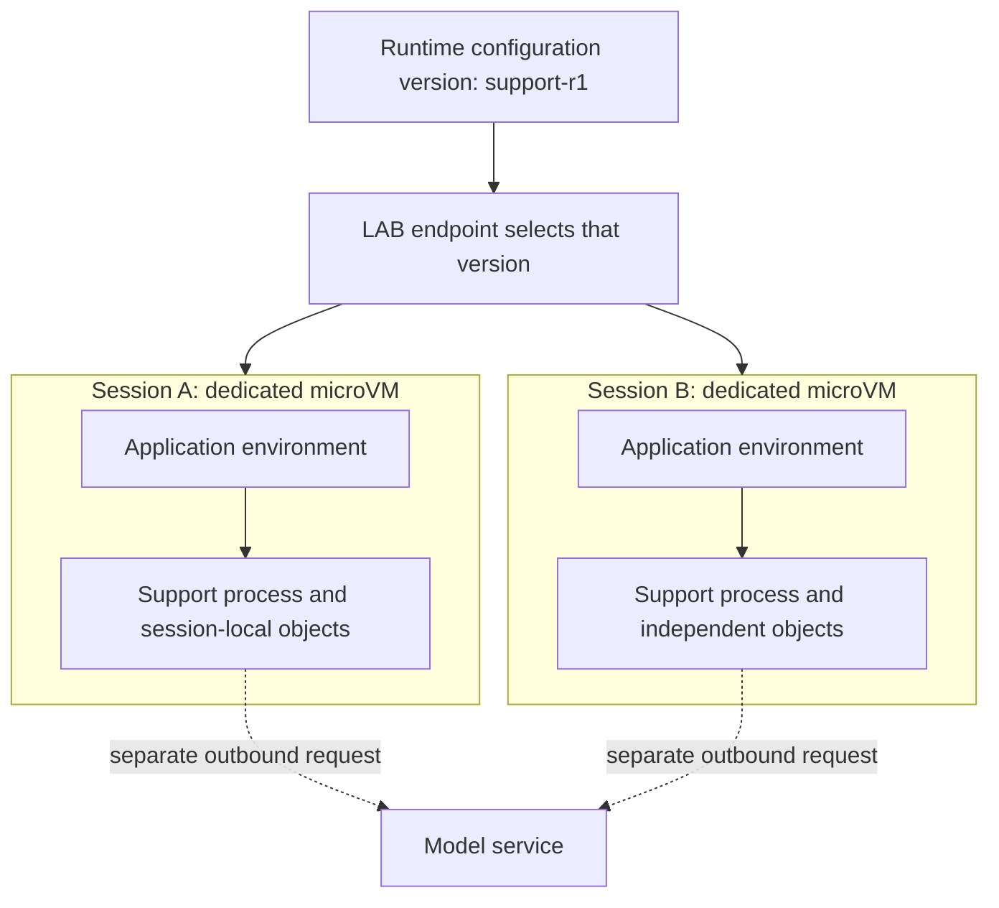
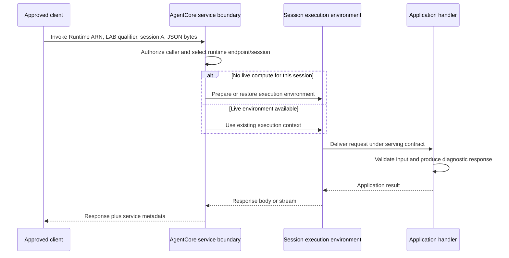
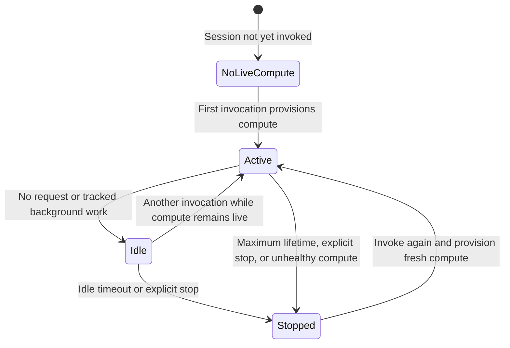

# Phase 3 - Execution and Session Lifecycle

**Complete reading document | Edition: 4 November 2026**

At the end of Phase 2, we had a packaged application, a managed Runtime resource, a numbered release, and an endpoint that could select it. That describes a deployment. It does not yet explain what happens when an actual request arrives.

This phase follows the next layer of the same system: where execution takes place, how a request reaches the application, how a session changes over time, and how concurrency changes the picture. We keep microVMs as the main learning path and examine Instances as a separate compute model rather than mixing their ownership and lifecycle contracts.

Read the four modules in order. A process marker is evidence about our authored probe, not an AWS infrastructure identifier. The practical observations are proposed experiments; live cloud results have not been manufactured for this document.

## Reading sequence

- [Module 7 - From a Deployed Runtime to Executing Compute](#module-7)
- [Module 8 - Follow One Request Across the Hosting Boundary](#module-8)
- [Module 9 - What Lives Between Requests, and What Survives a Stop?](#module-9)
- [Module 10 - When One Conversation Becomes Many](#module-10)

The chapters below are complete, not summaries of the individual module files. Read either format; you do not need to read both copies.

---

<a id="module-7"></a>

## Module 7 - From a Deployed Runtime to Executing Compute

**Phase 3: Execution and lifecycle**  
**Driving question:** Where does the configured application execute, and what happens before it can handle a request?  
**Reading context:** Continue from Module 6. We already have an artifact, a Runtime configuration version, a named endpoint, and a small application that returns a build marker.

At the end of Phase 2, our release had an addressable configuration. That was an important achievement, but configuration is not execution. A photograph of a machine is not a running machine; likewise, a record describing an application is not the process handling a customer's request.

Imagine our customer-support application has been deployed as build `support-r1`. The `LAB` endpoint selects its configuration version. No one has yet asked the application to check order 10. We now need to explain what turns that stored intention into a live program, what boundary surrounds that program, and what changes when another conversation starts.

The transcript introduces isolated execution, but it does not document the complete compute architecture. The mechanisms below therefore use the accepted Phase 1-2 model and explicitly cited AWS documentation. The customer-support scenario and experiments are authored teaching examples, not additional claims about what the lecturer demonstrated.

### 7.1 Reconstruct the documented microVM execution boundary

Recall the nesting established in Module 2: application code runs as a process; a container supplies an application environment; a virtual-machine boundary separates a guest execution environment from its host. The important next step is to attach this model to a particular unit of work.

For the microVM compute type, AWS documents a dedicated microVM for each Runtime session. The session is not necessarily one HTTP request. Several messages can belong to the same session and use the same live execution environment. Conversely, two independent sessions are not merely two Python objects in one deliberately shared application process. Their documented compute isolation boundary is separate. [R01][R06]

Our support conversation can therefore evolve as follows. A customer asks about order 10. The application receives a request in session A. The customer then asks whether that order can be returned. Provided the environment remains live and the request is routed to the same session, the application can reuse process-local context it retained. A second customer starts session B and gets a separate environment.

Do not read more into the diagram than it shows. It describes responsibility and isolation, not AWS's unpublished physical host placement or fleet scheduler.



Notice that the model service sits outside both application environments. Isolating an agent's process does not mean copying a remotely hosted language model into that process. The agent still initiates an outbound inference request. We will trace that boundary in Module 8.

### 7.2 Follow preparation, startup, and serving readiness

Before a process can handle work, its code and dependencies must be available, its startup command must run, and its server must become usable. Phase 2 already taught these dependencies from the artifact side. We now view them from the execution side.

Think of startup as answering three questions in order of dependency. Can the platform prepare the configured application environment? Can that environment start the expected server? Can the server accept the agreed invocation contract? These are logical prerequisites, not an assertion that every internal AWS action occurs in a publicly specified serial sequence.

Consider an image containing the wrong executable architecture. Its registry reference can be valid even though the program cannot execute in the chosen environment. Consider a correct image whose startup command imports a missing package. The image exists, but the process exits. Consider a process that starts successfully but listens on the wrong interface. The program is alive, but the platform cannot use the required serving interface. Each failure belongs to a different boundary we already established.

The HTTP contract and the platform's health checks make part of this preparation observable. They do not prove every business dependency works. A healthy server may still lack permission to retrieve an order. It is useful to begin with our no-model probe precisely because an initial request can verify hosting without also depending on model authorization or private database access. [R12][R64]

The operational lesson is to avoid collapsing every failure into "the agent is down." Record the Runtime resource status, the selected endpoint, the artifact identity, and the first application evidence separately. Those observations tell us which part of the explanation has actually been demonstrated.

### 7.3 Distinguish cold initialization from warm-session reuse

Suppose the first request takes longer than the second. A tempting explanation is that AWS cached the answer. That conclusion is not justified. The second request may simply avoid some environment initialization, while still executing a new application handler and a new model call.

We need three separate terms. **Release preparation** is work associated with making a version ready. **New-environment startup** is work needed when execution must be provided for a session. **Warm-session invocation** is another request served by an already available environment. Different platforms can move work between these stages.

An infrastructure experiment should therefore control its variables. Keep the artifact, endpoint qualifier, request shape, and model behavior constant. Invoke a fresh session, then invoke that same session again. Record client elapsed time and an application marker. Repeat with another fresh session. The results can reveal a pattern; they cannot reveal an undocumented host fleet or establish a universal cold-start guarantee.

Our later probe generates its execution marker lazily during request handling, not during module import. It increments a process-local counter under a lock. When a second request sees the same marker and a larger counter, it is evidence of application-state continuity under that experiment. It is not an AWS-issued microVM identifier. Multiple application workers or a different server configuration can also affect observations, so the lab uses a deliberately simple single-process application.

The transcript's approximate 20-millisecond statement should not become the baseline for a production latency objective. We will measure our chosen application, platform version, Region, and network path instead. The accepted source clarification in Phase 1 already identified that timing claim as unverified.

### 7.4 Compare platform V1 and snapshot-based V2

Now the distinction between release preparation and invocation startup becomes useful. AWS documents two Runtime platform versions, separate from the numbered configuration versions. V2 prepares an initialized application environment and uses a snapshot to start new execution environments. This moves reusable initialization work away from repeatedly starting each new environment in the same way. [R01][R02]

Imagine our application loads a large static parsing library and a read-only product rules file. Those objects are identical for every conversation using the release. Repeating the preparation for each new session may be wasteful. Preparing that reusable state once provides an intuitive reason for the snapshot approach.

But a snapshot is not automatically a safe copy of arbitrary startup behavior. Suppose startup also generated a supposedly unique conversation identifier or fetched a short-lived credential. Restoring the captured state can reproduce the identifier or restore a credential that is no longer suitable. The optimization changes where correctness must be checked.

For V2, AWS states that the first healthy ping is used to capture initialized state and that startup must become healthy within the documented 120-second window. Expensive reusable preparation belongs before serving readiness, while values that vary or expire need request-time treatment. Treat this as a concrete serving constraint, not as permission to make every dependency call during startup. [R02]

There is also an operational consequence. A release operation can take longer because preparation happens before readiness, while new-session startup can benefit later. A pipeline that assumes a create response means an immediately ready version will misread this behavior. Our Phase 2 distinction between request acceptance and observed readiness is therefore not administrative detail; it is needed to interpret this compute model correctly.

### 7.5 Separate reusable startup state from fresh request state

Let us classify the values in our support agent by what makes them valid, rather than by whether Python allows them at module scope.

The build marker belongs to the release. A static schema belongs to the release. An authenticated customer belongs to a request or conversation. A request identifier belongs to one operation. A token belongs to a credential lifetime. A network connection belongs to an actual transport relationship that may no longer exist when an environment resumes.

This classification gives us a practical design rule: initialization placement should follow the value's validity boundary. AWS's V2 guidance specifically discusses request-specific values, expiring credentials, cryptographic safety, and network connections. Libraries must be chosen and initialized with restore behavior in mind. Merely moving one UUID is not a complete snapshot-safety review. [R02]

Here is an authored conceptual example, not a complete server:

```python
# Stable release information can be prepared with the application.
BUILD_ID = "support-r1"
PRODUCT_RULES = {"returns_require_order_lookup": True}


def handle_request(payload, verified_identity):
    # Request-specific work occurs after invocation begins.
    request_id = create_fresh_request_id()
    customer_id = verified_identity.customer_id
    credentials = obtain_current_credentials_when_needed()
    return execute_request(payload, customer_id, credentials, request_id)
```

The undefined functions are deliberate pseudocode. The example teaches *where responsibilities belong*; it is not a claim about an AgentCore SDK helper with those names.

Apply the same reasoning to logs. A startup-generated identifier might be identical across restored environments. That makes it a poor standalone proof of execution identity. In our lab, a post-invocation marker is an observation aid. We still record the service's session identifier separately and avoid pretending either value is a physical instance ID.

### 7.6 Understand the Instances compute ownership branch

So far, every explanation has followed the microVM path. We now introduce an alternative because a different requirement makes it meaningful.

Suppose the support application evolves into an internal reconciliation job. It needs selected hardware, substantial local files, or mutually trusted collaborating agents working on one machine. The question is no longer merely how to isolate short interactive sessions; it is how to express a more explicit compute environment without managing its entire lifecycle ourselves.

AWS documents **Instances** as AgentCore-managed EC2 infrastructure provisioned in the customer's account. This is not the same ownership model as the fully managed microVM path. The customer supplies the capacity configuration and relevant permissions; AgentCore manages the documented instance lifecycle. [R03][R04]

An instance appearing in our account does not mean it is an ordinary manually managed server on which we should independently change every setting. AWS identifies these as managed instances with restricted operations. Inspection and ownership-aware changes are different from treating a service-owned resource as a free-standing EC2 machine. The data-management documentation explains how managed instances can be included in inventory views. [R38]

The comparison also changes our isolation assumptions. Within one Instances session, multiple agents may share the machine and filesystem. AWS explicitly requires such agents to be mutually trusted; the agent containers or direct-code processes within that session are not a security boundary between those workloads. The isolation unit is the capacity-provider-and-session combination. [R05]

This is why "one agent equals one isolated machine" is too imprecise as a platform rule. We must name the compute type and the unit of isolation before making a security claim.

### 7.7 Introduce capacity providers and instance lifecycle

A Runtime describes *which application* should run. An Instances capacity provider describes *what infrastructure* should be used to run it. Separating these concerns lets several Runtime definitions reference an approved infrastructure template rather than independently selecting arbitrary machines and networks.

The capacity-provider API describes compute configuration and an operator role. The detailed Instances guide connects that configuration to operating system selection, allowed instance types, networking, storage, and session creation. A new session causes the service to provision the associated managed execution environment. [R04][R70]

Now imagine two Runtime definitions, `support_planner` and `support_reviewer`. If they deliberately use the same capacity provider and session identifier, the documented model permits them to run in the same Instances session. That can support collaboration, but it also means shared trust and shared filesystem consequences. Reusing a string by accident is therefore a design risk, not merely a naming preference. [R05]

Persistent storage makes stopping different from deleting. An Instances session can resume on replacement compute with its persistent volumes, while deleting the session removes those retained volumes. Root and ephemeral volumes do not acquire persistence simply because some other mounted volume is persistent. Modules 9 and 13 examine this distinction more carefully. [R38][R39]

A further lifecycle constraint matters to infrastructure code: the current Instances documentation says compute type cannot be changed on an existing Runtime, and most capacity-provider settings require a replacement provider rather than an in-place edit. We therefore treat a compute-type migration as a migration design, not a casual property toggle. [R03]

### 7.8 Compare compute choices by the requirement they answer

The point of the comparison is not to declare one compute type universally better. It is to ask which boundary solves our actual problem.

| Question for our workload | MicroVM path | Instances path |
|---|---|---|
| What is our main abstraction? | A managed isolated session environment | A managed EC2 session defined by a capacity provider |
| Where do we make hardware decisions? | Within supported service allocation and limits | Through supported capacity-provider choices |
| Which collaboration assumption is safe? | Keep different sessions separate | Agents sharing one session must be mutually trusted |
| What can survive a stop? | Only deliberately configured persistence, not process memory | Persistent volumes, not root/ephemeral volume data |
| Which lifetime ceiling applies? | MicroVM lifecycle limits | Instances lifecycle limits |

The rows summarize earlier distinctions, not a claim that all feature combinations are available in every Region. Before choosing a path, check supported Regions, artifact types, platform versions, and account permissions for that exact configuration. [R01][R03][R07][R37]

For our learning probe, microVMs remain the main path because they let us isolate the meaning of a Runtime session without introducing selected EC2 hardware. The Instances branch is included because our final platform model must not incorrectly apply microVM assumptions to every AgentCore deployment.

A useful decision exercise is to write a one-sentence requirement and defend it. "We want Instances because it is more powerful" is weak. "This approved workload requires a supported GPU and trusted agents sharing a persistent working directory" identifies the actual design constraints. Likewise, "We want microVMs because they are serverless" is incomplete until we connect managed session execution to the workload's isolation and lifecycle needs.

### 7.9 Separate documented behavior from unpublished implementation

We now have a useful compute model without pretending to know every AWS internal component. The public contract tells us about Runtime resources, sessions, platform versions, health, supported compute branches, and customer-visible configuration. It does not require us to invent an internal Kubernetes cluster, an EC2 Spot fleet, a universal placement algorithm, or a guaranteed physical-host mapping.

This boundary is not a gap to fill with a plausible diagram. It is an engineering discipline. We can explain what a client observes, what configuration controls, and what our application must do. Where deployment approval depends on a detail that public material does not establish, the next action is to obtain the relevant service assurance or support confirmation, not to convert an inference into a fact.

Our first Phase 3 experiment should therefore remain narrow. Inspect the selected Runtime and endpoint. Invoke the no-model probe in two sessions. Compare build markers, process-local counters, and request identifiers. Record the platform version. Treat the observations as application evidence within the documented service model.

We have moved from a stored release to an executing application. The next question is now specific: **which actor sends each request, which credentials authorize it, and how does that request reach the process we have just described?** That is Module 8.

### Pause and reason

1. Why does a second message not necessarily require a new microVM?
2. Why is a UUID created at application startup a weak uniqueness mechanism under snapshot restoration?
3. Why can two agents sharing an Instances session require mutual trust even if they have separate Runtime definitions?
4. What would a repeated process-local counter prove, and what would it not prove?

<details>
<summary>Reasoning guide</summary>

A session can serve multiple invocations while its environment remains live. Startup values can be captured and restored, so request-specific uniqueness belongs after invocation begins with appropriate libraries. Instances session sharing also shares a machine-level trust boundary and filesystem, rather than establishing independent security boundaries for every agent. A counter is evidence that a particular application state was reused under the test; it is not an AWS microVM ID, a performance guarantee, or proof of durable state.

</details>

---

<a id="module-8"></a>

## Module 8 - Follow One Request Across the Hosting Boundary

**Phase 3: Execution and lifecycle**  
**Driving question:** Which actor performs each step between a client request and a hosted response?  
**Reading context:** Module 7 established where execution happens. We now follow a request into that environment and back out.

Our support application can run in an isolated environment, but a customer cannot reach it merely by knowing that isolation exists. Someone must construct a request, identify the target, authenticate, preserve conversation routing, and interpret the returned bytes.

Keep the example deliberately ordinary: "Please check order 10." We will first send it to the hosting probe, which does not contact a model or order system. Only after that boundary is clear will we add a separate model call. This prevents a successful inference response from hiding uncertainty about the hosting path underneath it.

The transcript's local invocation and Bedrock examples motivate the flow. The cloud invocation contract, credentials, endpoint selection, and request context below are supplemental AWS-documented mechanisms. Our integration sequence is an authored explanation, not a reproduction of the lecturer's cloud deployment.

### 8.1 Identify the client, credentials, and invocation API

Start outside AWS-managed execution. The client might be a test program, a trusted web backend, or another service. In the main learning path, it is a Python program using an approved AWS identity. The identity authorizes the program to invoke one chosen Runtime; it is not automatically the identity used by the hosted application afterward.

The service operation is `InvokeAgentRuntime`. Its purpose is to deliver a payload to an agent or tool hosted by Runtime and return the response. The Boto3 client for this data-plane operation is `bedrock-agentcore`; the management client used in Phase 2 is `bedrock-agentcore-control`. Keeping these clients distinct makes the control/data-plane model visible in code. [R08][R09][R14]

A client should know which Region and Runtime it is calling before it sends work. Do not let an incidental shell default silently determine the target environment. In the labs, Region, Runtime ARN, qualifier, and session identifier are explicit arguments. This is especially helpful when the same engineer can access both non-production and production accounts.

The client also needs a bounded transport configuration. A connect timeout limits waiting for a connection; a read timeout limits waiting during response handling. Neither is the Runtime session's maximum lifetime. A timeout observed by the caller is a statement about the caller's wait, not proof that all server-side work was canceled. [R17][R58]

That distinction will matter later when the application performs actions rather than merely returning a diagnostic message.

### 8.2 Separate inbound authorization from outbound execution permissions

Imagine a receptionist admits a visitor to a building. That decision does not give the visitor every permission held by every employee inside it. Similarly, permission to invoke a Runtime does not define all permissions available to the application it hosts.

For the IAM path, the caller signs the request with its own AWS credentials. The service evaluates invocation authorization. Once the application is running, AWS calls that application makes use its configured execution identity and permitted credentials. The deployment identity that originally created the resource is a third participant. [R27][R28]

This gives us a useful failure prediction. An engineer may successfully create the Runtime but lack permission to invoke it. A caller may successfully invoke the probe, while the real application fails to invoke Bedrock. A model request may succeed while a later secret retrieval fails. These are not contradictory results; they cross different authorization boundaries.

JWT-based inbound authorization is an alternative supported path, not a flag that magically causes a standard signed Boto3 call to become a bearer-token request. AWS's invocation documentation directs OAuth integrations to the HTTPS invocation path. Module 12 explains the policy and identity distinctions in detail; for now, the lab deliberately selects IAM invocation so only one path is being tested. [R08][R28]

Also distinguish public reachability from permission. A service API may have a publicly resolvable hostname and still reject an unauthorized caller. Likewise, a private network route does not establish that the caller is authorized. Networking and identity answer different questions.

### 8.3 Resolve the Runtime ARN and endpoint qualifier

Phase 2 gave us a Runtime ARN, configuration versions, and named endpoint references. An invocation must select among those objects rather than treating them as interchangeable strings.

In the documented API, the `qualifier` selects an endpoint name. When it is omitted, the default endpoint is used. Because `DEFAULT` follows Runtime updates, a test that omits the qualifier may silently select a different release later. Our experiments use a named `LAB` endpoint and record the version it references. [R08][R13]

Suppose `LAB` references configuration version 4 and the latest Runtime version is 5. A request using `LAB` is intended to test version 4, not whichever version the console happens to show as newest. The returned application build marker is then compared with the intended artifact. This checks both configuration selection and observed application behavior.

There are two complementary observations here. Reading the endpoint tells us what release it is configured to select. Reading the probe response tells us what build answered the particular invocation. Neither should replace the other. During an update or an experiment involving an existing session, keep both records rather than guessing from one field.

An endpoint qualifier is not a VPC endpoint and not the `/invocations` route inside the application server. We will encounter all three meanings of "endpoint" in this project. Naming the object explicitly avoids a surprising amount of architectural confusion.

### 8.4 Track runtimeSessionId and execution-context selection

Now we know which application release to address. We still need to identify the interaction context for this request.

A Runtime session identifier connects related invocations to the service's session-routing model. The API documents a length of 33 to 256 characters; a conventional string-form UUID is a convenient lab identifier. The application should retain the returned session identifier and use it consistently for related requests. [R08][R06]

For our experiment, generate session A once, save it, and send two requests with it. Then generate session B and send another request. Do not generate a new UUID inside every invocation call and then wonder why no process-local context survives. The resulting behavior would reflect our client choices, not a failure of stateful routing.

At the same time, do not treat possession of session A's string as sufficient proof of customer ownership. The Runtime session guide explicitly assigns user-to-session mapping to the client backend. In production, the authenticated user, the business conversation, and the chosen Runtime session must be bound by trusted application logic. [R06]

For the HTTP path, the service uses the Runtime session header documented by the protocol. The SDK can expose it through the invocation context; `context.session_id` is the documented access pattern for an AgentCore SDK application. A JSON field named `session_id` is only application payload unless the client and server deliberately map it into the actual service contract. [R59]

This distinction is observable. Put an arbitrary identifier in the JSON body but leave the real session-routing parameter unchanged. The body field does not, by itself, move the request into another execution environment. We do not need to run that variation in production to understand why the two channels have different responsibilities.

### 8.5 Trace delivery to the application server

We can now join the pieces into one flow. The caller supplies a target, an authorized identity, a session identifier, and bytes representing the payload. AgentCore applies its service boundary and delivers the request under the configured serving contract. The application server parses the payload and invokes our handler.

The following sequence is a conceptual responsibility trace. It does not expose the internal number of AWS network hops or name an undocumented router.



The process running our application is responsible for interpreting `prompt`. AgentCore does not need to understand order 10 or decide whether it is refundable to host this request. That decision belongs to our application and its downstream services.

This is also where we distinguish transport success from application success. A response containing `{"ok": false}` may still arrive with a successful transport status in our simple teaching probe. A production server must define its error contract deliberately. Client code should inspect both the service response and the application schema rather than considering all received JSON successful.

The lab client therefore records service metadata, decodes the expected JSON, and reports the probe's explicit `ok` field. It does not claim that any JSON document means the business operation succeeded.

### 8.6 Introduce a model call as a separate outbound request

The hosting probe has now established a path to our handler. To turn it into a useful support application, the handler might call a model. The transcript demonstrates this using a Bedrock Runtime client and the Converse API.

That new call has its own service endpoint, request schema, model selection, permissions, latency, and errors. It is initiated by application code, not by an implicit rule that every Runtime invocation automatically invokes a model. Converse accepts the conversation content and inference-related configuration; the application then interprets the model response. [R18]

This separation lets us reason through a common incident. The client receives an error after the application logs "request received" and "calling model." The hosting path has progressed farther than in a request that never reaches the handler. We should next investigate the model call's identity, network route, selected model, and response, rather than immediately rebuilding the container.

The same structure applies when the model requests a tool. A model output describing a tool call is not the external action itself. Our agent's orchestration code must select the allowed action, invoke a tool or Gateway, handle the result, and decide how to continue. The transcript's later loop demonstrates this application responsibility. It does not transform Runtime into the owner of every business action.

We keep the actual cloud lab model-free so we can observe compute and sessions without incurring model calls or requiring model access. The architectural walkthrough adds the model boundary conceptually, and a future approved application integration can instrument it separately.

### 8.7 Trace ordinary responses and streaming responses

An ordinary JSON response arrives after the handler has assembled a complete result. Streaming lets the application produce output progressively. It changes when the caller can observe progress, not which identity initiated the request or which session owns the execution.

AWS provides a streaming application pattern in which an asynchronous handler yields events. The invocation API can deliver a response stream. A correct client must interpret the declared content type and framing; a sequence of server-sent events is not automatically one JSON object. [R19][R09]

Think about the user's experience. The first event may appear quickly, while the complete request still takes much longer. We therefore distinguish time to first output from time to completion. A client that measures only the first event can make a slow overall operation look fast. A client that buffers the entire response can erase the perceived responsiveness of a streaming server.

Streaming also creates a failure case that ordinary request examples often hide. The caller might receive half the output and then lose the connection. Some computation, and possibly some tool actions, may already have occurred. Repeating the original request is not guaranteed to reproduce exactly the missing half or avoid repeating side effects. Application-level operation identifiers and recovery semantics become necessary when that distinction matters.

Our provided lab client intentionally supports the bounded JSON probe path rather than pretending to be a universal streaming client. It refuses unexpected content types. This keeps the test's claim narrow and prevents a successful diagnostic parser from being mistaken for production streaming integration.

### 8.8 Correlate request, endpoint, session, application, and model evidence

The request has crossed enough boundaries that one identifier is no longer sufficient.

A Runtime ARN answers which managed application resource was targeted. An endpoint qualifier answers which release selector was requested. A configuration version and build marker describe release identity. A session identifier describes execution context. An application request ID identifies one handler execution. An AWS request ID identifies a service operation. A business operation ID identifies the customer action whose duplicate execution might be harmful.

These identifiers are related, but none is a replacement for all the others. A retry can produce a new service request ID for the same intended business operation. A conversation can have many requests. A release can serve many sessions. A session can be resumed on new compute. Our log schema should preserve those distinctions.

For the lab, record the explicit target arguments, returned service request ID, echoed session ID, build marker, execution marker, request ID, and process-local count. Do not record credentials, bearer tokens, or the entire customer prompt just to make debugging convenient. The user input in our sample is synthetic, but the logging discipline should still be safe to reuse.

Once a real model or tool is added, create separate spans or records around that boundary. The observation "application handler took eight seconds" does not tell us whether seven seconds were spent waiting on inference, a database, or retry delays. Module 14 turns these distinctions into an operational evidence model. [R41][R42]

### 8.9 Locate failures along the complete path

We can now diagnose by asking how far the request demonstrably traveled.

A local credential-resolution error occurs before any successful authenticated service call. A service access-denied response means authorization must be inspected at the relevant service boundary. An unavailable or misselected endpoint is a resource-selection problem. A handler log followed by a model exception points farther downstream. A partial stream followed by a client disconnect means we must reason about work that may already have happened.

The API describes distinct error classes, including authorization, validation, throttling, conflicts, and service failures. Our application can also return its own errors after the service invocation is accepted. Classifying the actual exception and keeping its request ID is more informative than reporting only "HTTP failed." [R08]

The important discipline is not to jump from symptom to cause. A timeout does not prove a security group problem; an absent log line does not prove the application never ran unless the log delivery path is known to work. Evidence narrows the hypothesis. It does not justify facts we did not observe.

We have now reconstructed one complete request. What remains unresolved is the interval between requests: how long the environment exists, what "idle" means, and what survives its disappearance. Module 9 follows that lifecycle.

### Pause and reason

1. Why can a caller invoke the hosting probe successfully while the full application cannot call Bedrock?
2. What is the difference between `runtimeSessionId` and a JSON payload field named `session_id`?
3. Why should a release test record both the endpoint configuration and the returned build marker?
4. After a streaming connection breaks, what must be established before safely repeating a business action?

<details>
<summary>Reasoning guide</summary>

Inbound invocation and outbound model access use different permissions and paths. The service routing parameter participates in execution-context selection; an arbitrary JSON field is interpreted only by application logic. Endpoint configuration records intended selection, while the build marker observes the particular response. A broken connection leaves the server-side outcome potentially ambiguous, so operation status and idempotency must be checked before repeating side effects.

</details>

---

<a id="module-9"></a>

## Module 9 - What Lives Between Requests, and What Survives a Stop?

**Phase 3: Execution and lifecycle**  
**Driving question:** What persists between messages, and what changes when the execution environment stops?  
**Reading context:** Module 8 followed one request. This chapter follows the interval around many requests.

Our first order lookup returned successfully. The customer pauses, reads the answer, and sends another message. From the customer's perspective, the conversation never ended. From the infrastructure perspective, however, several different things may have happened during that pause.

The process may still be running with its objects intact. The environment may have become idle. Its compute may have stopped. Some files may have been retained while memory was lost. A new release may have been selected. We cannot reason about the next message until we distinguish those possibilities.

This chapter introduces no requirement to adopt a new storage service. It first makes the lifecycle precise. Module 13 will explain the storage choices after we know exactly which lifecycle boundary they must cross.

### 9.1 Separate users, business conversations, and Runtime sessions

Begin with the customer, not with a UUID. A customer is a business identity. A conversation is one sequence of interactions in our application. A Runtime session is an execution context used by the hosting service. These objects can be related without being identical.

For example, customer `customer-42` can have two support conversations open: one about a return and another about a delivery. We might map those conversations to separate Runtime sessions so their execution state does not mix. Later, a resumed business conversation could restore its durable history into replacement compute. The business identity has not changed merely because the process has.

The mapping is part of application design. AWS explicitly says AgentCore does not enforce the relationship between users and their session IDs; the client backend must maintain that relationship and relevant lifecycle controls. [R06]

A proposed mapping record for our example might contain an authenticated tenant, an authenticated customer, a conversation ID, the permitted Runtime resource, a chosen endpoint, and the Runtime session ID. This is a design example, not an AWS-required database schema.

The reason to record it becomes clear when a caller asks to resume a conversation. The backend must determine whether that caller owns the conversation and which execution context is appropriate. Accepting an arbitrary client-supplied session string without that check confuses routing with authorization.

### 9.2 Create and record session identifiers deliberately

For a new lab conversation, generate a UUID once and retain it. For a production conversation, generate an opaque identifier through trusted logic and bind it to the verified identity. Do not encode customer email addresses, medical information, or secrets into identifiers that may appear in telemetry.

A session ID should be stable for the interactions intended to share context. Stability does not mean permanence across every application migration. It means the client deliberately chooses when to continue a context and when to create a new one.

Our observation record includes Runtime ARN, qualifier, and session ID. This is a way to keep experiments unambiguous; it is not a declaration of the service's complete internal routing key. When we compare different endpoints or versions, we record those changes explicitly rather than assuming the string alone explains all behavior.

There are two common client mistakes. One generates a new session ID for every message and then expects in-process conversation state to persist. The other assigns a single global session ID to all users and then assumes the platform will separate them anyway. Both mistakes arise from ignoring what the session parameter is meant to select.

The first mistake destroys intended continuity. The second destroys intended isolation. A good design has a deliberate mapping rather than merely a valid identifier format.

### 9.3 Follow first invocation and subsequent invocations

Let us make the timeline concrete. At time A, the client starts conversation C and selects Runtime session S. It sends the first request. The application validates the input, creates a request ID, and updates some process-local diagnostic state. It returns build `support-r1`, execution marker E, and count 1.

At time B, the client sends another request to the same intended execution context. The application returns E and count 2. Under our single-process probe, this is evidence that the state we created in the first handler execution was still available.

Now consider a new session T. Its probe state should start independently. If it returned a preexisting value from S, we would first investigate our test configuration and application state handling, not dismiss the discrepancy. The whole purpose of this experiment is to make the isolation claim observable at a bounded application level.

A repeated count does not automatically mean the LLM remembers the prior prompt. A model request sees only the information the application supplies through its inference interface. Process-local availability and model-context construction are separate responsibilities. This distinction follows directly from the transcript's memory demonstration: saving or retaining something is insufficient unless the application later retrieves and uses it.

Likewise, retaining an in-memory order result does not make that result current forever. The database may have changed. The application must decide which state is an authoritative record and which is a cache that needs revalidation.

### 9.4 Distinguish active, idle, and stopped execution

The lifecycle trace in this chapter follows our **microVM lab**. For Instances, stopping one agent runtime with `StopRuntimeSession` is not the same as stopping the shared EC2 instance or deleting the capacity-provider session. The operation-specific Instances guide distinguishes those actions; Module 13 develops that branch. [R38]

We now introduce the lifecycle vocabulary because the example needs it. **Active** describes execution processing work. **Idle** describes an available environment waiting rather than actively processing work. **Stopped** describes a session whose compute has been terminated and may be provisioned again on a later invocation. AWS documents these states in its session guide. [R06]

A completed HTTP response does not imply immediate compute termination. That is why a subsequent message can reuse context. Conversely, an ongoing business conversation does not guarantee the process stays alive indefinitely. The compute lifecycle has its own limits.



This is a conceptual lifecycle, not a claim that every label is returned by one public session-status API. In particular, our lab does not invent a `GetRuntimeSession` operation to poll a state that the selected public API does not expose in that form.

Also keep maximum lifetime separate from idle timeout. A session can be busy and still reach the configured compute lifetime. Busy reporting is not an unlimited lease. When the workload needs to survive such boundaries, it needs recoverable work and appropriate persistence, not a health response that pretends the boundary does not exist.

### 9.5 Study lifecycle timeouts and explicit stopping

AWS exposes `idleRuntimeSessionTimeout` and `maxLifetime` through lifecycle configuration. At this edition's review date, the documented defaults are 900 seconds for idle timeout and 28,800 seconds for maximum compute lifetime. The maximum configurable ceiling differs by compute type: eight hours for microVMs and fourteen days for Instances. These are configuration limits, not guarantees that an unhealthy process will run until the ceiling. [R07]

Suppose our support interaction usually has short pauses. A shorter approved idle timeout reduces how long an unused environment remains available, but may increase environment recreation for returning users. A longer timeout favors continuity while using more live-session capacity and potentially more billable resources. The right choice follows the workload, not a universal "always keep it warm" rule.

For a controlled test, `StopRuntimeSession` explicitly requests that a running session stop. It is a state-changing operation, not a read-only inspection command. The API includes a client token for idempotency of the stop request and a qualifier to identify the intended endpoint. [R10]

We make stopping an explicit lab action. The provided client requires acknowledgement and does not silently stop a session after every invocation. This avoids two problems: hiding warm-state behavior from the learner and interrupting work without an intentional decision.

Stopping can involve a transition window. The session guide documents retryable conflict responses when another operation targets a session while provisioning or teardown is in progress. Do not treat the first accepted stop response as proof that all cleanup and storage flushing is already complete. [R06]

### 9.6 Relate health and background-work signals to lifecycle

Our original probe finishes its work before returning. A more complex application might accept a task, respond to the caller, and continue processing. The absence of an open request no longer tells the platform whether the application is truly idle.

The HTTP health contract addresses that ambiguity. `HealthyBusy` communicates background activity; `Healthy` communicates idle readiness. The SDK provides task tracking through `add_async_task` and `complete_async_task`, allowing the application to make lifecycle-relevant work visible. [R11][R12]

The important design issue is bookkeeping. If a task is marked busy but completion is never recorded after an exception, the session may remain active longer than intended. If work starts but is never tracked, it may be mistaken for idle time. A `try/finally` pattern can make task completion bookkeeping explicit, but it does not make the work durable.

The documented optional `time_of_last_update` value is especially easy to misuse in a custom health handler. It represents a status change, not the time of every health probe. Continuously advancing it can prevent idle expiration from behaving as intended. The SDK handles this lifecycle bookkeeping when used correctly. [R11]

Now connect this to the previous section. Busy reporting can prevent an idle-timeout decision, but it does not remove maximum lifetime or failure. A job that must finish despite process loss needs external progress records and recovery semantics. A Python thread alone is not a durable workflow engine.

### 9.7 Explain process, memory, and temporary-file loss

When compute stops, the live process and its in-memory objects are not preserved merely because we remember the session identifier. The next invocation may have the same session string but a different process with fresh memory. This is the distinction our diagnostic marker is designed to reveal. [R01]

Suppose count 2 existed only in a Python dictionary. After a controlled stop and a fresh execution environment, the dictionary starts over. That observation is expected. It would be incorrect to describe it as a failed durable-memory feature because we never configured one.

Files require a second question: where were they written? A temporary file in the ordinary execution filesystem and a file under a configured persistent mount can have different lifecycles. A statement such as "all files survive" or "all files disappear" is therefore incomplete unless we name the storage mechanism. [R37]

A third kind of state is external business data. If the application changed an order in a database, stopping the Runtime does not reverse that database transaction. Replacing compute is not a business rollback. This is the same ownership principle we used for endpoint rollback in Phase 2.

To reason clearly, complete this sentence for every important value: "This value is owned by ___, stored in ___, and must survive ___." If the last blank includes a boundary the chosen storage does not cross, the design is incomplete even though the application currently works.

### 9.8 Invoke after stopped compute and examine restoration boundaries

After stopping session S, the client may invoke S again. The service can provision new compute for that session. What the application can recover depends on the data it deliberately externalized and the storage configuration's lifecycle. [R06]

For the first experiment, use no persistent mount. Compare the execution marker and process-local count before and after the stop. The expected observation is fresh process state. Record the actual result without presenting it as a published AWS instance identifier.

For the second experiment, provision approved managed session storage on a disposable microVM Runtime and configure the probe's persistent directory accordingly. Write a small synthetic record, stop cleanly, and resume. Compare the restored file content with the fresh process marker. This demonstrates how files can persist even when the process does not. Managed session storage is documented as Preview and has additional retention and version-update boundaries, developed in Module 13. [R37]

Do not create an ordinary local directory and call that persistence. Our probe refuses to silently create the configured mount root. It also reports a warning that filesystem behavior alone does not prove the directory is an AWS-managed mount. The Runtime's deployed configuration and the observed stop/resume result must be considered together.

Finally, a local atomic file replacement does not prove that remote asynchronous replication has completed. The documentation describes graceful-stop flushing, so the experiment must allow that transition to finish. An abrupt failure is a different test and should not be assigned an invented recovery-point guarantee.

### 9.9 Test endpoint updates with existing versus new sessions

Release selection and session continuity now intersect. Suppose `LAB` changes from configuration version 4 to 5. A new session should be tested against the newly selected release. But what exactly happens to an already running conversation during that change?

The versioning documentation describes endpoint references and updates. It is not sufficient evidence, by itself, to assert universal live-process migration, uninterrupted state transfer, or automatic compatibility of existing conversation state. The storage documentation separately describes resets for managed session storage on Runtime version updates. These are distinct facts that must not be blended into a stronger guarantee. [R13][R37]

We therefore make the release experiment explicit. Record the old endpoint and build. Invoke session A. Promote a disposable test endpoint. Use a fresh session B to verify the new build. Then, as a separate approved test, invoke A and record its actual build and state behavior. Repeat only under a documented configuration and keep the result bounded to that configuration.

A production design needs a policy even when the platform's routing behavior is acceptable. Do we allow old conversations to finish on their established release? Do we deliberately restart them with a migration notice? Must checkpoints be schema-compatible across versions? Those are application and platform decisions, not consequences of naming an endpoint `PROD`.

The safe conceptual conclusion is that a release changes configuration intent; session and data transitions require their own verification.

### 9.10 Enforce user-to-session access in the application design

Return to our original customer. They should be able to continue their own order conversation, not another customer's conversation whose identifier they happened to obtain.

A proposed backend flow is therefore: authenticate the caller, resolve the business conversation, verify ownership and allowed environment, retrieve the permitted Runtime session mapping, and invoke the chosen target. The backend derives identity from trusted authentication context rather than accepting a customer ID as proof in arbitrary request JSON. [R30]

Keep the map durable enough for the product's requirements. A browser refresh should not accidentally create a new backend identity or lose the mapping to ongoing approved work. Conversely, logout, tenant changes, and conversation closure must not leave an unrestricted resume path. The exact database and retention policy are design choices, not prescribed AgentCore resources.

We can now reconstruct the lifecycle without conflation. The customer owns a conversation in the product. The backend maps it to an execution context. That context may outlive a particular process. Durable information survives only through storage whose contract crosses the required boundary. Authorization must be maintained through every transition.

The next question follows naturally: **what happens when many such contexts exist at once, or several requests arrive together?** Module 10 examines concurrency and capacity.

### Pause and reason

1. Can a business conversation continue even though its original process no longer exists?
2. Why does `HealthyBusy` not guarantee an arbitrarily long job will finish?
3. What would prove that a file survived a compute stop, and what additional evidence identifies the storage mechanism?
4. Why should endpoint promotion and conversation migration be tested separately?

<details>
<summary>Reasoning guide</summary>

A conversation can resume if trusted mapping and required context can be recovered. Busy reporting affects idle interpretation, not all failure or lifetime limits. A before/after content comparison demonstrates observed persistence; deployed filesystem configuration identifies the intended storage contract. Endpoint promotion selects a release, whereas migration must account for live execution, state compatibility, retention, and user-visible continuity.

</details>

---

<a id="module-10"></a>

## Module 10 - When One Conversation Becomes Many

**Phase 3: Execution and lifecycle**  
**Driving question:** What changes when the same release serves many simultaneous interactions?  
**Reading context:** We can explain one request and one session's lifecycle. We now change the amount and timing of work without changing the underlying responsibilities.

A single successful conversation tells us little about a busy support system. One hundred customers may arrive at once. One customer may submit two messages before the first finishes. A model dependency may slow down, leaving more requests waiting. A client may retry and amplify load.

These are different situations. Calling all of them "scaling" hides the mechanism we need to understand. We will separate the quantities first, then use the same support agent to reason about capacity, correctness, and latency.

The numerical examples below are authored thought experiments. They are not service benchmarks or measured results from an AWS account. Current service limits are referenced separately and must be checked for the target account and Region before testing.

### 10.1 Count requests, live sessions, and execution environments separately

Suppose ten users each send five messages over an hour. That is fifty requests, but not necessarily fifty simultaneously live sessions. If all messages are serialized and sessions expire between conversations, the peak capacity requirement can be much smaller than the request total suggests.

Now suppose ten users each open a session and wait while a model runs for thirty seconds. At the same instant, ten requests and ten session contexts may be active. If they finish but their environments remain idle, HTTP request concurrency can fall while live session occupancy remains nonzero.

The distinction matters for monitoring. A cumulative count of newly created sessions is not a gauge of sessions currently consuming capacity. AWS explicitly distinguishes `SessionCount` from `ActiveSessionCount` in its Runtime telemetry. Use the metric that matches the question rather than interpreting every number containing "session" the same way. [R41]

A fourth quantity is downstream concurrency. Each agent request could issue several model or tool calls, either serially or concurrently. Ten active agent requests do not imply exactly ten simultaneous downstream requests. The orchestration determines that relationship.

Our first capacity model should therefore record arrival rate, request duration, session retention, and downstream fan-out separately. We can then ask which resource each quantity stresses.

### 10.2 Observe separate-session isolation

The simplest scale-out experiment uses separate sessions. Send a small approved set of requests with distinct session IDs to the same immutable release. Each request should remain associated with its own context rather than leaking process-local diagnostic state from another session. [R01]

Our probe uses synthetic data only. It returns a per-request identifier, a lazy execution marker, and a count. This makes state separation observable without creating real orders or invoking tools. It is intentionally not a high-throughput load test.

When comparing responses, do not infer an internal scheduler from completion order. Session A finishing before session B does not prove A was provisioned first, nor does simultaneous completion prove shared compute. Different network delays and application startup work can produce the same outward timing.

The experiment should answer a narrow question: do the visible application contexts behave independently under the chosen configuration? Infrastructure isolation itself is a documented service property, while the experiment checks that our application's use of that property is coherent.

Once that is understood, we can examine the harder case: several requests targeting the *same* session, where shared application state is intentional.

### 10.3 Study concurrent requests aimed at one session

Consider two messages arriving together in the same conversation. One asks for order details. The other asks to cancel the order. Sharing an execution context does not automatically give those operations a safe business order.

The service may support concurrent connections while the application still has mutable state that requires coordination. A Python dictionary, a conversation history list, or a tool-action queue does not become race-free because it lives inside a microVM. Isolation from other sessions and coordination within one session are different problems.

As reviewed for this edition, AWS documents up to 250 concurrent connections per V2 session with the default 2-vCPU allocation, including requests and streaming connections. That is a service limit for the stated configuration, not a promise that our handler can safely or efficiently process 250 operations in parallel. [R16]

Our probe uses a lock around its diagnostic counter so concurrent updates do not lose increments. That lock protects a tiny in-process operation. It does not establish distributed ordering across processes or guarantee the semantics of an external refund.

For the real support conversation, one design may serialize user turns at the application boundary. Another may permit read-only requests concurrently but use durable conditional updates for mutations. A third may create explicit background jobs with their own operation IDs. These are proposed application designs, chosen according to the meaning of the work.

A retryable conflict while session compute is being created or stopped is yet another case. AWS documents that transition conflict separately from already-running concurrency. We should not generalize a provisioning conflict into a rule that all same-session concurrency is forbidden. [R06][R12]

### 10.4 Measure startup and steady-state latency separately

A single average latency can conceal the mechanism we are trying to improve. Our first request can include new-environment work. A later request can reuse live execution. Either request can also spend time waiting for a model, a tool, or a network connection.

Build a small measurement table with fresh-session latency, same-session latency, time to first streamed output if applicable, and total completion time. Record the application build, platform version, Region, request shape, and whether the downstream model was used. Without these fields, two latency values may not be comparable.

Here is a conceptual decomposition for a non-overlapping request path:

```text
client-observed elapsed time
  = client/network overhead
  + service admission and routing
  + any required environment-start work
  + application work
  + downstream wait
  + response delivery
```

This is an explanatory accounting model, not an AWS metric definition. In an asynchronous or overlapping implementation, the terms cannot always be added naively. A trace is needed to see which work overlaps and which sits on the critical path.

Suppose the probe returns in a small fraction of the full agent's time. That suggests the hosting path alone does not explain the full latency. It does not prove the model is responsible until the application records the downstream intervals. This is why the no-model baseline remains valuable after the first deployment test.

Under V2, some initialization moves into snapshot preparation, so release readiness and new-session latency should be measured separately. We should not count the release operation as if every user request repeats it. [R01][R02]

### 10.5 Understand account and regional quotas

Managed scale does not mean infinite capacity. AgentCore documents limits for resources, invocation rates, session allocation, payloads, streaming, and other dimensions. Many are scoped by account and Region; some can be increased while others are fixed. Instances also depends on quotas for the EC2 and supporting resources provisioned in the customer's account. [R16]

Rather than memorize one number, learn to identify the limiting dimension. Are requests arriving faster than an API rate quota? Are idle sessions retaining capacity? Is a single session hitting a connection limit? Is the selected Instances hardware constrained by account quota or available capacity? Each question leads to a different response.

For a real review, first list the relevant services and query the applied quotas in the intended account and Region. A default value in documentation is not proof of the account's current applied value. The AWS CLI Service Quotas interface supports listing applied service quotas, but not every documented service limit appears as an adjustable quota there. [R66]

An approved inspection workflow is to identify the service code through Service Quotas rather than guess it, record its applicable limits, and compare them with the workload model. This is read-only inspection; requesting increases or changing workload settings is a separate action.

A quota increase should be justified by a workload model and downstream capacity. Increasing agent admission while a database is already overloaded can move the bottleneck without improving successful throughput.

### 10.6 Reason about bursts, throttling, and admission behavior

Imagine a burst of 300 new conversations. Even if the average daily traffic is low, that burst can stress session creation, downstream model throughput, and database connections at the same time.

A useful thought experiment relates session arrival to retention. If new sessions arrive at two per second and remain live for an average of ten minutes, a steady-state estimate is about 1,200 live sessions: `2 x 600`. This is an application of a simple steady-state occupancy model, not a service prediction. It assumes stable arrivals, a stable mean lifetime, and no other constraints.

The estimate explains why idle timeout can affect capacity even when requests are short. A session that performs five seconds of work but stays available for ten minutes occupies a different lifecycle footprint from one that stops quickly.

The application should therefore have an admission policy appropriate to the product: perhaps a per-user active-conversation limit, a bounded job queue, or a clear busy response. These are proposed safeguards, not features assumed to appear automatically in the Runtime resource.

An unbounded queue is not an escape from capacity limits. It trades immediate rejection for rising delay and retained work. A queue needs maximum age, maximum size, and a policy for cancellation or expiration. The product's promise determines which behavior is acceptable.

### 10.7 Design bounded retries and safe application semantics

A temporary service conflict and an ambiguous business outcome deserve different retry decisions.

For a brief provisioning conflict, a bounded retry with exponential backoff and jitter can be appropriate. For a timeout after a refund request may have reached the order system, repeating the action without checking its identity can duplicate a side effect. AWS's retry guidance explicitly warns that failure or timeout does not imply the operation had no effect. [R17]

Give the intended business operation a stable identity, separate from the service request ID. The order system can then reject a duplicate, return the prior result, or expose a status lookup. Exactly which mechanism is correct depends on the downstream system; Runtime session reuse alone is not an idempotency mechanism.

Our diagnostic client disables automatic invocation retries by default so the learner sees the first result rather than an invisible sequence of attempts. A failed call therefore remains a single observed attempt. The lab guide explains how to wait and retry deliberately for a documented transition conflict. Boto3 retry settings are explicit because defaults and configuration sources can otherwise obscure the number of attempts. [R58]

For a production client, design an attempt budget and an overall deadline. Adding retries independently at the UI, backend, SDK, and tool layer can multiply traffic. A policy should specify which layer owns retries for which errors, how outcomes are reconciled, and when the caller receives a final failure.

This is a reliability decision, not just a performance tuning flag.

### 10.8 Compare managed scaling with Instances capacity decisions

The microVM path asks the platform to provide isolated environments within its service constraints. Instances adds selected EC2 infrastructure in our account. The workload model must now include allowed instance types, network address space, relevant EC2 quotas, storage, and the capacity provider's configuration. [R03][R04][R16]

Suppose a team chooses a single specialized instance type. That may satisfy a hardware requirement, but it can also narrow the available capacity options. Allowing several suitable types may improve flexibility, provided the application has been tested on the allowed set. This is a design trade-off, not a promise that every allowed type is available at every moment.

Similarly, co-locating trusted agents in one Instances session can reduce duplication of a working dataset, but it introduces shared-resource contention and a shared failure/trust boundary. A long-running helper can compete with a latency-sensitive interactive agent for memory or CPU on that session's machine.

Do not import an EKS operational model without checking the service boundary. We do not assume there is a customer-managed Deployment, HPA, node group, or Kubernetes API controlling these sessions. The supported AgentCore configuration is the interface we manage; any unpublished internal orchestration remains outside our diagram.

This is the general infrastructure lesson: a managed service can remove some scaling responsibilities while leaving capacity choices, workload semantics, and downstream bottlenecks firmly with the application and platform owners.

### 10.9 Separate model latency from hosting and network latency

We can finish Phase 3 by designing a meaningful performance investigation rather than an indiscriminate load test.

First, establish the no-model probe's behavior in one fresh session and repeated calls. Then compare a small approved set of independent sessions. Next, test same-session concurrency only where the application semantics permit it. Finally, add a real dependency with its own timing and error observations. Change one variable at a time.

For each step, state what the result could prove. A healthy hosting probe verifies a narrow execution path. A slower model-enabled request introduces an additional dependency but does not automatically identify the precise cause. A rising throttle count identifies an admission issue at the emitting layer, not necessarily the whole system's bottleneck. [R41]

The point is not to squeeze every possible metric into one dashboard. It is to build a causal explanation supported by observations. When downstream latency rises, requests may remain active longer. When active work lasts longer, more concurrent work can accumulate at the same arrival rate. When retries are added, the arrival rate itself can increase. These relationships explain how a seemingly small dependency slowdown can become a capacity problem.

Our safe lab remains deliberately bounded: no automatic load generator, no production target assumptions, and no model or tool side effects. Larger experiments require an approved environment, cost budget, downstream coordination, and a stop condition.

### Phase 3 consolidation

A Runtime release describes what can run. A request selects a target and execution context. A session can preserve live application state across invocations, but its compute has a lifecycle. Persistence must be designed for the boundaries that matter. Multiple sessions and multiple requests within one session stress different resources and create different correctness problems.

We can now explain execution without pretending the service is either a stateless one-request function or an immortal server. The next phase adds the surrounding infrastructure: **how this execution reaches networks and services, which identities authorize it, where durable state belongs, and what evidence makes the system operable.**

### Pause and reason

1. Why can live-session occupancy rise even when each HTTP request is short?
2. Why does support for many concurrent connections not prove that a conversation handler is race-free?
3. Why can adding retries worsen a downstream slowdown?
4. What observations would separate environment startup from model inference latency?

<details>
<summary>Reasoning guide</summary>

Retained idle environments can outlive their individual requests. Connection capacity is separate from application-state coordination and business ordering. Retries add demand and can duplicate ambiguous side effects unless bounded and reconciled. Controlled fresh-session and warm-session probe measurements establish a hosting baseline; instrumentation around the model call identifies the additional dependency interval without assuming every latency term is serial.

</details>

## Sources for this reading

These references support the current-service supplement, not a claim that every mechanism appeared in the original transcript. Reviewed for the 4 November 2026 edition.

<details>
<summary>Open the source list</summary>

- **R01:** [AWS: microVMs and platform versions][R01]
- **R02:** [AWS: Snapshot-safe Runtime V2 initialization][R02]
- **R03:** [AWS: Instances compute architecture][R03]
- **R04:** [AWS: CreateCapacityProvider API][R04]
- **R05:** [AWS: Instances security and isolation][R05]
- **R06:** [AWS: Runtime sessions][R06]
- **R07:** [AWS: Lifecycle configuration][R07]
- **R08:** [AWS: InvokeAgentRuntime API][R08]
- **R09:** [AWS: Boto3 invoke_agent_runtime][R09]
- **R10:** [AWS: StopRuntimeSession API][R10]
- **R11:** [AWS: Long-running tasks and health signals][R11]
- **R12:** [AWS: HTTP serving contract][R12]
- **R13:** [AWS: Runtime versions and endpoints][R13]
- **R14:** [AWS: GetAgentRuntime API][R14]
- **R16:** [AWS: AgentCore quotas][R16]
- **R17:** [Amazon Builders Library: Timeouts, retries, backoff, and jitter][R17]
- **R18:** [AWS: Bedrock Converse API][R18]
- **R19:** [AWS: Streaming responses][R19]
- **R27:** [AWS: Runtime IAM permissions][R27]
- **R28:** [AWS: Inbound and outbound authentication][R28]
- **R30:** [AWS: Runtime security best practices][R30]
- **R37:** [AWS: Runtime filesystem configurations][R37]
- **R38:** [AWS: Instances data management][R38]
- **R39:** [AWS: Instances EBS encryption][R39]
- **R41:** [AWS: AgentCore runtime telemetry][R41]
- **R42:** [AWS: Observability configuration][R42]
- **R58:** [AWS: Boto3 retries][R58]
- **R59:** [AWS: Runtime troubleshooting and request context][R59]
- **R64:** [AWS: AgentCore service contract][R64]
- **R66:** [AWS: Service Quotas list-service-quotas][R66]
- **R70:** [AWS: Instances quick start and configuration][R70]

</details>

[R01]: https://docs.aws.amazon.com/bedrock-agentcore/latest/devguide/runtime-how-it-works.html
[R02]: https://docs.aws.amazon.com/bedrock-agentcore/latest/devguide/runtime-v2-optimize.html
[R03]: https://docs.aws.amazon.com/bedrock-agentcore/latest/devguide/runtime-instances-how-it-works.html
[R04]: https://docs.aws.amazon.com/bedrock-agentcore-control/latest/APIReference/API_CreateCapacityProvider.html
[R05]: https://docs.aws.amazon.com/bedrock-agentcore/latest/devguide/runtime-instances-security.html
[R06]: https://docs.aws.amazon.com/bedrock-agentcore/latest/devguide/runtime-sessions.html
[R07]: https://docs.aws.amazon.com/bedrock-agentcore/latest/devguide/runtime-lifecycle-settings.html
[R08]: https://docs.aws.amazon.com/bedrock-agentcore/latest/APIReference/API_InvokeAgentRuntime.html
[R09]: https://docs.aws.amazon.com/boto3/latest/reference/services/bedrock-agentcore/client/invoke_agent_runtime.html
[R10]: https://docs.aws.amazon.com/bedrock-agentcore/latest/APIReference/API_StopRuntimeSession.html
[R11]: https://docs.aws.amazon.com/bedrock-agentcore/latest/devguide/runtime-long-run.html
[R12]: https://docs.aws.amazon.com/bedrock-agentcore/latest/devguide/runtime-http-protocol-contract.html
[R13]: https://docs.aws.amazon.com/bedrock-agentcore/latest/devguide/agent-runtime-versioning.html
[R14]: https://docs.aws.amazon.com/bedrock-agentcore-control/latest/APIReference/API_GetAgentRuntime.html
[R16]: https://docs.aws.amazon.com/bedrock-agentcore/latest/devguide/bedrock-agentcore-limits.html
[R17]: https://aws.amazon.com/builders-library/timeouts-retries-and-backoff-with-jitter/
[R18]: https://docs.aws.amazon.com/bedrock/latest/APIReference/API_runtime_Converse.html
[R19]: https://docs.aws.amazon.com/bedrock-agentcore/latest/devguide/response-streaming.html
[R27]: https://docs.aws.amazon.com/bedrock-agentcore/latest/devguide/runtime-permissions.html
[R28]: https://docs.aws.amazon.com/bedrock-agentcore/latest/devguide/runtime-oauth.html
[R30]: https://docs.aws.amazon.com/bedrock-agentcore/latest/devguide/runtime-security-best-practices.html
[R37]: https://docs.aws.amazon.com/bedrock-agentcore/latest/devguide/runtime-filesystem-configurations.html
[R38]: https://docs.aws.amazon.com/bedrock-agentcore/latest/devguide/runtime-instances-data-management.html
[R39]: https://docs.aws.amazon.com/bedrock-agentcore/latest/devguide/runtime-instances-encryption.html
[R41]: https://docs.aws.amazon.com/bedrock-agentcore/latest/devguide/observability-runtime-metrics.html
[R42]: https://docs.aws.amazon.com/bedrock-agentcore/latest/devguide/observability-configure.html
[R58]: https://docs.aws.amazon.com/boto3/latest/guide/retries.html
[R59]: https://docs.aws.amazon.com/bedrock-agentcore/latest/devguide/runtime-troubleshooting.html
[R64]: https://docs.aws.amazon.com/bedrock-agentcore/latest/devguide/runtime-service-contract.html
[R66]: https://docs.aws.amazon.com/cli/latest/reference/service-quotas/list-service-quotas.html
[R70]: https://docs.aws.amazon.com/bedrock-agentcore/latest/devguide/runtime-instances-getting-started.html

---

[Course index](../README.md) | [Master roadmap](../00_Master_Learning_Roadmap.md) | [Diagnostic lab](../Labs/README.md).
