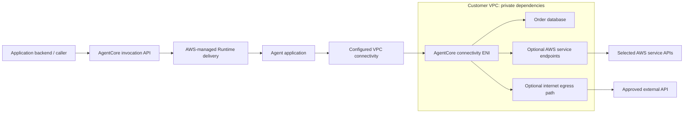
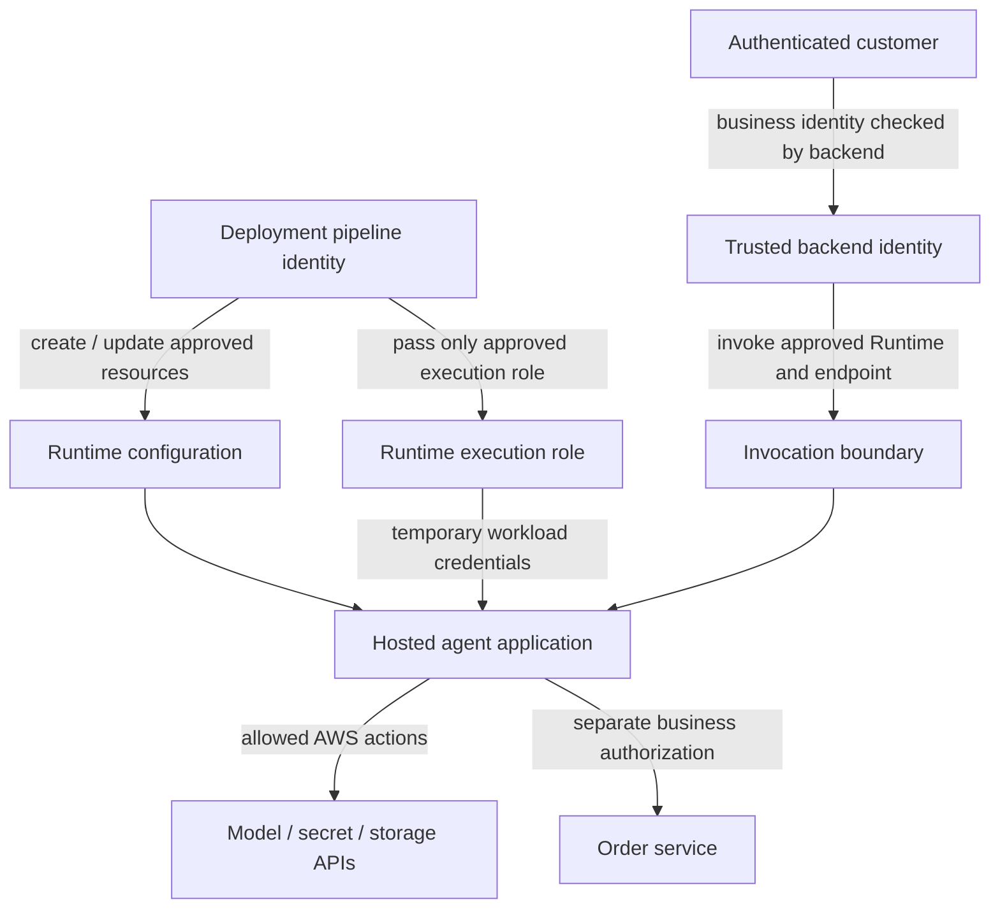
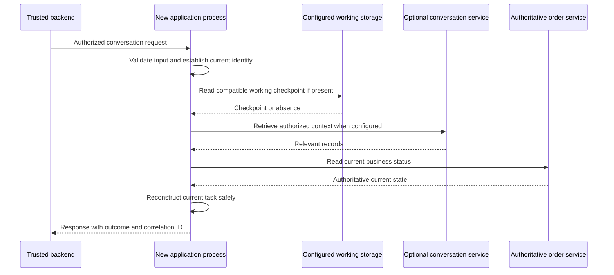
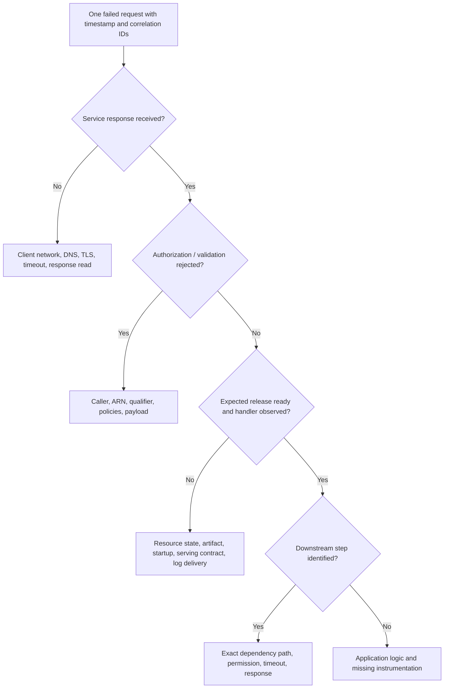

# Phase 4 - Networking, Security, State, and Operations

**Complete reading document | Edition: 4 November 2026**

Phase 3 explained a live request and the execution context around it. We now ask what that context can reach, which authority allows the action, what information survives it, and what evidence tells us whether the system is working.

These are not four unrelated product inventories. They are successive questions about the same application. A failed database request can involve a network path, an execution-role permission, a dataset policy, or the application itself. A successful response does not establish persistence or a correct audit record. We will separate those boundaries before recombining them in a practical investigation.

The storage discussion explicitly distinguishes process memory, temporary files, managed session storage, customer-provided filesystems, Instances volumes, and external conversation records. Treat each according to its own owner and lifecycle.

## Reading sequence

- [Module 11 - Following the Network Paths Instead of Guessing at Connectivity](#module-11)
- [Module 12 - Following Authority Through the Runtime](#module-12)
- [Module 13 - Deciding What Must Survive the Process](#module-13)
- [Module 14 - Operating the System with Evidence](#module-14)

The chapters below are complete, not summaries of the individual module files. Read either format; you do not need to read both copies.

---

<a id="module-11"></a>

## Module 11 - Following the Network Paths Instead of Guessing at Connectivity

**Phase 4: Networking, security, state, and operations**  
**Driving question:** How does our running application reach a caller, a private dependency, and an AWS API?  
**Reading context:** Phase 3 established the execution environment. We now follow the connections entering and leaving it.

Our no-model probe works. A request reaches the selected release, the handler returns its build marker, and repeated requests demonstrate the expected session behavior. We then add an order lookup against a private database. Suddenly the request waits and fails.

Nothing about this observation proves that Runtime stopped working. The earlier experiment demonstrated one path: a client could invoke our application. The new experiment introduced another path: the application must reach the database. Success on the first path says little about the second.

This chapter develops a network diagram that we can actually use during an incident. Its AWS-specific mechanisms supplement the transcript, which does not trace these VPC paths. The examples are deliberately small: one client, one Runtime, one database, and optional service endpoints. We add a network dependency only when there is a reason for it.

### 11.1 Draw inbound invocation and outbound dependency paths

Start by naming the initiator of every connection. Our client initiates a request to an AgentCore service API. AgentCore delivers the invocation to the configured application. The application initiates a different connection to the order database. A model call is another application-initiated connection, not an extension of the client's original TCP connection.

This distinction explains a surprisingly common debugging error. An engineer successfully invokes the Runtime and concludes that networking is configured correctly. In reality, they have established only that the invocation path worked. Database routing, the database's security rules, its listener, and its own authentication remain untested.

The following diagram shows logical paths and ownership boundaries. It intentionally does not invent internal AWS routers, load balancers, or host interfaces.



For an actual design, annotate each application-initiated arrow with destination name, transport, port, authentication method, and owner. Those five attributes turn a generic architecture picture into a testable connectivity contract.

Our order lookup might use a database hostname and its configured TLS port. Our model client uses the model service's HTTPS endpoint. An external support tool uses its own HTTPS hostname. The shared fact that all three requests originate in an agent does not make them the same network requirement.

### 11.2 Separate public API reachability from application egress mode

The word *public* causes confusion because it can describe different interfaces. A publicly reachable AWS API is not the same thing as an application process that accepts unauthenticated internet connections. A Runtime with public-network access is not necessarily an unauthenticated agent. A private dependency path does not automatically require the original caller to be inside the same VPC.

AgentCore exposes an authenticated service invocation interface. It also supports private access to that interface through AWS PrivateLink. Separately, the Runtime's network configuration determines how its workload reaches dependencies. Treat these as separate design decisions. [R08][R20][R21]

Imagine our support frontend runs outside the workload VPC but has an approved authenticated invocation path. Its agent can still require access to a database that has no public endpoint. Conversely, a backend can privately invoke an agent that only needs publicly reachable external APIs. Neither example is contradictory once we identify the two directions.

When someone says, "Make the agent private," ask a more precise architectural question: Are we restricting who can invoke the service, which network path callers use, where the agent can send traffic, or all three? Each answer requires its own control. We should not expect a single subnet setting to implement the entire policy.

### 11.3 Compare PUBLIC and VPC configurations

A useful decision starts with the dependency inventory, not with a preference for a label. Does the application require an internal database or an API reachable only through company networks? Does it need controlled egress through enterprise networking? Does it require a supported filesystem integration with VPC connectivity? Those requirements can justify the VPC branch.

AWS documents PUBLIC and VPC networking for the microVM model. VPC configuration supplies subnets and security groups for the connectivity path. Instances is a different compute branch with EC2 resources in the customer's account and its own capacity-provider network configuration; do not assume every microVM setting transfers unchanged. [R20][R03][R70]

For our first no-model probe, a more complex network path would add variables without teaching us anything about model or database access. Once the probe works, we can introduce the private dependency intentionally and compare the two observations. This is a learning sequence, not a blanket recommendation that production agents should begin with unrestricted public egress.

A production configuration should reflect approved dependency paths. Optional internet access is a capability to justify, not an automatic consequence of needing one private database. Likewise, a private network without the service endpoints or egress necessary for its dependencies is not a complete configuration simply because it is restrictive.

### 11.4 Understand ENIs, subnet choices, and connectivity ownership

Now we need the concrete attachment point. For Runtime VPC connectivity, AWS documents network interfaces in the customer's specified subnets, created using the service-linked role `AWSServiceRoleForBedrockAgentCoreNetwork`. The interfaces have private IP addresses and associated security groups. They provide connectivity; they are not evidence that the entire serverless microVM host is an EC2 instance deployed into our account. [R20]

This distinction matters when comparing AgentCore with an EKS workload. In EKS, our existing mental model may include a Pod address, node interfaces, and a Kubernetes networking implementation. We cannot copy that diagram onto a managed Runtime simply because we see an ENI. Instead, label the ENI according to the documented service relationship.

An ENI count is also not a reliable session count. AWS documents sharing across agents using the same subnet and security-group configuration, and delayed removal after deletion. Therefore, a leftover interface is not by itself evidence of a still-running session or a leaked application. Review its service ownership and documented cleanup behavior before attempting changes. [R20]

Subnet selection now has specific implications: supported Availability Zones, available address space, route-table associations, and access to dependencies. We should record these as platform inputs rather than allow each application author to guess subnet identifiers. The application team declares its connectivity need; the network owner supplies an approved path.

### 11.5 Follow security groups, routes, and network ACLs

Suppose the application tries to connect to the order database. We can reason about the path without seeing AWS's internal implementation. The source connectivity interface needs an allowed outbound path. Routing must direct packets toward the destination. The destination's security controls must permit the connection. The destination service must be listening. Finally, the application protocol and authentication must succeed.

Security groups are stateful: allowed connection response traffic is handled differently from a new independently initiated connection. Network ACLs are subnet-level and stateless, so a restrictive ACL must account for traffic in both directions. These mechanisms should not be treated as interchangeable copies of the same rule set. [R22][R23]

Consider an authored example: a database allows connections from the approved Runtime security group on the database's TLS port. The Runtime group allows that destination. If a custom ACL blocks the return traffic, the security-group relationship alone does not prove the connection works. If routing points the destination prefix somewhere unexpected, opening the security group further does not repair the route.

Do not solve a timeout by immediately permitting every port from every address. First locate the boundary that failed. A narrow correction preserves the intended security design and teaches us what the system actually needed. A broad allow rule may hide the root cause and create unrelated access.

Similarly, an inbound rule on the Runtime's connectivity security group is not the equivalent of publishing the application's `/invocations` port. Clients use the managed invocation interface. Avoid creating a fictional direct path from a customer's browser to an ENI merely because both exist in the diagram.

### 11.6 Trace DNS and internet egress where required

Before a TCP connection can use a hostname, the workload needs a useful DNS answer. VPC DNS settings, private zones, and resolver configuration therefore belong in the network design. A hostname that resolves on a developer's laptop may resolve differently, or not at all, in the workload's environment. [R24]

The correct debugging question is not just, "Can this name be resolved?" It is, "What address does this environment receive, and is that the intended private or public path?" A valid public answer can still be wrong for a design intended to use a private interface endpoint. A valid private answer can still point to a destination for which no permitted route exists.

For ordinary internet access through the documented IPv4 VPC configuration, placing the connectivity interface in a subnet named *public* is insufficient. AWS explicitly notes that the interface has a private address and recommends private subnets with a NAT Gateway route when internet access is required. [R20]

NAT solves an address and routing problem. It does not supply database credentials, authorize a Bedrock request, or validate a TLS certificate. Therefore, after a NAT change, we still need to test the exact dependency protocol. An HTTPS authentication error can be progress relative to a connection timeout: the request may now reach a service that is rejecting the caller at a higher layer.

Use the narrowest safe diagnostic first. A DNS lookup observes name resolution. A TCP connection test observes a listener path. A TLS handshake observes the secured transport boundary. An authenticated request observes the application operation. Ping or traceroute is not a universal substitute: success or failure on another protocol does not establish the behavior of the required HTTPS call.

### 11.7 Distinguish PrivateLink endpoints from Runtime endpoints

We have used *endpoint* in three ways, so let us stop and separate them. A Runtime endpoint such as `LAB` selects a deployed configuration version. A regional AgentCore API endpoint is the service address the caller uses. An interface VPC endpoint supplies private network access to a supported AWS service. [R13][R21]

Changing `LAB` from one version to another is a release-routing operation. Creating an interface VPC endpoint is a networking operation. Neither action automatically performs the other.

AgentCore documents separate PrivateLink service names for its data plane and control plane, plus a Gateway-specific service endpoint. A caller that only invokes Runtime needs the relevant invocation path; a deployment runner managing resources has control-plane requirements. A Runtime-only baseline does not need an AgentCore Gateway endpoint merely because both products share the AgentCore name. [R21]

Private DNS can allow clients to keep using a regional service hostname while resolving it through the private endpoint. The endpoint's security group and endpoint policy then become additional controls to inspect. A private path is not a permission grant; a permissive endpoint policy does not replace the Runtime's configured authorization. [R21]

In a packet-path diagram, keep the caller's PrivateLink interface distinct from the agent's VPC connectivity interface. They may be in the same customer VPC, but they serve different directions and have different ownership purposes. Mixing them is the source of many mistaken security-group changes.

### 11.8 Trace Bedrock, S3, databases, and external APIs individually

We can now add dependencies without losing the model. A database connection targets its private service. An external API may need approved internet egress. Bedrock inference targets a separate AWS service interface. Object access targets S3. The destination, network path, and authorization must be valid for each.

AWS's AgentCore VPC guidance also identifies infrastructure dependencies for artifact and telemetry paths. In a network without internet access, the documented endpoint requirements can include ECR API and registry access, S3 access for layers or artifacts, and CloudWatch Logs. Additional model or application integrations introduce their own requirements. Check the actual deployment mode rather than treating this as a universal list to create blindly. [R20]

S3 gateway endpoints are a different mechanism from interface endpoints: they participate through route-table configuration. Their policies also need to permit required buckets, including service-owned artifact buckets where applicable. An endpoint policy restricted only to our business-data bucket can unintentionally break a required artifact path. [R25]

Here is a compact design worksheet for our example. The rows are proposed requirements, not a claim that every AgentCore deployment needs every destination.

| Connection | Why it exists in this example | Evidence we would collect |
|---|---|---|
| Caller to AgentCore | Invoke the selected release | Service request ID and response status |
| Agent to order database | Read authorized order information | Connection result and redacted query outcome |
| Agent to Bedrock | Generate a model response | Model API status and downstream request ID |
| Artifact or logging dependency | Prepare and observe the release | Deployment status and delivery evidence |
| Agent to external support API | Optional integration | Approved destination and authenticated result |

This table is useful because it separates mandatory infrastructure dependencies from optional application behavior. It also prevents the team from interpreting a successful model call as proof that the order database works.

### 11.9 Plan cross-account access without assuming connectivity

Our platform account may differ from the account containing the order service. There are two independent questions: can packets reach the service, and is the requesting identity authorized to use it? Cross-account IAM permission does not create a network route. Network connectivity does not create permission to read an order.

For a private service, the network team must choose and validate the supported connectivity pattern for that service and topology. We do not prescribe peering, a transit gateway, or PrivateLink solely because the accounts differ. Each option changes routing, DNS, policy, and operational ownership. The correct choice follows the dependency's exposure model and organizational constraints.

For a supported AWS API with resource-based access, the service's IAM rules are a separate part of the design. AgentCore itself documents resource policies for cross-account access to Runtime resources and endpoints. We will study that authorization boundary next, rather than suggesting that a VPC connection solves it. [R29]

The platform worksheet should therefore have separate approval fields for network path and permission path. During an incident, this produces a concrete question for each owner instead of a vague request to "enable cross-account access."

### 11.10 Build a layered connectivity troubleshooting method

Return to our initial timeout. We now have a disciplined investigation. First confirm that the expected release handled the invocation. Then identify the exact downstream destination and the layer at which the application stopped. Check name resolution, intended address, route, connection controls, listener, TLS, and application authorization in that order of dependency, adapting to the observed error.

A certificate error and a connection timeout are not equivalent evidence. An AccessDenied response from an AWS API is different again. Do not restart the session, change its IAM role, and broaden its network policy simultaneously. That experiment cannot tell us which change mattered.

VPC Flow Logs can provide interface-level traffic evidence for supported traffic, including information useful for investigating accepted or rejected flows. They do not contain the full application payload or prove a successful business operation. Use them alongside application and service evidence, not as a replacement. [R26]

Our safe practice exercise is to inspect configuration and perform one approved, non-mutating dependency request. Deliberately breaking production DNS, deleting service-owned interfaces, or opening unrestricted access is unnecessary. A disposable environment can reproduce a selected failure, provided its owner has approved the change and rollback.

At the end of this module, the network is no longer a single cloud around the application. It is a set of named, directional paths. We can explain where connectivity enters our VPC, which control applies to each connection, and which evidence would distinguish a routing problem from an authorization problem. The next chapter takes the request that successfully arrives and asks whether it should be allowed to act.

### Reasoning checkpoint

**Question 1:** A client invokes `LAB` successfully, but the agent cannot reach a private database. Which conclusion was premature?

<details>
<summary>Reasoning guide</summary>

The successful invocation verified the caller-to-Runtime path, not the application-to-database path. Inspect the database destination, VPC configuration, DNS, routes, security controls, listener, and database authentication independently. Do not start by changing the Runtime endpoint qualifier.

</details>

**Question 2:** Why is an AgentCore connectivity ENI not evidence that the serverless microVM runs as a customer-managed EC2 instance?

<details>
<summary>Reasoning guide</summary>

The documented purpose of that ENI is VPC connectivity. Network attachment ownership and compute hosting ownership are different boundaries. Instances compute is the separate model that explicitly provisions managed EC2 resources in the customer's account.

</details>

**Question 3:** We added a private AgentCore endpoint, yet calls still fail with an authorization response. Has PrivateLink failed?

<details>
<summary>Reasoning guide</summary>

Not necessarily. The response may show that the private path reaches the service. Endpoint policy, caller credentials, Runtime authorization, and resource permissions remain separate checks. Confirm which layer produced the rejection before changing networking.

</details>

---

<a id="module-12"></a>

## Module 12 - Following Authority Through the Runtime

**Phase 4: Networking, security, state, and operations**  
**Driving question:** Which identity is allowed to perform each action, and where does that authority stop?  
**Reading context:** Module 11 established how requests can arrive. Connectivity is now necessary but insufficient: a reachable operation may still be forbidden.

Our support agent can reach the order service. The next customer asks for order 10. Before returning anything, the system must establish whether that customer is entitled to see that order. The network cannot answer this question. Neither can the fact that the agent is running in an isolated microVM.

This is where infrastructure security becomes more precise than a single statement such as "the agent has an IAM role." Several actors participate in deploying and using the application. They need different kinds of authority. If we merge them into one powerful identity, a convenient development setup can become an unsafe platform boundary.

The transcript introduces inbound and outbound identity conceptually. This module adds the documented AWS permission boundaries and an authored application authorization model. It does not claim that AgentCore automatically derives every business permission from an end user's identity.

### 12.1 Map deployment, invocation, and execution principals

Return to our deployment flow. A pipeline creates or updates a Runtime. Later, a backend invokes it. During execution, the application reads a secret and calls a model or business service. These are three distinct actions by three potentially distinct principals.

The **deployment principal** changes the infrastructure configuration. The **invocation principal** calls the hosted service. The **execution principal** supplies the authority available to code running in the application environment. AgentCore's documented execution role is the role the service assumes for workload operations. The service-linked network role discussed previously serves a separate infrastructure purpose. [R27][R20]

Here is the authority map for our proposed example. The arrows show authorized responsibilities, not network connections.



The backend does not automatically need permission to change the deployed image. The pipeline does not automatically need to read every customer order. The runtime application does not automatically need to modify its own role. These separations are design choices we should preserve even when a broad development policy makes everything initially work.

The first review question is therefore concrete: for each arrow, which principal performs it, which policy grants it, and which resource is in scope? "AWS manages it" is not an answer to all three.

### 12.2 Separate trust policies, permission policies, and PassRole

A role has two relationships that must not be confused. Its trust policy determines who can assume it. Its permission policies determine what its resulting credentials can do. The identity configuring a service to use that role also needs the appropriate `iam:PassRole` authority. [R31]

Think of an approved execution role as a restricted set of operational powers. The trust relationship allows the intended service to receive those powers. PassRole controls who may attach that set of powers to a service configuration. Permission statements then constrain the operations made using the credentials.

This distinction is especially useful when reading an IAM error. Adding a `Principal` to an identity permission policy is not the fix for a missing trust relationship. Giving the deployment pipeline a model permission does not grant that permission to the hosted application. Allowing the service to assume a role does not by itself give the role permission to retrieve a secret.

AWS documents the AgentCore service principal in its execution-role setup and recommends restricting the trust relationship with applicable source-account and source-resource conditions. The exact ARN pattern must match the intended resource scope; do not copy an account number or runtime name from an example. [R27][R30]

PassRole also has a crucial account boundary: a role passed to a service must be in the same account as that service resource. Cross-account operations require an appropriate role/resource-access design rather than passing an arbitrary foreign-account role directly. Scope PassRole to approved role ARNs and, where appropriate, the intended service. [R31]

There is another consequence worth deriving. A pipeline permitted to replace an application's code can cause that new code to exercise the application's execution permissions. Therefore, code-deployment access is part of the security boundary around the execution role. Protecting the role policy while allowing unreviewed code replacement is not sufficient.

### 12.3 Study the IAM SigV4 invocation path

Our lab client uses the IAM path. Boto3 obtains credentials through its configured credential chain, signs the service request, and sends the Runtime ARN, endpoint qualifier, session identifier, and payload. The application does not need an AWS access key pasted into the JSON body. [R08][R09]

The service evaluates authorization for the requested resources. Current AgentCore guidance describes hierarchical authorization involving both the Runtime and the endpoint being invoked. Review the relevant action/resource definitions when writing the caller's policy, rather than granting an arbitrary wildcard because one resource-specific attempt failed. [R29][R36]

A useful test matrix distinguishes permission to invoke `LAB` from permission to invoke a production endpoint, update the Runtime, or execute commands in a session. Those are not merely different buttons for the same authority. Our learning client deliberately implements a narrow set of actions and does not expose a general command-execution interface.

Now imagine a customer-facing backend uses one IAM role to invoke all customers' sessions. AgentCore sees a trusted workload caller. That does not, by itself, establish which human customer owns each business conversation. The backend must verify the customer and choose the authorized session mapping before invoking. We will return to that mapping in section 12.8.

If invocation is rejected before our handler logs a start event, investigate the caller and service boundary first. Broadening the application's execution role is unlikely to repair the caller's missing invocation permission. The role names can look similar, but their positions in the request flow are different.

### 12.4 Compare supported JWT-based inbound authorization

Some callers naturally carry a token issued by an identity provider rather than AWS credentials. AgentCore supports JWT-based inbound authorization as an alternative to the default IAM mechanism. The configured issuer and accepted token properties determine which tokens can be used; the documented bearer-token invocation flow differs from a normal SigV4 SDK request. [R28]

A token is not trusted because it has three dot-separated sections or contains a plausible email address. Its validation is what establishes the claims the system may rely on. Our application must also distinguish authenticated identity from authorization to a specific order, workspace, or tool operation.

For the support example, a validated customer identity can be mapped to a business account. The order service then verifies that order 10 belongs to that account. A model-generated sentence saying "the user is an administrator" cannot replace that lookup. Language-model output is data to evaluate, not an authority source.

A forwarded `Authorization` header also needs a defined purpose. Does the downstream system expect that token and audience? Is the application allowed to forward it? Does the forwarding configuration preserve only the headers required for the flow? Avoid treating token propagation as a generic substitute for a deliberate downstream authorization design.

There is a networking nuance from Module 11: PrivateLink endpoint policies identify IAM principals, not arbitrary OAuth users. AWS documents special policy considerations for bearer-token requests through those endpoints. A wildcard principal required at that particular network-policy layer does not mean removing JWT validation or business authorization elsewhere. [R21]

### 12.5 Introduce workload identity and outbound credentials where needed

The next action leaves Runtime. Our application may call an AWS service using its execution credentials, or an external provider using an OAuth token or other approved credential mechanism. The fact that the incoming caller passed authentication does not automatically supply the correct credential for every outgoing service.

AgentCore documents temporary execution-role credentials exposed through its microVM metadata mechanism. Code inside the environment can access those credentials, which makes the execution role's scope a real containment boundary. We should not assume that a prompt instruction can hide credentials from arbitrary code running in the same trusted environment. [R32]

For external services, AgentCore Identity can support outbound credential flows when that capability is configured. It is an integration to design, not a mandatory replacement for every AWS SDK call. A Runtime that only invokes a permitted AWS model does not require a separate third-party OAuth provider merely to exist. [R28]

Consider a support integration that acts on behalf of the customer in an external system. We need to establish whose credential is used, what scopes it grants, how consent or authorization is obtained, when it expires, and how revocation is handled. A service-account integration has a different risk model from a per-user delegated integration.

The transcript's broad description of automatically scoped tokens is therefore an intuition, not a complete security specification. We must inspect the chosen flow. In particular, AWS warns that the optional user-ID invocation header is a trusted-workload delegation path, not cryptographic proof of the end user's identity. Its additional permission should not be granted to untrusted callers. [R28]

### 12.6 Retrieve and refresh secrets without baking them into artifacts

A secret belongs to a credential lifecycle, not to an immutable image layer. Suppose our order API uses a service credential. Putting its value into the container image means anyone authorized to retrieve the image may obtain it, and rotating it requires replacing every affected artifact. Putting it into a Terraform variable can also place it in state.

A more deliberate design passes a non-secret identifier and retrieves the secret through a permitted runtime path. AWS Secrets Manager exposes secret-value retrieval APIs and recommends appropriate client-side caching. The application still needs a refresh strategy, correct permissions, and safe error handling; caching forever is not a rotation plan. [R33]

For V2 snapshot-based startup, the timing becomes especially important. A credential captured during initialization can be stale when a later environment serves requests. Use the documented credential providers and request-time refresh behavior rather than freezing expiring values into prepared startup state. [R02][R32]

Our no-model probe intentionally does not read secrets. When we add a secret-backed integration, the first test should verify retrieval without printing the value. Record the secret identifier or a safe reference, success/failure category, and timing. Do not log bearer tokens, session cookies, AWS credentials, or the complete secret response.

Failure handling must preserve this boundary too. An exception's raw representation can contain sensitive configuration. A helpful operational record identifies the failing service and request ID without exposing the material that would allow someone else to authenticate.

### 12.7 Constrain model and tool access with least privilege

We now have a running process with specific authority. The next question is how much authority it needs. Our customer-support use case may require reading order status, but not deleting an account, modifying production infrastructure, or issuing an unrestricted refund.

Start from operations, not product names. "Access to S3" is too broad to describe whether the application can read a particular prefix or delete every bucket object. "Access to Bedrock" does not identify the permitted inference operations and model resources. Use the relevant service authorization reference to match actions with resource and condition support. [R36][R18]

For an authored least-privilege review, describe the operation in plain language first: "Read a sanitized order record for the authenticated customer's account." Then identify the enforcing service. If the order API has a purpose-built operation that applies ownership checks, granting the agent that operation can be more appropriate than granting direct access to an entire database.

This also explains why tool discovery is not tool authorization. Exposing only a tool's schema to a model can reduce accidental selection, but the tool's implementation and service permissions must still reject forbidden operations. A malicious or mistaken invocation should fail at an enforceable boundary, not depend on the model declining to attempt it.

For V2 workloads, AWS documents a session-source IAM context key, `aws:AgentCoreRuntimeSourceSid`, for supported session-scoped resource policies such as custom mount access. That is a useful additional mechanism when correctly configured. It is not a replacement for mapping a session to an authenticated customer, and it must not be confused with API request condition keys. [R35][R36]

### 12.8 Bind session access to authenticated application identity

We can now make the most important application boundary explicit. A Runtime session identifier selects an execution context; it is not a password and does not by itself prove ownership. AWS explicitly places responsibility for session-to-user mapping on the application backend. [R30]

Our proposed backend stores a relation among the authenticated tenant, customer, business conversation, Runtime resource, endpoint policy, and session ID. When a message arrives, the backend looks up the authorized conversation and uses the associated Runtime session. It does not accept an arbitrary session ID from the browser and forward it unchanged merely because the browser is logged in.

Imagine customer B submits customer A's session ID. A random-looking UUID makes guessing harder, but it does not answer whether B is authorized to use it. The backend should reject the mapping before invocation. Likewise, the agent should not trust a payload field called `customer_id` without knowing which trusted component populated and authenticated it.

Concurrency and lifecycle matter here too. Limit how many active sessions a customer can create, define how long mappings remain valid, and determine who may stop or delete a conversation. Those are proposed application policies, not universal AWS defaults. A stopped environment does not automatically revoke the backend's logical mapping.

The microVM then protects the authorized session's compute boundary. It does not repair an authorization mistake that deliberately routed the wrong user into that session. Isolation and access control cooperate; neither eliminates the need for the other.

### 12.9 Review encryption and KMS responsibilities

Encryption protects data under specific conditions; it is not one global property attached to the word *agent*. Identify the transport, artifact store, log destination, filesystem, conversation store, and secret store separately.

AWS documents encryption for AgentCore-managed data and service transport. Customer-controlled stores and the selected compute/storage branch have their own configuration and key responsibilities. Do not infer that a single Runtime setting configures every S3 bucket, EFS filesystem, log group, and downstream database. [R34][R63]

The Instances branch deserves particular care. Its EBS encryption behavior follows the documented capacity-provider configuration and account/Region defaults. Explicitly inspect encryption and KMS settings rather than assuming that all managed instance volumes inherit an unrelated Runtime encryption choice. [R39]

For our platform, the review record should name who owns each key and who can disable or schedule deletion of it. A service can have correct IAM permissions and still lose access when a required key is unavailable. Key lifecycle is therefore an operational dependency, not just a compliance checkbox.

We also need to avoid placing confidential content into resource names and tags. Those fields are intended for identification and management, not as a substitute for an approved data store. The diagnostic build marker should identify a release, not contain a customer's question or an embedded credential.

### 12.10 Model tenant and cross-account security boundaries

We can now assemble the security model without pretending that one control solves everything. Account boundaries separate administration. Runtime roles constrain workload actions. Invocation policies constrain callers. The application binds customers to sessions and business resources. Network controls constrain connectivity. Storage policies constrain shared data access.

For cross-account Runtime invocation, AWS documents explicit resource permissions on both the Runtime and the selected endpoint, alongside the caller's applicable identity permissions. Review organization policies, permission boundaries, resource policies, and explicit denies when an apparently permitted call is rejected. [R29]

Our platform proposal should record which teams are trusted to deploy arbitrary code, which are only allowed to supply configuration, and which can invoke an existing service. These trust levels justify different role boundaries. Do not give every team the same powerful deployment role solely because their Runtime resources use the same Terraform module.

Finally, remember the Instances distinction: agents intentionally co-located in one session do not become mutually untrusted tenants simply because they are separate Runtime resources. The shared compute and credential-access boundary must match the documented trust assumptions. [R05]

The chapter's complete model is now a chain of authority. A deployment identity selects approved code and execution powers. An authenticated caller requests a permitted operation on a specific release and session. The application performs only authorized downstream actions. The next chapter asks what happens to the resulting information when the process that produced it no longer exists.

### Reasoning checkpoint

**Question 1:** The pipeline can create a Runtime, but its application gets AccessDenied from Secrets Manager. Why might more pipeline permissions be irrelevant?

<details>
<summary>Reasoning guide</summary>

The secret request is made with the workload's execution identity, not necessarily the pipeline identity. Inspect the role actually configured on the invoked version, the secret/resource policy, the key permissions where relevant, and the network path. Do not merge deployment and execution identities.

</details>

**Question 2:** A customer supplies a valid session UUID that belongs to someone else. What prevents access?

<details>
<summary>Reasoning guide</summary>

The backend must enforce the authenticated user-to-conversation-to-session mapping. A UUID's shape and unpredictability are not an ownership check. Compute isolation cannot prevent a backend from deliberately selecting the wrong context.

</details>

**Question 3:** Why should permission to update agent code be reviewed together with the execution role?

<details>
<summary>Reasoning guide</summary>

New code can use permissions available inside the execution environment. A principal able to replace that code may indirectly exercise those powers. Protect the release pipeline and constrain the execution role as parts of the same trust boundary.

</details>

---

<a id="module-13"></a>

## Module 13 - Deciding What Must Survive the Process

**Phase 4: Networking, security, state, and operations**  
**Driving question:** Which information must survive, and which system is responsible for keeping it?  
**Reading context:** We can now host, connect, and authorize the application. We need to decide what happens to its work when execution stops.

A customer asks our support agent to investigate an order. The agent reads the order, prepares a draft explanation, and remembers the conversation in a Python object. The customer leaves. Later, the same session is invoked on replacement compute.

The session identifier still exists. The original Python object does not.

This is not a contradiction. An identifier tells us which logical interaction we are resuming. It is not a storage device. To recover useful context, the application must have placed that context in a storage system whose lifecycle survives the event we are testing.

The transcript demonstrates a separate Memory service, but that does not describe every form of Runtime state. Current AWS documentation also describes managed session storage, customer-provided filesystems, and Instances volumes. We will distinguish those documented mechanisms from the authored recovery design, rather than calling them all "memory."

### 13.1 Separate process memory, files, conversation records, and business state

Start with the information, not the product catalog. Our application contains several kinds of state with different meanings.

A parsed configuration object can be reconstructed from the deployed release. A downloaded reference file may be a cache. A partially prepared response may be useful working state. A conversation record preserves what the user said. A completed refund is a business fact owned by the transaction system.

These objects should not inherit the same durability requirement merely because one agent touched them. Losing a cache may be inconvenient but recoverable. Losing the only record of an approved refund can be a correctness problem. Keeping every temporary file forever can create unnecessary cost and sensitive-data exposure.

A useful exercise is to label each state item with four questions: What creates it? Who owns the authoritative copy? Which events must it survive? What should eventually delete it? This is our proposed design method, not an AWS API schema.

For the support example, the order service remains authoritative for order status. The conversation store can be authoritative for conversation history. A session directory may contain a working draft. Process memory holds the currently loaded representation. We should be able to reconstruct the last two from the right durable sources when appropriate.

The resulting model already explains why microVM isolation is not a complete persistence design. Isolation answers who shares an execution environment. Durability answers which information remains after that environment disappears. The two concerns cooperate but are not interchangeable.

### 13.2 Observe default temporary-state behavior

Return to the diagnostic application. On the first invocation it creates a process marker and increments a counter. The second invocation in the same live process returns the same marker and a higher count. After a controlled microVM stop and recreation, the marker changes and the process-local count restarts.

That is the observation we expect from ephemeral execution state. It should not be described as a lost conversation unless we deliberately stored the conversation only in that process. The general session guide describes the default ephemeral context and the need for a separate persistence mechanism. [R06]

A file written somewhere in the application's ordinary temporary filesystem has a similar problem. A pathname is not a durability guarantee. Writing `/tmp/checkpoint.json` does not create a managed checkpoint service. Creating a directory called `/mnt/persistent` does not attach persistent storage.

Our lab therefore makes a useful distinction between a configured directory and a verified mount. It refuses to silently create a missing persistence root. Even when the directory exists, it warns that existence alone does not prove that AWS mounted a persistent service there. Deployed configuration plus a controlled lifecycle experiment supply stronger evidence.

This is why the baseline experiment comes before enabling storage. We first establish what is lost. We can then observe exactly what the new mechanism preserves instead of assuming that every surviving value came from the same place.

### 13.3 Study managed session storage and its retention boundaries

Suppose our agent needs a working directory that survives a normal stop and resume of the same microVM session. Managed session storage addresses that requirement. AWS currently labels it **Preview**. The service replicates files from a configured session-specific mount and restores them for a later invocation of that session; graceful shutdown includes a flush of pending data. [R71]

The key word is *files*. A restored JSON file does not automatically become a restored Python object. Our new process must open the file and interpret it. An interrupted function does not resume at the exact CPU instruction where it stopped merely because its output directory is available.

There are two especially important lifecycle boundaries in the current documentation: session storage expires after fourteen days without invocation, and a Runtime version update gives the session a fresh filesystem on the next invocation. The mount is available during invocation rather than application initialization. These details make session storage a conditional working-state mechanism, not a universal release-independent system of record. [R37]

For our authored example, storing a draft response can be reasonable if losing it after a release is acceptable. Storing the only authoritative approval to refund an order would be a poor fit unless the application separately records that decision in the business system. The choice follows the data requirement, not the convenience of a file API.

The safe experiment is deliberately narrow. Use one disposable microVM Runtime, one known version, one synthetic session, and one small record. Invoke, write, read, stop cleanly, allow the stop transition to finish, and invoke again. Compare both the fresh process marker and the retained file marker. Do not mix an endpoint promotion into this first test; that would introduce a documented reset boundary and confuse the result.

Asynchronous replication also deserves precise language. A local successful write or rename demonstrates local filesystem behavior. It does not independently establish a zero-loss guarantee for every abrupt failure. The documented graceful-stop behavior and an uncontrolled crash are different cases. Record which one the experiment actually tested. [R71][R74]

### 13.4 Evaluate customer-provided filesystems

Now change the requirement. Several approved sessions need the same reference files, or the data must outlive one Runtime release. Per-session working storage is no longer the whole solution.

AgentCore supports customer-provided Amazon EFS and Amazon S3 Files integrations for microVM runtimes. These mounts are for customer-owned data that can be shared across sessions or agents. Their setup introduces network and permission requirements; they are not simply another spelling of managed session storage. [R72][R37]

EFS access points can define an application-specific filesystem entry and root, with associated identity behavior. Mount targets provide network connectivity. This distinction mirrors our earlier networking lesson: the access point and the network attachment have different responsibilities. [R61]

Amazon S3 Files is a filesystem service connected to S3 data, with synchronization between its filesystem view and the bucket. It should not be confused with a plain S3 object API call or an arbitrary directory created by the application. File-to-bucket synchronization semantics must be considered when another consumer reads through the S3 API. [R62]

For our support application, an approved shared reference dataset might be mounted read-only. Conversation-specific working files should use an explicitly authorized namespace rather than a globally shared `current_customer.json`. A naming convention can reduce collisions, but it is not itself a security boundary. Permissions and application authorization must enforce the intended access.

Shared storage creates shared-state questions. What happens if two sessions update the same file? Is the application using an atomic replacement, a lock supported by the selected filesystem, or a service with conditional updates? Which writer wins? The dedicated microVM around each process does not solve coordination on a shared external path.

Also avoid transferring permission assumptions from one storage type to another. The managed session-storage documentation describes limitations in its permission enforcement. EFS has its own documented access-point and filesystem controls. Treat the selected mechanism's actual semantics as the contract, not the fact that both expose a Unix-like path. [R37][R61]

### 13.5 Study the Instances storage branch separately

Instances changes the infrastructure owner and lifecycle. Persistent volumes are defined on a capacity provider, then mounted by the participating Runtime using a logical volume name. The service creates EBS resources in the customer account. Root and ephemeral volumes remain temporary; only the designated persistent volumes have the documented retention behavior. [R38][R39]

This is a good place to slow down over the word *stop*. The operation-specific Instances guide says `StopRuntimeSession` stops one agent runtime within the shared session without necessarily terminating the EC2 instance or affecting the other agents. Instance idle/lifetime termination and `DeleteCapacityProviderSession` are different events. The latter deletes the session's persistent volumes. A generic phrase such as "stop the session" is not precise enough for a multi-agent Instances runbook. [R38]

We preserve that distinction rather than silently treating the generic filesystem walkthrough as a specification for every stop API. The provided lifecycle lab stays on microVMs. An Instances experiment must explicitly identify whether it is stopping an agent, waiting for instance termination, or deleting a capacity-provider session.

Suppose `support_planner` and `support_reviewer` intentionally share a capacity-provider session. They may share a configured volume, but each Runtime must reference the intended mount. Stopping the planner is not a request to destroy the reviewer's workspace. Deleting their shared session is a much larger operation.

There is an operational trap for engineers familiar with ordinary EBS administration. AWS documents that these managed capacity-provider volumes cannot be snapshotted using the normal snapshot operation. Export required data through an authorized application or command flow before deleting the session or provider. Do not design a backup plan around an operation the managed resource does not expose. [R38]

Encryption remains a separate configuration concern, as Module 12 established. A new capacity-provider encryption choice does not retroactively rewrite existing volumes. Treat a key or provider change as a migration with data-export, validation, and rollback decisions, not merely a new label on the same stored bytes. [R39]

### 13.6 Keep AgentCore Memory distinct from filesystem persistence

The transcript's memory demonstration now fits into the broader state model. AgentCore Memory exposes conversation/event and derived-memory capabilities through service APIs. It is not the application's Python heap and not a mounted filesystem. The agent must write or retrieve the relevant records and supply useful context to its model call. [R40]

Consider the question "What is my name?" A new compute environment can answer correctly if the application retrieves the appropriate conversation or user record from an external memory service. The process does not need to be the original process. Conversely, an old process that never retrieved the record cannot answer merely because a Memory resource exists somewhere in the account.

This is the same distinction the transcript demonstrates when storing messages initially fails to improve the response until retrieval is implemented. We retain that teaching point: persistence and context assembly are separate actions.

Do not infer that a short-term Memory record disappears exactly when Runtime compute stops. *Short-term* describes a memory purpose; its actual retention is governed by the Memory resource and event configuration. Runtime lifecycle and Memory lifecycle are different service boundaries. The original transcript's introductory simplification is not sufficient evidence for an automatic synchronized deletion policy. [R40]

A filesystem can store a serialized conversation too, but then the application owns its schema, access pattern, concurrency, and retention decisions. An external Memory service can provide a different access model. Neither choice removes the need to authorize the actor/session namespace and distinguish conversational context from authoritative business transactions.

### 13.7 Restore application context after compute recreation

We can now design recovery as an explicit execution flow. The following sequence is an authored application pattern, not a claim that AgentCore performs every step automatically.



Notice the order of trust. We establish the authorized context before using a caller-selected path. We check the checkpoint's schema and release compatibility before treating it as current state. We consult the business service before deciding whether an externally visible action already happened.

Imagine a checkpoint says "refund request sent" but not "refund confirmed." The correct recovery action is not automatically to send another refund. Query or reconcile the business operation using its durable idempotency key. Otherwise, recovering a file successfully can still produce an incorrect duplicate action.

A useful checkpoint therefore records more than a natural-language summary. In our proposed design it contains a schema version, logical task identifier, completed step markers, and references to durable external operations. It does not contain reusable secrets or assume that serialized network connections can be reopened by deserialization.

The point is not that every simple agent needs a sophisticated workflow engine. It is that the recovery mechanism must match the consequences of repeating its work. A read-only support answer and a payment-changing operation need different guarantees.

### 13.8 Handle consistency, partial writes, and recovery

The easiest recovery bug is a half-written record. Suppose a process overwrites its checkpoint and stops after writing only part of the JSON. The next process sees a file but cannot decode it. File existence is not equivalent to valid application state.

Our lab writes a temporary file and replaces the target path only after serializing a complete small record. It validates the record on read and reports an error instead of silently resetting corrupt data. This is an authored local-file safety measure. It is not a distributed transaction, a cross-process lock, or proof of remote storage replication.

For a shared filesystem, a lock in one Python process protects only that process's threads. It does not coordinate another session's process. A production design may require a supported filesystem lock, a single-writer rule, a database conditional write, or a durable workflow service. Select the mechanism from the actual sharing pattern.

Schema changes create another form of partial understanding. Build `support-r2` may interpret a checkpoint differently from `support-r1`. A successful code rollback does not necessarily reverse data already written in a new format. Release testing must therefore include compatibility and migration, not just an HTTP health check.

We also need a policy for absence. A missing optional cache can be rebuilt. A missing authoritative approval must not be invented. The application should know which category it is reading and react accordingly. This makes state recovery explainable instead of turning every missing file into an arbitrary exception handler.

### 13.9 Design retention, deletion, and workspace teardown rules

We can finish with a lifecycle inventory that follows ownership. This table is a design aid; the precise settings must come from the current storage and service configurations.

| State category | Proposed owner in our example | Teardown question |
|---|---|---|
| Process objects and ordinary temporary files | Runtime execution | Is loss acceptable on replacement? |
| Managed session working files | AgentCore session-storage configuration | Which reset/expiry/delete event applies? |
| Shared reference filesystem | Platform or dataset owner | Which other workloads still consume it? |
| Instances persistent volume | Capacity-provider session owner | Has required data been exported before deletion? |
| Conversation records | Application's conversation-data owner | What retention and user-deletion policy applies? |
| Orders and refunds | Business system owner | What independent audit and retention obligations apply? |

Deleting the Runtime is not a universal customer-data deletion operation. Shared filesystems and business records can outlive it. Conversely, deleting a shared capacity provider can remove data used by more than one agent. The cleanup plan must follow references and retention decisions rather than simply delete everything with a similar name. [R37][R38]

The chapter's final mental model is therefore a set of nested lifetimes. A request lives inside a process invocation. A process lives inside compute. Compute may be replaced while a logical session continues. Selected storage can outlive compute, but each store has its own ownership, retention, and deletion rules. Business facts may outlive all of those technical resources.

The next module asks how we observe these layers without conflating them. A log saying "session stopped" is not enough to establish what was billed, which operation failed, or which data remains.

### Reasoning checkpoint

**Question 1:** The process marker changes after resume, but a file marker stays the same. Is the experiment inconsistent?

<details>
<summary>Reasoning guide</summary>

No. The process was recreated while a configured storage mechanism restored a file. Process-memory continuity and filesystem persistence are different observations. Confirm the deployed mount configuration and the exact lifecycle event before drawing a storage conclusion.

</details>

**Question 2:** Why should the only authoritative refund record not live in a managed session working directory?

<details>
<summary>Reasoning guide</summary>

The business operation needs durability and reconciliation across the relevant release, retention, and failure events. Managed session storage has explicit reset and expiry boundaries. Store the authoritative operation in the business system and use working storage only for recoverable context or references.

</details>

**Question 3:** What is dangerous about assuming that `StopRuntimeSession` deletes an Instances workspace?

<details>
<summary>Reasoning guide</summary>

The operation-specific Instances documentation distinguishes stopping one agent from instance termination and session deletion. Persistent data can remain. A runbook based on the wrong assumption can either leak retained data or escalate to an unnecessarily destructive delete of a shared session.

</details>

---

<a id="module-14"></a>

## Module 14 - Operating the System with Evidence

**Phase 4: Networking, security, state, and operations**  
**Driving question:** What evidence tells us where a request failed, what remained running, and what the platform consumed?  
**Reading context:** We understand the major boundaries. Now we need an operational method that preserves those distinctions during a real problem.

A support request takes too long. The customer reports that the agent is unavailable. One dashboard shows errors, another shows sessions, and the application logs contain a model timeout. Which system is broken?

The honest starting answer is that we do not yet know. Each observation describes a different part of the flow. Our task is to connect the evidence to the architecture we have built, not select whichever graph looks most dramatic.

This chapter turns the earlier mental model into an operating model. Service metrics, application logs, traces, and audit records answer different questions. We will use each for its intended purpose and avoid assuming that a managed Runtime automatically exposes every application decision or business outcome.

### 14.1 Separate application logs from service-level telemetry

The first useful separation is between the platform handling an invocation and the application handling its work. AgentCore can report service-level activity and errors. Our code can report that it started a handler, retrieved an order, attempted a model call, or failed to parse a response. Neither record is a complete substitute for the other.

AWS documents built-in Runtime metrics and application log delivery. The CloudWatch log location for a hosted agent includes the Runtime identifier and endpoint name, with separate streams for different kinds of output. Always discover the actual resource and stream used by the deployment rather than searching an unrelated default group and concluding that no request ran. [R41][R43]

Our probe writes small structured events containing a build marker, application request identifier, process marker, and outcome. It does not log the prompt or credentials. This is an authored diagnostic design: the fields exist because they help connect a request to a release and an execution context.

Now imagine there is no application start event. That could mean the request was rejected before the handler, the process failed during startup, the wrong release was invoked, or logging delivery is broken. Absence of one signal is not enough to distinguish those cases. Confirm the log configuration and look for independent service evidence.

Conversely, a handler can return HTTP success while its JSON body reports a domain-level rejection. A service-level error count alone would miss that distinction. Define successful business outcomes explicitly instead of making the HTTP status carry every meaning.

### 14.2 Correlate invocation, session, release, and downstream calls

Module 8 introduced several identifiers. We now give them operational jobs. The service request ID helps investigate a specific AWS API call. The application request ID follows a handler execution. The Runtime session ID groups work associated with an execution context. The build marker identifies application code. A business operation ID identifies an externally meaningful transaction.

These identifiers are not interchangeable. Retrying one business operation may create several service request IDs. One session may contain many application requests. One application request may create several downstream model or tool calls.

Our proposed event record keeps those relationships explicit. It also records the selected Runtime ARN and endpoint in the client-side evidence. Inside the application, we report only context actually available to the handler; we do not fabricate an endpoint or configuration version that the SDK did not supply.

Consider an illustrative incident. The client invoked `LAB`, expected build `support-r2`, and received a response containing `support-r1`. That is a release-selection or session-behavior investigation before it is a model-quality investigation. Compare the endpoint configuration, the session's history, and the observed build marker. Do not assume that every existing session adopted a release update just because a control-plane API succeeded.

For downstream calls, capture a safe operation name, start/end time, outcome category, and provider request ID where available. Avoid putting a full customer document into the log simply because it would make debugging easier. Operational usefulness and data minimization should be designed together.

### 14.3 Introduce metrics and traces at the appropriate layers

Metrics describe aggregate behavior; traces describe related work inside an execution path. A latency percentile can tell us that some requests are slow without identifying which downstream step dominated a particular request. A trace can show that step, provided the relevant operations were instrumented.

AWS distinguishes built-in service telemetry from richer application instrumentation through ADOT/OpenTelemetry. Its setup includes CloudWatch Transaction Search and the appropriate permissions and application configuration. A dashboard alone does not create missing application spans. [R42]

For our evolving example, a useful trace would separate input validation, order retrieval, optional context retrieval, model invocation, and response construction. These are proposed application spans. They should reflect measured operations rather than fictional access to a model's private internal reasoning.

A metric name also requires interpretation. `SessionCount` counts newly created sessions; it is not the same as `ActiveSessionCount`, which reports currently active sessions. The documented dimensions and namespace must be matched to the selected metric, not guessed from a similar graph. [R41]

Suppose session creation falls to zero while active sessions remain high. That pattern could reflect a stable population still using existing environments. It is not necessarily an outage. Suppose invocation errors rise without new application start events. That pattern directs us toward admission, authorization, resource selection, or startup rather than a failure inside the business handler.

Span destinations can vary with the deployment and observability configuration. Current documentation describes both agent-specific and shared destinations. Discover the selected destination and instrumentation version instead of hard-coding one log group into every team's runbook. [R43]

### 14.4 Verify audit events rather than assuming everything is logged identically

A trace helps us understand execution. An audit record helps establish who called a management or data operation and when. These are related but distinct purposes.

CloudTrail's supported data-event types include AgentCore Runtime and Runtime Endpoint resources. Data events are not logged by default by trails or event data stores; the audit design must configure the relevant selectors and retention. A management-event history alone is not proof that all invocations were captured. [R44]

Do not infer that an audit event contains the full prompt, response, or command output. For command execution, AWS documents caller/time/status metadata in CloudTrail, input-command correlation in CloudWatch, and streamed output that is not automatically logged by the service. The exact event shape and configured destinations matter. [R65]

Our learning lab deliberately avoids remote shell execution. The existence of an operational feature does not make it a necessary default permission. A production platform can define a controlled diagnostic role and approval process when such access is justified.

An audit validation exercise should perform one approved operation, find its recorded event, and confirm the expected identity and resource. Record any missing event selector or permission as a configuration gap. Do not treat a dashboard screenshot as evidence that every required audit control has been tested.

### 14.5 Investigate startup, permission, network, and application failures

We can now build a decision path from evidence rather than from guesses. Start with the last boundary known to have succeeded. If the caller never received a service response, investigate the client-side path and timing. If the service rejected authorization, inspect the invocation identity and policies. If the Runtime configuration is not ready, investigate provisioning or startup. If the handler started, follow its downstream operations.

The following diagram is an authored troubleshooting aid. It classifies evidence; it does not claim that AWS exposes one API returning all these decisions.



For startup problems, reuse Phase 2's sequence: artifact exists, architecture matches, dependencies load, entry point starts, and the serving contract is satisfied. For a downstream AccessDenied, reuse Module 12's identity map. For a socket timeout, reuse Module 11's network path. For a missing checkpoint, reuse Module 13's lifecycle map.

AWS's troubleshooting guide lists concrete Runtime errors and configuration issues. Use it to interpret the specific error text and platform context, not as a reason to apply every suggested change simultaneously. [R59]

A disciplined incident note separates observation from hypothesis. "The handler logged a model request at 10:02:01 and a timeout at 10:02:11" is an observation. "The model service was overloaded" is a hypothesis until supported. This distinction keeps an infrastructure investigation useful even when several teams own the flow.

### 14.6 Reason about timeouts, recovery, and service limits

A request crosses multiple timers. The caller has a connection/read timeout. The application may have an operation deadline. A downstream SDK has its own retries and timeouts. Runtime has session lifecycle settings. None of those timers automatically substitutes for all the others.

An illustrative budget starts with the user-facing deadline and allocates time to the work that must complete within it. If an order lookup can retry repeatedly for longer than the customer's entire request budget, the system can continue consuming resources after the caller has abandoned the result. This is a design mismatch even when each component is individually behaving as configured.

A timeout also leaves uncertainty about side effects. The application may have completed a transaction before the response was lost. Recovery must consult the operation's durable state rather than blindly repeat a write. This is why the invocation lab disables automatic retries: we want transparent observations, not hidden repeated calls. A production retry policy should be explicit, bounded, and paired with idempotent business semantics. [R17][R58]

Quotas require the same layered reasoning. A Runtime service limit, an account's active sessions, a downstream model rate limit, and Instances-related EC2 capacity are not one interchangeable number. Check the current Region and account, identify the actual resource being constrained, and record whether the limit is adjustable. [R16][R66]

The response to a burst might be admission control or reduced downstream fan-out rather than a larger Runtime quota. A platform that admits more work than its database can safely handle has shifted the bottleneck, not solved it.

### 14.7 Design alerts around actionable evidence

A good alert should describe a condition, a scope, an owner, and a first diagnostic action. "Agent problem" lacks all four. "Production support endpoint has a sustained increase in invocation failures, with a linked release and request sample" is more actionable.

For our proposed platform, separate alerts for caller authorization failures, startup/release readiness, application failures, downstream dependency failures, and capacity pressure. The exact thresholds should follow measured baselines and service objectives; the learning notes do not invent universal percentages that every workload must adopt.

A session-capacity alert should use an appropriate active-population signal rather than summing session creation indefinitely. A latency alert should identify whether it concerns first-byte, complete response, or a downstream operation. A storage alert should identify the relevant mount or external store rather than report a generic memory problem.

An alert also needs an absence policy. If a service normally has no nighttime traffic, zero invocations may be healthy. If a scheduled synthetic check should run and no result arrives, missing evidence may be the failure. These are different interpretations of the same empty chart.

Keep synthetic checks harmless. Our no-model probe validates selected infrastructure boundaries without accessing customer data or sending paid model requests. It does not prove the real order workflow works. A separate approved read-only business check can test that additional boundary when necessary.

### 14.8 Study compute pricing and dependent costs with current sources

A fast agent can still be expensive, and a low-CPU agent can still retain memory, storage, and network resources. We need a cost model that follows the architecture rather than equating cost with the number of prompts.

AWS currently describes microVM pricing in terms of consumed compute resources, with platform-specific details, and Instances pricing as EC2 costs plus a management charge. Artifact storage, network transfer, model calls, telemetry, and optional services can add separate costs. Refer to the current pricing page for the selected Region and configuration rather than treating a copied example rate as permanent. [R45]

For planning, use symbolic quantities before numbers:

```text
Estimated workload cost
  = Runtime compute consumption
  + artifact and persistent-data storage
  + model and tool-service usage
  + network and endpoint-related usage
  + logs, metrics, traces, and audit storage/query usage
  + optional AgentCore capability usage
```

This is an authored accounting structure, not an AWS billing formula for a single line item. It helps us ask which component changed when a bill changes.

Suppose a release makes three model calls instead of one. Runtime processing might remain similar while model cost increases. Suppose a networking design sends large artifact or dataset transfers through a paid egress path. The agent's prompt count might remain unchanged while network cost increases. Suppose verbose logging includes entire tool responses. Telemetry costs and data exposure can both increase without an obvious compute change.

Usage metrics can support estimates, but an operational metric is not the final billing ledger. AWS documents CPU and memory consumption metrics and their dimensions; reconcile attributed usage with the account's billing data and the applicable pricing rules before claiming an exact cost. [R41]

The useful optimization target is cost per successful authorized outcome, constrained by latency and reliability requirements. Reducing cost by dropping audit evidence or retaining an unsafe shared session is not a like-for-like improvement.

### 14.9 Build an operational runbook and capacity review

We can now create a runbook that follows the same sequence as the course. Its opening record identifies the account, Region, Runtime, endpoint, selected version, artifact, build marker, platform version, network mode, and responsible team. This prevents an incident from beginning with an argument about which deployment is actually being tested.

The next record captures one failing request with a redacted payload description, timestamp, service request ID, application request ID if available, session reference, and observed error. Then the operator identifies the last successful boundary and follows the corresponding diagnostic path.

A concise runbook worksheet can be used repeatedly:

| Evidence question | Why it changes the next action |
|---|---|
| Was the intended release selected? | Separates promotion/configuration issues from code behavior |
| Did the application handler start? | Locates the failure before or after delivery |
| Which downstream operation failed? | Selects the correct identity and network path |
| Was state restored or newly initialized? | Explains recovery behavior and missing context |
| Is capacity pressure local or downstream? | Avoids increasing the wrong limit |
| What changed recently? | Connects release, policy, network, and storage changes |

A capacity review is the slower version of this same method. Measure arrival rate, session lifetime, concurrent work, downstream fan-out, resource use, and failure behavior. Distinguish observed values from projections. Record the assumptions behind a proposed quota increase or compute change so the team can revisit them when the workload evolves.

We have now completed Phase 4. The Runtime is no longer just a deployed application. It is an operated system with explicit paths, identities, state lifetimes, evidence, and costs. The remaining question is organizational: how do we offer this system to many teams without letting shared resources, Terraform state, and release ownership become ambiguous? Phase 5 addresses that platform design.

### Reasoning checkpoint

**Question 1:** Why might an invocation error exist without an application error log?

<details>
<summary>Reasoning guide</summary>

The failure may occur before the handler: client connectivity, service authorization, validation, readiness, or startup. Log delivery may also be misconfigured. Use independent service/resource evidence rather than assuming missing logs prove that no failure occurred.

</details>

**Question 2:** Is a complete CloudTrail management history proof that every Runtime invocation was audited?

<details>
<summary>Reasoning guide</summary>

No. Runtime data events require the appropriate data-event configuration. Verify selectors, supported resource/event types, destinations, and retention with a controlled operation. Audit metadata also does not automatically contain all application payloads.

</details>

**Question 3:** Why can reducing model-call latency improve user experience without proportionally reducing the entire bill?

<details>
<summary>Reasoning guide</summary>

The bill includes several independent dimensions: compute, model use, storage, networking, and telemetry. A faster response changes some time-based consumption but does not necessarily reduce every request-based, retained-storage, or data-transfer component. Measure the relevant dimensions.

</details>

## Sources for this reading

These references support the current-service supplement, not a claim that every mechanism appeared in the original transcript. Reviewed for the 4 November 2026 edition.

<details>
<summary>Open the source list</summary>

- **R02:** [AWS: Snapshot-safe Runtime V2 initialization][R02]
- **R03:** [AWS: Instances compute architecture][R03]
- **R05:** [AWS: Instances security and isolation][R05]
- **R06:** [AWS: Runtime sessions][R06]
- **R08:** [AWS: InvokeAgentRuntime API][R08]
- **R09:** [AWS: Boto3 invoke_agent_runtime][R09]
- **R13:** [AWS: Runtime versions and endpoints][R13]
- **R16:** [AWS: AgentCore quotas][R16]
- **R17:** [Amazon Builders Library: Timeouts, retries, backoff, and jitter][R17]
- **R18:** [AWS: Bedrock Converse API][R18]
- **R20:** [AWS: Runtime VPC connectivity][R20]
- **R21:** [AWS: AgentCore PrivateLink endpoints][R21]
- **R22:** [AWS: VPC security groups][R22]
- **R23:** [AWS: Network ACLs][R23]
- **R24:** [AWS: VPC DNS attributes][R24]
- **R25:** [AWS: S3 gateway endpoints][R25]
- **R26:** [AWS: VPC Flow Logs][R26]
- **R27:** [AWS: Runtime IAM permissions][R27]
- **R28:** [AWS: Inbound and outbound authentication][R28]
- **R29:** [AWS: AgentCore resource-based policies][R29]
- **R30:** [AWS: Runtime security best practices][R30]
- **R31:** [AWS: Passing an execution role][R31]
- **R32:** [AWS: Credential vending and refresh][R32]
- **R33:** [AWS: Secrets Manager retrieval][R33]
- **R34:** [AWS: AgentCore encryption][R34]
- **R35:** [AWS: V2 custom mounts and session-scoped access][R35]
- **R36:** [AWS: AgentCore actions, resources, and condition keys][R36]
- **R37:** [AWS: Runtime filesystem configurations][R37]
- **R38:** [AWS: Instances data management][R38]
- **R39:** [AWS: Instances EBS encryption][R39]
- **R40:** [AWS: AgentCore Memory][R40]
- **R41:** [AWS: AgentCore runtime telemetry][R41]
- **R42:** [AWS: Observability configuration][R42]
- **R43:** [AWS: Viewing runtime observability][R43]
- **R44:** [AWS: CloudTrail data-event configuration][R44]
- **R45:** [AWS: AgentCore pricing][R45]
- **R58:** [AWS: Boto3 retries][R58]
- **R59:** [AWS: Runtime troubleshooting and request context][R59]
- **R61:** [AWS: EFS access points][R61]
- **R62:** [AWS: S3 Files][R62]
- **R63:** [AWS: AgentCore data protection][R63]
- **R65:** [AWS: Session command execution and audit boundary][R65]
- **R66:** [AWS: Service Quotas list-service-quotas][R66]
- **R70:** [AWS: Instances quick start and configuration][R70]
- **R71:** [AWS: Managed session storage preview announcement][R71]
- **R72:** [AWS: Bring-your-own filesystem announcement][R72]
- **R74:** [AWS: Persistent session storage and command execution walkthrough][R74]

</details>

[R02]: https://docs.aws.amazon.com/bedrock-agentcore/latest/devguide/runtime-v2-optimize.html
[R03]: https://docs.aws.amazon.com/bedrock-agentcore/latest/devguide/runtime-instances-how-it-works.html
[R05]: https://docs.aws.amazon.com/bedrock-agentcore/latest/devguide/runtime-instances-security.html
[R06]: https://docs.aws.amazon.com/bedrock-agentcore/latest/devguide/runtime-sessions.html
[R08]: https://docs.aws.amazon.com/bedrock-agentcore/latest/APIReference/API_InvokeAgentRuntime.html
[R09]: https://docs.aws.amazon.com/boto3/latest/reference/services/bedrock-agentcore/client/invoke_agent_runtime.html
[R13]: https://docs.aws.amazon.com/bedrock-agentcore/latest/devguide/agent-runtime-versioning.html
[R16]: https://docs.aws.amazon.com/bedrock-agentcore/latest/devguide/bedrock-agentcore-limits.html
[R17]: https://aws.amazon.com/builders-library/timeouts-retries-and-backoff-with-jitter/
[R18]: https://docs.aws.amazon.com/bedrock/latest/APIReference/API_runtime_Converse.html
[R20]: https://docs.aws.amazon.com/bedrock-agentcore/latest/devguide/agentcore-vpc.html
[R21]: https://docs.aws.amazon.com/bedrock-agentcore/latest/devguide/vpc-interface-endpoints.html
[R22]: https://docs.aws.amazon.com/vpc/latest/userguide/vpc-security-groups.html
[R23]: https://docs.aws.amazon.com/vpc/latest/userguide/vpc-network-acls.html
[R24]: https://docs.aws.amazon.com/vpc/latest/userguide/vpc-dns.html
[R25]: https://docs.aws.amazon.com/vpc/latest/privatelink/vpc-endpoints-s3.html
[R26]: https://docs.aws.amazon.com/vpc/latest/userguide/flow-logs.html
[R27]: https://docs.aws.amazon.com/bedrock-agentcore/latest/devguide/runtime-permissions.html
[R28]: https://docs.aws.amazon.com/bedrock-agentcore/latest/devguide/runtime-oauth.html
[R29]: https://docs.aws.amazon.com/bedrock-agentcore/latest/devguide/resource-based-policies.html
[R30]: https://docs.aws.amazon.com/bedrock-agentcore/latest/devguide/runtime-security-best-practices.html
[R31]: https://docs.aws.amazon.com/IAM/latest/UserGuide/id_roles_use_passrole.html
[R32]: https://docs.aws.amazon.com/bedrock-agentcore/latest/devguide/security-credentials-management.html
[R33]: https://docs.aws.amazon.com/secretsmanager/latest/userguide/retrieving-secrets-python-sdk.html
[R34]: https://docs.aws.amazon.com/bedrock-agentcore/latest/devguide/data-encryption.html
[R35]: https://docs.aws.amazon.com/bedrock-agentcore/latest/devguide/runtime-fuse-mounts.html
[R36]: https://docs.aws.amazon.com/service-authorization/latest/reference/list_bedrock-agentcore.html
[R37]: https://docs.aws.amazon.com/bedrock-agentcore/latest/devguide/runtime-filesystem-configurations.html
[R38]: https://docs.aws.amazon.com/bedrock-agentcore/latest/devguide/runtime-instances-data-management.html
[R39]: https://docs.aws.amazon.com/bedrock-agentcore/latest/devguide/runtime-instances-encryption.html
[R40]: https://docs.aws.amazon.com/bedrock-agentcore/latest/devguide/memory.html
[R41]: https://docs.aws.amazon.com/bedrock-agentcore/latest/devguide/observability-runtime-metrics.html
[R42]: https://docs.aws.amazon.com/bedrock-agentcore/latest/devguide/observability-configure.html
[R43]: https://docs.aws.amazon.com/bedrock-agentcore/latest/devguide/observability-view.html
[R44]: https://docs.aws.amazon.com/awscloudtrail/latest/userguide/logging-data-events-with-cloudtrail.html
[R45]: https://aws.amazon.com/bedrock/agentcore/pricing/
[R58]: https://docs.aws.amazon.com/boto3/latest/guide/retries.html
[R59]: https://docs.aws.amazon.com/bedrock-agentcore/latest/devguide/runtime-troubleshooting.html
[R61]: https://docs.aws.amazon.com/efs/latest/ug/efs-access-points.html
[R62]: https://docs.aws.amazon.com/AmazonS3/latest/userguide/s3-files.html
[R63]: https://docs.aws.amazon.com/bedrock-agentcore/latest/devguide/data-protection.html
[R65]: https://docs.aws.amazon.com/bedrock-agentcore/latest/devguide/runtime-execute-command.html
[R66]: https://docs.aws.amazon.com/cli/latest/reference/service-quotas/list-service-quotas.html
[R70]: https://docs.aws.amazon.com/bedrock-agentcore/latest/devguide/runtime-instances-getting-started.html
[R71]: https://aws.amazon.com/about-aws/whats-new/2026/03/bedrock-agentcore-runtime-session-storage/
[R72]: https://aws.amazon.com/about-aws/whats-new/2026/05/amazon-bedrock-agentcore-runtime/
[R74]: https://aws.amazon.com/blogs/machine-learning/persist-session-state-with-filesystem-configuration-and-execute-shell-commands/

---

[Course index](../README.md) | [Master roadmap](../00_Master_Learning_Roadmap.md) | [Diagnostic lab](../Labs/README.md).
