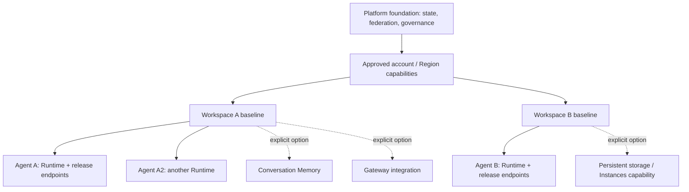
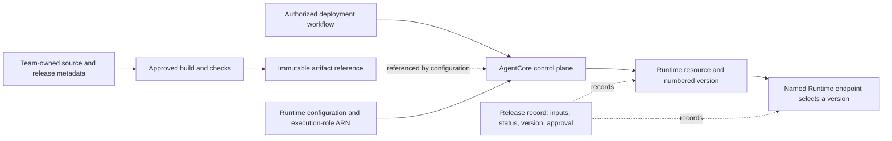
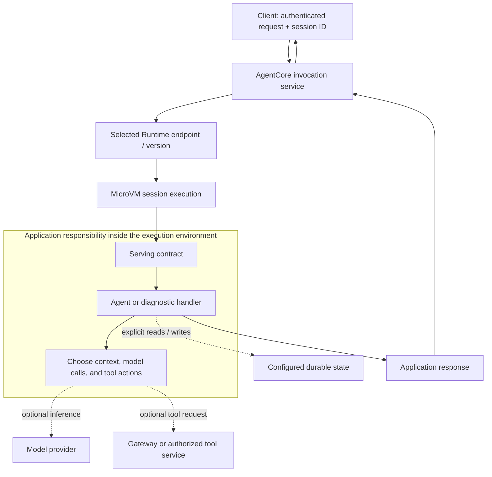

# Phase 5 - Configurable Workspaces and the Complete Architecture

**Complete reading document | Edition: 4 November 2026**

We now understand one Runtime from deployment through execution and operations. The remaining question is how a platform can offer that capability repeatedly without losing ownership, isolation, or release control.

The workspace design is a proposal for this project, not a description of infrastructure already approved or deployed. It separates a shared platform foundation, per-workspace baseline, application-owned Runtime resources, and optional capabilities. It also answers the earlier Terraform question directly: a platform-account state backend can support team-driven changes, but only through an explicit access and ownership model.

The capstone then reconstructs the complete architecture and turns claims into testable observations. Finishing the written course is not the same as executing the cloud labs; the evidence worksheet deliberately remains blank until an approved experiment is performed.

## Reading sequence

- [Module 15 - Turning Runtime Knowledge into a Configurable Workspace Platform](#module-15)
- [Module 16 - Reconstructing the Complete Runtime Infrastructure](#module-16)

The chapters below are complete, not summaries of the individual module files. Read either format; you do not need to read both copies.

---

<a id="module-15"></a>

## Module 15 - Turning Runtime Knowledge into a Configurable Workspace Platform

**Phase 5: Platform architecture**  
**Driving question:** How should platform-owned infrastructure and team-owned changes fit together without competing over the same resources?  
**Reading context:** We understand one Runtime end to end. We now design a repeatable way to support many teams.

Our support agent works in an approved environment. Another team wants a similar Runtime, but with a private dataset. A third team wants a longer-lived Instances workspace. If the platform copies the first deployment manually, the differences quickly become difficult to explain. If it creates every AgentCore capability for every team, the baseline becomes unnecessarily expensive, privileged, and coupled.

We need a product model for the infrastructure: a mandatory platform foundation, a small per-workspace baseline, and optional capabilities with explicit ownership.

**Design status:** The workspace layout in this chapter is a proposed reference architecture for this project. It is not a claim that these modules, accounts, repositories, IAM roles, or policies have already been approved or deployed. The transcript does not define a Terraform operating model; the design below combines the established Runtime model with cited Terraform and AWS behavior.

### 15.1 Separate mandatory foundations from optional capabilities

First distinguish what the service technically requires from what our platform requires to govern it. A Runtime needs a valid artifact and configuration, including execution authority and an invocation contract. Our platform may additionally require approved release pipelines, audit destinations, ownership metadata, and protected state storage. Those are platform standards, not proof that every item is a mandatory AgentCore API resource.

Likewise, Memory, Gateway, Browser, Code Interpreter, external identity providers, and persistent filesystems should appear only when the application needs them. A no-model probe demonstrates that a Runtime can execute useful diagnostic code without all those integrations. Model access itself is an application dependency rather than the definition of Runtime hosting. [R56][R64]

A proposed workspace baseline therefore supplies a controlled place to deploy approved Runtime resources. It defines allowed configuration, execution-role boundaries, deployment authority, release endpoints, and operational ownership. Optional features attach through specific contracts rather than expanding one universal administrator role.

This changes the team's request from "create everything in AgentCore" to "enable the following capabilities for this workspace." Each capability has a purpose, dependencies, permissions, data lifecycle, and cost owner. The platform can reject an unsupported combination before a deployment fails halfway through.

The benefit is not simply fewer Terraform resources. It is a smaller explanation. Every provisioned component should have a reason to exist that the team and platform can both state.

### 15.2 Define account, regional, shared, and per-workspace boundaries

A workspace in our platform is a logical ownership boundary. It is not automatically an AWS account, a single Runtime, a Kubernetes namespace, or a Terraform CLI workspace. One team can own multiple agents and environments; one logical workspace can therefore contain several Runtime resources.

We should record the relationship explicitly. An illustrative workspace key might identify team, environment, account, and Region. Each Runtime then has an application identity under that workspace. The exact naming convention is a proposal to settle, not something we infer from the source transcript.

The shared foundation can include the state backend, CI federation, approved networking patterns, and organization-wide audit arrangements. Regional resources might include network endpoint infrastructure or approved capacity-provider templates where appropriate. Per-workspace resources include the delegated deployment boundary and application-specific role/policy configuration. Per-agent resources include the Runtime and release endpoints.

Not every shared foundation has to be newly created by this project. An existing platform-managed VPC, artifact repository, or audit destination can be consumed through a documented interface. Reusing it does not transfer its deletion authority to the agent team.

Here is the proposed relationship:



The diagram separates dependencies from resource duplication. Both workspaces can consume a shared network contract without independently managing the same security group or route table.

### 15.3 Assign ownership to resources and changes

Ownership must mean more than a tag. It identifies who proposes changes, who applies them, which Terraform state records the resource, and who approves deletion.

For the reference design, use the following initial assignment. It can be changed through an explicit decision, but there must be only one authoritative owner for each managed resource.

| Resource or decision | Proposed authoritative owner | Team interaction |
|---|---|---|
| State bucket, encryption, recovery controls | Platform foundation | No direct modification by application pipelines |
| Shared network and service-endpoint configuration | Network/platform owner | Consume approved identifiers and request changes |
| Workspace deployment trust and role boundary | Platform baseline | Team uses delegated pipeline identity |
| Application source and immutable artifact | Application team | Build, test, and publish approved releases |
| Runtime resource and application configuration | Workspace application state | Team pipeline proposes/applies within guardrails |
| Named release endpoint | Same application state in this reference design | Separate reviewed promotion input |
| Shared datasets and their retention | Dataset owner | Consume authorized mount/reference |
| Optional application Memory/Gateway | Explicit capability owner | Provision only with an approved contract |

An important choice appears in the Runtime row. We do not let a platform stack create a Runtime and a team stack independently update the same Runtime. The platform can own the reusable module while the team-owned application state owns the actual resource instance. Module authorship and resource ownership are different things.

The execution role can remain platform-baseline-owned while the team-owned Runtime references its ARN. That design requires a constrained mechanism for requesting new permissions and PassRole limited to the approved role. The team must not gain permission to change the role's policies simply because it can change its application's image.

For endpoint promotion, we choose one owner too. A separate approval stage may update an input in the same application configuration. It must not become an unrelated script that continually fights Terraform's declared endpoint version.

### 15.4 Verify infrastructure-as-code coverage before designing the interface

Knowing that an AWS API supports a field does not prove that the installed Terraform provider supports it. There are three versions to track: the AWS service capability, the provider release/schema, and our internal module contract.

HashiCorp's current AWS provider documentation includes `aws_bedrockagentcore_agent_runtime` and `aws_bedrockagentcore_agent_runtime_endpoint`. The reviewed Runtime documentation also describes platform and filesystem configuration fields. The reviewed source is the provider's moving `main` branch, so it does not establish a minimum released provider version by itself. Before implementation, select and verify a released provider version that contains every required field. [R46][R47]

This is a release gate, not an excuse to invent HCL for newer capabilities. In particular, do not assume that every Instances capacity-provider option has a matching resource in the provider version your organization has approved. Check the actual schema and lifecycle behavior.

Our example endpoint fragment illustrates a narrow, verified contract:

```hcl
# Illustrative fragment, not a complete deployable root module.
# runtime_id and approved_version must come from the release workflow.
resource "aws_bedrockagentcore_agent_runtime_endpoint" "lab" {
  name                  = "LAB"
  agent_runtime_id      = var.runtime_id
  agent_runtime_version = var.approved_version
  description           = "Explicitly selected learning release"
}
```

The key teaching point is the explicit approved version. A new artifact becoming available does not need to promote production automatically. The team can test a candidate, record its Runtime version, and change the promotion input deliberately. [R47]

Where required provider coverage is absent, choose one documented owner/tool for the entire affected resource lifecycle and record the limitation. Avoid hiding untracked cloud mutations in a generic shell provisioner and calling the result fully managed Terraform. Creation, readback, update, import, drift, and deletion all need an accountable path.

### 15.5 Design module inputs, outputs, and version contracts

Now that ownership is clear, module boundaries can follow it. A foundation module should not need an application image to create the state bucket. A Runtime module should not create an organization-wide VPC simply because it receives a subnet requirement. An optional Memory module should not be instantiated when the team has no conversation-persistence use case.

HashiCorp describes module composition as assembling focused modules through inputs and outputs. In our design, dependency injection means passing approved resource references rather than having every child module discover or create global infrastructure implicitly. [R67]

A proposed Runtime contract includes an application name, immutable artifact reference, execution-role ARN, protocol, supported platform version, approved network configuration, lifecycle settings, non-secret environment configuration, and optional supported filesystem declarations. Its outputs identify the Runtime and relevant version information. The endpoint contract takes a Runtime ID and an explicitly approved version.

Validate combinations rather than only individual strings. A VPC configuration needs approved subnet/security-group values. A selected filesystem type has compute and network prerequisites. An unsupported Region/platform combination should fail before a lengthy deployment. An Instances request needs a verified capacity-provider contract rather than silently falling back to microVMs.

Outputs should be narrow: Runtime ARN, endpoint qualifier, environment metadata, and approved capability references. Never use a module output to distribute secret values casually. A team that needs one network identifier should not automatically receive read access to a state file containing every platform resource.

Pin the provider selection and review its lock file. Pin reusable module releases separately: Terraform's dependency lock file currently tracks providers, not remote module versions. A reproducible platform release therefore needs both decisions recorded. [R55]

We have now converted architectural boundaries into interfaces that can be tested. This makes the next question unavoidable: where does the state for those resource instances live, and who is allowed to change it?

### 15.6 Place Terraform state and define access

Terraform state maps configured resource addresses to real infrastructure and retains information needed to manage that relationship. It is not the team's source code repository, a container artifact, or a live configuration API for the running agent. [R52]

The proposed model stores state in a platform-owned S3 backend while separating state objects by ownership and environment. For example:

```text
foundation/<account>/<region>/terraform.tfstate
workspaces/<workspace>/<environment>/baseline.tfstate
workspaces/<workspace>/<environment>/applications/<agent>/terraform.tfstate
```

These are illustrative keys, not actual bucket paths. The critical property is separation: one team's application apply must not write the foundation state or another team's application state.

The S3 backend supports native lock files through `use_lockfile = true`; HashiCorp currently marks DynamoDB-based locking deprecated. Bucket versioning supports recovery, while the backend's required permissions include the state object and its lock object. Choose encryption, access logging, retention, and recovery controls according to the platform's policy. [R48]

A lock prevents cooperating Terraform operations from writing the same state concurrently. It does not stop an administrator or another tool from changing the AWS resource outside Terraform. Nor does it make two distinct state files safe if both claim ownership of the same Runtime. Locking and ownership solve different problems. [R51]

This answers the practical concern about teams running GitHub Actions in their own repositories while the state bucket is in the platform account. Their approved workflow can obtain narrowly scoped backend access and use the central backend during `init`, `plan`, and `apply`. They do not manually synchronize or edit a shared JSON file. Terraform performs the supported state operations.

Backend authentication and AWS provider authentication are separate configurations. The backend may access S3 in the platform account while the provider assumes a deployment role in the workload account. Do not assume a provider's `assume_role` automatically authenticates backend initialization, which is a separate step. [R48][R53]

Finally, state access is sensitive access. HashiCorp warns that consuming outputs through `terraform_remote_state` requires access to the underlying snapshot, not just the selected output. Publish approved cross-stack references through a narrower metadata interface where that is the intended access boundary. [R49]

### 15.7 Design team change workflows and CI identities

We can now follow one team change end to end. The support team modifies its code, tests it, and publishes an immutable artifact. A change to the workspace application configuration selects that artifact. The approved pipeline initializes the correct backend, reads the relevant state, and produces a plan for the intended account and Region.

The plan is reviewed against the requested change. After approval, the apply uses the reviewed commit and corresponding plan in a controlled workflow. Saved Terraform plans can contain sensitive data, so plan artifacts need restricted access and retention rather than being posted publicly. [R54]

GitHub Actions can use OIDC to obtain temporary AWS credentials instead of storing long-lived cloud keys. The trust policy must constrain the expected repository and branch or environment, with the appropriate audience. Merely trusting every workflow token from GitHub is not a workspace isolation design. [R50]

The proposed two-account flow is shown below. It describes responsibilities; exact role chaining and session policies must be implemented and reviewed for the organization's accounts.

```mermaid
sequenceDiagram
    participant Team as Team repository
    participant CI as Approved workflow
    participant STS as AWS identity federation
    participant State as Platform-account state backend
    participant AWS as Workload-account AWS APIs
    Team->>CI: Reviewed application change
    CI->>STS: Request scoped temporary authority
    STS-->>CI: Approved role session(s)
    CI->>State: Initialize backend; read and lock own state
    CI->>AWS: Read current resources; calculate plan
    CI->>CI: Review and apply approval boundary
    CI->>AWS: Apply approved resource changes
    CI->>State: Record resulting state; release lock
    CI->>AWS: Inspect release and run approved probe
```

The pipeline should fail closed on unexpected account, Region, workspace key, or role. It should not respond to a missing permission by automatically switching to an administrator credential. Apply concurrency should be coordinated per owned state, and production approvals should be separate from an untrusted pull request's ability to execute arbitrary workflow code.

A successful apply still needs release verification. Read back the Runtime and endpoint, invoke a controlled test session, and verify the expected build marker. Infrastructure convergence and application acceptance are related but separate outcomes.

### 15.8 Avoid independent tools managing the same resource

The earlier learning labs used CLI and SDK operations to expose the service model. Those experiments do not mean that production should have several competing writers.

Current AgentCore CLI documentation describes CDK/CloudFormation-based deployment. A CLI-created stack and a Terraform state must not independently manage the same Runtime, role, or endpoint. Choose the owner before provisioning, and treat migration between tools as an explicit state/import and resource-adoption exercise. [R27]

A common failure looks like this. Terraform declares endpoint `PROD` on version 4. A release script changes it to version 5. The next unrelated Terraform apply restores version 4. Both tools were doing what their inputs requested; the system lacked a single release authority.

The remedy is not automatically to add `ignore_changes` everywhere. Decide which system owns the property and how that decision is represented. Prefer a single resource owner and a deliberate promotion input. If there is an exceptional split, document exactly which properties are external, how drift is detected, and how reconciliation avoids destructive oscillation.

Read-only inspection can remain broad because observing a resource does not compete for ownership. Mutating helpers need a defined scope. Our included client invokes or explicitly stops a lab session; it does not deploy or update a Terraform-managed Runtime behind the platform's back.

### 15.9 Add optional capabilities by explicit need

Optional does not mean informal. Each capability should have a small contract covering provisioning, access, runtime integration, telemetry, retention, and removal.

Memory is justified when the application needs the corresponding conversational access model. Gateway is justified when tools need its discovery, routing, or governance interface. External identity integration is justified by a credential flow. Filesystem persistence is justified by a state lifecycle. Instances is justified by a compute requirement and trust model. These are different decisions, not one boolean called `enable_agentcore`.

For example, enabling Memory should return a resource reference and authorize only the required actions for the application. It should not automatically grant broad access to every Memory resource. Enabling a shared dataset mount should specify the permitted access point and retention owner; deleting the agent must not delete the shared dataset accidentally.

A capability request can be reviewed as a short design record: the team need, data classification, owner, supported configuration, expected cost dimensions, and rollback/deletion behavior. This is the proposed platform governance mechanism, not a claim that AWS requires a particular form.

The resulting workspace is configurable because capabilities compose through contracts. It is not configurable merely because a huge module exposes hundreds of loosely related variables.

### 15.10 Plan drift, migration, and decommissioning

Drift detection compares declared intent with observed resources. A detected difference is evidence to investigate, not automatic authorization to overwrite production. A legitimate emergency change may need to be incorporated into code; an unauthorized change may need to be reverted. Ownership decides the response.

Migration planning must include data and sessions. Changing a compute type is not equivalent to replacing an image. Changing a capacity provider can affect storage and networking. Updating a Runtime version can reset managed session working storage. A safe migration records which state must be exported, which sessions must drain, how a fresh release is tested, and what rollback can actually restore. [R03][R37][R38]

Decommissioning follows the dependency graph in reverse, but only after retention decisions. Remove application access, stop or drain approved work, export required data, remove application-owned endpoints and runtimes, and then remove unshared optional resources. Shared networks, datasets, and state-backend infrastructure remain with their owners.

Do not delete the Terraform state object as a way of deleting the infrastructure. Removing the mapping does not remove the cloud resources. Likewise, a successful destroy plan does not prove that external business data or customer-owned shared filesystems were erased. [R52]

Our proposal still has decisions to approve before implementation: account/Region topology, baseline ownership, CI trust constraints, exact provider/module versions, allowed compute/storage options, retention, and production promotion authority. The learning objective is to make those decisions visible and explainable, not pretend they have already been made.

We can now state the platform architecture in one connected sentence: a shared foundation grants a workspace a constrained deployment and operational boundary; the team uses approved modules and a scoped pipeline to manage its own Runtime resources and releases; optional capabilities attach only where needed; separate state and clear ownership prevent one team's change from becoming another team's unplanned infrastructure event.

### Reasoning checkpoint

**Question 1:** Can the state bucket live in the platform account while the Runtime lives in another account?

<details>
<summary>Reasoning guide</summary>

Yes, in the proposed design the backend and provider authenticate separately for their respective responsibilities. The pipeline needs scoped access to its state/lock objects and appropriate workload-account deployment authority. A provider role does not automatically configure backend authentication.

</details>

**Question 2:** Why is a platform-authored module compatible with team-owned Runtime resources?

<details>
<summary>Reasoning guide</summary>

Module authorship controls the reusable implementation. The root configuration, state, and authorized apply workflow own the resource instance. A team can use an approved module without granting the platform and team separate states that both manage the same Runtime.

</details>

**Question 3:** Why is a new AWS API field not enough to promise a supported Terraform capability?

<details>
<summary>Reasoning guide</summary>

The selected provider release must expose and correctly manage the field, and the platform module must validate and support its lifecycle. Moving main-branch documentation is evidence of current source support, not proof that the organization's pinned release contains it.

</details>

---

<a id="module-16"></a>

## Module 16 - Reconstructing the Complete Runtime Infrastructure

**Phase 5: Platform architecture**  
**Driving question:** Can we explain, inspect, and defend the complete infrastructure model rather than simply recognize its component names?  
**Reading context:** The previous modules established compute, deployment, invocation, sessions, networking, identity, storage, operations, and ownership. This chapter brings those ideas together through one controlled investigation.

At the beginning of the course, we had a Python application and a question: what must exist around that application before other people can reliably use it? We now have enough understanding to answer without treating AgentCore Runtime as an unexplained box.

That does not mean we know AWS's unpublished scheduler, fleet layout, or internal routing implementation. It means we can explain the supported resource model, the boundaries AWS exposes, the behavior our application must implement, and the evidence needed to investigate a failure. Knowing where the public contract ends is part of understanding the infrastructure.

Our final exercise is therefore not to build a more elaborate agent. We will use the small probe supplied in the `Labs` directory to make a few important boundaries observable. The probe avoids model calls and business transactions so that an infrastructure observation is less likely to be confused with model behavior or an irreversible tool action. Its process marker, request marker, counter, and optional synthetic file are application diagnostics, not AWS-issued infrastructure identifiers.

**Evidence status:** The exercises below are a plan for an approved non-production environment. This package does not contain results from a live AWS deployment. Local checks are recorded separately in the validation report. Never replace an unperformed observation with an expected result.

### 16.1 Rebuild the control-plane and deployment diagrams

Start before the first user request. A developer changes source code. A build process packages that source and its dependencies into an approved artifact. The artifact has an identity independent of the currently running process: for a container release, use an immutable image reference or a release convention that preserves the exact digest in the release record.

An authorized deployment workflow then asks the AgentCore control plane to create or update a Runtime. The request includes the artifact reference and the supported configuration for execution, networking, identity, protocol, and lifecycle. A successful API response and a ready deployment are different observations; inspect the resource's reported status before proceeding. Runtime versions and endpoints give us a way to identify and select a release instead of treating every update as an anonymous change. [R56][R57][R13]

Here is the deployment picture we should now be able to draw:



Notice what is absent: a user conversation does not appear in the build pipeline, and an execution role is not the same identity as the pipeline that creates the resource. We have also not drawn an EKS cluster, a customer-owned load balancer, or a particular EC2 fleet beneath the microVM branch. Those are not resources we should invent to make the diagram look complete.

The evidence for this part of the capstone is a small release record: selected account and Region, Runtime ARN, numbered version, endpoint name, artifact identity, configuration revision, and observed readiness. Capture selected fields, not an indiscriminate dump of environment variables or credentials. The exact runtime and endpoint lookup calls are documented control-plane operations. [R14][R15]

If the deployed version differs from the intended release, stop the investigation here. Testing an unidentified version can produce technically valid measurements that answer the wrong question.

### 16.2 Rebuild the invocation and compute diagrams

With a ready release selected, we can move to the execution path. An external client authenticates and invokes the Runtime through the supported service API. The request identifies the Runtime, any selected qualifier, and the runtime session. The application then receives its invocation through the serving contract established in Phase 2. [R08][R64]

For our main exercise, choose the microVM compute branch. The service provides session-isolated execution, while our application handles the request inside that environment. When the application needs a model or a tool, it makes the relevant outbound call; the Runtime does not become the model merely because it hosts the orchestration code. [R01][R18]



The arrows represent logical interactions, not a disclosure of AWS's internal router implementation. The important distinction is that resource selection, session execution, and application behavior are separate questions. We can investigate each without pretending to observe AWS's private machinery.

Now remove the optional model and tool arrows mentally. The probe still works. This is useful: a failed diagnostic invocation cannot be blamed on an unavailable model if no model is called. Later, add dependencies one at a time and establish their own request IDs and failure evidence.

The probe's process marker is initialized on its first handler invocation rather than being treated as a deployment identity. That reduces one obvious source of misleading startup evidence, especially when evaluating snapshot-based initialization. It is still only a marker for that authored process. Multiple worker processes, forks, application restarts, or changed startup behavior require a more careful interpretation. [R02]

### 16.3 Overlay network, identity, and ownership boundaries

The previous two diagrams explain activities. We now need to show who is allowed to perform them and which network path carries them.

Place deployment authority beside the control-plane calls. Place caller authority beside the invocation API. Place the execution role beside outbound AWS service access from the application. These identities may belong to the same account during a small experiment, but they have different jobs and should not silently inherit each other's privileges. A caller being allowed to invoke an agent does not authorize that caller to edit its execution role. An execution role being allowed to read a dataset does not authorize every user to receive every record in that dataset. [R27][R30][R31]

Next draw the network paths individually. Client access to an AgentCore API endpoint is one path. A Runtime accessing a private database through configured VPC connectivity is another. A model invocation is a third. The VPC connectivity configuration and any interface endpoint used by a caller address different sides of the system. A green result on one path does not establish the others. [R20][R21]

Finally mark ownership. The platform might own the network, the baseline role, and the state backend. A workspace application state might own the Runtime and named release endpoint. A dataset team might own the persistent filesystem. AWS owns the managed service mechanisms described by the public contract. The proposed split in Module 15 is a starting design, not an assertion about your current organization.

The resulting diagram should answer a concrete question: if the agent cannot read a private dataset, which owner can supply evidence and which owner can authorize a change? The application team can show the failed operation. The identity owner can check permissions. The network owner can inspect the relevant path. The dataset owner can check resource and file-access policy. None should need to guess that "AgentCore is down" from one failed read.

### 16.4 Trace first, repeated, and concurrent interactions

We now have enough context to run a controlled observation, subject to account approval. Record the intended release, confirm the account and Region, and generate a new UUID session ID. Use a synthetic payload such as an `inspect` operation. The supplied client has an explicit qualifier argument so that the release endpoint is not accidentally implicit.

For the first successful invocation, record the service request ID, application request ID, reported build ID, process marker, and counter. These identify different things. The service request ID helps locate one AWS request. The application request ID identifies one handler call. The build ID describes our authored release. The process marker and counter reveal behavior inside this particular diagnostic application.

Send another request using the same runtime session ID. If it reaches the same live probe process, the process marker remains the same and the counter increases. That is an expected application observation, not proof that every future request must reach an immortal process. A restart, stop, failure, or deployment-related change can alter the observation. The public session model gives the context for interpretation; the evidence tells us what happened in this experiment. [R06]

Now use a different session ID. For the microVM model, the service's session-isolation contract is the relevant guarantee; two different application markers are consistent with it but are not a security proof by themselves. A true isolation assessment would require a separately approved test plan and should not attempt to read another tenant's data.

Only after sequential requests are understood should we consider a small, approved concurrency test. Different sessions and simultaneous requests to one session answer different questions. The probe uses a lock around its counter so that a diagnostic race does not masquerade as service behavior. That lock does not impose a distributed concurrency limit on AgentCore or protect a production business transaction.

There is no automatic load generator in this package. Choose a bounded test based on actual quotas and account approval, record timing and errors, and distinguish application serialization from service limits. Do not treat a single successful burst as a capacity guarantee. [R16]

### 16.5 Trace session termination and state recovery

The next observation deliberately changes compute lifecycle. Before stopping anything, make the scope explicit: this exercise targets one microVM session used only by the probe. The client requires an acknowledgment flag for its stop operation. It does not enumerate and stop other sessions.

First run without a persistent directory. Invoke the probe, stop the intended session using the supported API, and later invoke with the same identifier after the service permits it. A new process marker and a reset in-memory counter are expected when new compute runs our process. The exact timing and any transient response must be recorded, not hidden by an unbounded retry loop. [R10][R06]

Then, as a separately configured exercise, attach an approved persistent filesystem mode and set the probe's persistent root to its configured mount path. Write only a synthetic marker. The probe refuses to create a missing root automatically; otherwise a misspelled mount path could quietly create an ordinary temporary directory and give us a false persistence test.

Even an existing directory is not proof of an AWS-managed mount. Verify the Runtime configuration and observe recovery after compute recreation. For managed session storage, the currently documented retention, session scope, and Runtime-version boundary matter. Customer-provided filesystems and Instances storage have different owners and lifecycles. Do not combine their guarantees into a single statement that "Runtime storage persists." [R37][R38][R71]

A useful recovery record says: the old process marker was A, the new marker is B, the in-memory counter restarted, and the synthetic file was either restored, absent, or unreadable under the selected storage configuration. An absent file and a corrupt file are different outcomes. The probe reports invalid stored data rather than silently treating it as a fresh empty state.

The Instances branch requires a separate experiment. In that model, stopping one agent with `StopRuntimeSession`, terminating instance compute through lifecycle settings, and deleting a capacity-provider session are different actions. The operation-specific Instances data-management guide is the basis for distinguishing them. Do not reuse the microVM stop experiment as a prediction about deleting Instances volumes. [R38]

### 16.6 Trace release promotion and rollback

Lifecycle evidence becomes much more useful when tied to a release. Suppose the probe release currently reports build A. Prepare a new artifact that reports build B and create or update the Runtime through its authoritative deployment workflow. Inspect readiness and record the new numbered Runtime version before changing the chosen endpoint.

Use a deliberately selected test endpoint to evaluate B. A fresh session removes one source of ambiguity when checking which code is running. Then separately examine an existing session if understanding its behavior during release changes is part of the approved test. Do not assume that updating an endpoint rewrites a process already executing in every existing session. Runtime versions, endpoints, session lifecycle, and reported application evidence must be considered together. [R13][R68][R59]

Once B passes the required checks, promote the intended endpoint through its single owning workflow. If Terraform owns that endpoint, change the declared version input through that workflow rather than making an unrecorded console mutation. The service operation and the infrastructure ownership policy must agree about who changes the pointer.

Rollback is also a release action, not time travel. Moving the endpoint to A does not undo a database transaction performed by B, restore overwritten files automatically, or guarantee that A can read B's new data format. Before a stateful release, decide whether schemas are backward compatible and whether a rollback needs data repair or an alternate recovery procedure.

This is why our release record includes both code identity and state assumptions. A stateless `hello` test can establish invocation success, but it cannot validate a stateful production rollback on its own.

### 16.7 Inject approved failures and inspect evidence by layer

Failure tests are useful only when their scope is controlled and the expected evidence is clear. Start with local or disposable conditions. Give the probe an invalid operation and verify its input validation. Point a local persistence test at a missing directory and verify that it fails rather than pretending storage is configured. Corrupt a temporary test record and verify that recovery reports the problem. These checks run without touching AWS.

For cloud exercises, use an approved sandbox and a reversible plan. A deliberately unauthorized test caller can help distinguish service-side rejection from application execution. A temporary, narrowly scoped dependency-denial test can help distinguish a working invocation path from failed outbound authorization. Do not weaken production controls, disable shared logging, or modify a shared security group merely to create an error.

For each experiment, record the layer you changed and the evidence you expect to move. If invocation is rejected before the handler, an application request ID may never be created. If the handler starts but a dependency fails, application evidence should exist even though no successful business result follows. Traces, logs, metrics, and audit events answer related but different questions; their availability depends on the configuration described in Module 14. [R41][R42][R44]

A timeout deserves particular care. It can mean that the client stopped waiting, not that the remote action never happened. Our lab client disables automatic invocation retries so that this ambiguity is visible. A production agent must resolve it through operation-specific idempotency and outcome checks, not by assuming every transport failure is safe to replay. [R17][R58]

The capstone evidence template asks for expected behavior, actual observation, identifiers, interpretation, and remaining uncertainty. Leaving an observation blank is more accurate than writing a plausible result that was never measured.

### 16.8 Validate the workspace resource and Terraform ownership model

We can now review the platform design with actual boundaries in mind. Pick one proposed workspace and identify the state that owns its Runtime, the state that owns its baseline role, and the owner of each shared dependency. Every mutable resource needs one authoritative management path.

Then simulate a team change on paper. A developer requests a new artifact version. Which repository changes? Which workflow receives temporary credentials? Which state key can it read and lock? Which execution role can it pass? Which endpoint can it promote? Which permission change requires platform approval? These questions expose ambiguity earlier than a failed deployment does.

A central S3 backend is compatible with team-driven changes when access is properly scoped. The state remains in the chosen backend; the team's authorized workflow uses it rather than copying it to a second independent state. Backend authentication and AWS provider authentication are separate configurations and may target different accounts or roles. [R48][R53]

Also test the negative cases. A workspace pipeline should not read another team's complete state merely because both use one bucket. A state lock should not be mistaken for protection against every out-of-band console update. A module output should not require granting full state-snapshot access when a narrower published configuration contract will do. [R49][R51]

Finally verify the implementation toolchain. The provider version actually installed must expose the fields required by the design. The moving documentation branch is useful evidence of development coverage, but it is not a released-version guarantee. Capture provider and module versions, lock dependencies appropriately, and review changes before applying them. The Terraform examples in this course are design fragments, not a validated production platform module. [R46][R47][R55]

### 16.9 Produce the final architecture, operating checklist, and teach-back explanation

Our final architecture should be explainable in a few connected paragraphs. Begin with the artifact and the identity authorized to deploy it. Explain how configuration becomes a Runtime version and how an endpoint selects that release. Follow an authenticated request into a session-isolated execution environment. Describe what the application does, which identity authorizes its outbound calls, and which network paths reach its dependencies. Then explain which state is temporary, which state has an independent durability contract, and what evidence reveals success or failure.

That explanation is stronger than a diagram containing every AWS icon. It tells a reviewer what happens and why the components exist. It also shows which details are intentional platform choices and which are AWS service contracts.

Before an approved deployment, the operating checklist should establish release identity, supported Region and compute mode, quotas, permissions, network paths, storage behavior, and telemetry. Before promotion, it should establish candidate readiness, observed build identity, compatible state behavior, and rollback criteria. Before teardown, it should establish which resources are shared, which data must be retained, and which operation actually deletes that data.

The supplied evidence template turns those checkpoints into a record rather than a memory exercise. Use it alongside the source ledger when a behavior differs from expectations. The difference may come from a version change, an account policy, an unsupported configuration, an application mistake, or an incorrect assumption in our model. Investigation should identify which, not protect the diagram from contradictory evidence.

The course's final mental model is therefore:

> A Runtime is a managed application-hosting resource with a versioned deployment contract. Invocations select and use that deployment through authenticated service interfaces. Sessions organize execution and isolation; compute has a lifecycle; persistence is an explicit additional contract. Networking, permissions, telemetry, and infrastructure ownership determine whether the application can operate safely and whether we can explain its behavior.

Keep the words "explicit additional contract" in mind. Most confusing infrastructure discussions in this project came from assuming one boundary automatically implied another: a session ID implying authentication, an ENI implying compute ownership, a stopped process implying deleted data, or a successful deployment implying a promoted production release. We now have the vocabulary and the execution model to separate those questions.

### Reasoning checks

#### A new release is ready, but a test reports the old build. What do you investigate before redeploying?

<details>
<summary>Reasoning guide</summary>

Confirm the caller's account, Region, Runtime ARN, selected qualifier, and the endpoint's reported version. Check the exact artifact and the application's build identifier. Distinguish a fresh session from an existing one. Inspect the relevant resource status and request evidence. Redeploying immediately may overwrite the evidence without resolving whether the problem is release selection, lifecycle, or the artifact itself.

</details>

#### The process marker changes after a stop, while a stored file remains. Is this contradictory?

<details>
<summary>Reasoning guide</summary>

No. The process marker describes this diagnostic application's process lifetime. The file follows the selected persistence mechanism's contract. New compute can reconstruct application context from durable files while its in-memory counter starts again. The observation must still be tied to the same supported session, storage configuration, and release boundary.

</details>

#### The team owns its agent code. Must it also own the VPC, execution-role policy, and state bucket?

<details>
<summary>Reasoning guide</summary>

No. Source ownership, module authorship, resource authority, and state ownership can be different. The important requirements are explicit input/output contracts, a single authoritative manager for each resource, and a change path that allows the team to release safely without gaining unrelated administrative access. A proposed split must be approved and implemented; a diagram alone does not enforce it.

</details>

### Course completion checkpoint

You have reached the end of the written learning sequence, not an automatic certification that the cloud experiments were performed. The remaining practical task is to gather evidence in an approved environment, compare it with the documented model, and resolve any differences. Use the lab guide and blank evidence worksheet for that work. The validation report states exactly which checks were performed while preparing this package.

## Sources for this reading

These references support the current-service supplement, not a claim that every mechanism appeared in the original transcript. Reviewed for the 4 November 2026 edition.

<details>
<summary>Open the source list</summary>

- **R01:** [AWS: microVMs and platform versions][R01]
- **R02:** [AWS: Snapshot-safe Runtime V2 initialization][R02]
- **R03:** [AWS: Instances compute architecture][R03]
- **R06:** [AWS: Runtime sessions][R06]
- **R08:** [AWS: InvokeAgentRuntime API][R08]
- **R10:** [AWS: StopRuntimeSession API][R10]
- **R13:** [AWS: Runtime versions and endpoints][R13]
- **R14:** [AWS: GetAgentRuntime API][R14]
- **R15:** [AWS: GetAgentRuntimeEndpoint API][R15]
- **R16:** [AWS: AgentCore quotas][R16]
- **R17:** [Amazon Builders Library: Timeouts, retries, backoff, and jitter][R17]
- **R18:** [AWS: Bedrock Converse API][R18]
- **R20:** [AWS: Runtime VPC connectivity][R20]
- **R21:** [AWS: AgentCore PrivateLink endpoints][R21]
- **R27:** [AWS: Runtime IAM permissions][R27]
- **R30:** [AWS: Runtime security best practices][R30]
- **R31:** [AWS: Passing an execution role][R31]
- **R37:** [AWS: Runtime filesystem configurations][R37]
- **R38:** [AWS: Instances data management][R38]
- **R41:** [AWS: AgentCore runtime telemetry][R41]
- **R42:** [AWS: Observability configuration][R42]
- **R44:** [AWS: CloudTrail data-event configuration][R44]
- **R46:** [HashiCorp: AWS provider Runtime resource documentation][R46]
- **R47:** [HashiCorp: AWS provider Runtime endpoint resource][R47]
- **R48:** [HashiCorp: S3 state backend][R48]
- **R49:** [HashiCorp: Remote-state access and output sharing][R49]
- **R50:** [GitHub: AWS OIDC deployment identity][R50]
- **R51:** [HashiCorp: Terraform state locking][R51]
- **R52:** [HashiCorp: Terraform state purpose][R52]
- **R53:** [HashiCorp: AWS provider authentication][R53]
- **R54:** [HashiCorp: Saved Terraform plans][R54]
- **R55:** [HashiCorp: Dependency lock file][R55]
- **R56:** [AWS: CreateAgentRuntime API][R56]
- **R57:** [AWS: UpdateAgentRuntime API][R57]
- **R58:** [AWS: Boto3 retries][R58]
- **R59:** [AWS: Runtime troubleshooting and request context][R59]
- **R64:** [AWS: AgentCore service contract][R64]
- **R67:** [HashiCorp: Module composition][R67]
- **R68:** [AWS: UpdateAgentRuntimeEndpoint API][R68]
- **R71:** [AWS: Managed session storage preview announcement][R71]

</details>

[R01]: https://docs.aws.amazon.com/bedrock-agentcore/latest/devguide/runtime-how-it-works.html
[R02]: https://docs.aws.amazon.com/bedrock-agentcore/latest/devguide/runtime-v2-optimize.html
[R03]: https://docs.aws.amazon.com/bedrock-agentcore/latest/devguide/runtime-instances-how-it-works.html
[R06]: https://docs.aws.amazon.com/bedrock-agentcore/latest/devguide/runtime-sessions.html
[R08]: https://docs.aws.amazon.com/bedrock-agentcore/latest/APIReference/API_InvokeAgentRuntime.html
[R10]: https://docs.aws.amazon.com/bedrock-agentcore/latest/APIReference/API_StopRuntimeSession.html
[R13]: https://docs.aws.amazon.com/bedrock-agentcore/latest/devguide/agent-runtime-versioning.html
[R14]: https://docs.aws.amazon.com/bedrock-agentcore-control/latest/APIReference/API_GetAgentRuntime.html
[R15]: https://docs.aws.amazon.com/bedrock-agentcore-control/latest/APIReference/API_GetAgentRuntimeEndpoint.html
[R16]: https://docs.aws.amazon.com/bedrock-agentcore/latest/devguide/bedrock-agentcore-limits.html
[R17]: https://aws.amazon.com/builders-library/timeouts-retries-and-backoff-with-jitter/
[R18]: https://docs.aws.amazon.com/bedrock/latest/APIReference/API_runtime_Converse.html
[R20]: https://docs.aws.amazon.com/bedrock-agentcore/latest/devguide/agentcore-vpc.html
[R21]: https://docs.aws.amazon.com/bedrock-agentcore/latest/devguide/vpc-interface-endpoints.html
[R27]: https://docs.aws.amazon.com/bedrock-agentcore/latest/devguide/runtime-permissions.html
[R30]: https://docs.aws.amazon.com/bedrock-agentcore/latest/devguide/runtime-security-best-practices.html
[R31]: https://docs.aws.amazon.com/IAM/latest/UserGuide/id_roles_use_passrole.html
[R37]: https://docs.aws.amazon.com/bedrock-agentcore/latest/devguide/runtime-filesystem-configurations.html
[R38]: https://docs.aws.amazon.com/bedrock-agentcore/latest/devguide/runtime-instances-data-management.html
[R41]: https://docs.aws.amazon.com/bedrock-agentcore/latest/devguide/observability-runtime-metrics.html
[R42]: https://docs.aws.amazon.com/bedrock-agentcore/latest/devguide/observability-configure.html
[R44]: https://docs.aws.amazon.com/awscloudtrail/latest/userguide/logging-data-events-with-cloudtrail.html
[R46]: https://raw.githubusercontent.com/hashicorp/terraform-provider-aws/main/website/docs/r/bedrockagentcore_agent_runtime.html.markdown
[R47]: https://raw.githubusercontent.com/hashicorp/terraform-provider-aws/main/website/docs/r/bedrockagentcore_agent_runtime_endpoint.html.markdown
[R48]: https://developer.hashicorp.com/terraform/language/backend/s3
[R49]: https://developer.hashicorp.com/terraform/language/state/remote-state-data
[R50]: https://docs.github.com/en/actions/how-tos/secure-your-work/security-harden-deployments/oidc-in-aws
[R51]: https://developer.hashicorp.com/terraform/language/state/locking
[R52]: https://developer.hashicorp.com/terraform/language/state/purpose
[R53]: https://raw.githubusercontent.com/hashicorp/terraform-provider-aws/main/website/docs/index.html.markdown
[R54]: https://developer.hashicorp.com/terraform/cli/commands/plan
[R55]: https://developer.hashicorp.com/terraform/language/files/dependency-lock
[R56]: https://docs.aws.amazon.com/bedrock-agentcore-control/latest/APIReference/API_CreateAgentRuntime.html
[R57]: https://docs.aws.amazon.com/bedrock-agentcore-control/latest/APIReference/API_UpdateAgentRuntime.html
[R58]: https://docs.aws.amazon.com/boto3/latest/guide/retries.html
[R59]: https://docs.aws.amazon.com/bedrock-agentcore/latest/devguide/runtime-troubleshooting.html
[R64]: https://docs.aws.amazon.com/bedrock-agentcore/latest/devguide/runtime-service-contract.html
[R67]: https://developer.hashicorp.com/terraform/language/modules/develop/composition
[R68]: https://docs.aws.amazon.com/bedrock-agentcore-control/latest/APIReference/API_UpdateAgentRuntimeEndpoint.html
[R71]: https://aws.amazon.com/about-aws/whats-new/2026/03/bedrock-agentcore-runtime-session-storage/

---

[Course index](../README.md) | [Master roadmap](../00_Master_Learning_Roadmap.md) | [Diagnostic lab](../Labs/README.md).
