# LLMOps — Session 1: From a Language Model to a Reliable Production Application

> **Learning narrative, not a transcript summary.** This chapter reconstructs the conceptual journey taught in Session 1. The instructor's recurring example is a course-support chatbot built with retrieval-augmented generation (RAG). Visuals deliberately evolve as each new responsibility is introduced.
>
> **Source:** Uploaded *LLMOps Session 1* VTT recording (approximately two hours). The recording contains speech transcription errors (for example, “Rack” for “RAG” and “journalist” for “generalist”). Terminology is normalized when its intended meaning is clear. Notes labeled **Technical clarification** distinguish additional precision from the lecture's introductory treatment.

## 1. Why this course starts with the *why*, not the tool

Imagine that you have developed an impressive chatbot. On your laptop, you ask it a question and it produces a plausible answer. Can you now put it in front of hundreds of paying students?

Not yet. An answer that appears correct in a demonstration does not tell us whether the chatbot is consistently accurate, whether it uses the right documents, whether it discloses restricted course content, whether it will work after a deployment, or how much it will cost under load. The difference between **a working demonstration** and **a dependable application** is the central motivation for LLMOps.

The instructor emphasizes a tool-agnostic learning strategy: tools and cloud product names may change, but the problems of versioning, evaluation, deployment, and monitoring persist. Rather than memorizing one library's buttons, the learner should understand *why each operational capability exists*.

### What you should be able to explain after this chapter

By the end, you should be able to trace a course-support chatbot from its development version to production, explain why each LLMOps activity is introduced, distinguish model-level operations from application-level operations, and describe what changes when real users begin interacting with it.

### Starting prerequisites

The instructor expects only introductory familiarity with:

- **LangChain:** basic prompts, runnables, model invocation, and application composition.
- **LangGraph:** nodes, edges, shared state, graph construction, and compilation.

Advanced LangGraph memory techniques are **not** a prerequisite in this session. This is an orientation to the operational journey rather than a hands-on coding session.

---

## 2. First, distinguish the model from the application

A language model can predict or generate text. But an organization usually needs more than text generation: it needs a specific task to be performed according to its own data and rules. A model is therefore often *one component* of a larger application.

Consider a student asking: “In the RAG course, why do we split documents into chunks?” A general-purpose model may answer from its learned knowledge. A course-support chatbot, however, should ideally use the course's own teaching material, avoid content from courses the student does not have access to, and provide an answer in the expected instructional style.

The application needs to coordinate those responsibilities around the model.

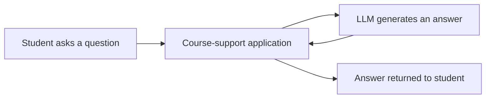

**What to observe:** The student interacts with the **application**, not with the model's weights or training pipeline. This distinction determines the focus of the rest of the session.

### What does “LLMOps” mean here?

The lecture describes LLMOps as the practices and workflows for **developing, deploying, and managing** large-language-model systems across their lifecycle, while addressing operational qualities such as reliability, performance, cost, evaluation, and safety.

There are two related but different operational journeys:

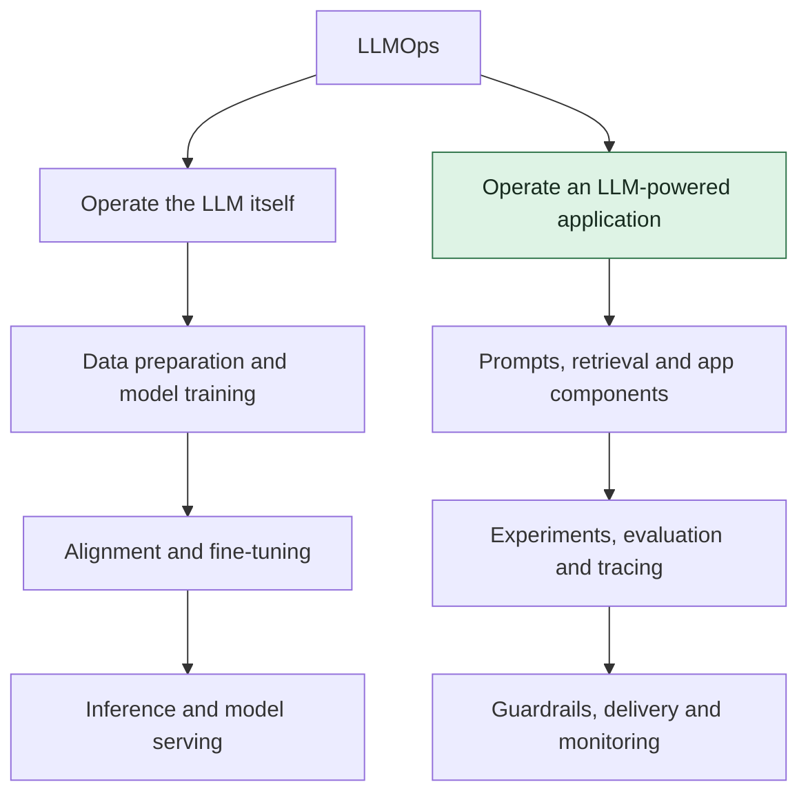

The instructor explicitly chooses **the application branch** for the course. Training a foundation model from scratch requires enormous amounts of data, compute, engineering expertise, and money. Application operations are more directly useful for the chosen course projects, without requiring the class to run a foundation-model training program.

**Mental-model checkpoint:** LLMOps does not always mean *training* an LLM. It can mean building and operating a reliable product that **uses** an existing LLM.

---

## 3. Why model development still matters as background

Before narrowing the scope to applications, the instructor explains the model's lifecycle to show why operating a foundation model is a different scale of problem.

### 3.1 Data comes before training

A model must learn from data, but internet-scale text is not automatically suitable for training. Source material can contain duplicates, errors, noise, harmful material, and bias. Data preparation is therefore part of the work, not an optional clean-up step.

The initial question is simple: **If bad or inconsistent examples dominate what a model sees, why would we expect consistently good behavior afterward?**

This motivates filtering, cleaning, curation, and organizing the training data before significant compute is spent.

### 3.2 Training changes parameters, not source documents

The model has an architecture and trainable parameters (weights, and in some architectures biases). Training repeatedly computes an error signal and updates trainable parameters to reduce a training objective. The lecture expresses this simply as finding useful or optimal parameter values.

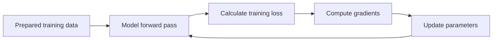

**Why the loop matters:** training is a repeated optimization process, not just uploading a large library of documents into a model. Large-scale pre-training also needs substantial GPU compute, memory, data movement, and distributed coordination.

### 3.3 Pre-training is not the same as alignment

A model trained primarily on a predictive text objective has learned patterns of language and knowledge, but this alone does not guarantee helpful, safe, or instruction-following responses. The instructor introduces **reinforcement learning from human feedback (RLHF)** as a way to prefer more appropriate behavior.

The illustrated idea is that reviewers evaluate several responses to a prompt and indicate which are preferable. These preferences can be used in an alignment-training pipeline.

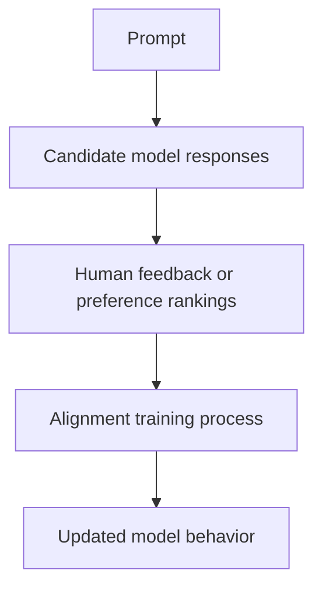

**Technical clarification:** The recording simplifies RLHF. In practice, human preference collection and the subsequent model updates are distinct stages, and the model **is** being trained or updated in the alignment process. Not every alignment method is RLHF; other preference-optimization approaches exist.

### 3.4 Fine-tuning and inference solve different problems

The lecture presents fine-tuning as adapting a general-purpose model to more specific tasks or domains. For example, an organization might want a particular vocabulary, output format, or domain-specific behavior. Fine-tuning can modify selected parameters or larger subsets depending on the method.

**Technical clarification:** Model capabilities are not neatly partitioned into “knowledge parameters” and “style parameters.” Fine-tuning does not guarantee domain accuracy and is not always the right way to supply current or private knowledge. Later, our RAG application supplies external context at request time instead.

**Inference** is what happens when the deployed model processes a request and generates a response. The instructor notes an operational consequence: even without training a model, handling many concurrent inference requests can introduce meaningful compute, throughput, latency, and scaling concerns.

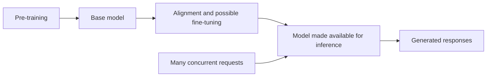

At this point, we understand *why* foundation-model operations can be extremely demanding. We can now concentrate on the other branch: **running a useful application with an existing model API**.

---

## 4. Construct one running example: a RAG chatbot for students

The course uses two application families: **RAG** during the learning journey and an **agentic application** for the final project. Using just one primary RAG example during the lessons avoids changing the business problem every time a new operational concept appears.

A basic retrieval-augmented generation system has two linked parts:

1. **Prepare the knowledge:** process course material such as lecture transcripts and notes; split it into retrievable pieces; represent and index it.
2. **Answer a question:** retrieve relevant pieces for a student's question, send them as context to the LLM, and return a grounded answer.

The following picture adds the missing knowledge source to our earlier model-only diagram.

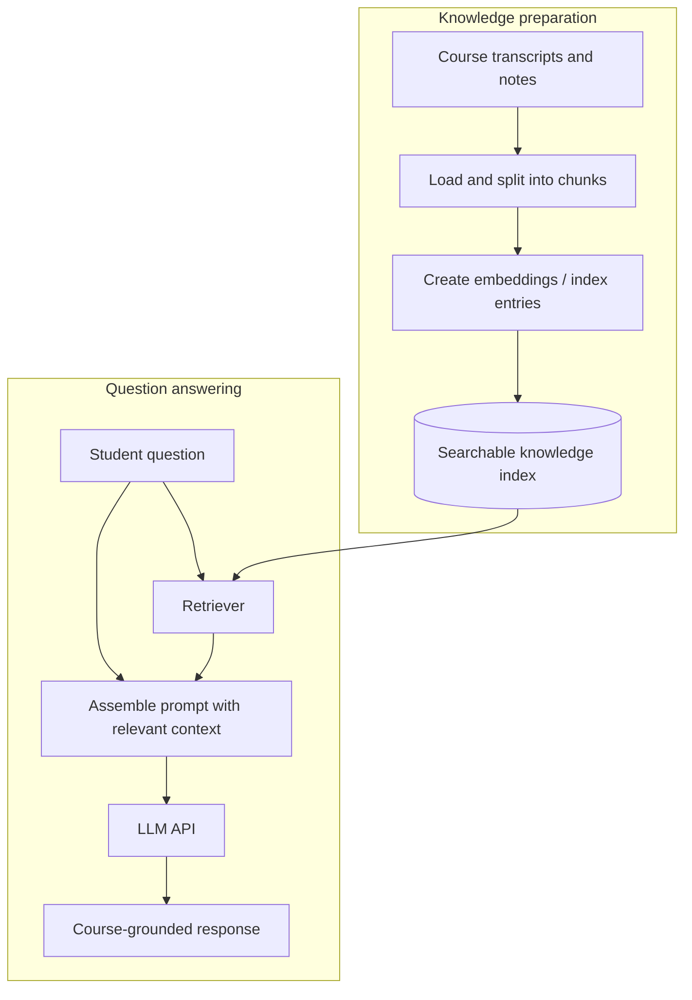

**Notice what changed:** earlier, the application merely forwarded a question to a model. Now it performs document preparation, retrieval, context construction, and generation. Each new component is also a new place where quality can improve—or fail.

Suppose the chatbot gives an inaccurate answer about chunking. Is the LLM at fault? Perhaps, but perhaps the document loader dropped paragraphs, the chunks were too large, the embedding configuration was unsuitable, or the retriever returned the wrong course section. This uncertainty motivates the first operational tools.

---

## 5. Why a prompt needs a version

The model's behavior depends partly on its prompt, especially the **system prompt** or application instructions. The first prompt is rarely perfect. A developer may change the tone, demand citations, or narrow answers to course material.

Imagine the first version says only, “You are a helpful course assistant.” During testing, students receive confident answers without references. The developer then changes the instruction to use retrieved course context and acknowledge missing evidence.

Without versioning, we cannot reliably answer: *Which instruction produced this particular result? Did the newer instruction actually improve the chatbot?*

| Version | Illustrative change | Reason for changing it |
|---|---|---|
| v1 | Generic helpful assistant | Initial baseline |
| v2 | Answer using retrieved course material | Improve groundedness |
| v3 | Acknowledge unsupported answers and cite relevant notes | Reduce unsupported claims |

These versions are **illustrative**, not literal prompts quoted from the session.

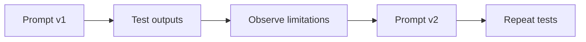

Versioning preserves the history of decisions. But prompts are only one variable in a RAG system. What happens when a developer changes the document loader, chunk size, retrieval strategy, *and* prompt in the same week?

---

## 6. Why we need experiment tracking

A RAG application has multiple interchangeable components. The instructor emphasizes that document loaders, chunking strategies, embeddings, vector stores, and retrievers can be configured in many combinations. A successful test of one combination says little about another.

An **experiment** is a record of a particular configuration and its resulting measurements. It allows us to compare the system as a whole instead of judging changes from memory.

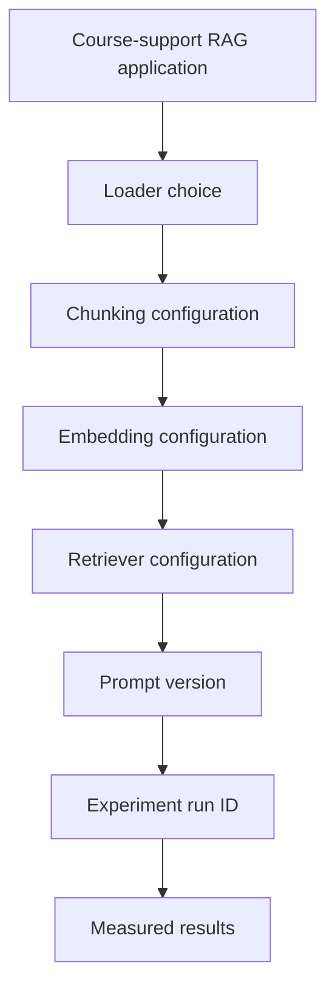

An illustrative experiment ledger might look like this:

| Run | Prompt | Chunking | Retrieval | What is retained |
|---|---|---|---|---|
| E01 | v1 | 500-character chunks | Top 3 results | Inputs, configuration, outputs, metrics |
| E02 | v2 | 500-character chunks | Top 3 results | Same information, with changed prompt |
| E03 | v2 | 800-character chunks | Top 5 results | Same information, with changed retrieval setup |

**Technical clarification:** The numbers and runs above are teaching examples, not measurements from the recording. Real experiments should also record dataset/version, model identification, code version, and relevant parameters for reproducibility.

Now we have a history of *what we tried*. That still leaves the harder question: **Which version is actually better?** This is the role of evaluation.

---

## 7. Evaluation: deciding whether the chatbot is good enough

The transcript distinguishes **model-specific evaluations** (including model benchmarks and related governance questions) from **application-specific evaluations**. This course focuses on the application level: how well does *our particular course chatbot* do its intended job?

An answer that reads fluently might still be wrong, unsupported by retrieved material, or unrelated to the question. We therefore need explicit test questions and an agreed way to judge outcomes.

For the running example, imagine asking:

> “What is the difference between a document chunk and an embedding?”

An evaluation might investigate whether the chatbot finds the right lecture section, correctly explains both concepts, and avoids inventing additional course-specific claims.

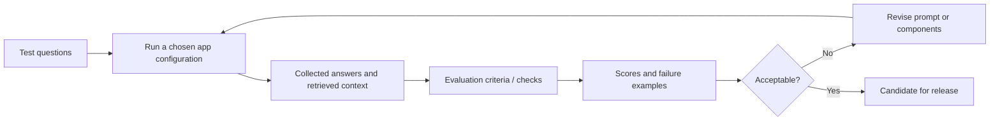

Evaluation answers **“Does the application produce acceptable outcomes?”** It can reveal a quality problem, but a failing score alone may not show which internal component caused it. For that, we need to see the individual steps that produced the answer.

---

## 8. Observability: opening the application's black box

The instructor describes observability as opening the “black box” of the application to inspect how internal components behave. For our RAG chatbot, a single question can move through retrieval, prompt assembly, model inference, and response generation.

A result-level evaluation can say the answer was incorrect. A **trace** helps investigate *where* things went wrong.

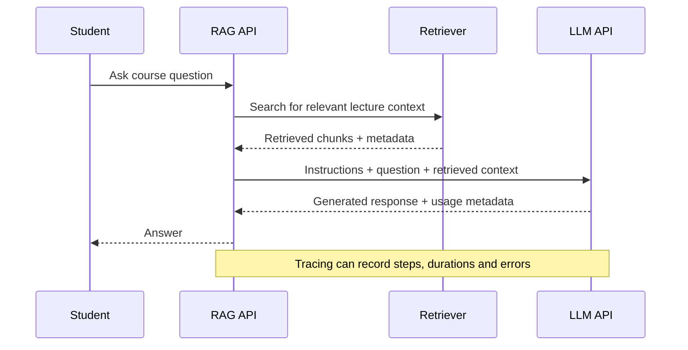

With a trace, the developer may discover that retrieval returned irrelevant chunks, prompt assembly omitted key text, or model latency increased sharply. These clues make quality improvements less dependent on guesswork.

The transcript also explains **why observability continues after deployment**: users ask questions the developer never anticipated. Their interactions reveal failures and improvement opportunities that a pre-release test set may not expose.

### Evaluation versus observability

| Question | Evaluation | Observability / tracing |
|---|---|---|
| Primary purpose | Determine whether behavior meets quality expectations | Understand actual execution and diagnose behavior |
| Typical output | Scores, judgments, pass/fail cases | Traces, events, latency, errors, token usage |
| Main value | Compare versions and decide readiness | Explain failures and investigate real interactions |
| After release? | Yes, useful for regression testing and live-data review | Yes, continues throughout production operations |

**Technical clarification:** The recording introduces observability as a later stage for teaching clarity. In practice, basic tracing is often useful *from the first experiment*, because evaluation and observability reinforce each other.

We can now test the chatbot and inspect its execution. But even an accurate answer might violate a business constraint. For example, the system could reveal paid course content to someone who has not purchased it.

That leads to guardrails.

---

## 9. Guardrails: defining and enforcing acceptable behavior

The running example has a distinct audience: students who should receive help with course material they are authorized to access. This creates boundaries that go beyond correctness alone.

The instructor proposes several illustrative restrictions: do not answer outside the appropriate course scope, avoid exposing personal student information and secrets, avoid inappropriate or harmful responses, and maintain the intended tone or educational style.

A **guardrail** is a control that checks or constrains some aspect of input or output behavior. Some restrictions belong in instructions; other restrictions need validation or enforcement outside the model.

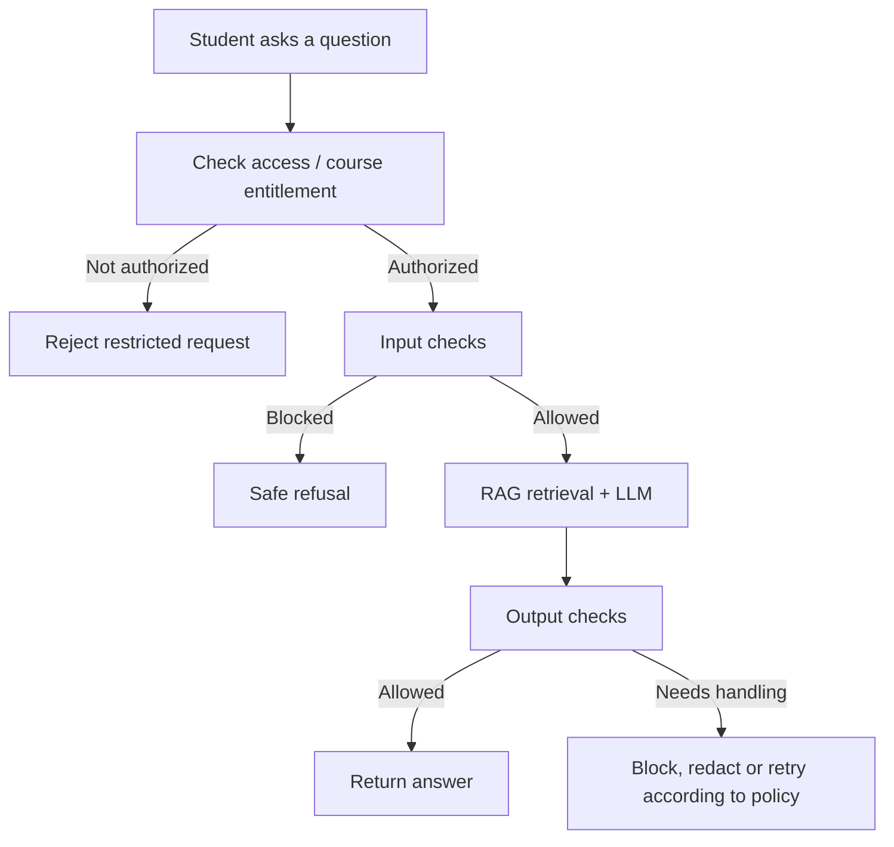

**A critical distinction:** a system prompt can *ask* the model not to reveal restricted content, but a prompt is not reliable access control. Course entitlements and access to restricted source documents must be enforced by the application and its retrieval permissions, not merely by an instruction to the LLM.

The session places guardrails after evaluation and observability to help the learner progress from internal developer checks toward user-facing protections. That is a helpful narrative order, **not a requirement that security controls wait until the last phase**. In real projects, data access restrictions and essential input/output protections should be designed and tested early.

This gives our chatbot a more complete behavior model. We have a system that can generate answers, evaluate them, inspect how they were produced, and enforce boundaries. The remaining challenge is making it available to actual users.

---

## 10. Serving: how the student reaches the application

Until now, the developer may have invoked the RAG pipeline directly from Python. A website or mobile application needs a stable interface that can accept questions and return answers without knowing the internal implementation details.

The instructor introduces **FastAPI** as the tool to expose application behavior over an HTTP API.

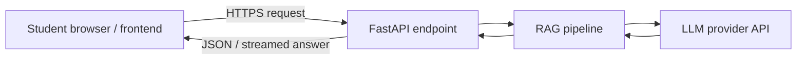

For example, an endpoint such as `POST /ask` could accept a question and return an answer. The path below is **illustrative**, not a documented endpoint from the lecture.

```json
{
  "question": "Why do we split documents into chunks?",
  "course_id": "rag-intro"
}
```

The key idea is a **contract** between frontend and backend. The frontend sends documented inputs and receives documented outputs. It does not need to know which loader, retriever, prompt template, or LLM library produced the result.

**Technical clarification:** The API must authenticate the requester and enforce permissions server-side. Do not treat a user-supplied `course_id` as proof that the requester has purchased the course.

But providing an API on the developer's laptop does not automatically make it reproducible in another environment. The developer has installed Python and supporting libraries locally. How do we carry those dependencies into a deployment target?

---

## 11. Containerization: making the application portable

The instructor introduces Docker as a way to **package** the application and its dependencies. Without a repeatable package, another environment may have incompatible Python versions, missing libraries, or different setup steps.

Think of a container image as a versioned application artifact containing the application code, runtime dependencies, and startup configuration required by the image. It is then run as a container in a compatible environment.

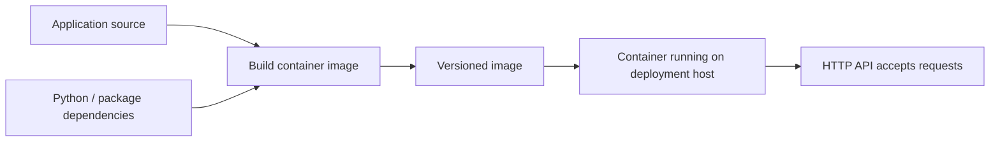

A simplified Dockerfile could look like this:

```dockerfile
FROM python:3.11-slim
WORKDIR /app
COPY requirements.txt .
RUN pip install --no-cache-dir -r requirements.txt
COPY . .
CMD ["uvicorn", "main:app", "--host", "0.0.0.0", "--port", "8000"]
```

This is an **educational example**, not code provided by the instructor and not a hardened production image. It assumes a `main.py` exporting `app`, plus a complete `requirements.txt`. Secrets should not be baked into the image.

Containerization addresses reproducible packaging. But when a developer changes a prompt or retrieval strategy, do we want someone to manually rebuild, retest, and redeploy the application every time?

---

## 12. CI/CD: making changes repeatable and controlled

The session introduces CI/CD as automation around updates to an application. At a conceptual level, **continuous integration (CI)** validates and builds changes; **continuous delivery/deployment (CD)** takes suitable build artifacts toward an environment where users can access them.

Suppose a new course has been added and the chatbot's retrieval setup must be updated. Rather than relying on a fragile sequence of manual actions, the team can configure a pipeline to run repeatable checks and build the next version.

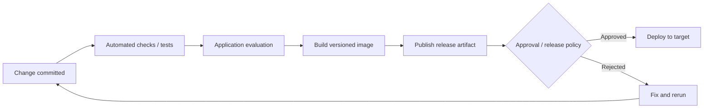

**Technical clarification:** CI, continuous *delivery*, and continuous *deployment* are not identical. Delivery means a release is deployable and may involve a manual approval; continuous deployment automatically releases qualifying changes. This is an operational distinction beyond the lecture's high-level analogy.

Automating the steps reduces accidental inconsistencies, but does not ensure that every change is good. Quality checks, policy gates, and rollback approaches remain important.

### Serving, containerization, CI/CD, and deployment are different jobs

| Step | Core question it resolves |
|---|---|
| Serving | How can another system call my application? |
| Containerization | How do I package it with its runtime dependencies? |
| CI/CD | How do I repeatedly validate, build, and release changes? |
| Deployment | Where and how does the running application become accessible? |

This distinction matters because beginners often use the word *deployment* to describe all four activities at once.

---

## 13. Production monitoring: the journey does not end at deployment

Once real students are using the chatbot, the operational questions become ongoing. Is the API available? Are students seeing errors? Is the LLM provider slow? How much are requests costing? Are application resources becoming saturated?

The instructor separates application-level tracing from the broader **operational monitoring** of the deployed service. Both matter, and both continue after release.

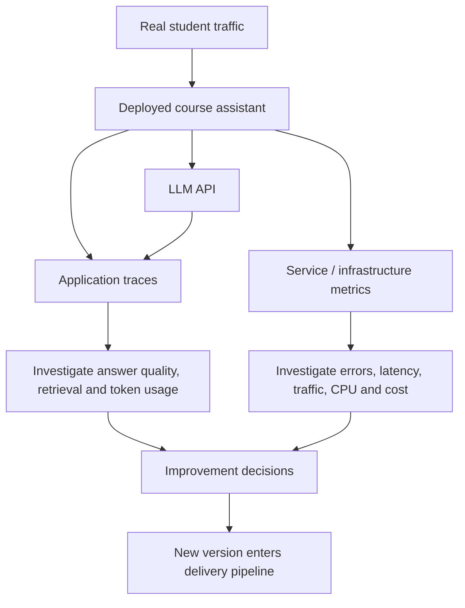

The closing arrow is the crucial insight: **LLMOps is a feedback loop, not a one-time checklist.** Production results inform the next experiment, prompt update, evaluation, or release.

An operations-oriented starter set of signals could include:

| Signal | Why it matters |
|---|---|
| Request volume and failure rate | Understand demand and application reliability |
| End-to-end latency | Understand student experience |
| Retrieval and model-call latency | Find slow internal stages |
| Token usage / model API spend | Estimate operational cost |
| CPU / memory / capacity | Diagnose service resource pressure |
| Quality regressions / negative feedback | Identify answers that need investigation |

These signals are **illustrative categories** expanding the lecture's examples; the recording does not prescribe specific thresholds, alert rules, or service-level objectives.

---

## 14. Assemble the entire lifecycle in one picture

We started with a single question: *If a chatbot gives a good answer on my laptop, what else is required before I can rely on it in production?*

Each stage has now answered a different part of that question.

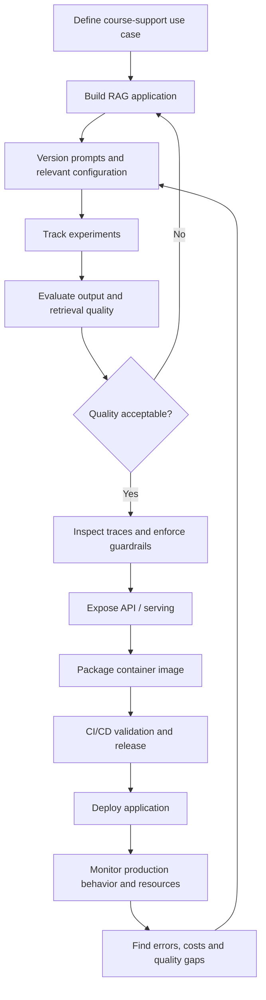

The arrows show a **teaching flow**, not a universal mandatory ordering. Security, tracing, evaluation, versioning, and tests should be woven through the development lifecycle rather than switched on only once.

### An end-to-end walkthrough with one student question

Let's follow one representative request, then connect it to the engineering workflow behind it.

1. A student signs into the course platform and asks why chunking matters in RAG.
2. The application verifies the student's permissions and accepts the request through an API.
3. The RAG pipeline retrieves relevant lesson segments from the permitted course knowledge index.
4. The application constructs a prompt using the student question, appropriate instructions, and retrieved context.
5. The LLM returns a response. Application checks may validate the output before it is sent to the student.
6. The request trace records meaningful execution details, errors, timings, and usage metadata according to the system's observability configuration.
7. If the response is wrong or slow, engineers investigate the trace and compare configuration versions.
8. They test a new prompt or retrieval approach, evaluate it against known questions, and publish a new application build if it passes release criteria.
9. CI/CD moves the approved artifact into the intended environment, and production monitoring shows whether the new version behaves as expected.

This is what “operations across the application lifecycle” means in concrete terms.

---

## 15. Scope of this course and what comes next

The instructor's stated course plan is to apply LLMOps to **RAG-based applications during the instructional journey** and later revisit the lifecycle using an **agentic application** as a project. The session also mentions FastAPI, Docker, AWS-based deployment, and services including EC2, CodeDeploy, load balancers, Auto Scaling Groups, and Secrets Manager as areas intended for the wider course.

It explicitly **does not focus on** pre-training a foundation model, deploying a locally hosted open-source foundation model, or teaching model fine-tuning as part of this application-centered track. The instructor instead describes using paid model APIs for the exercise applications.

These are the instructor's stated plans in this session—not a claim that later lessons completed every item.

### Three distinctions to retain

| Common confusion | Better mental model |
|---|---|
| “LLMOps means LLM training.” | LLMOps also covers reliable applications built on existing models. |
| “Evaluation and observability are the same.” | Evaluation measures outcomes; observability helps understand execution. |
| “Once I deploy, the project is complete.” | Deployment starts an ongoing loop of monitoring, learning, and improving. |

## 16. Check your understanding

1. A chatbot answers a student question inaccurately. Why should you inspect retrieval results before deciding the LLM itself is inadequate?
2. You improve a system prompt but forget to record the old version. What question becomes difficult to answer later?
3. Two RAG experiments use different chunk sizes. Why do you need a comparable evaluation set rather than judging only one attractive answer?
4. A trace shows the correct documents were retrieved but the final answer contradicts them. Which part of the request journey would you investigate next?
5. Why can a system prompt that says “do not reveal paid material” **not** replace backend entitlement checks?
6. What does Docker solve that merely exposing a FastAPI endpoint does not solve?
7. Why do operational monitoring and application tracing both remain necessary after deployment?
8. What new problem appears when the chatbot serves hundreds of concurrent users instead of one developer on a laptop?

### Final mental model

An LLM can generate language. A RAG application can give that ability access to task-specific knowledge. Prompt versioning and experiment tracking make changes understandable and repeatable. Evaluation asks whether the application is good enough. Tracing explains its internal behavior. Guardrails and backend controls constrain what it is permitted to do. Serving gives other systems a stable way to use it. Containers and CI/CD make releases reproducible. Deployment makes it available to users. Monitoring turns real-world behavior into the evidence for the next improvement.

**That continuous path—from application development, through release, to measured production behavior and back—is the LLMOps lifecycle emphasized in Session 1.**
