# LLMOps — Session 2: From a RAG Prototype to an Operated System, and Why That Is Different from MLOps

> **Learning mode:** A continuous technical chapter, not a lecture transcript summary. We reuse a single course-transcript RAG chatbot as our main example, introduce each operational need only when the previous explanation makes it necessary, and evolve the diagrams along the way.
>
> **Primary source:** *LLMOPs Session 2*, approximately 2 hours 9 minutes. The session primarily **recaps the LLMOps lifecycle**, **maps the curriculum to specific tools**, and **teaches MLOps versus application-focused LLMOps**. The planned live construction of the RAG application was postponed to the following session.
>
> **Terminology:** Transcription variants such as “rack/RAD” and “LAN graph/LAN fuse” have been normalized to **RAG**, **LangGraph**, and **Langfuse** where context is unambiguous. Additional explanations appear as **Technical clarification** or **Illustrative example**; those are educational supplements, not claims that the instructor implemented them live.

## Our destination: the question this chapter should answer

In Session 1, we established that using an LLM in a local notebook is not the same as delivering an LLM-based application that real people can rely on. That gave us a **high-level lifecycle**. Session 2 makes that lifecycle more concrete and then asks an important architectural question:

**If MLOps already helps us deploy and operate machine-learning models, why do we need a different operational approach for an application built on an LLM?**

A good answer requires two things. First, we need to know what we are *operating*: an application with prompts, retrieval, language generation, user-facing APIs, and infrastructure. Second, we need to know what differs from operating a conventional predictive model: the artifacts we change, the shape and variability of the output, the internal execution path, the evaluations, the risks, and the feedback loop after deployment.

By the end of this chapter, you should be able to explain the course's tool choices without memorizing a vendor list; follow one RAG request from a student's question to an answer; distinguish experiment tracking from a live trace; reconstruct a conventional MLOps pipeline for loan prediction; compare both systems at each operational boundary; and reason about what must change when a production RAG answer is poor.

**What you need beforehand:** a working intuition for an LLM, a prompt, a RAG retriever, LangChain, and LangGraph. The lecture names LangChain and LangGraph as prerequisites. We will briefly re-establish the essential concepts as they become necessary rather than front-loading a glossary.

---

## 1. Begin with one application, not fifteen tools

Imagine a learning platform with recordings and transcripts of its classes. Students repeatedly ask questions about earlier sessions: “What did the instructor say about evaluation?”, “How is the RAG pipeline supposed to work?”, or “Why are we using LangGraph?” The platform could let them search transcripts manually. Instead, it wants a chatbot that uses those transcripts to answer questions.

This is the **course-transcript RAG chatbot** that the instructor selects as the running application. It matters that the example is modest. If we spend the entire course developing an elaborate retrieval algorithm or advanced agent, we may learn those techniques without ever learning how to *operate* the resulting system. Here the application is deliberately kept basic so that the operational layers remain visible.

Before we introduce any operational tool, we can describe the request path:

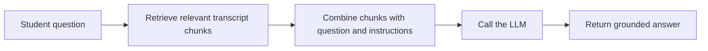

**Read the diagram from left to right.** The application does not expect the LLM to remember the course transcripts. It looks up relevant chunks and supplies them as context. That is the essential RAG idea: **retrieval**, then **augmentation** of the prompt, then **generation** of the answer.

Notice how this already differs from a bare chat-completion call. There is a retrieval step with its own configuration and possible failures. There are prompt instructions that shape how the model should use evidence. There is a model call that may have variable latency and cost. And there is an answer that must be judged against the student's question and the retrieved source material.

These are exactly the moving parts we will learn to manage.

### Why the course has two applications

The lecture outlines two learning stages. During the course, the group will use this **basic RAG chatbot** to learn the full LLMOps lifecycle. Later, the final project will use an **agentic chatbot** with tools and memory and apply the same lifecycle again. The agentic application is not built in this particular session; it is the promised second application.

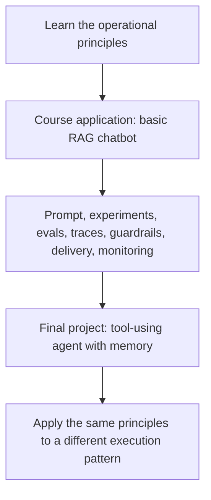

The useful mental model is: **learn the operating method on a simple system, then transfer the method to a more complicated system**. The tools may differ, and the measurements will differ, but the need to control changes and observe behavior remains.

---

## 2. Why development ending is not the end of the work

Suppose the first version of the chatbot works in a notebook. You run three questions, inspect the answers, and feel satisfied. What remains unresolved?

You do not know whether a prompt change improves or worsens answers overall. You cannot easily explain why a particular run retrieved the wrong chunk. You do not know whether the model is exposing sensitive information, how the user reaches the application, whether a new release can be tested automatically, or whether the server will keep serving requests when traffic rises.

This is why the instructor treats the progression from **local working application** to **user-facing operated application** as the important journey of application-focused LLMOps. The recap groups the major steps into a lifecycle:

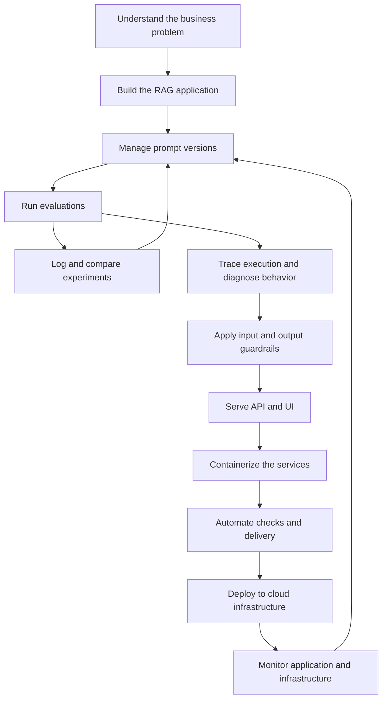

**Observe the loops, not just the boxes.** Prompt management, experiment tracking, and evaluation are not a once-only staircase. They support successive changes and comparisons. Monitoring is not the finish line either: production evidence can trigger a new improvement cycle.

The instructor sometimes describes these topics in a particular classroom order, but their operational relationship is better understood as **connected activities**, some repeated before deployment and some continually performed afterward.

### Establish a stable reference point

Let us name the first application configuration **Candidate A**. This is only a teaching label, not a version that the instructor actually deployed. It consists of a specific model, system prompt, transcript collection, chunking method, embedding model, retriever configuration, and generation settings.

When we later say “Candidate B improved the answer,” a meaningful claim must identify what was changed and **how that improvement was measured**. This need takes us to the first cluster of LLMOps practices.

---

## 3. First control what the application is instructed to do: prompt management

The student can ask any number of questions, so the student's query is different on every run. But the application itself has persistent instructions about its task. For example, a course-support assistant may be instructed to answer from retrieved course transcripts, say when evidence is insufficient, and avoid inventing course-specific details.

That relatively stable instruction set is the **system prompt** (or an application-level prompt template). The instructor specifically emphasizes versioning *this behavior-defining prompt*, not versioning every individual student's question.

Imagine an initial instruction:

> **Illustrative prompt v1:** “Answer students' questions about the provided course transcripts.”

After observing that unsupported claims sometimes appear, we could test a stronger instruction:

> **Illustrative prompt v2:** “Use the retrieved transcript excerpts when answering. If the excerpts do not establish an answer, say that the material is insufficient. Do not manufacture lecture-specific facts.”

This is not just wording polish. It changes the behavior the application is being asked to exhibit. Now we need to know which instruction was used for a particular run, how v2 compares with v1, and which version is approved for release.

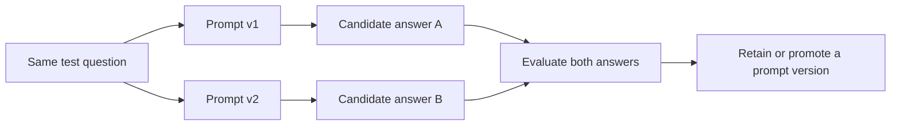

This reveals why prompt management is an **operational practice**. It makes changes identifiable, comparable, and reversible. It also demonstrates why there cannot be one universally best system prompt: the behavior required by a course-support assistant is different from the behavior required by a coding agent or customer-service assistant.

The course plans to use **Langfuse** for prompt versioning, registration, tagging, and comparison. We will return to Langfuse when we talk about traces because it serves more than one purpose.

**Mental-model checkpoint:** Prompt versioning answers, “**Which behavioral instruction set did this application use?**” It does not by itself prove that a new instruction set is better. For that, we need evidence.

---

## 4. Now control everything else that can change: experiment tracking

Suppose you keep the prompt unchanged, yet the RAG chatbot produces a different answer after a code update. Where else could the difference come from?

The retriever may select a different number of chunks. The document-chunk size may have changed. The embedding model may differ. The vector store may contain a newer transcript collection. The generation model or its settings may have changed. In other words, the prompt is only one piece of the system.

**Experiment tracking records the configuration and results of an application candidate.** The lecture uses **MLflow** for this layer. The exact logging schema is an implementation choice, but the conceptual record should allow us to reconstruct what was tested.

Here is a small **illustrative** record for a RAG run; the values are teaching examples rather than parameters provided in the lecture:

```yaml
experiment: course-transcript-rag
run: candidate-b
application:
  prompt_version: v2
  llm: selected-provider-model
  embedding_model: selected-embedding-model
  chunk_size: 800
  chunk_overlap: 100
  retriever_top_k: 4
  corpus_version: transcripts-2026-06
results:
  groundedness_score: 0.91     # illustrative only
  answer_relevance_score: 0.87 # illustrative only
```

This record is useful even without a live request trace. It tells us **which road we constructed**: the components, parameters, data version, and test results. The instructor uses a road analogy: experiment tracking documents the road and its construction, whereas tracing follows a particular traveler moving along it.

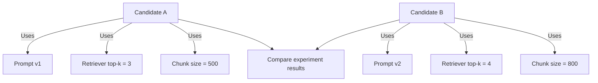

This illustrates an important experimental discipline: if you change the prompt, the retriever, and the chunking strategy at the same time, you might find a better result without knowing **which change caused it**. For learning and debugging, start with controlled comparisons wherever practical; track all changes when comparing more complex candidates.

### Why evaluation belongs inside this loop

Logging configuration without testing tells us how a system was built, not whether it is successful. Evaluating without recording configuration may tell us one candidate performed well, but not how to reproduce it.

Therefore the useful loop is **configure → execute → evaluate → record → compare → modify**. The lecture discusses all three concerns—prompts, evaluation, and experiment tracking—as a tightly related improvement cycle. We will now examine the evaluation step that makes the comparison meaningful.

---

## 5. Why evaluating generated language is harder than checking a calculator

A calculator returning `4 + 5 = 9` is easy to test. The expected output is exact. With the RAG chatbot, the expected answer is usually a *meaning*, not one specific character string.

Suppose a student asks, “Why does the course use a basic RAG application?” One acceptable answer may explain that the course wants to keep attention on LLMOps rather than advanced retrieval design. Another acceptable answer may use different wording and include a short example. Their strings are different but their meaning can be equivalent. Conversely, an eloquent answer could be unsupported by the transcripts.

The instructor stresses that LLM-based applications are **probabilistic** and that even small prompt changes can affect the output. This creates an evaluation problem: exact string comparison alone is insufficient for many natural-language tasks.

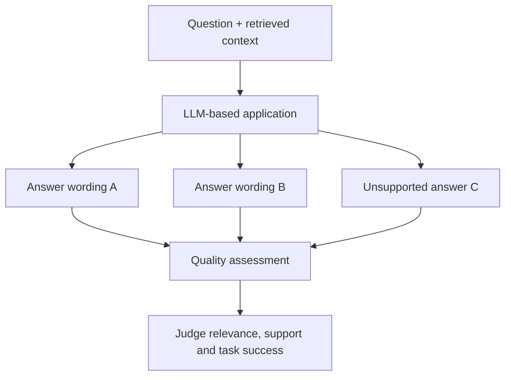

**Do not interpret the three arrows as guaranteed randomness on every call.** They illustrate *possible variation*. Repeated outputs can sometimes be stable, especially with constrained settings; the key is that natural-language quality is not generally determined by exact byte-for-byte equality.

### The criteria must follow the application

A transcript-grounded assistant needs checks that reflect its purpose. For example, we may ask: Does the answer address the question? Is it supported by the retrieved excerpts? Did the system retrieve relevant evidence? Did it refuse to manufacture course-specific facts when the corpus had no answer? An agentic tool-using application may require additional criteria about whether a tool was selected correctly, whether actions were valid, and whether the result satisfied the task.

The lesson says the course will explore **application-specific and custom evaluation metrics**, using **DeepEval as the primary evaluation framework** and **Ragas as an additional RAG-focused framework**. This session **does not** calculate these metrics or implement the evaluation suite; that deeper study is planned for the next module.

### An evaluation example without pretending there is one perfect answer

Consider a small set of questions derived from lecture transcripts:

| Question | What a useful evaluation should examine |
|---|---|
| “Which application does the course use to learn LLMOps?” | Correctly identifies the basic transcript-based RAG chatbot. |
| “Why not start with an advanced RAG design?” | Explains the instructor's desire to focus on operating the application. |
| “Was the RAG application coded live in Session 2?” | Correctly says no; coding was deferred. |
| “What exact production answer did the deployed chatbot give yesterday?” | Recognizes that the lecture does not provide such a production record. |

The final row is especially important: the system should not be rewarded for fluency when the required evidence is absent. Evaluation should encode the product's expectations, not just whether an answer sounds plausible.

**Mental-model checkpoint:** Prompt management and experiment tracking tell us **what changed**. Evaluation tells us **whether the resulting behavior met our criteria**. Yet a failed evaluation still leaves another question: **at which internal step did the system go wrong?**

---

## 6. Open the black box: tracing an individual RAG request

Imagine that the evaluator marks an answer as unsupported. Was the model ignoring good evidence? Did the retriever fetch the wrong lecture excerpt? Did a previous step alter the student's question? Looking only at the final answer cannot tell us.

We need to look *inside one execution*. That is the purpose of **tracing**, part of **observability**. A trace follows a request through the components that processed it, recording meaningful operations, their inputs and outputs (subject to privacy controls), timings, errors, and relationships.

The instructor makes the distinction explicit: experiment tracking describes the configured system, whereas tracing describes a **particular journey** through that system.

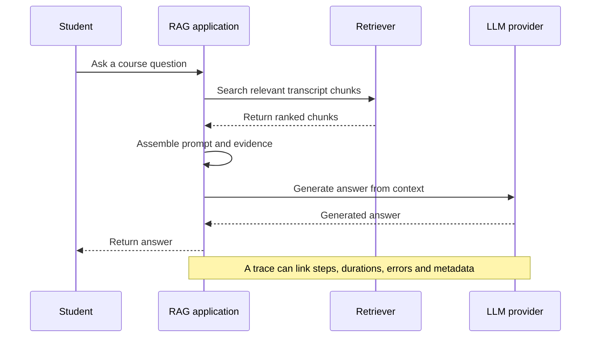

This diagram is intentionally more detailed than the first RAG picture. Our mental model is expanding: the earlier picture explained the *idea* of RAG; this one exposes the communication sequence that an observer wants to inspect.

### What a trace can teach us

Suppose retrieval completed quickly but brought back a passage from the wrong lesson. The subsequent LLM response may be coherent and still factually wrong for the user's question. That is a **retrieval problem**, not necessarily a prompt problem. If correct chunks were retrieved but the answer misrepresents them, we would investigate prompt construction and generation instead.

For a particular request, useful trace fields can include a request or trace identifier, selected model, prompt version, retrieved document identifiers, operation durations, usage information, exception details, and parent-child relationships between steps. The exact fields depend on instrumentation and privacy policy.

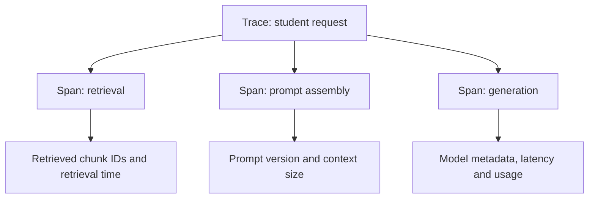

The course chooses **Langfuse** as the principal tracing and observability tool and touches **LangSmith** as a secondary option. Langfuse also supports the prompt-management layer, giving the curriculum a reusable tool across responsibilities.

**Technical clarification:** Instrumentation should not blindly store raw student questions, private transcript content, credentials, or sensitive responses in traces. A trace is valuable only if the telemetry pipeline is also appropriately secured, minimized, and retained.

### A distinction you should be able to make instantly

**Experiment tracking:** “Candidate B used prompt v2, top-k 4, and chunk size 800. Its evaluation result was better.”

**Tracing:** “On request `r-204`, retrieval returned these chunks, prompt assembly took this long, and the generation step produced this response.”

They complement each other. One describes **a reproducible configuration and trial**; the other describes **an individual execution through that configuration**.

---

## 7. Once the system can answer, what should it refuse or reject? Guardrails

Now imagine the same chatbot has been opened to students. Most ask legitimate questions about lessons. Some input may be malformed, unsafe, or designed to make the application ignore its instructions. A generated answer may also contain material that should not be returned as-is.

The course introduces **guardrails** as rules and checks around the application that accept ordinary traffic and reject or handle disallowed inputs or outputs. The instructor describes them using a *semi-permeable boundary* analogy: the boundary allows expected requests to pass while interfering with problematic ones.

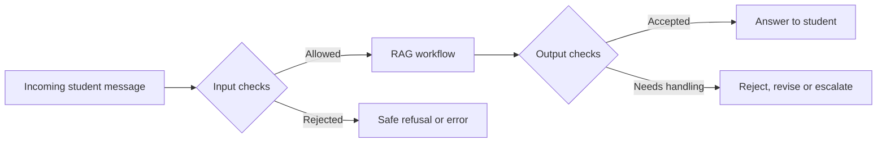

The boundary is an analogy, not a promise that a guardrail can detect every malicious prompt. In practice the checks may validate input structure, enforce policy, restrict sensitive information disclosure, assess answer format, and apply domain-specific safety criteria. Which checks matter depends on the product.

The instructor recommends keeping the **internal rules and detection mechanisms** out of users' view, so the system does not disclose implementation details that make evasion easier. That does not mean a user must receive no explanation: an appropriate refusal can be transparent about the outcome without revealing bypass instructions or internal policy configuration.

The course plans to use **Guardrails AI** as the main tool and **NVIDIA NeMo Guardrails** as the secondary tool. The tool comparison is a curriculum choice, not an assurance that either library solves every threat.

**Technical clarification:** Guardrails are one protection layer, not a substitute for authentication, authorization, input limits, data-access controls, rate limiting, or application security. For a transcript RAG system, the retriever must also respect which documents a student is entitled to access; an output filter cannot reliably compensate for improper access control.

We can now imagine a chatbot whose behavior is versioned, whose configurations are recorded, whose quality is evaluated, whose requests can be traced, and whose input and output are checked. But so far this is still primarily an application we run as developers. How does a student actually reach it?

---

## 8. Make it reachable: APIs, UI, containers, and automation

The next barrier is not a language-model problem at all. We have a working backend, but ordinary students will not open a Python notebook, import a LangGraph workflow, and invoke it from code. They need a user interface and an endpoint that accepts their requests.

The instructor introduces **FastAPI** to expose backend functionality and **Streamlit** as a pragmatic frontend. These choices keep the course focused on LLMOps rather than on building a sophisticated web interface.

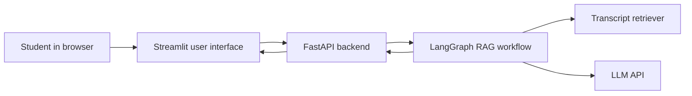

Notice an important separation: Streamlit handles the user experience; FastAPI exposes the service boundary; LangGraph coordinates the application workflow; the retrieval and generation steps remain backend responsibilities. Keeping these roles distinct makes it possible to change the interface without rewriting the RAG logic.

### Why response streaming enters the discussion

For an ordinary classification service, an API commonly returns a compact prediction after computation. An LLM may produce a longer answer over time. If the API waits until the entire answer is complete, a student may see an apparently idle interface. When supported by the model and application, **streaming** lets the client display chunks as they arrive.

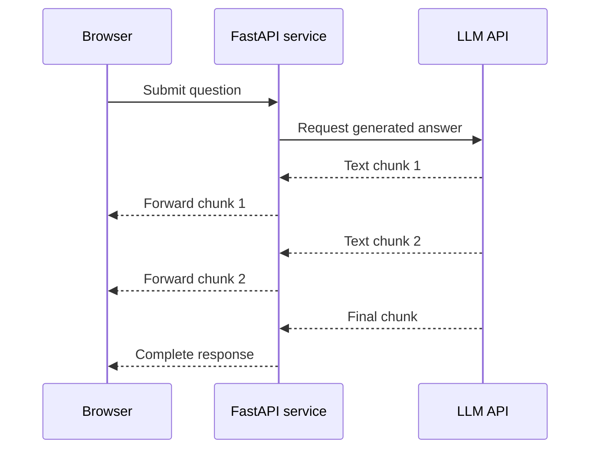

**Technical clarification:** Streaming is a useful interaction pattern, not a requirement of all LLM calls. Providers and transports differ in how chunks are emitted, and output chunks do not necessarily correspond to a single word or token. The lecture uses “token by token” to explain the experience intuitively.

### Why package the services into containers?

The backend and frontend use distinct runtimes and dependencies. Running both manually on one laptop hides assumptions about installed packages, start commands, ports, and environment variables. **Containerization** provides repeatable application environments. The course will use **Docker** and **Docker Compose** to package and start the related services.

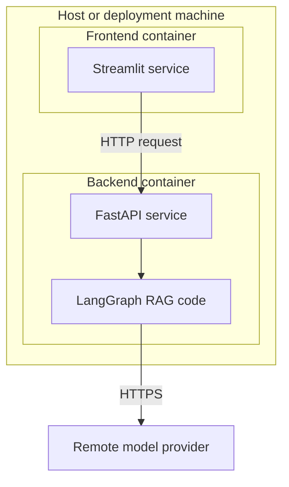

**What to observe:** Two containers are separate application processes with their own images and execution environments. Compose can place them on a shared network and configure service startup, but it does **not** magically merge them into one application. The frontend still uses a network/API contract to call the backend.

### Why CI/CD follows containerization

Manually testing one version and manually deploying the next becomes risky as the number of changes increases. The course therefore introduces **GitHub Actions** to automate a delivery workflow. It plans to use **DeepEval's CLI** for evaluation checks and **Docker Hub** as part of the image workflow.

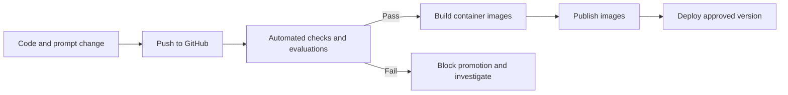

This is why evaluation is not simply a notebook exercise. The same quality expectations can be enforced as release checks. The precise thresholds, test environment, and deployment workflow will be designed when those lessons are implemented.

---

## 9. The cloud is a different operating environment, not a different application concept

After the application is packaged, it must run somewhere students can access it. For the course, that environment is **AWS**, chosen mainly because of the instructor's familiarity rather than a claimed universal advantage over Azure or Google Cloud.

The lecture identifies several AWS pieces by their responsibilities. We can understand them by following a request and then considering what happens when load increases:

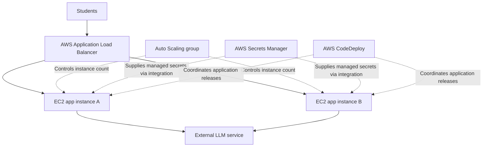

**Follow the solid request path first.** A student's request arrives at the load balancer, which distributes it to an available application instance. The backend may call an external LLM service. Now follow the dotted operational relationships: Auto Scaling adjusts the pool of instances under configured conditions; CodeDeploy helps coordinate releases; Secrets Manager supplies a safer way to manage sensitive credentials than hard-coding them into the application.

The instructor also mentions deployment strategies such as **canary** and **blue-green**. Their purpose becomes obvious once a service has users: we want the ability to promote a new version carefully and reduce the impact of a bad release. The session does not implement these strategies yet.

### Two kinds of production observation

We have already introduced traces for individual RAG requests. But traces will not tell us everything about CPU exhaustion, instance availability, memory pressure, or failing network infrastructure. Those belong to **infrastructure and service monitoring**.

The lecture separates them:

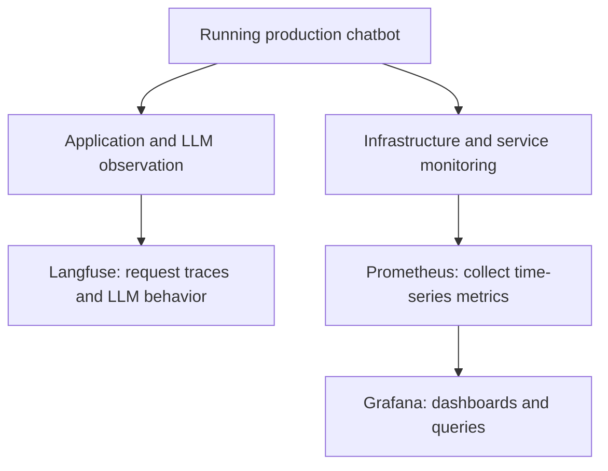

The course uses **Langfuse** for LLM/application visibility, and **Prometheus plus Grafana** for infrastructure-oriented metrics and dashboards. Real deployments may additionally monitor application-level HTTP rates and errors with Prometheus; the boundary is about what we measure, not a hard restriction on which tool may store a metric.

We now have an end-to-end operating picture. But a familiar question remains: **haven't we already done deployment, versioning, and monitoring in MLOps?** To answer correctly, we must first understand the system that MLOps traditionally operates.

---
## 10. Reconstruct MLOps from first principles: what are we actually operating?

The lecture's second major teaching arc begins by relating three familiar disciplines: **DevOps**, **MLOps**, and **LLMOps**. The instructor presents them as an evolution of operational practices: conventional software operations helped inspire the workflows for machine-learning systems, and those practices in turn inform how we operate systems built around language models.

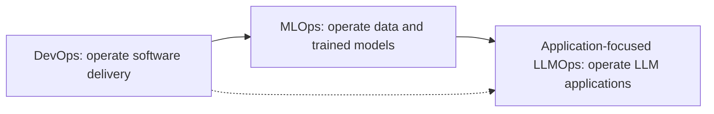

The arrows describe **shared ideas and historical influence**, not a formal rule that one discipline completely replaces another. All three care about reproducibility, testing, releases, and production health. What changes is **the object being built and managed**.

To make the difference concrete, consider the instructor's second running example: a **loan-prediction system**. A bank has past customer data and wants a model that predicts some loan-related outcome. The lecture describes this using binary labels, `0` and `1`, and a classification model. We will treat it as a *toy supervised-learning example*; real lending decisions require human oversight, fairness analysis, compliance, and careful definition of the target.

### 10.1 Start with a model as a mathematical mapping

A conventional supervised machine-learning model can be described, at a useful introductory level, as a function:

\[
\hat{y} = f_{\theta}(x)
\]

Here `x` is an input feature vector, `θ` represents learned model parameters, and `ŷ` is the model's prediction. The function may be much more complex than the notation suggests, but the notation is enough to reveal a central requirement: **where do the parameters `θ` come from?**

In the course's loan example, there is no usable model waiting for us as a third-party application API. We must produce a model by training on suitable labeled data. That means our operational journey begins **before** there is a deployable model.

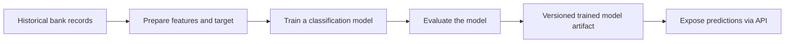

Compare this with our RAG application. For the course project, a foundation model is already accessible through an API. We construct a workflow *around* that model. For the loan project, we spend substantial effort preparing data and producing the model itself.

This is the first major difference of **scope**.

**Technical clarification:** The contrast is between the *particular* conventional MLOps scenario and the *application-focused* LLMOps scenario taught in this course. LLMOps can also include model fine-tuning and serving; conventional ML systems can also contain many services and complex workflows. “MLOps always trains from scratch” and “LLMOps never trains a model” would both be too broad as universal claims.

---

## 11. Why an MLOps pipeline starts with data

A predictive model cannot be trained without examples. The instructor therefore builds the conventional MLOps workflow from the data side, beginning with **data collection**. In our loan example, the data might contain customer attributes, loan history, credit-related features, and a defined training target. The exact columns are incidental; their relationship to the prediction task is what matters.

The data is not immediately ready for training. We need to understand it, repair relevant problems, and transform it into the features the model expects. These activities are related but not identical.

### 11.1 EDA: understand the evidence before changing it

**Exploratory data analysis (EDA)** answers questions about the data. What distributions do the numeric columns have? How frequently are values missing? Are some values unusually extreme? Does the target class appear much less often than another? Do certain columns show surprising relationships?

The instructor strongly differentiates EDA from cleaning: **EDA is primarily for inspecting and understanding**, whereas downstream preparation steps modify the data. That distinction protects an important reasoning habit. If we change data before understanding its structure, we may remove information we later discover was meaningful.

Think of EDA as opening a map of the terrain before deciding where to build a road.

### 11.2 Cleaning and wrangling: change data to make it usable

Once we understand the data, we can decide how to handle missing values, inconsistent representations, duplicates, and outliers. Cleaning is not “delete all unusual observations.” An unusual value might be a recording error, or it might represent a rare but real case. The treatment should follow the data and business meaning.

Our data now differs from the original source. This immediately creates a new problem: **what if the transformation turns out to be wrong?** If the only copy is the modified data, reverting becomes difficult. We therefore need versioned artifacts.

### 11.3 Data versioning: preserve the ability to reproduce and undo

The lecture calls both data and trained models important **artifacts** of an MLOps pipeline. An artifact is a durable output of an operational step that we may need to store, identify, reuse, compare, or promote. Data collection yields one artifact; cleaning yields another; feature engineering yields another.

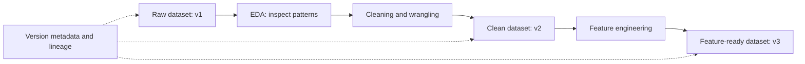

**Notice what versioning gives us:** the possibility of reconstructing the state used in an earlier training run, comparing a modified dataset with its predecessor, and tracking which transformations produced which output. The lecture names **DVC (Data Version Control)** as an example of a tool used for data versioning, without teaching its commands.

Versioning is not necessarily the same as copying an entire large dataset after every operation. A practical implementation might track immutable objects, transformation code, hashes, metadata, or combinations of these. The conceptual requirement is **identifiable, reproducible data states and lineage**.

### 11.4 Feature engineering: reshape data into model inputs

After cleaning, the data still may not be in the form required by the learning algorithm. The model wants usable numeric or otherwise encoded inputs with consistent semantics. The instructor introduces **feature engineering** as the stage that converts prepared data into model-ready inputs.

Examples include categorical encoding, scaling, and mathematical transformations. The transcript mentions log and Box–Cox-style transformations among other techniques. These are examples of possible operations, not steps that every dataset requires.

The important progression is:

1. **EDA:** discover what the raw dataset looks like.
2. **Cleaning:** address identified data-quality issues.
3. **Feature engineering:** create and transform the input representation expected by the model.
4. **Versioning:** retain enough evidence of the inputs and transformations to reproduce a model-building run.

These are distinct responsibilities, even though real implementations may combine several of them in one reproducible pipeline.

**Mental-model checkpoint:** We needed versioning here for the same *reason* that we versioned prompts in the RAG system: to control changes to an artifact that materially affects system behavior. But the artifact is different. In this MLOps example, it is a **dataset or feature representation**; in prompt management, it is an **instruction artifact**.

---

## 12. The second MLOps pipeline: produce, test, and register the model

With a model-ready dataset available, we can begin training. The lecture describes a cycle of **training, evaluation, and hyperparameter tuning**, followed by model versioning and a model registry.

Why a cycle instead of a single training action? Because the first trained model may not meet the required accuracy or other performance criteria. We must measure its performance and adjust the configuration or the learning approach. A hyperparameter is a design or training setting chosen outside the learned model parameters—different from the weights the training procedure learns from data.

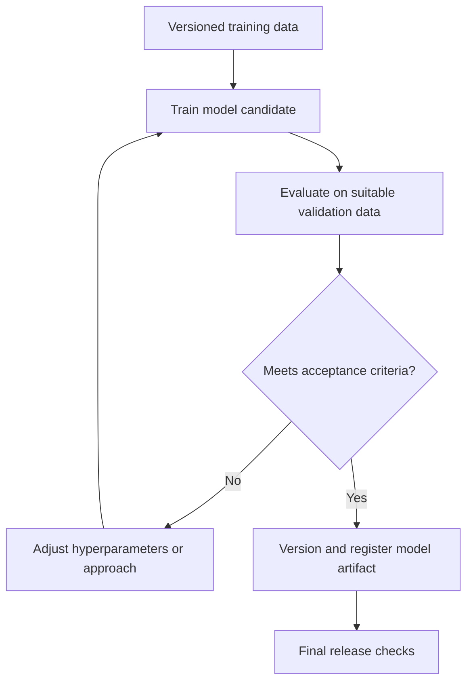

The instructor emphasizes two parallel tracking needs. First, preserve the **model artifacts** themselves: the trained candidate, its version, and eventually the approved model. Second, record the experimental choices and outcomes: what training configuration was used, what evaluation result was obtained, and which candidate performed better.

This is where **experiment tracking** appears in MLOps as well. A model registry is not interchangeable with experiment tracking: a registry helps manage identifiable model artifacts and their lifecycle, while experiment tracking connects runs, parameters, inputs, and measured results.

### Put both MLOps pipelines together

We now understand why the lecture draws **two major pipelines**. One produces the model's input data; the other consumes that data to train and evaluate a model.

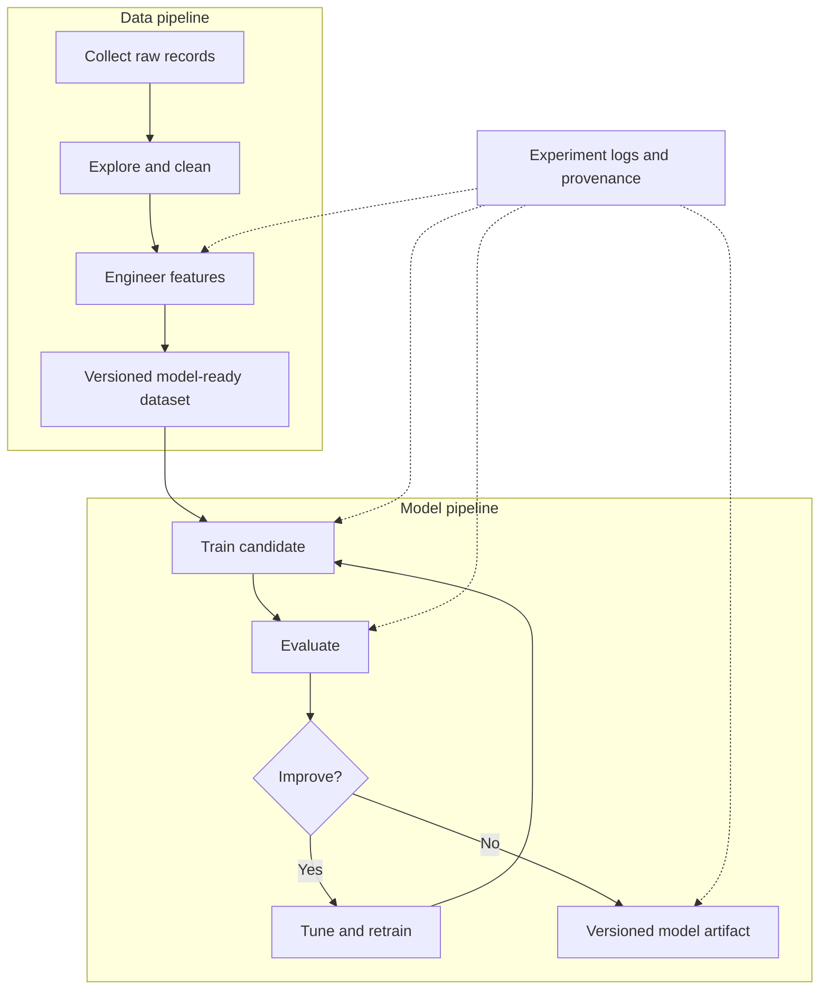

This is a deeper application of the word **pipeline** than simply “a list of steps.” A pipeline defines a repeatable orchestration of work: given suitable inputs and conditions, it can execute a known sequence and produce identifiable outputs. In practice, orchestration may include conditional paths, independent tasks, retries, and checks rather than a permanently rigid A-then-B-then-C sequence.

That principle is shared with the LangGraph RAG workflow. In a data pipeline the trigger might be a new dataset or scheduled training run; in the RAG chatbot the trigger is a student's incoming question. Both are designed so the required steps execute consistently and can be understood afterward.

### Why the instructor's loan example matters

Imagine the bank's first model is too eager to approve loans. A data scientist may discover that certain customer features were encoded incorrectly. If earlier data versions, transformation logic, model configurations, and evaluation records are retained, the team can diagnose the problem and compare the resulting retrained model. If these are not retained, the team is left guessing which dataset and transformation created the original behavior.

That is exactly why MLOps goes beyond a notebook: it provides controlled, reproducible routes from **data and training experiments** to **deployable model artifacts**.

---

## 13. The crucial comparison: what actually differs once both systems exist?

We are finally ready to compare systems without merely saying “ML uses numbers and LLMs use text.” Those claims alone miss the operational consequences.

Our two examples now have complete basic shapes:

```mermaid
flowchart TB
    subgraph ConventionalML[MLOps example: loan prediction]
        MD[Historical labeled data] --> MT[Train and evaluate own model]
        MT --> MM[Versioned classification model]
        MM --> MS[Prediction API]
        MS --> MO[Class or score]
    end
    subgraph LLMApplication[Application-focused LLMOps example: transcript chatbot]
        LC[Prepared transcript corpus] --> LR[Retriever]
        UQ[Student question] --> LR
        LR --> LP[Prompt with retrieved evidence]
        LP --> LM[Hosted LLM API]
        LM --> LA[Natural-language answer]
    end
```

**Read down each branch:** the first pipeline creates a model artifact that can serve predictions; the second builds an application whose inference workflow calls a pre-existing model and other components. The second still requires data preparation for the document corpus, but not the same foundation-model training pipeline.

### Difference 1: the artifact we are primarily changing

In the loan example, the central promoted artifact is the **trained predictive model**, supported by versioned training data, transforms, and run metadata. In the chatbot example, the meaningful release artifact is a **working application configuration and codebase**: prompt version, graph behavior, retriever parameters, corpus/index version, model selection, container images, and service deployment.

This difference affects rollback. A loan model can often be rolled back by selecting a previously approved model artifact together with its preprocessing pipeline. Rolling back a RAG system may require more than choosing an earlier LLM: if a new index, prompt, or retriever caused the regression, those components must be reverted or made compatible as well.

### Difference 2: what an answer looks like, and how its correctness is judged

A classifier may predict `0` or `1`. The evaluation can compare predictions with trusted labels and compute measures such as precision, recall, F1 score, and accuracy. We can explain these using confusion-matrix counts.

For example, **precision** measures how many predicted-positive cases were actually positive; **recall** measures how many actual-positive cases were recovered. The lecture names those standard classification metrics but does not derive all their formulas.

A transcript chatbot returns unconstrained or partially constrained language. Two differently worded answers may both be useful; a concise answer can be more useful than a verbose one; a plausible answer can lack evidence. So LLM application evaluation may require semantic correctness, evidence grounding, task success, human review, LLM-based judges, or customized checks.

The important conclusion is not that conventional ML evaluation is always simple; it is that **many LLM application outcomes cannot be evaluated through one exact-answer comparison**.

### Difference 3: what happens during inference

The instructor contrasts the relative simplicity of sending a feature row to a predictor with the richer **multi-step workflow** of a RAG request. The loan model may perform preprocessing and inference, then return a result. The RAG application may perform retrieval, context construction, a provider call, output validation, and response streaming. Agentic applications add further decisions, tool calls, and sometimes loops.

This makes **trace visibility** especially valuable in the RAG example. If output quality is poor, we need to know which step failed to meet expectations, not just the final value.

**Technical clarification:** Conventional ML production systems can have intricate feature pipelines, distributed inference graphs, rich observability, and request tracing too. The lecture's comparison is with a deliberately simple loan-prediction serving path, not every possible MLOps architecture.

### Difference 4: cost and performance vary with workload shape

The lecture points out that a student's question and retrieved evidence can vary greatly in length, and generated responses can also vary. When using a usage-priced hosted model, request cost often depends on input and output token usage and the chosen model, along with other billed capabilities or infrastructure.

For example, a short question with two relevant chunks is not the same workload as a long conversation with extensive evidence. Similarly, a streaming answer that generates many chunks is not identical in time or usage to a brief answer.

```mermaid
flowchart TD
    Q[Incoming question] --> SIZE[Input size and conversation context]
    SIZE --> RET[Retrieved context volume]
    RET --> LLM[Model call]
    LLM --> TOK[Generated output length]
    TOK --> COST[Usage cost and latency impact]
    RET --> COST
    SIZE --> COST
```

This does **not** mean traditional ML inference has perfectly fixed costs or that LLM cost is impossible to predict. Real ML batching, model size, scaling, and hardware utilization also affect costs. The useful distinction is that hosted generative applications make **variable prompt/context size and generated-token usage** particularly visible operational dimensions.

### Difference 5: failures and misuse take different forms

The loan classifier can make a harmful or biased decision despite returning only a number. The chatbot can also fail by retrieving a wrong document, producing an unsupported claim, mishandling private information, or obeying malicious content found in input or retrieved material.

Consequently, the RAG application needs layered input, retrieval-access, tool-permission, and output controls appropriate to its use case. **Guardrails** are a named layer in the course's LLMOps architecture because the application consumes and generates language as part of its main behavior.

**Technical clarification:** The lecture's simplified statement that a numeric classifier cannot leak private information or need guardrails should not be generalized. Classical ML systems also need privacy, fairness, security, access control, model-risk management, and sometimes adversarial defenses. The difference is the **threat and validation profile**, not the existence of safety requirements.

---

## 14. The operational feedback loop is where the difference becomes undeniable

Suppose we have now deployed both applications. A few months pass, and their behavior worsens. Do we fix them the same way?

### 14.1 The loan model: data changes can motivate retraining

The instructor introduces **data drift**: the properties of new inputs may depart from the data used to train the model. If that affects performance, the team may need to inspect incoming data, refresh training examples, re-run the data and model pipelines, evaluate new candidates, and promote a replacement artifact.

```mermaid
flowchart TD
    PROD[Production loan model] --> MON[Monitor predictions and data]
    MON --> DR{Meaningful drift or degradation?}
    DR -->|No| PROD
    DR -->|Yes| DATA[Inspect and prepare current data]
    DATA --> TRAIN[Retrain and evaluate candidate]
    TRAIN --> PROM{Candidate passes checks?}
    PROM -->|Yes| RELEASE[Register and deploy new model]
    PROM -->|No| DATA
    RELEASE --> PROD
```

The feedback loop centers on **updating the trained artifact**. Monitoring does not imply that every drift alarm should cause automatic retraining: a team must decide whether the change is material, whether labels or trustworthy ground truth are available, and whether the new candidate is genuinely safer or better.

### 14.2 The RAG application: inspect and improve the orchestration around the LLM

Now suppose students report that the transcript assistant confuses two sessions. The operations team opens a production trace and sees that the retriever fetched irrelevant excerpts. Training the entire foundation model again would not be the natural first response. Instead, the team may change the retrieval configuration, repair the transcript corpus or indexing process, revise prompt instructions, improve evaluation data, and deploy a new application version.

```mermaid
flowchart TD
    APP[Production transcript chatbot] --> OBS[Traces, evaluations and usage signals]
    OBS --> ISSUE{Quality or reliability regression?}
    ISSUE -->|No| APP
    ISSUE -->|Yes| DIAG[Identify failing component or assumption]
    DIAG --> CHANGE[Revise prompt, retrieval, data or application code]
    CHANGE --> TEST[Evaluate and compare tracked candidate]
    TEST --> GATE{Passes release criteria?}
    GATE -->|Yes| REL[Deploy revised application]
    GATE -->|No| DIAG
    REL --> APP
```

The feedback loop centers on **changing the application**, not necessarily the foundation-model weights. This distinction connects the whole lecture: prompt management, experiment tracking, evaluation, tracing, and CI/CD are not isolated modules. They form the mechanism by which a production application is systematically improved.

**Technical clarification:** Application-focused LLMOps can also include fine-tuning, changing the underlying model, updating embeddings, or re-indexing a corpus. These may be necessary in some cases. The course chooses a simpler API-model-first workflow so the core operational mechanisms remain understandable.

---

## 15. Compare both lifecycles side by side, now that the prerequisites are established

We can now put the complete workflows next to each other without treating every box as equivalent. Some concerns are genuinely shared; others refer to different artifacts or operational questions.

```mermaid
flowchart TB
    subgraph ML[MLOps: train and serve a loan model]
        M1[Business goal] --> M2[Collect and version data]
        M2 --> M3[Clean and engineer features]
        M3 --> M4[Train, tune and evaluate]
        M4 --> M5[Track experiments and register model]
        M5 --> M6[Serve, containerize and deploy]
        M6 --> M7[Monitor drift and model performance]
        M7 -.-> M2
    end
    subgraph LLM[Application-focused LLMOps: operate a RAG chatbot]
        L1[Business goal] --> L2[Build retrieval and generation workflow]
        L2 --> L3[Version prompts and configurations]
        L3 --> L4[Evaluate and track experiments]
        L4 --> L5[Trace and apply guardrails]
        L5 --> L6[Serve, containerize and deploy]
        L6 --> L7[Monitor behavior, usage and infrastructure]
        L7 -.-> L3
    end
```

The **horizontal alignment** is conceptual, not a claim that both systems use an identical release sequence. MLOps has a strong **data → training → model artifact** center. Application-focused LLMOps has an **application workflow → behavioral evaluation → application release** center. Both benefit from version control, reproducibility, automated delivery, and monitoring.

| Operational question | Loan prediction: course's MLOps example | Transcript chatbot: course's LLMOps example |
|---|---|---|
| What is the central product? | A trained predictive model exposed through a service | An orchestrated RAG application using a hosted model |
| What starts the work? | Obtain and prepare labeled training data | Build an application around available LLM access and transcript data |
| What changes frequently? | Data transformations, features, model candidates, hyperparameters | Prompts, retriever/index settings, orchestration, model selection, UI/API code |
| What is a key versioned artifact? | Dataset / transformed features / trained model | Prompt / corpus-index configuration / application and container version |
| How do we assess quality? | Task metrics against labeled outcomes | Application-specific output, retrieval, grounding and task criteria |
| Why trace a request? | Useful when model-serving path is complex | Especially helpful to inspect retrieval-to-generation workflows |
| What happens on degradation? | Investigate data and performance; potentially retrain and redeploy | Diagnose traces and evaluations; change application components and redeploy |
| What do both need? | Testing, reproducible releases, security, cost control, monitoring | Testing, reproducible releases, security, cost control, monitoring |

A helpful way to remember the relationship: **the operational principles are shared, but the critical objects and failure modes differ.** That is a stronger explanation than memorizing “MLOps is deterministic; LLMOps is probabilistic.”

---

## 16. Connect each course tool to a problem we have already encountered

Only now, after the problems have been introduced, is a tool map useful. The table below preserves the session's planned curriculum choices. It is a **course roadmap**, not evidence that these tools were all installed or demonstrated during Session 2.

| Layer / problem | Primary course choice | Secondary or companion tool | What this layer is meant to solve |
|---|---|---|---|
| Model access | LangChain | Provider APIs from OpenAI and others | Connect the application to hosted foundation models |
| Workflow orchestration | LangGraph with LangChain components | — | Express RAG steps, conditions, and stateful control flow |
| Prompt management | Langfuse | — | Version, tag, and compare application prompts |
| Experiment tracking | MLflow | — | Log candidate configurations, artifacts, and measured outcomes |
| Application evaluation | DeepEval | Ragas | Evaluate RAG responses; later extend to the agentic project |
| Observability and tracing | Langfuse | LangSmith | Inspect individual executions and intermediate operations |
| Guardrails | Guardrails AI | NeMo Guardrails | Implement task-appropriate input/output and policy checks |
| Backend serving | FastAPI | — | Expose the backend workflow through an API |
| Frontend | Streamlit | — | Provide a simple Python-based chat interface |
| Containerization | Docker | Docker Compose | Package and coordinate separate application services |
| CI/CD | GitHub Actions | DeepEval CLI, Docker Hub | Automate checks, packaging, and promotion activities |
| Hosting and releases | AWS EC2, ALB, CodeDeploy, Auto Scaling | AWS Secrets Manager | Run, route, scale, deploy, and secure the application |
| LLM/application observation | Langfuse | — | Follow application behavior after deployment |
| Infrastructure monitoring | Prometheus | Grafana | Collect operational metrics and present dashboards |

### How to read this table correctly

Do **not** memorize “Langfuse comes after MLflow” as if production requests travel through these products in sequence. Langfuse and MLflow are primarily operational systems that help the team observe and manage the application, while LangGraph is part of the application logic itself. Similarly, a Prometheus collector is not normally a required hop between the student's browser and the backend.

The instructor wants the learner to focus on **why → what → how** for each layer. The course intentionally selects a primary tool for practical depth and shows some alternatives in overview. That way, if a framework changes, the engineering question remains familiar even if the API calls change.

**Technical clarifications on library capabilities:**

- The lecture uses the shorthand that switching LLM providers through LangChain can require a one-line change. A common interface can simplify replacement, but providers can differ in authentication, structured output, streaming, tool calling, context lengths, and behavior. A production switch still deserves compatibility checks and evaluation.
- The lecture presents LangGraph as the workflow layer and LangChain as the model-access layer. This is a helpful teaching division, although LangChain itself also offers composition and routing mechanisms; the distinction is not an absolute limitation of LangChain.
- The lecture favors Langfuse partly for framework flexibility and describes LangSmith as more tied to the LangChain ecosystem. Treat that as the instructor's rationale for the course, **not** a permanent statement that LangSmith cannot instrument other libraries or that NeMo Guardrails can only support simple chatbots. Integration capabilities change across versions.
- AWS cost examples in the lecture should not be interpreted as guarantees of zero charges. Free-tier entitlements, service eligibility, traffic, idle resources, and account age all affect billing. Set budgets and cleanup procedures when conducting the deployment exercises.

---

## 17. An integrated walkthrough: a production answer is wrong—what exactly do we do?

We will now test whether the mental models genuinely connect. This is an **illustrative engineering exercise**, not a debugging incident from the recording.

A student asks the course chatbot: “Did the instructor build the RAG chatbot during Session 2?” The assistant replies, incorrectly, “Yes, the complete chatbot was implemented during Session 2.” In reality, the instructor planned to do that live but **postponed coding to the next session** because the conceptual explanation took longer than expected.

How would we improve the application without guessing?

**Step 1 — Reproduce the failure.** Capture a permitted test version of the question and the observed answer. Identify the deployed application, prompt version, selected model, corpus/index version, and relevant retriever settings. This establishes *which candidate* the failure belongs to.

**Step 2 — Inspect the execution trace.** Did retrieval fetch the section where the instructor says coding will move to the next lecture? Or did it fetch an early agenda mention saying the application would be built today? Those are not equivalent pieces of evidence. A trace helps distinguish **wrong evidence** from **wrong interpretation of correct evidence**.

**Step 3 — Choose a targeted change.** If retrieval is wrong, inspect chunk boundaries, ranking, metadata, and transcript indexing. If retrieval is correct but interpretation fails, test a prompt that asks the model to prioritize the session's **actual outcome** over the originally announced agenda. Change the minimum necessary components to understand the effect.

**Step 4 — Create a tracked candidate.** Record the new prompt or retrieval configuration in a new experiment. Preserve the previous configuration as a baseline. Do not silently replace Candidate A with Candidate B.

**Step 5 — Run evaluations.** The originally failed question becomes a regression test. Test additional questions, including ones the original system answered correctly, to avoid optimizing one answer at the expense of the overall chatbot. Check both task correctness and groundedness.

**Step 6 — Apply the release path.** If the candidate meets the agreed checks, build and deploy it through the normal delivery workflow. Avoid one-off manual edits on the production server that leave no clear record.

**Step 7 — Observe the next production behavior.** Inspect new traces, application metrics, and service health. A change that improves answer quality but causes very high latency or cost is not automatically a successful release.

```mermaid
sequenceDiagram
    participant User as Student
    participant App as RAG app
    participant Trace as Trace store
    participant Team as Engineering team
    participant Eval as Evaluation suite
    participant CI as Delivery pipeline
    User->>App: Ask if RAG was built in Session 2
    App-->>User: Incorrect answer
    App-->>Trace: Record permitted execution metadata
    Team->>Trace: Inspect retrieval and generation steps
    Trace-->>Team: Identify likely failure location
    Team->>Eval: Submit revised tracked candidate
    Eval-->>Team: Quality and regression results
    Team->>CI: Promote approved candidate
    CI-->>App: Deploy new application version
    User->>App: Ask a subsequent question
```

This is the whole LLMOps lesson compressed into one failure investigation. No individual tool solves it by itself. The improvement comes from connecting the **business expectation**, the **execution evidence**, the **controlled change**, the **evaluation**, the **deployment**, and **post-release observation**.

---

## 18. What this session actually taught—and what it explicitly postponed

The instructor intended to write the basic RAG workflow live during Session 2, but the explanation of the LLMOps curriculum and MLOps comparison took the available class time. It is important that our notes do **not** confuse an architectural overview with a completed implementation.

The session establishes the design and course plan; it does **not** provide a finished LangGraph project, a measured DeepEval test suite, deployed AWS architecture, or running Prometheus dashboards.

The instructor's next planned work is to assemble the basic transcript-based RAG chatbot: set up the project folder and Python environment, construct and test the LangGraph backend using course transcripts, and then begin a detailed evaluation module. Frontend serving, containerization, cloud deployment, and monitoring are later course stages. The speaker mentions that evaluation may occupy several lectures because the metrics will be examined in detail.

This boundary keeps the learning narrative accurate: we have **earned the architectural mental model** in this chapter. The implementation should follow in the next chapter rather than being falsely attributed to this lecture.

---

## 19. Final synthesis: one connected mental model

We began with a simple RAG chatbot: student question → transcript retrieval → context assembly → LLM answer. That workflow exposed a series of unanswered questions. Which prompt defines the chatbot's behavior? Which retriever and chunking choices produced the result? How do we know that a change improves quality? Which step caused a bad answer? Which inputs or outputs need control? How do users reach the application reliably? How do we deploy a new version without losing reproducibility? What do we monitor when it is running?

Each LLMOps practice arises as a response to one of these questions:

```mermaid
flowchart TD
    NEED[Need: reliable answers for students]
    NEED --> APP[Build retrieval and LLM workflow]
    APP --> CFG[Control prompts and configurations]
    CFG --> EVAL[Measure output quality]
    EVAL --> OBS[Trace why a result occurred]
    OBS --> SAFE[Apply appropriate safeguards]
    SAFE --> DEL[Serve and release reproducibly]
    DEL --> MON[Observe real production behavior]
    MON -.->|Evidence for a new change| CFG
```

Then we examined why the course calls this **application-focused LLMOps** rather than simply MLOps. A conventional loan-prediction workflow in the lecture begins with labeled data, prepares and versions that data, trains and tunes a model, registers the trained artifact, exposes it for prediction, and monitors for degradation that may justify retraining. The chatbot's main work is different: it operates a *composition of components around an already accessible LLM*. The central operational object is the application and its behavior, including prompt, retrieval, context, generation, and delivery.

Both use reproducible pipelines. Both use experiments and evaluations. Both use releases and production monitoring. They differ primarily in **what changes, what is evaluated, which failures must be explained, and what is updated in the feedback loop**.

That is the conceptual foundation Session 2 was designed to establish before practical implementation begins.

### Understanding checks: reason through the system

1. A RAG response is wrong. What evidence would let you distinguish a retrieval failure from a generation failure?
2. Candidate B uses a new prompt and a different chunk size. Its result improves. What can—and cannot—you conclude from that comparison?
3. A course chatbot has high accuracy in offline evaluations but becomes very slow in production. Which aspects of observability and monitoring would you investigate?
4. A loan-prediction model stops performing well on current customers. Why might re-running a data-and-model pipeline make sense, whereas re-training the foundation model behind the chatbot is usually not the first fix for a bad retrieved answer?
5. Why do we version raw, cleaned, and feature-engineered data separately? What is the closest analogous operational need in the RAG project?
6. When a LangGraph workflow succeeds in a notebook, which essential responsibilities remain before students can depend on it?
7. Why are guardrails alone insufficient to secure a transcript chatbot containing documents with different access permissions?
8. If an LLM provider is replaced through a convenient wrapper, what might still need to be tested before promoting the new application version?

If you can answer these using one connected explanation—not eight unrelated tool definitions—you have reached the learning objective of this session.

---

## Source-navigation guide

These are approximate points in the **Session 2 recording** that anchor the chapter; they are for navigation, not a claim of one-to-one transcription:

| Recording position | Main discussion |
|---|---|
| ~00:02–00:25 | Session 1 recap: application-focused LLMOps workflow, prompts, evaluation, experiments, traces, guardrails, serving, CI/CD, cloud, monitoring |
| ~00:25–00:51 | Course curriculum, primary/secondary tools, LangChain/LangGraph, Langfuse, MLflow, DeepEval/Ragas, Guardrails AI, Docker, AWS, Prometheus and Grafana |
| ~00:51–01:08 | Why MLOps and LLMOps differ; available model vs trained model, output variability, cost, and workflows |
| ~01:08–01:35 | MLOps overview with loan prediction; EDA, cleaning, data versioning, feature engineering, training and tuning |
| ~01:35–01:46 | MLOps experiments, artifacts, evaluation, serving, containerization, deployment and retraining; comparison with LLMOps |
| ~01:46–02:08 | Questions, feedback, clarification that the RAG build and evaluation lessons are deferred to the next class |

> **Study habit:** First explain the two diagrams in Sections 15 and 19 without looking at the text. Then choose any one box and work backward: *What problem makes this box necessary? What evidence does it produce? What would break if it were missing?* That is how this chapter is meant to be learned—one connected thought at a time.
