# LLMOps — Session 3: Build a Baseline RAG Application, Then Learn Why Evaluating It Is Hard

> **Course:** LLMOps · **Session:** 3 · **Source:** Session 3 classroom transcript (approximately 2 hours 24 minutes).
>
> **Learning mode:** This is a connected teaching chapter, not a chronological subtitle summary. Each concept is introduced because the previous concept creates a need for it. Diagrams evolve from a simple system into the full implementation. The primary running example is the **course-transcript RAG chatbot**.
>
> **Source fidelity:** The transcript documents a live demo but does not include the complete source code shown on screen. The code examples in this chapter are **educational reconstructions** of the design and settings discussed aloud, **not** a verbatim copy of the instructor's notebook. Wherever a code detail or conceptual correction is added, it is identified. The source says the instructor attempted a GitHub push but encountered an authentication/permission problem; it does **not** establish that the remote push succeeded during this class.
>
> **Terminology:** Automatic transcription repeatedly writes “Rack,” “Ragaas,” “DPVAL,” or “line graph.” Here these are normalized, where the intended term is clear, to **RAG**, **Ragas**, **DeepEval**, and **LangGraph**. This lesson primarily concerns **LLM-application operations**, not the training of an LLM from scratch.

## The destination: what should you be able to explain after this chapter?

Sessions 1 and 2 gave us a high-level picture of LLMOps. We learned that an LLM application is not only a language model: it is a system of prompts, retrieval, orchestration, evaluations, tracing, security controls, deployment, and feedback loops. We also compared that lifecycle with a conventional MLOps pipeline.

There is an important limitation to understanding those ideas only in the abstract. If someone asks, “What exactly are we evaluating?”, we need to point to a real system. If someone asks, “Which part failed?”, we need to separate the retriever from the prompt-building step and the generator. Without that separation, *evaluation* remains a vague promise.

Session 3 solves this problem by establishing an actual **baseline application**. The instructor cleans course transcripts, constructs a small RAG pipeline, places the request-time logic into a LangGraph workflow, sends a few test questions, and observes mixed results. Those mixed results create the natural reason to study evaluation next.

By the end, you should be able to reason through **two complete stories**:

1. **Construction:** How raw transcripts become a searchable knowledge base, and how a user query travels through retrieval, augmentation, and generation.
2. **Measurement:** Why a working answer is not proof of a good application, how systematic evaluations use datasets, metrics, and criteria, and what makes evaluation of generated text particularly challenging.

We will build the model in that order. We will not jump straight from `uv init` to an elaborate evaluation framework, because the framework only becomes meaningful after we know what it is supposed to evaluate.

---

## 1. Start with the gap between knowing LLMOps and operating something

Imagine a student returning to an online course after missing several lectures. They could ask a general-purpose LLM, “What is DeepEval?” The model may give an excellent general answer. But that answer will not necessarily tell the student **which parts of DeepEval the instructor has covered, which concepts are planned for upcoming lessons, or what specific prerequisites this course expects**.

The issue is not necessarily that the base model is ignorant of DeepEval. The issue is that the model does not possess the **local, course-specific evidence** needed for the student's actual question.

This is our starting problem:

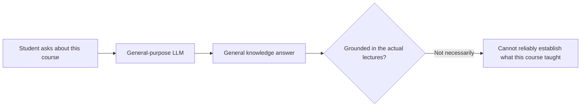

The instructor's chosen project is therefore a chatbot that answers questions **using transcripts of course sessions**. It is intentionally a basic application. The purpose of this course is to operate an LLM application, not to spend the next several lectures designing an advanced retriever or autonomous agent.

Here is the system we want to reach, initially shown at the simplest useful level:

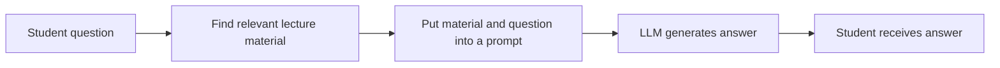

The change is small but fundamental. The model is no longer being asked to answer from its own general knowledge alone. Our application first supplies relevant course material. This is **retrieval-augmented generation (RAG)**.

The immediate question is: **Where does the course material come from, and how do we make it searchable?** That leads us to two related but different flows, often conflated in early RAG explanations.

---

## 2. The two flows hiding inside a simple RAG chatbot

A RAG chatbot has a path for **preparing knowledge** and another path for **answering questions**. They are related, but they do different work and occur at different times.

The knowledge-preparation path processes the original documents so a future question can find relevant information. The question-answering path uses the prepared knowledge to respond to one user.

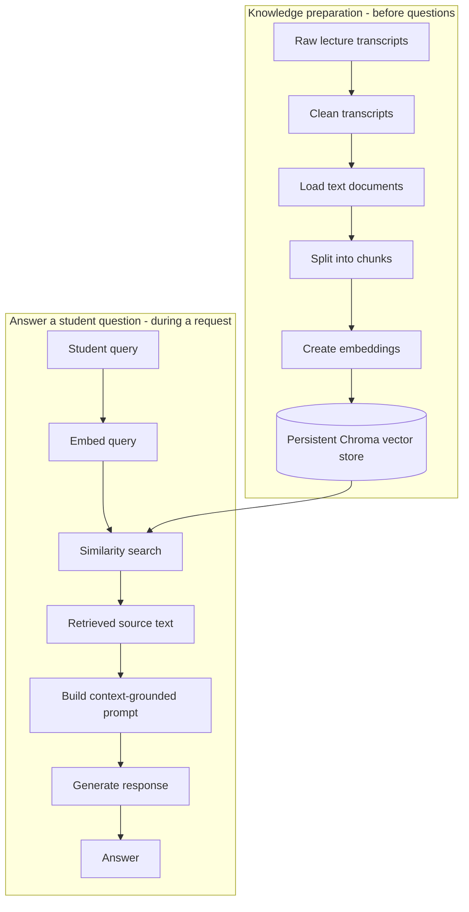

**Read the top path before the bottom path.** The top path makes searchable material available. The bottom path makes use of it. An application might prepare documents once and answer many questions. If documents are later added or changed, the preparation step may need to run again.

The instructor uses two terms that are worth keeping separate:

| Term | Meaning in this lesson | Concrete example |
|---|---|---|
| **Knowledge source** | Original course information before indexing | Transcript files in a folder |
| **Knowledge base** | The prepared, searchable representation used by the application | Stored embeddings together with document text and metadata in Chroma |

The analogy in the lecture is **raw material versus refined material**. That is helpful as an intuition, with one refinement: a vector store does not have to contain only numbers. It commonly holds or associates embeddings with the corresponding text and metadata, precisely so retrieval can return useful source passages.

### Why not simply give every transcript to the LLM?

For a small amount of text, putting the whole source into a model's context might work. But as lecture transcripts grow, requests would repeatedly carry large amounts of irrelevant text. That can increase cost and latency and may exceed context limits. It also gives the model more irrelevant material to sift through.

Retrieval attempts to solve a narrower problem: **For this particular question, which small pieces of our document collection matter most?** Before we can answer that question, we need to transform unstructured transcripts into searchable units.

---

## 3. First make the source usable: cleaning the transcripts

The classroom transcript shows a practical source-data issue. Lecture text contains subtitle timestamps, blank lines, and formatting noise. For example, a raw subtitle-style file can look like this:

```text
00:12:03.000 --> 00:12:06.000
We are using a retrieval augmented generation pipeline.

00:12:06.000 --> 00:12:09.000
The next step is preparing the knowledge base.
```

If we load that file without preprocessing, timestamp ranges become part of the text being split and embedded. Those tokens are usually not the substance a student wants to search. The instructor therefore creates a reusable `transcript_utils.py` script to remove unwanted time-range lines and collapse unnecessary blank space.

Notice the new responsibility: **the knowledge source is not automatically a good knowledge base**. We need a transformation step in between them.

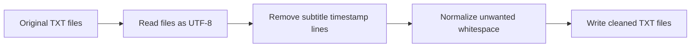

### 3.1 Why use a cleaning function rather than editing three files manually?

The classroom example initially has three transcript files. But the course will generate more recordings. A manual edit might be manageable for three files and tedious for thirty; it also creates inconsistency when some files are treated differently from others.

A function gives us a **repeatable transformation**. Instead of saying, “Please clean the newest transcript,” we can say, “Run the same cleaning routine over every matching source file.” The quality of the process then depends on the routine rather than on someone remembering each individual step.

The lecture uses **regular expressions** to recognize subtitle timestamp ranges and `pathlib` to manage paths. Let us reconstruct a small version of that behavior.

```python
# Educational reconstruction, not a verbatim transcript of the notebook.
import re
from pathlib import Path

TIMESTAMP_RANGE = re.compile(
    r"^\d{2}:\d{2}:\d{2}\.\d{3}\s*-->\s*"
    r"\d{2}:\d{2}:\d{2}\.\d{3}$"
)


def clean_transcript_text(text: str) -> str:
    cleaned_lines: list[str] = []
    for line in text.splitlines():
        stripped = line.strip()
        if not stripped or stripped == "WEBVTT":
            continue
        if TIMESTAMP_RANGE.fullmatch(stripped):
            continue
        cleaned_lines.append(stripped)
    return "\n".join(cleaned_lines)


def clean_transcript_directory(
    source_dir: str = "transcripts",
    target_dir: str = "clean_transcripts",
) -> None:
    original_path = Path(source_dir)
    new_path = Path(target_dir)
    new_path.mkdir(parents=True, exist_ok=True)

    for transcript_path in original_path.glob("*.txt"):
        raw_text = transcript_path.read_text(encoding="utf-8")
        clean_text = clean_transcript_text(raw_text)
        output_path = new_path / transcript_path.name
        output_path.write_text(clean_text, encoding="utf-8")


if __name__ == "__main__":
    clean_transcript_directory()
```

This example follows the instructor's core method. However, it is only intended for simple `.txt` files with the displayed timestamp format. More complete `.vtt` files may contain cue identifiers, speaker markup, alternative timestamp formats, or multiline subtitles. A production parser should handle those formats rather than assuming every subtitle line has this exact shape.

### 3.2 Read the code as a sequence of responsibilities

The first responsibility is to **recognize what is not content**. The `TIMESTAMP_RANGE` pattern matches two time positions separated by `-->`. It checks the complete line with `fullmatch`, so a normal sentence containing an arrow would not be removed merely because it happens to include the same characters.

The second responsibility is to **separate transformation from file handling**. `clean_transcript_text()` accepts a string and returns a string. It does not care which directory the input came from. The directory function handles the filesystem and invokes the transformation for each transcript.

The third responsibility is to **preserve file identity**. `transcript_path.name` extracts the original filename, and `new_path / transcript_path.name` constructs the corresponding output path. As a result, the cleaned directory contains familiar filenames rather than anonymous files such as `file1.txt`, `file2.txt`.

Finally, `mkdir(parents=True, exist_ok=True)` avoids failure when the destination already exists. In particular, `parents=True` creates missing parent directories, while `exist_ok=True` avoids raising an error when the requested directory already exists. These two options solve related but distinct problems.

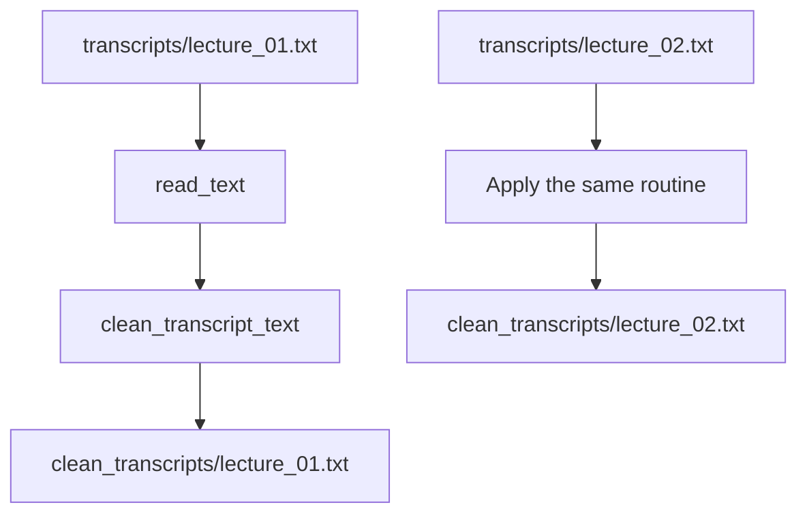

**Important operational distinction:** The cleaning operation can safely overwrite the same cleaned file on a repeated run, but that does **not** automatically make the later *vector indexing* operation idempotent. Re-adding documents without stable IDs or index-rebuild logic may create duplicate records. We will return to that issue once indexing is introduced.

### 3.3 A small improvement worth understanding, but not part of the class demo

The lecture deliberately removes timestamps for a simple chatbot. For a more advanced course-support system, timestamps could be useful metadata. Imagine a student asking, “Where exactly in the lecture was this mentioned?” Keeping source filename and time offsets separately from the searchable text would let the chatbot cite the lecture more precisely.

The distinction is between **removing noise from the text used for retrieval** and **discarding information that might later be useful for provenance**. These need not be the same decision.

We now have cleaned documents. That resolves the first problem, but it does not yet make the material searchable by meaning.

---

## 4. Before indexing, give the project a reproducible environment

At this point we could begin importing Python libraries inside a notebook. The instructor pauses for an operational lesson: if this code is going to become the course's baseline application, the environment around the code matters too.

Suppose one student runs the notebook today and another clones it three weeks later. If they silently install different dependencies, they may observe different APIs, defaults, or failures. That can make it difficult to know whether a change in behavior comes from the application or from the Python environment.

The lesson therefore uses **`uv` as the Python project/package manager**. The instructor initializes a project, installs dependencies, generates environment and lock files, and explains the purpose of those artifacts. The exact commands are library-version-sensitive, but the ideas are not.

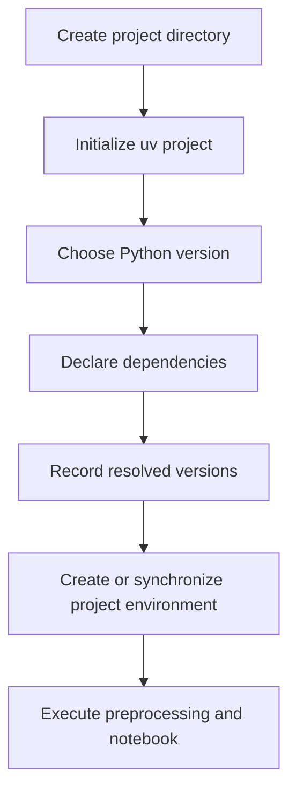

A reconstructed terminal sequence consistent with the demonstration is:

```bash
mkdir llmops-rag-app
cd llmops-rag-app

# Assumes uv has already been installed.
uv init --python 3.12

uv add langchain-community langchain-text-splitters \
  langchain-openai langchain-chroma langgraph \
  python-dotenv ipykernel

# Run the preprocessing script inside the managed environment.
uv run python transcript_utils.py

# On a fresh checkout containing pyproject.toml and uv.lock:
uv sync
```

The lecture also demonstrates keeping dependencies in a `requirements.txt` file and installing them with `uv add -r requirements.txt`, alongside `uv add` and `uv remove` for individual packages. It uses **Python 3.12** in the project; a stray transcription reading of “3.2” is not a different intended version.

### 4.1 What exactly are the files uv creates or manages?

The key distinction is between **declaring what the application needs** and **recording a resolved environment**.

| File or folder | Why it exists |
|---|---|
| `.python-version` | Records the project-selected Python version for compatible tooling. |
| `pyproject.toml` | Declares project metadata and direct dependencies. |
| `uv.lock` | Captures resolved dependency versions and related resolution information. |
| `.venv/` | Local virtual environment with installed packages; normally not committed. |
| `.env` | Locally held environment configuration such as API keys; must not be committed. |
| `.gitignore` | Prevents local secrets, caches, and generated files from being unintentionally committed. |

A `requirements.txt` file may be useful for particular workflows, but it is not the only way to represent dependencies in a uv-managed project. The lecture illustrates both approaches rather than requiring both files to be independent sources of truth.

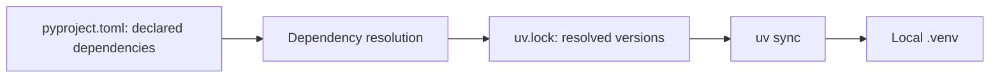

**Why a lock file matters:** If two people use the same resolved dependency graph, they remove one major source of environmental drift. It does not guarantee that all outputs will match, because remote model versions, retrieval data, configuration, and runtime infrastructure may still differ.

### 4.2 Where should API keys live?

The demonstration creates a `.env` file and loads the OpenAI API key with `python-dotenv`. The reason is simple: an API key is needed by the process but should not appear in publicly shared source code.

```text
# .env — local secret file; do not commit
OPENAI_API_KEY=your-key-here
```

```gitignore
# .gitignore
.env
.venv/
__pycache__/
.ipynb_checkpoints/
.DS_Store
saved_embeddings/
```

The `saved_embeddings/` choice above is a recommended local-data exclusion for this reconstruction, not a claim that the instructor committed or ignored the exact same directory. Likewise, a published repository should not include cached credentials or sensitive transcripts unless sharing those files is explicitly permitted.

The point of this project setup is not “uv is faster than pip,” although speed is mentioned in the lecture. The deeper point is that **a baseline application must be reproducible enough that later experiments can be compared meaningfully**.

Now we can return to the knowledge-processing problem with a stable project boundary in place.

---

## 5. A cleaned document is still too large: why chunking appears next

Imagine a transcript containing 90 minutes of speech. A student asks what the instructor said about one specific evaluation criterion. Searching at the document level might identify the correct lecture but still leave us with far more text than necessary.

To select *passages* rather than entire files, we split each transcript into smaller pieces called **chunks**. This is an indexing decision: it determines the granularity at which the system can later retrieve evidence.

The instructor uses `DirectoryLoader` with `TextLoader` and then a recursive character text splitter. The lecture's concrete baseline settings are **chunk size 500** and **chunk overlap 50**. The demo reports **542 chunks from three transcripts**.

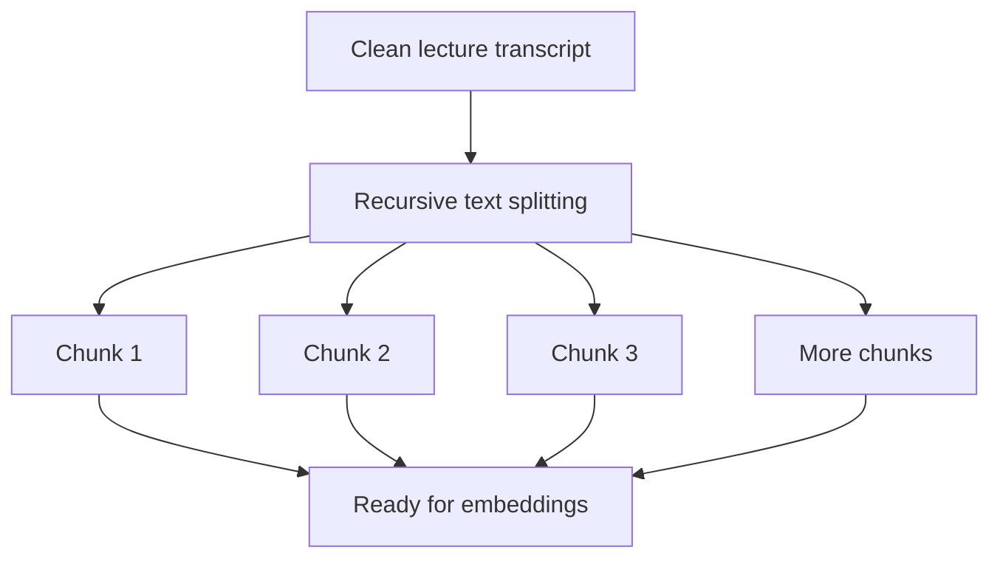

### 5.1 Why both chunk size and chunk overlap?

Chunk size specifies the approximate upper target for each unit of text, subject to the splitter's rules. Overlap preserves a portion of neighboring content across a boundary.

Suppose a concept begins at the end of one chunk and its definition appears at the beginning of the next. If chunks have no overlap, the nearest available evidence may become fragmented. With overlap, some boundary text is repeated and may help retrieval preserve context.

```text
Illustrative chunk window (not actual lecture content)

Chunk 1: [A A A A A A A A A A | shared tail]
Chunk 2:                       [shared tail | B B B B B B B B]
                                     ^ overlap
```

Overlap is not free. It causes repeated text to be indexed, increasing storage and processing, and can produce redundant retrieved passages. This is why chunk size and overlap should eventually be evaluated rather than treated as universally correct numbers.

```python
# Reconstructed indexing step.
from pathlib import Path
from langchain_community.document_loaders import DirectoryLoader, TextLoader
from langchain_text_splitters import RecursiveCharacterTextSplitter

loader = DirectoryLoader(
    path=str(Path("clean_transcripts")),
    glob="**/*.txt",
    loader_cls=TextLoader,
    loader_kwargs={"encoding": "utf-8"},
    show_progress=True,
)

docs = loader.load()

chunker = RecursiveCharacterTextSplitter(
    chunk_size=500,
    chunk_overlap=50,
)
chunks = chunker.split_documents(docs)
print(f"Original documents: {len(docs)}")
print(f"Chunks: {len(chunks)}")
```

A typical loaded LangChain document has both text (`page_content`) and metadata (such as a source path). Splitting such documents can preserve source metadata across derived chunks. This becomes important when the application wants to distinguish “the answer came from lecture A” from “the answer came from lecture B.”

**Mental-model checkpoint:** Cleaning decides *which parts of the source are meaningful text*. Chunking decides *the size of evidence that retrieval will be allowed to return*. Neither step searches by meaning yet.

---

## 6. From chunks to vectors: why embeddings are needed

We have text chunks, but a semantic-search system must compare the meaning of a student's question with the meaning of stored chunks. Plain string comparison is a poor fit: the student may phrase a concept differently from the instructor while referring to the same thing.

The lecture introduces an **embedding model**. It transforms text into a fixed-length numeric representation called a **vector**. We can then compare the student's query vector with stored chunk vectors using similarity or distance functions.

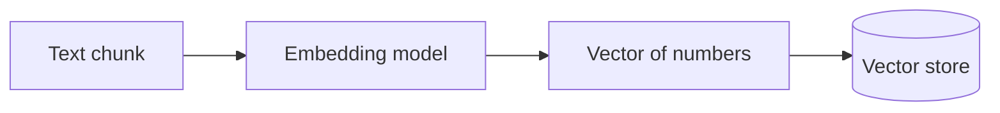

### 6.1 What is the vector representing?

Think of an embedding as a position in a mathematical representation space learned by the embedding model. Texts with related meanings are often represented near one another according to the model's learned geometry, though this is an approximation, not a guarantee of semantic truth.

For a deliberately simplified illustration, imagine a three-number vector:

```text
"How are RAG answers evaluated?" -> [0.18, -0.42, 0.73]
"Evaluating retrieved responses" -> [0.21, -0.39, 0.70]
"How do I reset my password?" -> [-0.51, 0.14, -0.22]
```

These are **invented numbers solely to illustrate the shape of an embedding**; they are not results from a real model. Actual embeddings in this course have many more dimensions.

The instructor chooses **OpenAI `text-embedding-3-small`**, configures **1024 dimensions**, and uses Chroma as the vector store. The instructor mentions that this embedding model normally has a **1536-dimensional default** and explicitly reduces the size for the basic demo. The lecture does not establish that 1024 dimensions is optimal; it is a baseline setting to evaluate later.

### 6.2 Why must the stored text and incoming queries share an embedding space?

If document vectors were generated by one embedding model and query vectors by an unrelated model, numerical closeness might no longer mean what we think it means. Even equal-sized vectors are not automatically comparable merely because the arrays have the same length.

Therefore, for this simple system, the instructor uses **the same embedding model and configuration** for indexed chunks and incoming queries.

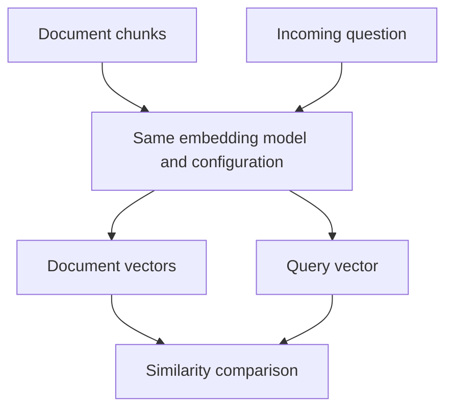

**Technical clarification:** The purpose of embeddings is not that an LLM is literally incapable of accepting text. Language models process text through tokenization and numerical internal representations. Here embeddings serve a *different purpose*: efficient retrieval of semantically related documents before passing their text to the generating LLM.

### 6.3 How do we decide which vectors are close?

The lecture mentions three common mathematical approaches:

| Method | Intuition | Important distinction |
|---|---|---|
| **Dot product** | Measures directional alignment together with magnitude effects | Results depend on vector magnitudes unless vectors are normalized. |
| **Cosine similarity** | Measures orientation rather than raw length | Larger cosine similarity generally implies greater directional alignment. |
| **Euclidean distance** | Straight-line distance between vector endpoints | Smaller distance implies greater geometric closeness. |

The selection matters because “nearest” depends on which comparison rule the vector store uses. A metric that works well for one embedding model and dataset is not guaranteed to be best for all others.

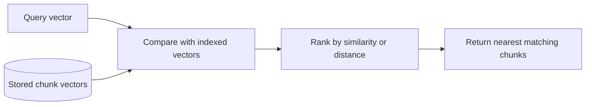

The important result is **not** a list of numbers shown to the user. It is a list of relevant **source-text passages** associated with those numbers. That leads to the final preparation step: a persistent vector store capable of returning documents, not just embeddings.

---
## 7. Save the prepared knowledge so future questions can use it

If embeddings disappeared after every notebook session, we would have to process the transcripts again before answering questions. That might be acceptable for a tiny demo, but it makes the system unnecessarily expensive and awkward as the collection grows.

The instructor therefore uses a **persistent Chroma vector store**. The store has a collection name, an embedding function, and a persistence directory. The class demonstration first creates a vector store instance and then adds the chunks to it.

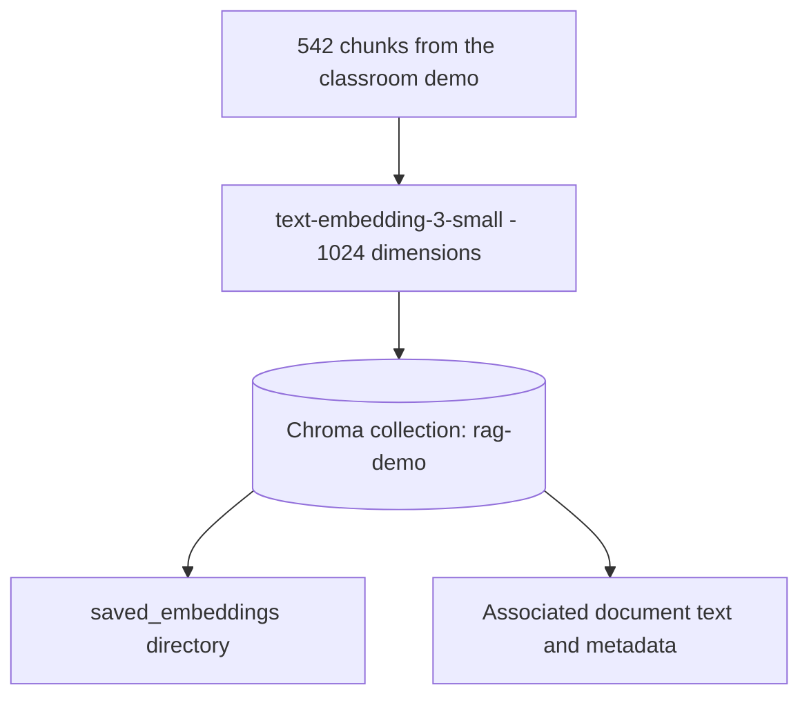

The 542 figure is what the instructor observes from **his** three input transcripts and particular preprocessing setup. It is not an expected output for every three-file dataset, including the uploaded VTT transcript being read here.

The following is a reconstructed version of the core indexing operation:

```python
from langchain_chroma import Chroma
from langchain_openai import OpenAIEmbeddings

embedder = OpenAIEmbeddings(
    model="text-embedding-3-small",
    dimensions=1024,
)

vector_store = Chroma(
    collection_name="rag-demo",
    embedding_function=embedder,
    persist_directory="saved_embeddings",
)

vector_store.add_documents(chunks)
```

Notice that we are not asking Chroma to generate an answer. We are asking it to **index chunks** in a representation that can be searched later. The generating LLM has not yet been involved in this operation.

### What persistence does and does not guarantee

Persistence means the database contents can survive beyond the life of the current Python process, subject to how the store is configured and where the data directory resides. It does not mean the data are perfectly versioned, that backups exist, or that the index will never become corrupted.

It also does not guarantee that repeated calls to `add_documents(chunks)` will produce exactly the same index. The lecture's cleaning script can overwrite a cleaned text file on each run, but *indexing is a separate state-changing operation*. In a more robust application, we would choose one of these patterns:

- Build a new collection from a known corpus version, then switch the application to that collection.
- Assign stable document IDs and explicitly update or replace records.
- Track ingestion state so unchanged documents are not repeatedly added.

These are operational extensions beyond the simple classroom exercise. They become important because a baseline must remain stable while we measure it.

### Prepare the retriever

We now have a store, but the application needs an interface that accepts a user query and returns relevant documents. The instructor converts the vector store to a **retriever** with similarity search and **`k = 3`**:

```python
retriever = vector_store.as_retriever(
    search_type="similarity",
    search_kwargs={"k": 3},
)
```

The top-three limit is an important application parameter. If the answer requires evidence spread across four different passages, selecting three might omit something necessary. Conversely, increasing the number without control can introduce distracting or redundant text. We should not decide the ideal value based on intuition alone; this is precisely the kind of change future evaluation can compare.

**We have now completed the knowledge-preparation flow:** files were cleaned, loaded, chunked, embedded, and indexed; the application has a retriever ready for requests. The next question is what happens after a student actually asks something.

---

## 8. Walk through one question before introducing orchestration

Take the question that the instructor later uses in his live test:

> **Student:** “What are the prerequisites for the LLMEvals course?”

The retriever does not send the text directly to the final LLM as if the question were already answered. It first embeds the question with the same embedding configuration as the indexed documents. It then compares that vector against the stored chunk vectors and retrieves the top matching document objects.

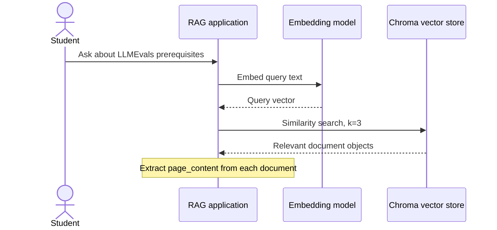

What comes back from the retriever matters. It typically returns **document objects** with their text and available metadata, rather than a human-readable answer. The application then extracts their `page_content` and combines the passages into a single context string.

```python
query = "What are the prerequisites for the LLMEvals course?"
retrieved_documents = retriever.invoke(query)
context = "\n\n".join(
    doc.page_content for doc in retrieved_documents
)
```

We can now identify the three concepts in the name **retrieval-augmented generation** without hand-waving:

**Retrieval** has happened because the application searched the knowledge base and recovered passages that might answer the question. The output at this point is *evidence*, not the final response.

**Augmentation** will happen when the application combines the question with that evidence and the instructions that define how the model should behave. We are enriching the model's input with source-specific context.

**Generation** will happen when we invoke the LLM using the assembled prompt and obtain an answer.

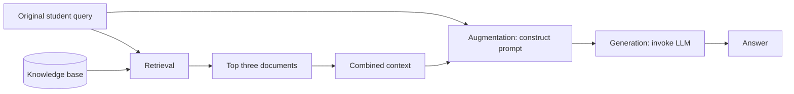

### 8.1 Why separate the system prompt and the human message?

The instructor's baseline uses a simple rule: answer based **only on the supplied context**, say **“I don't know”** if the answer is not present, and avoid unnecessary preamble.

The instruction belongs in a system-level message because it specifies how the application should generally behave. The individual query and the retrieved evidence belong in the per-request content.

An educational reconstruction of the template is:

```python
from langchain_core.prompts import ChatPromptTemplate

rag_prompt = ChatPromptTemplate.from_messages(
    [
        (
            "system",
            "Answer the user query based on the given context only. "
            "If you do not know the answer, say 'I don't know'. "
            "Do not add a preamble to the response.",
        ),
        (
            "human",
            "Context:\n{context}\n\nQuestion:\n{query}",
        ),
    ]
)
```

The distinction becomes valuable later when we want to version or evaluate the system instructions independently of student questions.

### 8.2 Why is the “I don't know” rule important?

A RAG assistant is built to rely on supplied evidence. If the retriever returns unrelated excerpts, fabricating an answer could be worse than admitting insufficient context. Saying “I don't know” is therefore potentially a **desirable guard against unsupported claims**, even if it frustrates a user when the answer really exists somewhere in the document collection.

That creates a useful diagnostic distinction:

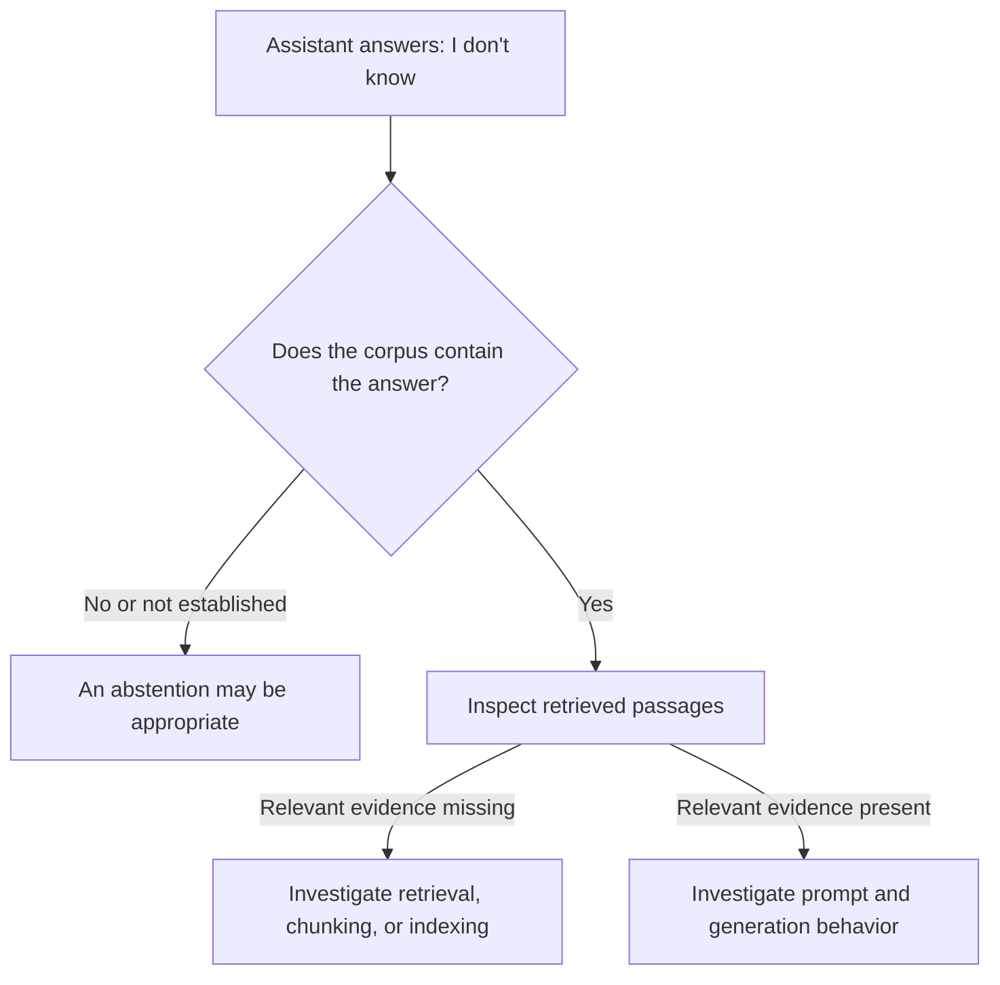

The question “Does the corpus contain the answer?” is *not* something this diagram magically decides for us. A human or an appropriate validation process must establish the ground truth. This distinction becomes particularly useful when the instructor's first live test returns “I don't know.”

We now know the complete answer path. But the classroom implementation needs another property: we should be able to inspect and modify the steps independently. That brings us from a plain sequence of Python calls to a **LangGraph workflow**.

---

## 9. Why LangChain components are not the same thing as a LangGraph workflow

The instructor uses both LangChain and LangGraph and explains the distinction through responsibilities.

LangChain supplies many building blocks: loaders, splitters, model integrations, document abstractions, prompt templates, output parsers, and retriever interfaces. LangGraph supplies the structure used here to arrange **stateful processing nodes** into a workflow.

This does not mean that LangChain is incapable of composing chains, or that LangGraph is compulsory for basic RAG. The instructor explicitly acknowledges that the pipeline *could* be built without LangGraph. In this lesson, LangGraph is chosen because the application will later be changed and evaluated repeatedly; separating steps makes those changes easier to reason about.

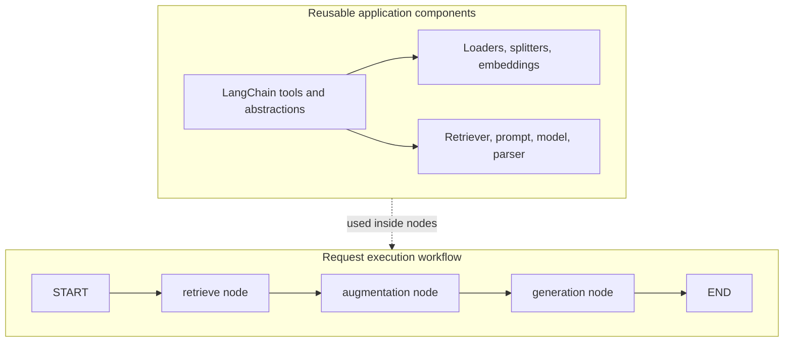

What we are gaining is **separation of concerns**. The retrieve node is responsible for fetching relevant evidence. The augmentation node is responsible for creating the prompt. The generation node is responsible for calling the LLM and producing the answer.

If we change the retriever later, we can inspect the retriever's outputs independently of the prompt's outputs. If we change system instructions later, the retrieval machinery does not have to be re-explained. This modularity is useful for software maintenance; more importantly for this course, it gives evaluation concrete boundaries.

### 9.1 What is a graph state?

A workflow node cannot operate in complete isolation: the generation step needs the prompt created earlier, and augmentation needs both the original question and the retrieved context. LangGraph handles these handoffs using **state**.

For this baseline, the instructor describes a state containing five useful fields: the query, retrieved documents, context, prompt, and response.

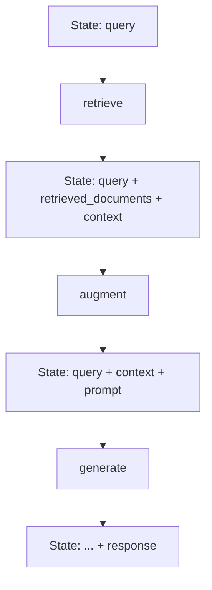

These boxes are conceptual snapshots. In the actual workflow, nodes typically **return partial state updates**, and the graph runtime incorporates those updates into the shared state. It is not necessary for every node to return every existing field.

A reconstructed state type might look like this:

```python
from typing import TypedDict
from langchain_core.documents import Document
from langchain_core.prompts import ChatPromptTemplate

class RAGState(TypedDict, total=False):
    query: str
    retrieved_documents: list[Document]
    context: str
    prompt: ChatPromptTemplate
    response: str
```

`total=False` is used in this reconstruction because the starting input only includes the `query`; later fields are added by other nodes. It does **not** mean all five fields are optional from the perspective of the whole workflow: a node may still require fields that earlier nodes are supposed to produce.

### 9.2 Build node one: retrieve

The node reads the input query from state, invokes the prepared retriever, and saves both the source documents and their combined text.

```python
def retrieve_node(state: RAGState) -> dict:
    documents = retriever.invoke(state["query"])
    context = "\n\n".join(doc.page_content for doc in documents)
    return {
        "retrieved_documents": documents,
        "context": context,
    }
```

Why preserve `retrieved_documents` if we already created `context`? Because the raw document objects may contain useful metadata and preserve evidence boundaries. A flattened context string is handy for a prompt, but loses some structural information. Both are useful for later inspection.

### 9.3 Build node two: augmentation

The second node establishes the instructions used by the generator. In the classroom demo it returns the prompt template as part of state; the actual query and context values are supplied when the generation step invokes that template.

```python
def augmentation_node(state: RAGState) -> dict:
    return {"prompt": rag_prompt}
```

You might reasonably ask: “Isn't this node almost trivial?” Yes, for the *baseline*. That is a deliberate choice. Its value is structural: future lessons can change how prompts are constructed, versioned, or instrumented without moving those responsibilities into the retriever.

### 9.4 Build node three: generation

The final node takes the prompt, feeds it into the LLM, and converts the model output into a plain string using a string output parser. The lecture selects **`gpt-5-mini`** for generation in its demonstration.

```python
from langchain_openai import ChatOpenAI
from langchain_core.output_parsers import StrOutputParser

llm = ChatOpenAI(model="gpt-5-mini")


def generation_node(state: RAGState) -> dict:
    chain = state["prompt"] | llm | StrOutputParser()
    answer = chain.invoke(
        {
            "context": state["context"],
            "query": state["query"],
        }
    )
    return {"response": answer}
```

The expression `prompt | llm | parser` is a compositional pattern: format the prompt, call the model, then parse the output. No new knowledge retrieval occurs in this node because that responsibility has already been completed by `retrieve_node`.

### 9.5 Connect the nodes

We now connect the responsibilities in exactly the order required by this simple application:

```python
from langgraph.graph import StateGraph, START, END

builder = StateGraph(RAGState)
builder.add_node("retrieve", retrieve_node)
builder.add_node("augmentation", augmentation_node)
builder.add_node("generation", generation_node)

builder.add_edge(START, "retrieve")
builder.add_edge("retrieve", "augmentation")
builder.add_edge("augmentation", "generation")
builder.add_edge("generation", END)

graph = builder.compile()
```

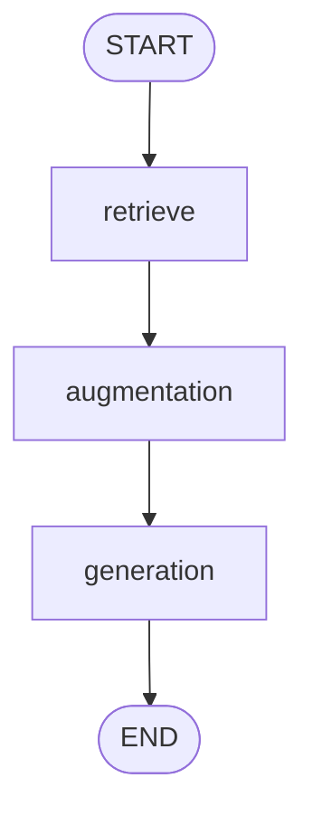

There are no conditional branches, retries, tools, or human-approval steps here. The purpose of this design is not to showcase everything LangGraph can do. Its purpose is to make a small, legible pipeline that we can **hold constant, change intentionally, and evaluate**.

### 9.6 One complete invocation

Finally, the application can be called with a query:

```python
result = graph.invoke(
    {"query": "What are the prerequisites for the LLMEvals course?"}
)
print(result["response"])
```

At a high level, the call proceeds as follows:

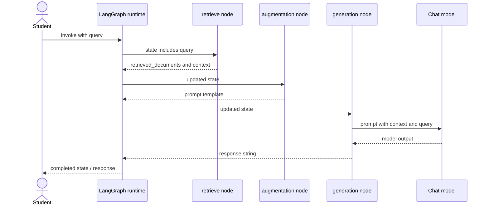

**Read this as the graph's logical execution order**, not as a guarantee about all possible LangGraph applications. Other graphs can branch or execute tasks independently, but the one built in this class is intentionally linear.

We have finally reached a genuinely running application. The next step in the lecture is particularly valuable: the instructor does not pretend that the first working version is already a good version.

---

## 10. The live demo works—but not every answer is good

Students suggest questions to test the newly built chatbot. The initial question about **LLMEvals prerequisites** produces the answer **“I don't know.”** The instructor inspects the retrieved context and notes that the necessary material may not be present in the returned passages. He does not rebuild the application immediately; instead, he treats the behavior as part of the baseline.

Other questions also produce mixed-quality answers. The group asks questions based on the available lecture transcripts, including an AI Pulse discussion and a question about a lawyer's fine. The instructor observes that some answers are usable and other questions are not handled well. He describes the system as deliberately basic and says that later LLMOps stages will improve it.

This is an important teaching moment. A successful call proves several narrow things: the graph executed, the application could access its dependencies, a prompt reached the model, and a string response came back. It does **not** prove that the retrieved material is appropriate, that the answer is correct, or that the system performs well across the range of student questions.

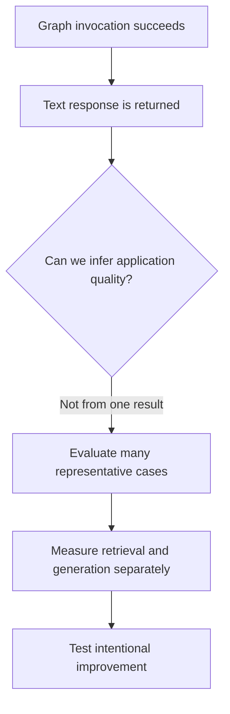

### What did the first “I don't know” really tell us?

On its own, very little. It was evidence that the generator followed the application's instruction to abstain under insufficient context. Whether it was a *correct abstention* requires additional information about the underlying transcripts and retrieved passages.

There are at least three possibilities:

1. The required information was absent from the indexed transcripts, so saying “I don't know” was appropriate.
2. The information was in the original transcripts, but cleaning, chunking, indexing, or top-three retrieval failed to surface it.
3. The retriever provided enough evidence, but the model did not use it correctly.

Notice how these possibilities correspond to **different components of the system**. Without a stored copy of the input question, retrieved documents, prompt, and generated answer, diagnosing the root cause becomes guesswork.

### A stable baseline is more useful than a secretly changing demo

Suppose we modify `k` from 3 to 5 and also change the chunk size from 500 to 800, then see a different answer. Which change helped? We would not know from that experiment alone.

A baseline gives us a reference configuration:

| Baseline property | Session 3 classroom setting |
|---|---|
| Source material | Three course-related transcript files |
| Transcript preparation | Remove subtitle timestamps and excess blank lines |
| Text splitter | Recursive character text splitter |
| Chunk size / overlap | `500` / `50` |
| Observed chunk count | `542` in the instructor's demo |
| Embedding model | `text-embedding-3-small` |
| Embedding dimensions | `1024` |
| Vector store | Chroma, persisted locally |
| Retriever | Similarity search, `k=3` |
| Generator | `gpt-5-mini` |
| Application graph | Retrieve → Augmentation → Generation |
| Answering rule | Use provided context; abstain when unknown |

This table records the baseline as described in the source; it is not a performance benchmark. It says **what was configured**, not **how well it performed**.

### Why Git enters the lesson here

The instructor then demonstrates creating a GitHub repository and attempting to commit and push the baseline project. Locally he stages files and creates a commit. The remote interaction encounters an access/permission problem, which he says he will fix after class. Thus the class establishes the intended version-control flow, but the transcript does not verify a successful remote push.

The operational reason for Git is deeper than sharing code with students. A commit helps identify which application implementation was tested. Combined with a controlled dependency environment, dataset version, prompt version, and model configuration, it becomes possible to compare experiments against an identifiable software state.

```mermaid
flowchart LR
    CODE[Baseline code] --> COMMIT[Local Git commit]
    COMMIT --> REMOTE[Attempt remote push]
    REMOTE --> AUTH[Authentication issue in live demo]
    COMMIT --> EVAL[Reference point for future evaluations]
```

**Security reminder:** The lecture shows `.gitignore` handling for the API key. Before committing, inspect what Git is staging; sensitive `.env` values and locally persisted datasets should not be published unintentionally. A repository being “public” does not make included data safe to share.

With a baseline captured, the original LLMOps question becomes concrete: **How do we know whether this particular application is good, and whether a proposed change actually improves it?** This is where Session 3 shifts from construction into evaluation.

---
## 11. The real beginning of evaluation: “It runs” is not the same as “It works well”

Return to the classroom demo. We have an application that can be invoked. It sometimes returns useful information and sometimes declines to answer. What should we do next?

One temptation is to keep changing prompts until a few examples look better. But even if those examples improve, another set of questions may become worse. Without a stable way to assess behavior, we cannot distinguish genuine improvement from a fortunate demonstration.

That is why the instructor moves from the baseline RAG application to **LLM application evaluation**.

At its simplest, evaluation has two stages: **test a system** and **judge the result**. The lecture uses the analogy of an examination. Giving students questions is not yet an evaluation; we must also decide how their answers will be scored.

```mermaid
flowchart LR
    APP[Application under test] --> EXEC[Run test questions]
    TESTS[Prepared evaluation dataset] --> EXEC
    EXEC --> OUTPUTS[Observed outputs]
    OUTPUTS --> JUDGE[Apply scoring criteria]
    RULES[Defined metrics and pass thresholds] --> JUDGE
    JUDGE --> REPORT[Scores, failures, evidence]
```

The lecture defines the desired practice as the systematic measurement of an LLM application's **quality, reliability, and correctness** using defined metrics, datasets, and evaluation criteria, so we can obtain evidence of current performance and compare changes over time.

Each part of that sentence adds something we did not have during the spontaneous question-answering demo.

### 11.1 Why “systematic” matters

Imagine asking three random questions today, changing the prompt tomorrow, and then asking three completely different questions. The second day might feel better. But what caused the difference: the prompt change, the new question selection, or some other variation?

A **systematic** evaluation reduces that ambiguity. It establishes a known test set, records what was tested, and applies defined scoring rules. The goal is not to eliminate every source of variation; it is to make comparisons interpretable.

### 11.2 Why quality, reliability, and correctness are not identical

Consider the question: “How much was the fine mentioned in the lecture?” A response could have excellent grammar and directly answer the question while citing the wrong amount. It might have good *presentation quality* but fail *factual correctness*.

Alternatively, a response might give the correct amount but expose an unrelated passage containing inappropriate or irrelevant language. Factual correctness in one detail would not make the overall response high quality.

Reliability asks a different question: does the application behave appropriately across the conditions it is expected to encounter, including missing evidence, varied phrasings, and different course topics?

| Dimension | Main question | Example failure |
|---|---|---|
| **Quality** | Is the answer useful, relevant, appropriately expressed, and suitable for the task? | An overly vague or irrelevant response |
| **Correctness** | Are factual claims supported by the appropriate ground truth? | The wrong numeric fine or wrong prerequisite |
| **Reliability** | Does the application behave dependably over representative cases and conditions? | It answers some similar questions well but fails unpredictably on others |

The boundaries between these categories can overlap, and actual evaluation frameworks may organize metrics differently. The lecture uses them as complementary concerns, not as a universal taxonomy.

### 11.3 The three parts of a meaningful evaluation

The instructor's exam analogy gives us a useful structure:

```mermaid
flowchart TB
    Q[Evaluation dataset - what questions are asked?]
    M[Evaluation metrics - what behavior is measured?]
    C[Evaluation criteria - what counts as acceptable?]
    Q --> RUN[Run baseline application]
    RUN --> SCORE[Score each response]
    M --> SCORE
    C --> DEC[Pass / fail or review decision]
    SCORE --> DEC
```

The **dataset** supplies questions and any necessary reference information. The **metric** specifies which property we wish to measure—such as answer correctness, groundedness, or retrieval relevance. The **criteria** tell us how to interpret scores, for example a threshold required for a particular release.

The instructor plans to study dataset construction and DeepEval's facilities for working with evaluation data in subsequent sessions. Session 3 introduces the need for these pieces; it does **not** demonstrate a full DeepEval test suite or final metrics implementation.

---

## 12. Why evaluating a traditional predictive model often feels simpler

We previously compared MLOps and LLMOps at the lifecycle level. Session 3 revisits that comparison at a more specific point: **evaluation**.

Take a conventional binary classifier—say a logistic-regression model deciding whether an application belongs to class `0` or class `1`. Given a fixed model, preprocessing, input, and execution conditions, its predicted output is normally repeatable. More importantly, its evaluation dataset commonly contains known target labels.

```mermaid
flowchart LR
    X[Test input rows] --> ML[Fixed classifier]
    ML --> P[Predicted labels]
    Y[Known true labels] --> METRIC[Calculate accuracy / precision / recall]
    P --> METRIC
    METRIC --> SCORE[Numeric result]
```

For example, consider an illustrative evaluation dataset:

| Test row | True label | Predicted label | Correct? |
|---|---:|---:|---|
| A | 1 | 1 | Yes |
| B | 0 | 0 | Yes |
| C | 1 | 0 | No |
| D | 0 | 0 | Yes |

The fraction of correct labels in this tiny sample is `3 / 4`. We do not have to interpret an essay to decide whether the model got row C right. The test labels and the definition of the metric give us the answer.

The point is not that classical ML evaluation is trivial. Dataset shift, label quality, class imbalance, subgroup performance, and threshold choices all remain difficult. The narrower point is that **many common tasks use output types and reference labels that admit well-defined numerical checks**.

### 12.1 What the instructor means by determinism

The lecture states that traditional ML algorithms are deterministic and LLMs probabilistic. This is a useful contrast for the fixed logistic-regression example, but it should not be treated as an absolute rule applying to every ML system.

**Technical clarification:** Some ML systems are stochastic, some use randomized inference, and some vary across hardware or implementation details. Conversely, LLM responses can be quite repeatable under particular settings, although full reproducibility across hosted model changes and serving environments is not guaranteed. The central evaluation distinction is not an iron law of determinism; it is the **variability, flexibility, and semantic complexity of the outputs and expected behavior**.

The instructor also contrasts simple fixed outputs with open-ended language. This is the more important bridge to the next section.

---

## 13. Generated language makes “the correct answer” harder to define

Now imagine a customer-service assistant asked about a refund policy. The instructor uses the following kind of example: one response says returns are possible within 30 days with the original packaging, while another says returns are accepted for about one month when the item is in its original packaging with accessories.

The exact strings differ. Yet both may convey nearly the same policy, *if* the policy actually allows those interpretations and the wording preserves the relevant conditions.

```mermaid
flowchart TB
    Q[Question: What is the refund policy?] --> A[Answer A: Return within 30 days in original packaging]
    Q --> B[Answer B: Return within one month with original packaging]
    A --> COMP[Evaluate meaning and factual conditions]
    B --> COMP
    COMP --> J{Both faithful to the actual policy?}
    J -->|Possibly| PASS[Different wording can still be acceptable]
    J -->|Not necessarily| CHECK[Check exact dates, exclusions, and conditions]
```

A literal string comparison might mark one of these responses wrong just because the words do not match. A human evaluator would instead look at **meaning**, **completeness**, and **fidelity to the policy**.

The word “possibly” is crucial. Semantic similarity is not the same as correctness. If a policy specifies exactly 30 calendar days, “one month” may differ in some contexts. If the policy requires tags and proof of purchase, omitting them may make an otherwise fluent summary incomplete. An evaluation must determine which differences matter for the task.

### 13.1 Exact-match tests answer only a narrow question

Suppose the expected answer is:

```text
You may return items within 30 days with the original packaging.
```

And the model produces:

```text
Returns are accepted for 30 days, provided the original packaging is included.
```

These strings are unequal, but they may describe the same rule. An exact-match test tells us **the text differs**; it does not tell us **the policy meaning differs**.

That is why the instructor emphasizes that LLM evaluation needs more than checking whether a generated sentence is identical to a reference sentence.

### 13.2 Sometimes the same question admits several valid answers

Open-ended questions create an additional problem: the reference answer may itself be only *one* acceptable solution. An explanation of “Why does RAG use retrieval?” could be correct as a short answer, a detailed explanation, a diagram, or an example. We cannot automatically call the detailed version wrong merely because the reference is short.

The evaluation process therefore needs a criterion aligned with the task, such as whether the response contains the relevant causal explanation without unsupported statements. The evaluation can still be numerical, but the number must be produced from a meaningful judgment procedure rather than an arbitrary count of matching words.

### 13.3 A RAG application has several places where a mistake can enter

The lecture highlights another key difference: the LLM is not the only component producing outputs. RAG combines retrieval and generation, and those components can fail **independently**.

```mermaid
flowchart TD
    Q[Question] --> R[Retriever]
    R --> RC{Relevant evidence retrieved?}
    RC -->|No| RF[Retrieval quality problem]
    RC -->|Yes| G[Generator uses evidence]
    G --> GC{Answer faithful and useful?}
    GC -->|No| GF[Generation quality problem]
    GC -->|Yes| OK[Successful grounded response]
    RF --> EVAL[Evaluate component separately]
    GF --> EVAL
```

Consider two possible failures:

**Failure A:** The correct lecture passage exists in the transcript collection, but the retriever returns three unrelated passages. The generator might appropriately say “I don't know.” The symptom is an unanswered question, but changing the generator's prompt is unlikely to repair the missing evidence.

**Failure B:** The retriever returns the exact paragraph containing the answer, but the generator produces a number that the paragraph does not support. The retrieval step worked; the failure occurred when evidence was interpreted or expressed in the response.

This is why an application-level score alone may not be sufficient. We also need measurements that help us attribute failures to specific parts of the workflow.

### 13.4 Why evaluation costs more effort

For many common ML metrics, evaluating a prediction against a known label requires a small deterministic calculation. For open-ended text, a useful quality assessment may require a rubric, a reference answer, a human annotator, an automated evaluator, or an LLM acting as a judge.

Human review can provide nuanced judgment but becomes expensive across large datasets. Automated evaluators can scale, but they introduce their own reliability, calibration, and cost concerns. The course plans to study **LLM-as-a-judge** later, particularly through DeepEval. The mechanism and implementation details are not yet demonstrated in this session.

**Mental-model checkpoint:** The core difficulty is not simply “LLMs output text.” It is that this text is *open-ended, potentially variable, semantically rich, and produced by a pipeline with multiple independently fallible components*.

---

## 14. The evaluation should behave like a repeatable experiment

If we accept that judging a single answer is difficult, the next challenge is designing a process that remains useful across application changes.

The instructor repeatedly returns to the idea of **a baseline and a controlled comparison**. We first evaluate the starting application, then change a component, then evaluate again.

```mermaid
flowchart TD
    BASE[Baseline configuration - Candidate A] --> TESTA[Run fixed evaluation dataset]
    TESTA --> SA[Record metrics and failure cases]
    SA --> CHANGE[Change one planned component]
    CHANGE --> CAND[Candidate B]
    CAND --> TESTB[Run comparable evaluation dataset]
    TESTB --> SB[Record metrics and failures]
    SB --> COMP{Better, worse, or mixed?}
    COMP -->|Better on target criteria| ACCEPT[Consider promoting change]
    COMP -->|Worse| REVERT[Revisit or revert]
    COMP -->|Mixed| INVESTIGATE[Study trade-offs and test coverage]
```

### 14.1 Use the actual RAG knobs from our baseline

The lecture gives a very concrete example: change the chunk size from **500** to **800** and observe the effect. There is no universal rule that 800 will improve retrieval. Larger chunks may preserve more context but include more irrelevant text; smaller chunks may target precise content but split evidence across boundaries.

An evaluation gives us a way to compare rather than guess.

| Component | Candidate A: baseline | Candidate B: illustrative change |
|---|---|---|
| Chunk size | `500` | `800` |
| Chunk overlap | `50` | `50` |
| Retriever `k` | `3` | `3` |
| Embedding configuration | Same | Same |
| Prompt and LLM | Same | Same |
| Evaluation dataset | Fixed comparison set | Same comparison set |

A change to chunk size requires **rebuilding or updating the index** so the retrieved passages actually reflect the new chunk boundaries. Merely changing the splitter object in code while continuing to query the old Chroma collection would not be a valid test of the new chunking strategy.

### 14.2 Why separate improvement from regression?

Suppose Candidate B performs better on broad conceptual questions but worse on precise factual questions. Calling Candidate B “better” because its average score improved could conceal important regressions.

In software testing, a **regression** is an undesirable loss of previously working behavior. In this LLMOps setting, regression testing asks whether a change has reduced quality on cases the earlier candidate handled acceptably.

For example, a new retrieval configuration might improve broad questions about LLMOps while making it harder to recover an exact figure quoted in an AI Pulse lecture. The scorecard should reveal both effects.

```mermaid
flowchart LR
    A[Candidate A results] --> DIFF[Compare per-test outcomes]
    B[Candidate B results] --> DIFF
    DIFF --> WIN[Improved cases]
    DIFF --> LOSS[Regressed cases]
    DIFF --> SAME[Unchanged cases]
```

A composite or average score can still be useful, but it should not replace examining the distribution of wins and losses on important question categories.

### 14.3 Offline evaluation versus production observation

A participant asks whether changing user inputs means evaluations are performed dynamically for each user question. The instructor explains that the course's immediate focus is **development-time/offline evaluation**: use a prepared dataset and test the application before or while modifying it. In his analogy, every candidate sits the same examination.

That is the correct mental model for **this module**. It is not a claim that online evaluations never exist. In a production LLMOps system, teams may additionally monitor real interactions or evaluate sampled outputs, with suitable privacy and safety safeguards. Those online practices are beyond the implementation covered in Session 3.

This distinction matters because a fixed dataset answers, “Did this application candidate improve on our known test cases?” Production monitoring answers a different question: “What is happening with actual traffic and conditions?” An effective long-term program may need both.

---

## 15. Seven properties that make evaluation useful rather than decorative

Near the end of the session, the instructor introduces the qualities a good evaluation approach should have. He notes that he is moving quickly because the session is running long and intends to revisit the slide in greater depth. We can still connect the ideas into a coherent design.

### 15.1 Consistency: does the score mean the same thing on every run?

Suppose an automated evaluator gives the same response a near-perfect score one day and a failing score the next, even though its criteria and evidence have not changed. The scoring process may be too unstable to guide engineering decisions.

Consistency does not require every real application response to be identical. It asks that **the evaluation method itself behave predictably enough** to make scores trustworthy. For an LLM-as-a-judge approach, this is particularly important because the evaluator can also produce variable judgments.

### 15.2 Reproducibility: can we reconstruct the evaluation conditions?

An evaluation is reproducible when its defining conditions are recorded well enough to rerun or audit it. In our RAG example, that includes the test dataset, metric definition, dataset/source version, application code revision, chunking settings, retriever configuration, prompt, model settings, and relevant evaluator configuration.

Reproducibility is not identical to receiving an absolutely identical number under every possible hosted LLM runtime. Rather, it is the ability to establish **what was measured and under which conditions**, with unexpected variability made visible instead of hidden.

### 15.3 Coverage: are we testing the range of questions our users actually ask?

If all test questions concern the beginning of the orientation lecture, a chatbot might pass while failing on later sessions or narrower factual questions. The instructor's spontaneous demo already spans different transcripts and topics. A systematic evaluation should make that diversity intentional.

For our course chatbot, a representative test design could cover the following **illustrative categories**:

| Test category | What it reveals | Example question type |
|---|---|---|
| Course-specific fact | Precise retrieval and factual correctness | “What prerequisites were named?” |
| Concept explanation | Ability to integrate a lecture passage into a useful answer | “Why do we use evaluation datasets?” |
| Multi-passage topic | Context assembly from multiple parts | “How do retrieval and generation fail differently?” |
| Missing answer | Correct abstention | “Which topic was never covered?” |
| Paraphrased wording | Robustness to alternate vocabulary | A question using “assessment” instead of “evaluation” |
| Specific source location | Whether the right lecture material is recovered | A question about a later segment of AI Pulse |

These categories are a proposed testing design, **not** a dataset that the instructor created during this class. Their role is to turn the principle of coverage into something actionable.

### 15.4 Relevance of metrics: are we measuring what the application is meant to do?

A chatbot intended to answer from course transcripts should not be graded solely on sounding fluent. It needs to retrieve relevant evidence and remain faithful to it. A generic style metric may be useful, but if it is our only metric, the evaluation will not align with the application's real objective.

Metric selection starts from the application's promise. For this project, the promise is **useful, grounded answers about specified lecture content**. That should guide the metrics chosen in future lessons.

### 15.5 Separation of concerns: can we locate the failing component?

We deliberately built three graph nodes. That decision now pays off. The evaluator can inspect retrieved passages and the final response separately instead of reporting only a single opaque score.

```mermaid
flowchart TD
    CASE[Test case fails] --> STEP1[Examine retrieved passages]
    STEP1 --> FOUND{Evidence sufficient?}
    FOUND -->|No| R[Inspect chunking, embeddings, corpus, k]
    FOUND -->|Yes| STEP2[Examine final answer]
    STEP2 --> GOOD{Faithful and relevant?}
    GOOD -->|No| G[Inspect prompt and generation]
    GOOD -->|Yes| SPEC[Review test reference or scoring criterion]
```

The diagnostic flow is not a perfect automatic classifier of root causes. It is a **reasoning method** that stops us from blindly modifying the LLM when the actual issue is elsewhere.

### 15.6 Baseline and regression: did the change improve the right behavior?

We already saw why a fixed reference point matters. An evaluation should make comparisons visible across configurations, not just produce an isolated number for one run. The comparison should reveal improvements, regressions, and trade-offs.

### 15.7 Actionability: does a failed score tell us what to investigate?

Suppose an evaluation reports “Score 0.3.” That number alone does not specify which engineering action to take. A more useful result might identify the failing question, relevant retrieved text, expected behavior, actual output, and the reason the scoring criterion was not met.

```mermaid
flowchart LR
    FAIL[Failure: low groundedness] --> EVIDENCE[Inspect question, retrieved sources, response]
    EVIDENCE --> CAUSE[Identify unsupported claim or missing evidence]
    CAUSE --> FIX[Form a specific hypothesis and change]
    FIX --> RETEST[Re-evaluate against baseline]
```

Here the lecturer is introducing a goal, not guaranteeing that any framework will always produce a correct fix recommendation. Automated feedback can help an engineer diagnose a problem, but the suggested explanation and fix still need checking.

### Connect the seven properties

These seven requirements are interdependent. Without **coverage**, a reproducible score might describe only easy questions. Without **consistency**, a score difference could be evaluator noise. Without **metric relevance**, a high score might reward the wrong behavior. Without **component separation**, a failure might be difficult to correct. Without **actionability**, the whole report could be impressive but operationally useless.

They combine into one principle: **evaluation must support reliable engineering decisions, not merely produce numbers**.

---

## 16. Where DeepEval fits, and what was explicitly deferred

The lecturer identifies **DeepEval** as the primary evaluation framework for the upcoming module. **Ragas** will be mentioned, but the curriculum plans to spend considerably more time on DeepEval. He expects several classes for datasets, metrics, judge-based assessment, and implementation against the baseline RAG application.

The later curriculum is planned to explain metrics at four levels: what a metric measures, where it applies, how it works internally, and how to implement it on this specific application.

It is tempting to insert a full DeepEval test suite here. Doing so would blur a source boundary. **Session 3 does not implement that test suite.** It introduces the baseline, the reason evaluations are needed, and the criteria an evaluation system should satisfy.

The following map shows **where** the planned evaluation framework belongs conceptually, without pretending the lesson has already executed it:

```mermaid
flowchart TB
    APP[Baseline RAG application] --> RUN[Run test question]
    DATA[Evaluation dataset - upcoming detail] --> RUN
    RUN --> OUT[Retrieved context + generated answer]
    OUT --> EVAL[DeepEval-based checks - future sessions]
    MET[Metrics, judge, thresholds - upcoming detail] --> EVAL
    EVAL --> REPORT[Evidence for comparing candidates]
    REPORT --> IMPROVE[Improve application and repeat]
```

Similarly, the instructor discusses the later use of **agentic applications** that have tools and different evaluation needs. Session 3 does not build an agent or teach agent-specific metrics. The foundational discipline—dataset, scoring criteria, reproducible tests, and regression comparison—will transfer, but the metric choices will change according to what the application actually does.

---
## 17. Put the entire lesson together: one application, two lifecycles, one improvement loop

We can now reconstruct the complete system without introducing unfamiliar components. Everything begins with source transcripts. Preparation turns the transcripts into a searchable knowledge base. A request-time graph retrieves context and generates a grounded answer. Evaluation tests the result against criteria that matter for a course-support chatbot. If the evidence reveals a problem, we change a specific part of the system and measure again.

```mermaid
flowchart TB
    subgraph PREP[1. Prepare the knowledge]
        RAW[Raw transcripts] --> CLEAN[Clean TXT files]
        CLEAN --> SPLIT[Split into chunks]
        SPLIT --> EMB[Embed chunks]
        EMB --> STORE[(Chroma vector store)]
    end
    subgraph SERVE[2. Answer a question]
        USER[Student question] --> RET[LangGraph: retrieve]
        STORE --> RET
        RET --> AUG[LangGraph: augmentation]
        AUG --> GEN[LangGraph: generation]
        GEN --> RESP[Answer and retrieved evidence]
    end
    subgraph QUALITY[3. Evaluate and improve]
        DATA[Controlled test dataset] --> TEST[Evaluate a fixed candidate]
        RESP -.observed behavior.-> TEST
        TEST --> SCORE[Quality and failure evidence]
        SCORE --> CHANGE[Choose an improvement]
    end
    CHANGE -.rebuild knowledge base if indexing changes.-> PREP
    CHANGE -.update workflow if request path changes.-> SERVE
```

There are three important observations in this final diagram.

First, **data preparation and serving are different processes**. The student does not normally wait for every transcript to be cleaned and re-embedded whenever a question arrives. Instead, the serving flow uses a prepared index.

Second, **the model is only one participant**. An apparently bad answer may originate from source data, cleaning, chunking, indexing, retrieval, prompt construction, or generation. A strong LLM alone cannot repair evidence it was never given.

Third, **evaluation provides the bridge between “working software” and “improving software.”** Without explicit evaluation, iterative changes are difficult to justify. With an appropriate evaluation dataset and useful metrics, we can identify which system behavior improved, which regressed, and what to investigate next.

### A worked reasoning example: a student asks a factual question and receives the wrong number

Suppose the lecture transcript contains a particular monetary figure, and our chatbot replies with a different amount. We should not immediately change the model or rewrite the prompt. We should perform a staged investigation:

**First**, verify the ground-truth passage in the original transcript. If the transcript is itself wrong or the question is ambiguous, changing retrieval cannot solve the source-quality problem.

**Second**, check the cleaned document and the chunk that contains the figure. Did preprocessing accidentally remove meaningful content? Did a chunk boundary separate the amount from the statement explaining what it represents?

**Third**, check what Chroma returned for this exact query. If the relevant chunk is absent from the top three, the problem may involve chunking, embeddings, indexing, or the retriever's search settings.

**Fourth**, if the right passage was present, inspect the generated prompt and answer. Did the LLM quote the right number? Did it confuse two fines mentioned in different passages? Did the system instructions adequately constrain it to the evidence?

**Fifth**, after making a targeted change, run the *same* evaluation case along with a broader regression dataset. We want to know whether the change fixes this question and whether it harms previously correct answers.

```mermaid
flowchart TD
    WRONG[Answer contains unsupported number] --> SOURCE{Check original source}
    SOURCE -->|Source itself wrong| DATAFIX[Correct source and rebuild index]
    SOURCE -->|Source correct| CLEAN{Correct text survives preprocessing?}
    CLEAN -->|No| PREP[Fix cleaning / chunking and rebuild]
    CLEAN -->|Yes| RET{Right passage retrieved?}
    RET -->|No| SEARCH[Investigate indexing or retrieval]
    RET -->|Yes| GEN[Investigate prompt and generation]
    DATAFIX --> REG[Run evaluation and regression tests]
    PREP --> REG
    SEARCH --> REG
    GEN --> REG
```

The value of this walkthrough is not any one specific tool. The value is the **diagnostic order**. We follow the evidence through the system in the same direction as the request, locating the point where correct information was lost or misused.

### How the classroom project could be organized

The actual transcript shows a project folder, a cleaning utility, raw and cleaned transcript directories, a requirements file, and notebook-based application code. A compact representation of that structure is:

```text
llmops-rag-app/
├── .gitignore
├── .python-version
├── pyproject.toml
├── uv.lock
├── .env                      # local only, not committed
├── requirements.txt          # if maintaining the lecture's input list
├── transcripts/              # source lecture text
├── clean_transcripts/        # preprocessing output
├── saved_embeddings/         # local Chroma persistence
├── transcript_utils.py       # transcript cleaning
└── rag_baseline.ipynb        # illustrative notebook name
```

This is an **organizational reconstruction** consistent with the lecture, not a verified copy of its exact filenames. It intentionally avoids fragmenting a small project into many unnecessary modules before there is a reason to do so. If the course later adds evaluations, prompt versions, serving APIs, and CI/CD, those new responsibilities can be given clear boundaries as they emerge.

---

## 18. Technical cautions to carry into future sessions

The instructor emphasizes concepts over memorizing exact framework syntax because LangChain, LangGraph, and surrounding libraries change. That is sound study advice, especially for an ecosystem with frequent API changes. But durable concepts also require precise distinctions.

| Simplified classroom explanation | More precise mental model |
|---|---|
| “The LLM cannot understand text, so text must become vectors.” | Embeddings are primarily used here for semantic search. The generating LLM can receive text prompts through its own tokenizer and model representation. |
| “Same dimensions let query and document embeddings match.” | Dimensions must be compatible, but meaningful similarity also requires the same or an explicitly compatible embedding space and preprocessing configuration. |
| “The vector store retrieves vectors and then brings back text.” | A practical retriever typically returns document objects containing text and metadata associated with indexed vectors. |
| “Running the preprocessing script repeatedly is safe.” | Rewriting cleaned files is one concern; inserting them repeatedly into a persistent vector store is another and may cause duplicate records. |
| “Traditional ML outputs are always deterministic.” | The fixed-classifier example is generally repeatable under fixed conditions; not every ML system is deterministic, and LLM variability depends on settings and infrastructure too. |
| “Regression outputs cannot be outside a particular range.” | A regression model's valid output range depends on the model and task; many regressors have no such inherent bound. |
| “Offline evaluation uses a fixed test set.” | Correct for this module's baseline testing. Production systems may also use online monitoring or evaluation, which are separate activities. |
| “Semantic similarity means two answers are equally correct.” | Meaning must be checked against task requirements and factual evidence; apparently similar phrasing can hide important differences. |

These clarifications supplement the source without altering its fundamental learning objective: **create an understandable baseline, then learn to evaluate it before claiming improvement**.

---

## 19. Final mental-model consolidation

We started with a straightforward limitation: a general-purpose LLM may know about LLMOps, but it does not automatically know what happened in a particular course. We therefore need an application that brings local evidence into the model's input.

That requires a knowledge-preparation process. Original transcripts are cleaned to remove irrelevant formatting. Large text documents are split into smaller searchable chunks. An embedding model turns those chunks into vectors, and a vector store saves a retrievable representation alongside the source text. A retriever then makes that knowledge available to the application.

When a student asks a question, the query is compared against the prepared index. Relevant passages become context. A prompt combines those passages with the query and behavioral instructions, and an LLM produces the answer. LangGraph arranges this request-time path into three explicit steps: **retrieve, augment, generate**. The steps share state so that inputs, intermediate evidence, and outputs can be inspected.

The live tests then reveal an important limitation: **execution success is not quality success**. A graph returning a string does not tell us whether the right evidence was found or whether the final answer was correct. Sometimes the chatbot abstains; sometimes it answers. Neither observation is meaningful enough on its own to declare the system good.

Evaluation gives us the next layer of engineering discipline. We prepare representative questions, define metrics and criteria, run the baseline, record its strengths and failures, and compare later changes against the same expectations. Evaluation is particularly difficult for LLM applications because answers are open-ended and semantically flexible, and because failures can arise independently in retrieval and generation.

That is the conceptual accomplishment of Session 3:

**We moved from understanding what an LLMOps lifecycle should contain to possessing a concrete RAG system whose behavior can be measured and improved.**

### Understanding checks: reason through the design

Try answering these without looking at the diagrams. The aim is to reconstruct the mental model, not recite definitions.

1. **Suppose the index contains embeddings produced with one embedding model and new queries use a different model with the same output dimension. Why is that not necessarily valid?**
2. **A question's correct answer exists in the original transcript, but the chatbot responds “I don't know.” What evidence would you inspect, and in what order?**
3. **If chunk size increases from 500 to 800, why is changing one Python variable insufficient to evaluate that new configuration against a persistent index?**
4. **What distinct questions are answered by a Git commit, a dependency lock file, an evaluation dataset, and an evaluation score?**
5. **Why can two differently worded responses both be acceptable—and why is semantic similarity alone still insufficient evidence of correctness?**
6. **If an end-to-end score worsens, how do LangGraph node boundaries help narrow the cause?**
7. **What must remain comparable between baseline and candidate runs for an improvement claim to be meaningful?**
8. **Which parts of the transcript's evaluation discussion were implemented in this class, and which were deferred to later DeepEval sessions?**

If you can confidently work through these questions, you have the foundation needed for the next module: **constructing evaluation datasets, defining RAG-specific metrics, understanding LLM judges, and applying DeepEval to this baseline application**.

---

## Source-navigation guide: where the original lesson develops each idea

These are approximate positions in the uploaded recording. The chapter deliberately reorganizes the material by conceptual dependency rather than following every interruption, question, or code edit in chronological order.

| Recording time | Main material in the transcript |
|---|---|
| **00:00–00:12** | Prerequisites, conceptual focus, agenda: build the baseline RAG chatbot and introduce evaluations. |
| **00:12–00:18** | Recap of LLMOps and LangChain/LangGraph responsibilities. |
| **00:18–00:24** | Why a course-specific RAG chatbot is needed; end-to-end pipeline overview. |
| **00:24–00:36** | Knowledge source versus knowledge base, chunking, embeddings, similarity search, retrieval, augmentation, and generation. |
| **00:36–00:42** | Why the baseline uses LangGraph and separation of concerns. |
| **00:42–00:54** | Project setup, uv, Python and dependencies, API key handling, Git ignore. |
| **00:54–01:12** | Cleaning transcripts using regex, reusable Python functions, `pathlib`, globbing, and file I/O. |
| **01:12–01:24** | Document loading, splitting with 500/50, embedding model, Chroma persistence, retriever with `k=3`. |
| **01:24–01:36** | LangGraph state, retrieve/augmentation/generation nodes, graph compilation and invocation. |
| **01:36–01:48** | Live question testing, mixed results, local Git commit, attempted GitHub push, transition to evaluations. |
| **01:48–02:00** | Meaning of LLM application evaluation, quality/reliability/correctness, metrics/datasets/criteria, baseline and regression. |
| **02:00–02:12** | Traditional ML comparison; semantic flexibility; multi-component failures; why judging text is difficult. |
| **02:12–02:18** | Consistency, reproducibility, coverage, relevance, separation of concerns, baseline/regression, and actionability. |
| **02:18–02:24** | Session wrap-up; plan to revisit the evaluation criteria and deepen DeepEval in upcoming classes. |

**Scope boundary:** This session demonstrates a basic RAG pipeline and **introduces evaluation concepts**. It does **not** establish final evaluation metric scores, fully constructed goldens, a live DeepEval test pipeline, deployed production infrastructure, or a successful GitHub push during the classroom recording. Those should not be represented as completed Session 3 work.
