# LLMOps — Session 4: From a Working RAG Chatbot to a Trustworthy Evaluation System

> **Course:** LLMOps  
> **Session:** 4 · **Source:** Session 4 classroom transcript (approximately 2 hours 9 minutes)  
> **Learning arc:** RAG failure points → why ordinary scoring is insufficient → evaluation dataset design → synthetic question generation → LLM-as-a-judge → limitations and next experiments.  
> **Continuity:** Builds on Session 3, where the instructor cleaned lecture transcripts and implemented a baseline RAG chatbot using LangChain components, LangGraph orchestration, and a vector knowledge base.

> [!IMPORTANT] Source and illustration boundaries
> This chapter reorganizes the **actual teaching content of Session 4** into an incremental learning narrative. The instructor **explains** a synthetic-dataset generation flow and LLM-as-a-judge at a conceptual level; the detailed DeepEval implementation, five specific RAG metrics, formulas, and code are **explicitly deferred to future classes**. Examples, sample records, pseudo-code, and worked scores below are marked **educational illustrations**, not claims that the instructor ran them in this session.
>
> The auto-transcript contains speech-recognition variants such as “Rack,” “DPVAL,” “Deep evolve,” and “line graph.” When the intended term is evident, these notes use **RAG**, **DeepEval**, and **LangGraph**. Some lecture claims deliberately simplify engineering reality; the relevant technical nuances are called out instead of silently being treated as universal rules.

---

## The learning destination: what problem are we trying to solve now?

At the end of Session 3, our course-transcript chatbot could accept a student's question, retrieve a passage from the lecture material, combine that passage with the question, and ask an LLM to produce an answer. The instructor tried several live questions and confirmed that the application was capable of executing the expected workflow.

That was a significant milestone: **we built an application that runs**.

But a working application and a reliable application are not the same thing. Suppose a student asks, “Which vector database did the instructor use in the implementation?” The chatbot returns a fluent sentence, but names the wrong database. The HTTP request can succeed, the graph can complete, and the user can see a readable answer—and the overall task can still fail.

This creates the central engineering problem of Session 4:

**How can we test a RAG application systematically, identify which part of it is responsible for poor answers, and assign meaningful quality scores without manually reading every generated response?**

Our destination is not yet a fully implemented DeepEval test suite. This session supplies the mental architecture necessary to build one in later sessions.

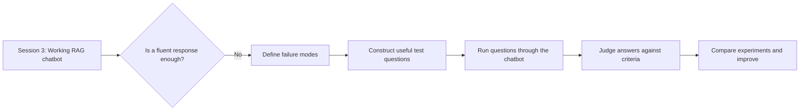

A useful way to read this chapter is to follow one recurring example: **a student asking questions about the course transcripts**. We will first locate potential failures in the chatbot, then design an examination for it, and only after the examination exists will we discuss how its answers should be graded.

---

## 1. We already tested the chatbot. Why do we need evaluation?

Remember the basic application we constructed in Session 3:

1. Prepare the transcripts so they contain usable lecture text rather than subtitle timing noise.
2. Create a searchable knowledge base from those transcripts.
3. Accept a student question.
4. Retrieve relevant lecture material.
5. Put the retrieved material and question into an LLM prompt.
6. Return the generated answer.

The instructor used live queries to see whether the chain worked. He refers to this as informal manual or **“vibe testing”**: try questions, observe answers, and form an impression about the system's behavior.

Manual probing is useful early on. It can catch obvious problems such as a crashed graph, an empty retrieval, or a completely irrelevant answer. But its weakness becomes clear when we ask what “passed” actually means.

Consider three manual observations:

| Question | Returned behavior | What we can really conclude |
|---|---|---|
| “What is RAG?” | The app returns a sensible explanation. | At least one basic question appeared to work. |
| “What did the instructor use to orchestrate the pipeline?” | The app mentions LangGraph. | Another answer appeared compatible with the lecture. |
| “Which exact topic was deferred to the next class?” | The app returns an uncertain or invented answer. | We have identified a possible quality failure, but not yet measured how common it is. |

Even if the first two answers are good, we cannot infer that the chatbot performs reliably on the range of questions a student might ask. Nor can we confidently compare the system before and after changing its chunk size, embeddings, prompt, or LLM.

**Evaluation begins when we stop relying on a few favorable examples and start defining repeatable evidence.**

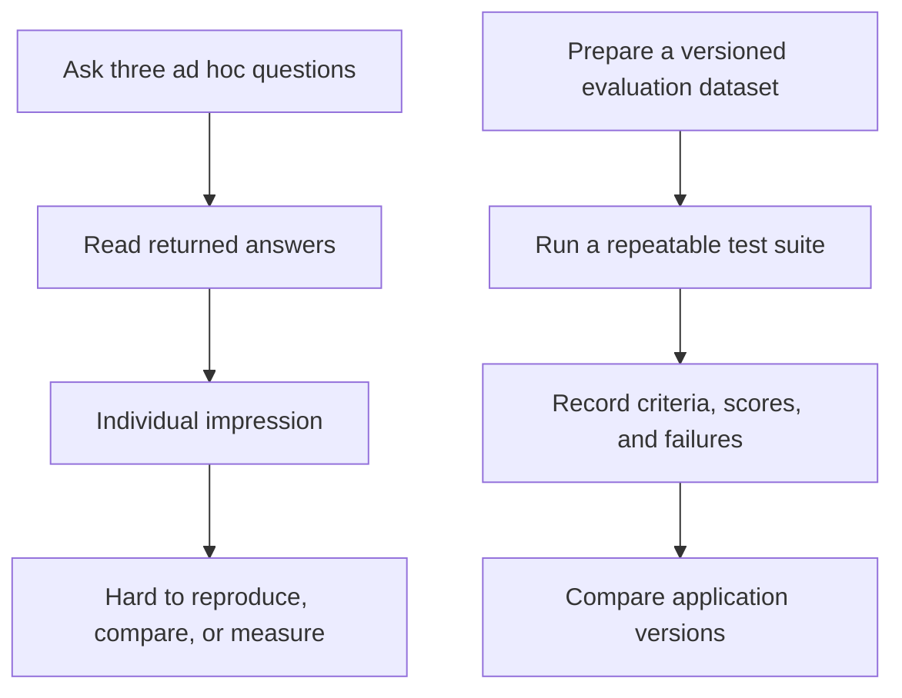

The next question is not yet “Which evaluation framework should we install?” It is **“Where can a RAG system produce a bad result?”** If we do not know that, we cannot choose useful tests.

---

## 2. Rebuild the RAG system as two related flows

We learned in Session 3 that RAG is more than a single call to an LLM. It has two flows that serve different purposes.

The **ingestion flow** prepares the material we want the application to know. The **question-answering flow** uses that prepared material for a real query. Session 4 concentrates on quality failures visible in the second flow, while recognizing that the first flow can strongly influence them.

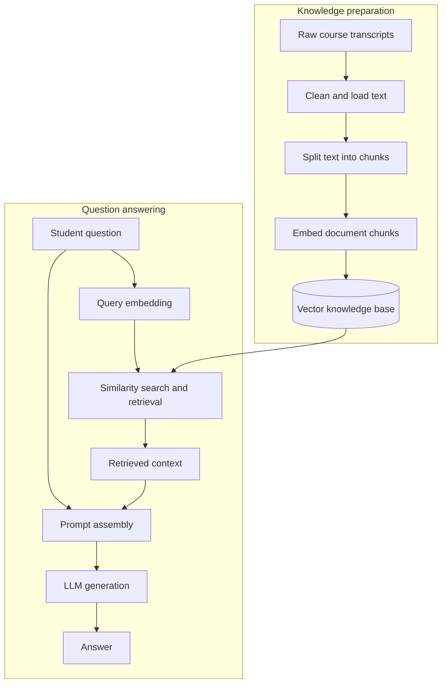

The distinction matters because these activities have different *immediate* outputs. Ingestion produces searchable data; retrieval produces passages; prompt assembly produces the model's input; generation produces an answer. A successful earlier stage does not automatically establish that a later stage is good.

For instance, text can be cleaned correctly but divided at awkward boundaries. Embeddings can be created successfully but fail to represent a specialist phrase well. The vector search can complete without an exception while retrieving passages about the wrong lecture. Finally, the LLM can receive excellent passages and still fail to answer the user's actual question.

So, instead of treating the entire application as one black box, the instructor introduces **two main request-time quality failure points**:

- **Retriever failure:** The evidence brought into the answer process is inappropriate, insufficient, missing, or irrelevant.
- **Generator failure:** The system produces an inaccurate, unsupported, incomplete, misleading, or incorrectly formatted answer from the available inputs.

These are quality failures, not necessarily runtime crashes. This distinction is one of the most important ideas in the lecture. A component can return `200 OK` and still do the wrong intellectual work.

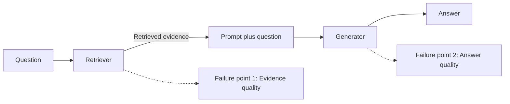

Let's inspect those two failure points separately before we talk about evaluation metrics.

---

## 3. Failure point one: the retriever returns the wrong evidence

Assume the student asks:

> “Which vector database was used in the course-transcript RAG demo?”

The correct supporting lecture material would contain the section where the instructor introduces **Chroma** as the local vector store used in the baseline implementation. A successful retrieval should make that information available to the generation step.

At query time, the student's sentence is converted into an embedding and compared against the embeddings stored in the knowledge base. A similarity search identifies the most relevant chunks and returns their associated text. Those chunks are then assembled into context for the LLM.

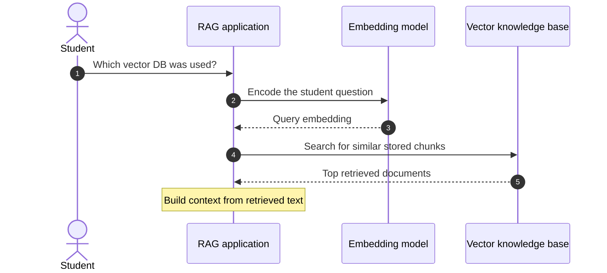

Nothing in this sequence guarantees that the returned text answers the question. Similarity is a retrieval mechanism, not a final correctness judgment. The retrieved result could concern general vector database theory, an unrelated mention of Pinecone, or an entirely different course session.

### What does a retrieval failure actually look like?

Let's take a simplified **educational illustration**:

**Desired evidence:** “In the baseline lecture project, the instructor indexed course transcripts using Chroma.”

**Retrieved evidence:** “Pinecone is a vector database commonly used in deployed RAG systems.”

The second statement may be true in isolation, but it does not support the student's question about **what the instructor used in this specific demo**. The retrieval is unhelpful for the task.

We can now make an important distinction:

| Operational result | Quality result |
|---|---|
| Vector database request completes | Retrieved documents may still be irrelevant |
| Search returns the expected number of chunks | Key evidence may still be absent |
| Chunk similarity values look plausible | Chunks may not answer the user question |
| Prompt receives nonempty context | Context may still be incomplete or misleading |

This explains why retrieval deserves an independent evaluation. Without it, a bad final answer could be incorrectly blamed on the LLM.

### How can ingestion affect this failure?

The lecture emphasizes a causal chain: ingestion choices influence which passages the retriever can find. Chunk size, overlap, the embedding model, and source-document quality shape the searchable knowledge base. When those choices are poor, their consequences are often visible in retrieval results.

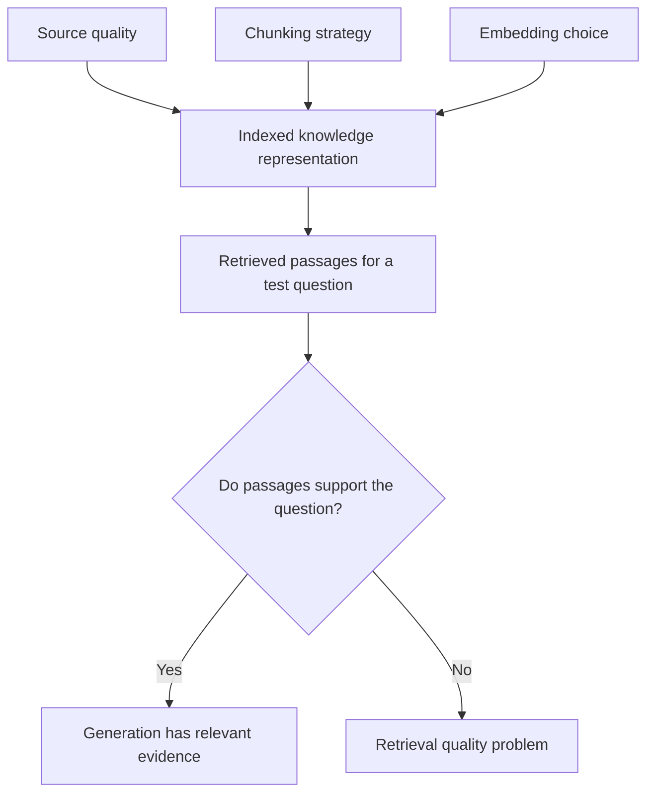

**Technical clarification:** The instructor says we do not “directly evaluate ingestion” and instead study its downstream effects. This is a useful focus for this course's RAG-quality discussion, but not a universal restriction. Engineers *can* directly inspect source coverage, parsing accuracy, chunk integrity, metadata, index completeness, and embedding properties. The lecture's intended point is that **a well-completed ingestion pipeline is not proof of successful question retrieval**.

We now have our first evaluation target: **the relevance and usefulness of retrieved evidence for a question**. But even a perfect retrieval is not enough.

---

## 4. Failure point two: the generator mishandles good evidence

Imagine retrieval now works correctly. The RAG application finds the passage naming Chroma, and the prompt includes that passage alongside the student's question.

At that moment, the generator must perform another task. It must interpret the question, pay attention to the relevant evidence, follow the prompt instructions, and produce a response that satisfies the application requirements.

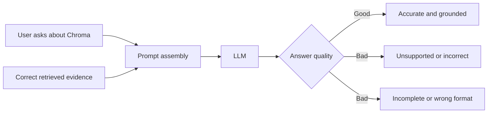

The instructor gives several examples of a generator failing **despite receiving a useful context**. The response might hallucinate an unsupported fact; it might omit an important detail; it might not answer the question specifically enough; or it might ignore a required output format.

We can think about three different answer-quality requirements:

**Grounding:** Does the response stay within, and correctly use, the supplied evidence?  
**Task success:** Does it answer what the student actually asked, rather than some easier adjacent question?  
**Output compliance:** Does it honor the application's instructions, such as answering concisely or returning a required structure?

A response could satisfy one of these while failing another. For example, a lengthy explanation of vector databases may be factual and relevant to a lecture transcript but still fail the task “Name the specific database used in this demo.”

### Why the retriever and generator must be distinguished

Consider the following table. All four situations can occur even when the application executes without a software error.

| Retrieved evidence | Generated answer | Interpretation |
|---|---|---|
| Good | Good | The tested case succeeded. |
| Good | Bad | Investigate generation, prompt use, model behavior, or formatting. |
| Bad | Bad | Investigate retrieval first; poor evidence may have propagated downstream. |
| Bad | Apparently good | The model may have relied on prior knowledge or guessing; do not assume grounding succeeded. |

The last case is particularly subtle. A model might happen to know that Chroma is a popular open-source vector store and guess correctly without retrieving the course passage. A correct-looking final answer is **not necessarily evidence that the retrieval process is reliable**.

We can now reconstruct the instructor's main architectural point:

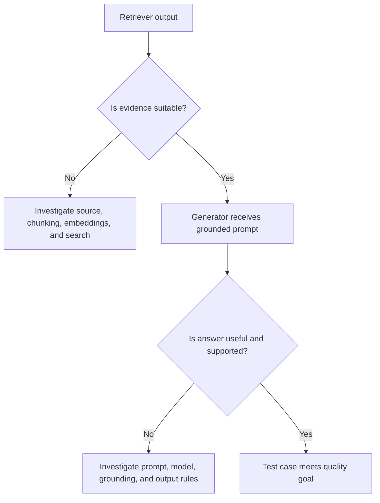

The logical next question is **how we decide that one output is good and another is bad**. This seems trivial in conventional machine learning, but text generation makes it surprisingly difficult.

---

## 5. Why LLM answers cannot usually be graded by exact string matching

Suppose the course chatbot is asked, “What is the name of the student?” The evaluation's reference answer says:

> “The student's name is Rahul.”

The application replies:

> “Rahul is the student's name.”

A literal string comparison will say the two sentences are different. But the underlying information is identical. The wording changed, not the fact being conveyed.

This is the lecture's entry point into **free-form text evaluation**. Natural-language outputs permit many acceptable forms of expressing the same answer. Differences in word choice, sentence ordering, length, and presentation do not automatically imply a difference in correctness.

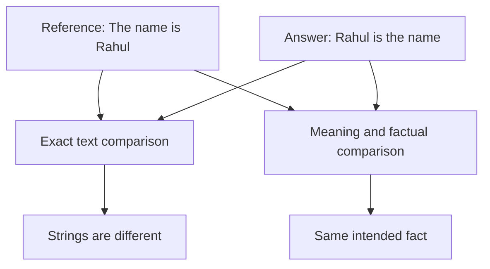

The opposite error is also possible. Consider:

> “The student's name is Amit.”

This sentence has the right *shape* and answers the kind of question being asked. But if the underlying record says Rahul, it is factually wrong. Fluency, grammatical correctness, and task intent are not enough to establish factual correctness.

So we cannot reduce answer evaluation to “does it read well?” or “does it have the same words as the answer key?” We need criteria that can distinguish several dimensions at once.

### Variability is one reason—but not the only reason

The instructor describes LLMs as probabilistic and not perfectly deterministic. Depending on sampling and serving configurations, a repeated request can produce different outputs. Some outputs may be paraphrases with equal quality; others may differ materially.

The deeper evaluation problem is not merely randomness. Even when generation is configured to be relatively stable, **there can be multiple semantically valid responses to the same question**.

| Candidate response | Same surface wording? | Is it acceptable? |
|---|---|---|
| “The student's name is Rahul.” | Reference wording | Yes, assuming evidence supports it. |
| “Rahul is the student's name.” | No | Yes, same underlying fact. |
| “Amit is the student's name.” | No | No, factually inconsistent. |
| “Rahul might be the student's name.” | No | Context-dependent: unnecessary uncertainty may weaken the answer. |
| “A student is a person who studies.” | No | No, fails to answer the question. |

A meaningful evaluator needs to distinguish between these cases without treating all non-identical text as equally wrong.

---

## 6. Why familiar ML evaluation feels easier—and where the comparison stops

To sharpen the problem, the instructor compares our RAG chatbot with a supervised classification model. Imagine a conventional binary classifier that outputs `0` or `1`. For each test example, we have a known target label. We can compare the predicted label to the target and aggregate errors using an established formula.

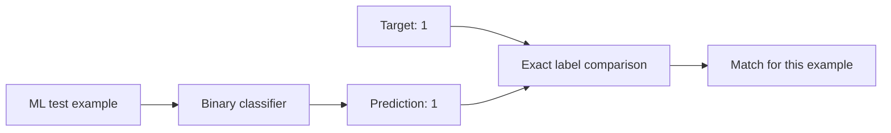

If a classifier predicted `1` and the target was `1`, it got **that example** correct. To calculate dataset accuracy, we count correct predictions over all evaluated examples:

\[
\text{Accuracy} = \frac{\text{Number of correct predictions}}{\text{Number of evaluated examples}}
\]

For a 100-example test set, 87 correct predictions yield an accuracy of 87%. A single matching example does not itself establish the model's overall accuracy.

Our course chatbot is different. Its output is not necessarily one element in a small predefined set. It may generate a paragraph, a short phrase, a structured explanation, or several possible valid phrasings. “Correctness” can involve grounding, factual validity, completeness, relevance, style, and format.

| Dimension | Typical supervised classification example | Our course-transcript RAG chatbot |
|---|---|---|
| Prediction | A label from a predefined set | Free-form generated text |
| Typical test reference | Known target label | May require authored or generated reference answer and source evidence |
| Basic comparison | Exact label comparison | Meaning-aware and evidence-aware judgment |
| Quality dimensions | Accuracy, precision, recall, F1, etc. | Retrieval quality, answer quality, groundedness, and task-specific constraints |
| Principal problem studied here | Predictive model quality | Quality of a composed retrieval-and-generation application |
| Repeated tests | Straightforward to automate for a fixed set | Automated generation plus potentially subjective judging |

The lecture also points out that LLM applications are **multi-component systems**. If retrieval fails, the final answer may fail even when the base LLM is capable. A larger or newer model does not erase upstream information problems.

**Technical clarification:** This is a comparison with a *simple supervised classification workflow*, not a universal claim that all ML systems are deterministic, single-component, or easy to evaluate. Conventional ML pipelines can also suffer data drift, preprocessing defects, ranking ambiguity, and complex integration failures. Similarly, some LLM tasks with constrained outputs can be tested with exact comparisons or executable checks. The practical distinction is that **open-ended RAG answer quality often requires richer evaluation criteria than a simple label comparison**.

We have now explained *why scoring is hard*. But the instructor takes a more fundamental step before choosing a scoring technique: **what are we going to score?**

---

## 7. Before grading the answers, we must design the examination

This is the chapter's central transition. We know that a RAG application can fail at retrieval and generation. We know its answers cannot always be checked by matching text. It might be tempting to immediately install DeepEval or define five metrics.

But imagine trying to test students without preparing a question paper. Before you decide how to mark the answers, you need to know **which questions will be asked**.

The instructor uses a tenth-standard **NCERT science examination** to explain this. Picture a student who has studied the prescribed science textbook. You are the examiner responsible for testing the student's knowledge. The student should answer based on that textbook, not unrelated material. Correspondingly, your test questions should be derived from the prescribed syllabus.

For RAG evaluation, the analogy maps like this:

| School examination | RAG evaluation |
|---|---|
| NCERT science textbook | The chatbot's source knowledge or document corpus |
| Student | RAG application under test |
| Question paper | Evaluation dataset of test queries |
| Model answers / answer key | Expected or reference answers |
| Student's written answers | Actual responses produced by the RAG application |
| Examiner checking the answers | Evaluator, potentially an LLM judge |
| Marks and feedback | Scores, pass/fail decisions, and reasons |

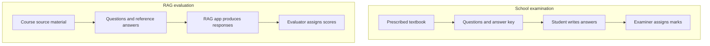

The analogy establishes an important ordering:

**First decide what representative questions and expected answers look like. Then run the application. Then judge the returned results.**

It also reveals a design risk. A weak question paper gives weak evidence about a student's capabilities. A weak evaluation dataset gives weak evidence about a RAG application's reliability.

Our new problem is therefore: **How do we create an evaluation question set that actually tests the application well?**

## 8. A good test set must be small enough to run and broad enough to matter

The instructor places a practical constraint on our imaginary exam: **the paper may contain only fifteen questions**. Fifteen is an example chosen to make the idea intuitive, not a required DeepEval dataset size.

If we had unlimited time, we might be tempted to ask a question about every line of the textbook. But real evaluations have costs: human preparation time, application inference, retrieval operations, judge-model calls, and result review. We therefore need a limited set of questions that still provides useful evidence about performance.

This sets up a genuine design tension:

\[
\text{Finite evaluation budget} \quad \text{versus} \quad \text{Representative coverage}
\]

A set of fifteen nearly identical questions could produce a deceptively high score. A student who memorized only the chapter on biology might appear excellent if most questions happened to cover biology. The paper would be easy to administer but poor at judging the intended breadth of knowledge.

Likewise, if our RAG chatbot's test set only asks for definitions of common LLM terms, we have little evidence that it can answer questions about **the particular lectures**, the implementation choices, the differences between sessions, or the topics postponed for later classes.

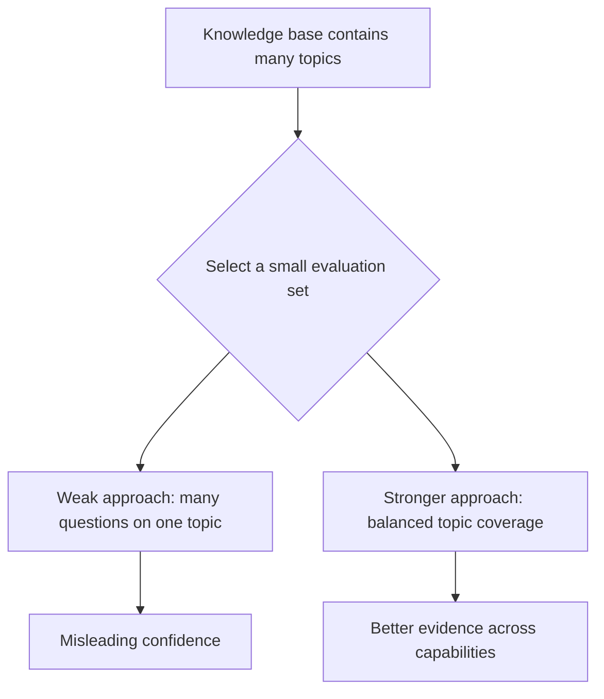

### Coverage is about *what we test*

The teacher in the lecture wants a science paper that touches physics, chemistry, and biology rather than drawing disproportionately from a single subject. In our RAG example, analogous categories might be concepts introduced in Session 1, architecture discussed in Session 2, coding decisions made in Session 3, and evaluation questions introduced in Session 4.

These are **illustrative categories** for our course corpus, not the actual categories of a generated dataset in the recording.

A simple coverage plan might look like this:

| Area of knowledge | Example test intent | Why it is useful |
|---|---|---|
| RAG architecture | Identify the roles of retrieval and generation | Checks core conceptual understanding |
| Implementation specifics | Name the database used in the course demo | Tests access to course-specific evidence |
| Cross-topic synthesis | Explain how chunking affects retrieved context | Tests connections across multiple passages |
| Lecture boundaries | Identify what was demonstrated versus deferred | Detects invented course-specific claims |
| Limitations and trade-offs | Explain why a working chatbot still needs evaluation | Tests reasoning beyond word definitions |

A balanced selection is not necessarily an *equal count from every topic*. It should represent the application's expected usage, the importance of each knowledge area, and the failures we need to discover.

### Difficulty is about *how we test it*

The instructor next considers difficulty. A paper made entirely from the easiest questions will fail to distinguish basic competence from deeper understanding. But a paper made entirely from the hardest questions may obscure whether the student at least understands the foundation.

For a RAG chatbot, an easy question might ask it to extract a clearly stated fact. A more demanding question might require connecting two passages or explaining an implementation consequence. These are different levels of reasoning and retrieval difficulty.

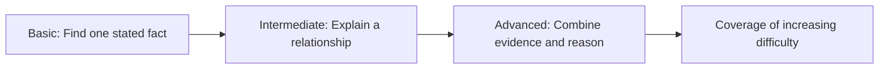

Notice what has changed in our mental model. We are no longer asking “Can the application answer *a* question?” We are asking **which capabilities do the chosen questions collectively test?**

### Diversity and bias are related but not identical

The instructor uses a physics teacher, a chemistry teacher, and a biology teacher to demonstrate selection bias. Each teacher may naturally favor familiar topics. If one teacher single-handedly writes the entire paper, the resulting questions may overrepresent that teacher's specialty.

A similar effect can occur with synthetic questions. A generation method can repeatedly favor short factual questions, particular document positions, familiar phrasings, or a narrow set of concepts. Merely producing a large number of questions does not guarantee diversity.

This leads to our next question: **Instead of asking one teacher to produce the final fifteen questions directly, what if we generated a larger pool and selected the best?**

---

## 9. The instructor's “three teachers” strategy: generate candidates, then select

Return to the NCERT examination. Rather than commissioning one teacher to write the final paper, the instructor imagines three capable teachers, each preparing thirty candidate questions.

That gives us:

\[
3 \text{ teachers} \times 30 \text{ questions} = 90 \text{ candidates}
\]

The head examiner then chooses fifteen high-quality questions from the ninety candidates. This is more work up front than accepting the first fifteen, but it creates a richer selection pool.

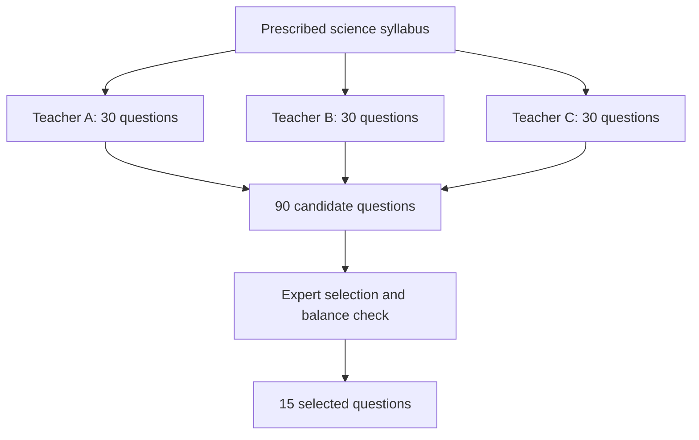

The **numbers** matter only as an illustration of oversampling and selection. The **strategy** is the important idea: producing more candidates than we need allows us to compare coverage, relevance, quality, and difficulty before finalizing the evaluation set.

Why is this a better approach? Because the goal is not to reward the quantity of questions created. The goal is to discover a limited set that tells us something meaningful about how the application performs.

### Selection needs explicit criteria

The moment we have ninety candidate questions, we have created a new problem: **how do we choose fifteen?** An examiner who picks the first fifteen has not solved the bias problem; they have moved it downstream.

The instructor's answer is to use an expert process that considers coverage, duplication, usefulness, balance, and difficulty. This can be described as **candidate generation followed by critique and selection**.

A strong question should contribute something that other selected questions do not already cover. If we select three nearly identical paraphrases of “Define photosynthesis,” we have consumed three of our fifteen slots without necessarily testing three distinct abilities.

This is the conceptual reason the lecture introduces **context grouping** and later **question evolution**. Both try to increase the informational value of a limited evaluation budget.

We are still preparing the question paper. The RAG application has not taken the test yet, and no answers have been scored.

---

## 10. Converting the examination idea into a synthetic dataset generation flow

The instructor now translates the three-teacher analogy into a conceptual automated approach similar to what the later DeepEval lessons will explore. This is the most architecturally interesting part of the lecture because it reveals a pipeline **before** the evaluation pipeline.

We started with an application knowledge base. We want to transform that knowledge into a representative set of **question–reference-answer pairs**. Rather than directly asking an LLM, “Write fifteen random questions,” the instructor motivates several intermediate steps.

The narrated process is roughly:

**Source material → candidate contexts → critique and filter → group related context → generate question candidates → critique and select → evolve questions → validate → final evaluation dataset.**

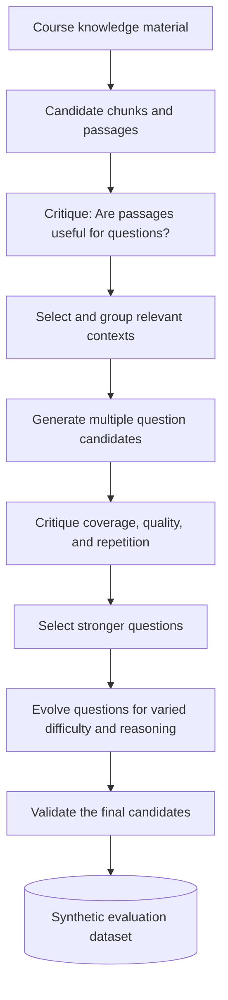

> [!NOTE] A lecture-level conceptual map, not a DeepEval API contract
> The instructor describes these stages as an **overview** and explicitly promises the detailed mechanisms, research background, tunable parameters, and code in the next lecture. Do not assume this precise Mermaid diagram is the exact internal call graph of a particular DeepEval version. The lecture's concrete quantities, such as 500 pages, 30 contexts, 90 questions, and 15 finalists, are explanatory examples.

Let's examine why each transition exists. Otherwise, the flowchart risks becoming another dump of component names.

### 10.1 We cannot ask good questions without suitable source evidence

Our raw material is the course content. In the exam analogy, the source is the NCERT book. In our application, it is the lecture knowledge that will be indexed and searched.

The first challenge is that a large book or transcript corpus contains many passages that vary in usefulness. Some passages introduce key concepts; others repeat explanations, include housekeeping, or contain incidental remarks.

The lecture proposes a **critique/filtering step** that judges which candidate passages are worth turning into questions. In its story, an LLM serves the role of a teacher examining pages and deciding whether they contain meaningful testable material.

We can visualize that as:

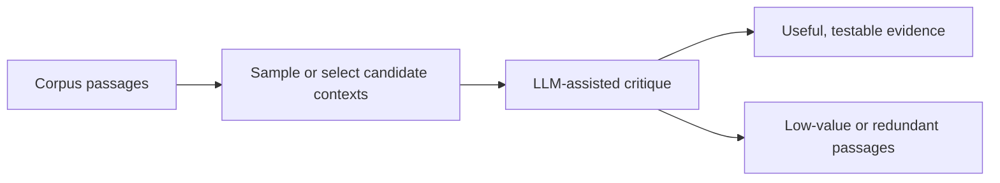

Why filter? Because an evaluation question created from irrelevant or trivial source text uses our limited testing budget without revealing an important application capability.

**Added technical caution:** Sampling only a small fraction of a corpus can miss important but infrequent topics. For a real deployment, coverage checks and targeted sampling may be necessary. Automation does not independently prove that the chosen contexts represent the whole corpus.

### 10.2 Related passages may need to be grouped before question generation

Now imagine the lecture explains one concept in three different transcript locations. One passage introduces the definition, another gives the reason it exists, and a third provides an example.

If we generate one question separately from each passage, we may obtain three near-duplicate questions. Alternatively, if the information is truly complementary, combining it into a coherent context could support a richer question.

The instructor describes **assembling related contexts** to reduce repetition and increase useful coverage.

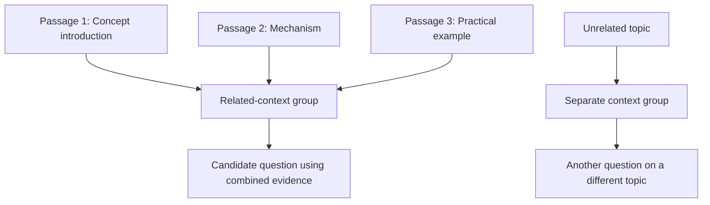

This is different from claiming that arbitrary nearby pages should always be merged. Grouping should preserve meaning, source traceability, and a reasonable amount of context. The objective is **meaningful grouping**, not longer text for its own sake.

### 10.3 Produce multiple questions so that we have choices

With a set of useful contexts identified, we ask a question generator to produce several candidate questions. The instructor imagines three questions per selected topic, potentially produced through separate LLM calls. The candidates may focus on different details even when they come from the same source.

For a single course passage about retriever failures, illustrative candidates could be:

- “What is a retriever failure in RAG?”
- “How can a successfully completed similarity search still produce an incorrect final answer?”
- “Why might improving the prompt fail to fix an application whose retrieved context is irrelevant?”

These three questions test related but not identical abilities: recognition, causal explanation, and diagnosis. The idea is to **create a menu of capabilities to test**, then choose a balanced subset.

However, different prompts or model calls do not guarantee diversity. Candidate generation should be followed by a check for repeated meanings, ambiguous formulations, and unsupported questions.

### 10.4 Critique and select a manageable final set

We now have a larger candidate pool than our evaluation budget allows. A selection step chooses questions that contribute to coverage and variety.

In the instructor's example, ninety candidates are narrowed to fifteen. The goal is to maximize how informative those fifteen questions are.

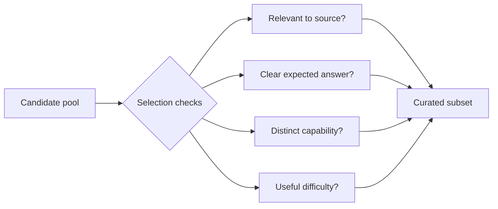

The selection itself is an evaluation task: we are evaluating **test-question quality**, before using the selected questions to evaluate **the application**. This is a helpful distinction because it explains why an evaluation framework may use LLM calls during dataset construction and again during answer scoring.

### 10.5 Evolve simple questions into more demanding ones

The instructor introduces **question evolution** using the school-exam analogy. The original question might be “What is photosynthesis?” A more complex version could ask for the relevant steps or associated chemical process.

The important idea is not making every question intentionally tricky. It is diversifying the skills the test set probes: factual recall, explanation, reasoning, relationships, and possibly multiple pieces of evidence.

Here is the same notion applied to our course-transcript example:

| Stage | Illustrative question | Capability probed |
|---|---|---|
| Raw factual question | “What is LangGraph?” | Identify a concept |
| Applied question | “Why was LangGraph used for the RAG workflow rather than treating the flow as one undifferentiated model call?” | Explain role and motivation |
| Comparative question | “How do the LangGraph orchestration layer and the LangChain node components differ in the course example?” | Distinguish related components |
| Reasoning question | “If the retrieval node provides irrelevant context, why can the generation node still complete successfully while the overall answer is wrong?” | Reason through a failure |

An evolution should remain **answerable from authorized evidence**. Making a question harder by introducing an unsupported requirement creates a bad test, not a better one.

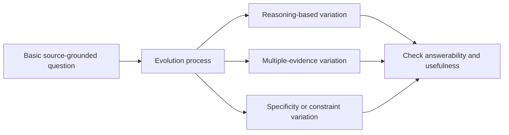

### 10.6 Validate the final questions and reference answers

The school exam does not merely need questions. It also needs a trustworthy **answer key**. Likewise, to compare chatbot outputs against expectations, the dataset needs suitable reference material.

For an automated RAG evaluator, a typical record might associate a question with an expected answer and the source evidence supporting that answer. The precise fields depend on the evaluation framework and metric.

**Educational illustration — not actual Session 4 data:**

```json
{
  "question": "Which vector store was used in the course RAG demo?",
  "expected_answer": "Chroma was used as the vector store.",
  "source_evidence": [
    "Session 3 implementation passage describing Chroma"
  ],
  "topic": "RAG implementation",
  "difficulty": "basic"
}
```

Why store evidence as well as a reference answer? Because a generated answer key can itself be wrong. The evaluator should have a way to verify that the expected answer is actually supported by the material the chatbot is supposed to use.

**Technical clarification:** The transcript talks conceptually about generating correct question–answer pairs, but does not establish a final dataset schema, guaranteed answer verification method, or actual synthetic dataset produced in Session 4. Those are design illustrations here.

We now have a complete high-level answer to the question-paper problem. But the instructor pauses to examine whether generating this paper automatically is the only available method.

---

## 11. Three ways to obtain an evaluation dataset

At this point, it is useful to imagine that a new RAG application has arrived in production. We want to evaluate it, but nobody has assembled a reusable test set yet. What are the possible starting points?

The instructor presents **three broad approaches**: manual creation, historical production questions, and synthetic generation.

### 11.1 Manual creation: experts write the tests

In a manual approach, a developer or domain expert reads the underlying knowledge material and writes test questions and expected answers. This has an obvious strength: a knowledgeable human can reason about importance, ambiguity, and business relevance.

The instructor also identifies substantial problems. Experts may favor topics they know well; reviewing a large corpus is time-consuming; question writing can become expensive; maintaining the test set after corpus changes requires more work; and creating thousands of varied questions may be impractical.

For the course chatbot, writing ten excellent questions by hand could be feasible. Writing and maintaining hundreds across continuously added lectures would be much more burdensome.

### 11.2 Historical production data: use what people actually asked

What if the application already has users? Their real queries are evidence about how people interact with the chatbot. In the school analogy, this resembles learning from previous examination questions; in RAG operations, it resembles using logged user queries.

This approach has a powerful advantage: the test questions are drawn from real usage patterns. But there are important limitations. Production logs may overrepresent a common user segment, omit rare failure cases, contain privacy-sensitive information, or lack verified reference answers.

Suppose a logged user asked, “Which session introduced LangGraph?” We know the question was asked, and perhaps we know how the chatbot answered. But the chatbot's previous response is **not automatically the correct answer key**. It may be exactly the error we are trying to detect.

### 11.3 Synthetic generation: derive new tests from the knowledge source

In the synthetic approach, a generation pipeline reads or samples source content, identifies useful topics, creates question candidates, and prepares reference answers. This is the approach the instructor chooses for the upcoming hands-on work with DeepEval.

It addresses a different need from historical logs: we can generate tests **before real users have supplied enough queries**, and we can intentionally target knowledge areas that are otherwise rarely queried.

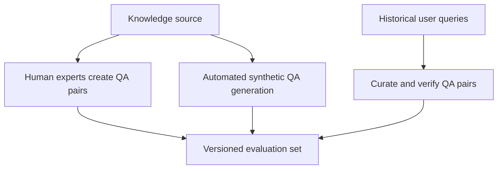

| Method | Main strength | Main limitation | Useful situation |
|---|---|---|---|
| Manual | Human domain reasoning and careful curation | Time, cost, expertise, maintenance | High-stakes or specialized examples |
| Historical | Reflects authentic user behavior | Missing answer keys, usage bias, privacy concerns | Mature applications with useful logs |
| Synthetic | Scalable and can intentionally target source coverage | Generated questions/answers may be wrong, repetitive, or biased | New RAG systems and broad initial coverage |

The instructor strongly motivates synthetic data because it can be automated and rerun after knowledge changes. That is a meaningful advantage, but it does not imply that synthetic generation eliminates all bias, expense, or review work.

> [!NOTE] Important engineering extension
> In real projects, these approaches are often complementary rather than mutually exclusive: synthetic questions provide coverage, curated human examples provide trusted reference cases, and historical questions supply realistic usage patterns. The instructor selects synthetic generation as the focus of the course; the combined strategy is an additional practical interpretation.

The next question is crucial: **if an LLM created the questions and answers, how do we know the examination itself is trustworthy?**

---

## 12. A test set can fail independently of the application

This is where we must keep the roles straight. The RAG application is the **student**. The generated test set is the **question paper and answer key**. If the answer key is wrong, the student may be penalized for giving a correct answer—or rewarded for agreeing with an invented statement.

Consider a hypothetical evaluation record:

> Question: “Which vector database was used in the Session 3 demo?”  
> Generated reference answer: “Pinecone.”  
> Source lecture fact: “Chroma.”

Even before querying the chatbot, the evaluation record is defective. If the application correctly answers “Chroma,” a naive comparison against the wrong reference could mark it down.

```mermaid
flowchart TB
    S[Actual source says Chroma] --> V[Reference verification]
    R[Generated answer key says Pinecone] --> V
    V --> BAD[Reject or correct defective test record]
    BAD --> FIX[Use source-grounded reference]
    FIX --> RUN[Only then evaluate chatbot]
```

We can now see why dataset generation is such a serious engineering activity. It requires more than producing grammatically reasonable questions. It requires **relevance, representation, source grounding, answerability, expected-answer quality, and ongoing maintenance**.

The transcript raises the question of how to ensure synthetic-data reliability but deliberately postpones the detailed mechanism to the next class. The checks below are therefore **supplemental engineering safeguards**, not a claim that they were implemented in this session.

A practical test-set review should ask whether the question has a clear answer within the source, whether the reference faithfully reflects that source, whether near-duplicates crowd out other topics, whether difficulty is represented appropriately, whether test data has been inadvertently copied from evaluation outputs, and whether the source version is recorded.

### What happens when the knowledge base changes?

Suppose a course instructor updates a lecture note to correct an earlier error. The chatbot's source documents and vector index may need refreshing. The evaluation dataset may also need refreshing; otherwise, it could grade the system against outdated facts.

```mermaid
flowchart LR
    U[Source material changes] --> KB[Rebuild or refresh knowledge index]
    U --> RE[Review evaluation references]
    KB --> T[Test revised chatbot]
    RE --> T
    T --> C[Compare only against applicable test version]
```

That is the connection between **dataset engineering** and **experiment tracking**, a topic mentioned earlier in the course. To compare version A and version B fairly, we need to know which evaluation dataset each was tested against.

Our examination paper is now ready *in principle*. We can finally let the student take the test.

---

## 13. Running the examination: convert a QA dataset into observed RAG behavior

Our dataset contains questions and suitable reference answers. The next step is to feed each question to the same application that students use. This is important: we are not merely asking a separate LLM to answer exam questions. We are testing the **actual retrieval-and-generation pipeline** whose quality we want to improve.

Let's walk one question through the system:

**Evaluation query:** “Which vector store was used in the course demo?”  
**Reference answer:** “Chroma was used.”

The evaluator takes the query from the test set and sends it to the application. The application embeds the query, searches the vector database, builds a context, and invokes its generation model. It then returns an answer. For diagnosis, it is useful to preserve the retrieved context and relevant run metadata as well.

```mermaid
sequenceDiagram
    autonumber
    participant Data as Evaluation dataset
    participant Runner as Test runner
    participant RAG as RAG application
    participant Store as Vector store
    participant Model as Application LLM
    Data-->>Runner: Question plus reference answer
    Runner->>RAG: Send evaluation question
    RAG->>Store: Retrieve relevant chunks
    Store-->>RAG: Retrieved context
    RAG->>Model: Question, context, and prompt
    Model-->>RAG: Generated answer
    RAG-->>Runner: Actual answer and available context
    Note over Runner: Preserve outputs for later judging
```

At this moment the test runner has two kinds of information:

**What we expected:** a question, a reference answer, and potentially source evidence or test criteria.  
**What we observed:** the retrieved passages, generated response, and any operational details that the application records.

The result is a test case ready to be evaluated. We have *not* scored it yet.

### A single test record becomes richer after execution

The following is an **illustrative data structure**, not a copy of the lecturer's source code or a promised DeepEval field schema:

```json
{
  "test_case_id": "rag-impl-001",
  "question": "Which vector store was used in the course RAG demo?",
  "expected_answer": "Chroma was used as the vector store.",
  "expected_source": "Session 3 implementation passage",
  "actual_answer": "The instructor used Chroma.",
  "retrieved_context": [
    "The course demo indexes cleaned transcripts with Chroma."
  ],
  "application_version": "rag-baseline-v1",
  "evaluation_dataset_version": "eval-set-v1"
}
```

Now we can ask different questions of the same execution. Did the retriever find the right lecture material? Did the model use that material faithfully? Did the answer satisfy the student? A useful evaluation system can preserve evidence for all three questions rather than giving us only one opaque number.

---

## 14. Why human grading works conceptually but struggles at scale

In a written science exam, students submit answers and a teacher checks them against marking criteria. The teacher understands that different students may express the same correct idea using different sentences. This is exactly the kind of interpretation a RAG-answer evaluator needs.

So why not use humans to grade everything?

For a small benchmark, skilled human review is invaluable. But imagine that we evaluate two hundred questions every day while experimenting with prompts, chunking, model choices, or retrieval settings. If a person must read every response, examine the source, compare expected and actual answers, and justify a score, the work grows with every experiment.

```mermaid
flowchart TB
    A[One RAG configuration] --> B[200 evaluation questions]
    B --> C[200 generated answers]
    C --> D[Human graders examine each answer]
    D --> E[Scores and reasons]
    F[Change application configuration] --> G[Repeat the full grading workload]
    G --> D
```

The instructor identifies several constraints: manual time, scaling costs, grader availability, and differences between how people assign scores. Two reviewers can agree on the general answer yet differ in how severely they penalize missing details.

There is a second obstacle: the application responses are not multiple-choice bubbles. We cannot simply mark an OMR-style sheet by looking for one exact option. Written answers demand **meaning-aware judgment**.

This is the reason the instructor introduces **LLM-as-a-judge**. It is a way to automate some of the interpretive work that people otherwise perform when comparing free-form answers.

---

## 15. LLM-as-a-judge: use a model to evaluate another model's output

The basic idea is straightforward. We already have an LLM capable of reading instructions, interpreting natural language, and producing structured responses. Why not assign a separate LLM the role of **examiner**?

The application LLM generates an answer. A judge LLM receives the answer together with the reference information and grading criteria, then produces a score and explanation.

```mermaid
flowchart LR
    Q[Question] --> APP[RAG application]
    APP --> ACT[Actual answer]
    Q --> J[Judge LLM]
    EXP[Expected answer or source evidence] --> J
    ACT --> J
    CR[Grading rubric] --> J
    J --> OUT[Score plus reason]
```

This is the lecture's central conceptual definition:

**LLM-as-a-judge is the use of an LLM as an evaluator that examines another system's output against explicitly supplied criteria.**

There is no need to imagine an LLM somehow checking the hidden thinking of another model. In the simple case the judge sees artifacts: a query, an actual response, an expected response or evidence, and a rubric. It decides how well the observed output meets the rubric.

### Why this technique helps with paraphrases

Return to the Rahul example:

**Expected:** “The student's name is Rahul.”  
**Actual:** “Rahul is the student's name.”

An exact string comparison fails, but a judge instructed to evaluate factual agreement can recognize that both statements convey the same name. If the actual answer said “Amit,” a competent judge could flag the factual mismatch.

The judge thus changes the nature of our comparison: from **surface text equality** to a more useful assessment of **meaning and task-specific evidence**.

We still must tell the judge *which meaning to assess*. That is where the rubric becomes essential.

---

## 16. Design a judge by starting with the question it must answer

The instructor describes configuring the judge through a prompt. The system or evaluator instructions can establish a role, identify the inputs, define the criteria, and require a score plus a reason.

The important word is **criteria**. “Tell me if this answer is good” is not sufficiently specific if we want repeatable results. Good according to what? Factual correctness? Source grounding? Relevance? Completeness? A required JSON structure? Different questions lead to different evaluator behavior.

```mermaid
flowchart TB
    ROLE[Evaluator role and task] --> PROMPT[Judge instructions]
    RUBRIC[Detailed scoring rubric] --> PROMPT
    INPUT[Question and actual answer] --> PROMPT
    REF[Reference answer or evidence] --> PROMPT
    PROMPT --> J[Judge model]
    J --> STRUCT[Structured score and explanation]
```

### A small judge instruction, built progressively

To illustrate the reasoning, begin with an extremely weak instruction:

```text
Is the answer good?
```

This gives the judge no stable task definition. One model call might prefer short wording while another rewards lengthy explanations. The evaluator could penalize different things from one run to the next.

A better **educational example** names the specific inputs and a specific criterion:

```text
You are evaluating factual agreement for a course-question chatbot.

Question:
{question}

Expected answer:
{expected_answer}

Application answer:
{actual_answer}

Judge whether the application answer conveys the same correct facts.
Accept valid paraphrases. Penalize invented or contradictory facts.
Return a score from 0.0 to 1.0 and a concise explanation.
```

This prompt is still just a starter. It does not define partial-credit details, how to treat missing information, what to do with ambiguous references, or how to assess the source evidence. A production rubric would make those decisions more explicit.

Now make the evaluation objective narrower: **Does the answer stay supported by the retrieved context?** Here we would need to include the retrieved passages and explicitly define how to penalize unsupported claims. That is a different criterion from whether the answer matches a human-authored reference.

### Different judge prompts are different evaluators

The instructor explains that LLM-as-a-judge can serve multiple metrics by changing the judge's instructions. That does not mean one vague judge can reliably evaluate all dimensions simultaneously. Instead, each dimension can have its own rubric and relevant inputs.

For example:

| Evaluation question | Main evidence the judge may need | What it tries to establish |
|---|---|---|
| “Does this answer address the question?” | Question and actual answer | Response relevance |
| “Does the answer contradict its retrieved passages?” | Retrieved context and actual answer | Evidence faithfulness |
| “Does the answer agree with the expected fact?” | Reference answer and actual answer | Reference-based correctness |
| “Does the answer satisfy the output instruction?” | Requested structure and actual answer | Format compliance |

These are **conceptual evaluation dimensions**, not a claim that the instructor taught four named DeepEval metrics in Session 4. He says that the course will later study **five RAG-specific metrics**, their calculations, and their code individually; their names and exact formulas are not established in this lecture.

### The judge should explain its score—but explanation is not proof

The instructor emphasizes a useful property: we can ask for both a numerical score and a reason. This makes the result more actionable than a bare number.

Illustrative structured output:

```json
{
  "score": 0.9,
  "reason": "The answer identifies Chroma correctly and is consistent with the reference."
}
```

The value `0.9` above is **an invented teaching example**, not a real result from the course. The reason is useful because it identifies what the judge believed supported its evaluation. However, it is still the judge model's generated explanation, so it may contain mistakes or overstate certainty.

What matters is that we have introduced an executable-looking interface:

```text
Input:  test case + application output + evaluation criteria
Process: judge-model comparison
Output: numerical judgment + textual explanation
```

This interface is the bridge between the instructor's classroom analogy and real evaluation tooling. Frameworks like DeepEval provide implementations around these ideas so engineers do not always have to create every judge prompt, result parser, and reporting component from scratch.

---

## 17. The full evaluation flow now has two distinct LLM roles

Earlier, we had a single RAG application containing an LLM that generated answers. After introducing automated grading, we must keep **application generation** separate from **evaluation generation**.

This distinction can be confusing because both are LLM calls, but they have different responsibilities and are used at different stages.

```mermaid
sequenceDiagram
    autonumber
    participant Set as Evaluation dataset
    participant Runner as Evaluation runner
    participant RAG as RAG application
    participant AppLLM as Answer model
    participant Judge as Judge model
    Set-->>Runner: Question and reference
    Runner->>RAG: Run question
    RAG->>AppLLM: Prompt with retrieved evidence
    AppLLM-->>RAG: Answer
    RAG-->>Runner: Answer and available context
    Runner->>Judge: Actual, reference/evidence, rubric
    Judge-->>Runner: Score and explanation
    Runner->>Runner: Record result for this test case
```

The judge is not part of the student-facing answer path in this example. It operates in the **evaluation path**. When the same test set is executed against a new application version, the runner can score the new results and compare them with the baseline.

There are therefore at least **two separate reasons LLM API calls may occur in the evaluation workflow**:

1. The application generates answers to the test questions.
2. The judge evaluates those generated answers.

In the synthetic-data approach, generating or critiquing the test questions may also require LLM calls *before* either of those steps. This is why evaluation cost is broader than the cost of calling one judge on one answer.

Now we understand the mechanism. But why is the instructor optimistic about it, and where can it go wrong?

---

## 18. What LLM-as-a-judge makes possible

The lecture identifies four recurring benefits. We can understand each by linking it to an obstacle we already encountered.

**First, semantic judgment addresses the wording problem.** Our application can say “Rahul is the student” rather than “The student's name is Rahul.” A language-aware judge can assess whether the underlying statement agrees with the reference instead of penalizing word rearrangement.

**Second, different rubrics address the multi-dimensional quality problem.** When we test retriever relevance, answer faithfulness, factual correctness, or formatting, we ask different questions of different evidence. An adaptable judge makes some of these criteria automatable.

**Third, programmatic judging addresses manual-review scaling.** A test runner can send many outputs through evaluation in a repeatable process, subject to API limits, rate limits, token usage, latency, and cost.

**Fourth, generated reasons aid diagnosis.** If scores decline, an explanation may point to missing source evidence, an invented fact, or a response that did not satisfy a constraint. Engineers can then inspect specific failing examples rather than looking only at aggregate averages.

```mermaid
flowchart TB
    P1[Different valid phrasings] --> B1[Meaning-aware comparison]
    P2[Multiple quality dimensions] --> B2[Criterion-specific rubrics]
    P3[Too many cases for manual grading] --> B3[Automated evaluation runs]
    P4[Opaque low scores] --> B4[Explanations to inspect]
```

The key idea is not that an LLM judge is universally correct. It is that **it can automate a kind of interpretation that is awkward to express as a simple string comparison**.

---

## 19. The judge has its own failure modes

This is one of the most important sections for real engineering. The instructor explicitly discusses why an LLM judge should not be regarded as a perfect authority. It is another model, and models can make errors.

### 19.1 Judge bias and self-preference

The instructor describes a self-enhancement or self-preference concern: when the same or very similar models generate and evaluate responses, the judge may favor familiar styles or fail to notice certain mistakes.

This is a reasonable risk to investigate, but it is not a guarantee that every model will always rate its own answer higher. The broader point is that **a judge's preferences may affect scores independently of true answer quality**.

```mermaid
flowchart LR
    APP[Answer model] --> AN[Generated answer]
    AN --> J[Judge model]
    STYLE[Judge preferences and biases] --> J
    J --> S[Score]
    S --> Q{Does score track actual task quality?}
```

The instructor recommends using a stronger judge than the application model. This can be useful, but it is **not an absolute rule or a substitute for validation**. A stronger model may still exhibit bias, overlook domain-specific facts, or misapply the rubric. The correct choice depends on demonstrated judging performance for the relevant task.

### 19.2 Judges can simply make factual and reasoning errors

Suppose the source says Chroma and the application says Pinecone. An evaluator that misreads the reference could incorrectly reward the answer. A judge may hallucinate its reasoning, miss nuanced contradictions, or fail to detect absent evidence.

The lecture suggests repeating evaluations and considering aggregate results to reduce the impact of isolated variability. This can help estimate the stability of scores, but repeating a biased judge will not necessarily remove **systematic bias**. A judge that consistently applies the wrong rule may give a consistently wrong result.

A useful engineering safeguard is to maintain some **human-verified anchor cases** and compare judge decisions against those anchors. This is an added practical recommendation, not a technique demonstrated during Session 4.

### 19.3 Judge prompts can shift scores

The instructor emphasizes **prompt sensitivity**. Two versions of a judge instruction may produce different scores for the same application output. For example, “reward partial factual overlap” and “require complete coverage of every reference fact” are different grading policies.

Even apparently minor edits to the instructions can alter the interpretation of a borderline answer.

```mermaid
flowchart TB
    SAME[Same test case and actual response] --> J1[Judge rubric A]
    SAME --> J2[Judge rubric B]
    J1 --> S1[Possible score A]
    J2 --> S2[Possible score B]
    S1 --> DIFF[Different grading policy or sensitivity]
    S2 --> DIFF
```

This means a change in evaluation score does not automatically prove a change in application quality. Perhaps the *judge prompt* or *judge model* changed. For fair comparison, record or pin those evaluation settings.

The instructor highlights the value of predefined DeepEval metrics whose prompts have already been developed and tested by the framework authors. That makes them useful starting points, but built-in prompts still need to fit the application and should not be assumed infallible.

### 19.4 Judge-model calls create additional cost and latency

For illustration, imagine two hundred test questions and five criteria. A simplistic one-call-per-criterion design would imply:

\[
200 \text{ test cases} \times 5 \text{ criteria}
= 1000 \text{ judge calls}
\]

This is only a planning example. A real framework metric may use **multiple calls**, share work with other evaluations, skip cases, or run different operations. Separately, we may incur costs from application inference and synthetic dataset generation.

The lesson is that automated evaluation scales *operationally*, but it is not free. Engineers must select representative questions and decide which evaluation dimensions to run, how often to run them, and how to interpret changes.

### 19.5 Natural-language judges are not a replacement for every test

The instructor makes an important boundary distinction. If a model generates executable code, a judge's opinion about whether the code “looks correct” cannot replace running relevant tests. If an agent uses tools, verifying actual tool behavior can be more trustworthy than evaluating only the final textual summary.

The general principle is: **prefer direct verification when the property can be checked directly; use LLM judgment for criteria that genuinely require language interpretation.**

| Property to test | More direct method where available | Where a judge may help |
|---|---|---|
| JSON conforms to schema | JSON parser and schema validator | Explanation of semantic content |
| Code passes tests | Execute test suite safely | Evaluate clarity or documentation |
| Response cites a given source | Check citation references and passage links | Assess whether claim is actually supported |
| Answer agrees with a reference | Exact check if output is constrained | Interpret open-ended paraphrases and partial credit |
| Agent used required tool | Inspect tool trace | Assess quality of natural-language decision rationale |

The instructor's intent is not that LLM-as-a-judge solves everything. It is that it solves an important **free-form text scoring** problem that ordinary exact-match testing does not solve on its own.

---

## 20. From scores to engineering decisions: compare configurations, not anecdotes

Once evaluation produces repeatable results, we can use it for a practical purpose: decide whether a system change actually improved the application.

The instructor mentions changing one component configuration, evaluating the application, saving the score, then repeating with an alternative. Chunking strategy is the example.

Imagine two versions:

**Version A:** Existing chunking strategy, embedding model, retrieval settings, prompt, and generator.  
**Version B:** Same application, but with a different chunking strategy and rebuilt index.

Both versions run against the same suitable evaluation set. We record what happened, including retrieval-level failures and answer-level failures.

```mermaid
flowchart TB
    DATA[Fixed evaluation dataset] --> A[Application version A]
    DATA --> B[Application version B]
    A --> EA[Evaluate retrieval and answers]
    B --> EB[Evaluate retrieval and answers]
    EA --> SA[Record scores, examples, and settings]
    EB --> SB[Record scores, examples, and settings]
    SA --> COMP[Compare by criterion and investigate regressions]
    SB --> COMP
```

The goal is not always to maximize one average score. A change could improve factual correctness on easy queries but worsen retrieval for technical multi-part questions. Aggregates are useful, but the underlying failed cases tell us *what kind of behavior changed*.

### What should be recorded for a reproducible experiment?

The instructor names the idea of saving an evaluation result and comparing configurations; the following is a **practical elaboration** of what a structured experiment record can contain.

| Record | Why it matters |
|---|---|
| Dataset version | Prevents accidental comparison across different exams |
| Knowledge corpus/index version | Captures the source material available for retrieval |
| Chunking and embedding settings | Identifies ingestion changes that may affect search |
| Retrieval settings | Identifies differences in candidate selection |
| Prompt and answer-model configuration | Identifies generation changes |
| Judge model, prompt/rubric, metric version | Makes the grading policy explicit |
| Scores, reasoning, and failed cases | Supports diagnosis instead of just ranking versions |

An evaluation score without the conditions that produced it is difficult to reproduce. With those conditions recorded, the team can reason more confidently about the effect of a change.

---

## 21. A complete worked example: diagnose one poor RAG answer

We have now established every conceptual piece needed for a simple evaluation trace. Let's put them together as **one educational example**. This is reconstructed from the lesson's ideas; it was **not performed as a live DeepEval run in Session 4**.

### Starting situation

Our application uses course transcripts. The evaluation dataset contains the following case:

```json
{
  "question": "Which tool was used as the vector store in the demo?",
  "expected_answer": "Chroma",
  "source_topic": "Session 3 RAG implementation"
}
```

The application runs the query. The retriever returns two passages. The first discusses Pinecone as a vector database in general; the second explains embeddings but does not mention the instructor's chosen storage component. The final answer says:

> “The demo used Pinecone.”

From the student's perspective, the answer looks confident and relevant. From our evaluation perspective, it is incorrect.

### Step 1: Inspect the retrieved context before blaming the generator

Ask a concrete question: “Was the passage explicitly identifying Chroma available in the retrieved context?”

In this illustrative run, **no**. That points to a retrieval-quality problem. It does not yet tell us which upstream mechanism caused it. We might investigate source indexing, topic ambiguity, chunk boundaries, similarity behavior, or retrieval settings.

### Step 2: Diagnose the generated response

The model named Pinecone, but the reference answer is Chroma. Its response is factually wrong for the specific lecture. It may also have relied on general familiarity or an irrelevant retrieved snippet.

At this stage we have **two observations**: poor evidence was retrieved, and an incorrect answer was generated. A final incorrect-answer score alone cannot separate their causes.

### Step 3: Rerun after an isolated retrieval change

Suppose we adjust a retrieval configuration and the relevant Chroma passage is now present in context. The application responds:

> “The instructor used Chroma to store and search embeddings from the cleaned lecture transcripts.”

A reference-based judge can recognize this as a valid expansion of the reference answer. A source-faithfulness check can also verify whether the answer is supported by the retrieved passage.

### Step 4: Preserve the explanation and version information

We save which version retrieved what, which answer was produced, which evaluator criteria were applied, and how the results changed. If the generator still said “Pinecone” after retrieving the Chroma passage, that would direct attention toward the prompt or generation behavior instead.

```mermaid
flowchart TB
    Q[Evaluation question about demo vector store] --> R[Inspect retrieved evidence]
    R --> HAS{Does the context contain the Chroma evidence?}
    HAS -->|No| RET[Retrieval investigation]
    HAS -->|Yes| GEN[Inspect generated answer]
    RET --> FIX[Modify one retrieval configuration]
    FIX --> R2[Re-run same question]
    R2 --> GEN
    GEN --> OK{Does answer accurately use evidence?}
    OK -->|No| PROMPT[Inspect prompt and generation]
    OK -->|Yes| PASS[Record successful test case]
```

### Why this example matters

It reconnects the entire lesson. We needed **a test question**, an **expected answer**, visibility into **retrieved context**, an **observed response**, and **evaluation criteria**. Only then could we determine what failed and what improvement would count as progress.

That is why the instructor spends so much time on dataset construction before teaching individual metrics.

---

## 22. What Session 4 teaches—and what it intentionally does not teach yet

This session is a **first-principles design lesson**. Its major achievement is not a code artifact. Its achievement is the chain of reasoning needed before writing evaluation code.

We can now reconstruct the sequence of problems that led us to the proposed system:

```mermaid
flowchart TB
    A[Working chatbot] --> B[Manual checks cannot establish broad quality]
    B --> C[Locate retrieval and generation failures]
    C --> D[Free-form output prevents simple exact-match grading]
    D --> E[Need representative test questions]
    E --> F[Use corpus-grounded dataset construction]
    F --> G[Run RAG app against the test set]
    G --> H[Judge generated text against criteria]
    H --> I[Use scores and failure examples to improve app]
```

Several substantial subjects are named as **upcoming work**, rather than demonstrated during this lecture:

| Topic | Status in Session 4 |
|---|---|
| Baseline RAG application | Recapped from Session 3 |
| Two major RAG quality failure points | Explained conceptually |
| Why LLM-app evaluation differs from simple ML classification | Explained conceptually |
| Dataset coverage, difficulty, and selection | Explained through the school-exam analogy |
| Synthetic QA generation flow | Explained as a high-level design |
| LLM-as-a-judge | Defined, motivated, and examined for pros/cons |
| Actual DeepEval synthetic-dataset generation code | **Deferred to next session** |
| Exact question-evolution mechanism and research basis | **Deferred** |
| Five named RAG metrics, formulas, and implementations | **Deferred to later sessions** |
| Complete end-to-end evaluation run with all five metrics | **Planned for later sessions** |

This boundary matters. Learning the concept of an LLM judge does not imply that we have already installed DeepEval, configured metric objects, calculated metric-specific scores, or validated a full test suite. Those steps belong to the next layer of the course.

---

## 23. Final synthesis: the mental model you should retain

Start with a RAG chatbot. Its purpose is to use relevant stored knowledge to answer a user's question. To do that, it retrieves passages and asks an LLM to generate a response from those passages and the question. A failure can occur because **the retrieved evidence is not fit for purpose**, or because **the generator does not turn useful evidence into a satisfactory answer**. Since these failures can occur even when the workflow completes normally, operational success is not enough.

Now suppose we want to know whether the system has improved. We could ask a few manual questions, but that would give us only scattered impressions. To obtain repeatable evidence, we need an evaluation dataset that covers important areas of the knowledge source and tests different levels of difficulty. The instructor's examination analogy shows why making this dataset is not a trivial preparatory chore: writing or generating the questions and verified expected answers is itself a complex quality problem.

A synthetic approach can automate portions of that preparation. It can examine source passages, select useful contexts, generate candidate questions, critique candidates, evolve difficulty, and produce question–answer pairs. But the resulting test set must still be trustworthy: an incorrect or unrepresentative answer key undermines whatever comes next.

Once the dataset exists, the application takes the examination. Each question is passed through the **real** RAG workflow. The system produces retrieved context and an actual answer. Finally, an evaluator decides whether the response meets clearly stated criteria. For free-form language, an LLM-as-a-judge is one way to perform meaning-aware comparison, generate scores, and explain judgments.

The resulting score is evidence, **not an unquestionable fact**. A judge can be biased, sensitive to prompts, or mistaken. Evaluation settings and examples therefore matter just as much as a headline score. Only with the dataset, application configuration, and judging policy held appropriately stable can we make useful comparisons across experiments.

Our final picture is an engineering feedback loop:

```mermaid
flowchart TB
    SRC[Authoritative lecture source] --> KB[(Indexed RAG knowledge base)]
    SRC --> DS[(Curated evaluation dataset)]
    USERS[Evaluation questions] --> APP[RAG retrieval and generation]
    KB --> APP
    DS --> USERS
    APP --> OBS[Actual answers and retrieved contexts]
    DS --> J[Evaluation criteria and references]
    OBS --> J
    J --> RESULTS[Scores, reasons, failure cases]
    RESULTS --> CHANGE[Change retrieval, prompt, or model setup]
    CHANGE --> APP
    RESULTS --> TRACK[Save comparable experiment results]
```

**That is the purpose of evaluation in LLMOps:** not simply to award a mark to a chatbot, but to make quality observable, failures diagnosable, and improvements comparable.

---

## 24. Understanding checks: reason through the system

Try answering these without looking back at the diagrams. The purpose is not to memorize terminology, but to verify that the ideas connect.

1. Your chatbot answers a question incorrectly, but the right passage is present in its retrieved context. Which stage do you investigate first, and why?
2. Your final answer happens to be correct, but the retriever supplied unrelated context. Has retrieval quality passed? Explain what the correct-looking answer does and does not prove.
3. Two answers use different words but communicate the same correct fact. Why does literal string matching fail as an evaluation strategy?
4. You can afford to evaluate only twenty questions against a corpus covering ten broad topics. Why might twenty randomly generated questions be worse than a carefully selected subset of twenty?
5. A synthetic dataset contains a reference answer that contradicts the source document. What could happen when you grade a correct chatbot response against it?
6. A new chunking strategy produces a better average score. What configuration and dataset details would you want recorded before treating that comparison as evidence of improvement?
7. You rerun the same question and judge rubric repeatedly. The judge consistently rewards an unsupported claim. Why will merely averaging more such judgments not necessarily solve the problem?
8. A RAG system must return machine-readable JSON. Which parts can be checked directly, and which might still require semantic judgment?

### Suggested next reading order

The instructor's intended continuation is: **implement synthetic evaluation-dataset generation using DeepEval**, inspect the details of filtering and question evolution, then learn the **five RAG-specific evaluation metrics** and apply them to the course chatbot. With the current mental model in place, those implementation details will have a clear purpose rather than appearing as unrelated framework calls.

---

## Source fidelity and technical clarifications

The main explanation is reconstructed from the supplied Session 4 VTT lecture. The following distinctions are particularly important when returning to the original recording:

- **Lecture demonstration vs future work:** Session 4 explains evaluation architecture, dataset generation, and LLM-as-a-judge. It does **not** provide the complete DeepEval code or demonstrate a finished dataset evaluation.
- **Source terminology:** “DPVAL/Deep evolve” is normalized to **DeepEval**, “Rack” to **RAG**, and “line graph” to **LangGraph** where the transcript context supports it.
- **Ingestion evaluation:** The lecture focuses on downstream retrieval consequences of ingestion design. Direct ingestion quality checks are possible and are not ruled out in practice.
- **ML vs LLM comparison:** The lecture contrasts a simple supervised classifier with open-ended RAG generation. Not every ML task is easy to evaluate, and not every LLM output requires subjective scoring.
- **Synthetic data:** Automation can improve scale and coverage, but it does not guarantee correct references, balanced questions, or absence of bias.
- **Judge selection:** A more capable judge is a useful heuristic discussed by the instructor, not a universal guarantee of sound evaluations.
- **Judging stability:** Repeated runs can reveal variability; repeated biased judgments can still be consistently wrong.
- **Framework-specific details:** Sample schemas, prompt text, score examples, and experiment-record fields in this chapter are **educational illustrations**. They are not verified DeepEval code or the exact output of the instructor's application.

**Session 4 takeaway:** *First build the exam, then administer it, then grade it, and finally use the evidence to improve the system.*
