# LLMOps — Session 5: Designing Trustworthy Synthetic Evaluation Datasets with DeepEval

> **Course:** LLMOps  
> **Session:** 5 · **Lecture duration:** approximately 2 hours 21 minutes  
> **Primary subject:** Turning knowledge-base documents into reusable RAG evaluation goldens, understanding DeepEval's synthesis pipeline, and preparing for component-level testing.  
> **Learning progression:** Session 3 built a baseline RAG chatbot → Session 4 asked how we can evaluate its reliability → **Session 5 explains how to construct the test material itself.**  
> **Source:** The supplied *LLMOps Session 5* VTT transcript, recorded/transcribed as dated 1 July 2026.

> [!IMPORTANT] What this chapter does—and does not—claim
> The instructor spends this session **explaining evaluation artifacts and the DeepEval synthetic-data pipeline**. He initially promises live implementation, but near the end explicitly moves **code implementation, context-construction details, and evaluation metrics to the following session**. This chapter therefore does not claim that goldens were successfully generated or evaluated during Session 5.
>
> **Source-derived content** follows the lecture's ideas, examples, constraints, and teaching sequence as reorganized for easier learning. Sections marked **Educational illustration** introduce invented sample questions, mock scores, worked traces, or code solely to make the mechanism tangible. **Engineering clarification** notes qualify simplifications made during the spoken class. Library code examples were separately checked against the DeepEval documentation current at the time of writing; APIs can change, and examples have **not** been run against the course project.

---

## The learning destination: what should you be able to explain?

Imagine that our course-transcript chatbot is working, just as it was at the end of Session 3. A student asks what an embedding is; the application retrieves relevant lecture passages, provides them to an LLM, and returns a fluent explanation. We have a functioning system. We do **not** yet have a repeatable basis for deciding whether this version of the system is better than another one.

In Session 4, we identified the need for an **examination**: questions that represent what students may reasonably ask, along with reliable reference answers. We also introduced the idea of an LLM acting as an examiner. Session 5 takes the question-paper analogy much more seriously. Instead of immediately scoring the chatbot, we investigate what must exist *before* meaningful scoring is possible.

By the end, you should be able to walk another engineer through this entire chain:

```mermaid
flowchart LR
    A[Lecture documents] --> B[Useful evaluation contexts]
    B --> C[Synthetic question candidates]
    C --> D[Quality filtering]
    D --> E[Difficulty evolution]
    E --> F[Review and store goldens]
    F --> G[Run RAG application]
    G --> H[Capture actual output and retrieval]
    H --> I[Build LLM test cases]
    I --> J[Judge with selected metrics]
```

But we will not jump straight into this picture's most complex portion. We will first identify the objects involved—**a question, an expected answer, an actual answer, a retrieved context, a golden, and a test case**—and then see why DeepEval needs several stages to construct them reliably.

Our recurring example will remain the *educational chatbot built over cleaned course lecture transcripts*. When useful, we will also reuse the instructor's school examination and NCERT textbook analogy. These are teaching analogies; they are not DeepEval's internal class names.

---

## 1. We need an evaluation dataset—but where will it come from?

Session 4 ended with an unavoidable problem. Traditional supervised machine learning often begins with labelled examples. When building a classifier, we may have input records paired with known labels. We can reserve a suitable portion for validation or testing. The trainer and the evaluator may use the same underlying source collection while preserving separation between the datasets.

An application-oriented RAG chatbot does not automatically arrive with an equivalent set of representative *questions and expected answers*. We may possess lecture transcripts, PDFs, product manuals, or articles, but those materials are not yet an evaluation dataset. They are the **knowledge source from which an evaluation dataset might be constructed**.

This distinction is foundational:

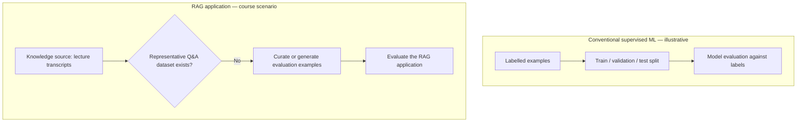

The instructor describes three sources of evaluation examples: manual curation, historical production interactions, and synthetic generation. This is not merely an implementation preference: each approach changes which questions we will test and how much we trust their expected answers.

### Manual, historical, and synthetic data are not equivalent

**Manual curation** means humans read relevant material, formulate test questions, and verify expected answers. It is attractive because knowledgeable reviewers can assess the product's purpose, recognize important topics, and catch subtle errors. Its weaknesses are effort, cost, limited throughput, and potentially narrow human preferences. If every code or prompt change requires an entirely new hand-written exam, iteration becomes difficult.

**Historical production data** means harvesting real user prompts or conversations, cleaning them, selecting representative samples, and adding reliable expected outcomes. Real usage reveals authentic wording and surprising edge cases, but it may be skewed. The instructor's example is a course chatbot where students disproportionately ask about difficult lessons, while basic theory receives few requests. The result can be excellent realism but poor *coverage*. Real conversations also contain greetings, off-topic messages, sensitive data, and incomplete turns. They cannot be treated as automatically labelled goldens.

**Synthetic generation** means asking an LLM to propose and refine questions using available source material. It can bootstrap a test suite before launch and repeatedly supply candidates, but the outputs must be selected and reviewed. The model can make the same misunderstanding in both the question and the answer, creating false confidence if nobody checks the reference answer.

| Source | Main strength | Main limitation | Most useful stage |
|---|---|---|---|
| Human-curated examples | Domain judgement and trusted reference answers | Time, cost, bias, limited scale | Baseline cases, critical regressions, high-stakes criteria |
| Historical user interactions | Authentic user language and failure cases | Skew, noise, privacy, missing answer keys | Improving an already deployed product |
| Synthetic examples | Rapid, reproducible candidate generation | Hallucinations, trivial cases, artificial distributions | Bootstrapping coverage before production |

Rather than assuming these are mutually exclusive, understand them as complementary. A mature system often combines them. The instructor emphasizes **human-reviewed examples whenever available**, then real production behavior, with synthetic examples particularly useful when neither already provides enough suitable coverage.

> [!NOTE] Engineering clarification — the “80/20” and “50–100” recommendations
> The lecture presents an approximately **80% LLM generation / 20% manual review** philosophy and suggests starting with roughly **50 good questions, perhaps 100 for a complex application**. Treat these as **course heuristics**, not universally required DeepEval rules or mathematical limits. Test-suite size should follow risk, coverage, variability, critical failure modes, and review capacity. The instructor's durable principle is more important: **fewer reviewed examples can be more valuable than many untrustworthy examples**.

### Why this brings us back to the RAG architecture

To evaluate a system, we need to understand what behavior is being tested. Our RAG application contains at least two meaningful runtime operations: retrieval and generation. A bad output may originate from either one. This is why the lecture next moves from the dataset's *source* to the dataset's *shape*.

---

## 2. A RAG answer depends on evidence, not merely on the user's question

Recall the two processes from earlier sessions. During **knowledge preparation**, we clean documents, create chunks, compute embeddings, and make the chunks searchable. During **question answering**, the application uses a user question to retrieve passages and prompts an LLM to respond.

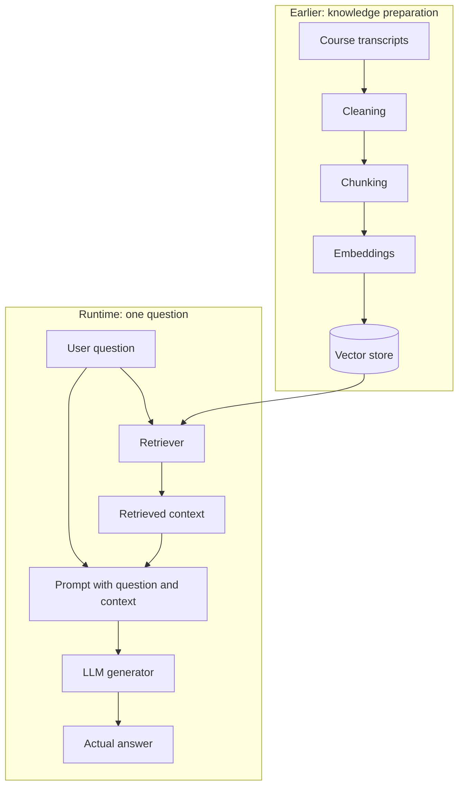

The retrieved context influences the answer, and therefore it matters when testing. Suppose the student asks, “Which orchestration library did the instructor use in the baseline application?” A question and a reference answer saying “LangGraph” might be enough to check the *final sentence*. But if we want to diagnose the pipeline, we also want to know whether the retriever actually found the relevant LangGraph material.

These are two different questions:

1. **Did the retriever fetch the evidence it should have fetched?**
2. **Given its evidence, did the generator answer correctly and stay supported?**

The instructor calls this the motivation for **component-wise evaluation**. The earlier stages of ingestion—cleaning, chunking, embeddings, indexing—can affect the retriever's results, even if we do not score each ingestion operation separately in this lecture.

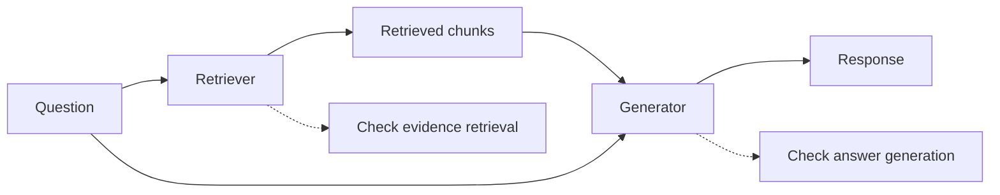

> [!NOTE] Engineering clarification
> Component-wise evaluation is the **chosen approach in this course**, not the only valid method for all RAG systems. End-to-end checks remain useful, and individual components may be assessed using different metrics. DeepEval metric inputs vary; not every metric requires all of the fields we will build below.

To perform these checks, we need more than a general understanding of the architecture. We need a precise record of the input and the artifacts observed during execution. This is where the vocabulary of **golden** and **LLM test case** becomes essential.

---

## 3. Begin with the question paper: the meaning of a golden

Return to the instructor's classroom analogy. The teacher is preparing an exam for students. Before anyone sits the exam, the teacher writes questions and prepares an answer key. That pair—*what is asked* and *what a good answer looks like*—is the first artifact.

In our course example, a student might ask:

> **Input / question:** “Why does a RAG application retrieve passages before calling the LLM?”
>
> **Expected output / answer key:** “Retrieval supplies relevant external evidence that can be included in the prompt, allowing the response to reflect the indexed knowledge source.”

That is an **educational illustration**, not a question copied from the instructor's generated output. It is intended to show the relationship between an expected answer and a source-grounded question.

DeepEval calls an evaluation example defined before execution a **Golden**. Its important characteristic is that it expresses what we wish to test *independently of what the application happens to do on a particular run*.

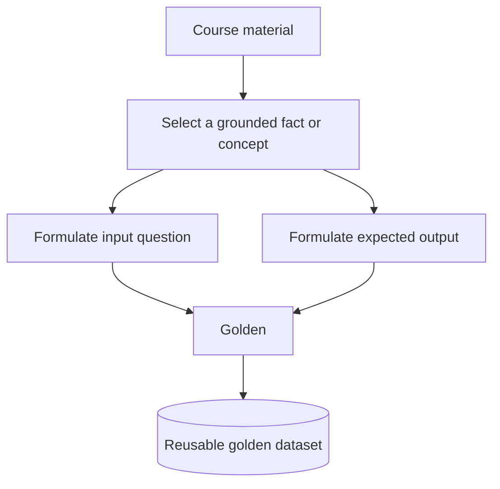

One subtle but important distinction: a golden may contain an input and *optionally* an expected output and other reference information. The lecture simplifies it to **question + expected answer** because that is the form most useful for its examination analogy. DeepEval is more flexible than this simplified picture.

The expected answer is not whatever the chatbot happens to say. It is the *answer key* against which one may compare a later response. Even if the chatbot fails or returns nothing, the golden remains useful because the test expectation exists separately.

### Why we preserve the golden across application changes

Suppose our first RAG configuration uses a chunk size of 500, and a later configuration uses 700. If we produce a completely different set of questions each time, a score improvement can be caused by the **test becoming easier**, not by the application becoming better. The lecture deliberately uses the same stored question paper across iterations.

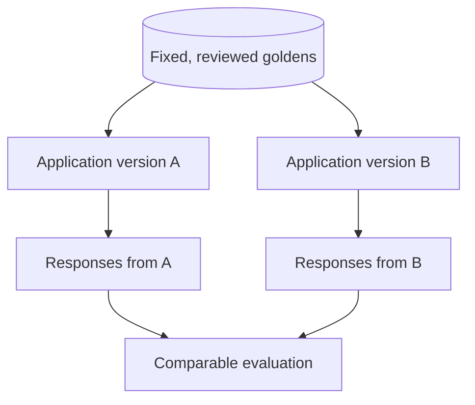

This gives us a repeatable basis for regression testing. We may **add** new cases when product capabilities or knowledge sources change, but we should version the dataset and understand when comparing old and new scores remains valid.

So a golden defines a test expectation, but it still does not tell us what happened inside the application. To obtain that information, we must actually conduct the exam.

---

## 4. Conduct the exam: input, retrieval context, actual output, expected output

When we send a golden's question through the live RAG workflow, the retriever produces passages, and the generator produces a response. These are the **observed** results, which can change between application versions. The expected answer remains our reference.

The instructor repeatedly separates four fields:

| Field | Meaning | Comes from | Stable across reruns? |
|---|---|---|---|
| `input` | User's question or instruction | Golden | Normally yes |
| `expected_output` | Reference answer / answer key | Golden | Normally yes, unless deliberately revised |
| `retrieval_context` | Text actually returned by the retriever | Running RAG application | Can change |
| `actual_output` | Answer actually generated by the app | Running RAG application | Can change |

The crucial difference is between **expected** and **actual**. Expected is the examiner's reference; actual is the student's submitted answer. The same expected answer may be compared against many observed answers over repeated experiments.

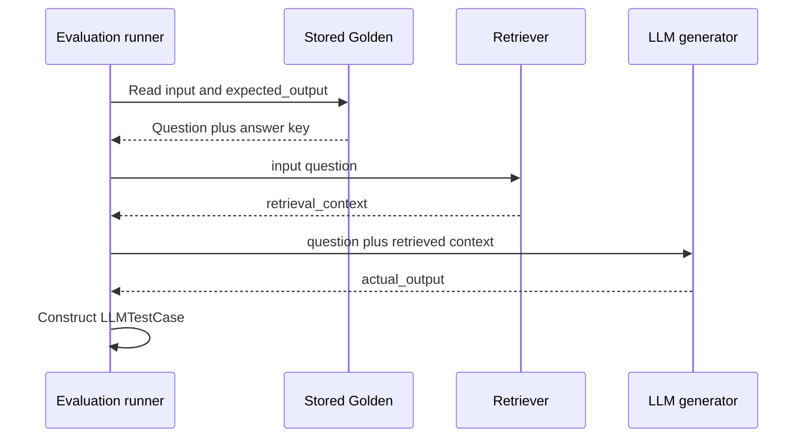

In the real Session 3 LangGraph workflow, retrieval and generation are coordinated by graph nodes; the above sequence intentionally focuses on the evaluation-visible artifacts, not on internal calls to the orchestration library.

### One complete example

**Educational illustration:** We invent an exam item about Session 3, then imagine that the chatbot retrieves the wrong text.

```json
{
  "input": "What tool orchestrated the RAG application in Session 3?",
  "expected_output": "LangGraph orchestrated the retrieval and generation workflow.",
  "retrieval_context": [
    "The application stores embedded lecture chunks in Chroma."
  ],
  "actual_output": "The workflow was orchestrated by Chroma."
}
```

The response is fluent, but incorrect. More importantly, we can see *why* the failure may have happened: the retrieved context names the vector store while failing to retrieve the relevant orchestration passage. If all we captured were `input` and `actual_output`, we could detect an answer mismatch but would lack evidence about the retrieval stage.

### A fifth distinction: source context vs retrieved context

Do not confuse the **reference source material** from which a synthetic question was created with the **retrieval context** returned when we run the RAG application. They might overlap, but they serve different roles.

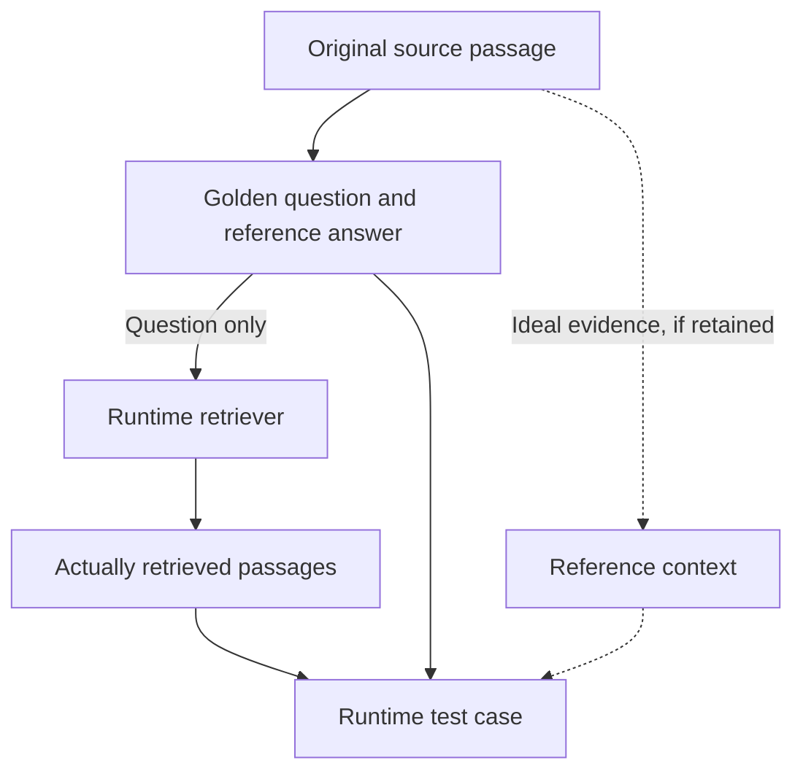

In current DeepEval terminology, `context` can represent static **ground-truth/reference context**, while `retrieval_context` represents material **actually retrieved by the application**. They are not interchangeable. This distinction becomes particularly important for retrieval recall metrics; some require reference information beyond the four simplified lecture fields. The instructor had not yet taught individual metric requirements here.

---

## 5. A golden becomes an LLM test case only after the application runs

We can now define the next object without memorizing a disconnected definition. Before the exam, we hold a question and answer key. After the exam, we have the student's answer and evidence of the internal steps. DeepEval's **`LLMTestCase`** is the concrete unit on which selected metrics will operate.

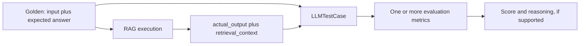

It is helpful to view a golden as a **pending test**, and an LLM test case as a **populated test run**. This distinction resolves a common confusion in spoken explanations: the golden dataset and test-case dataset are not two unrelated knowledge bases. They are related artifacts at different phases of the evaluation workflow.

The instructor calls a filled-in collection of these test cases an **evaluation dataset**, imagining a completed answer sheet. In DeepEval's current object model, `EvaluationDataset` can hold **goldens, test cases, or both**. The teaching metaphor is useful, but the exact API object is broader than an answer sheet alone.

**A second educational illustration:**

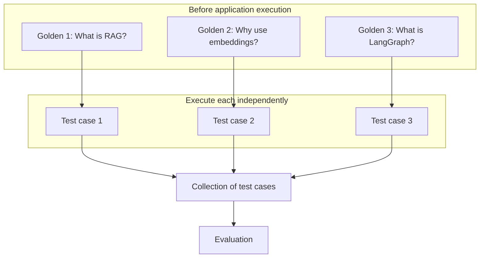

Once the artifacts are clear, we are ready to answer a different question: *what kind of interaction are we evaluating?*

---

## 6. Why the course uses single-turn, component-level evaluation

The RAG chatbot in this course has no conversational memory in the demonstrated baseline implementation. One query does not automatically depend on the prior query. That is the reason the instructor chooses **single-turn** evaluation.

A single-turn test asks one self-contained question and examines the corresponding execution. A **multi-turn** test, by contrast, must examine conversations whose later turns depend on earlier messages or tool outputs. For example, “Explain Chroma,” followed by “How did the instructor configure it?” requires a history-aware application to understand what *it* refers to.

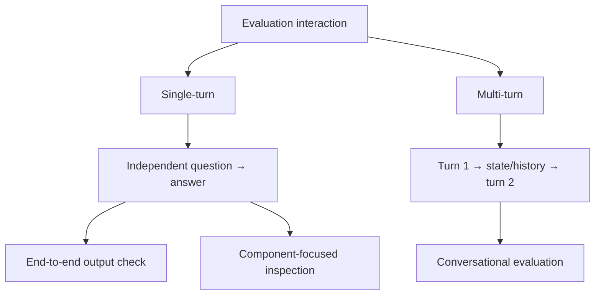

There is a second axis of classification. **End-to-end** means judging the result of the whole application. **Component-level** means examining a particular internal stage or a metric designed to target its behavior. These axes are independent: an application can be tested with single-turn *and* component-focused tests at the same time.

For our current project, the chosen test shape is:

> **Single-turn + component-level evaluation**, especially retriever quality and answer-generation quality.

> [!NOTE] Engineering clarification
> Independent questions do **not** imply that an evaluation runner must call them sequentially in one process; safe parallelism is possible. Conversely, a chatbot is not inherently multi-turn: the distinction depends on whether state and history affect subsequent behavior. The lecture's exam analogy is about logical independence, not execution concurrency.

The next challenge is harder than calling the application. We still need a strong set of questions *to feed into it*. The lecture now turns to DeepEval and the Golden Synthesizer.

---
## 7. Why DeepEval enters the picture

If we attempted to do every step manually, we would need to read the transcript collection, choose important passages, create multiple candidate questions, check their quality, rewrite them into more challenging cases, and attach expected answers. We would then need to manage those examples so the application could be tested again after each change.

The instructor introduces **DeepEval** because it provides primitives for evaluating LLM applications *and* for bootstrapping synthetic evaluation examples. In the lecture, he navigates the official documentation and explicitly uses it to teach both the concepts and the structure of the library. The aim is not to memorize a particular call signature. It is to understand what job each part of the library performs.

The major objects now have a natural division of work:

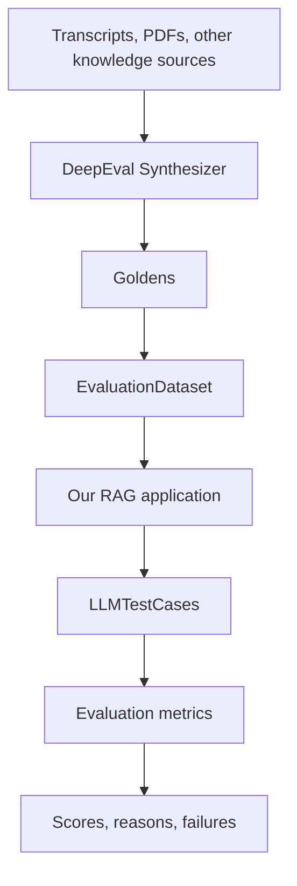

**`Synthesizer`** creates candidate golden examples. **`Golden`** represents one predefined case. **`EvaluationDataset`** organizes a collection of examples and/or observed test cases. **`LLMTestCase`** captures one actual test execution. **Metrics** judge a specific quality dimension. The application itself is not replaced by DeepEval; it is the system we are measuring.

The lecture also introduces additional capabilities of the framework—unit-testing integration through pytest, single-turn and multi-turn evaluations, customizable judge metrics such as GEval, and various agent, safety, and RAG metrics. We do not need to learn all of those before mastering synthetic data. They establish why the framework can eventually become part of the LLMOps workflow.

The instructor mentions evaluation techniques such as **GEval**, **QAG**, and **DAG-based evaluation**. They are architectural context here, not the lecture's implementation focus. Likewise, the class does not implement metrics for faithfulness, answer relevancy, contextual recall, or other dimensions during this session.

### A necessary separation between generation and evaluation

It is easy to mistake a framework that *generates questions* for a framework that has already *evaluated the chatbot*. These are distinct processes:

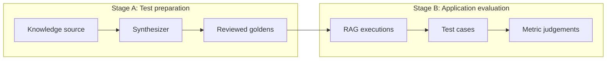

The fact that a golden was generated with an LLM does not prove that it is correct. Likewise, the fact that an evaluation metric returns a score does not prove that the original answer key was reliable. The pipeline needs quality control at *both* levels.

---

## 8. Start by thinking backwards: what output should the synthesizer produce?

The lecturer uses an interesting teaching choice. In a real document-based synthesis job, we must construct useful context first and generate goldens second. But he deliberately explains **golden generation before full context construction**, because the generator can also operate when contexts have already been provided, or in some other applications without a knowledge base.

Let's adopt that same backwards reasoning.

Assume a teacher has already highlighted ten useful topics in a textbook. Our task is to produce two sound questions per topic. We do not yet need to know *how* the topics were selected. We only need to know that some source-grounded context exists. If we understand how useful questions emerge from that context, we can later ask how to select and group contexts from thousands of documents.

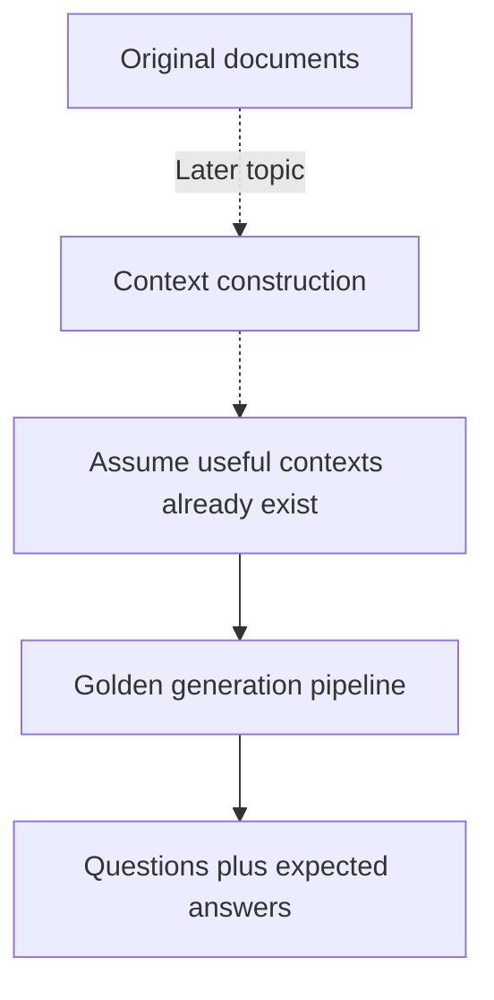

This is a pedagogical ordering, not a runtime inversion. The real pipeline remains **context construction → golden generation** for document-based RAG evaluation.

The instructor describes four major stages in golden generation:

1. **Input generation** — propose questions from a context.
2. **Filtration** — judge whether the generated questions satisfy basic quality conditions.
3. **Evolution** — rewrite accepted questions to introduce more realistic challenges.
4. **Styling** — if required, conform questions and answers to the use case's required format.

Because the lecture is specifically about the course-transcript RAG system, it focuses on the first three and describes styling as an optional capability.

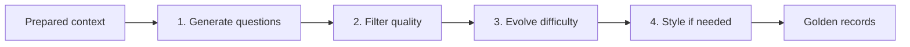

The central design insight is that the LLM does **not** simply produce the final examination in one shot. A useful synthetic dataset usually needs stages that ask different questions of the candidate material. Initial generation asks *what questions are possible?* Filtration asks *which questions are sufficiently clear?* Evolution asks *which accepted questions reveal deeper weaknesses?* Styling asks *how should the finished inputs and outputs be expressed?*

---

## 9. Input generation: why create more candidate questions than we intend to keep?

Suppose our selected context explains that document chunks are embedded into vectors and placed into a vector store. We could ask an LLM to create a single question: “What is a vector database?” Such a question might be valid, but it may be too broad for our specific passage or too simple to distinguish between good and bad application versions.

A more robust approach is to create **candidates**, then let later stages determine which ones deserve a place in the dataset. The instructor uses an example where we might need two questions from a context but initially generate more candidates than the final quota.

**Educational illustration:**

| Initial candidate | Potential issue |
|---|---|
| “What is a vector database?” | Broad but possibly too easy |
| “Why were the transcripts split before indexing?” | Relevant and specific |
| “Explain what that thing does.” | Not self-contained |
| “How do embeddings help retrieve related transcript passages?” | Relevant and clear |
| “What was the exact answer to question 7?” | No defined reference |

Generation gives us material; it does not yet give us a trustworthy exam. A good process expects some candidates to be unclear, irrelevant, insufficiently grounded, or repetitive.

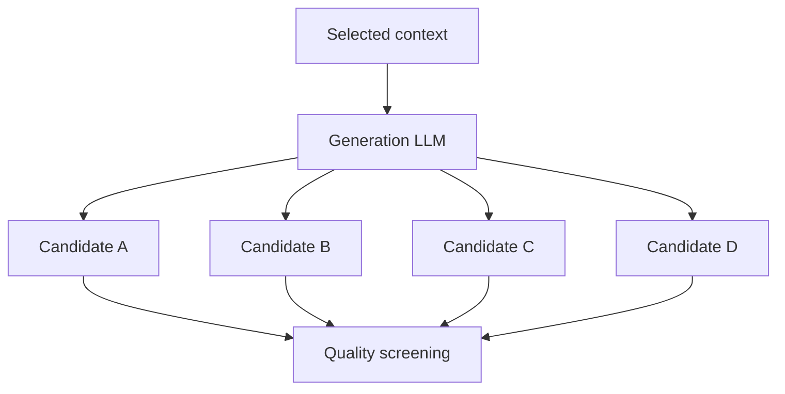

At this point, the important question is not whether the candidate looks sophisticated. It is whether it is sufficiently well-formed to be made more sophisticated later. That is precisely why filtration occurs **before** evolution.

---

## 10. Filtration: an LLM acts as a critique model

The instructor explains filtration with a sieve or mesh. Candidates are poured into the sieve; stronger examples are allowed forward; weaker examples are either regenerated or deprioritized. The image is intuitive, but to understand implementation we must replace “sieve” with the real actor: a **critique LLM**.

The critique model receives a candidate question, along with relevant context or evaluation instructions. It judges the candidate and assigns a quality score. In the DeepEval documentation discussed during class, two attributes are used for synthetic **input** quality:

**Self-containment** means the question makes sense on its own. A reader should not need an earlier conversation turn, an unspecified screenshot, or a dangling “this” reference to know what is being asked. “How does *that* differ from *the previous approach*?” is a poor single-turn question unless those terms are explicitly identified.

**Clarity** means the question's purpose is unambiguous enough for an application to attempt an appropriate response. A query like “Tell me more” is ambiguous; a question like “Why does the RAG workflow include a retrieval step before generation?” has a defined target.

These criteria are related, but they are not identical. A question can be grammatically clear about what it asks yet depend on missing context; another can be self-contained but phrased vaguely about the desired level of detail.

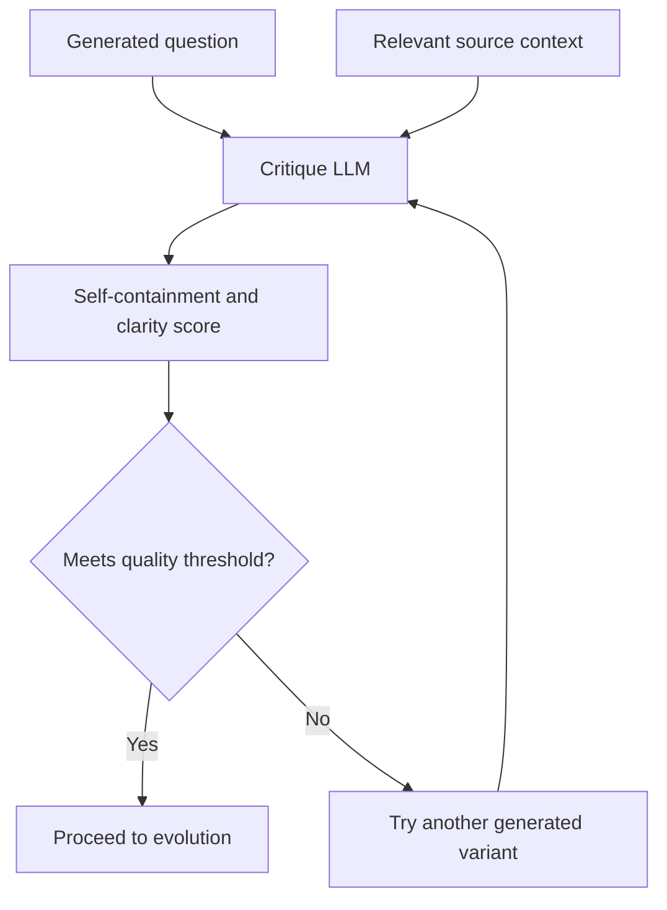

### What does a score of 0.8 mean?

The instructor uses thresholds such as 0.8 and 0.5 to show how filtering works. The number is a **quality score assigned by an evaluator**, not a statistical probability that the question is correct and not an empirical measurement of final chatbot accuracy. Passing a quality threshold does not establish that the question is fully supported by the source or that the reference answer is true.

For example, suppose the threshold is `0.8`:

| Candidate | Illustrative critique score | Decision |
|---|---:|---|
| “Explain the purpose of embeddings in our RAG pipeline.” | 0.92 | Pass |
| “How does it work?” | 0.35 | Regenerate |
| “Why did the instructor use LangGraph?” | 0.84 | Pass, then verify source grounding |
| “Tell me everything about databases.” | 0.51 | Regenerate |

These are **made-up scores** to demonstrate the mechanism. They are not DeepEval results from this lecture.

### Filtration is not a human review substitute

There is a subtle trap here. Both the generation LLM and the critique LLM can share blind spots. A critique model might consider a well-written but unsupported question perfectly clear and self-contained. It might also prefer easy questions that resemble standard textbook formulations. Therefore, filtration is useful **automatic screening**, while human verification remains an additional and different kind of quality check.

The lecture specifically says that DeepEval provides prewritten internal criteria for this filtering step. The developer can choose the judge model and parameters such as the passing threshold and the maximum number of quality retries. The instructor does not construct his own filtering prompt during the session.

---

## 11. The retry loop: what happens when no candidate clears the threshold?

This is one of the most important details in Session 5. A naïve mental model says: “A question scores below 0.8, so DeepEval throws it away.” The actual behavior explained by the instructor is more nuanced.

The synthesizer may regenerate candidates and have them scored again, up to a configured retry limit. If none reaches the required threshold, it can select the **highest-scoring attempt** anyway. That protects the generation pipeline from returning no golden simply because a strict threshold was chosen—but it also means a generated golden can have a score *below* the configured threshold.

**Educational illustration: retry trace**

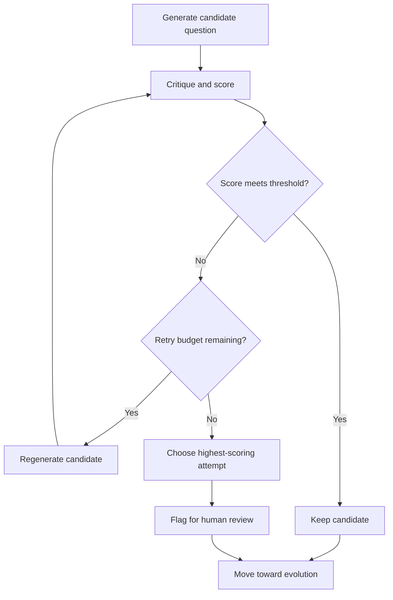

Assume the threshold is `0.80`, with these invented attempts:

| Attempt | Quality score | Interpretation |
|---|---:|---|
| First candidate | 0.40 | Below threshold |
| Regeneration 1 | 0.32 | Worse |
| Regeneration 2 | 0.62 | Better, still below threshold |
| Regeneration 3 | 0.71 | Best available, still below threshold |

The fallback may use the `0.71` candidate. That is not equivalent to passing the threshold. It is a **best-effort result**. The instructor relates this to an exam waitlist: when all the ideal candidates are unavailable, an institution may fill remaining seats from the best available list.

> [!WARNING] Engineering clarification — never interpret fallback as a quality guarantee
> The lecture's “fill all ten seats” analogy explains why the pipeline may proceed. It does not guarantee that every final golden is high-quality, nor that an application run must accept the fallback. A practical curation step should **inspect quality scores**, reject unsuitable examples, and permit a smaller final dataset. This is consistent with the instructor's separate advice: use fewer, better-reviewed goldens.

### The actual filtration configuration described

The instructor names three parameters exposed through DeepEval's `FiltrationConfig`:

| Parameter | Role | Lecture / documentation default discussed |
|---|---|---|
| `critic_model` | LLM used for the critique step | Uses the synthesizer's model or a framework default; version-sensitive |
| `synthetic_input_quality_threshold` | Minimum targeted input quality | `0.5` |
| `max_quality_retries` | Number of allowed retries for low-scoring inputs | `3` |

It matters that a **default is not the same as a recommended value for every project**. Higher thresholds may increase retries, latency, and model cost. Lower thresholds may admit ambiguous questions. Even if a high threshold produces prettier questions, it does not automatically improve topic coverage, answer quality, or the accuracy of the final evaluation.

At this stage we have potentially useful *simple questions*. Now we must decide whether simple questions are sufficient to test a real application.

---

## 12. Evolution: a good question can still be too easy

Imagine testing a student using only questions whose answers occur verbatim in a highlighted textbook sentence. The student might do well without demonstrating deeper understanding. The same issue can occur with a RAG chatbot: a simple retrieval-and-repeat question may produce excellent scores across many different chunking and retrieval configurations. Such a test can pass while more realistic questions fail.

The instructor therefore introduces **evolution**, which rewrites a generated question into a more demanding form. The goal is not to make questions arbitrarily confusing. It is to expose meaningful variation: comparisons, constraints, more concrete situations, questions spanning more than one relevant passage, and other challenges that users may genuinely pose.

**Educational illustration: one question at different levels**

| Level | Question | New demand |
|---|---|---|
| Raw | “What is RAG?” | Recall a definition |
| Evolved 1 | “Why does a transcript chatbot use RAG instead of relying only on an LLM's pretraining?” | Explain motivation |
| Evolved 2 | “Compare the responsibilities of document chunking and runtime retrieval in the transcript chatbot.” | Compare mechanisms |
| Evolved 3 | “If a transcript chatbot returns a wrong answer after a successful retrieval call, how would you distinguish a retrieval-quality issue from a generation-quality issue?” | Diagnose a multi-part scenario |

These are teaching examples, **not** the actual evolution sequence produced by DeepEval. Not every rewritten question will remain answerable from a particular source passage. That must be checked.

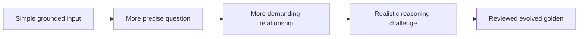

### The balance the lecturer is trying to achieve

If questions are too easy, different application versions can all score near the top, making the evaluation insensitive to meaningful changes. If questions are made *unreasonably* difficult, even a well-designed application can fail, and the evaluation can reward irrelevant sophistication rather than the actual product goal.

The instructor illustrates this with hypothetical score differences—one version achieving `0.90` versus another `0.91` on an easy dataset, with harder questions possibly making differences more apparent. The specific numbers are illustrations, not evaluation measurements.

A productive target is **discriminating difficulty**: questions that are neither so obvious that every version passes nor so contrived that the correct behavior is unclear.

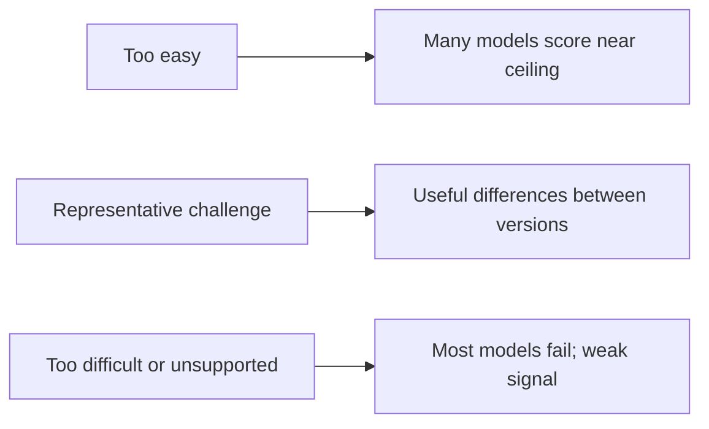

The point is not “always make questions harder.” It is “design questions that reveal whether the system meets its intended standard.” The later review process must therefore ask whether an evolved question remains relevant to the knowledge source and within scope.

---

## 13. Evolution is a sampled sequence, not seven transformations applied at once

The instructor's evolution explanation occupies a long section because the probabilities and the tree analogy can be confusing. Let's build the idea carefully.

Suppose a question has passed filtration. We want to rewrite it multiple times. At each evolution step, the synthesizer chooses a **type of transformation** from a configured set. The developer may assign different probabilities to the transformation types. The new question then becomes the input to the next iteration.

For illustration, the instructor invents three choices:

- Depth: 30%.
- Comparison: 60%.
- Breadth: 10%.

He draws a tree where one question takes one route at each level. If we set `num_evolutions = 3`, the system applies **three successive rewrites** to that question. The sampled route might be *depth → comparison → comparison*.

```mermaid
flowchart TD
    Q0[Raw question]
    Q0 -->|Sample: depth, p 0.30| Q1[Question after rewrite 1]
    Q1 -->|Sample: comparison, p 0.60| Q2[Question after rewrite 2]
    Q2 -->|Sample: comparison, p 0.60| Q3[Question after rewrite 3]
    Q3 --> OUT[One evolved question]
```

The critical word is **sample**. A weight of 60% for comparison does not guarantee that *exactly six out of ten* questions will have that transformation. It means that each relevant sample has that selection probability, subject to the implementation's actual sampling behavior. For a small dataset, realized counts can differ substantially from the expected counts.

The tree is also a **conceptual set of possible routes**; it does not mean each golden necessarily branches into every possible transformed question. In the instructor's narrative, one golden follows a *path* through successive transformations.

### Why not always choose the same transformation?

Suppose every question is evolved by simply adding extra constraints. Then we might produce a dataset full of unusually constrained inputs without testing comparisons, cross-passage reasoning, or other realistic patterns. A distribution provides some control over the kinds of challenges the evaluation will contain.

The instructor's example also illustrates why repeated transformations are possible: a question might receive the *same* category twice. An evolution strategy is not a queue where each label can appear only once.

### Seven evolution types in DeepEval

The documentation browsed in the lecture discusses seven evolution techniques. The names used by current DeepEval APIs are:

| Evolution enum | Educational interpretation | Grounding caveat |
|---|---|---|
| `REASONING` | Increase reasoning demand | May move beyond supplied evidence |
| `MULTICONTEXT` | Draw on multiple context items | Listed as context-grounded for RAG |
| `CONCRETIZING` | Make the question more concrete or specific | Listed as context-grounded for RAG |
| `CONSTRAINED` | Add relevant constraints | Listed as context-grounded for RAG |
| `COMPARATIVE` | Ask for comparisons | Listed as context-grounded for RAG |
| `HYPOTHETICAL` | Introduce a hypothetical situation | May move beyond supplied evidence |
| `IN_BREADTH` | Broaden or diversify scope | May move beyond supplied evidence |

The instructor emphasizes four for the **simple, document-grounded RAG application**: **multi-context, concretizing, constrained, and comparative**. These are the options he identifies as appropriate for keeping questions anchored to the context.

> [!NOTE] Engineering clarification — reasoning is not exclusive to agentic RAG
> The lecture informally associates reasoning-heavy evolution with more advanced agentic systems and suggests skipping it for the current straightforward RAG chatbot. This is a **course scoping decision**, not a general claim that ordinary RAG cannot answer reasoning questions. What matters for this evaluation dataset is that every expected answer be sufficiently supported by the available source material.

### How the number of evolutions changes complexity and cost

With `num_evolutions = 1`, a question is rewritten once. With a value of `3`, it passes through three rewriting steps. The instructor describes roughly **two to four** as a practical starting range and warns against mindlessly increasing the number to ten. This is useful guidance, but not a library-enforced bound or universal optimum.

Each LLM-based rewrite costs tokens, time, and potentially money. More transformations can make a question more challenging, but can also introduce unsupported facts, drift away from the target topic, or deform the expected answer. We should monitor quality after evolution rather than equate depth with trustworthiness.

---

## 14. Styling: give the golden the format the application expects

By this point, a generated question may already be clear and appropriately challenging. But some applications also require a particular language, output representation, or domain framing. This creates a separate concern: **style and format**, rather than intellectual difficulty.

The instructor uses a **text-to-SQL** application as his example. A non-technical user may ask a database question in plain English and expect the application to return a SQL query or database result. Goldens for this task should reflect the expected input and output formats, the intended user, and the actual system role.

```mermaid
flowchart LR
    Q[Grounded evolved question] --> ST[Styling guidance]
    ST --> A[Desired input language]
    ST --> B[Expected output format]
    ST --> C[Task description]
    ST --> D[Application scenario]
    A --> G[Styled golden]
    B --> G
    C --> G
    D --> G
```

DeepEval's `StylingConfig` is described through four optional settings:

| Setting | Question it answers |
|---|---|
| `input_format` | What form should the user input take? |
| `expected_output_format` | What form should a reference output take? |
| `task` | What kind of work does the application perform? |
| `scenario` | In what situation and for which users does it operate? |

For instance, a multilingual chatbot may need questions written in Hindi rather than English. A structured-output application may need an expected JSON or SQL format. Styling can help generated examples better match those constraints.

For the course-transcript chatbot, the instructor **does not plan to apply special styling**, so the focal flow is **generation → filtration → evolution**. The step is taught so readers understand the complete synthesizer, not because styling was demonstrated in the project's code.

---
## 15. We postponed the first step: where do the evaluation contexts come from?

We have followed the instructor's backwards teaching approach and explained how prepared contexts can become evolved goldens. Now we can finally ask the earlier unresolved question: **why do we need to construct evaluation contexts if the source documents already exist?**

Because a source document and a useful *question-generation context* are not automatically the same object. A large transcript contains greetings, setup instructions, side conversations, core explanations, repeat demonstrations, and closing remarks. We might want an examination with only 50 questions. Sending the entire transcript to the generation LLM as one undifferentiated prompt makes topical coverage, cost, and evidence attribution difficult to control.

The instructor explains context construction through the school analogy: a teacher first identifies meaningful topics, groups related concepts, and then generates a controlled number of questions from those groups. This gives a natural reason to separate **context construction** from **golden generation**.

```mermaid
flowchart TB
    DOC[Complete lecture materials] --> TOP[Select useful concepts]
    TOP --> GROUP[Group related passages]
    GROUP --> C1[Context group A]
    GROUP --> C2[Context group B]
    GROUP --> C3[Context group C]
    C1 --> GEN[Golden generation]
    C2 --> GEN
    C3 --> GEN
```

Imagine that our entire knowledge source discusses ingestion, embeddings, LangGraph orchestration, retrieval, generation, and evaluation. If the model creates 50 questions but 45 concern embeddings, our exam may be perfectly clear and still fail to test the product's full scope. **Selecting and grouping contexts is partly about representing the knowledge source before we generate questions.**

### Semantic grouping: the instructor's cluster illustration

During the class, the instructor draws points in a two-dimensional space and explains that similar points represent similar concepts. In real embedding systems, each chunk is represented by a vector in a higher-dimensional space; the two-dimensional picture is an analogy to help us see grouping.

**Educational illustration:**

```mermaid
flowchart LR
    A[Chunk: embeddings turn text into vectors] --> E[Group: semantic representation]
    B[Chunk: cosine similarity compares vectors] --> E
    C[Chunk: LangGraph coordinates graph nodes] --> L[Group: workflow orchestration]
    D[Chunk: graph state carries retrieved context] --> L
    E --> QA[Questions about vector-based retrieval]
    L --> QB[Questions about LangGraph execution]
```

The instructor's simple arithmetic is: five clusters and ten desired questions means planning for approximately two questions per cluster; ten clusters and thirty questions suggests three per cluster. That illustrates **coverage allocation**. It is not a guarantee that all clusters are equally important or that the framework literally maintains these exact quotas in all configurations. Some clusters may deserve more cases because they carry greater product risk.

### A short implementation preview—distinct from what was completed in the class

The detailed context-construction implementation was **deferred**, so the following is an **extra documentation-verified preview**, not a record of executed Session 5 code. In DeepEval's documented `generate_goldens_from_docs()` path, context preparation can include:

1. Parsing the supplied documents into chunks and embedding them.
2. Selecting candidate chunks and judging their context quality.
3. Grouping semantically similar chunks into usable contexts.
4. Feeding those contexts into the golden-generation pipeline we have already studied.

```mermaid
flowchart LR
    D[Documents] --> P[Parse into chunks]
    P --> EMB[Embed chunks]
    EMB --> SEL[Select and check chunks]
    SEL --> SIM[Group semantically similar chunks]
    SIM --> CONTEXT[Prepared contexts]
    CONTEXT --> SYN[Generate, filter, evolve goldens]
```

The documentation separately identifies context-quality considerations such as clarity, depth, structure, and relevance. These are **context selection** criteria and must not be confused with the **synthetic input** criteria of self-containment and clarity from Section 10. DeepEval also describes context similarity thresholds and retry behavior. These are details the instructor planned to revisit, not details we should falsely present as a live walkthrough from Session 5.

> [!NOTE] One subtle but important difference
> Context grouping need not mean running a general-purpose clustering algorithm over every possible point in the source collection. The documented implementation can select seed chunks and group them with sufficiently similar chunks. The teacher's visual clusters are a conceptual model; the precise algorithm is governed by the DeepEval version and its context-construction configuration.

We can now put the *actual execution order* back together.

---

## 16. The complete synthesis architecture: two pipelines, one purpose

At the highest level, synthetic golden generation from documents is a two-stage process. The first stage builds useful contexts. The second converts each context into test questions and, optionally, reference answers. The instructor describes both but goes much deeper into the **second stage** during this lecture.

```mermaid
flowchart TB
    subgraph PH1[Context construction — full details deferred]
        A[Raw documents] --> B[Parse and select chunks]
        B --> C[Build grouped contexts]
    end
    subgraph PH2[Golden synthesis — primary Session 5 focus]
        C --> D[Generate question candidates]
        D --> E[Critique and filter]
        E --> F[Apply sampled evolutions]
        F --> H[Optional styling]
        H --> I[Input and expected output]
    end
    I --> REV[Human source-grounding and quality review]
    REV --> GOLD[(Versioned golden dataset)]
```

This picture also resolves a question the instructor repeatedly asks: **Why not simply tell the model to create fifty questions from the entire knowledge base?** Because the direct approach reduces our control over what it samples, whether it understands the task, which examples it repeats, how difficult the questions become, and whether the question distribution resembles meaningful product behavior.

No individual component guarantees quality on its own. Context construction influences **coverage**; filtering influences **well-formedness**; evolution influences **challenge**; styling influences **format**; and human review influences **trust**. They solve different problems.

| Pipeline stage | Primary question answered | Problem if omitted |
|---|---|---|
| Context construction | Which source material should be used? | Unbalanced or poor source coverage |
| Input generation | Which questions could we ask? | No candidate cases |
| Filtration | Are the questions sufficiently clear and independent? | Ambiguous or unusable inputs |
| Evolution | Do questions challenge meaningful behavior? | Overly trivial tests |
| Optional styling | Do inputs/outputs fit the use case? | Wrong language or format |
| Human curation | Are these genuinely correct and useful? | Misleading goldens enter the benchmark |

Once we have good goldens, we should stop regenerating the exam before every application change. Instead, we save them. This is where the synthesis process becomes part of a proper LLMOps iteration loop.

---

## 17. End-to-end worked example: one golden, two RAG versions

Let's now trace one complete scenario using the lecture's course chatbot. Everything in this section is an **educational simulation** created to make the already-established concepts concrete; no scores or outputs here are claims from the live class.

### Step A — Select reliable source evidence

Assume a cleaned transcript passage explains that Chroma stores searchable embeddings, while LangGraph coordinates a stateful workflow containing retrieval and generation nodes. This is our **reference evidence**. A human reviewer checks that the transcript actually supports both facts.

### Step B — Generate and refine a question

An initial generated candidate could be: “Which tool was used?” The filtering stage flags poor self-containment. A regenerated candidate is: “Which component orchestrated the transcript RAG application?” That is unambiguous, but simple. An evolved version might ask: “How do the responsibilities of Chroma and LangGraph differ in the course's RAG implementation?”

The expected answer now needs to mention *both* roles, not just the original single answer. This is why evolved questions must undergo renewed answer-key verification: a rewrite can introduce a new information requirement.

### Step C — Store a reviewed golden

```json
{
  "id": "lecture-architecture-comparison-01",
  "input": "How do the responsibilities of Chroma and LangGraph differ in the course RAG implementation?",
  "expected_output": "Chroma is used to store and retrieve embedded lecture chunks, whereas LangGraph coordinates the retrieval-and-generation workflow.",
  "source": "Verified course transcript passage",
  "difficulty": "comparison"
}
```

The fields `id`, `source`, and `difficulty` above illustrate *useful dataset metadata*; do not assume these are the exact mandatory constructor attributes for the DeepEval `Golden` object.

### Step D — Run the same question against two versions

Version A is our baseline, and Version B is a changed configuration. The exact configurations do not matter for this lesson; what matters is that the **test question stays constant**.

| Run | Retrieved material | Actual answer | Possible diagnosis |
|---|---|---|---|
| A | Passage about Chroma only | “Chroma orchestrates the workflow.” | Missing LangGraph evidence; answer inaccurate |
| B | Passages describing both tools | “Chroma indexes/retrieves; LangGraph orchestrates the graph.” | Both evidence and response look better |

A score or judgement can now be interpreted alongside the observed artifacts. If Version B performs better, we can ask whether retrieval changed, generation changed, or both. This is more useful than simply declaring that one chatbot “felt better.”

```mermaid
sequenceDiagram
    participant T as Test runner
    participant G as Fixed golden
    participant A as RAG version A
    participant B as RAG version B
    participant J as Selected evaluation metrics
    T->>G: Read same question and expected answer
    G-->>T: Golden data
    T->>A: Ask question
    A-->>T: Context A and answer A
    T->>B: Ask same question
    B-->>T: Context B and answer B
    T->>J: Two populated test cases
    J-->>T: Compare scores, reasons, failures
```

### Step E — Separate the two levels of judgement

Even if the question itself passed synthesizer filtering, the final application response may fail evaluation. In fact, these are **different questions asked by different judges at different times**:

| Time | Judge examines | Decision |
|---|---|---|
| During synthesis | Candidate question | Is it clear and self-contained enough to keep? |
| During curation | Golden + verified source | Is the answer key actually correct and relevant? |
| During evaluation | RAG response + captured evidence | Did the application perform well according to the chosen metric? |

This separation explains why a single use of the phrase **LLM-as-a-judge** does not represent one universal scoring process. The critique used during golden synthesis is not necessarily the same as the metric judge used to evaluate the application.

---

## 18. Implementation preview: DeepEval API objects in Python

> [!WARNING] Supplement, not Session 5 live execution
> The instructor **deferred the implementation**. The following examples are deliberately **small and explanatory**. They follow the public documentation for DeepEval's current v4-era API but **were not executed here**, do not access an OpenAI account, and have not been integrated into the instructor's Session 3 code. Confirm the installed library version before using these in a real project.

### A. A minimal synthesizer example

Once our lecture transcripts have been cleaned into supported document formats such as `.txt` or `.md`, the concept is straightforward:

```python
from deepeval.synthesizer import Synthesizer

synthesizer = Synthesizer()

goldens = synthesizer.generate_goldens_from_docs(
    document_paths=["data/cleaned/session_3.txt"],
    include_expected_output=True,
)

for golden in goldens:
    print("QUESTION:", golden.input)
    print("ANSWER KEY:", golden.expected_output)
    print("---")
```

A `.vtt` subtitle file should not simply be assumed to work with this API. The documented file types include text, Markdown, PDF, and Word formats. The cleaning stage established in Session 3 remains relevant.

The role of each part is now easy to understand: `Synthesizer` controls creation; `generate_goldens_from_docs()` performs document-based generation; `include_expected_output=True` requests a reference answer, and `goldens` contains the generated examples. The created examples still need inspection.

### B. Configure the critique threshold and evolution distribution

This version makes the lecture's two most important configuration ideas explicit:

```python
from deepeval.synthesizer import Synthesizer, Evolution
from deepeval.synthesizer.config import FiltrationConfig, EvolutionConfig

filtration = FiltrationConfig(
    synthetic_input_quality_threshold=0.80,
    max_quality_retries=3,
)

evolution = EvolutionConfig(
    evolutions={
        Evolution.MULTICONTEXT: 0.25,
        Evolution.CONCRETIZING: 0.25,
        Evolution.CONSTRAINED: 0.25,
        Evolution.COMPARATIVE: 0.25,
    },
    num_evolutions=2,
)

synthesizer = Synthesizer(
    filtration_config=filtration,
    evolution_config=evolution,
)

goldens = synthesizer.generate_goldens_from_docs(
    document_paths=["data/cleaned/session_3.txt"],
    include_expected_output=True,
)
```

**What has changed?** We told the critique stage what score to target and how many retries to permit. We also told the evolution stage that four transformations should have equal sampling weights and that each input should go through two evolution rewrites.

We have **not** told DeepEval to create exactly 25% of the final dataset in each category, nor have we proved that all evolved expected answers are correct. Those require inspection and appropriate acceptance criteria.

### C. Save the generated material and curate it

```python
# Save a snapshot of synthesized examples for human inspection.
synthesizer.save_as(
    file_type="json",
    directory="./data/goldens",
    file_name="session3_candidates_v1",
)
```

Saving is not the same as approving. An engineering workflow can mark these as **candidates**, have a reviewer approve or reject each example, and then store a separate stable **reviewed dataset** for regression testing. This distinction protects the integrity of comparisons over time.

### D. Construct a single-turn test case from real runtime artifacts

Here is the relationship from Section 4 expressed directly as code. Assume `run_course_rag()` is a function *you implement in your actual application* that returns an answer and the retrieved chunks. That function is intentionally only a placeholder in this example.

```python
from deepeval.dataset import EvaluationDataset
from deepeval.test_case import LLMTestCase

# Assume goldens have already been reviewed and loaded.
dataset = EvaluationDataset(goldens=goldens)

for golden in dataset.goldens:
    # Application-specific function, not supplied by DeepEval:
    answer, retrieved_chunks = run_course_rag(golden.input)

    dataset.add_test_case(
        LLMTestCase(
            input=golden.input,
            expected_output=golden.expected_output,
            actual_output=answer,
            retrieval_context=retrieved_chunks,
        )
    )

# dataset.test_cases now reflects observed runs of your application.
```

**Why is `run_course_rag()` deliberately not filled in?** Session 3's exact project interfaces are not part of this transcript, and Session 5 does not show a successful integrated implementation. Inventing a Graph API or return shape and presenting it as recorded lecture code would be misleading. The example preserves the contract we actually need: *ask the question, capture retrieved passages, capture the answer*.

### E. Where metrics would enter—without claiming they were taught today

As a preview of the next learning milestone, a subsequent session can choose metrics and evaluate the populated cases. For example, current DeepEval documentation shows a pattern resembling:

```python
from deepeval import evaluate
from deepeval.metrics import AnswerRelevancyMetric, FaithfulnessMetric

results = evaluate(
    test_cases=dataset.test_cases,
    metrics=[
        AnswerRelevancyMetric(),
        FaithfulnessMetric(),
    ],
)
```

This is an **extra integration preview**, not a description of what Session 5 executed. Each metric has its own field requirements and limitations. For example, a retrieval recall assessment may need explicit reference `context`, not merely the generated answer. The course has not yet formally unpacked those metrics in this class.

### A practical visual summary of the code's object lifecycle

```mermaid
flowchart TB
    FILE[Cleaned session transcript file] --> S[Synthesizer]
    S --> RAW[Generated golden candidates]
    RAW --> REVIEW[Human approval]
    REVIEW --> DS[Saved reviewed goldens]
    DS --> EXE[run_course_rag per input]
    EXE --> CASE[LLMTestCase: actual output and retrieved context]
    CASE --> EV[evaluate with selected metrics]
    EV --> RES[Inspect results and compare versions]
```

---

## 19. Designing a small but useful golden dataset for our course chatbot

The instructor asks for a small, high-quality starting dataset. To make that advice operational, we need a definition of **coverage**. A synthetic generator can create many plausible questions but still omit the features or failure modes that determine whether users trust the product.

For our educational chatbot, a useful coverage grid might include *both topic* and *question behavior*. This is an **extra design example**, not a grid shown in the lecture.

| Topic | Simple explanation | Comparison | Multi-passage | Failure reasoning |
|---|---|---|---|---|
| Document ingestion | Cleaning transcripts | Cleaner vs splitter | Connect cleaning to retrieval | Bad transcript formatting |
| Embeddings and indexing | Semantic vectors | Keyword vs vector search | Chunking + embeddings | Missing relevant chunk |
| LangGraph runtime | Graph state and nodes | Retriever vs generator | State across nodes | Missing context in prompt |
| Evaluation | Golden vs test case | End-to-end vs component | Retrieval + generation metrics | Fluent but wrong answer |

There is no requirement to fill every cell equally. What matters is that reviewers can look at the table and ask, “What important capability have we not examined?” A handful of well-chosen cases can form a useful smoke suite, while a broader regression suite can evolve as actual failure reports become available.

```mermaid
flowchart LR
    TOPICS[Key source topics] --> MATRIX[Coverage matrix]
    TASKS[Realistic query behaviors] --> MATRIX
    MATRIX --> GENERATE[Synthesize candidate goldens]
    GENERATE --> REVIEW[Review coverage and correctness]
    REVIEW --> SUITE[Versioned regression suite]
```

### Golden review: what should a human actually inspect?

A reviewer should not merely answer, “Does this question look intelligent?” They should check whether it is **relevant, answerable, supported, discriminating, and suitable for the product**. For example, a complex question might be beautifully written but require knowledge never present in the indexed lecture source. Such a question would evaluate a different capability from the one we intended.

A lightweight review procedure could ask:

- Is the question understandable without prior chat history?
- Is its expected answer supported by a specific source passage?
- Is the answer key accurate and appropriately complete?
- Does the question test a meaningful product capability, not merely trivia?
- Is the question a near duplicate of an existing golden?
- Is its difficulty realistic rather than artificially convoluted?
- Does the collection cover meaningful failure modes and topics?

**Engineering clarification:** Source-grounded generation reduces the chance of unsupported content; it does **not** eliminate hallucinations. The instructor acknowledges that hallucinations cannot be eliminated completely, despite sometimes using optimistic language when discussing context-based generation. It is therefore the combination of automatic screening, provenance, and review—not the mere presence of source documents—that earns trust in the golden.

---
## 20. Failure scenarios that make synthetic evaluation misleading

At this point, we understand every major stage, but we have not yet examined how a well-intentioned process can fail. This is especially important because evaluation errors can be more dangerous than ordinary application errors: a faulty benchmark may persuade us to ship a weaker system.

### Failure A — the candidate is clear but its answer is wrong

A generator proposes a polished question and confidently writes a plausible reference answer. The critique LLM scores the input highly for self-containment and clarity. The golden passes those tests—but its answer key contradicts the source. When the chatbot gives the correct answer, the benchmark may falsely mark it down.

**Resolution:** Verify the **expected output** against specific reference material; do not assume an input-quality critic has checked factual correctness.

### Failure B — the evolution changes what the source can support

A simple question asks what Chroma does. The evolution process rewrites it into a comparison that references a different vector database never discussed in the transcript. That may be a valid general research question but not a source-grounded question for this course chatbot.

**Resolution:** Check source support **after evolution**, not just before. If evidence is absent, discard the example, rewrite it, or deliberately move it to a different evaluation category.

### Failure C — the dataset is clear and correct but biased toward one topic

Suppose 40 of 50 goldens are about embeddings because that source chapter contained more repetitive definitions. The benchmark reports good aggregate scores even though LangGraph orchestration and failure reasoning are poorly tested.

**Resolution:** Review topic and difficulty coverage as a dataset-level concern. Per-question quality does not guarantee representative sampling.

### Failure D — increasing difficulty makes the benchmark irrelevant

Repeated evolution creates lengthy artificial prompts full of constraints never seen in real student interactions. A new application version gains a higher score on these questions while answering ordinary user requests worse.

**Resolution:** Use actual product requirements and, when available, reviewed production examples to calibrate difficulty. Hardness is useful only when it represents an intended capability.

### Failure E — below-threshold fallback gets mistaken for approval

A critique model never finds a candidate above the threshold but the framework returns the best available attempt. A team treats the existence of an output as proof that the golden was validated.

**Resolution:** Distinguish **generation completion** from **review acceptance**; inspect scores and metadata and refuse weak cases.

### Failure F — the dataset changes between experiments

Version A is scored against 30 questions, while Version B is scored against newly synthesized questions. The score comparison seems quantitative but may conflate model quality with changes in the test distribution.

**Resolution:** Keep a reviewed benchmark version fixed for each comparison and record when the suite changes.

```mermaid
flowchart TB
    BAD[Unexpected or suspicious evaluation result] --> Q{Where might the problem be?}
    Q --> K[Golden incorrect or unsupported]
    Q --> C[Dataset lacks coverage]
    Q --> R[Retriever supplied poor evidence]
    Q --> G[Generator produced poor answer]
    Q --> M[Metric or judge unreliable]
    K --> FIX[Inspect source and reference answer]
    C --> FIX2[Inspect coverage grid]
    R --> FIX3[Inspect retrieved chunks]
    G --> FIX4[Inspect prompt and actual response]
    M --> FIX5[Inspect scoring criteria and calibration]
```

Notice how the completed mental model lets us diagnose more than “the score is low.” We can ask whether the test itself was valid, whether the application failed, or whether the chosen metric was inappropriate.

---

## 21. How the golden dataset fits into an iterative LLMOps workflow

Why has the instructor spent an entire class on question generation instead of rushing into the metrics? Because once we have a reusable dataset, it becomes a shared standard for every later change: chunk size, chunk overlap, embeddings, vector store settings, retriever strategy, prompt, or model configuration.

The application and the goldens follow **different lifecycles**. Application versions are expected to change rapidly. The reviewed golden suite changes when the product's requirements, knowledge, or known failure modes require it—not merely because a new model experiment is being run.

```mermaid
flowchart LR
    G[(Reviewed golden suite v1)] --> A[Experiment: baseline]
    G --> B[Experiment: changed chunking]
    G --> C[Experiment: changed prompt]
    A --> E[Evaluation results]
    B --> E
    C --> E
    E --> D{Regression or improvement?}
    D -->|Inspect| X[Diagnose retrieval and generation]
    X --> NEXT[Next application experiment]
    NEXT --> E
```

A productive experiment report would preserve the golden suite identifier, application version, source corpus version, model configuration, retrieval settings, date, chosen metric definitions, per-test results, and whether the reference answer was human-approved. Those details are **extra operational guidance** beyond the class, but they follow logically from the repeatability problem the instructor introduces.

> [!TIP] A useful separation of artifacts
> Maintain **candidate goldens**, **approved goldens**, and **runtime test results** as distinct records. The first are proposals from synthesis. The second represent reviewed expectations. The third represent the application behavior observed during a particular experiment. Mixing these stages makes regressions difficult to explain.

If we update the underlying transcript collection—adding a new lesson or correcting a source—some old goldens may no longer represent the current knowledge. That is a legitimate reason to refresh or revalidate the reference suite. If we merely tune chunk size, we should normally run against the existing suite to preserve comparability.

---

## 22. Final mental model: from an unlabelled document to a measurable experiment

Let's reconstruct the whole lesson without treating each concept as a separate vocabulary item.

At first, all we had was an application and its documents. We could ask the RAG chatbot questions, but we could not consistently tell whether the retrieved evidence was good or whether one application configuration was better than another. We therefore needed an **evaluation dataset**. The instructor reviewed three sources of such a dataset: manual curation, historical interactions, and synthetic generation. Synthetic generation was the practical bootstrap for the current project, not a substitute for review.

The first durable artifact is a **golden**: a question, often with a verified expected answer. It is created **before** running the application and is meant to be reusable. When we execute that question, the RAG system yields an **actual answer** and a **retrieved context**. These observations can be combined into an **LLM test case**. Metrics then assess particular aspects of performance. Because the baseline chatbot is stateless and the instructor wants to diagnose its retrieval and generation behavior, the planned evaluation is **single-turn and component-focused**.

But constructing goldens is itself a quality-sensitive process. With DeepEval, we first need useful **contexts** selected from source documents. The golden-generation pipeline then **proposes questions**, **filters for clarity and self-containment**, **evolves the surviving candidates into more realistic challenges**, and **styles them if needed**. The lecturer particularly emphasizes the critic model, retry loop, and sampled evolution tree. The final candidates still require source verification and human quality review.

Only after those steps do we have a sensible, versioned exam to give the application. Then we can compare configurations, investigate failures, and decide what to improve.

```mermaid
flowchart TB
    KB[Knowledge documents] --> CC[Construct useful contexts]
    CC --> S[Generate candidate questions]
    S --> F[Critique, filter and retry]
    F --> EV[Evolve sampled difficulty]
    EV --> ST[Optional styling]
    ST --> V[Human validation]
    V --> GD[(Fixed golden suite)]
    GD --> R[Run each question through RAG]
    R --> CT[Record actual output and retrieval context]
    CT --> TC[Build LLM test cases]
    TC --> J[Apply selected evaluation metrics]
    J --> COMP[Inspect results and compare versions]
    COMP --> CHG[Change application configuration]
    CHG --> R
```

The most useful single sentence to retain is this:

**The synthesizer builds and refines questions that define what success should look like; the RAG application produces what actually happened; the evaluator compares that observed behavior against explicit quality criteria.**

---

## 23. Understanding checks: can you reason through the workflow?

These are not memorization questions. Try explaining each out loud using the examples and diagrams from this chapter.

1. **Why isn't a course transcript already an evaluation dataset?** Explain the missing representation and why an expected answer must be reliable.
2. **Why is a golden not the same as an `LLMTestCase`?** Identify what data exists before execution and what can only be observed after the chatbot runs.
3. **What is the difference between `context` and `retrieval_context`?** Describe a scenario where the two contain different passages, and explain why the distinction helps diagnose retrieval.
4. **Why do we filter before evolving a question?** What would happen if we invested many LLM calls evolving poor, ambiguous questions?
5. **A candidate scored 0.73 while the threshold is 0.80. After all retries, DeepEval returned it. Is that a bug?** Explain the fallback behavior and how your curation workflow should treat the result.
6. **You configure comparison evolution with probability 0.60. Will exactly 60 of 100 outputs use comparison?** Explain the difference between a sample probability and a fixed quota.
7. **How could increasing `num_evolutions` from two to six make evaluation worse?** Discuss realism, hallucination, reference-answer drift, cost, and over-difficulty.
8. **Why shouldn't we regenerate a new synthetic dataset every time we change chunk size?** What would we lose in the comparison?
9. **The chatbot answers incorrectly, but the retrieved passage is correct. What should you inspect next?** Contrast this with a case where the retrieved passage itself is wrong.
10. **Why is a clear, self-contained question not automatically a trustworthy golden?** Identify the quality dimensions not fully checked by the synthesizer's input filter.

If you can answer these questions coherently, you have the mental framework needed for the next session's implementation and metrics, rather than merely the names of DeepEval classes.

---

## 24. Session-specific boundaries and next lesson

The instructor closes the session by acknowledging that the content was conceptual and sometimes demanding. He suggests that understanding the reasons for filtration and evolution is more useful than memorizing exact code that may be changed or deprecated in future framework versions. A discussion follows about teaching implementation alongside concepts, and he plans to revisit the context-building portion before continuing.

**Covered substantially during Session 5:** the need for evaluation datasets, manual/historical/synthetic data sources, source grounding, golden-versus-test-case terminology, single-turn versus multi-turn, component-wise evaluation, DeepEval's role, input generation, filtration and critique, quality thresholds and retries, evolution distributions and depth, appropriate RAG evolution types, and optional styling.

**Introduced but not completed:** the real context-construction implementation, generating and saving the course's goldens through a live code run, connecting the synthesized dataset to the project's RAG code, and applying/understanding specific evaluation metrics. The instructor explicitly moves these topics to a later lesson, despite initially announcing they would be implemented today. He also briefly discusses Excel/CSV ingestion and text-to-SQL during audience questions; those are tangential rather than central Session 5 learning objectives.

The last few minutes advertise a separate Pinecone masterclass. That is not the main focus of this chapter; no Pinecone implementation is demonstrated within Session 5.

### Timeline reference to the original recording

| Approximate time | Main teaching focus |
|---|---|
| 00:00–10:00 | Recap of Session 4 and why synthetic datasets are needed |
| 10:00–39:00 | Golden, test case, actual/expected output, retrieved context, single-turn evaluation |
| 39:00–50:00 | DeepEval documentation orientation and major capabilities |
| 50:00–63:00 | Human review, dataset-quality principles, synthetic generation choices |
| 63:00–80:00 | Golden synthesizer mental model; why contexts and groups matter |
| 80:00–90:00 | Four synthesis steps and why evolution is needed |
| 90:00–110:00 | Filtration criteria, critique model, thresholds, retries, and fallback |
| 110:00–125:00 | Evolution tree, distributions, evolution depth, RAG-grounded techniques |
| 125:00–130:00 | Optional styling and text-to-SQL illustration |
| 130:00–141:00 | Closing questions, deferred implementation, future class announcement |

---

## 25. Documentation references and terminology notes

The **VTT transcript is the primary source** for this chapter's session boundaries, instructor claims, examples, and curriculum. Additional framework-level information and the optional code examples were checked against the following public documentation. The documentation may have changed since the lecture; installation-time behavior must always be verified against the installed DeepEval version.

- [DeepEval — Golden Synthesizer](https://deepeval.com/docs/golden-synthesizer) — synthesis stages, filtration, evolution, styling, supported methods.
- [DeepEval — Generate Goldens from Documents](https://deepeval.com/docs/synthesizer-generate-from-docs) — context construction, document support, context selection/grouping.
- [DeepEval — Datasets](https://deepeval.com/docs/evaluation-datasets) — goldens, `EvaluationDataset`, populated test cases, evaluation workflow.
- [DeepEval — Frequently Asked Questions](https://deepeval.com/docs/faq) — distinction between reference `context` and runtime `retrieval_context`.
- [DeepEval — Introduction to Evaluation](https://deepeval.com/docs/evaluation-introduction) — `evaluate`, `LLMTestCase`, and metric integration.

The supplied transcript contains speech-to-text variations such as **“DPVal,” “Deep Evaluation,” “LLME walls,” “Rack,” “NCRT,” “matrix,” and “breathwise.”** Where the intended terms are clear, this chapter normalizes them to **DeepEval, LLM evals, RAG, NCERT, metrics, and breadth/in-breadth evolution**. The normalization is editorial; it does not imply that the instructor used precise API spellings in every sentence.

> **The next learning milestone:** Take a small group of cleaned course transcripts, construct contexts, generate and review a reusable golden set, then capture real runtime retrievals and outputs. Only after those artifacts are sound should we implement and compare specific RAG evaluation metrics.
