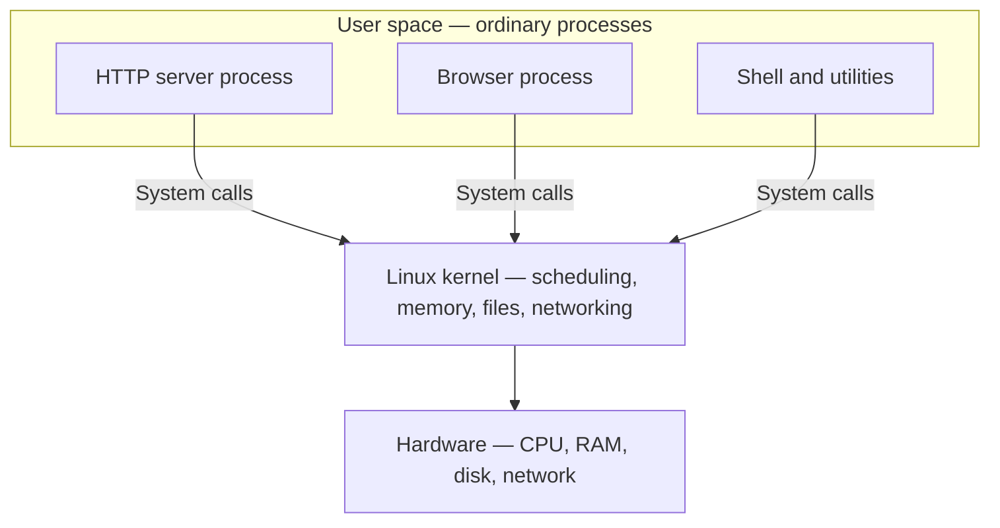
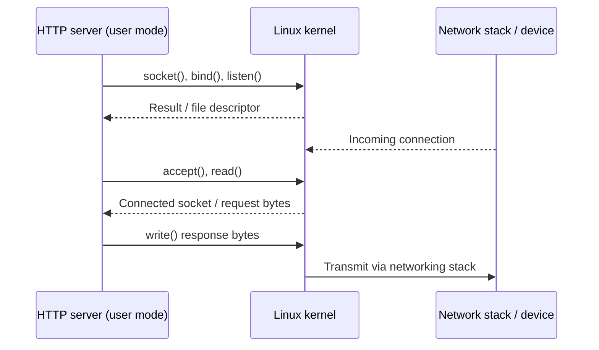
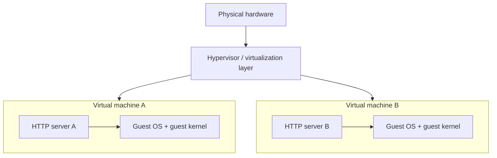
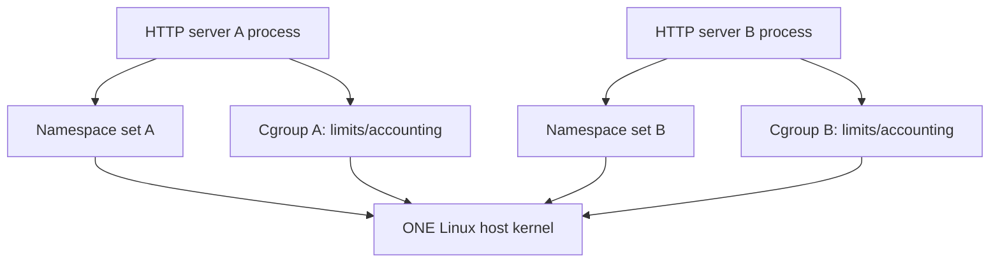
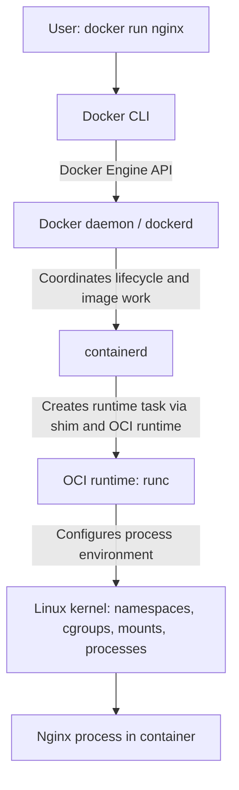

# CKA Day 0 — From a Running Program to a Linux Container

> **Purpose:** Build the operating-system mental model that makes Docker and Kubernetes understandable. This chapter is a prerequisite to Day 1 (why Docker exists) and Day 2 (building and running images). It deliberately avoids kernel programming and detailed scheduler or memory-management algorithms.

## The question we will answer

Imagine you write a tiny HTTP server and execute it on your laptop. It starts listening on port 8080 and returns `Hello` when a browser connects.

It seems as though *your program* is doing everything: using the processor, remembering data, accepting connections, and reading files. But your program cannot safely decide which physical memory belongs to it, command the network card directly, or monopolize the CPU. Other programs are running too. Something must coordinate their access to the machine.

We will follow this one HTTP server all the way from **program → process → kernel services → isolated process → Docker container**. At every stage, we will keep the previous picture and add only the next necessary piece.

By the end, you should be able to explain, without memorizing a slogan, why containers share a kernel, what a system call is, what namespaces and cgroups change, and what Docker Engine does versus what Linux itself does.

---

## 1. Start with the hardware: who gets to use it?

A computer has a **CPU**, which executes instructions; **RAM**, which holds working instructions and data; **storage**, which retains files; and **network devices**, which send and receive data. Your HTTP server needs all four: instructions run on the CPU, variables live in memory, program files come from storage, and incoming requests arrive through the network.

Now start a browser alongside it. Both programs need memory and CPU time. If either application could freely read the other's memory, overwrite disk blocks, or control a network interface, the machine would be unreliable and insecure. The first problem we have to solve is **coordination and protection**.

That is the job of an **operating system (OS)**. On a typical Linux machine, it provides an environment in which many programs can run while the system coordinates resources and enforces boundaries. The OS also includes user-facing utilities and services. The part most directly responsible for protected resource management is the **kernel**.

**What we have learned:** Applications need resources; a shared machine needs an authority to coordinate them. **Next question:** What is the kernel, and why can't an ordinary application simply take over its responsibilities?

## 2. Kernel and user space: separating authority from application code

The **Linux kernel** is the privileged core of Linux. Among its jobs are scheduling runnable tasks, managing memory, handling filesystems, implementing networking, and enforcing permissions. The kernel is not the entire operating system: shells, command-line utilities, libraries, services, and many other programs run outside it.

Your HTTP server normally executes in **user mode**, with restricted privileges. Kernel code executes in **kernel mode**, where it can perform privileged operations. This separation is a CPU-enforced protection boundary, not simply two folders on disk. The words **user space** and **kernel space** describe the software environments associated with these modes and their memory protection model.



The arrow does **not** mean an application continuously runs *through* the kernel as though it were a proxy. Much application code executes in user mode without entering the kernel. When it needs an OS-managed service, however, it uses a controlled entry into the kernel.

**What we have learned:** The kernel owns privileged mechanisms; applications run with restrictions. **Next question:** What exactly is our HTTP server when we launch it?

## 3. A program becomes a process

A **program** is code and related data stored in a file or set of files. A **process** is an executing instance of a program with operating-system-managed state. Running the same executable twice can create two different processes.

Suppose our server is a compiled executable named `hello-server`:

```bash
./hello-server
```

The shell requests the creation/execution of the program using OS facilities. Linux sets up an execution context: among other things, the process has an identifier (**PID**), its own **virtual address space**, open-file information, credentials, and one or more threads of execution. The precise creation sequence depends on how the program is launched; on Linux, `fork`/`clone`-family operations and `execve` are important mechanisms, but we do not need to memorize their internals today.

### Why is virtual memory relevant?

Our server might refer to memory address `0x...` in its code. That does not mean it owns the corresponding physical RAM location directly. Processes normally operate through **virtual addresses**, and the OS/hardware cooperate to map them to permitted physical memory. This gives each process a controlled view of memory and helps prevent accidental access to another process's private memory.

Do not confuse this with a container: **ordinary Linux processes already benefit from process-level memory protection**, even when they are not containerized.

### How can multiple processes run on one CPU?

The kernel **scheduler** decides which runnable thread receives CPU time. On a machine with fewer CPU cores than runnable threads, execution is interleaved. On multicore machines, different threads can run at the same time. We need this general idea for understanding resource limits later, not a detailed scheduling algorithm.

### What about threads?

A process can contain multiple **threads**, which share much of the process's address space and resources while having independent execution state. For now, treat a thread as a schedulable execution path within a process. A container may have multiple processes and threads; it is not limited to one Linux task.

Try observing ordinary processes:

```bash
ps -ef | head
ps -p 1 -o pid,ppid,comm,args
```

`PID 1` is significant on a Linux system, and later we will see a different-looking `PID 1` *inside a PID namespace*. That is not a second physical kernel.

**What we have learned:** Our program becomes one or more scheduled execution paths in a process with OS-managed identity and memory. **Next question:** How does it open a file or listen on a network port if it cannot operate hardware directly?

## 4. System calls: the controlled doorway to kernel services

Let's watch the HTTP server begin listening on port 8080. The program uses a networking library, which ultimately requests Linux networking services using **system calls**. A system call is a controlled interface from user-mode code to kernel functionality.

A simplified server startup looks like this:

1. The process requests a **socket**: an OS-managed endpoint for networking.
2. It asks to **bind** that socket to a local address and port, such as `0.0.0.0:8080`.
3. It asks to **listen** for incoming TCP connections.
4. It **accepts** connections and **reads/writes** application data.



A **file descriptor** is a process-local integer handle that refers to an open resource managed by the kernel. Linux uses file descriptors for files and sockets, among other things. The application does not need to know the network card's device instructions to send an HTTP response.

Libraries often wrap system calls in convenient functions; **not every library function is a system call**, and not every CPU instruction causes a mode transition. That distinction matters because “apps talk to the kernel” is shorthand for particular protected operations, not for every line of code.

A similar idea applies when the server opens a configuration file: a call such as `openat()` asks the kernel to resolve a path under applicable filesystem and permission rules. The kernel performs the protected work and reports success or failure.

**What we have learned:** A process is ordinary code that relies on specific kernel services through system calls. **Next question:** If several applications already run on one kernel, why would anyone use a VM?

## 5. Virtual machines: create a whole separate OS environment

Imagine two teams need radically different operating-system environments, or we want a strong boundary between workloads. One way to provide that is a **virtual machine (VM)**.

A **hypervisor** presents virtualized hardware to a **guest operating system**. That guest runs its **own kernel**. Applications inside the VM request services from their guest kernel, while the hypervisor and host infrastructure arrange access to real hardware.



This is a conceptual diagram; actual virtualization architectures vary (for example, bare-metal and hosted hypervisors).

The key idea is **kernel separation**: VM A and VM B can have distinct guest kernels. This makes VMs suitable when we need separate operating systems, but each VM brings a guest OS and its associated memory, storage, updates, and operational overhead. A VM is not inherently wasteful; it is simply a different isolation and packaging boundary.

Could we avoid starting a separate guest kernel merely to run another HTTP server? That leads directly to Linux containers.

## 6. Namespaces and cgroups: make processes isolated without a new kernel

Return to our original Linux machine. Imagine launching two HTTP server processes. By default, they both live in the host's broader process, networking, and filesystem environment (subject to ordinary permissions). They could conflict over port 8080, observe many of the same process identifiers, or use the same filesystem paths.

Linux offers mechanisms to change *what a process can see* and *how much of a resource it can use*.

### 6.1 Namespaces: different views of shared kernel resources

A **namespace** changes the view of a specific category of resource for processes that belong to it. A few examples:

| Namespace | What it changes for a process |
|---|---|
| PID | Which processes are visible and how PIDs are numbered |
| Mount | Which filesystem mounts are visible |
| Network | Network interfaces, routing tables, port space, and related networking state |
| UTS | Hostname and domain name view |
| IPC | Visibility of certain interprocess communication objects |
| User | Mappings of user/group IDs and associated privilege interpretation |
| Cgroup | View of cgroup paths (not the resource-limits mechanism itself) |

Suppose server A and server B have **separate network namespaces**. Each can bind to port 8080 inside its own network namespace because those sockets live in separate networking contexts. The host still needs an explicit networking arrangement to reach them—such as a virtual interface, bridge, and optionally published ports.

Suppose server A has a **PID namespace**. It may see its main process as PID 1 *inside that namespace* while the same task has another PID when viewed from the host. **The kernel is shared; the numbering and visibility are different.**

Do not overread isolation: namespaces are specific boundaries, not automatically perfect security, and not every system resource is namespaced. Filesystem access also depends on mounts, filesystem permissions, and other security controls.

### 6.2 Cgroups: accounting and control, not visibility

Namespaces answer something like **“Which processes and resources can I see?”** But they do not alone ensure that one busy server cannot consume all available CPU or memory.

**Control groups (cgroups)** organize processes for resource accounting and control. Depending on configuration and available controllers, cgroups can impose memory limits and control or weight CPU usage, among other things.

For example, a container may have a memory limit. If its workload exceeds the enforced limit, the kernel may trigger out-of-memory handling within that cgroup, potentially terminating processes. A CPU limit normally constrains available execution time; it does not create a private CPU.

These are two different ideas:

- **Namespaces:** isolate aspects of the process's view of the system.
- **Cgroups:** track and control resource consumption of groups of processes.

They complement each other but are not interchangeable.



**What we have learned:** Linux can give processes different resource views and resource budgets while keeping one kernel. **Next question:** Is that enough to call something a container?

## 7. A container: an application process with a prepared environment

Imagine starting our HTTP server with:

- A **root filesystem** containing the program, libraries, and required files.
- **Namespaces** for selected isolation boundaries.
- **Cgroups** for resource management.
- Relevant **credentials, capabilities, security settings, and mounts**.
- A designated **initial process** to start.

This begins to describe a **container runtime environment**. It is not a miniature VM and does not boot a second Linux kernel. The HTTP server remains a normal Linux process from the host kernel's perspective, but it executes within the configured environment.

### Why does the container appear to have its own filesystem?

The process can be started with a particular root-filesystem view and mount configuration. Paths such as `/app` or `/etc` can resolve within that configured view rather than the host's normal root tree. Container images supply the files for this environment; at runtime, writable storage is commonly added above image layers or mounted separately.

An image therefore is **not** the process and does **not** contain a running kernel. It is a packaged artifact containing filesystem content and configuration metadata used to create a container.

### Does every container have exactly one process?

No. A container starts with an initial process; that process may spawn children. A container typically stops when its initial process exits, but the internal process tree can contain multiple tasks. The `CMD` and `ENTRYPOINT` image settings help define what starts by default; the runtime can override them.

### Does “shared kernel” mean no isolation?

No. Namespaces, cgroups, filesystem configuration, credentials, and security mechanisms provide meaningful controls. But it does mean the containers rely on the **same kernel**, and the isolation/security model differs from VMs with separate guest kernels. Also, containers on macOS and Windows commonly run Linux workloads inside a Linux VM—the containers share that VM's Linux kernel, not the macOS or Windows kernel.

**What we have learned:** A container is a runtime environment around processes using host-kernel mechanisms. **Next question:** If Linux already exposes these mechanisms, why do we need Docker at all?

## 8. Docker Engine and the runtimes: coordinating the setup

Manually setting up namespaces, cgroups, mounts, and a root filesystem for each application is possible but cumbersome. We also need to build and distribute consistent filesystem artifacts, retrieve them, and manage container lifecycles. **Docker provides a developer-friendly workflow and management system around these tasks.**

Here is the high-level responsibility chain for a typical Linux Docker Engine setup:



This is a **conceptual control flow**, not a claim that every system call travels through these components.

- **Docker CLI:** the command-line client you use.
- **Docker Engine API:** an interface through which clients ask the daemon to perform operations.
- **Docker daemon (`dockerd`):** coordinates Docker objects, lifecycle operations, and related networking/image management.
- **containerd:** manages container lifecycle and supporting tasks such as image handling; commonly used beneath Docker and directly by Kubernetes through its CRI integration.
- **runc:** a common low-level OCI runtime that sets up and starts container processes according to an OCI runtime specification. Runtime shims and other details exist between components; today's goal is responsibility, not every implementation step.
- **Linux kernel:** actually enforces namespaces, cgroups, scheduling, memory, sockets, and filesystem rules.

This distinction is central: **Docker does not supply a second kernel.** And once Nginx is running, an ordinary `read()` or `write()` system call goes to the Linux kernel; it does not need to travel back through `dockerd`, `containerd`, and `runc`.

### Connecting to Kubernetes without jumping ahead

Kubernetes uses a **container runtime** on nodes, commonly containerd or CRI-O. The **kubelet** coordinates Pod and container lifecycle through the **Container Runtime Interface (CRI)**. Modern Kubernetes does **not** require Docker Engine on every node. We'll develop that workflow in its own Kubernetes lesson; for Day 0, just retain the distinction between an orchestrator, a runtime, and the kernel.

---

## 9. End-to-end mental model: what really happens when you run Nginx?

Now we have enough foundation to revisit a familiar command:

```bash
docker run nginx
```

**Starting state:** Docker CLI can reach a running Docker daemon; the daemon has access to a suitable Linux container environment. The Nginx image may or may not already be available locally.

**Step 1 — State your intent.** The CLI sends a request to Docker Engine. You are not personally invoking `clone()` or setting up cgroups.

**Step 2 — Obtain the image if necessary.** Docker resolves the image reference (by default, `nginx:latest` on Docker Hub for this shorthand) and uses its image-management path to obtain the required content if absent. Image tags are mutable; `latest` is just a tag, not a guarantee of newest software.

**Step 3 — Prepare the runtime environment.** Docker and the underlying runtime arrange the image-derived root filesystem, configuration, networking, namespaces, cgroups, and other settings. Exact details vary with platform and Docker version.

**Step 4 — Create and start the process.** The low-level runtime starts the configured Nginx process inside that environment. From the host Linux kernel's point of view, it is a process with particular isolation and resource-control attributes.

**Step 5 — The application does its work.** Nginx uses normal sockets, file operations, memory, and CPU scheduling provided by **the same Linux kernel**. It does not send ordinary HTTP reads and writes through Docker Engine.

**Step 6 — Understand network reachability.** Starting a container is not the same as publishing its port to the host. To reach Nginx through a host port, a typical local exercise uses:

```bash
docker run -d --name day0-nginx -p 8080:80 nginx
curl http://localhost:8080
```

The `-p 8080:80` setting requests host-port publication to container port 80. Depending on the environment, Docker arranges forwarding/NAT or an equivalent implementation. On Docker Desktop, the Linux engine is usually inside a VM; port forwarding also crosses that platform boundary.

**Step 7 — Observe and clean up.**

```bash
docker ps
docker logs day0-nginx
docker stop day0-nginx
docker rm day0-nginx
```

You have now traced the whole idea without needing to know low-level kernel programming: *a packaged filesystem and start configuration become a running process, configured by a runtime, constrained and serviced by a Linux kernel*.

> **Critical correction to a common mental model:** Docker Engine helps **set up and manage** a container. It is **not** a permanent translation tunnel between every container operation and the host kernel.

---

## 10. What should we now understand differently in Day 1 and Day 2?

When Day 1 says **“containers share the host kernel,”** translate that into a precise statement: container processes are scheduled by and use system services from the same Linux kernel, while namespaces and other controls can give them distinct environments.

When Day 1 compares **VMs and containers**, ask which layer is being separated: a VM has a guest OS and guest kernel; a Linux container shares a kernel with other containers on the same Linux host. Neither approach magically guarantees that an application will behave identically under every external condition.

When Day 2 says **“a Dockerfile becomes an image,”** remember that the image supplies filesystem content and configuration. It is not a running process. When `docker run` executes, runtime components turn that artifact into an actual Linux process environment.

When Day 2 shows a container immediately exiting after printing a message, we now understand why: its configured initial process finished. There was no separate operating system inside the container that needed to keep booting.

And later, when Kubernetes introduces **kubelet**, **CRI**, and **containerd**, we will be ready to separate three different questions: *Who wants the workload to run? Who creates the container environment? What actually executes the process and enforces its resources?*

## 11. Check your understanding by reasoning

Try answering these aloud, without looking back:

1. If an HTTP server executes most of its own application logic in user mode, why does it still need system calls?
2. How can two processes each see themselves as PID 1 without there being two physical Linux kernels?
3. If namespaces give processes separate views, why would we still use cgroups?
4. If a container image contains Ubuntu user-space tools, does that mean running it starts an Ubuntu kernel?
5. Why can a running container make networking system calls even if `dockerd` is not handling each request?
6. Why does a container running in Docker Desktop on macOS still use a Linux kernel?
7. What is the fundamental difference between two Linux containers on one host and two VMs with distinct guest OS kernels?

### Short answer guide

1. Protected operations such as networking and file access require services controlled by the kernel.
2. PID namespaces can present different PID numberings and visibility for the same host-managed tasks.
3. Visibility isolation and resource control solve different problems.
4. No. It uses the Linux kernel of the environment where the container actually runs.
5. The Nginx process invokes Linux kernel services directly through ordinary system calls; Docker configured its environment beforehand.
6. Docker Desktop typically provides a Linux VM whose kernel serves Linux containers.
7. Containers share a kernel while VMs run distinct guest kernels on virtualized hardware.

---

## Day 0 — Final connected picture

We started with an HTTP program that seemed to control a computer. We discovered that a **process** actually runs within boundaries established by an **OS kernel**. System calls allow that process to request protected services, such as network sockets, without controlling devices directly. A **VM** creates a larger boundary by running another guest OS and kernel. Linux **namespaces** and **cgroups** offer another route: change what processes see and how resources are controlled while retaining one kernel. A **container** combines those mechanisms with a prepared filesystem and startup configuration. **Docker Engine and container runtimes** provide a practical way to create and manage that environment.

The through-line is simple:

**Hardware requires coordination → the kernel manages resources → programs run as processes → system calls request services → namespaces and cgroups shape process environments → container runtimes set up those environments → Docker makes them practical to build and run.**

That is the operating-system foundation beneath the next two days of Docker—and the later Kubernetes lessons.

### Boundary of this chapter

We have intentionally not studied scheduler algorithms, virtual-memory page tables, kernel source code, container networking internals, image layer internals, Linux capabilities in detail, seccomp/AppArmor/SELinux policies, or the full kubelet/CRI lifecycle. Those are valuable topics, but they should arrive *after* the mental model they depend on.
