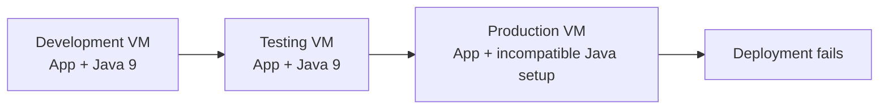
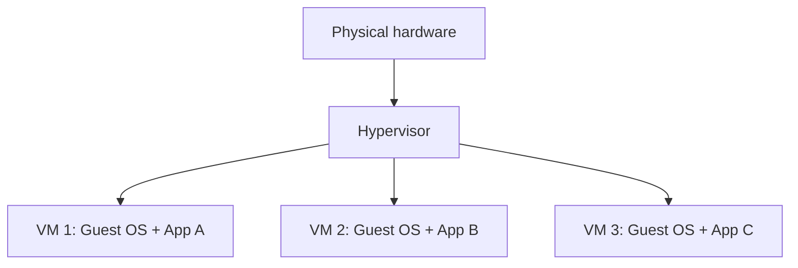
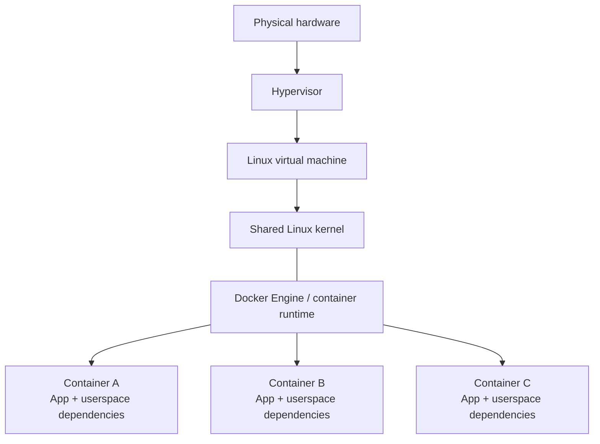
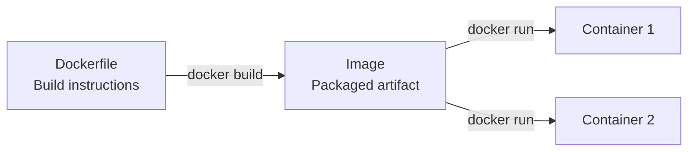
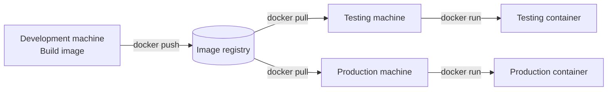
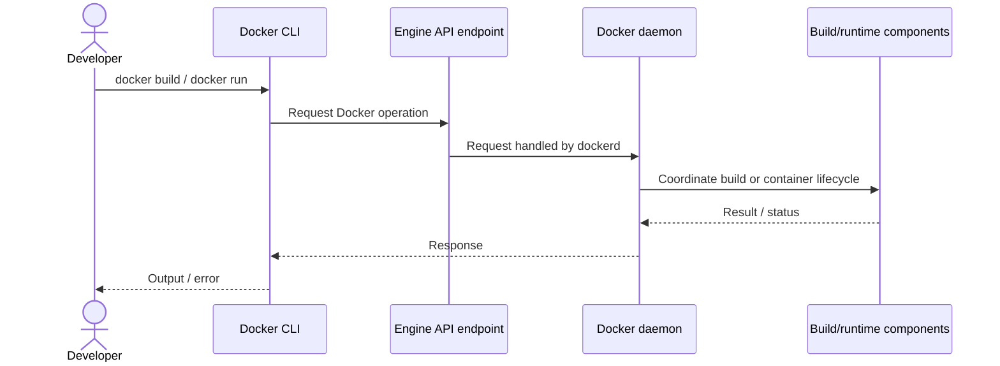
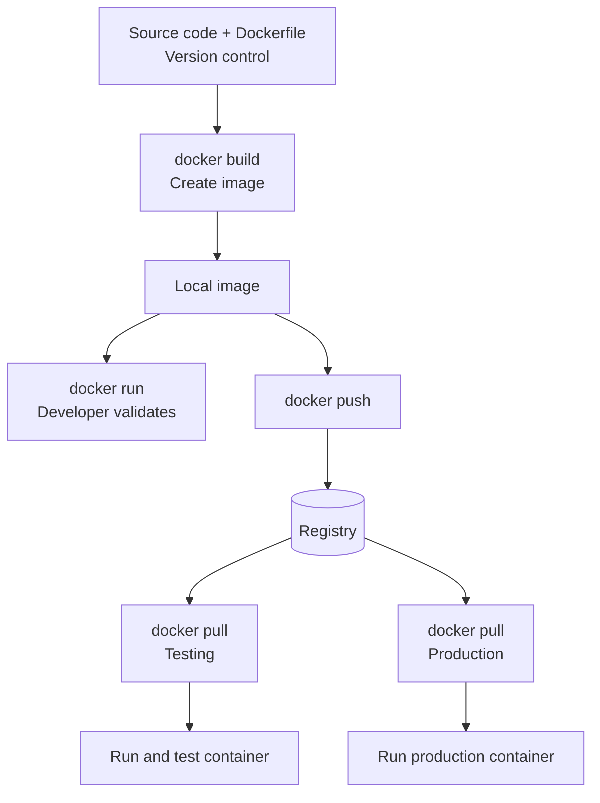

# Day 1 — Docker Fundamentals: From “Works on My Machine” to Portable Containers

> **Course:** Cloud With VarJosh — CKA Certification Course 2025  
> **Source:** Day 1 video transcript (January 7, 2025)  
> **Learning objective:** Understand *why* containerization became useful, how containers differ from virtual machines, and what happens between writing a Dockerfile and running the same application in another environment.

## How to read this chapter

This chapter follows a single question: **How can a team build an application once and run it predictably across development, testing, and production?** We will first encounter the deployment problem without Docker. Only after that problem is clear will we introduce containers, their architecture, and the tools that make the build-and-distribute workflow possible.

You do **not** need prior experience with Docker. A working idea of an application, an operating system, and a server is enough. We will explain the other terms as they become necessary.

Our running example is a small service that requires a particular version of Java. Later, we will also use a tiny `hello Docker` image to understand Docker commands without distracting application details.

---

## 1. One application, three environments — why does deployment fail?

Imagine you are developing a Java service. On your development machine, you install Java 9, set up the libraries the application needs, and run it. Everything works. The application is then handed to a testing team. Their testing machine also has Java 9, so the application continues to work.

Now the same application reaches production. The production server does not have Java 9. The code has not necessarily changed, but the **environment around the code** has changed. The application can fail to start, or it can behave differently from what the developer observed.

This is the practical meaning of **“it works on my machine.”** The phrase does not prove that the program is portable. It may simply mean that one particular machine happens to have the right conditions for running it.



The point is not that Java 9 is special. It could be a different Python version, a missing native library, a configuration file, or an expected operating-system tool. **A program depends on more than its own source code.**

### What exactly is a dependency?

A dependency is something the application needs in order to build or run correctly. Some dependencies are packaged software, such as a Java runtime or Python library. Others are configuration, such as a setting that tells the service where its database lives. Still others are external services or operating-system capabilities.

This distinction will become important later: **Docker can package many application-level dependencies, but it does not magically include every external service or eliminate every host requirement.** For example, a database connection still needs the correct network, credentials, and a reachable database.

We can now state our first problem precisely: the developer has transferred the application code, but not necessarily the environment that made that code work.

## 2. Why was the old approach difficult to manage?

The transcript identifies four related difficulties. Instead of treating them as four unrelated facts, consider how each emerges from the way teams operate servers.

### 2.1 Machines gradually become different

Development, testing, and production machines are administered separately. Developers install tools to experiment. Testing teams make changes to exercise new releases. Production teams tend to change things more cautiously. Over time, the machines **drift**: installed package versions, libraries, configurations, and even open ports are no longer identical.

That drift creates uncertainty. A developer might reasonably say, “I tested this code.” The operations team might equally reasonably say, “The machine on which it must run is different.” Both statements can be true.

### 2.2 Giving each application its own VM costs resources

A common response is to separate applications. Instead of letting two applications interfere with one another, run each in its own virtual machine (VM).

A VM behaves like an independent computer, including a **guest operating system**. If you run several VMs, each carries its own guest OS environment, in addition to the application. This consumes storage and memory, introduces OS maintenance overhead, and may create licensing costs for some operating systems.

This is not a claim that VMs are bad or inherently wasteful. VMs provide strong isolation and remain very useful. The issue is that a **whole guest OS can be more than we need** merely to isolate two application processes.

### 2.3 Sharing one machine introduces collisions

Now consider the opposite strategy: use one VM for many applications. This saves some VM overhead, but it creates new conflicts.

Suppose application A requires one Python environment while application B requires another. Or suppose both programs try to listen on the same network address and port. Installing and configuring everything in the same environment requires careful coordination. A change made for one application may affect another.

So we face a trade-off:

- **Separate VMs:** stronger environment separation, but additional guest-OS overhead.
- **Multiple apps in one environment:** potentially more efficient, but more opportunity for dependency and configuration collisions.

What we want is a way to isolate applications **without needing a separate guest OS for every application**.

### 2.4 Repeating manual setup makes releases fragile

Even if a team writes down every required package and setting, someone still has to reproduce that setup in another place. Manual steps are easy to miss and hard to keep identical over time. Deployment becomes an exercise in reconstructing an environment rather than simply running a known application package.

At this point, the desired outcome is clear: **package the application and the application-level environment together, move that package between machines, and give separate applications controlled runtime environments.** This is the problem containerization addresses.

---

## 3. The idea of a container: standardize what gets transported

The instructor introduces shipping containers as an analogy. Before standardized shipping containers, moving goods required many different handling arrangements. A standard container provides a predictable unit for transportation. The transport system can deal with the container rather than every individual item inside it.

Docker applies a related idea to software. Instead of handing another team just a code directory and a long list of instructions, we create a **container image**: a standardized package that describes a filesystem and application startup behavior. That package can be transferred and used to create a container on another compatible machine.

Three ideas follow naturally:

1. **Consistency:** the same image contains the same packaged application files and dependencies.
2. **Separation:** separate containers can run applications in distinct process and filesystem environments.
3. **Repeatability:** we can create multiple containers from the same image rather than setting up the application manually each time.

The analogy has limits. Software containers do not physically transport everything they depend on. They share the host kernel, rely on host resources and configuration, and may call outside services. An image increases predictability; it is not a guarantee that behavior will be identical on every machine.

### Docker versus a container

**Docker** is a platform and set of tools for building, distributing, and running containerized applications. A **container** is the runtime environment created from an image. The distinction matters because Docker helps us manage the lifecycle, while a container is the running application environment we create.

We have described the *goal* of containerization. But why can containers offer isolation without creating a guest operating system for every application? To answer that, we need to look below the application and compare the architectures.

---

## 4. A necessary foundation: OS, kernel, and virtual machine

An operating system provides services that applications need. Its **kernel** is the privileged core that coordinates processes, memory, filesystems, devices, and networking. Ordinary applications run in user space and ask the kernel to perform privileged operations through system calls.

This matters because application isolation can happen in two different ways: by giving each workload a separate virtual machine and guest OS, or by letting isolated workloads share a kernel.

### 4.1 Virtual machines: each VM has a guest OS

A **hypervisor** is the virtualization layer that supports virtual machines. Each VM presents a virtualized machine to its guest operating system. The guest OS then runs its application.



Each application now has a separate guest OS environment. That can make the applications easier to separate, but it also means each VM has OS-level resource and maintenance costs.

### 4.2 Containers: isolated processes share a kernel

For the Docker arrangement shown in the transcript, we keep **one Linux VM**, install Docker Engine inside it, and run several containers on that VM.



The diagram separates the kernel and Docker Engine to explain their roles; it should not be read as a literal sequence in which Docker is installed *on top of* the kernel like another operating system.

The key difference is this: **containers on the same Linux host share the host's Linux kernel.** They do not each boot a complete guest OS. That is a major reason containers can start quickly and can have lower per-workload overhead than separate VMs.

Linux provides mechanisms such as **namespaces** (to give processes separated views of resources) and **cgroups** (to account for and control resource use). These are useful supporting details beyond the depth of the original lesson. You only need the mental model for now: *separation is enforced around processes that still use one underlying kernel*.

There are two clarifications worth remembering:

- Containers do **not** automatically get hard resource limits simply because Docker runs them. CPU and memory controls must be configured when needed.
- A Linux container on macOS or Windows usually runs using a Linux environment provided by virtualization or another compatibility layer. “Runs anywhere Docker is installed” is a useful teaching shorthand, not an unconditional compatibility guarantee; CPU architecture, OS, kernel features, and external dependencies still matter.

### 4.3 Is Docker a replacement for virtual machines?

No. The transcript deliberately shows Docker **inside a VM**. This is common in cloud environments: VMs provide host-level boundaries, while containers provide convenient packaging and application-level isolation inside those VMs. Docker can also run on a suitable physical Linux machine without an intervening guest VM.

With the architecture established, one question remains: if a container is created from a package, **what exactly is in that package, and how do we create it?**

---

## 5. From source code to an image: the Dockerfile

Recall our Java application. The source code alone is not enough; it requires a particular runtime and potentially other files. We need a **repeatable recipe** for assembling those pieces into an image.

That recipe is the **Dockerfile**. It contains build instructions such as which base image to start from, which files to copy, which dependencies to install, and which command should run when the container starts.

The transcript uses an intentionally tiny example. Here is a valid equivalent of that example:

```dockerfile
FROM ubuntu:24.04
CMD ["echo", "Hello Docker"]
```

Read it in two steps:

1. `FROM ubuntu:24.04` means: begin with this Ubuntu base image, which supplies a starting filesystem and user-space tools.
2. `CMD ["echo", "Hello Docker"]` means: use `echo` as the default command when a container starts from this image.

This image is not a Java application. It simply lets us understand the build/run process without extra complexity. The instructor refers to `ubuntu:latest`; this note uses a versioned Ubuntu tag for a more reproducible example. For stronger reproducibility, production workflows may pin image digests.

**Important:** A Dockerfile is a set of instructions, **not** the finished image, and it does not automatically contain the application code. An actual application Dockerfile normally copies files and installs or selects the dependencies it needs.

### What is an image?

An **image** is the packaged artifact produced by a build. It supplies the filesystem content and metadata used to create containers. We often call it a “blueprint,” but unlike a merely abstract blueprint, it is also a distributable artifact containing the assembled filesystem layers.

To build our example, save the Dockerfile in a directory and run:

```bash
docker build -t hello-docker:1.0 .
```

Here, `docker build` starts the build, `-t hello-docker:1.0` names and tags the resulting image, and `.` selects the current directory as the build context. In this context, Docker or its build backend retrieves the base image if needed, processes the instructions, and produces an image available locally.

We now have something more predictable than “the code plus some setup steps.” We have an image that other environments can obtain. But an image by itself does not execute our application.

---

## 6. From image to container: what `docker run` actually changes

An image is the packaged starting point; a **container** is an instance created from that image, with an isolated runtime environment and its own writable state. While tutorials often describe a container as a “running instance of an image,” a container can also be stopped or exited and still exist.

Execute:

```bash
docker run --name hello-demo hello-docker:1.0
```

Docker creates a container from the local image, starts its default command, and the command prints:

```text
Hello Docker
```

The process then exits. This is a useful distinction: **the image remains available even after the container process stops.** You can run the image again to create another container. One image can produce many containers.



For a real server application, the container's main process would typically keep running and serve requests. Our small `echo` program finishes immediately, which is expected.

### Why does this help with isolation?

If we package two applications as separate images and run them in separate containers, each receives its own container filesystem view and process environment. Different application libraries need not be installed into one shared application environment. This addresses a central problem from Section 2.

Isolation is not absolute: containers still share a host kernel, share machine resources, and can be configured to communicate. Host port publishing can also conflict if two containers attempt to use the same host port. Containers reduce many common collisions; they do not eliminate every possible one.

We can build and run the image on one machine. But our original problem included **multiple teams and multiple environments**. How does the image move to them?

---

## 7. Registries: how the same image reaches another machine

Imagine a developer successfully builds `hello-docker:1.0` on a development VM. The image exists in that machine's local image store. A testing VM does not automatically have access to it.

We therefore need a shared location where images can be published and retrieved. That is the job of a **container registry**.



A registry stores and serves images. Docker Hub is a familiar example. Other examples mentioned in the lecture include JFrog Artifactory, Nexus, Amazon ECR, and Azure Container Registry. Registries or repositories can be configured for public or restricted access, depending on the provider and permissions.

Consider a hypothetical registry address:

```bash
# Give the local image a registry-qualified name
docker tag hello-docker:1.0 registry.example.com/demo/hello-docker:1.0

# Publish it (requires registry access and permission)
docker push registry.example.com/demo/hello-docker:1.0
```

Another machine can then retrieve and use it:

```bash
docker pull registry.example.com/demo/hello-docker:1.0
docker run registry.example.com/demo/hello-docker:1.0
```

`registry.example.com` is only a placeholder, not a registry you should expect to access. Authentication, network connectivity, and permissions are needed for a private registry.

### Why distribute the image instead of rebuilding in every environment?

This is the important architectural payoff. If development, testing, and production all obtain **the same image artifact**, the application files and dependencies inside that artifact are not reconstructed separately each time. The teams move a known package through their deployment process.

That does not mean the machines are identical. Environment variables, mounted files, secrets, network access, CPU architecture, and host behavior may differ. The stronger statement is: **reusing the same immutable image reduces a major source of deployment drift.** For exact artifact identity, an image digest is more reliable than a tag that can be reassigned.

The lecture's original “works on my machine” problem is now beginning to close: the developer is no longer handing off code while asking operations to manually recreate its software environment. The developer can hand off an image reference that identifies a packaged runtime artifact.

But we have so far described Docker commands as though they directly perform the work. We need one more layer to understand who actually receives those commands.

---

## 8. Inside Docker Engine: CLI, API, and daemon

When we type `docker build` or `docker run`, something on the host must interpret the request and carry it out. The transcript introduces three key parts of the Docker tooling:

**Docker CLI** is the command-line client used by the developer or operator. It is how we express the desired operation: build, run, pull, push, and so on.

**Docker Engine API** is the programmatic interface through which clients request Docker operations. The Docker CLI communicates with the Docker daemon using this API (commonly over a local Unix socket, with other transports possible). It is more accurate to think of the API as a *contract for requests* than as a separate process translating commands.

**Docker daemon (`dockerd`)** is the long-running service that accepts Engine API requests and manages Docker objects and operations. Modern Docker implementations also rely on other components, such as containerd and the OCI runtime, for portions of container lifecycle management. Those lower-level details are outside this introductory transcript.

The instructor compares the CLI to a car's controls, the API to the connection carrying commands, and the daemon to the working engine. This is a useful intuition as long as we remember that the API is an interface and the daemon coordinates work with other runtime components.



The Engine API endpoint is served by the daemon; the diagram separates them only so their roles are visible.

### Apply the model to `docker build`

The user supplies a Dockerfile and build context. The CLI submits a build request. Docker's build machinery processes instructions such as `FROM` and `CMD`, retrieves necessary base image content, and produces an image. The result can then be tagged and stored in the local image store.

### Apply the model to `docker run`

The CLI sends a request to create and start a container from an image. The daemon coordinates the necessary container lifecycle work. The container gets an execution environment and starts its configured process. In our `Hello Docker` example, that process writes a line and exits.

### Apply the model to `docker pull` and `docker push`

These commands involve the local Docker environment and a registry. A pull retrieves image content into the local image store; a push uploads an image's content and metadata to the remote registry, subject to permissions.

Now we can tie together both views: the simple developer experience (`build`, `run`, `push`) and the machinery (`CLI`, Engine API, daemon, image store, registry) that makes it happen.

---

## 9. Follow one application from development to production

We have learned the parts individually. Let us now trace one continuous journey and verify that every part has a purpose.

### Starting situation: development

A developer owns a service and has its source code. They create a Dockerfile defining how to assemble the runtime environment. The Dockerfile can be stored alongside the source code in version control such as GitHub or GitLab, as described in the lecture.

The developer invokes a Docker build. The CLI forwards the request through the Engine API, and the build system creates a local image. The developer runs a container from that image to verify basic behavior. So far, everything has happened on the development machine.

### Handoff: distribution

The developer (or a CI pipeline) tags the validated image and pushes it to a registry. This is the critical handoff point: the registry now provides a location from which other systems can retrieve the *same packaged artifact*.

### Testing

The testing environment pulls that image. It creates and starts a container from it. Testing can focus on the packaged application and its behavior rather than reinstalling each application dependency manually. If testing passes, the exact tested image can be promoted for deployment.

### Production

Production retrieves the approved image and starts containers with the required production settings. Because the application files and packaged dependencies originate from the same image, one important category of development-versus-production mismatch is reduced.



**One subtle ordering point:** a team may test the local container *before* pushing an image, or push it to a test registry and let automated testing run it there. The transcript illustrates both local testing and later distribution. The concept to remember is not one mandatory command sequence; it is the separation between **building an image**, **running a container**, and **distributing an image**.

### What did Docker solve—and what remains?

Docker greatly improves the packaging and deployment story. Yet the team still needs to decide how to keep a service available, run many copies, recover from failures, connect applications, and deploy updates safely. These are not automatically solved merely by building an image. They lead naturally toward container orchestration and Kubernetes, which is why this Docker foundation appears at the beginning of a CKA course.

---

## 10. Reconstructing the complete mental model

Return to the very first problem. We had a Java service that worked on development and testing machines but failed on production because the machines were configured differently. We discovered that applications rely on surrounding dependencies, and those dependencies drift when environments are configured independently.

Running one VM per application offers separation, but it also requires a guest operating system per VM. Running many applications directly in one environment reduces that overhead but allows more collisions. Containers provide another option: package application-level dependencies into images, then run isolated application processes that share the host kernel.

A **Dockerfile** describes how to build the package. `docker build` creates an **image**. `docker run` creates and starts a **container** from that image. A **registry** makes the image available to other machines through push and pull operations. The **Docker CLI** supplies a convenient interface, the **Engine API** carries client requests, and the **Docker daemon** coordinates Docker operations.

The central relationship is therefore:

```text
Application source + Dockerfile
              |
              v
         docker build
              |
              v
          IMAGE
         /     \
        /       \
 docker run    docker push
      |             |
      v             v
 CONTAINER       REGISTRY
                    |
                docker pull
                    |
                    v
              IMAGE ON ANOTHER HOST
                    |
                docker run
                    |
                    v
                 CONTAINER
```

Do not collapse **image** and **container** into the same idea. The image is the reusable packaged artifact; the container is a particular runtime instance with its own lifecycle. And do not collapse **container** and **VM** into the same idea: a Linux container shares its host kernel, while a conventional VM runs its own guest OS.

Finally, interpret “build once, run anywhere” as a design goal with compatibility requirements—not a literal guarantee. A consistent image is a strong foundation, but configuration, hardware architecture, networking, secrets, storage, and external dependencies can still affect the application.

## 11. Test your understanding by reasoning, not memorizing

Try answering these without rereading the chapter:

1. A Java application works on a developer laptop but fails in production. What must you investigate besides the application source code? How could an image reduce part of that risk?
2. If two applications both need different library versions, why might two containers be easier to manage than installing both directly into one shared VM environment?
3. If containers share a host kernel, what is the architectural difference between launching another container and launching another VM?
4. You have built `hello-docker:1.0` locally. Why cannot the testing server necessarily execute it yet? Which missing component solves the distribution problem?
5. Your `Hello Docker` container immediately stops after printing its message. Does that mean image creation failed? Explain why or why not.
6. A deployment uses the same image in testing and production, yet production fails to connect to a database. Does this contradict the value of containerization? What did the image *not* guarantee?
7. When you run `docker run`, which part accepts the user-facing command, which interface carries the request, and which service coordinates the operation?

If you can explain the answers as a connected story, you have achieved the goal of this lesson.

---

## Source-alignment notes

The chapter follows the transcript's substantive progression: environment inconsistency and four deployment difficulties; the shipping-container analogy; VM versus container architecture; Dockerfile/image/container; registries; Docker Engine components; and the full development-to-production workflow.

A few clarifications extend or refine the introductory lecture so the mental model remains technically dependable:

- Containers share the host kernel; the mere presence of Docker Engine does not itself explain isolation or enforce resource limits. Linux namespaces and cgroups are the relevant underlying concepts.
- The transcript's portability statement is simplified. Host OS, CPU architecture, compatible runtime, and external dependencies still matter.
- `Dockerfile` is the build recipe; an image is the produced artifact. A stopped container can still exist, so “running instance” is a useful starting definition rather than a complete one.
- The Docker Engine API is not an independent translation process; it is an interface served by the daemon.
- The transcript's `ubuntu:latest` example was expressed here using a versioned tag and a valid executable command.
- Image reproducibility is stronger when the same digest is reused rather than assuming a tag always identifies identical content.

**Next lesson boundary:** The source concludes by indicating that future lessons will examine Docker commands, Dockerfile details, and containerizing a first application. Those subjects are intentionally not expanded into a separate tutorial here.
