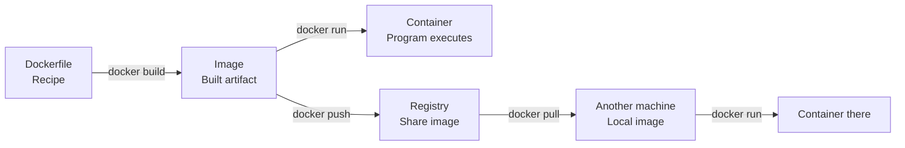
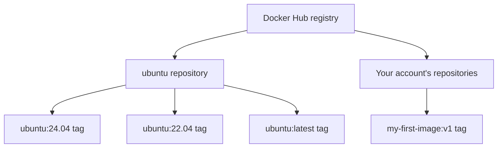
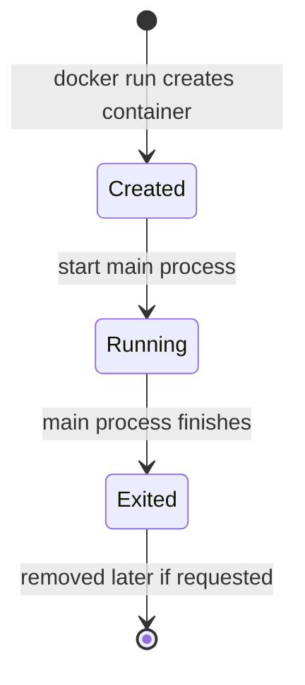

# Day 2 — Docker in Practice: From a Dockerfile to a Shareable, Running Container

> **Course:** Cloud With VarJosh — CKA Certification Course 2025  
> **Source:** Day 2 lecture transcript supplied by the learner  
> **Position in the course:** Continues Day 1's explanation of why Docker exists, how Docker images and containers relate, and how Docker Engine works.  
> **Outcome:** Build a small custom image, understand its layers and tags, run a container, recognize why it exits, and publish an image to Docker Hub.

## The question driving this chapter

In Day 1, we arrived at an important idea: rather than asking each environment to recreate the right runtime by hand, we can package an application into a **Docker image** and use that image to create containers. That sounds promising, but it leaves us with a practical problem: **how do we actually create, inspect, run, and share one of these images?**

This lesson answers that question using one deliberately tiny example. Our application will do nothing more than print `hello Docker`. That simplicity is useful: it lets us notice what Docker is doing instead of becoming distracted by application code. We will start with a machine that can run Docker, find a base image, write a Dockerfile, build our own image, start a container, and finally make the image available from another machine.

There is one principle to keep in mind throughout: **a Dockerfile is the recipe, an image is the built artifact, and a container is an instance created from that image.** The registry is where the image can be stored and distributed. We will develop each part only when the workflow needs it.



---

## 1. Before we build anything, what must be available?

When we ran through the architecture in Day 1, we distinguished the human-facing **Docker CLI** from the **Docker daemon**, which does the work of managing images and containers. This is why simply possessing a Dockerfile is not enough. We also need a working Docker installation able to build images and run containers.

The lecture presents two ways to get that environment. On a personal laptop, Docker Desktop provides a convenient way to work with Docker. It is available for macOS, Windows, and Linux. The instructor suggests that a machine with roughly 8–12 GB of RAM and four CPUs offers a comfortable learning setup, with 4 GB mentioned as a minimum for the Docker Desktop environment in the demo. Those figures are **lecture guidance, not universal current product requirements**; check the requirements for your operating system and Docker Desktop version before installation.

If the laptop is too constrained, the lecture suggests using an **Ubuntu virtual machine** from a cloud provider and installing Docker Engine there. This is a meaningful alternative, not a different container model. In both cases, our commands still need a Docker Engine that can perform the work. The difference is where it runs and how we reach it. Using a cloud VM may incur charges beyond any introductory credits.

**Practical references:**

- Docker Desktop: https://docs.docker.com/desktop/
- Docker Engine installation on Ubuntu: https://docs.docker.com/engine/install/ubuntu/

The transcript demonstrates the installation workflow conceptually rather than recording every installer screen or the precise Ubuntu installation commands. Follow the current official instructions for the platform you choose.

### How do we know Docker is available?

Once Docker is installed, open a terminal. The first test is deliberately small:

```bash
docker --version
```

This tells you which Docker CLI version is installed. It is a quick way to check that the command is on your path, but **it does not, by itself, prove the Docker daemon is running**. For a fuller picture, run:

```bash
docker version
```

This normally prints information about the client and, when accessible, the server/engine. If the client is present but the daemon is unavailable, this is the point where you are likely to see a connection error. Another useful diagnostic is:

```bash
docker info
```

This shows characteristics of the Docker environment, such as its server setup, storage details, and other configuration information. These commands answer different questions: *Is the CLI installed? Can it reach the Docker Engine? What environment is that engine running?*

Now that our machine can talk to Docker, the next question is: **where does Docker obtain the software from which our custom image will be built?**

---

## 2. We need a starting point: finding an image on Docker Hub

Imagine writing a Dockerfile that says, “Start from Ubuntu.” Docker needs to know where to find that Ubuntu image. This is the role of a **container registry**. In this lesson, we use **Docker Hub**, an image registry that can store images for others to retrieve.

The instructor demonstrates signing up for an account at https://hub.docker.com/ and signing in through Docker Desktop. Creating an account becomes particularly relevant later, when we want to **push** our own image. Public images can often be pulled without an interactive login, subject to registry policies and limits.

Here is an important detail that would be easy to miss if we jumped directly to `docker pull`: a registry contains **repositories**, and repositories contain references to image versions or variants.

Think of the structure like this:



A repository is not the same thing as a running container. It is a namespace for organizing image references. Within one repository, **tags** such as `22.04`, `24.04`, `latest`, or `v1` identify particular image references. More precisely, a tag is a **name that points to an image manifest**; it is not automatically an immutable version. The owner of a repository can retarget a tag later.

### Why should we care about tags before learning `docker pull`?

Because we must choose *which* image to download. The lecture uses:

```bash
docker pull ubuntu
```

Without a tag, Docker interprets the request as the `latest` tag for that repository. Its fully qualified Docker Hub form is effectively:

```text
docker.io/library/ubuntu:latest
```

Read it from left to right:

- `docker.io` identifies the Docker Hub registry.
- `library` is the namespace used for Docker Official Images such as Ubuntu.
- `ubuntu` identifies the repository.
- `latest` is the tag selected when none is specified.

We did not type all these components, but Docker can resolve the short name by applying these defaults. If we need a specific Ubuntu release, we can make the tag explicit:

```bash
docker pull ubuntu:24.04
```

**Important distinction:** `latest` means *the tag named `latest`*, not “Docker will search all versions and choose the newest by some universal rule.” The transcript uses `latest` for simplicity. In repeatable real-world builds, a deliberately chosen release tag—and sometimes a digest—is generally a safer choice.

### What changes when we use a different registry?

The short name `ubuntu` works because Docker assumes Docker Hub for an unqualified name. For a different registry, the name generally includes that registry's host and repository path:

```text
<registry-host>/<namespace-or-project>/<repository>:<tag>
```

The instructor mentions AWS ECR, Google-hosted registries, Nexus, and similar products as alternatives. The underlying concept is unchanged: **an image reference tells the tooling where to find a particular image**. Authentication and the exact naming format vary by registry.

At this point we know *where* Ubuntu lives. Let's get it onto our machine and see how Docker represents it locally.

---

## 3. Pulling an image and understanding what we now have

Open a terminal in the directory where you plan to work. In the lecture, the instructor opens an integrated terminal from VS Code in the Day 2 directory. Nothing special about Docker requires VS Code: the terminal simply provides a place to run the commands.

The command below requests the Ubuntu image from Docker Hub:

```bash
docker pull ubuntu
```

Docker resolves the image reference, contacts the registry, and downloads the image content needed locally. It may reuse content already cached on the machine. After the pull completes, try:

```bash
docker images
```

This displays locally available image references. The output includes fields such as **REPOSITORY**, **TAG**, **IMAGE ID**, **CREATED**, and **SIZE**.

These fields answer different questions. The repository and tag tell us *how we refer to the image*. The image ID identifies image content locally. The created field relates to image metadata and build history rather than necessarily saying when we downloaded it. The size indicates the reported local image size; its accounting can depend on Docker's version and image storage implementation.

This is also a good moment to separate two actions that may sound similar:

- `docker pull ubuntu` makes an image available locally.
- `docker run ubuntu` creates and starts a container from an image.

**Downloading a recipe's finished artifact is not the same as executing it.** So far, no custom application has been started.

If you want to discover what commands exist, the instructor also demonstrates:

```bash
docker --help
```

This introduces the commands we will need as the journey progresses: `pull`, `images`, `build`, `run`, `ps`, `tag`, and `push`. Rather than memorize them as an isolated list, we will associate each command with the exact problem it solves.

Now we have a base image, but it is still just Ubuntu. How do we turn it into **our** image with **our** chosen behavior?

---

## 4. Writing the Dockerfile: stating how our image should behave

Return to the project directory in VS Code and create a file named exactly:

```text
Dockerfile
```

The standard filename is `Dockerfile`—capital `D`, no file extension. The transcript's spoken phrases “Docker file” and “Dockerfile” refer to this file.

For the tiny demonstration, write:

```dockerfile
FROM ubuntu:latest
CMD ["echo", "hello Docker"]
```

There are only two instructions, but together they introduce two different ideas.

`FROM ubuntu:latest` tells the builder which existing image to start from. That is why we spent time understanding Docker Hub, repositories, and tags. Our image will **reuse** Ubuntu rather than construct a complete Linux userspace from scratch.

`CMD ["echo", "hello Docker"]` defines the default command a container should execute when started from the image. Our command prints the words `hello Docker` and finishes. We have not yet run it; we have only **declared** what the container will do by default.

### Why is `CMD` not the same as `RUN`?

The distinction becomes clear when we ask *when* an instruction takes effect.

- A **`RUN`** instruction executes a command **while building** an image. Its filesystem changes may become part of a new image layer.
- A **`CMD`** instruction establishes a default command **for a future container start**. It is image configuration metadata, not a build-time command execution.

That is why placing an `echo` into `CMD` does not print `hello Docker` while building. The message appears only when we start a container using the image, unless we override that default command.

We now have a description of an image, but no custom image yet. That brings us naturally to the next operation: **building**.

---

## 5. Building our first custom image

From the directory that contains the Dockerfile, run:

```bash
docker build -t my-first-image .
```

Let's understand the command rather than memorize it.

`docker build` asks Docker to create an image using the build definition and context we supply. The `-t my-first-image` portion gives the resulting image a convenient local name. Because we did not include a tag, Docker uses `latest` as its tag when it creates that named reference.

The final dot, `.`, represents **the current directory as the build context**. Docker makes that context available to the build, subject to ignore rules. In this simple example, the default `Dockerfile` is also located in that directory. The transcript describes the dot as pointing to the Dockerfile's current directory; more precisely, **it specifies the build context**, and Docker locates the default Dockerfile there unless directed otherwise.

You should now be able to run:

```bash
docker images
```

You will see Ubuntu and your new image reference, `my-first-image:latest`. This is a crucial milestone. We no longer have only someone else's base image. We have **our own image configuration built on that base**.

### A small subtlety: why might the image creation time look older than expected?

The instructor notices that the first image's **CREATED** value appears to match the older Ubuntu base image even though the custom image has just been built. This leads into the lesson's explanation of **image layers**.

Image builds can reuse existing content. Some Dockerfile instructions change the image's configuration without adding filesystem content. Our `CMD` instruction is one such example: it specifies the default command but does not require a new filesystem layer containing changed files.

Image timestamps displayed by Docker are not a reliable way to infer whether a filesystem layer was added. Their behavior may also depend on the builder and image metadata. The durable learning point is: **image configuration can change even when no new filesystem layer is added.**

### Introducing `RUN` only when we need it

To demonstrate the difference, the lecture temporarily adds a build-time instruction:

```dockerfile
FROM ubuntu:latest
RUN echo "I will create a new layer"
CMD ["echo", "hello Docker"]
```

Now build another image:

```bash
docker build -t my-second-image .
```

Unlike `CMD`, `RUN` executes during the build. A `RUN` instruction may create a new filesystem layer. However, **this particular `echo` writes only to build output and does not create a persistent file**, so an associated layer can be empty. Do not conclude that the message becomes a file inside the final container.

If you want a demonstration with a visible filesystem change, try this **additional educational example, not an instruction shown in the lecture**:

```dockerfile
FROM ubuntu:latest
RUN echo "created at build time" > /build-note.txt
CMD ["cat", "/build-note.txt"]
```

Here, `RUN` produces `/build-note.txt` during the build, and `CMD` specifies a command that reads that file when the container starts. This makes the two phases easier to distinguish.

### Inspecting instead of guessing

The transcript shows two useful commands:

```bash
docker history my-second-image
docker inspect my-second-image
```

`docker history` shows the image's build-history entries, including entries corresponding to metadata-only instructions and filesystem changes. An entry in history does **not** necessarily mean a non-empty filesystem layer was created.

`docker inspect` returns detailed structured metadata about the image, including its configuration. These tools answer two complementary questions: *How was the image assembled?* and *What configuration and metadata does the image now carry?*

Before continuing, the instructor removes the temporary second image and returns to the original two-instruction Dockerfile:

```bash
docker rmi my-second-image
```

Be aware that `docker rmi` removes a local image reference (and image data if no longer needed). In the lecture, a force flag is mentioned while cleaning up another earlier image. **Avoid `-f` unless you understand what still refers to the image**; we do not need it for this walkthrough.

We have now built an image. But a build tells us only that Docker produced an artifact. It does not establish how our program behaves when executed. The next question is: **what happens when we turn the image into a running container?**

---

## 6. Running our image: image versus container becomes real

Run:

```bash
docker run my-first-image
```

Our Dockerfile defined a default command. Docker creates a container from `my-first-image`, executes that command, and the terminal displays:

```text
hello Docker
```

The container then stops. This single operation demonstrates something much more important than a successful print statement: **an image is a stored artifact; a container is created from the image to execute a process.**

### Where did our container go?

The lecture immediately runs:

```bash
docker ps
```

No running container appears. That might initially look like a failure. But it is exactly what we should expect, because our process was not designed to keep running. It printed its message, completed, and exited.

Now run:

```bash
docker ps -a
```

The `-a` option includes containers that are no longer running. Our container should appear with an exited status, unless it has been automatically removed by some other option or cleanup. The important distinction is:

```text
docker ps       -> containers currently running
docker ps -a    -> all containers, including exited ones
```

### Why does a container exit when the command finishes?

At this point, connect the observation back to the definition of a container. Docker is not creating a full virtual machine that needs to remain booted as if it were a separate physical computer. Instead, Docker starts a process within a containerized environment. A container's lifecycle is tied to its main process: **when the main process exits, the container transitions out of the running state**.

Our process was `echo`. Its entire job was to print one message. Finishing immediately is correct behavior.

Later in the course, if you containerize a web server, the behavior will look different: the server's main process continues serving requests, so the container generally remains running while that process is alive. We do not need to learn web servers yet to understand the underlying rule.



A stopped container can still exist in Docker's local records. **Exited does not necessarily mean deleted.** That is exactly why `docker ps -a` can find it.

We have validated the image locally. But the original goal was not merely “works on my machine.” It was to make an image others can use. How do we get this image from our computer to Docker Hub?

---

## 7. Why a local image name is not enough for publication

Look again at the name we built:

```text
my-first-image:latest
```

This name is perfectly adequate for running the image locally. But it does not make ownership or a publishing destination clear. Docker Hub needs to know **which account's repository** should receive the image.

For Docker Hub, a typical image name for a user's repository is:

```text
<dockerhub-username>/<repository-name>:<tag>
```

A more explicit form includes the registry host:

```text
docker.io/<dockerhub-username>/<repository-name>:<tag>
```

The transcript demonstrates this using the instructor's account and a `v1` tag. Since you will publish to your own account, use **your own Docker Hub username** in the commands below. The placeholder is intentional; it is not a literal username.

### What is the tag doing here?

So far we have used `latest`, which is merely a tag name. But if we are deliberately publishing the first version of an application, `v1` communicates our intended release label more clearly.

We want Docker Hub to receive:

```text
YOUR_DOCKERHUB_USERNAME/my-first-image:v1
```

Notice that we have changed more than the tag: we have included the account namespace. This becomes the target image reference for the push.

### Give the existing image the right name

There is no need to rebuild the image just to change its name. Docker supports adding another reference to the same local image:

```bash
docker tag my-first-image:latest YOUR_DOCKERHUB_USERNAME/my-first-image:v1
```

Now:

```bash
docker images
```

You should see the original local name and the new account-qualified name. They can point to the **same image content**. `docker tag` does not duplicate and rebuild the application.

This also explains the failed attempt discussed in the transcript: trying to push an account-qualified image name that has **not been created locally** produces an error. Docker does not infer that some differently named local image was the intended source. We must explicitly tag the image with the reference we plan to publish.

We now have a properly named local artifact. The remaining question is authorization: **are we allowed to publish it under this Docker Hub account?**

---

## 8. Authentication: why a push can work on one machine but fail on another

In the instructor's desktop demo, the push succeeds without prompting for credentials at the moment of the command. That is because the instructor has already signed in through Docker Desktop. The local Docker tooling is able to use the relevant saved authentication configuration.

On another machine, including a newly provisioned cloud VM, that login may not exist yet. In that case, authenticate before pushing:

```bash
docker login --username YOUR_DOCKERHUB_USERNAME
```

Follow Docker's prompted authentication flow. Depending on the CLI version and account setup, authentication may involve browser/device login, a password, or a personal access token. Prefer secure, supported credential flows, especially when automation is involved.

The lecture also references a Docker configuration file in the user's home directory. On typical setups its path is:

```text
~/.docker/config.json
```

This is not `config.js`. That is a transcription or spoken-name error. The config can describe the current Docker context, authentication helpers, and other client settings. **A Docker context such as `desktop-linux` identifies an engine connection, not by itself proof of Docker Hub authentication.** Authentication credentials may reside in an OS credential store or another helper, not directly in readable JSON. Avoid sharing the contents of this file because it can contain sensitive settings or credential references.

### Why was this distinction worth introducing?

A working image and a correctly formed repository name are not sufficient to push successfully. The registry must accept the upload. So we now have three separate conditions:

1. The image exists locally.
2. Its destination reference includes the intended Docker Hub repository.
3. Docker has valid permission to publish there.

With these in place, we can finish the distribution workflow.

---

## 9. Pushing the image, then pulling it somewhere else

Push the tagged image:

```bash
docker push YOUR_DOCKERHUB_USERNAME/my-first-image:v1
```

Docker contacts Docker Hub and uploads image content and the relevant manifest metadata, reusing already available content where applicable. The lecture then returns to Docker Hub, opens the repository, and observes the `v1` tag.

You can also spell the registry explicitly:

```bash
docker push docker.io/YOUR_DOCKERHUB_USERNAME/my-first-image:v1
```

For this Docker Hub example, both forms refer to the same destination. You must still be authenticated and authorized to push.

### Have we actually solved the original Day 1 problem?

So far, we built and tested on one machine, then uploaded the artifact. The most important payoff occurs when another machine **pulls the same image**:

```bash
docker pull YOUR_DOCKERHUB_USERNAME/my-first-image:v1
```

And runs it:

```bash
docker run YOUR_DOCKERHUB_USERNAME/my-first-image:v1
```

That other machine should print the same `hello Docker` message. We did not separately instruct someone on the second machine to build our example from our source Dockerfile. We distributed the resulting image instead.

```mermaid
sequenceDiagram
    participant Dev as Development machine
    participant Hub as Docker Hub
    participant Test as Test / other machine
    Dev->>Dev: Write Dockerfile
    Dev->>Dev: docker build -t my-first-image .
    Dev->>Dev: docker run my-first-image
    Dev->>Dev: docker tag .../my-first-image:v1
    Dev->>Hub: docker push username/my-first-image:v1
    Test->>Hub: docker pull username/my-first-image:v1
    Hub-->>Test: Image content + metadata
    Test->>Test: docker run username/my-first-image:v1
    Note over Dev,Test: Same published image reference; each machine creates its own container
```

This illustrates a central benefit of container images: the application packaging process has been separated from the later act of running the application. It also shows why image registries matter. They provide an accessible location for teams and machines to retrieve common artifacts.

**Boundary of the promise:** Docker improves portability and consistency of packaged dependencies. It does not guarantee identical results across incompatible CPU architectures, different kernel capabilities, missing environment configuration, blocked networks, absent volumes, or unavailable external services. The lecture emphasizes consistent operation across development, testing, and production; this nuance helps us understand the conditions under which that promise holds.

---

## 10. Reconstructing the entire execution journey

We now know why each new command entered the story. Rather than treating them as unrelated CLI syntax, reconstruct the actual dependency chain.

First, Docker must be installed and the CLI must be able to reach its engine. We verify this with `docker version`. Next, we need a foundation for our custom image. Docker Hub provides the Ubuntu image, and `docker pull ubuntu` retrieves it. We verify local availability with `docker images`.

With the base available, we declare our image's behavior in a Dockerfile. `FROM` picks the foundation. `CMD` establishes what our container runs by default. `docker build -t my-first-image .` then uses the current directory as the build context and produces the locally named image.

Before publishing anything, we run `docker run my-first-image`. The output confirms the configured command executes. The process finishes immediately, so the container exits. `docker ps` shows no currently running container, while `docker ps -a` can show the exited one. We understand why: the main process has finished its job.

Now that the image works locally, we identify the intended Docker Hub destination. `docker tag` gives the existing image an account-qualified `v1` name. After authentication, `docker push` publishes that reference to Docker Hub. A second machine can `docker pull` and `docker run` the same published image. This is the complete cycle that the lecture set out to demonstrate.

### End-to-end commands: one executable learning path

The following block collects the commands in the order they became necessary. Replace the username before executing. You must already have Docker installed and configured and be inside the directory where you will create the Dockerfile.

```bash
# Check Docker CLI and engine connectivity
docker version

# Obtain the base image and see local images
docker pull ubuntu
docker images

# Create a tiny Dockerfile in the current directory
cat > Dockerfile <<'DOCKERFILE'
FROM ubuntu:latest
CMD ["echo", "hello Docker"]
DOCKERFILE

# Build the custom image
docker build -t my-first-image .

# Run it, then inspect the container state
docker run my-first-image
docker ps
docker ps -a

# Inspect the image if desired
docker history my-first-image
docker inspect my-first-image

# Tag for your Docker Hub account
docker tag my-first-image:latest YOUR_DOCKERHUB_USERNAME/my-first-image:v1

# Authenticate and publish
docker login --username YOUR_DOCKERHUB_USERNAME
docker push YOUR_DOCKERHUB_USERNAME/my-first-image:v1

# The following commands can run on another Docker-enabled machine
docker pull YOUR_DOCKERHUB_USERNAME/my-first-image:v1
docker run YOUR_DOCKERHUB_USERNAME/my-first-image:v1
```

**Publishing consideration:** Check the repository's visibility before uploading anything sensitive. For this harmless `hello Docker` example, the image contains no private application code or secrets.

### The command reference, now that we understand its purpose

| Command | Question it answers in this workflow |
|---|---|
| `docker --version` | Is the Docker CLI installed? |
| `docker version` | What client and engine versions are accessible? |
| `docker info` | What kind of Docker environment is available? |
| `docker --help` | Which Docker commands can I use? |
| `docker pull` | How do I get an image from a registry? |
| `docker images` | Which images are present locally? |
| `docker build` | How do I construct an image from my Dockerfile? |
| `docker history` | What build-history entries does an image have? |
| `docker inspect` | What configuration and metadata are attached to it? |
| `docker run` | How do I create and start a container from an image? |
| `docker ps` | Which containers are currently running? |
| `docker ps -a` | Which containers exist, including exited containers? |
| `docker tag` | How do I give an image another reference? |
| `docker push` | How do I publish a tagged image? |
| `docker login` | How do I authenticate with a registry? |
| `docker rmi` | How do I remove a local image reference? |

This table is intentionally placed **after** the explanation. At this point, each command should recall an action you understand, rather than being an isolated item to memorize.

---

## 11. Deeper connections that will matter when we reach Kubernetes

Day 2 is a Docker lesson, not yet a Kubernetes lesson. But three ideas will carry forward into Kubernetes architecture.

**First, an image is not a container.** Kubernetes workload configurations refer to container images. A container runtime on a node eventually uses an available image to create and start containers. The image can exist in a registry long before any specific node starts it.

**Second, image names carry operational meaning.** The registry, repository, and tag—or an image digest—tell a system which artifact it should obtain. If an image cannot be pulled, the container cannot be started from that image. Later this becomes important when diagnosing image-pull problems in Kubernetes.

**Third, a container's main process matters.** In our demo, an `echo` command finishes and the container exits. In Kubernetes, understanding process termination becomes important when interpreting a container that repeatedly stops and is restarted. Kubernetes adds its own workload controllers, policies, and restart behavior, but it does not change the basic fact that a running container must have a running main process.

These are forward-looking connections supplied to aid learning, not additional topics demonstrated in depth by the Day 2 transcript.

---

## 12. Consolidating the mental model

The complete story began with a practical challenge left over from Day 1: **we wanted to package an application so that another environment could run the artifact instead of recreating our setup by hand.**

A Dockerfile gave us a repeatable description for constructing an image. An existing Ubuntu image provided the starting filesystem and environment. `docker build` turned that description into a custom image. By comparing `CMD` with `RUN`, we recognized the difference between declaring container-start behavior and performing work during the build. The image could be inspected and locally referenced by name and tag.

Running that image created a container. Its `echo` command completed, so the container exited; the empty `docker ps` output was not mysterious anymore. Finally, we gave the image a Docker Hub account-qualified reference and pushed it to a registry. Another machine could pull and run that same published image.

The chain is now clear:

**Dockerfile → Build → Image → Run → Container → Tag image → Push → Registry → Pull elsewhere → Run elsewhere**

This order is a learning sequence, not a requirement that the first local run must always occur before publication. The lecture demonstrates the operations together to build a complete mental model.

### Check whether you can reason with the model

1. You can run `docker --version`, but `docker version` reports that it cannot connect to the daemon. What has been verified, and what is still missing?
2. When someone types `docker pull ubuntu`, what assumptions does Docker make about the registry, namespace, and tag?
3. Why does changing `CMD` differ from adding a `RUN` instruction to the Dockerfile?
4. If `docker run my-first-image` prints a message and `docker ps` then shows nothing, why is that not necessarily a failure?
5. Why does `docker push my-first-image` not automatically know which personal Docker Hub repository you intend to publish to?
6. If two tags point to the same local image ID, have you necessarily created two independent copies of the filesystem?
7. Why can an image run correctly on a developer's machine yet still require additional configuration in production?

If you can answer these by reconstructing the journey rather than memorizing command definitions, the lesson has achieved its purpose.

---

## Source fidelity and instructional clarifications

The central demonstration, conceptual sequence, and commands in this chapter come from the provided **Day 2 transcript**. To keep the notes accurate and usable, a few details have been clarified or supplemented:

- The instructor gives broad laptop sizing guidance; actual Docker Desktop system requirements depend on the platform and version.
- `.` in `docker build -t ... .` is the **build context**; it is not merely shorthand for “the Dockerfile's location.”
- `RUN` participates in build-time execution and can generate filesystem layers; `CMD` changes image configuration. The demonstrated `RUN echo ...` does not itself save a file into the final image.
- The exact relationship between displayed image creation timestamps and the existence of image filesystem layers is more nuanced than the transcript's simplified explanation.
- The client configuration filename is conventionally `~/.docker/config.json`, and the Docker context is separate from registry authentication.
- `latest` is an ordinary tag rather than a guarantee of a stable or universally newest release.
- The extra `/build-note.txt` Dockerfile is an **additional teaching example**, not part of the instructor's demonstration.
- The forward-looking Kubernetes section connects the lesson to subsequent CKA learning; the transcript does not teach Kubernetes runtime orchestration yet.

**End of Day 2.** The next logical step is to learn Dockerfile instructions and everyday container-management commands in greater depth, after the image/build/run/push lifecycle is firmly understood.
