# CKA Day 3.1 — How the Linux Kernel Actually Isolates Containers

> **Position in the course:** Read after Day 3 (running and exposing Docker containers), and before Day 4.  
> **Goal:** Understand what Docker asks Linux to do, what the kernel actually enforces, and why sharing one kernel does **not** mean sharing one view of the system.
>
This chapter expands on the supplied **namespaces and cgroups transcript**. The transcript establishes two questions: *Why can't containers see each other's processes or files?* and *Why doesn't one container consume all the CPU and memory?* We'll preserve those questions, then add the missing mechanics connecting Docker, container runtimes, kernel data structures, and running processes. The implementation details identified as **deeper context** go beyond what the speaker explicitly covered.

## 0. The question we must answer

On Day 3, you ran two Nginx containers on a single Docker host. Each could listen on port 80 **inside** its own environment, while you published them on different host ports (`8080:80` and `8081:80`).

Stop there for a moment. Both Nginx processes run on the same host kernel. If the kernel is shared, why doesn't every process see the same network ports, process IDs, and files? And if Nginx goes into a busy loop, who prevents it from consuming everything?

The starting model is:

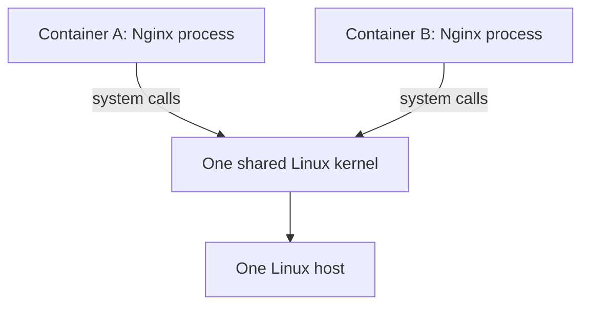

This is true, but incomplete. **Sharing a kernel means sharing the kernel's implementation, not necessarily sharing the same process-visible resources or resource budget.** We need to explain the missing boundaries.

We'll build one mental model in layers: **process -> kernel request -> namespaces -> cgroups -> Docker/runtime configuration**.

---

## 1. Before isolation: what does the kernel know about a process?

Let's start **without Docker**. Suppose you run an ordinary Linux program:

```bash
python3 app.py
```

The running program is a **process**. The kernel tracks its identity, execution state, virtual memory, open file descriptors, credentials, and the resources it uses. When the process calls `open()` to read a file or `socket()` to create a network endpoint, it asks the kernel to perform a privileged operation on its behalf.

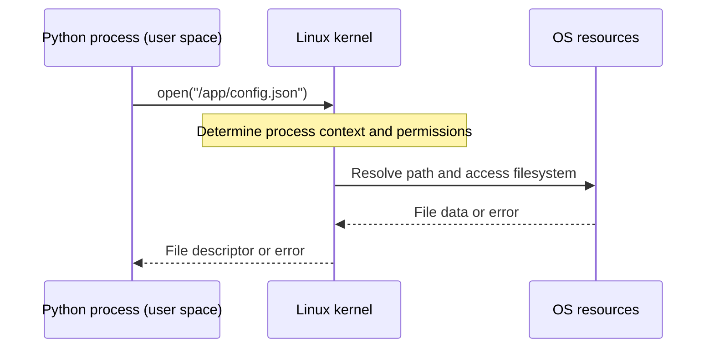

At this stage, the important observation is not *which* system call we used. It is **that the kernel has enough information about the calling process to make decisions for that process**.

That means the kernel could give two processes different answers to similar requests, if those processes are associated with different environments. Linux namespaces are one of the mechanisms that make this possible.

### Checkpoint

The application doesn't directly manipulate the disk, network card, or global process table. It enters the kernel through system calls. **This gives the kernel a place to enforce boundaries.**

---

## 2. One kernel, two different views: namespaces

A **Linux namespace** isolates a particular category of system resources or identifiers. A process belongs to namespace instances, and kernel operations interpret certain resources according to those memberships.

Think back to the transcript's example: two teams share an office building, but each sees its own workspace. The analogy is useful only up to a point. A namespace isn't a separate physical room or a second kernel. It is **kernel-maintained context that changes which resources and identifiers a process can observe or operate on**.

Let's add this layer to the model:

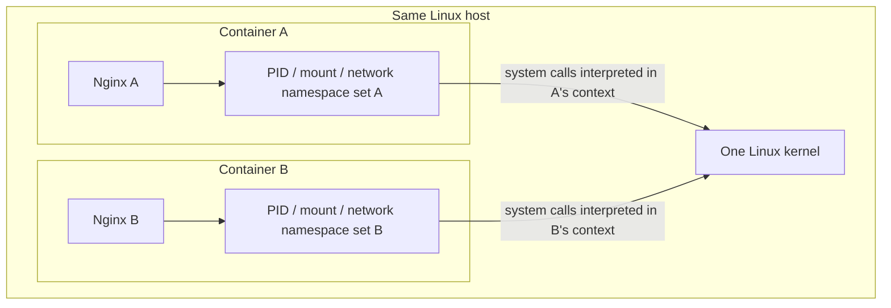

The diagram intentionally shows **namespace sets**, not a single magical "container namespace." Linux has different namespace types. A container runtime typically configures several together. Individual namespaces can also be shared between processes or containers, so complete separation is not automatic.

### 2.1 PID namespaces: why a container sees its own process IDs

Imagine Nginx A and Nginx B are both running. A process listing inside A does not normally expose the processes visible inside B. That's the **PID namespace** at work.

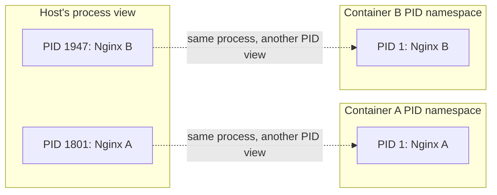

The numbers are illustrative. **There is only one Nginx A process, not a duplicate.** That process may have a host-visible PID and a different PID within its container's PID namespace. Processes in an ancestor PID namespace can generally see descendants, while a containerized process does not automatically see processes in its siblings' namespaces.

This also explains something from Day 3: why a container's principal program is often PID 1 *inside that PID namespace*. PID 1 has special responsibilities and signal behavior; that is one reason process startup and shutdown design matter.

> **Do not overgeneralize:** Namespaces restrict visibility, but are not an absolute security barrier on their own. Privileges, capabilities, mounts, kernel attack surface, and configuration still matter.

### 2.2 Mount namespaces and root filesystems: why files look different

The transcript says namespaces separate files. The more accurate statement is: **mount namespaces isolate the view of mounted filesystems**, while a container runtime also prepares a filesystem tree for the container.

A mount namespace doesn't invent a new filesystem or automatically protect every file. The runtime typically supplies a container root filesystem based on the image, sets up mounts, and makes that tree the process's view of `/` (using appropriate root-switching mechanisms). A bind mount can deliberately make a host directory visible inside a container.

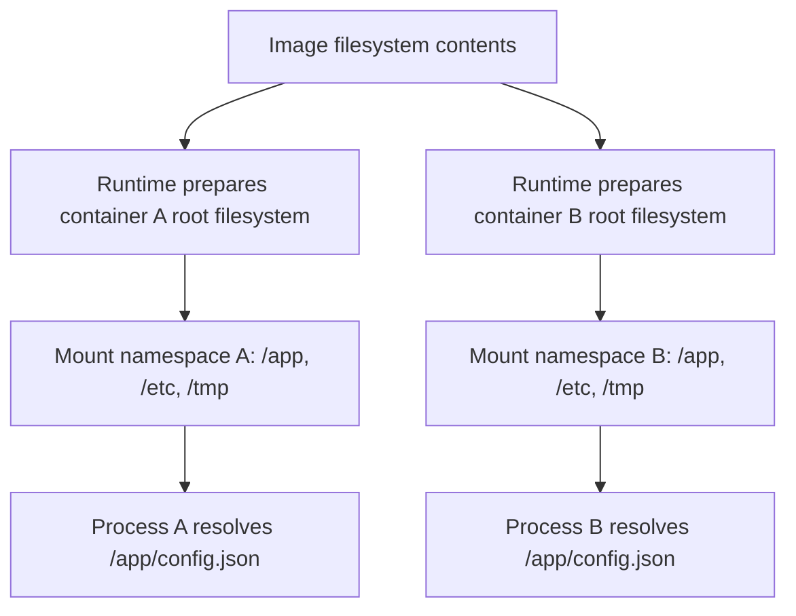

The path string may be identical, but the resolved file can be different. If both containers are given the **same shared bind mount or volume**, they can see common underlying files. Isolation is configured, not magical.

### 2.3 Network namespaces: why two containers can both use port 80

Now we can connect to Day 3 directly. A network namespace provides a distinct view of network interfaces, IP addresses, routes, and transport-layer port bindings, among other network state.

Each Nginx instance can bind to port 80 because the listeners exist in **different network namespaces**. Docker often connects the namespaces through virtual Ethernet interfaces and a bridge network. Port publishing adds a way for traffic arriving at a host address/port to reach a selected container.

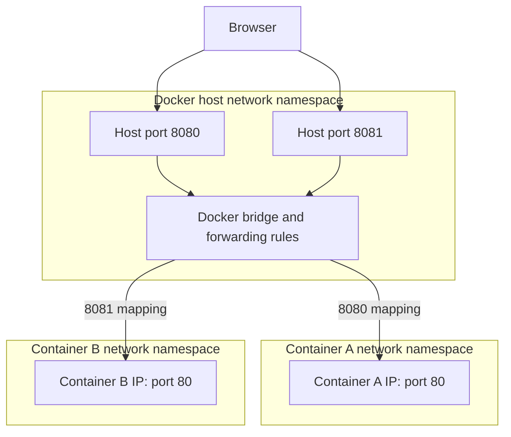

This is a **conceptual traffic diagram**, not a guarantee that packets always pass through a user-space Docker daemon. On Linux, networking often uses kernel packet forwarding/NAT rules (and implementation details vary with Docker setup). On Docker Desktop for macOS/Windows, a Linux VM and additional forwarding layers are involved.

### 2.4 Other namespaces: keep the scope useful

| Namespace | What it separates | Why you might care |
|---|---|---|
| UTS | Hostname and domain name | Different containers can report different hostnames. |
| IPC | Certain interprocess communication resources | Reduces unintended sharing of IPC objects. |
| User | User/group ID mappings and capabilities | Root inside a user namespace need not be host root. |
| Cgroup | View of cgroup paths | Can hide or virtualize parts of cgroup membership information. |
| Time | Certain monotonic/boot-time clock offsets | Relevant to specialized workload environments. |

We don't need to memorize every namespace implementation detail for this chapter. The recurring pattern is: **same kernel, process-specific resource view**.

---

## 3. The second missing boundary: resource controls with cgroups

Now imagine that Nginx A can only see its own processes and network interfaces. Could its workers still consume lots of memory and CPU? **Yes.** Isolation of visibility doesn't automatically create a resource quota.

This is where **cgroups (control groups)** enter. The transcript's pizza analogy captures the intent: give workloads resource budgets. The real mechanism is that Linux associates processes with cgroups and enforces/account for resources through controllers.

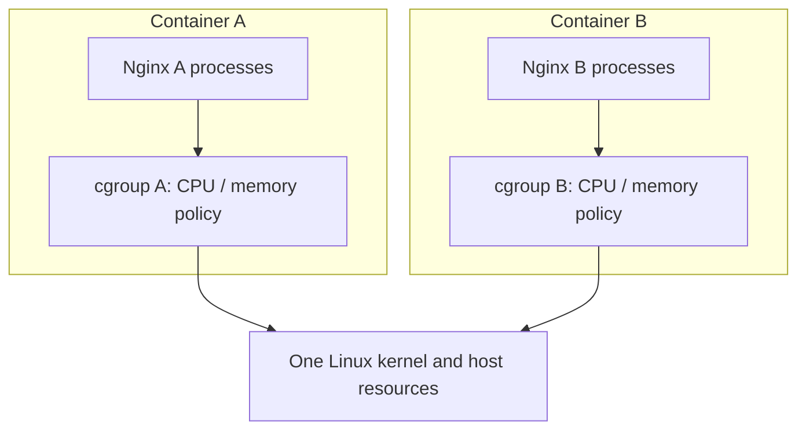

Here's the core contrast:

| Question | Linux feature | Practical meaning |
|---|---|---|
| **What resources can this process see?** | Namespaces | Process, filesystem-mount, network, and other views. |
| **How much resource may this workload consume?** | Cgroups | CPU, memory and supported I/O accounting and controls. |

### 3.1 CPU controls: what does `--cpus=1` mean?

Suppose the host has four logical CPUs, and you start:

```bash
docker run --name busy-a --cpus=1 nginx
```

A CPU quota of `1` CPU means the workload is allotted approximately **one CPU's worth of execution time over the quota period**. It does **not necessarily pin the process to one particular CPU core**. Separate CPU affinity/cpuset settings govern which CPUs may be used.

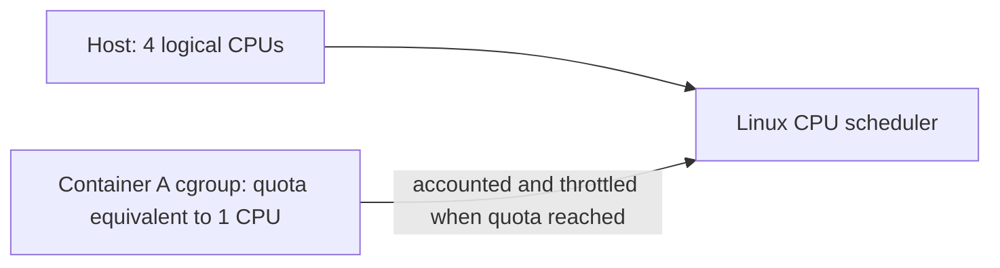

This is a limit on **CPU time**, rather than a fixed physical slice of the processor. Without an explicit CPU limit, a container can often use substantial idle CPU capacity. Cgroups are a tool for controlling consumption, but their protection depends on configured policies.

### 3.2 Memory controls: what happens at the limit?

Now start a workload with a memory limit:

```bash
docker run --name memory-a --memory=512m nginx
```

The memory controller accounts memory usage for the cgroup. If the workload reaches its configured limit, the kernel may try reclaiming memory; if that isn't sufficient, an out-of-memory condition may cause a process in the cgroup to be killed. The exact behavior depends on kernel and policy configuration.

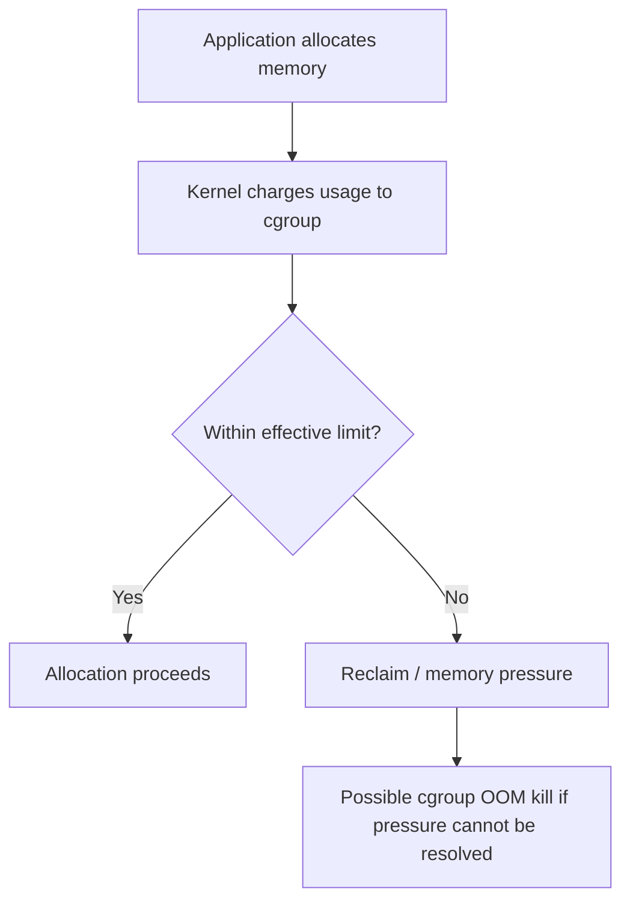

A memory limit reduces the risk of a workload exhausting the host, but **does not guarantee that every failure is contained or that the host can never experience resource pressure**. Kernel memory, shared dependencies, badly chosen limits, and other system resources still require attention.

### 3.3 What about disk?

The source transcript says cgroups control "disk." The careful interpretation is that Linux cgroup controllers can influence **block I/O usage** (such as I/O weight or limits where supported). That is different from limiting how many **bytes of disk storage** a container's writable layer may occupy. Storage capacity quotas usually involve additional filesystem or storage mechanisms.

This distinction matters whenever a course uses the general term "resource limit."

---

## 4. Who sets up namespaces and cgroups: kernel versus Docker?

We have the kernel features. Now we can ask the question that prompted this chapter: **what exactly does Docker do?**

Linux supplies the actual mechanisms. Docker and the container runtime ecosystem **orchestrate their use**: choose which namespaces to establish or join, prepare filesystem mounts, arrange resource policies, and start the application process.

The video says "Docker does not create namespaces." That is accurate in the sense that Docker did **not invent** Linux namespaces. But when starting a container, the runtime can indeed request the **kernel to create new namespace instances**. These are different meanings of *create*.

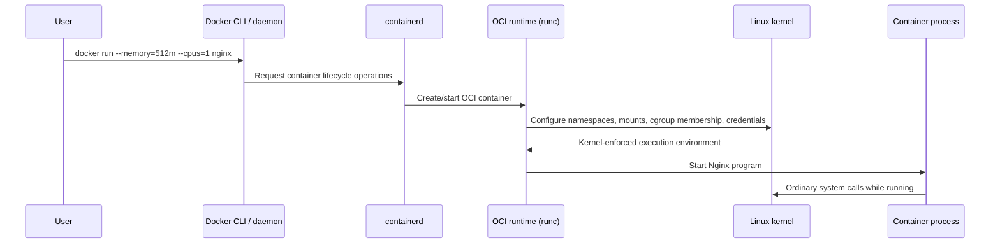

This is a **simplified modern Docker-on-Linux flow**. Real systems involve additional components and setup steps, and exact ordering varies. The key causal distinction is stable:

1. **Docker/runtime configures an environment** by asking Linux to apply isolation and resource policies.
2. **The Linux kernel enforces the policies** as processes execute.
3. **The application uses ordinary system calls**; its requests do not need to pass through the Docker daemon every time.

### The most important correction to your mental model

Don't picture Docker as a middleman continuously translating every container system call to the kernel. Picture Docker/containerd/runc as the **setup and lifecycle coordinators**, and the kernel as the **ongoing enforcer**.

---

## 5. Revisit the original two-container example, now with all layers

Let's give Nginx A and B separate views and different memory limits:

```bash
docker run -d --name nginx-a -p 8080:80 --memory=512m --cpus=1 nginx
docker run -d --name nginx-b -p 8081:80 --memory=256m --cpus=0.5 nginx
```

Both use the same host kernel. Each normally gets its own PID/mount/network namespace configuration and its own resource-control membership. Both can serve on container port 80. Different host ports direct browser requests to the right container.

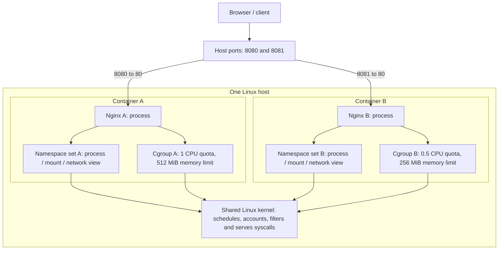

This is a **mental-model diagram**, not a packet-level network trace. Keep two different operations mentally separate:

- A request coming to host port `8080` is routed to Nginx A's container port `80`.
- When Nginx A needs to read data or send a response, it makes system calls that the **same kernel** processes according to the process's namespace, credentials, cgroups, and other security configuration.

### A subtle but critical point

A container isn't a miniature VM or a separate running kernel. A container is an **arrangement of processes and runtime settings** on an existing Linux kernel. Isolation is powerful, but weaker in some threat models than running workloads on entirely separate guest kernels. Namespaces and cgroups alone are **not complete security**; capabilities, seccomp, LSMs (such as AppArmor/SELinux), privileges, and host patching also contribute.

---

## 6. How to observe these boundaries without learning kernel programming

We need only a few small observations to connect the diagrams to a real Linux system.

> These checks target a **Linux Docker host**. With Docker Desktop on macOS/Windows, the Linux kernel belongs to Docker's VM, so host PID and `/proc` observations differ from a native Linux host.

### Experiment A — Compare process visibility

```bash
# Create a test container
docker run -d --name demo-a nginx

# Show processes as Docker sees them
docker top demo-a

# Show processes from inside the container (if ps is installed)
docker exec demo-a ps -ef
```

Ask yourself: *Is Nginx a real host process?* Yes. The container may show it with a different PID and a narrower process view.

### Experiment B — Compare namespace identities

On a Linux host, first get the process ID of the container's main process:

```bash
PID=$(docker inspect -f '{{.State.Pid}}' demo-a)
echo "$PID"

# Compare the host shell's and container process's namespace identifiers
readlink /proc/self/ns/pid
sudo readlink /proc/$PID/ns/pid

readlink /proc/self/ns/net
sudo readlink /proc/$PID/ns/net
```

Different identifiers typically indicate different namespace instances. `/proc/<PID>/ns/*` is a useful way to inspect namespace membership; this is **observation**, not manual namespace creation.

### Experiment C — Inspect configured limits

```bash
docker run -d --name demo-limited --memory=256m --cpus=0.5 nginx

docker inspect -f 'Memory={{.HostConfig.Memory}} NanoCPUs={{.HostConfig.NanoCpus}}' demo-limited

docker stats --no-stream demo-limited
```

Notice that `docker inspect` exposes configured container settings while `docker stats` shows resource usage. Configuration and observed consumption answer **different** questions.

### Safe cleanup

```bash
docker rm -f demo-a demo-limited
```

Run this only for the disposable demo containers created above.

---

## 7. Connect this foundation to Kubernetes (without jumping too far ahead)

We are not studying kubelet and CRI in detail here. Still, notice why Day 3.1 matters for Kubernetes:

- A Kubernetes Pod is also built from Linux processes and container-runtime primitives; it is not a new kernel.
- Containers in the **same Pod** typically share a **network namespace**, which is why they can communicate over `localhost` and share the Pod IP. That differs from our two separate Docker containers.
- Kubernetes CPU and memory resource settings eventually influence runtime and kernel resource controls; Kubernetes doesn't replace the Linux kernel's enforcement mechanisms.

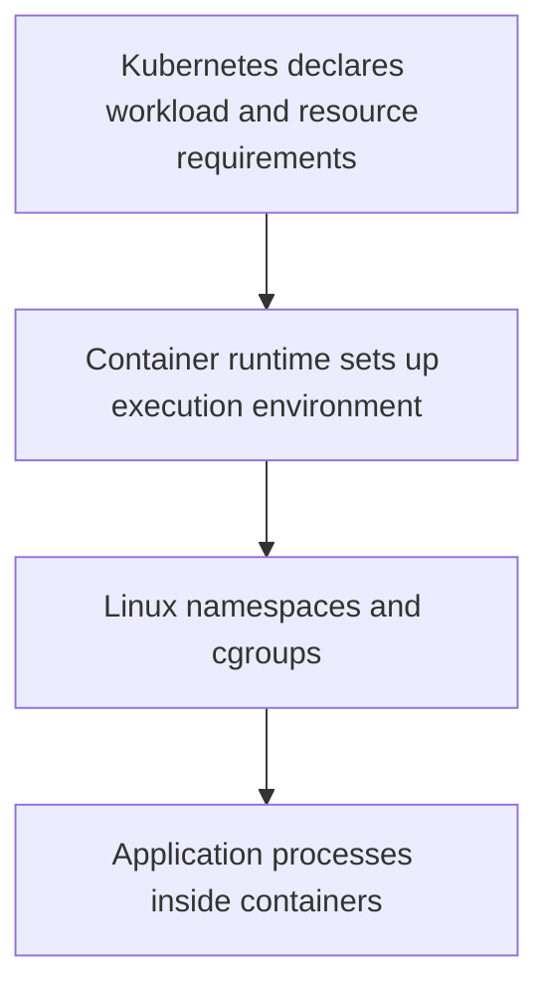

This connection is why the "shared kernel" concept comes back again during kubelet, networking, and resource-management lessons.

---

## 8. Rebuild the complete mental model in your own words

We started with a puzzle: if containers share a kernel, why don't they behave like ordinary processes all piled into one unrestricted environment?

First, we established that every process relies on kernel services for operations such as reading files and using the network. **The kernel already knows which process is making each request.**

Then we added **namespaces**. They let the kernel give processes different views of particular resources: process IDs, mounted filesystems, network interfaces, and more. This is why two Nginx containers can each see their own PID 1, have their own network configuration, and listen on port 80 in different network namespaces.

But visibility isn't the same as resource allocation. So we introduced **cgroups**. They account for and control resource usage, such as CPU time and memory, according to configured policies.

Finally, we located Docker correctly: Docker and its runtime components **request and coordinate** the environment; Linux **implements and enforces** the boundaries while the processes run.

The compact model is:

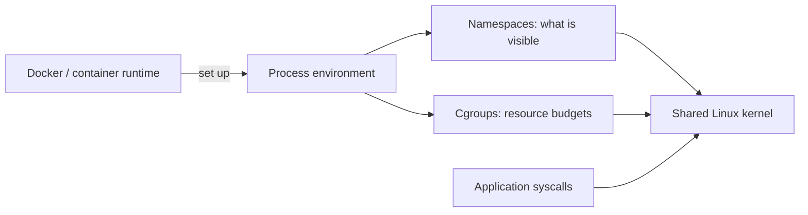

### Reasoning checks

1. If two containers have different PID namespaces, are they running under two different kernels? **No.** They have different PID views under one kernel.
2. If two containers both use port 80 internally, why is there no inherent conflict? **Their listeners can exist in separate network namespaces.**
3. Would setting a memory limit automatically prevent every possible host failure? **No.** It constrains accounted memory according to its policy but is not a complete host-safety guarantee.
4. Is Docker daemon in the data path of every application `read()` or `send()` call? **No.** Running applications use normal kernel interfaces.
5. Does a mount namespace guarantee that no files can ever be shared? **No.** Deliberately shared mounts or volumes can expose the same underlying data.

### Where to go next

With this foundation, revisit Day 4's `CMD` and `ENTRYPOINT` discussion. The process launched by those instructions is now more than an abstract "container command": it is a **real Linux process** that runs with specific namespaces, resource controls, filesystem mounts, and kernel access rules.

---

## Source boundaries and clarifications

**Derived from the supplied transcript:** Shared host kernel; namespaces for isolated resource views; cgroups for controlling resource usage; Docker as a tool that uses Linux features; the two-container example; the distinction between visibility and resource limits.

**Added technical explanation:** Kernel system-call decision points; PID mappings; mount namespaces versus prepared root filesystems; network namespaces and port publishing; cgroup CPU quota and memory OOM behavior; runtime orchestration with containerd/runc; security limitations; the difference between block I/O control and disk-capacity quotas; Linux observation commands; Kubernetes Pod network-namespace connection.

**Important corrections to oversimplifications:** Docker can ask Linux to *create namespace instances* even though Docker did not invent namespaces; cgroups do not necessarily guarantee a server cannot crash; namespaces and cgroups alone do not provide complete security; containers do not always have mutually isolated namespaces because sharing can be configured.
