# CKA Day 3.2 — Docker as One Connected System

> **Learning objective:** Build one continuous mental model of how Linux processes become containers, how images are built and reused, where data lives, how containers communicate, and why Docker Compose exists.
>
> **Source:** User-provided Day 3.2 video transcript (approximately 19 minutes). This chapter reorganizes its teaching sequence, adds bridging explanations, and marks important technical qualifications. It continues **Day 0 → Day 1 → Day 2 → Day 3 → Day 3.1**.
>
> **Visual format:** Every diagram is an embedded Mermaid block. No external SVGs, image files, plugins, or linked assets are required in an Obsidian vault with Mermaid support.

## Our starting question: Why does `docker compose up` sometimes feel like magic?

Imagine joining a project with a frontend, an API, and a PostgreSQL database. A teammate asks you to run `docker compose up`. Three services start; a web page appears; the API connects to the database. But you don't yet know **what was created**, **which parts were shared**, **where information is stored**, or **how the three processes found each other**.

There is one way to understand this without memorizing twenty commands: begin with one ordinary Linux process, give it an isolated execution environment, package that environment as an image, run several containers, and introduce storage and networking only when the application needs them.

We will evolve the same application through the chapter:

- **Version 1:** One Node.js HTTP API.
- **Version 2:** Build a repeatable image for that API.
- **Version 3:** Give the API persistent data rather than depending on its temporary writable layer.
- **Version 4:** Connect the API to a PostgreSQL database.
- **Version 5:** Express the whole arrangement with Compose.

These are milestones in a story, not separate topics to memorize.

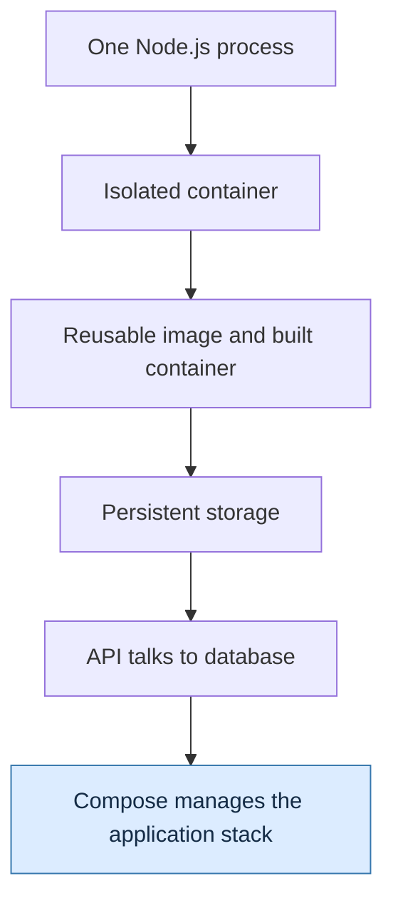

**Mental checkpoint:** By the end, you should be able to look at a Compose file and mentally reconstruct the processes, network paths, image filesystem layers, and persistent storage behind it.

---

## 1. Start below Docker: a process asks Linux to do work

From Day 0, remember that a program sitting on disk is not yet running. When it executes, Linux creates a **process**. The kernel schedules its CPU time, maps memory, and handles privileged operations via system calls. A Node.js web server calls into the operating system when it opens a network socket or reads a file.

Without Docker, the process may see the host's usual filesystem, process environment, and network interfaces, subject to its permissions. Docker doesn't replace the Linux kernel or create a tiny separate kernel for this app. Docker and its runtime arrange **kernel-provided boundaries** around the process before it runs.

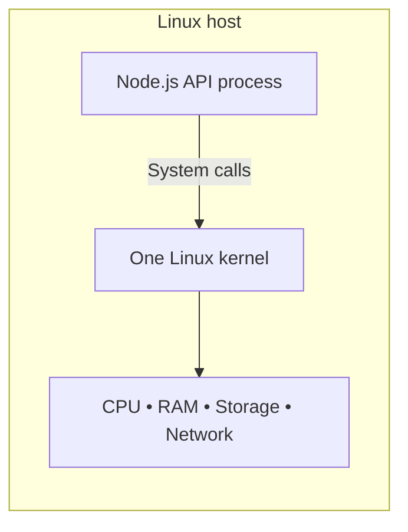

This immediately gives us our first design problem: **if the API and database run as two processes on the same machine, how do we keep their views and resource usage separate?**

### 1.1 Namespaces and cgroups are different kinds of boundaries

A **namespace** changes the scope of certain resources visible to a process. For example, a process in its own PID namespace sees a process numbering space that differs from the host's. A network namespace has its own network stack, including interfaces and routing tables. A mount namespace can have its own mount layout. The container's **root filesystem** is prepared separately and made visible through filesystem/mount operations; it is not accurate to say namespaces magically generate a private disk.

A **cgroup** groups processes so the kernel can account for and control supported resources, including CPU and memory. A CPU quota can throttle a busy process. A memory limit can cause out-of-memory termination when the cgroup cannot reclaim enough memory. **Limits are configurable, not automatic**: an unconstrained container may still exhaust host resources.

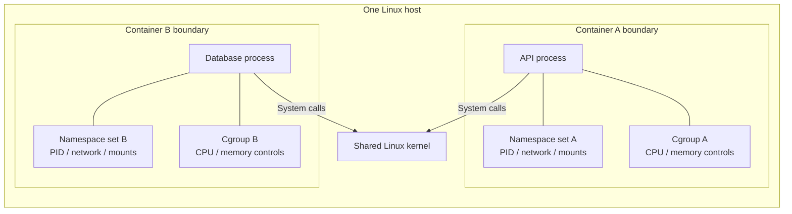

**What to notice:** There aren't two kernels inside the two boxes. The kernel is common; the configuration of each process's environment differs.

**Important qualification:** Kernel namespaces and cgroups are isolation and resource-control mechanisms, not a complete security guarantee. User identities, capabilities, seccomp, mandatory access control, filesystem permissions, and runtime hardening also matter. And Docker Desktop on macOS/Windows generally runs Linux containers in a Linux VM, so the shared Linux kernel belongs to that VM rather than directly to the macOS/Windows kernel.

Now we can answer what a container *is*: an isolated application execution environment, typically containing one main application process and sometimes related child processes. But the environment has to come from somewhere. That leads to images.

---

## 2. The application isn't the image, and the image isn't the container

Suppose our API has a `server.js` file, a package manifest, and a Node runtime requirement. We could configure these manually on every machine. Then each setup could drift: one machine has a different Node release, another lacks a dependency.

An **image** solves the repeatability problem. It is a reusable, read-only image artifact consisting of filesystem content and configuration metadata. It can include application code, runtime libraries, and default startup settings. It does **not automatically include** runtime secrets, host resources, or every external dependency (for example, the database server our API calls).

A **container** is created from an image. It gets a writable layer and runtime settings; its configured process starts. One image can back multiple independently running containers.

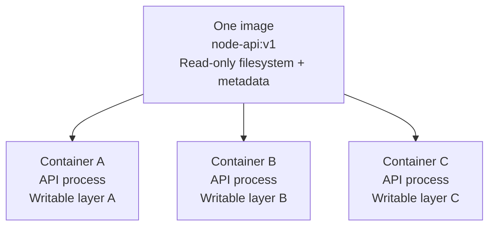

If you change `/app/settings.json` in Container A, does Container B see it? **Not simply because they use the same image.** The change lands in A's own writable layer (unless the path is a shared mount).

And if you stop and restart A, its writable layer normally remains. If you **remove** A and replace it with a newly created container from the original image, changes in A's writable layer are lost. That distinction will become central when we add a database.

### 2.1 What is the difference between a process, a container, and an image?

| Thing | What it represents | Lifetime insight |
|---|---|---|
| Program / files | Code and supporting files on storage | Exist without being executed |
| Image | Read-only distribution artifact with filesystem layers and metadata | Reusable across container creations |
| Container | Runtime instance with writable layer, mounts, namespaces, cgroups and settings | Can exist even when its process has stopped |
| Main process | Executing application inside the container | Its exit normally causes the container to stop |

**Connection back to Day 3:** Nginx kept running because its main server process continued serving requests; the `echo` container exited after its command finished. Container lifecycle is tied to its main process, not to whether a 'mini virtual machine' remains powered on.

---

## 3. Why an image consists of layers rather than one giant copy

We have a reusable artifact. The next problem is efficiency. If you rebuild your API after changing one line of code, should Docker repeat every dependency installation and transfer the entire image again?

Images are assembled from **read-only filesystem layers**. A layer represents a filesystem change relative to earlier layers. The image also contains configuration metadata, and a Dockerfile is one common recipe used to build it.

Take our Node API:

```dockerfile
FROM node:20-alpine
WORKDIR /app
COPY package*.json ./
RUN npm ci --omit=dev
COPY . .
EXPOSE 3000
CMD ["node", "server.js"]
```

The instructional chain is intentional. We first establish a Node runtime, then install dependencies based on the relatively stable package files, then copy the frequently changing application source. `EXPOSE` documents an application port; it doesn't publish the port. `CMD` defines the default command used when the container starts, not an application execution step during the build.

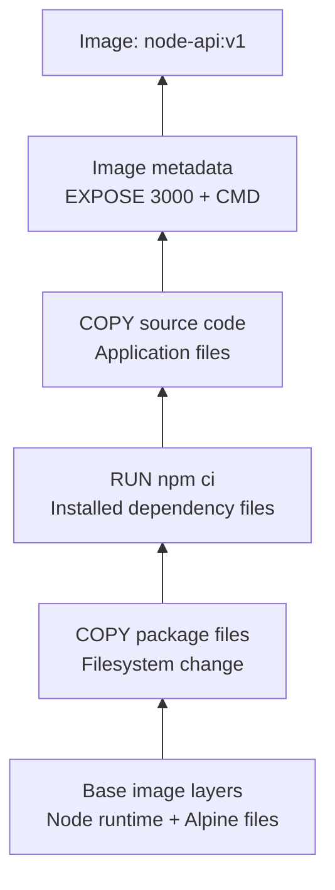

**Visual precision:** This chart shows a *conceptual build progression*. `WORKDIR` may affect the filesystem if it must create the directory, and actual filesystem layers/cache records depend on builder implementation. `EXPOSE`, `CMD`, and `ENV` are primarily image configuration; do not assume each Dockerfile line creates a new filesystem layer.

### 3.1 How Docker reuses earlier work

Imagine changing only `server.js`. The dependency manifest and lockfile are unchanged. A modern Docker builder can reuse earlier cached steps, including dependency installation, and rebuild the later source-copy step.

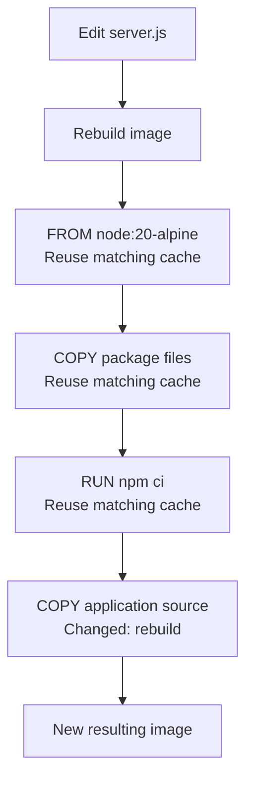

Contrast that with this alternative:

```dockerfile
FROM node:20-alpine
WORKDIR /app
COPY . .
RUN npm ci --omit=dev
CMD ["node", "server.js"]
```

Now modifying source code changes the broad `COPY` input *before* `RUN npm ci`, usually causing that dependency step to rebuild. The application may behave identically, but the rebuild work is different.

**Key idea:** Cache efficiency depends on **what changes** and **where the change appears in the build dependency chain**. This is why Dockerfile instruction order matters. BuildKit uses more sophisticated dependency and cache analysis than a simplistic 'always rebuild every following line' rule, but the ordering principle is still useful.

### 3.2 Layers help distribution too

Two images sharing identical layers need not duplicate those layers in local storage, and registries/clients can avoid retransferring layer blobs already present. This is an important reason base images and layer reuse matter, not just build speed.

But what tells the builder which local files it is allowed to include? That requires the next concept: the **build context**.

---

## 4. The Dockerfile is a recipe; the build context is its available material

Suppose your project folder looks like this:

```text
node-api/
├── Dockerfile
├── .dockerignore
├── package.json
├── package-lock.json
├── server.js
├── node_modules/
├── test-results/
└── .env
```

When you run:

```bash
docker build -t node-api:v1 .
```

The `.` names the **build context**: the current directory. The builder may use eligible files from this context for `COPY`/`ADD`. A Dockerfile can be selected separately with `-f`, as in:

```bash
docker build -f Dockerfile.dev -t node-api:dev .
```

Here `Dockerfile.dev` is the selected recipe; `.` is still the context. These two arguments have different responsibilities.

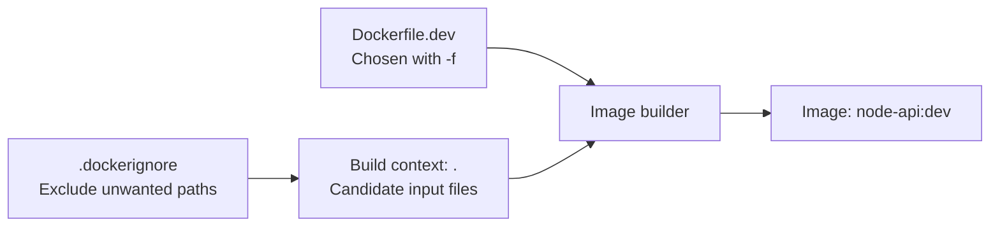

To avoid including dependency directories, test artifacts, Git metadata, or local secrets in a broad copy, use a `.dockerignore`:

```gitignore
node_modules/
test-results/
.git/
.env
*.log
```

The transcript emphasizes that a big context can slow down builds. That's a good working principle. With modern BuildKit, file transfer and caching can be optimized, so it isn't accurate to assume every byte is always transferred in full on every build. **Nevertheless, broad `COPY . .` instructions can still accidentally package unnecessary or sensitive files.** Treat `.dockerignore` as a hygiene and safety boundary for build inputs, not as a substitute for secure secret handling.

We now know how to build the API image. Let's run it. But that raises the next question: where do files written by the running API actually go?

---

## 5. The hidden trap: a container can write files, but the image does not change

When the API container starts, the runtime makes the image's read-only layers available through a filesystem view and places a **container-specific writable layer** over them. The application experiences this as its filesystem.

If the API writes a temporary report to `/app/reports/report.json` and that path isn't a mounted volume or bind mount, the write belongs to this container's writable layer.

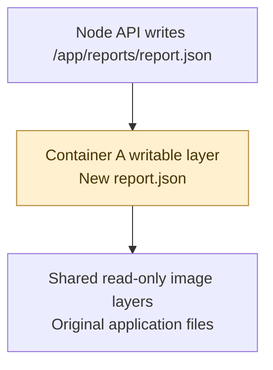

This produces two different lifecycle stories:

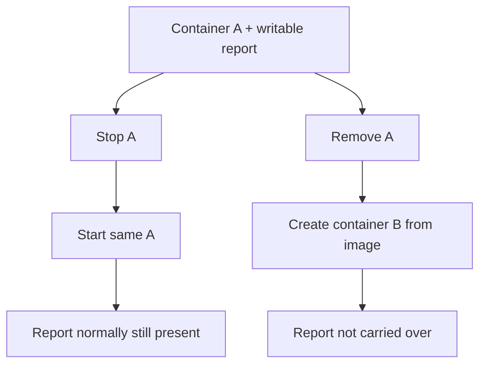

A running application therefore has **two types of change** to distinguish:

1. **Application release changes:** modify source/dependencies/configuration, build a new image, create new containers.
2. **Durable application data:** database records, uploads, and other state that must outlive one container instance.

Rebuilding an image solves the first type, but it does not solve the second. We need a storage location whose lifecycle isn't coupled to the container's writable layer.

### 5.1 Introduce a named volume

Suppose the API is replaced with PostgreSQL. PostgreSQL writes data files to `/var/lib/postgresql/data` in our example. Mount a Docker-managed named volume at that path:

```bash
docker volume create pgdata

docker run -d \
  --name db \
  -e POSTGRES_PASSWORD=localdevpassword \
  -v pgdata:/var/lib/postgresql/data \
  postgres:16
```

The password shown is a **local-learning placeholder**, not a production credential pattern. The precise default data directory is image/version-sensitive; this path is appropriate for the `postgres:16` example here.

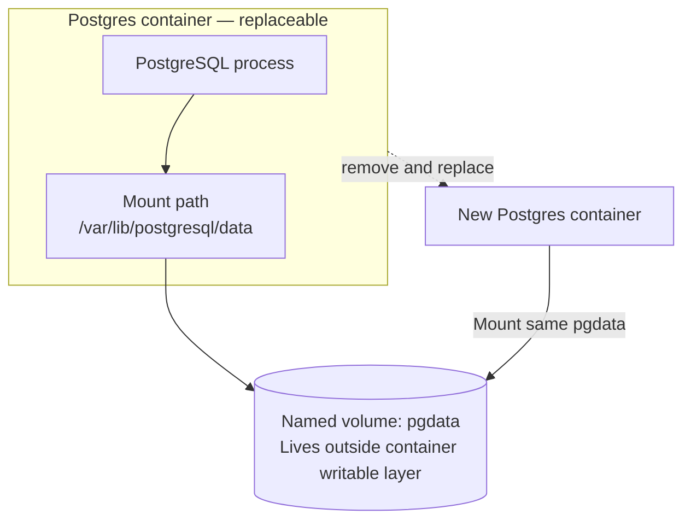

Removing the container normally doesn't delete the named volume. Creating a replacement and mounting `pgdata` can make the data available again. Note that deleting volumes explicitly, including with certain Compose `down -v` operations, *does* delete persistent data. A volume is **persistence**, not a backup.

### 5.2 Compare a bind mount

During development, you may want source-code edits on your laptop to appear in the container without rebuilding the image:

```bash
docker run --rm -it \
  --mount type=bind,src="$(pwd)",dst=/app \
  node:20-alpine sh
```

Here `/app` points to a directory on the Docker daemon's host (Docker Desktop manages host-file sharing into its Linux VM). A change on the host can become visible inside the container immediately. **Whether the application automatically reloads after the change is a separate question**: it needs an appropriate watcher or restart behavior.

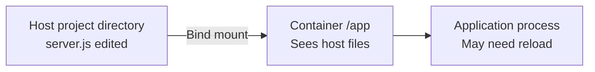

**Subtle but useful distinction:** A bind mount at `/app` hides image files that would otherwise be visible at that mount point. An initially empty Docker-managed volume mounted over existing image files may be initialized with the image directory's content by default (unless volume copy-up is disabled). Neither mechanism literally edits the immutable image itself.

So far we have one application with an isolated process and independent storage. But a real API needs to talk to a database. How can two isolated network namespaces communicate?

---

## 6. Isolation creates a networking question

From Day 3 and Day 3.1, remember that a container process can have its own network namespace. Its loopback address, network interfaces, IP routing table, and listening ports belong to that namespace.

This means `localhost` is **relative to the process making the request**. In the API container, `localhost:5432` means port 5432 *inside the API container's network namespace*, not automatically the database container or the Docker host.

To connect isolated containers, Docker commonly attaches their network interfaces to a virtual bridge network. On Linux, this uses virtual interfaces and kernel networking mechanisms; Docker configures the connection. On Docker Desktop, the traffic is mediated by the Docker Desktop Linux VM and its network integration.

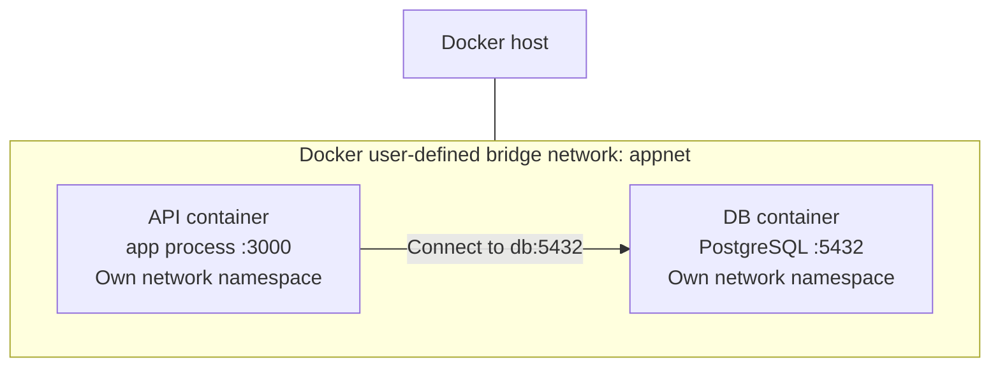

### 6.1 Why a custom network helps

On a **user-defined bridge network**, Docker provides name resolution for connected containers. If the database's network name is `db`, the API can connect to `db:5432` without hardcoding the container IP.

The legacy default bridge does not provide the same automatic container-name DNS behavior. This explains why two containers may share an underlying host and still fail to reach each other by name.

Try the idea manually:

```bash
docker network create appnet

docker run -d --name db --network appnet \
  -e POSTGRES_PASSWORD=localdevpassword \
  -v pgdata:/var/lib/postgresql/data \
  postgres:16

# Illustrates name resolution; it does not require our API source code.
docker run --rm --network appnet busybox nslookup db
```

Docker can connect API and database over the network, but publishing a port is another operation. That's how a user outside the Docker network reaches the API.

### 6.2 Add access from a browser

Suppose the API listens on **port 3000** inside the container. We want our development browser to access it using **localhost:8080** on the host:

```bash
docker run -d --name api --network appnet \
  -p 127.0.0.1:8080:3000 \
  node-api:v1
```

Here the host-side address and port are `127.0.0.1:8080`, while the container-side port is `3000`. Binding to localhost explicitly avoids exposing this development port on all host interfaces. The API must actually listen on the appropriate interface *inside the container* (commonly `0.0.0.0:3000`) for traffic to reach it.


**A crucial observation:** Publishing the API's port is for **host-to-container access**. The API normally talks to the DB over the Docker network using `db:5432`; it doesn't need the DB port published to the host.

### 6.3 Is Docker networking a security boundary?

Different Docker networks can separate reachability, but 'not on the same network' is not a universal security guarantee. Host networking, published ports, multihomed containers, host firewall rules, privileges, and deployment topology can alter reachability. Treat networks as an important isolation and connectivity tool, while applying additional security controls as needed.

We now have the essential pieces: API image, DB image, a volume, a network, and port publishing. But manually recreating this stack from commands gets cumbersome. That's the problem Compose addresses.

---

## 7. Why Docker Compose appears naturally at this point

Consider what we would need to remember every time we start development:

Create a network; create a volume; start PostgreSQL with environment settings and a storage mount; start the API with its image, port mapping, and matching network; stop or remove the stack later.

This is **configuration of a multi-container application**, not an entirely new kind of kernel isolation. Compose lets us express the desired stack declaratively in YAML and coordinates Docker API operations to bring it up.

We'll make the example concrete. Assume our Node API code listens on `0.0.0.0:3000` and takes its database connection string from `DATABASE_URL`. Our `compose.yaml` can look like this:

```yaml
services:
  db:
    image: postgres:16
    environment:
      POSTGRES_USER: app
      POSTGRES_PASSWORD: ${POSTGRES_PASSWORD:?Set POSTGRES_PASSWORD}
      POSTGRES_DB: appdb
    volumes:
      - pgdata:/var/lib/postgresql/data
    healthcheck:
      test: ["CMD-SHELL", "pg_isready -U app -d appdb"]
      interval: 5s
      timeout: 3s
      retries: 10

  api:
    build: .
    ports:
      - "127.0.0.1:8080:3000"
    environment:
      DATABASE_URL: postgres://app:${POSTGRES_PASSWORD}@db:5432/appdb
    depends_on:
      db:
        condition: service_healthy

volumes:
  pgdata:
```

To run this example, provide a local test password (for instance in a `.env` file excluded from Git) and ensure the API's code actually reads `DATABASE_URL`. For real deployments, use appropriate secret-management practices rather than assuming Compose environment variables provide secret protection.

```bash
docker compose up --build -d
docker compose ps
docker compose logs -f api
```

What does Compose accomplish here? It builds the API image from `.` when needed, pulls the Postgres image if missing, creates the default project network and the named volume, starts the services, and applies their configured mounts and port mappings.

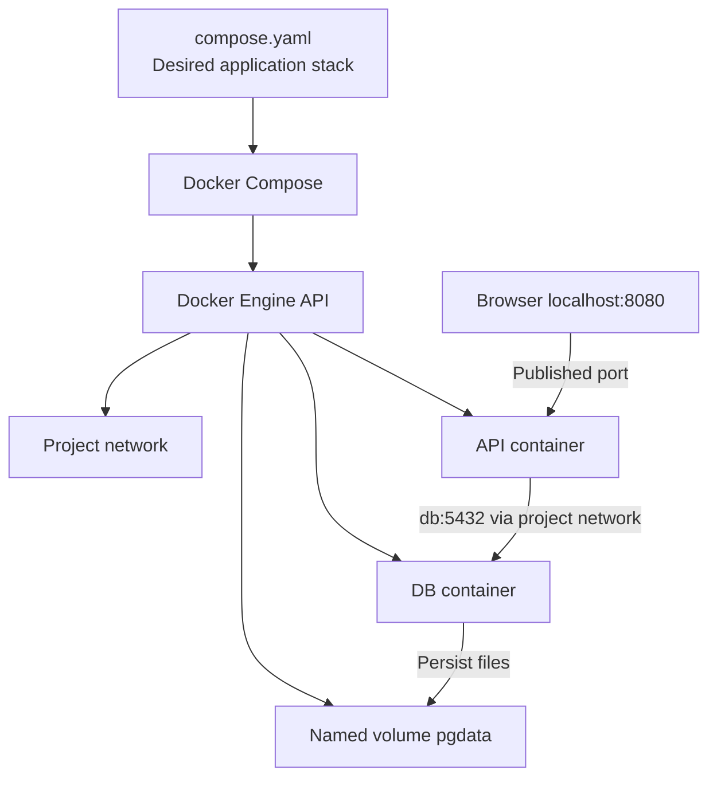

Compose is not Kubernetes and is not a cluster-wide scheduler. It is a tool for defining and managing Docker applications, typically in a single Docker Engine environment. Its interface is declarative, even though Docker performs API operations to realize that configuration.

### 7.1 Why `depends_on` does not always mean ready

Starting a database process doesn't mean it can accept SQL connections immediately. It may need time to initialize data files and begin listening. Short-form `depends_on` establishes startup ordering but does not guarantee application readiness.

Our example includes a `healthcheck` and `condition: service_healthy` so Compose can wait for the configured DB health check before starting the API. The API should still implement database reconnect/retry handling, because a database can become unavailable **after** startup.

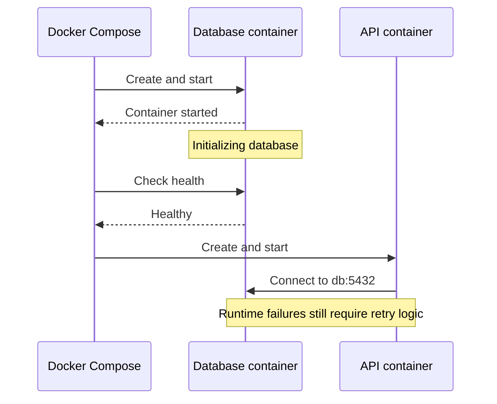

### 7.2 What survives `docker compose down`?

`docker compose down` normally removes the Compose-managed containers and default network, while named volumes are retained unless removal of volumes is explicitly requested. Therefore, `pgdata` can survive redeployment and be reused. By contrast, `docker compose down -v` removes Compose-declared named volumes (and anonymous volumes attached to the removed containers), which can destroy DB data.

You should be able to predict that outcome now, because volume lifecycle is separate from container lifecycle.

---

## 8. Reconstruct the complete architecture from first principles

Let's pull the entire story together without introducing anything new.

Our Dockerfile specifies how to construct the API's image. The image has read-only filesystem layers and a default startup command. Compose asks Docker Engine to create API and database containers. The runtime uses Linux capabilities—namespaces, cgroups, mounts, process creation—to establish each container's runtime environment. Both sets of application processes ultimately use the same **Linux kernel**. Compose additionally configures a bridge network and mounts a durable named volume for database files.

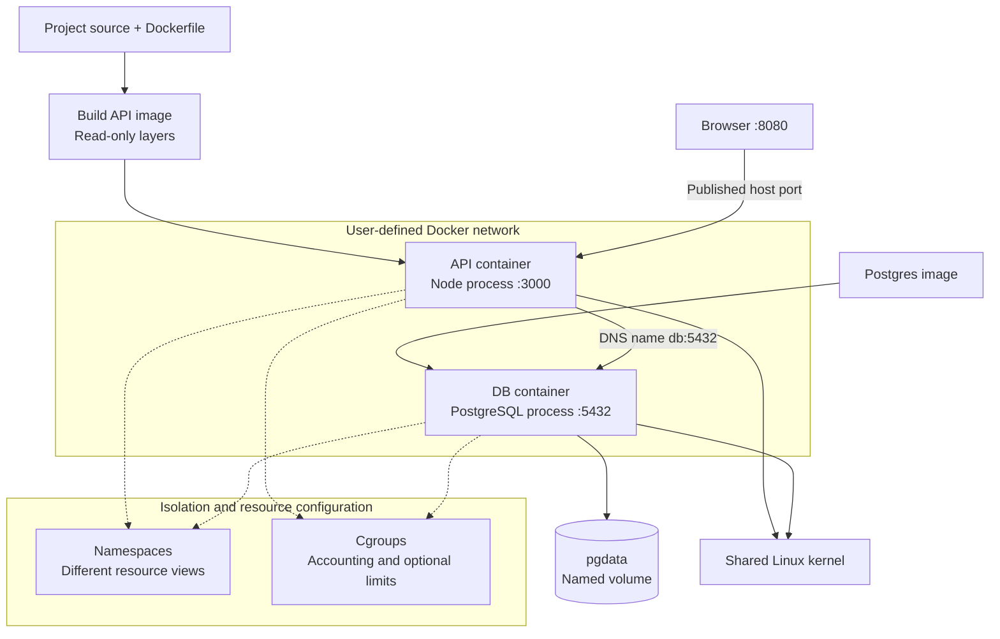

Read the diagram as a series of questions:

**Why can both containers run without two Linux kernels?** They are processes managed by one kernel, using separate runtime isolation contexts.

**Why do they start from the same predictable application files on every machine?** Their images contain repeatable filesystem content and startup configuration, assuming compatible runtime/platform and external dependencies.

**Why can a rebuilt API be fast?** Stable dependency layers and cached build steps may be reused.

**Why can the database survive container replacement?** Its files are written to a named volume mounted outside the container's writable layer.

**Why does the API connect to `db` instead of `localhost`?** It resolves the DB service name on the shared user-defined Docker network; localhost would refer to the API's own network namespace.

**Why is the web page at port 8080 if the API listens on 3000?** A host-side port is published and forwarded to the container's listening port.

**Why does one command start all of it?** Compose is a declarative description that orchestrates the Docker resources we now understand.

---

## 9. A small observational lab: prove the model

Use a disposable development Docker environment. These commands inspect behavior rather than change system-wide configuration. Some require that the sample Compose project from Section 7 exists.

### Observation A — Images and containers are different objects

```bash
docker image ls
docker ps
docker ps -a
```

Ask: Can an image exist with no running containers? Yes. Can a stopped container still exist? Yes. Does `docker ps` show stopped containers? Not without `-a`.

### Observation B — Inspect how the API was configured

```bash
docker compose ps
docker compose config
```

Ask: What host port is bound? Which service builds locally? Where is the DB volume mounted? `docker compose config` displays resolved configuration—be careful when sharing output, as it may include expanded secrets.

### Observation C — Observe the application's network name

```bash
docker compose exec api getent hosts db
```

This works if the API image includes `getent`; minimal images may not. Alternatively run a disposable diagnostic image on the Compose network. The key is to distinguish **DNS service-name resolution** from **port publishing**.

### Observation D — Observe persistent volume ownership

```bash
docker volume ls
docker compose down
docker volume ls
```

Ask: Why does the volume still appear? Because removing a container is not the same as deleting a named volume. **Do not run `docker compose down -v` on a project containing data you care about.**

---

## 10. Technical clarifications to keep the mental model accurate

The transcript's conceptual progression is useful, but several shortcuts deserve careful wording:

| Simplified statement | More accurate working model |
|---|---|
| "An image is one file on disk." | An image is a structured artifact with layers, manifests/configuration, and associated content. |
| "An image contains everything needed to run." | Images package many runtime dependencies, but not necessarily external databases, secrets, host kernel support, or platform compatibility. |
| "Every Dockerfile line creates a layer." | Filesystem-producing steps can create layers; configuration-only steps update image metadata. |
| "A container has no persistent storage." | A container has a writable layer while it exists; mounts provide storage whose lifecycle can extend beyond its removal. |
| "An app is isolated, so it is safe." | Namespaces and cgroups reduce interference but do not guarantee security or automatically impose limits. |
| "`EXPOSE` opens a port." | `EXPOSE` is image metadata; the application must listen, and host access generally requires publishing or other networking setup. |
| "`localhost` means the Docker host." | `localhost` refers to the network namespace of the calling process. |
| "Compose `depends_on` means the database is ready." | Short form orders startup only; readiness-aware startup needs a supported health condition, and robust clients need retries. |
| "Compose is only a shorthand for commands." | Compose manages a declaratively defined application through Docker APIs, networks, volumes, and lifecycle operations; it is not merely a pasted shell script. |

These qualifications aren't extra topics to memorize. They prevent the wrong mental model from becoming a habit.

---

## 11. Think through these scenarios, don't memorize commands

1. You update `server.js` but do not rebuild the API image. Why might a newly created container still run the old code?
2. Two containers use the same image. You create `/tmp/hello.txt` inside the first. Under what conditions could the second see it?
3. The API's Dockerfile says `EXPOSE 3000`, but `http://localhost:3000` on your laptop fails. What must you check?
4. Your API tries connecting to `localhost:5432` and receives `connection refused`, even though PostgreSQL is running in another container. What is your first correction?
5. The DB container is deleted and recreated with the same `pgdata` volume. What would you expect to happen to its records, assuming compatible software and correct mounts?
6. You modify a Node API source file and a full dependency install runs on rebuild. How might Dockerfile instruction ordering have caused this?
7. Compose starts your API after the DB container, but the first database connection still fails. Explain the difference between **started**, **healthy**, and **available later**.
8. A container is assigned no memory limit. Can you safely assume cgroups prevent it from using most host memory? Why not?

Try answering in sentences that connect the component, its responsibility, and the resulting behavior. That's a more useful CKA skill than remembering command flags without context.

---

## 12. Where the learning journey goes next

We have now built a coherent picture of the **single-host container world**:

**Linux process → kernel-enforced isolation → image → container writable layer → persistent mounts → bridge networking → multi-container application → Compose.**

The next questions in a Kubernetes course are natural: What happens when the containers need to run across multiple machines? Who decides which machine should host an application? Who notices that it failed? How are storage and networking represented across nodes?

Those questions lead to Kubernetes scheduling, the kubelet, CRI/container runtimes, Pods, Services, and persistent volumes. We should approach them the same way: each mechanism introduced because it solves a problem the existing model cannot handle.

**One-sentence teach-back:** Docker packages repeatable application files into images and runs them as isolated Linux processes; mounts preserve data beyond individual containers, networks connect those processes, and Compose describes how the pieces form one application.
