# CKA Day 03 — From a Running Container to a Reachable Application

> **Learning narrative:** Docker container flags, port publishing, Dockerfile instructions, Flask containerization, image distribution, process startup, logs, and container inspection.  
> **Source:** Day 3 transcript from *Cloud With VarJosh — CKA 2025*.  
> **Prerequisites:** Day 0 (processes, kernel, networking basics), Day 1 (containers versus VMs), and Day 2 (image → container; build, run, tag, push).  
> **How to read:** Follow the *same application journey* through successive diagrams. Each diagram adds something that did not exist in the previous mental model. Mermaid diagrams render in Obsidian and many Markdown viewers.

## Our destination: what are we actually trying to make happen?

Suppose we have a web application. A user opens a browser and expects a page. We know from Day 2 how to create a container from an image, but that is not sufficient: **starting a process**, **keeping it running**, and **allowing a browser to reach it** are three distinct questions.

We'll first use a ready-made Nginx web server to discover these questions. Then we will build our own Flask application, package it into an image, publish the image, start a container, and inspect the running process. At the end, a browser request will travel from a host port to our application in the container.

### Starting mental model — yesterday's knowledge

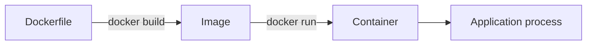

This is correct, but it hides important details: *Where is the process running? What is attached to the terminal? Which port is open? Who can reach it?* Those are today's missing pieces.

---

## 1. A container can be running even when no one can reach its web server

### 1.1 Start from the smallest experiment

Run:

```bash
docker run nginx
```

If `nginx:latest` is absent locally, Docker ordinarily pulls it from its configured registry (Docker Hub for this short name), creates a container, and starts Nginx inside it. Nginx normally listens on **port 80 inside the container**.

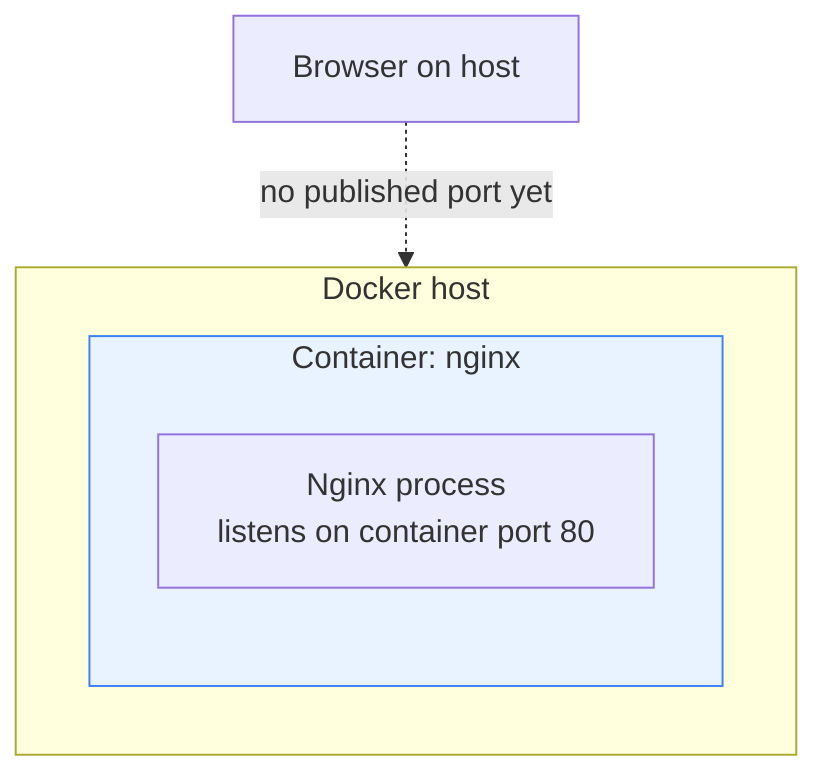

**First correction to the mental model:** A service can listen inside its own container network environment without Docker publishing a port on the host. We have started the server, but have not yet set up the host-port entry point demonstrated in this lecture.

### 1.2 Why the terminal does not return

With `docker run nginx`, Docker attaches the terminal to the container's standard streams by default. Nginx is a long-running server, so the terminal stays attached while the server continues to execute.

Open a second terminal and run:

```bash
docker ps
```

It displays **running** containers. Docker may generate a memorable name if none was provided. In the lecture, the instructor presses `Ctrl+C` in the attached terminal; the container exits. Afterwards:

```bash
docker ps -a
```

shows the stopped/exited container as well.

> **Think about it:** The container did not exit because Nginx successfully served one request. Nginx is intended to keep serving requests. It exited because its main server process was stopped in the demonstration. The lifecycle follows the container's main process, not the amount of browser traffic.

### 1.3 Foreground versus detached is about the terminal, not the network

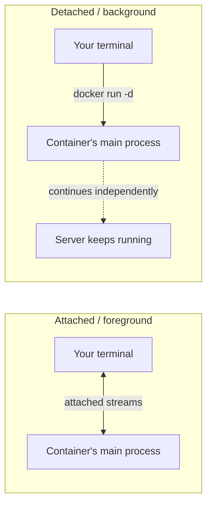

Now we can detach:

```bash
docker run -d --name nginx-one nginx
```

Docker returns a container ID and the terminal is free to accept new commands. **Detached mode does not automatically make the server accessible to a browser.** That requires the next concept: port publishing.

---

## 2. Port publishing: giving an isolated server an entry point

The server already listens on container port 80. But when we type `localhost:8080`, `localhost` refers to the machine whose browser we are using, not automatically to an isolated container's network namespace. How does the host know which container should receive traffic?

Docker lets us declare a host-to-container port mapping:

```bash
docker run -d -p 8080:80 --name nginx-one nginx
```

Read `8080:80` **from left to right** as:

**Host port 8080 → Container port 80**.

(If you already created `nginx-one` above, remove it with `docker rm -f nginx-one` before reusing the name.)

### Visual checkpoint A — before publishing

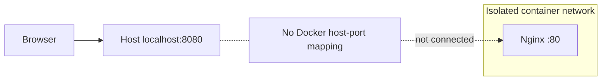

### Visual checkpoint B — after publishing

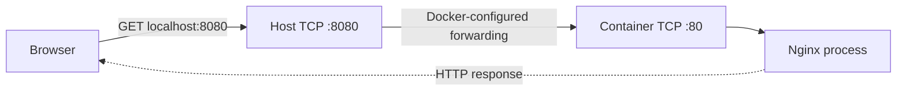

The command configures the mapping at container creation. Docker's networking implementation then handles packets according to that configuration; **the Docker daemon is not manually relaying each HTTP request in userspace**. The networking implementation may use host firewall/NAT rules and/or a forwarding component depending on platform and configuration.

Now `http://localhost:8080` can show the Nginx welcome page.

**Important security detail beyond the lecture:** `-p 8080:80` commonly publishes on all host interfaces by default. For a local-only exercise, prefer `-p 127.0.0.1:8080:80`. On Docker Desktop for macOS/Windows, a lightweight Linux VM and Desktop's forwarding integrate the container networking with host `localhost`; the high-level host → container model still applies.

### 2.1 A second container exposes the next missing distinction

What happens if we start another Nginx container? Both applications want port 80 **inside** their own containers. Is that a collision?

No. Each container normally has a separate network namespace, so the same internal listening port can be used in both containers. What cannot ordinarily be reused simultaneously is the **same host IP + protocol + published port combination**.

```bash
docker run -d -p 8080:80 --name nginx-one nginx
docker run -d -p 8081:80 --name nginx-two nginx
```

### Visual checkpoint C — one host, two isolated servers


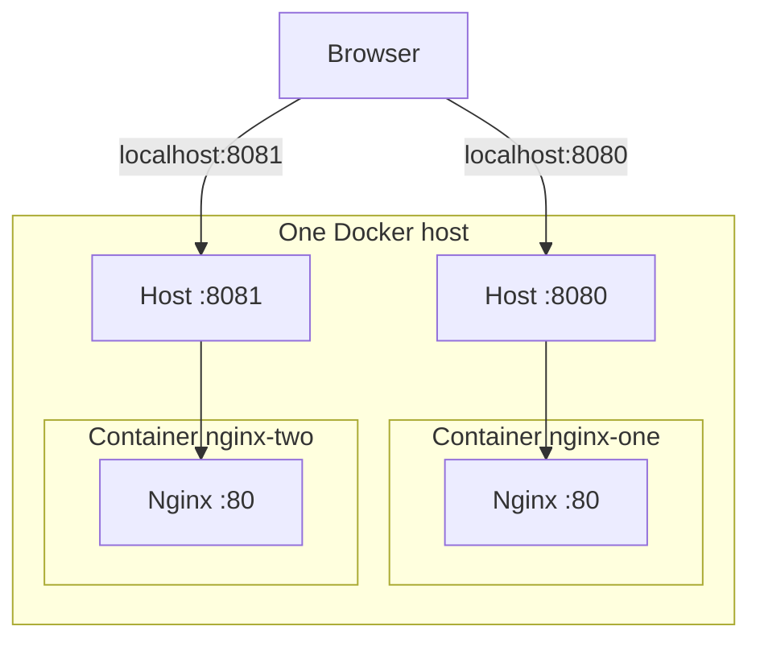

Notice what changed: the two containers have the **same container port**, but **different published host ports**. This is the exact reason `localhost:8080` and `localhost:8081` can show equivalent Nginx pages from two independent processes.

`docker ps` displays the containers' statuses and published port mappings. An attempted second binding to host port 8080 on the same listening address/protocol would generally fail because that binding is already taken.

> **Mental-model checkpoint:** The port belongs to a particular network endpoint, not to the image. An image is a template; each container has its own runtime networking context.

---

## 3. From using someone else's image to packaging our own app

Nginx proved that a containerized server can be started and reached. But in a real development workflow we usually own the application code. That creates a new problem: **How do we consistently place our application, its language runtime, and its dependencies into an image?**

The instructor uses a tiny Python Flask service. We'll use a concrete, runnable version of that same example. This sample code is a **clarifying implementation**, rather than a verbatim transcription of the lecture's on-screen code.

**Project directory:**

```text
day-03/
├── app.py
├── requirements.txt
└── Dockerfile
```

**`app.py`:**

```python
from flask import Flask

app = Flask(__name__)

@app.get("/")
def home():
    return "Hello Docker\n"

if __name__ == "__main__":
    app.run(host="0.0.0.0", port=5000)
```

Why `0.0.0.0`? It makes Flask listen on available interfaces **inside the container**, rather than only on the container's own loopback address. This is essential for the demonstrated published-port access path. The built-in Flask development server is fine for this lesson, but should not be treated as a production application server.

**`requirements.txt`:**

```text
Flask>=3.0,<4
```

For reproducible production builds, pin an exact verified dependency version and use an appropriate supported Python runtime. The lecture demonstrates `python:3.9-slim`; that version is retained here for fidelity to the lesson, although Python 3.9 has reached end-of-life and should not be chosen for a new production deployment.

### Visual checkpoint D — application needs three ingredients

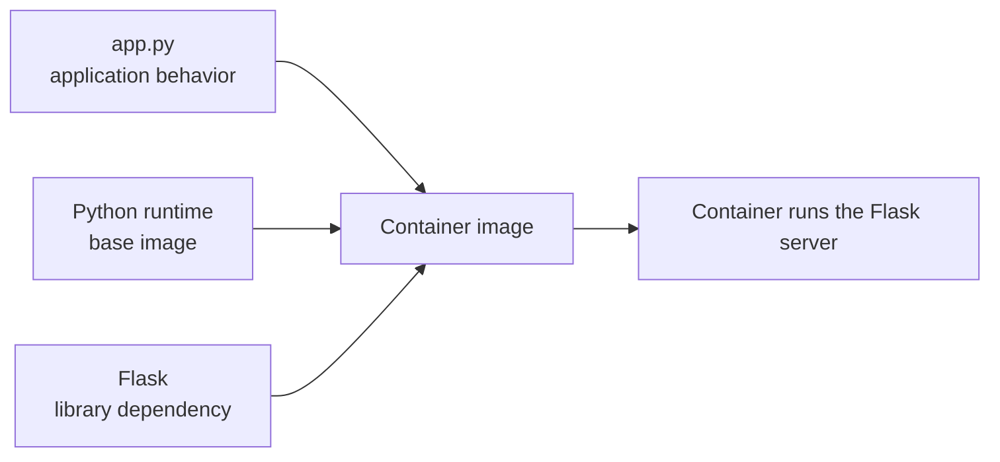

The central point is not that Docker somehow converts Python into a new kind of program. It packages a filesystem and execution metadata so a container runtime can start an ordinary Python process with its required files and libraries.

---

## 4. The Dockerfile is a recipe: distinguish build-time from run-time

Let's create a Dockerfile. The first decision is the starting environment. A Python application needs a Python interpreter; instead of installing one manually on each deployment machine, we start from a Python base image.

```dockerfile
FROM python:3.9-slim
WORKDIR /app
COPY requirements.txt .
RUN pip install --no-cache-dir -r requirements.txt
COPY app.py .
EXPOSE 5000
CMD ["python", "app.py"]
```

This is intentionally close to the lecture, with two practical refinements: `COPY` in place of `ADD` for ordinary local files, and a requirements file to express the dependency separately. The instructor uses `ADD app.py ...` and `RUN pip install flask`; both serve the same educational demonstration. `ADD` has extra behaviors that we don't need here.

### First mental model: two different timelines


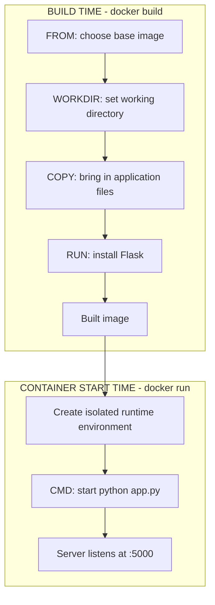

This explains a common confusion: **`RUN` happens while building an image; `CMD` defines the default command for a container created from that image.** Putting `python app.py` in `RUN` would try to start a long-running server *during the build*, which is not what we want.

### Now read each instruction as a meaningful design decision

**`FROM python:3.9-slim`** supplies the Python runtime and base filesystem. The `slim` variant includes fewer packages than the corresponding fuller image, usually giving a smaller footprint; it is not automatically free of vulnerabilities or guaranteed suitable for every package.

**`WORKDIR /app`** sets the working directory for following instructions and for the container's default working directory. Consequently, a relative filename such as `app.py` resolves beneath `/app`.

**`COPY`** places local build-context files into the image filesystem. The application code doesn't magically appear in the container: it must be included during the build or mounted at runtime.

**`RUN pip install ...`** executes a command during the build. In typical image builds, filesystem changes produced by that instruction are represented in the image's layers.

**`EXPOSE 5000`** documents the port the application is expected to listen on. It does **not** start the server and does **not** publish host port 5000. `-p` at runtime is separate.

**`CMD ["python", "app.py"]`** tells Docker which default process to launch at container startup. This is the exec-form syntax that we'll examine later.

### Visual checkpoint E — `EXPOSE` does not equal `-p`

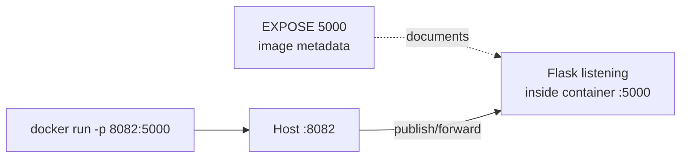

The thing that opens the HTTP listener is **the Python application**. The thing that arranges reachability from a host port is **Docker's published-port configuration**.

---

## 5. Build the image, then decide where to distribute it

The Dockerfile is a recipe, not the image itself. We now ask Docker to build an image from the current directory:

```bash
docker build -t my-python-image:v1 .
```

The trailing `.` means the **build context** is the current directory; by default Docker looks for a file named `Dockerfile` there. The `-t` flag tags the built image for later reference.

```bash
docker images
```

This lets us see the resulting image. Now recall the two kinds of places in our workflow:

- **Local image storage**, where Docker can immediately start containers on this machine.
- **Remote image registry**, where another machine or teammate can obtain an image.

### Visual checkpoint F — the image's journey

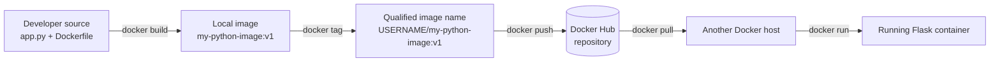

To publish to a repository in your Docker Hub account:

```bash
docker tag my-python-image:v1 YOUR_DOCKERHUB_USERNAME/my-python-image:v1
docker login
docker push YOUR_DOCKERHUB_USERNAME/my-python-image:v1
```

The username is part of the Docker Hub image reference; **the tag `v1` selects the reference's version label**. Tagging does not copy all image data into a different image; it gives an existing local image another reference. A tag is mutable, so for stronger deployment immutability a digest can identify exact image content.

**Authentication clarification:** Docker Desktop may already have working registry credentials. On a command-line-only VM, `docker login` can establish them. The Docker *context* (`docker context ls`) controls which Docker daemon is targeted; it is not the same thing as registry-login identity.

For our local demonstration, pushing is optional: we can run from the locally built image. The transcript pushes to Docker Hub to show how sharing works across machines.

---

## 6. The full browser-to-Flask request

Now let's run our own image. Since earlier Nginx examples use host ports 8080 and 8081, the lecture chooses host port **8082** for Flask, which listens internally on **5000**.

```bash
docker run -d \
  -p 127.0.0.1:8082:5000 \
  --name my-python-container \
  my-python-image:v1
```

For the lecture's non-loopback-specific form, use `-p 8082:5000`. Then visit `http://localhost:8082`.

### Visual checkpoint G — connect the complete mental model

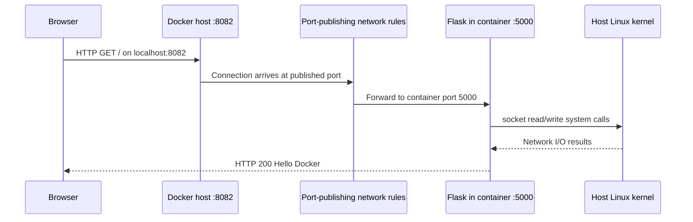

**Notice how Day 0 reappears here.** Flask is still a process making system calls to the Linux kernel. The container gives that process an isolated environment, not a private kernel. Port publishing is an additional networking arrangement that connects the host endpoint to the process listening in the container.

Also notice the separation of responsibilities:

- The **Dockerfile** describes the runnable image.
- `docker build` creates the image.
- `docker run` creates and starts a container, optionally detached, named, and with published ports.
- The **Python process** binds port 5000 and serves HTTP requests.
- The **kernel/network stack** handles actual networking; Docker has configured the required forwarding.

If the browser cannot connect, reason backwards: Is the container running? Is Flask listening? Is it binding to `0.0.0.0`? Is host 8082 mapped to container 5000? Is something else using 8082?

---

## 7. Why the instructor prefers exec-form `CMD`

Our Flask server starts because the Dockerfile contains:

```dockerfile
CMD ["python", "app.py"]
```

But Docker also accepts:

```dockerfile
CMD python app.py
```

Both appear to start the same application. Why distinguish them? Because **the process tree can differ**, and container lifecycle and shutdown behavior depend on the main process.

### Visual checkpoint H — exec form

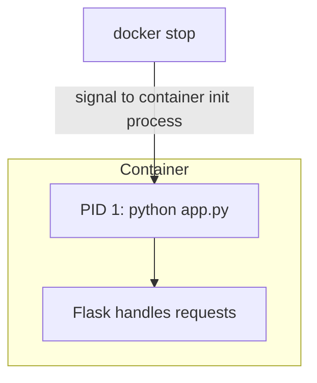

With exec form, the specified application is started without an intermediate shell and is typically PID 1 in a simple container like this.

### Visual checkpoint I — shell form

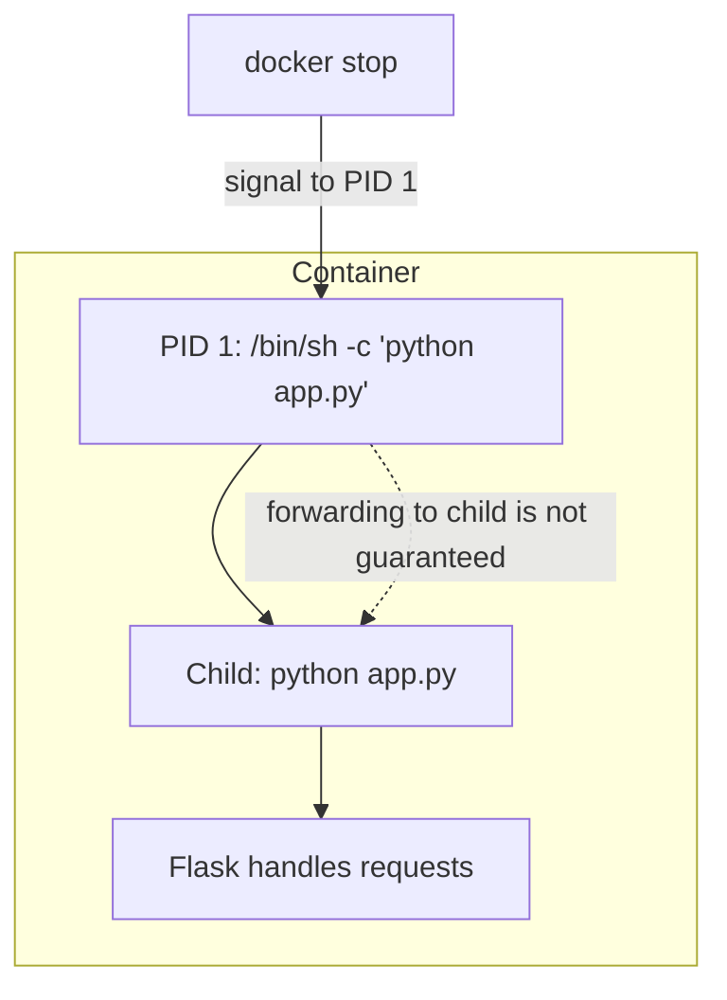

With shell form on Linux, Docker commonly launches `/bin/sh -c ...`; depending on shell and command behavior, there may be a separate shell process above the application. That extra hop can complicate signal propagation and graceful termination.

**Important nuance:** Exec form is usually preferred *when shell features aren't required*. It is **not inherently a security guarantee**; an exec-form container can still contain `/bin/sh` in the image, and removing a shell from the image is a separate decision. Shell form is appropriate when you need features such as redirection, pipelines, or shell expansion and understand the process/signal behavior. Also, PID 1 has special signal-handling responsibilities on Linux.

The instructor demonstrates the process difference with:

```bash
docker top my-python-container
```

We can now connect this back to Day 0: the process list and parent-child relationships aren't abstract Docker concepts. They are ordinary Linux process behavior, viewed through the container runtime.

---

## 8. Inspect the live container instead of guessing

By this point, the container is working. But a platform engineer needs to answer three different questions: **Is it running? What is it doing? Can I inspect its filesystem or processes?**

Rather than memorize commands without context, match each question to its observation.

### “Is it running, and which ports are published?”

```bash
docker ps
docker ps -a
```

`docker ps` shows running containers; `-a` also includes exited ones. The `PORTS` column helps confirm the host-to-container mapping.

### “What did the application print?”

```bash
docker logs my-python-container
docker logs -f my-python-container
```

`docker logs` reads captured stdout/stderr logs for supported logging drivers; `-f` follows new output. These logs come from processes in the container, not from automatically reading every file under `/var/log`.

### “What processes are running?”

```bash
docker top my-python-container
```

This is especially useful when comparing exec-form and shell-form startup.

### “What files are in `/app`?”

```bash
docker exec my-python-container ls -la /app
```

`docker exec` starts **an additional process inside an already-running container**. It does not replace the container's main process.

### “Can I open an interactive shell?”

```bash
docker exec -it my-python-container /bin/sh
```

`-i` keeps stdin open and `-t` allocates a pseudo-terminal. The instructor demonstrates `bash`; `/bin/sh` is often more portable for slim/minimal images. A shell must exist in the image for this to work. Type `exit` to leave the shell without necessarily stopping the server.

### Visual checkpoint J — observe one running container in four ways

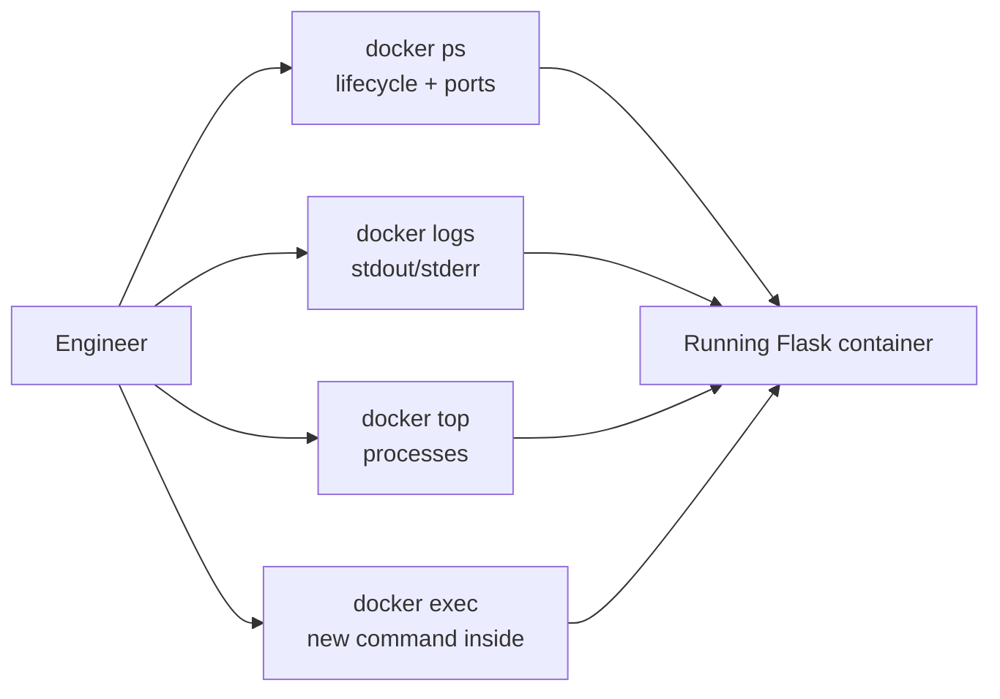

At this stage, the commands are easier to remember because each one answers a problem you might encounter while operating a service.

---

## 9. Reconstruct the complete Day 3 story

We began with an Nginx image and discovered that merely starting a server doesn't give a browser an obvious host entry point. `-p` solved that: a **host-side port** could direct requests to a **container-side port**. Two independent containers could still both listen on port 80 because their network environments were separate.

That solved the access problem for a ready-made image. But to run our own code, we needed a new artifact: a Dockerfile that selected a Python runtime, copied our application, installed Flask, documented the internal port, and specified the startup process. A build turned that recipe into an image. A tag plus Docker Hub gave the image a distributable name. `docker run` turned the image into a live Flask process, with `8082:5000` connecting the browser to it.

Finally, we looked inside the running system: exec versus shell form matters because Linux processes, PID 1, and shutdown signals matter; logs, process inspection, and exec help us observe what Docker started.

### Final visual — the entire sequence on one page


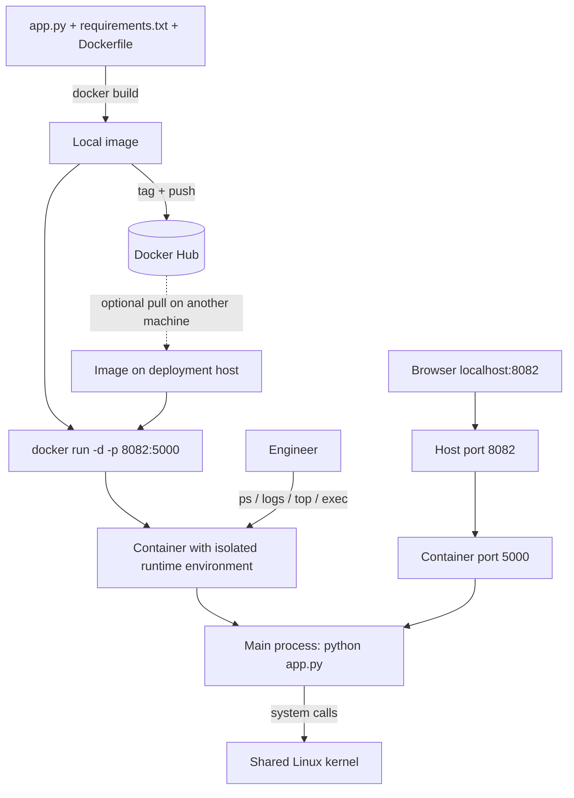

**The central mental model:** Docker packages and starts processes in an isolated environment; Linux still executes and manages those processes, and publishing a port is an explicit bridge from a host network endpoint to a listening process in a container.

---

## 10. Small practice lab: test your own understanding

Run these commands in order in a disposable learning environment (use the project files above):

```bash
# First Nginx server, local-browser access
docker run -d -p 127.0.0.1:8080:80 --name nginx-one nginx

# A second independent Nginx server
docker run -d -p 127.0.0.1:8081:80 --name nginx-two nginx

# Build your own application image from the Dockerfile
docker build -t my-python-image:v1 .

# Run the Flask server on another host port
docker run -d -p 127.0.0.1:8082:5000 --name my-python-container my-python-image:v1

# Observe what Docker actually started
docker ps
docker logs my-python-container
docker top my-python-container
docker exec my-python-container ls -la /app

# Test from the host
curl http://localhost:8082
```

Expected application response: `Hello Docker`.

When finished:

```bash
docker rm -f nginx-one nginx-two my-python-container
```

Only remove these named training containers, not unrelated workloads.

### Reasoning checks (try before looking back)

1. Nginx is running and listening on container port 80. Why might `localhost:80` on the host still fail?
2. Why can two Nginx containers both listen on 80, while attempting to publish both to the same host port normally fails?
3. Why does `EXPOSE 5000` not replace `docker run -p 8082:5000`?
4. If you run `RUN python app.py` in a Dockerfile, during which phase does that command execute, and why is it usually incorrect for a persistent web server?
5. What is the difference between the image tag `v1` and the container name `my-python-container`?
6. When does exec-form `CMD` help with graceful shutdown, and what extra behavior might shell form introduce?
7. Does `docker exec -it ... /bin/sh` change the container's original startup command?

### What the next lecture builds on

The instructor previews **multi-stage builds** for Day 4. We now understand that building an image involves selecting a base image, executing build-time commands, and producing an artifact. That leads to the next natural question: *Must everything needed to compile or assemble an application remain inside the final image that runs in production?* Multi-stage builds will address that distinction.

---

## Source boundaries and technical clarifications

The source transcript's lesson flow is: Nginx foreground/detached execution → port publishing → two containers with distinct host ports → Flask Dockerfile (`FROM`, `ADD`, `RUN`, `EXPOSE`, `CMD`, `WORKDIR`) → image build, tag, push, and run → exec/shell `CMD` → `docker top`, `logs`, and `exec`. These notes preserve that progression but reorganize details for conceptual continuity.

Clarifications added for technical accuracy: `-p` does not require dockerd to proxy every request; Docker Desktop's networking differs from a native Linux host; `EXPOSE` is descriptive image metadata; `COPY` is preferable to `ADD` for basic local-file copying; Flask must bind an accessible container interface; exec-form does not automatically remove shells/security risks; Docker contexts differ from registry credentials; Python 3.9 is retained as a historical lesson example rather than a current deployment recommendation. The runnable sample files above are educational reconstructions rather than exact on-screen source code.
