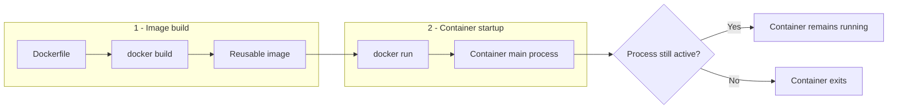
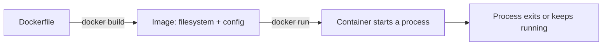
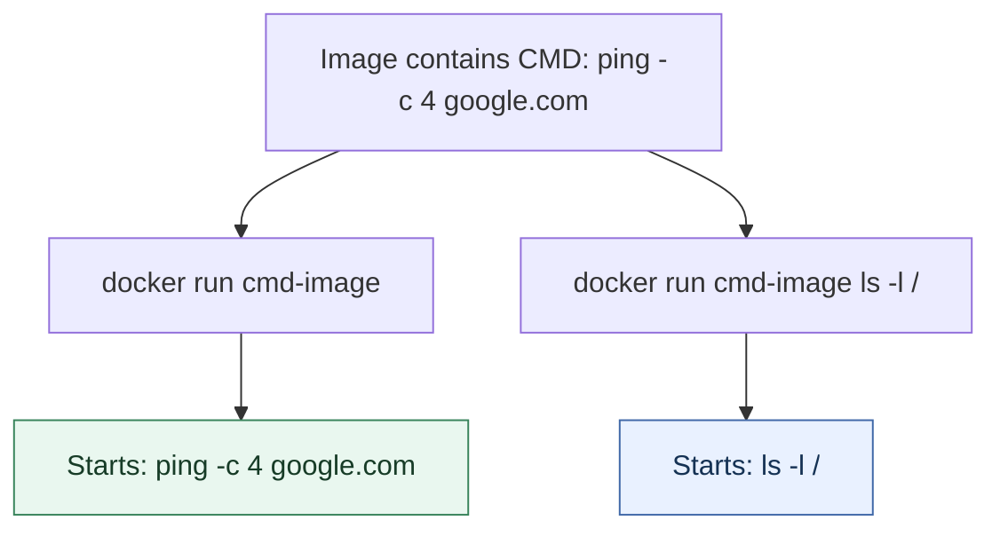
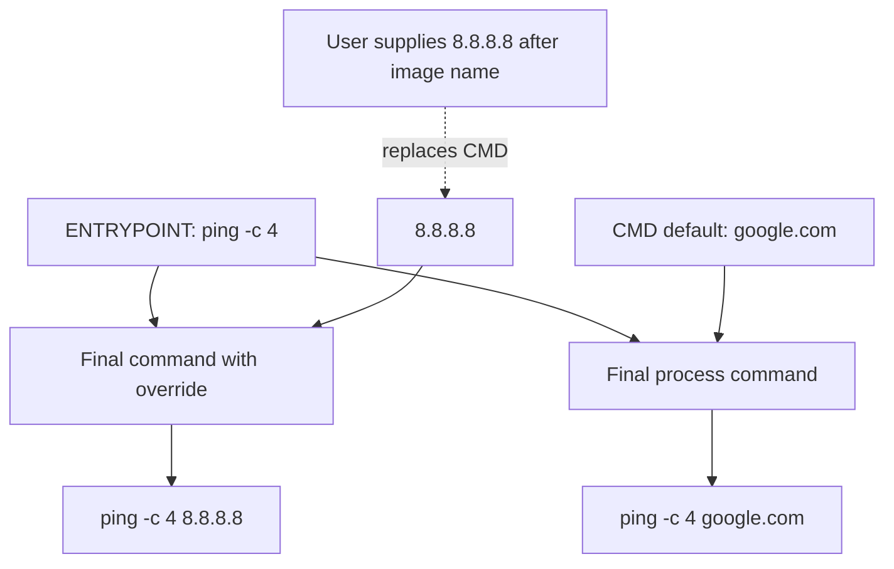
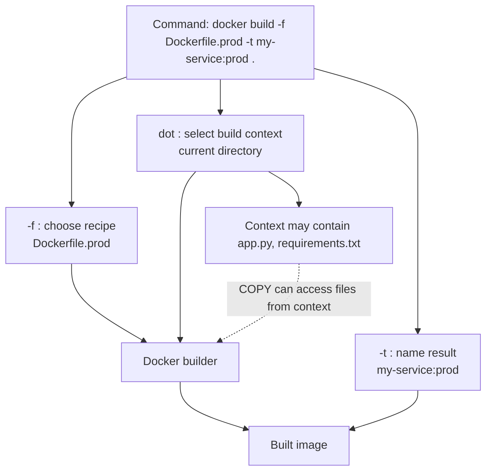
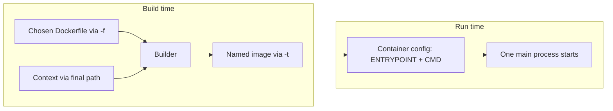
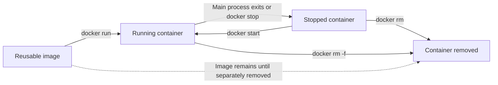
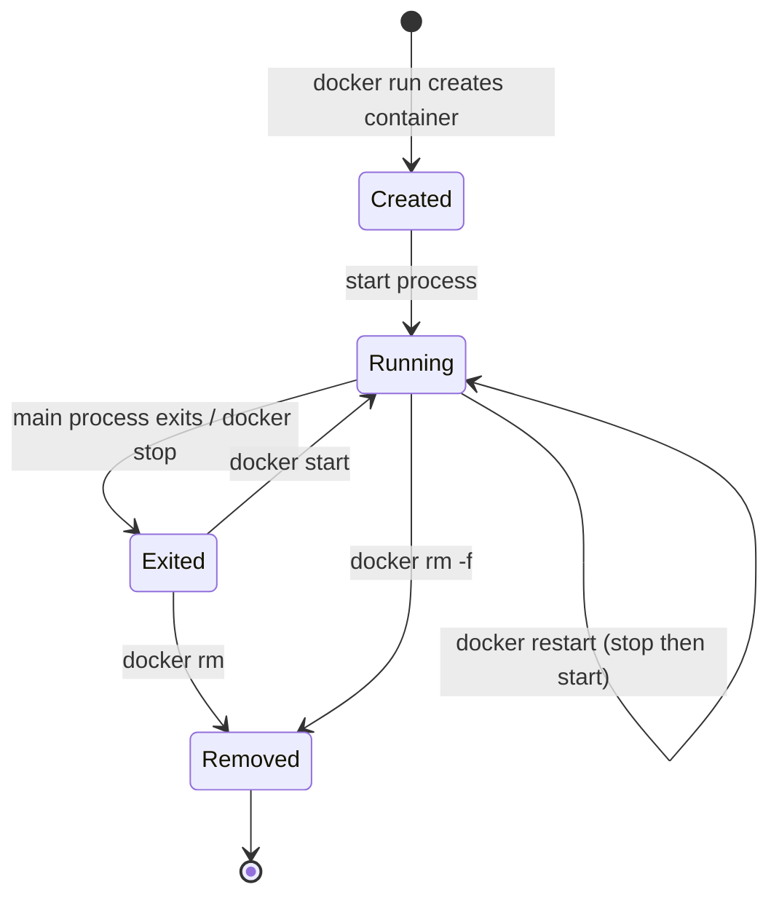
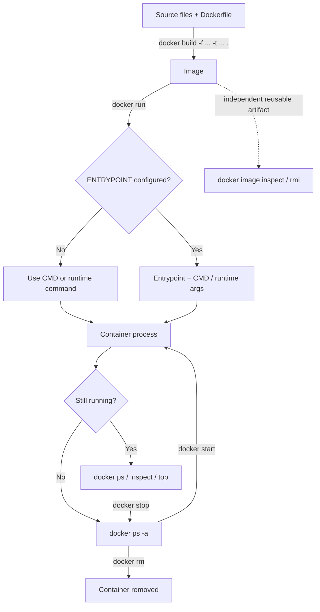

# CKA Day 04 — How Docker Chooses a Process, Builds an Image, and Manages Its Lifecycle

> **Learning path:** Day 0 taught us that a container is an isolated process using a shared kernel. Day 1 explained why containers help. Day 2 introduced images and registries. Day 3 showed how an application is started and reached through published ports. **Today we answer a deeper question: who decides what the container does when it starts, and how do we manage what we created?**
>
> **Format:** Self-contained Markdown. All visualizations use inline Mermaid code blocks; no SVG files, image assets, plugins, or external links are required. Mermaid-capable Markdown viewers (including Obsidian) render these as diagrams. In plain Markdown readers, their source remains readable.
>
> **Source:** CKA 2025 Day 4 lesson transcript supplied with these notes. Sections marked **Technical clarification** refine an oversimplification or error in the spoken demonstration; they are not quotations from the lecture.

## Our running experiment: a short-lived network-check container

In Day 3, our Nginx and Flask processes kept running because they were servers. Imagine a different container: its only job is to send four pings to a chosen destination and exit. It has no web port and no long-lived service. The container starts, performs a command, and stops.

This is an ideal experiment because we can **change the command given at startup** and immediately observe the result. First, recall the two distinct moments in a container's life:

**Visual checkpoint — two different moments in Docker's lifecycle:**






The Dockerfile is read during the **build**. Some instructions change the image's filesystem; others record configuration that is consulted when a container starts. That difference will explain both `CMD` and `ENTRYPOINT`.

## 1. The first problem: how does Docker choose the startup command?

Suppose we build an image containing the `ping` utility. We want this image to ping `google.com` four times unless the person running it chooses another task. Docker provides `CMD` for precisely this kind of **default command**.

Create a file named `Dockerfile.cmd`:

```dockerfile
FROM ubuntu:24.04
RUN apt-get update && apt-get install -y --no-install-recommends iputils-ping \
    && rm -rf /var/lib/apt/lists/*
CMD ["ping", "-c", "4", "google.com"]
```

Read it in execution order. `FROM` selects a base filesystem. `RUN` installs a package **while building the image**. `CMD` does **not** run `ping` during the build. Instead, it records what to execute *later*, when someone creates a container from the image.

Build with a custom Dockerfile name:

```bash
docker build -f Dockerfile.cmd -t cmd-image .
```

We'll return to `-f` and the final `.` shortly. For the moment, focus on runtime behavior:

```bash
docker run --rm cmd-image
# Attempts four pings to google.com, then finishes.
```

`--rm` is an optional convenience added for this lab: Docker removes this container after it exits. If DNS, ICMP permissions, or outbound network policy prevents ping, the experiment may fail even though command selection works correctly.

Now replace the default:

```bash
docker run --rm cmd-image ls -l /
```

The command after the image name replaces the image's `CMD`. Docker runs `ls -l /` rather than `ping -c 4 google.com`. Why? Because `CMD` is a **default**, not a fixed executable.

**Visual checkpoint — notice what changes when we add a command after the image name:**




The lesson's first conceptual milestone is therefore: **an image can contain a default startup command, but the caller can choose a different command.**

## 2. What changes when the image has one primary purpose?

Our ping image is not a general-purpose shell toolbox. We might want it always to execute `ping`, while allowing the user to choose **which host** to check. This is a slightly different design problem.

`ENTRYPOINT` defines the primary executable. With its recommended *exec form*, arguments supplied after the image name are passed to that executable.

Create `Dockerfile.entrypoint`:

```dockerfile
FROM ubuntu:24.04
RUN apt-get update && apt-get install -y --no-install-recommends iputils-ping \
    && rm -rf /var/lib/apt/lists/*
ENTRYPOINT ["ping", "-c", "4", "google.com"]
```

Build and run:

```bash
docker build -f Dockerfile.entrypoint -t entry-image .
docker run --rm entry-image
```

Again, Docker runs `ping -c 4 google.com`. The difference appears when we append a word:

```bash
docker run --rm entry-image amazon.com
```

Docker constructs the command as approximately:

```text
ping -c 4 google.com amazon.com
```

It does **not** replace `google.com` with `amazon.com`. That added argument may cause an error or unexpected behavior depending on the `ping` implementation. The important lesson is about **argument composition**, not ping's particular error message.

To make the behavior visible without networking, the instructor also demonstrates an `echo` entrypoint:

```dockerfile
FROM ubuntu:24.04
ENTRYPOINT ["echo", "This is entrypoint"]
```

```bash
docker build -f Dockerfile.echo -t echo-image .
docker run --rm echo-image appended
# This is entrypoint appended
```

This example isolates the key idea: the executable remains `echo`, and `appended` becomes another argument to it.

### A better design: split the fixed action from the default input

We can now combine both instructions:

```dockerfile
FROM ubuntu:24.04
RUN apt-get update && apt-get install -y --no-install-recommends iputils-ping \
    && rm -rf /var/lib/apt/lists/*
ENTRYPOINT ["ping", "-c", "4"]
CMD ["google.com"]
```

This is the most useful mental model for the lesson. The `ENTRYPOINT` supplies **what program runs**; `CMD` supplies **the default arguments**. At startup, Docker combines them.



Try both paths:

```bash
docker build -f Dockerfile.combined -t ping-tool .
docker run --rm ping-tool
# ENTRYPOINT + default CMD -> ping -c 4 google.com

docker run --rm ping-tool 8.8.8.8
# ENTRYPOINT + overridden CMD -> ping -c 4 8.8.8.8
```

If we need to change the executable itself, use `--entrypoint`:

```bash
docker run --rm --entrypoint ls ping-tool -l /
# ls -l /
```

**Technical clarification:** An entrypoint is not literally impossible to override; `--entrypoint` overrides it. Also, the startup-composition examples above assume **exec-form** Dockerfile instructions. Shell-form instructions have different shell and argument behavior. Day 3 introduced why exec form helps keep signals and the main application process straightforward.

| Dockerfile design | Without extra runtime arguments | With arguments after image name |
|---|---|---|
| `CMD ["ping", "-c", "4", "google.com"]` | Runs the default ping | Replaces the entire `CMD` |
| `ENTRYPOINT ["ping", "-c", "4", "google.com"]` | Runs the entrypoint | Appends to its argument list |
| `ENTRYPOINT ["ping", "-c", "4"]` + `CMD ["google.com"]` | Combines executable + default host | Replaces CMD host but keeps entrypoint |

**Pause and predict:** What would `docker run ping-tool example.com` execute? Answer: `ping -c 4 example.com`. If you can predict that without memorizing a definition, you understand the relationship.

## 3. Back to the build command: what does Docker actually receive?

We've been using:

```bash
docker build -f Dockerfile.combined -t ping-tool .
```

There are **three separate decisions** hidden in this one line:

1. **`-f Dockerfile.combined`** answers: *Which recipe should the builder read?*
2. **`-t ping-tool`** answers: *What name/tag should the resulting image receive?*
3. **`.`** answers: *Which directory is the build context?*

The last item is usually misunderstood. The dot does **not** mean “the Dockerfile lives here.” It means **use the current directory as the build context**. The `-f` option determines the Dockerfile path independently.

**Visual checkpoint — the Dockerfile and build context are two independent inputs:**




Imagine this project:

```text
my-service/
├── Dockerfile.dev
├── Dockerfile.prod
├── app.py
├── requirements.txt
├── README.md
└── tests/
```

Both Dockerfiles can refer to the **same context**:

```bash
cd my-service
docker build -f Dockerfile.dev  -t my-service:dev  .
docker build -f Dockerfile.prod -t my-service:prod .
```

Why does the context matter? A Dockerfile instruction such as:

```dockerfile
COPY app.py /app/app.py
```

needs access to `app.py`. The builder can obtain that source file from the selected build context. If you choose a directory that lacks `app.py`, this `COPY` fails—even if your Dockerfile is stored somewhere else.

### Reduce the context without breaking the build

The transcript recommends keeping build inputs small. A practical way is to create a `.dockerignore` file **in the context root**:

```dockerignore
.git
__pycache__/
*.pyc
.env
.venv/
node_modules/
```

This prevents matching files from being available as ordinary build-context inputs. It is especially important not to send secrets such as `.env` or private credentials into a build context.

**Technical clarification:** The lecture uses the shortcut “Docker copies everything to the daemon.” Modern Docker often uses BuildKit, which can transfer or process context more selectively. The reliable lesson is unchanged: **context defines the available build inputs; `.dockerignore` reduces unwanted inputs**, while `-f` chooses the recipe.

At this stage, our complete model has two phases:



**Checkpoint:** The final `.` is a *source boundary*, not an instruction to run anything. `RUN` acts at build time; `ENTRYPOINT` and `CMD` are consulted at container start.

## 4. The container ran—now how do we observe it?

Return to our two kinds of workloads. Nginx from Day 3 remained running as a server. Our `ping` command completes a short task and exits. Docker therefore contains both **running** and **stopped** container objects. We need commands that answer different questions about them.

Start by listing:

```bash
docker ps       # Only running containers
docker ps -a    # Running and stopped containers
```

If a container stops after four pings, `docker ps` may not show it, but `docker ps -a` will—unless you used `--rm`, which removes it upon exit. That is the lifecycle relationship, not a Docker failure.

**Visual checkpoint — stopping, starting, and removing affect the container object differently:**




Suppose we have a long-running Day 3 container named `my-nginx`. We can ask two distinct kinds of question:

```bash
docker inspect my-nginx   # Configuration and state metadata
docker top my-nginx       # Processes currently running in it
```

`inspect` answers **what is Docker's recorded configuration and state?** It provides structured fields such as configuration, mounts, network settings, status, and process metadata. `top` answers **what processes are running now?** Neither replaces the other.

To verify an image's stored configuration, we can also inspect the *image*:

```bash
docker image inspect ping-tool
```

This is particularly useful when debugging why an image starts a particular executable: inspect its `Config.Entrypoint` and `Config.Cmd` rather than guessing.

## 5. Managing the running and stopped states

A container is not its image. The image is reusable; a container is one created instance with its own lifecycle. Therefore, stopping a container does not delete its image.

For a running container:

```bash
docker stop my-nginx
```

Docker requests a graceful stop (typically by sending the configured stop signal and later forcing termination if necessary). The container object remains, now in a stopped state.

```bash
docker start my-nginx
```

This starts **the existing container** again; it does not rebuild the image or create a second container. This distinction matters when preserving its configuration and writable container filesystem.

```bash
docker restart my-nginx
```

This stops and starts that same container. It is not equivalent to `docker rm` followed by `docker run`.

After stopping it:

```bash
docker rm my-nginx
```

This removes the container object. If the container is still running, normal removal fails. `docker rm -f my-nginx` forces removal and can interrupt a workload; don't use it casually.



The diagram is a conceptual lifecycle, not the complete set of Docker's actual states (which also include states such as paused and restarting).

## 6. Cleanup: distinguish containers from images before deleting anything

After many experiments, `docker ps -a` can display dozens of exited containers. Rather than remove each one, the lecture demonstrates:

```bash
docker container prune
```

This removes **all stopped containers**, not just those from today's lesson. Docker asks for confirmation. It does **not** delete running containers or automatically delete their images.

The lecture then demonstrates force-removing containers using shell command substitution:

```bash
docker ps -aq
# Print IDs of all containers (-a all, -q IDs only)

docker rm -f $(docker ps -aq)
```

Understand the substitution rather than memorizing the line. The shell executes `docker ps -aq` first and inserts those IDs into `docker rm -f`. This affects **all containers visible to the selected Docker daemon**, including unrelated running workloads. **Treat this as a destructive lab-only command, not a normal cleanup habit.** On an empty container list, it may simply show a missing-argument error.

To remove an image specifically:

```bash
docker rmi ping-tool
# Equivalent intention: docker image rm ping-tool
```

Removing an image reference is different from removing a container. Docker may refuse to delete image data while containers still reference it; shared image layers and additional tags can also affect what is removed.

The transcript concludes with a force-remove-all-images example. That is useful for understanding command substitution but unnecessary for normal study. It can delete local images needed by other workloads, so we deliberately do **not** make it part of the standard lab cleanup.

| Question | Command | What it targets |
|---|---|---|
| What is running? | `docker ps` | Running containers |
| What was created? | `docker ps -a` | All containers |
| What is configured? | `docker inspect <container>` | Container metadata |
| What process is active? | `docker top <container>` | Container process list |
| Stop / resume | `docker stop` / `docker start` | Existing container |
| Restart | `docker restart` | Existing container |
| Remove stopped container | `docker rm` | One container |
| Clear all stopped containers | `docker container prune` | All stopped containers |
| Remove image reference | `docker rmi` | Image/tag |

## 7. One complete mental model: from recipe to cleanup

We began with a small ping utility, but we have now learned three separate control surfaces:

**Build-time choices** determine *which files are inputs* and *which image is produced*. `-f` picks the Dockerfile, the context path supplies the source files, and `-t` names the result.

**Startup choices** determine *which process starts*. `ENTRYPOINT` gives the preferred executable; `CMD` gives a default command or default arguments depending on the image design; extra arguments from `docker run` can replace `CMD`.

**Lifecycle choices** determine *what happens to the container object afterward*. The process can run, exit, be restarted, or be removed. Images remain separate reusable artifacts.



The central idea is not a set of commands. It is **separation of responsibilities**: recipe and source inputs create an image; image configuration and run arguments choose an initial process; Docker tracks that process's container across its lifecycle.

## 8. Hands-on lab: verify the mental model yourself

Use a disposable Docker environment and a fresh directory.

Create `Dockerfile.combined` with the combined `ENTRYPOINT` / `CMD` example from Section 2. Then work through these checkpoints:

```bash
# 1. Build using a custom recipe and current directory as context
docker build -f Dockerfile.combined -t ping-tool .

# 2. Observe default process configuration
docker image inspect ping-tool --format '{{json .Config.Entrypoint}} {{json .Config.Cmd}}'

# 3. Observe default and replaced host arguments
docker run ping-tool
docker run ping-tool 8.8.8.8

# 4. Override the executable itself
docker run --entrypoint ls ping-tool -l /

# 5. See containers that have exited
docker ps -a

# 6. Remove only your test containers by ID
docker rm <your-stopped-container-id>

# 7. Remove only your test image after its containers are gone
docker rmi ping-tool
```

The fifth command should make sense only after the third: `ping` terminates after the configured count, so those containers move to an exited state. The image stays available for another `docker run` until you explicitly remove it.

## 9. Check your understanding (reason, don't memorize)

1. If a Dockerfile contains `CMD ["echo", "hello"]`, why does `docker run image ls /` not print `hello`?
2. If an image contains `ENTRYPOINT ["echo", "Hello"]`, what command results from `docker run image World`?
3. Why does `ENTRYPOINT ["ping", "-c", "4"]` plus `CMD ["google.com"]` work better for a configurable ping tool than placing `google.com` inside the entrypoint?
4. If `Dockerfile.prod` is outside your build-context directory, does `-f` mean that `COPY` can access any file beside that Dockerfile? Why not?
5. Why can `docker ps` be empty even though `docker ps -a` shows several containers?
6. What survives `docker stop`: the container object, the image, or both? What happens when you `docker start` it?
7. What is dangerous about `docker rm -f $(docker ps -aq)` on a shared host?

**Answers to test yourself:** (1) runtime arguments replace `CMD` when there's no entrypoint; (2) `echo Hello World`; (3) program stays fixed and destination becomes a replaceable default; (4) no, ordinary `COPY` sources are constrained by the context; (5) exited containers are hidden by `ps` without `-a`; (6) both remain and the existing container is started again; (7) it force-removes every selected running or stopped container.

## Final connection to Kubernetes

Kubernetes won't usually ask you to invoke `docker run` on a worker node. But the principles remain: a container image has default executable/arguments, the runtime starts a process, and that process has a lifecycle. Later, when Kubernetes introduces Pod `command` and `args`, you'll recognize their relationship to the image's `ENTRYPOINT` and `CMD`—without confusing the Kubernetes API fields with Dockerfile syntax.

> **Day 4 takeaway:** You now understand three distinct questions—**what goes into the build**, **what runs when a container starts**, and **how to observe/manage the container after it starts**. That prepares you for Day 5, where the transcript says the course will introduce multi-stage builds.
