# MicroVMs: From One Linux Process to an Isolated Guest Kernel

*A connected learning chapter: logical reasoning first, Linux and virtualization internals second*

> **Learning goal.** By the end, you should be able to explain why microVMs exist; distinguish host and guest kernels; describe what Firecracker, KVM, the CPU and an orchestrator each do; trace a microVM from creation to boot, networking and termination; and reason about its security and performance trade-offs. You should be able to reach these conclusions from first principles, not from memorized definitions.
>
> **Our running example:** A company operates a Linux host and must run Python code submitted by two unrelated customers, **Asha** and **Ben**. We will retain this same host and the same two workloads throughout the chapter.
>
> **How to read:** Follow the sections in order. Diagrams are deliberately incremental; a later diagram adds only the machinery needed to answer a question left open by the earlier one. Code examples come *after* the conceptual explanation. The Kubernetes/Kata connection is intentionally postponed until the core machine is clear.

## The learning path

1. **Why put a machine inside a machine?** Begin with ordinary Linux processes and containers.
2. **What makes a microVM a VM?** Separate the guest's operating-system environment from the host.
3. **What builds that environment?** Walk from Firecracker-as-a-process to KVM and a virtual CPU.
4. **How can another kernel actually run?** Boot a guest kernel and give it userspace.
5. **Where is the fence?** Explain CPU and memory isolation without pretending hardware is duplicated.
6. **How does an isolated VM do useful work?** Follow disk and networking paths.
7. **Who controls the VM's life?** Start, observe, clean up and optionally orchestrate many guests.
8. **How does this relate to EC2, Kata and Kubernetes?** Put the abstractions back in their correct places.

---

# Part I — The logical reason microVMs exist

## 1. One machine, two applications: where does the operating system sit?

Picture one Linux machine with eight CPU cores and 32 GiB of RAM. Asha's code and Ben's code need to run. To begin, ignore their trustworthiness. They are ordinary programs.

When Asha's Python process opens a file, it makes a system call. The Linux kernel checks the process's permissions, resolves the file, and coordinates the relevant filesystem and device operations. When Ben's program requests memory, the **same** kernel performs the relevant memory-management work. When the CPU has more runnable threads than available cores, that kernel schedules them.

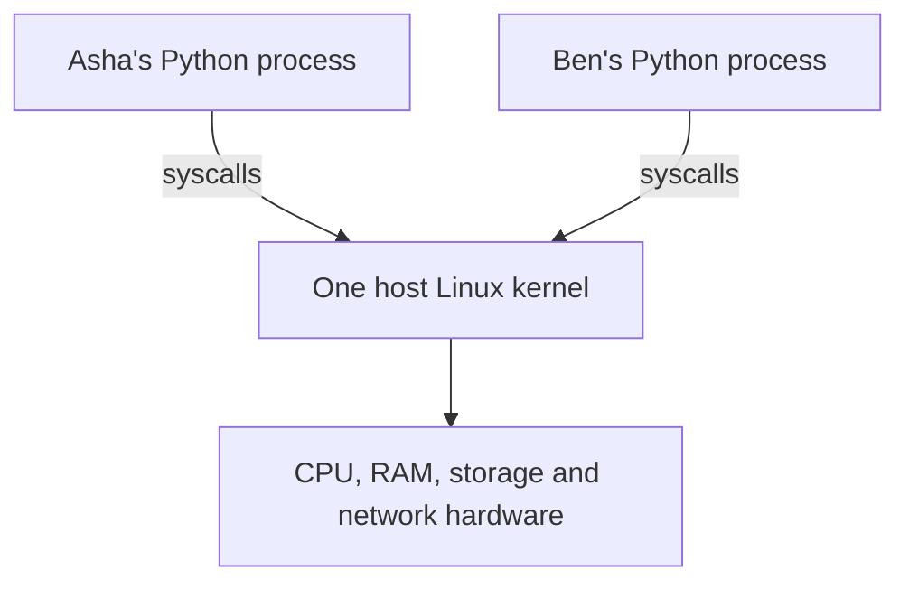

The first important distinction is between a **process** and a **kernel**. Processes are programs being executed and managed. The kernel is privileged operating-system software that manages those processes and controls their access to resources. Ten processes do not require ten kernels.

The problem appears when these processes belong to different people. Ben should not be able to read Asha's files, observe her processes, exhaust all her memory, or compromise the machine. How much isolation can we obtain without starting a new operating system?

## 2. Containers improve isolation, but keep the same kernel

Linux already offers mechanisms for this problem. **Namespaces** change the view of resources a process sees: for example, its process IDs, network interfaces and mounts. **Cgroups** account for and control resource usage, including CPU and memory. Mechanisms such as capabilities, seccomp, mount restrictions and Linux security modules can reduce privilege and attack surface.

A container runtime combines such Linux mechanisms with a filesystem and a process to create an isolated container environment. Kubernetes, when present, builds a higher-level **Pod** abstraction around one or more containers. A Pod is not literally one Linux process; it is an orchestration object whose containers contain processes.

Now update our example:

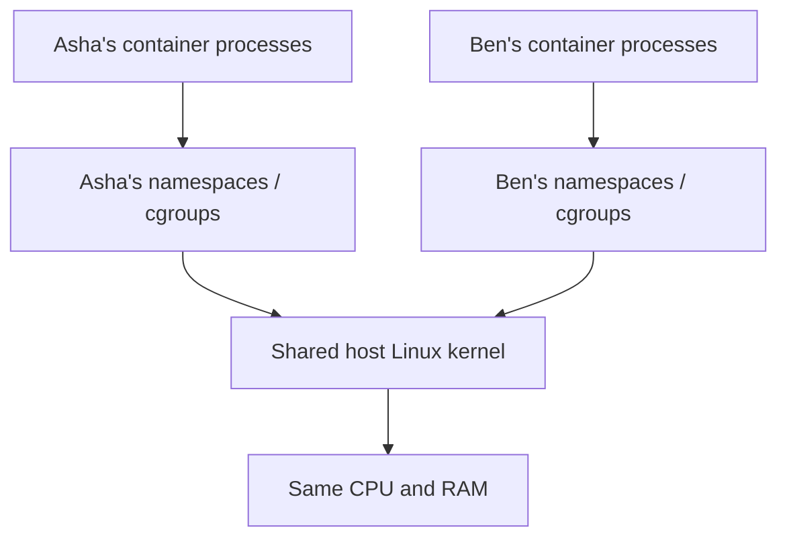

Asha and Ben have different views of the system, but their system calls still enter **one host kernel**. This is not a flaw in containers. It is how OS-level isolation works, and it is very efficient: the host does not need to boot another Linux kernel for every workload.

However, this reveals an important trust boundary. The shared kernel itself must correctly enforce the isolation rules. If malicious code exploits a vulnerability in the host kernel, container restrictions might be bypassed. Properly hardened containers can be very secure, but they do not place an independent guest kernel between an untrusted workload and the host.

That gives us the next engineering question: **Can we keep many workloads on one machine but stop them from making ordinary system calls directly to the shared host kernel?**

## 3. Change the boundary, not the underlying hardware

Imagine giving each customer a separate Linux computer. Asha's machine has its own kernel; Ben's machine has another. A kernel compromise on Asha's machine would not, by itself, grant control over Ben's machine. But buying and operating a full physical computer per customer would be wasteful.

Virtualization offers a more efficient version of that idea. We present each customer with **virtual hardware** backed by resources from the original host. A Linux guest kernel boots on that virtual hardware, then manages the customer workload.

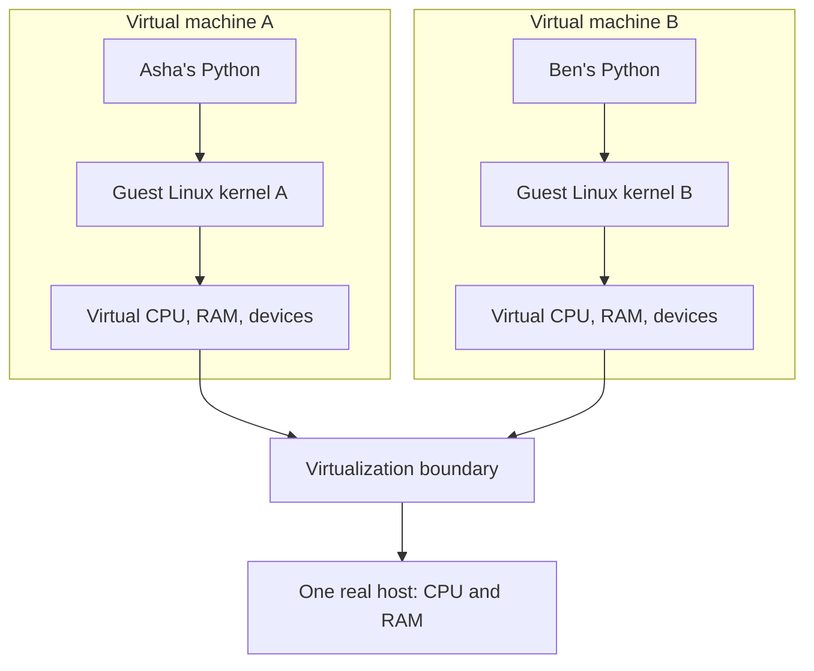

We have **not** added another physical CPU or duplicated the RAM chips. We created two separate operating-system environments using the original machine's resources. The guest kernels control processes *inside* their own VMs. Host-side virtualization software controls which resources their virtual hardware is allowed to use.

**Why is the guest kernel useful?** Asha's `open()` system call goes to *guest kernel A*, not directly into the ordinary host-kernel syscall path. Even if her workload compromises that guest kernel, it must cross another, hardware-enforced virtualization boundary to reach the host or Ben's environment. The fence is not perfect, but it is different from a shared-kernel container boundary.

### So what is *micro* about a microVM?

A microVM **is a real VM**. It still has a guest kernel, guest memory, vCPU state, and an operating-system userspace. The word *micro* refers to a deliberately small virtual-machine design, not to an imitation VM or a container with a new label.

A conventional general-purpose VMM may present many kinds of emulated hardware and legacy interfaces to support a wide variety of operating systems. A microVM-oriented VMM can remove unnecessary virtual devices and use a streamlined boot path. That can reduce memory overhead, startup work, and the virtual hardware's attack surface. Actual speed and footprint depend on the workload and configuration.

**Logical result so far:** Containers separate processes using one kernel. VMs separate **operating-system environments** using virtual hardware. MicroVMs implement the second model with minimal machinery.

The unresolved question is no longer *why* we want another kernel. It is: **how can an ordinary program on our Linux host create a virtual machine capable of running another kernel?**

---

# Part II — Build a VM from the host's point of view

## 4. Before any VM exists, Firecracker is just a Linux process

We'll choose **Firecracker**, an open-source Virtual Machine Monitor (VMM), to make the example concrete. Firecracker is one implementation of microVMs, not the definition of the concept.

Suppose the host administrator starts Firecracker:

```bash
firecracker --api-sock /tmp/asha-fc.socket
```

The host kernel executes this program just as it would execute a Python application. It has a host PID, host threads, file descriptors, memory mappings and CPU time allocated by the host scheduler. Starting the executable normally creates its **control API**, but does not automatically mean Asha's guest kernel has booted. In this API-driven example, the host must configure and start the guest later.

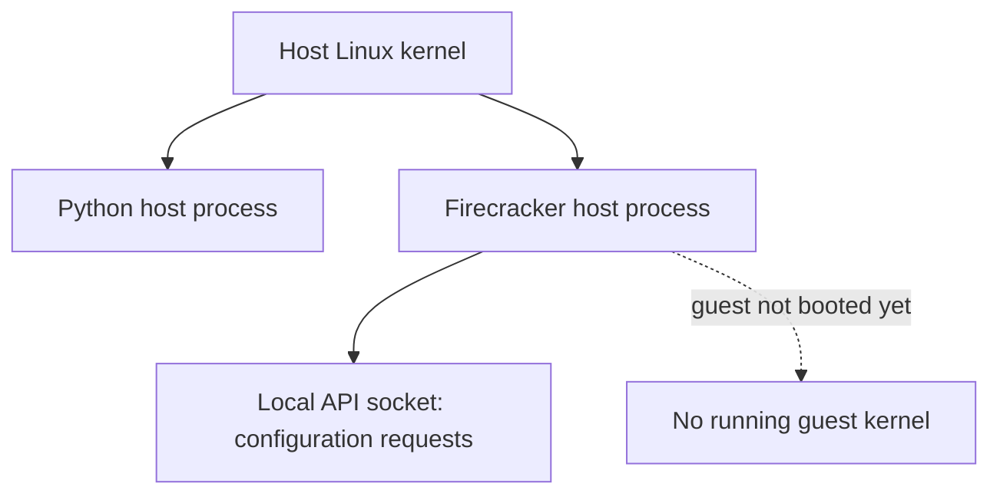

Firecracker's design generally uses **one Firecracker process for one microVM**, with an API thread, VMM thread and one or more vCPU threads once configured/running. To run two independent Firecracker microVMs in this model, we launch two separately managed Firecracker processes. [1]

A crucial linguistic distinction: *the VMM is a host process*; *the microVM is the virtualized machine represented and operated by that host process plus KVM*. They are related, but not identical objects.

If Firecracker is an ordinary process, it cannot simply seize physical CPU virtualization controls. Something privileged must assist it. Enter KVM.

## 5. Why Firecracker needs `/dev/kvm`

Linux provides **KVM — Kernel-based Virtual Machine** — as a kernel virtualization facility. KVM works with CPU hardware virtualization features. It exposes a userspace API through the special device `/dev/kvm`.

Firecracker opens `/dev/kvm` and obtains a **file descriptor**. A file descriptor is a process-local handle to an open file or kernel object. Firecracker can then make `ioctl()` system calls to ask KVM to create and configure virtualization objects.

```mermaid
sequenceDiagram
    participant FC as Firecracker (host process)
    participant KVM as Host kernel / KVM
    FC->>KVM: open("/dev/kvm")
    KVM-->>FC: kvm_fd
    FC->>KVM: ioctl(kvm_fd, KVM_CREATE_VM, ...)
    KVM-->>FC: vm_fd
    Note over FC,KVM: VM object exists; guest kernel not yet running
```

This sequence is based on the public KVM API. The call `KVM_CREATE_VM` creates a **kernel-side VM object** and returns another handle, `vm_fd`, used for VM-specific requests. [2]

**Where does the word *hypervisor* fit?** It is an umbrella term for software that enables and controls virtual machines. In this Linux design, **KVM** supplies kernel-side virtualization support and uses CPU hardware features, while **Firecracker** is the userspace VMM that configures the guest machine, starts vCPUs and emulates its deliberately limited set of devices. They are cooperating pieces of the virtualization stack; Firecracker is not a second host kernel, and KVM is not a Kubernetes-style orchestrator.

Pause and be precise about the state of the system. There is now a *representation* of a VM in KVM. That does not mean another operating system is running. Nothing can execute until memory and at least one virtual CPU have been set up and the guest's initial execution state has been prepared.

You can think of `vm_fd` as a handle to an unfinished virtual machine. It is not a Linux PID, a kernel image or a guest process. It is a way for userspace software to tell KVM which VM to configure.

## 6. A VM needs memory — but where does its RAM come from?

We now have a VM object and the original host's RAM. We need to give Asha's VM a memory address space in which a guest kernel can live.

Firecracker allocates or maps host userspace memory to back guest RAM. Through KVM, it registers memory regions such that **guest physical addresses** refer to corresponding backing memory in the VMM's host address space. A representative KVM API operation is `KVM_SET_USER_MEMORY_REGION`. [2]

Suppose we give Asha a guest memory size of 512 MiB and Ben another 512 MiB. This is **not** necessarily a permanent, physically contiguous 512 MiB slab of RAM for each guest. The host and hardware maintain mappings between the guest's memory view and host-backed pages, with allocation and paging details depending on configuration.

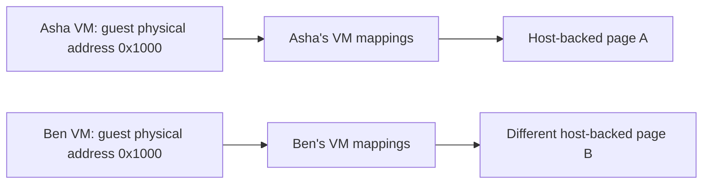

Notice that **both guests can use the same numeric guest address** (`0x1000`) without sharing the same real memory. The address is meaningful only in its VM's address space.

At this point, the guest has a memory space but still needs something that can execute instructions. That brings us to the virtual CPU.

## 7. A vCPU is not a newly manufactured CPU

KVM can create a virtual CPU for an existing VM. The userspace VMM uses a VM-specific `KVM_CREATE_VCPU` operation and receives a **vCPU file descriptor**. It configures guest CPU state, such as registers, so the processor can begin at the guest's intended entry point. [2]

In a typical Firecracker VM, each vCPU has a corresponding **host thread**. When that thread enters `KVM_RUN`, KVM and the processor execute guest instructions on a **real CPU core**. If the guest must yield to the virtualization layer, control returns to the host-side VMM/KVM path.

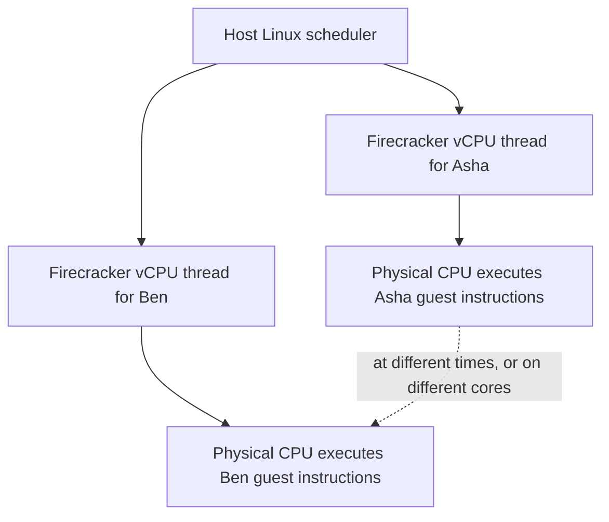

On a multicore host, Asha's and Ben's vCPU threads may execute in parallel on different cores. If resources are oversubscribed, the host can time-slice them. *Inside* each VM, its own guest kernel schedules application processes over the vCPUs it believes it owns.

There are thus **two scheduling responsibilities**, not two physical processors:

- Guest kernel: "Which guest process runs on my vCPU?"
- Host kernel: "When and where does the host thread backing that vCPU get real CPU time?"

A vCPU is **state + execution machinery**, not a dedicated physical CPU chip. A guest configured with two vCPUs can have two concurrent execution contexts, subject to the actual host's scheduling and capacity.

### A complete intermediate view

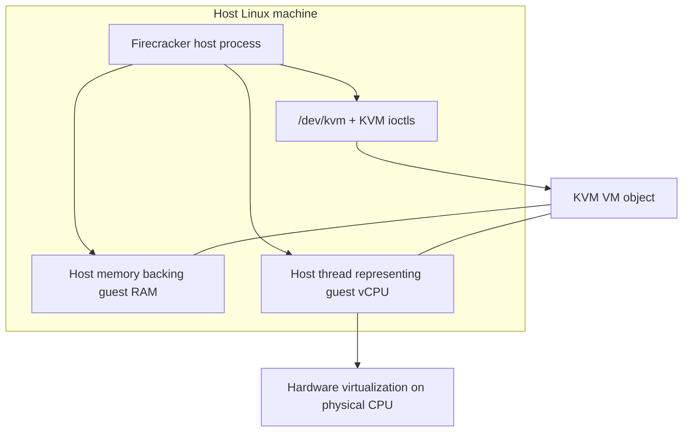

We've built the *capacity* to run a separate machine. We still haven't placed a guest kernel in it. The next section supplies the missing software.

---

# Part III — How a guest operating system appears

## 8. The guest kernel is executable code, not a new physical component

We should clear up one of the most common misunderstandings: a "guest kernel" is not a magical hardware object and not another host kernel installation. A Linux kernel is executable software that can be loaded into memory and started at an appropriate processor state.

For our guest we need, at minimum, a **guest kernel image**, a way to provide **guest userspace**, and appropriately configured **virtual hardware**. In a common Firecracker Linux setup, userspace resides in a **root filesystem image** provided as a virtual block device. Alternatively, an initramfs can supply early userspace.

What do these elements actually mean?

**Guest kernel image** — the Linux kernel binary that will boot *inside the VM*. It has its own kernel version, configuration and kernel-internal state while running. It does not replace the host kernel.

**Root filesystem image** — the guest's filesystem contents. This can contain `/bin`, libraries, configuration, an init program, and the Python application. It is **not** the guest kernel itself. A kernel without working userspace may boot only to fail when it cannot start an init process.

**Virtual devices** — for example, a virtual block device that exposes the root filesystem image to the guest, and an optional virtual NIC for networking.

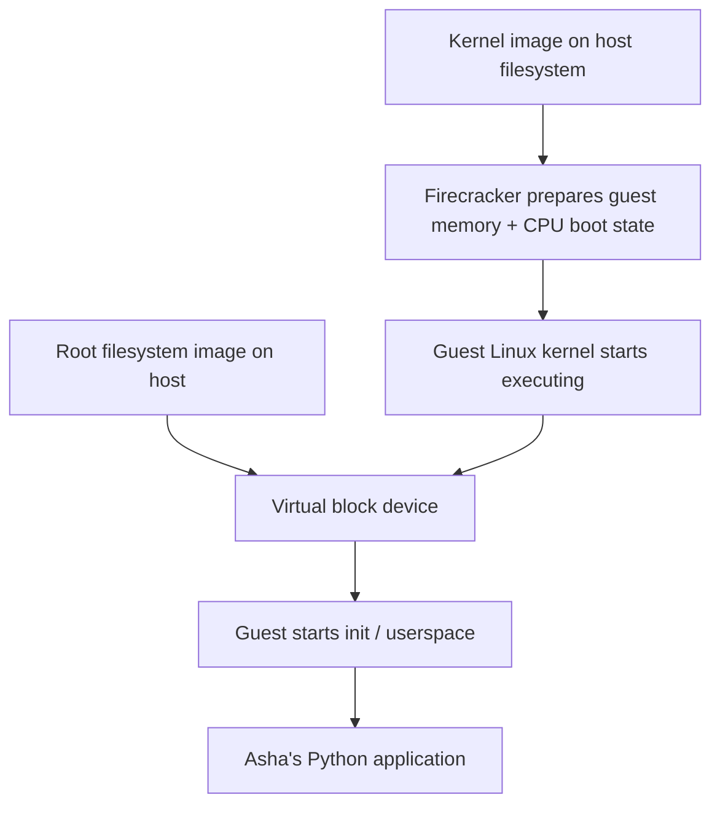

The VMM and KVM establish the conditions under which the CPU can enter the guest. The CPU then executes the guest kernel code. As the guest initializes, it creates its own kernel data structures, memory-management state, process table, device drivers and scheduler state.

That is how we can have **two independently running Linux kernels on the same host**. They are two different running instances of kernel code with different memory and machine state, just as two Python processes can run the same program code but have different memory and state. The kernel analogy has limits — a guest kernel runs in a privileged guest execution context, unlike a normal Python process — but it makes the "two kernel instances" idea less mysterious.

## 9. Trace one syscall: which kernel answers it?

Now Asha's Python code is running inside her guest VM. Suppose it executes a syscall to get its process ID (`getpid`).

**Case 1 — ordinary host process or ordinary container:** the process transitions into the **host Linux kernel**. Namespace rules may affect the PID value visible inside a container, but it remains the host kernel handling the syscall.

**Case 2 — process inside the microVM:** the process transitions into **Asha's guest Linux kernel**. That guest kernel looks up Asha's process information and returns the answer. A normal guest `getpid` does **not** require sending an API request to Firecracker or handling the call in the host kernel.

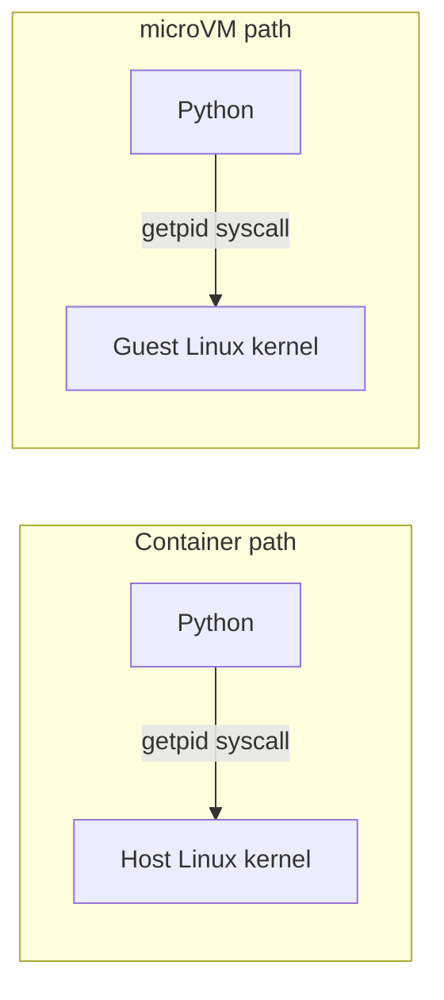

This is the most practical definition of the guest kernel's responsibility: **it is the OS kernel serving the applications inside that VM**. It handles their system calls, scheduling and guest memory management. It doesn't directly own physical RAM or arbitrary host devices.

But if the guest can execute kernel instructions, why doesn't that give it control over the whole machine? We need to understand the fence.

---

# Part IV — Where the actual isolation fence comes from

## 10. Separate two ideas: the guest's privileges and the host's privileges

The guest Linux kernel needs privileges *inside* its machine to manage page tables and perform kernel operations. That does not mean it should gain unrestricted privileges over the host.

Modern CPUs provide **hardware virtualization modes**. On Intel, VT-x uses VMX root and non-root operation; AMD offers corresponding virtualization features. A guest can run privileged kernel code in a guest context while the host's virtualization layer retains control over operations that must not escape that context.

When KVM configures the virtual CPU, it sets up rules for what the CPU can run directly and what must return control to the virtualization layer. Entering guest execution is called **VM entry**; returning to the hypervisor for an intercepted operation or event is called a **VM exit**.

```mermaid
sequenceDiagram
    participant T as Host vCPU thread
    participant K as KVM / CPU virtualization
    participant G as Guest kernel
    T->>K: KVM_RUN
    K->>G: VM entry; execute guest instructions
    Note over G: Many normal guest instructions and syscalls run here
    G-->>K: Intercepted event / operation
    K-->>T: VM exit; VMM may need to handle it
    T->>K: Resume guest when ready
    K->>G: Next VM entry
```

Do **not** imagine every instruction or guest system call traveling through Firecracker. That would be an incorrect and slow design. Hardware virtualization allows most guest CPU execution to happen directly on the physical processor, while particular operations and events are intercepted as needed.

## 11. The memory fence: two translations, different owners

We already saw that Asha and Ben can both use guest address `0x1000`. Now look at how a memory reference is translated.

An ordinary application has a **virtual address**. Its operating system uses page tables to map that to a physical-memory address. In a VM, the guest kernel builds its own page tables, but the "physical" addresses it produces are **guest physical addresses**, not unrestricted host addresses.

Hardware performs an additional mapping from guest physical addresses to host-backed physical memory. On Intel this can use **Extended Page Tables (EPT)**; on AMD, **Nested Page Tables (NPT)**. KVM and the virtualization layer set up and maintain the guest memory mappings; the CPU enforces them.

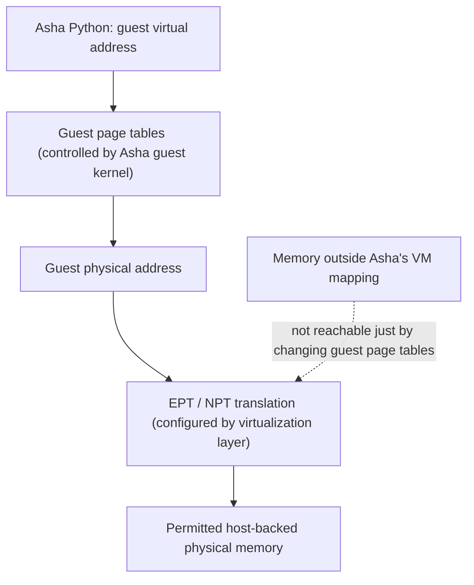

Suppose malicious code gains full control of Asha's guest kernel. It could potentially manipulate Asha's **guest page tables**. But it does not thereby gain the ability to rewrite the **second-stage host mapping** into Ben's memory. That map is governed by the virtualization boundary rather than Asha's kernel.

This is the crucial difference between an isolated container and a VM: compromising the container's shared kernel threatens the kernel serving all host containers. Compromising one VM's guest kernel does not normally permit the guest to access host memory or other guests' memory without a further vulnerability in KVM, the VMM, a virtual device, or another exposed path.

**Important nuance:** Conventional KVM virtualization does **not** generally protect the guest from a maliciously privileged *host administrator*. The host controls the VMM and its backing memory. Technologies designed for confidential computing address a different host-trust problem and are outside our main microVM model.

## 12. Isolation also needs a controlled I/O boundary

CPU and RAM fencing alone would be incomplete. A guest could otherwise attack the host through untrusted device operations, networking paths or incorrectly exposed host resources.

Firecracker therefore exposes a **small virtual device model**. The guest talks to virtual devices; the VMM and host-side infrastructure back those devices with permitted host resources. Device emulation and I/O paths are part of the **attack surface**, so minimizing and hardening them matters. When a physical device is directly assigned to a VM, an **IOMMU** may be used to fence device DMA memory access; that is a separate mechanism from CPU EPT/NPT translations.

Firecracker additionally limits the power of its **host-side VMM process** through defenses such as seccomp syscall filtering and its `jailer` mechanism (which uses restrictions such as namespaces, cgroups and privilege dropping). Those protections are not a replacement for the guest/host virtualization boundary. They are defense in depth if the VMM itself is attacked. [3]

At this stage our security story has three distinct owners:

| What must be limited? | Main enforcing mechanism | Who configures or manages it? |
|---|---|---|
| Guest control of host CPU virtualization state | CPU hardware virtualization | KVM / host virtualization layer |
| Guest access to host/other-VM memory | Hardware EPT/NPT-style mapping | KVM / host virtualization layer |
| Exposed virtual devices and VMM host privileges | Minimal device model, seccomp, jailer, host security controls | Firecracker and host operator |

**The physical CPU is a major enforcer of the fence; KVM programs the VM environment; Firecracker supplies the VM model and its restricted host-side devices.** The guest kernel does not create its own fence against the host.

---

# Part V — How the guest can read files and send packets

## 13. A guest disk is usually a virtual device backed by a host file

Asha's application opens `/data/input.txt` inside her VM. The guest kernel handles the syscall and filesystem logic, but sooner or later a block read may be necessary. Where does the data physically live?

In our Firecracker setup, the virtual block device is backed by a **disk image file on the host**. The guest kernel sees the virtual block device and uses a guest driver (often virtio-block). Firecracker handles the request through the configured virtual-device backend. Eventually, the host services I/O against the backing file and storage stack.

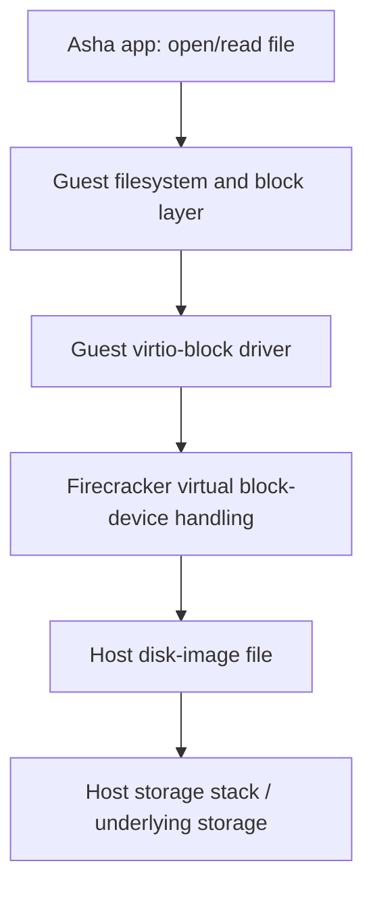

This diagram is an **I/O request path**, not a statement that every read always goes to the disk. Like ordinary operating systems, the guest and host may cache data. Also, giving multiple VMs unsafe concurrent writable access to the same root filesystem image can corrupt data or create cross-tenant leakage. A manager needs a deliberate image-copying, layering, sharing or snapshot strategy.

Notice the ownership distinction: the guest thinks it has a block device. It does **not** get arbitrary access to the host's filesystem. The host decides which backing image the guest is allowed to use.

## 14. A guest network interface needs a path to the host's network

Now Asha's Python program sends a TCP packet to a service. The guest kernel builds the packet according to its own network stack and routes it toward its virtual NIC. In a simple Firecracker arrangement, the guest uses a **virtio-net** device and the host has a corresponding **TAP** interface.

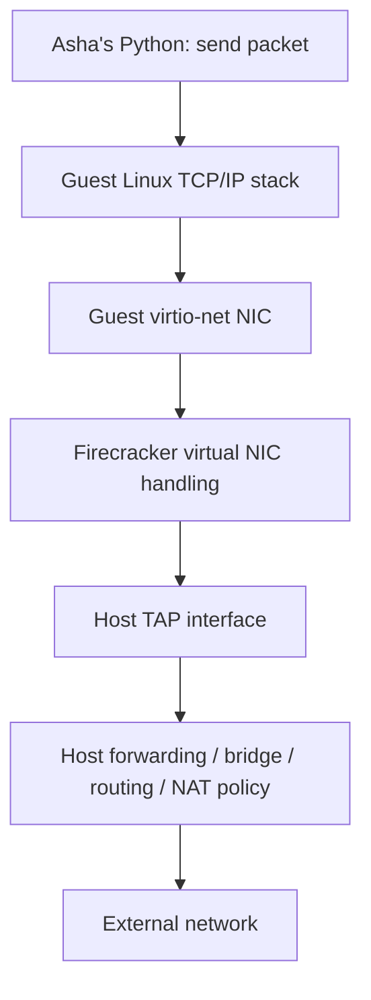

This adds an operational responsibility: **creating a VM does not automatically give it internet access**. Somebody must configure the host TAP interface, addresses, routes, firewall rules and optional NAT/bridging, plus guest network configuration. The choices differ between platforms.

The same separation that protects the host from arbitrary guest memory access means networking must cross an intentionally provided interface. The firewall and routing policy therefore matter to tenant isolation too. A separate guest kernel does not automatically prevent Asha from reaching Ben over the network if you explicitly connect them.

Some workloads use **virtio-vsock**, a host–guest communication channel that does not require a guest IP network connection, for control messages or agent communication. This is especially useful in Kata, but it is not the same as automatically exposing a guest's TCP service.

---

# Part VI — Put the pieces together: from an empty host to a useful VM

## 15. One full start-up story, told first in ordinary language

Return to our original host. A request arrives: "Run Asha's Python code inside an isolated environment." We now know enough to follow the whole sequence without skipping over unknown concepts.

First, a host-side **manager** accepts the request. Firecracker does not decide on its own which customer's code should run, how to choose a host, or when to clean up. Those policy decisions belong to the surrounding system. The manager selects a suitable host, chooses CPU and memory limits, prepares a guest kernel and a root filesystem, and decides which network and disk resources to expose.

Next, the manager starts a **Firecracker process**. It configures the VM using Firecracker's local API. Under the hood, Firecracker communicates with **KVM**: it establishes VM state, guest-backed memory, vCPUs and virtual-device configuration. Once requested to start, the guest kernel begins booting on its virtual CPU. It initializes its own process and memory-management state and starts userspace from its configured guest image. Asha's Python process then runs and uses **the guest kernel** for its system calls.

During execution, the **host scheduler** allocates time to Firecracker's host threads; the **guest scheduler** allocates vCPU time to Asha's processes. KVM and CPU hardware enforce the guest execution and memory boundaries. Disk and network activity cross the virtual-device interfaces intentionally provided by Firecracker. The manager monitors the job, captures its result, and terminates the VM when appropriate.

Now the technically labeled trace should feel like a refinement, not a different story.

```mermaid
sequenceDiagram
    participant M as Host-side manager
    participant F as Firecracker VMM process
    participant K as Host Linux / KVM
    participant C as CPU virtualization
    participant G as Guest Linux kernel
    participant A as Asha application
    M->>M: Prepare guest kernel/rootfs and policy
    M->>F: Start Firecracker; configure API
    F->>K: Open /dev/kvm; configure VM, memory, vCPUs
    K-->>F: VM/vCPU handles and prepared state
    M->>F: InstanceStart
    F->>K: Enter vCPU execution (KVM_RUN)
    K->>C: Enter guest mode
    C->>G: Execute guest kernel boot code
    G->>G: Initialize kernel + mount rootfs + start userspace
    G->>A: Launch application
    A->>G: Normal Linux syscalls
    G-->>A: Files, memory, process/network services
    Note over F,G: Device I/O may be handled via VMM and host backends
    M->>M: Observe result and apply completion policy
    M->>F: Stop / terminate and clean up
```

This diagram deliberately compresses many low-level boot operations and does **not** claim that all KVM creation steps happen at exactly the moment of a particular Firecracker API call. The essential causal relationships are: host manager requests the VM; VMM/KVM prepare its execution; guest kernel boots; guest userspace runs; manager controls lifecycle.

## 16. A small real API example — only after the logical flow

The following is a **learning sketch** of Firecracker's API, not a turnkey installation script. It assumes:

- A Linux host with usable `/dev/kvm` and a compatible Firecracker binary.
- Correctly built and compatible guest `vmlinux` kernel image at `/opt/microvm/vmlinux`.
- A valid ext4 guest rootfs image at `/opt/microvm/rootfs.ext4` with working guest init/userspace.
- Sufficient permissions, disk access and host resources.

We deliberately **omit networking**, since that would introduce TAP configuration before the minimal boot is understood. Do not run the example against a production host or use the simplified no-jailer form for untrusted production workloads.

First start the Firecracker executable in one terminal:

```bash
firecracker --api-sock /tmp/asha-fc.socket
```

In a second terminal, the following calls configure one instance:

```bash
SOCK=/tmp/asha-fc.socket

# 1. Specify guest CPU and memory size.
curl --unix-socket "$SOCK" -X PUT \
  -H 'Content-Type: application/json' \
  -d '{"vcpu_count":1,"mem_size_mib":512}' \
  http://localhost/machine-config

# 2. Identify the guest kernel image and boot arguments.
curl --unix-socket "$SOCK" -X PUT \
  -H 'Content-Type: application/json' \
  -d '{"kernel_image_path":"/opt/microvm/vmlinux", "boot_args":"console=ttyS0 reboot=k panic=1"}' \
  http://localhost/boot-source

# 3. Expose a host disk-image file as the guest's root disk.
curl --unix-socket "$SOCK" -X PUT \
  -H 'Content-Type: application/json' \
  -d '{"drive_id":"rootfs", "path_on_host":"/opt/microvm/rootfs.ext4", "is_root_device":true, "is_read_only":false}' \
  http://localhost/drives/rootfs

# 4. Start the VM using the supplied kernel and rootfs.
curl --unix-socket "$SOCK" -X PUT \
  -H 'Content-Type: application/json' \
  -d '{"action_type":"InstanceStart"}' \
  http://localhost/actions
```

The **first** request changes the VM's virtual-resource configuration. The **second** identifies the code to boot. The **third** binds a virtual disk to a host image. The **fourth** crosses from *configured* to *running*. For a genuinely runnable lab, use the version-matched images and host/network setup in Firecracker's official getting-started guide. API options and boot requirements can vary by version. [4]

If a request fails, distinguish which stage failed. "Cannot open `/dev/kvm`" is a host capability/permission issue. "Invalid boot image" is a guest-asset issue. "Kernel starts but no init is found" is a guest userspace/rootfs issue. A VM that boots but has no network is a **network configuration** issue, not proof that virtualization failed.

## 17. Inspecting the host: what would you actually see?

The host offers clues without needing Kubernetes. These are **inspection** commands, not commands that create VMs:

```bash
# Does the KVM character device exist and what permissions does it have?
ls -l /dev/kvm

# Which KVM modules are loaded, if modules are used on this host?
lsmod | grep kvm

# Find running Firecracker processes on the host.
pgrep -af firecracker

# Look at the host threads belonging to a known Firecracker PID.
ps -T -p <FIRECRACKER_PID> -o pid,tid,comm,stat,pcpu

# See the host's CPU virtualization flags on x86 when exposed.
grep -m1 -E 'vmx|svm' /proc/cpuinfo
```

If `/dev/kvm` is absent, that **does not always mean the physical hardware lacks virtualization**: permissions, kernel modules, disabled nested virtualization, platform restrictions or an unsupported environment could be responsible. A CPU flag alone also does not prove that KVM is available inside your specific EC2 instance.

Why might `ps` not show Asha's Python process? Because that Python process exists under **the guest kernel's process table**, not as an ordinary application process on the host. The host does see Firecracker and its vCPU threads. A guest-side `ps` will show its own processes.

---

# Part VII — The lifecycle manager, multi-VM hosts and failures

## 18. Firecracker runs a VM; it is not a scheduler or reconciliation controller

Suppose twenty requests arrive from different customers. The VMM knows how to create/run its individual microVM, but it does not by itself perform fleet scheduling, multi-host placement, desired-state reconciliation, tenant admission control, image distribution or business-level retries.

A separate manager must decide **where**, **when**, **for whom**, **with what resources**, **under which policies**, and **for how long** a guest runs. That might be a small custom service or a sophisticated platform. If we later place Kata underneath Kubernetes, Kubernetes can provide pod orchestration while Kata provides a VM-backed sandbox; that is a particular integration, not an intrinsic feature of microVMs.

A manager for our two customers could have a simple state model:

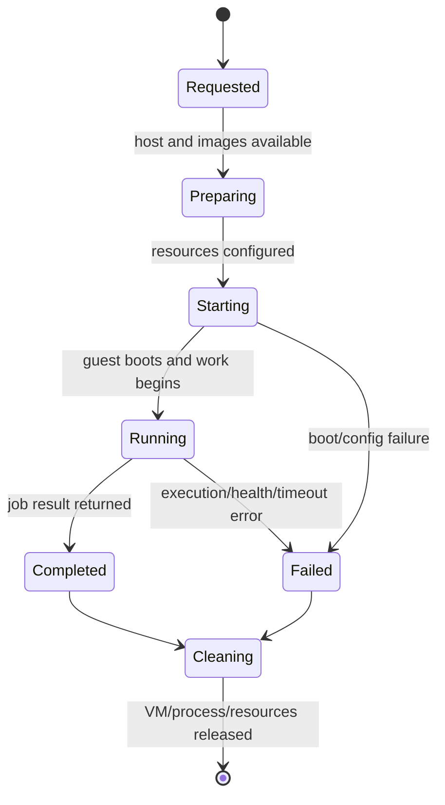

Reconciliation, if desired, belongs in that manager: "I expect two active customer environments; do I currently have two healthy environments?" A managed platform can implement this loop, but Firecracker's local API is not a Kubernetes-style desired-state API.

### Capacity is shared even when kernels are separate

If the host has 16 GiB RAM, three microVMs configured with 4 GiB each do not create 12 GiB of new physical memory. They consume host-backed resources while also imposing VMM, host OS, memory-page and guest-kernel overhead. The manager must account for the host, backing files, networking and resource headroom.

CPU can be oversubscribed, but if too many vCPU threads compete for too few physical cores, queueing and latency increase. Memory overcommit may be possible depending on mechanisms and workload, but it introduces pressure, paging or out-of-memory risks. **Separate kernels give separate operating-system state, not infinite hardware capacity.**

## 19. What fails, and who notices?

Now apply our complete model to failures:

**Asha's Python process crashes.** The guest kernel can remain running. The job supervisor or agent must decide whether to restart the application, report failure or end the VM.

**Asha's guest kernel panics.** Asha's VM may stop functioning, but Ben's VM and the host should ordinarily continue because they do not depend on Asha's guest kernel. The manager still needs to detect the failure and clean up.

**Firecracker or its VMM process crashes.** Its corresponding guest VM is disrupted or terminated, subject to the implementation and recovery design. Other separately hosted VMM processes generally remain unaffected, although a shared host problem can affect many guests.

**The host kernel panics, or the EC2 host loses power.** Every VM relying on that host is affected. VM isolation is not high availability. To survive host loss, an orchestration platform needs replication, placement across hosts, restart/recovery policy, and durable state.

**A guest boots but cannot reach the network.** Check guest network configuration, virtual NIC, TAP link, routing/NAT/firewall and host network policy. There may be no virtualization fault at all.

**One guest tries to read another's RAM.** Guest page-table control is insufficient to bypass a correctly enforced second-stage memory mapping. A failure here would be a serious vulnerability in the virtualization boundary or related host-facing component, not the ordinary design.

This exercise shows why **isolation**, **orchestration**, **resource governance**, and **availability** must be treated as four separate system properties.

---

# Part VIII — Return to AWS, Kata Containers and the industry

## 20. Does a microVM require AWS or an EC2 instance?

No. MicroVM is a *virtualization design*, not an AWS resource type by definition. You can run an appropriate VMM on a Linux host with the right processor support, KVM access and permissions. That host can be a physical Linux server or a suitably configured VM that supports **nested virtualization**.

An ordinary EC2 instance is typically already a VM under the AWS Nitro hypervisor. If your EC2 instance then runs KVM to create Firecracker guests, you have nesting:

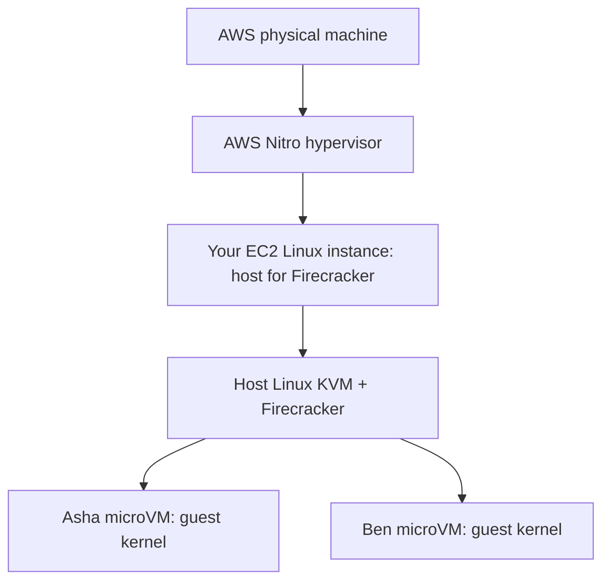

Historically, many Firecracker-on-EC2 examples used **bare-metal** EC2 instances, which do not add this nested guest-VM layer. AWS introduced nested virtualization support for selected **virtual** EC2 families in 2026; availability is instance-type dependent, must be enabled, and should be checked against current AWS documentation. Do **not** assume every EC2 size exposes usable `/dev/kvm`. Also verify Firecracker's own tested/supported configurations for the selected host. [5]

On an EC2 host, the "physical hardware" mentioned earlier is itself exposed through AWS's virtualization environment; the underlying CPU cores and memory still ultimately belong to the real AWS server. The logical distinction between host-for-our-microVM and guest-of-our-microVM remains exactly the same.

AWS Lambda uses Firecracker under the hood, but **AWS Lambda's control plane is not the Firecracker API itself**. It provides the managed scheduling, scaling, security controls and lifecycle around the microVM substrate. AWS also introduced the distinct Lambda MicroVMs offering in June 2026 for a more directly controlled microVM execution model. [6]

## 21. Firecracker is one VMM, not the only one

We needed a program that can assemble a virtual machine, provide virtual devices and work with KVM. **Firecracker** is one such VMM, emphasizing a small device model and serverless-style workloads.

Other technologies include **Cloud Hypervisor**, **crosvm**, **Dragonball**, and **QEMU**. These do not all offer identical interfaces, virtual device capabilities, hardware support or operational trade-offs. QEMU is a broader machine emulator/VMM and can also support minimal VM configurations; it is not exclusively a microVM project.

This is why the conceptual stack should be read from the bottom up:

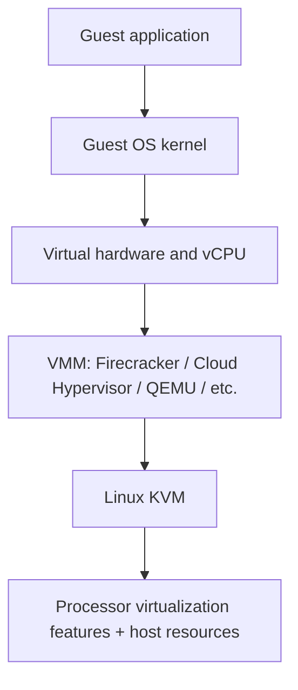

The precise implementation can differ. The diagram shows the **responsibility layers**, not a claim that every syscall passes through each box.

## 22. How Kata brings this back into the Kubernetes world

Only now, after understanding the machine itself, revisit your earlier Kubernetes question.

Kubernetes decides which **Pod** should run and where. Kubelet requests a pod sandbox through a CRI runtime such as containerd. With a standard `runc` path, the containers are created as host-kernel processes, isolated by host namespaces and cgroups. With a **Kata Containers** runtime path, Kata arranges for the pod's sandbox to be a lightweight VM, usually one VM per Pod, with the Pod's container processes running *inside the guest*. [7]

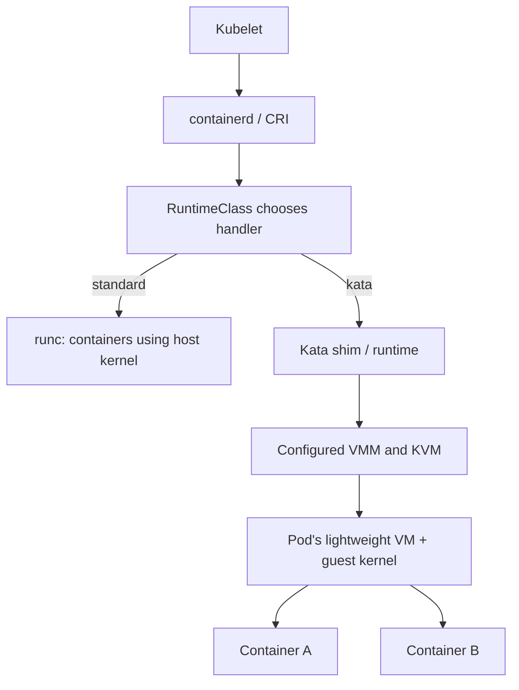

The *pod is not a host process containing a VM*. A pod is Kubernetes's logical workload object. Kata **backs its sandbox with a VM**. Some Kata backends run a separate VMM host process; Dragonball can be built into the Kata shim process. Inside the VM, a **kata-agent** manages the guest's containers, and guest-side Linux namespace/cgroup isolation can still be used between them. [7]

The choice is therefore not "Kubernetes **or** microVMs." It can be "Kubernetes **with** VM-backed Pod sandboxes," when that additional isolation is worth the overhead and the runtime is configured appropriately.

---

# Part IX — What you should be able to reason about now

## 23. Cost, usefulness and the actual decision

Why not replace every container with a microVM? Because security is not the only system requirement. A microVM needs a separate guest kernel, guest memory, boot/initialization work and virtualization machinery. It may have different I/O and observability paths, and its networking/storage integration requires attention. A minimal VMM reduces overhead compared with general-purpose VMs; it does **not** make that overhead disappear.

Conversely, why not always use ordinary containers? When workloads come from unrelated tenants or execute untrusted customer/AI-generated code, a separate guest kernel and hardware-backed memory/CPU boundary can reduce the consequences of a container-level or guest-kernel compromise.

The correct question is therefore: **Which trust boundary do we need, and what overhead are we willing to pay for it?**

| Situation | First approach worth evaluating | Reason |
|---|---|---|
| Trusted internal application fleet | Hardened ordinary containers | Efficient process isolation; straightforward operations |
| Untrusted customer code on shared workers | MicroVM-backed sandboxes | Separate guest kernel and additional hardware virtualization boundary |
| One developer needing an entire customizable OS | Traditional VM or lightweight VM, depending on needs | Independent operating-system control |
| Kubernetes Pods requiring stronger workload isolation | Kata-backed sandbox, where supported | Retain K8s orchestration while changing execution boundary |
| High availability across machine failures | Multi-host orchestration/replication | VM isolation by itself cannot survive host failure |

In production, none of these options excuse poor network policy, vulnerable images, excessive privileges, weak identity controls, unpatched host kernels or inadequate monitoring. A VM boundary is one security control within a larger system.

## 24. Reconstruct the whole mental model without starting from definitions

We began with Asha and Ben running Python programs on the same Linux host. The host kernel could isolate their resources through containers, but both workloads still depended on that single kernel. When we wanted an additional boundary between untrusted code and the host, we chose to give each workload its own **guest Linux kernel** running on **virtual hardware**.

That raised a practical challenge: where does this extra machine come from? We did not buy another CPU. Instead, we started **Firecracker as a host process**, used its **`/dev/kvm` interface** to ask **KVM** to prepare VM/vCPU state and guest memory, and allowed physical CPU virtualization features to execute guest instructions. We loaded a **guest kernel image**, exposed guest userspace through a root filesystem, and booted an actual guest operating system.

Once the guest was running, Python's system calls were answered by the **guest kernel**. The guest kernel could schedule its processes and manage its own guest page tables. It still could not arbitrarily access host memory: **KVM-configured, CPU-enforced second-stage memory mappings** constrain what guest physical addresses can reach. Virtual block and network devices gave the guest narrow, intentionally configured ways to perform I/O. The host-side manager decided when to create, monitor and terminate the microVM; Firecracker did not invent a fleet orchestrator.

Here is our finished picture, now with every component earned by the preceding explanation:

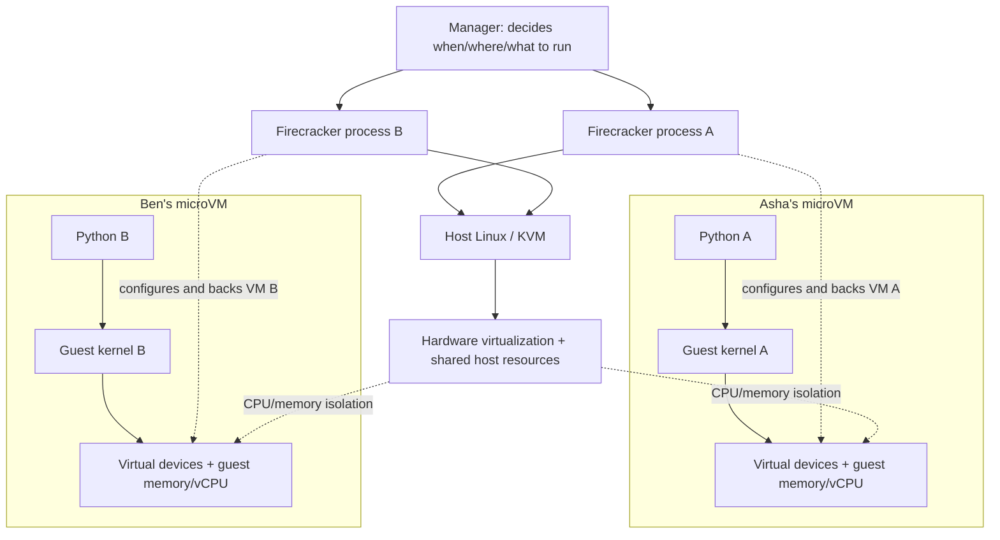

*These arrows show ownership and resource relationships rather than a literal instruction-by-instruction execution path. Each Firecracker process controls its own microVM; both rely on the same host's KVM facility and physical resources.*

## 25. Understanding checks — reason, don't memorize

Try answering these before opening the suggested reasoning.

**1. Asha and Ben use guest physical address `0x1000`. Are they reading the same physical RAM?**

Not necessarily; ordinarily, no. Each VM has its own translation context. The same guest physical address can map to different host-backed pages.

**2. Asha's guest kernel is fully compromised. Why doesn't that automatically make Ben's VM compromised?**

The guest kernel controls guest state, not the host-controlled second-stage memory mappings or CPU virtualization state. Crossing those boundaries requires another vulnerability or an exposed interface; isolation is stronger, not infallible.

**3. Asha executes `getpid()` inside the microVM. Does Firecracker answer the syscall?**

No. Her guest Linux kernel normally handles it directly. Firecracker is involved in configuring/executing the VM and supporting virtual I/O, not servicing every guest Linux syscall.

**4. Why can the guest kernel have its own scheduler if the host still schedules the Firecracker vCPU thread?**

They operate at different levels. The guest chooses a guest process to run on its vCPU; the host chooses when the thread backing that vCPU runs on a physical CPU.

**5. A microVM boots, but SSH cannot reach it. Does that mean KVM failed?**

No. The VM may have booted correctly but lack guest networking, host TAP, routing, firewall or SSH configuration. Boot and external connectivity are separate stages.

**6. Why isn't Firecracker a replacement for Kubernetes?**

A VMM operates an individual VM. Kubernetes provides declarative workload orchestration, scheduling and reconciliation. Kata can bridge containerd/Kubernetes workflows to VM-backed sandboxes.

**7. The host crashes. What happens to two perfectly isolated guests?**

Both lose the machine providing their CPU, memory and I/O. Isolation does not imply availability; resilience needs management and redundancy across hosts.

**8. If the VM is "micro," can it omit the guest kernel?**

Not in the Linux guest-kernel microVM model we are studying. It removes unnecessary *virtual hardware and boot complexity*, not the essential guest operating-system execution environment.

---

# Optional exploration after this chapter

A useful practical lab is to bring up a **single** Firecracker guest using the official guide, then observe: the Firecracker PID and threads on the host, boot messages from the guest kernel, process listings *inside* the guest, and a packet crossing a TAP interface. This confirms one conceptual layer at a time. Use an isolated test host; do not expose untrusted user workloads through an unjailed demo setup.

If you want to deepen the low-level explanation later, the next focused lessons should be **(1) a single vCPU's `KVM_RUN`/VM-entry/VM-exit loop, (2) guest virtual → guest physical → host physical memory translation, and (3) a single virtio-net packet from guest to host TAP**. Those lessons now have a clear place in the larger mental model.

## Sources and further reading

These are technical references used to check interfaces and implementation details. This chapter is a newly constructed teaching narrative based on the learning questions in our discussion; it is not a quotation or reproduction of a vendor tutorial.

1. **Firecracker design (one VMM process per VM; threads, devices, jailer):** https://github.com/firecracker-microvm/firecracker/blob/main/docs/design.md
2. **Linux Kernel KVM API (`/dev/kvm`, VM/vCPU file descriptors and ioctls):** https://docs.kernel.org/virt/kvm/api.html
3. **Firecracker production host hardening:** https://github.com/firecracker-microvm/firecracker/blob/main/docs/prod-host-setup.md
4. **Firecracker getting started / API configuration:** https://github.com/firecracker-microvm/firecracker/blob/main/docs/getting-started.md
5. **AWS EC2 nested virtualization and supported instance types:** https://docs.aws.amazon.com/AWSEC2/latest/UserGuide/amazon-ec2-nested-virtualization.html
6. **AWS Lambda and Firecracker:** https://aws.amazon.com/lambda/faqs/ ; **AWS Lambda MicroVMs (2026):** https://aws.amazon.com/blogs/aws/run-isolated-sandboxes-with-full-lifecycle-control-aws-lambda-introduces-microvms/
7. **Kata Containers architecture:** https://kata-containers.github.io/kata-containers/quick-start-guide/ ; https://kata-containers.github.io/kata-containers/design/virtualization/
