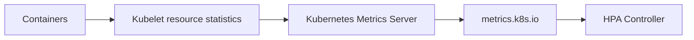
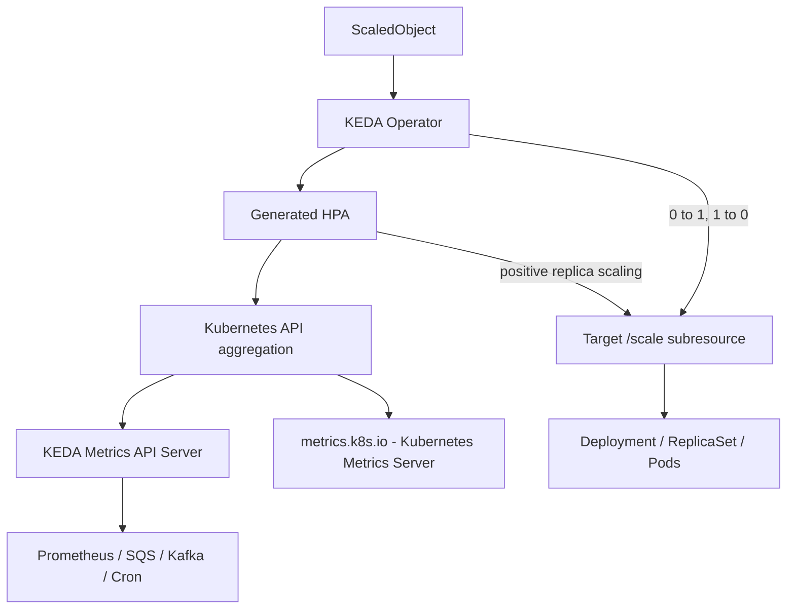
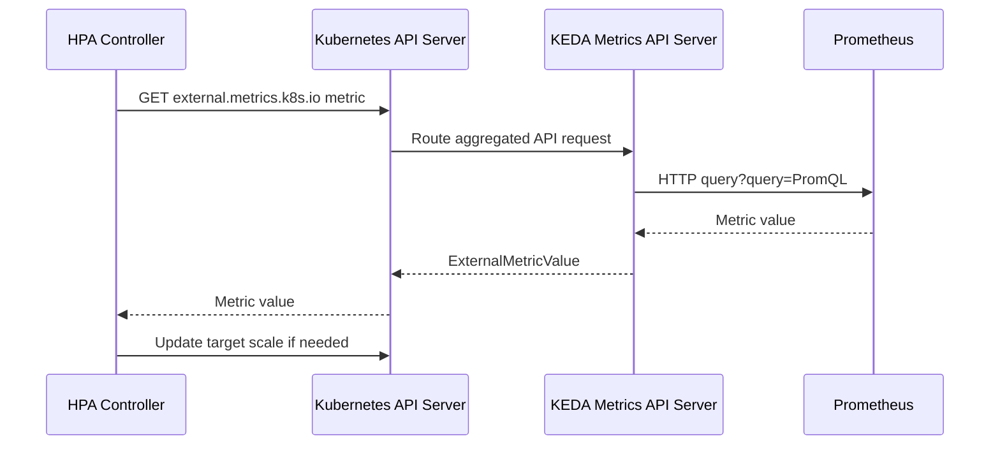
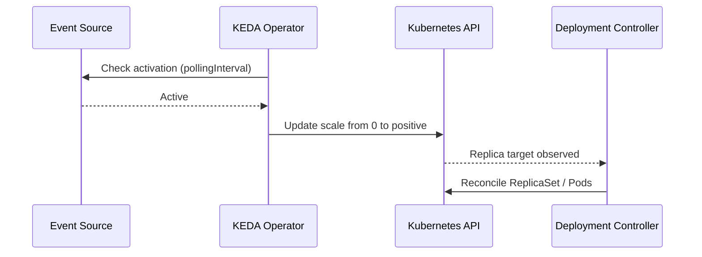
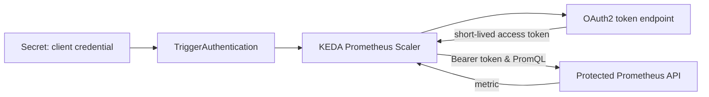

# Kubernetes Autoscaling & KEDA — Complete Architecture and Operations Guide

> **Scope:** A progressive, end-to-end learning and implementation reference covering HPA, VPA, Kubernetes Metrics Server, KEDA, authentication, Prometheus, Cron, scaler internals and production operations. The worked examples are illustrative; production defaults, API fields and integrations must be verified against your deployed versions.

**Documentation basis:** Official Kubernetes HPA and KEDA project docs, checked October 2026. KEDA documentation evolves; examples use commonly supported v2.x concepts but are **not pinned to a specific release**. Before deployment, validate Kubernetes-version compatibility, selected Helm chart version and scaler/provider schema in the corresponding versioned KEDA docs.

## Contents

- **Part 1 — Kubernetes Autoscaling Fundamentals**
  - [1. Introduction to Kubernetes Autoscaling](#1.-introduction-to-kubernetes-autoscaling)
  - [2. CPU and Memory: Usage, Requests, Limits and Utilization](#2.-cpu-and-memory-usage,-requests,-limits-and-utilization)
  - [3. Kubernetes Metrics Server Architecture](#3.-kubernetes-metrics-server-architecture)
  - [4. HPA: Algorithm, API and Multiple Metrics](#4.-hpa-algorithm,-api-and-multiple-metrics)
  - [5. VPA: Recommendation and Updating](#5.-vpa-recommendation-and-updating)
- **Part 2 — KEDA Fundamentals**
  - [6. Why KEDA Exists](#6.-why-keda-exists)
  - [7. KEDA, HPA and VPA Compared](#7.-keda,-hpa-and-vpa-compared)
  - [8. Scaler, Trigger, Activation and Scaling](#8.-scaler,-trigger,-activation-and-scaling)
  - [9. KEDA High-Level Architecture](#9.-keda-high-level-architecture)
- **Part 3 — Installation and Internal Components**
  - [10. Installation via Helm and Kubernetes Prerequisites](#10.-installation-via-helm-and-kubernetes-prerequisites)
  - [11. KEDA Operator Reconciliation](#11.-keda-operator-reconciliation)
  - [12. KEDA Metrics API Server and Kubernetes API Aggregation](#12.-keda-metrics-api-server-and-kubernetes-api-aggregation)
  - [13. Admission Webhooks and Validation](#13.-admission-webhooks-and-validation)
- **Part 4 — KEDA Resources and YAML**
  - [14. KEDA CRDs and Their Responsibilities](#14.-keda-crds-and-their-responsibilities)
  - [15. ScaledObject Fields and Lifecycle](#15.-scaledobject-fields-and-lifecycle)
  - [16. Trigger Catalog and Example Selection](#16.-trigger-catalog-and-example-selection)
- **Part 5 — Detailed Scaling Sequences**
  - [17. Scale from 0 to 1: KEDA Activation](#17.-scale-from-0-to-1-keda-activation)
  - [18. Scale from 1 to N: HPA Metric Loop](#18.-scale-from-1-to-n-hpa-metric-loop)
  - [19. Scale from N to 1 and 1 to 0](#19.-scale-from-n-to-1-and-1-to-0)
  - [20. Multiple Triggers and Highest Recommendation](#20.-multiple-triggers-and-highest-recommendation)
- **Part 6 — Metrics and Authentication**
  - [21. The Three Metrics API Families](#21.-the-three-metrics-api-families)
  - [22. Prometheus Query End to End](#22.-prometheus-query-end-to-end)
  - [23. Credentials, Token Rotation, Workload Identity](#23.-credentials,-token-rotation,-workload-identity)
- **Part 7 — Advanced Scaling Behaviors**
  - [24. Polling, HPA Sync, Cooldown and Stabilization](#24.-polling,-hpa-sync,-cooldown-and-stabilization)
  - [25. Activation Threshold vs Scaling Threshold](#25.-activation-threshold-vs-scaling-threshold)
  - [26. Advanced HPA Behavior, Caching, Fallback and Pausing](#26.-advanced-hpa-behavior,-caching,-fallback-and-pausing)
- **Part 8 — Jobs**
  - [27. ScaledJob versus ScaledObject](#27.-scaledjob-versus-scaledobject)
- **Part 9 — Operating KEDA in Production**
  - [28. Observability and Instrumentation](#28.-observability-and-instrumentation)
  - [29. Troubleshooting by Failure Boundary](#29.-troubleshooting-by-failure-boundary)
  - [30. Production Security, Capacity and Lifecycle](#30.-production-security,-capacity-and-lifecycle)
- **Part 10 — Hands-on Labs and Architecture Reference**
  - [31. Progressive Hands-On Labs](#31.-progressive-hands-on-labs)
  - [32. Master Reference and Summary](#32.-master-reference-and-summary)

---

# Part 1 — Kubernetes Autoscaling Fundamentals

## 1. Introduction to Kubernetes Autoscaling

Kubernetes reconciles desired state. Autoscaling changes desired resource allocations or replica counts in response to measurements. 
1. **HPA** changes replica count; 
2. **VPA** recommends or changes per-container CPU/memory requests; 
3. **KEDA** adds event-driven activation and external metrics to horizontal scaling. 
4. Node autoscalers (Cluster Autoscaler/Karpenter) provision nodes to fit pending Pods; they do **not** decide application replica counts.

**Mental model:** demand → metrics → replica recommendation → Deployment `.spec.replicas` → ReplicaSet/Pods → scheduler → nodes.

## 2. CPU and Memory: Usage, Requests, Limits and Utilization

- **CPU request:** scheduler reservation and denominator for CPU utilization. `500m` means 0.5 CPU core. CPU use can exceed request if capacity exists.
- **CPU limit:** CFS/quota ceiling; CPU use can be throttled at that limit.
- **Memory request:** scheduler reservation and denominator for memory utilization.
- **Memory limit:** container can be OOM-killed if limit exceeded; unlike CPU, memory is not throttled in the same way.
- **Usage:** observed CPU consumption rate or memory working-set-related measurement.
- **Utilization:** `usage / request × 100` (not `usage / limit`).

Example: CPU request 500m; usage 400m; limit 1000m → **80%** utilization. At 750m usage → **150%** request utilization, even though still below the 1000m limit. For memory, request 512Mi and observed 768Mi → 150% utilization; an application may retain memory and scaling down on memory can be less predictable than CPU.

## 3. Kubernetes Metrics Server Architecture


  [Edit Drawing](https://youtu.be/2arL1jh8ihA?type=inkDrawing&width=500&aspectRatio=1.778&viewBoxX=0&viewBoxY=0&viewBoxW=2000&viewBoxH=1125)


`Kubelet` obtains container resource stats via node/container runtime interfaces; Metrics Server gathers summarized metrics from kubelets and exposes **`metrics.k8s.io`** via API aggregation. It is not a long-term time-series database or a Prometheus replacement. CPU and memory-based HPA query this API. Metrics Server must be installed, reachable and healthy; it is not a magic HPA metric configuration generator.



Inspect: `kubectl top pod -A`, `kubectl get apiservice v1beta1.metrics.k8s.io`, `kubectl get --raw /apis/metrics.k8s.io/v1beta1/nodes`. `kubectl top` failing can indicate a metrics pipeline issue, not necessarily absent workloads.

1. What does Matrix server look like and second question what is the what does Matrix server look like and what are the end points it exposes and essentially who are the consumers of that Matrix server and point apart from HP and vpa controllers right

## 4. HPA: Algorithm, API and Multiple Metrics

The HPA controller (in `kube-controller-manager`) periodically reads the **metrics defined in the HPA spec**, with a default sync of around **15 seconds**. It does **not** monitor CPU just because Metrics Server is running.

`desired = ceil(currentReplicas × currentMetric / targetMetric)`; default tolerance around 10%. Example: 3 Pods, 80% CPU vs target 60% → ceil(3×80/60)=**4**. For 5 Pods at 72% vs 60% → 6. The result is subject to min/max, missing metrics, readiness, stabilization, scaling-rate policies.

Multiple metrics: calculate a desired count for **each** and choose the **largest**, subject to policy. If a metric fails and others suggest scale-down, HPA generally skips scaling down; a successful metric can still justify scaling up. Default scale-down stabilization is commonly **300 seconds**.

**Resource metric HPA example:**
```yaml
apiVersion: autoscaling/v2
kind: HorizontalPodAutoscaler
metadata:
  name: demo-hpa
spec:
  scaleTargetRef:
    apiVersion: apps/v1
    kind: Deployment
    name: demo
  minReplicas: 1
  maxReplicas: 10
  metrics:
  - type: Resource
    resource:
      name: cpu
      target:
        type: Utilization
        averageUtilization: 60
```

KEDA typically **generates** and owns an HPA instead of asking you to create a second competing one.

## 5. VPA: Recommendation and Updating

VPA has **Recommender** (historical usage distribution → request recommendations), **Updater** (coordinates applying changes), and **Admission Controller** (mutates resources on Pod creation). Depending on VPA version/configuration, updates can involve Pod replacement or in-place resize support. Modes include recommendation-only (`Off`) and automatic updating modes. Check your installed VPA release for exact update modes.

Common recommendation fields: `target`, `lowerBound`, `upperBound`, `uncappedTarget`. E.g. CPU request 500m and sustained usage 800m might yield target 1000m; this is an illustration, **not** a simple VPA formula.

**Interaction:** if HPA targets CPU **percentage of request**, and VPA increases request from 500m to 1000m with actual usage constant 400m, HPA sees 80% → 40%. Avoid blindly combining CPU-utilization HPA and CPU-request-adjusting VPA on the same workload. Consider HPA external/object metrics with VPA request management, after testing.


  [Edit Drawing](https://youtu.be/2arL1jh8ihA?type=inkDrawing&width=714.0048828125&aspectRatio=2.949&viewBoxX=-361.309&viewBoxY=-421.165&viewBoxW=1988.07&viewBoxH=674.132)


# Part 2 — KEDA Fundamentals

## 6. Why KEDA Exists

KEDA (Kubernetes Event-Driven Autoscaling) connects event sources—SQS backlog, Kafka lag, Redis queue length, Prometheus query, scheduled Cron windows—to workload scaling. It extends Kubernetes HPA rather than replacing it. Some sources are polled; the term “event-driven” does **not** mean every scaler receives push notifications.

## 7. KEDA, HPA and VPA Compared

| System | Primary output | Input |
|---|---|---|
| HPA | Desired replica count | Configured resource/custom/external metrics |
| VPA | CPU/memory request recommendations or updates | Resource usage history |
| KEDA | HPA configuration/external metric service; activation from zero | ScaledObject triggers and scalers |

**KEDA does not itself schedule Pods.** It manages scaling requests; native controllers realize the desired state.

## 8. Scaler, Trigger, Activation and Scaling

A **trigger** is a ScaledObject entry (`type: prometheus`, `cron`, `aws-sqs-queue`, `cpu`). A **scaler** is KEDA logic for that source. **Activation** answers: should the workload wake from zero? **Scaling** answers: how many positive replicas? Activation thresholds can differ from scaling thresholds. A `ScaledObject` targets long-running scale-enabled resources; a `ScaledJob` creates Kubernetes Jobs directly.

## 9. KEDA High-Level Architecture



Arrows simplify implementation; the HPA controller queries APIs via the Kubernetes API server and reconciliation is asynchronous.

# Part 3 — Installation and Internal Components

## 10. Installation via Helm and Kubernetes Prerequisites

Before installing, verify Kubernetes/KEDA compatibility, RBAC, API aggregation, cluster DNS, TLS trust, network policies, and resource capacity. Production typically uses a pinned, tested Helm chart/release (example command below intentionally omits a version; **pin one in actual deployment**).

```bash
helm repo add kedacore https://kedacore.github.io/charts
helm repo update
helm show values kedacore/keda > keda-values-reference.yaml
helm upgrade --install keda kedacore/keda --namespace keda --create-namespace --values keda-values.yaml
```

Install manifests typically include CRDs; a Deployment for operator, metrics API server, and admission webhooks; Services; RBAC and ServiceAccounts; `APIService` for external metrics; webhook configurations; certificates/certificate management, depending on chart settings. Inspect actual installed chart resources rather than assuming each exact name.

```bash
kubectl get deploy,svc,sa -n keda
kubectl get crd | grep keda.sh
kubectl get apiservice | grep external.metrics
kubectl get validatingwebhookconfigurations | grep -i keda
```

## 11. KEDA Operator Reconciliation

The operator watches KEDA custom resources and reconciles scalers and associated HPA, tracks active/inactive state, and uses Kubernetes `/scale` on scale-to-zero/activation boundaries. It coordinates ScaledObject status, readiness, trigger validation/reconciliation and scaler polling. Reconciliation is **not** the same as the HPA's own metric synchronization loop. The KEDA Operator does not proxy every CPU metric through itself.

## 12. KEDA Metrics API Server and Kubernetes API Aggregation

KEDA Metrics API Server implements the external metrics API (`external.metrics.k8s.io`). When HPA requests an external metric, Kubernetes API server routes to KEDA's registered `APIService`; KEDA selects the scaler and returns a metric, often querying the backend at request time. `useCachedMetrics`, when supported and enabled, can cache supported external metrics on the polling cadence.



Caution: Multiple independent adapters generally cannot each own the same `external.metrics.k8s.io` APIService. Plan coexistence deliberately.

## 13. Admission Webhooks and Validation

KEDA admission webhooks validate supported KEDA resources and protect against invalid or conflicting configurations. Kubernetes API admission occurs when resources are created or updated, **not** on each metric query. A webhook outage can block affected resource writes depending on configured failure policies. Examine: `kubectl get validatingwebhookconfigurations`, webhook Service endpoints, certificates and admission logs.


  [Edit Drawing](https://youtu.be/2arL1jh8ihA?type=inkDrawing&width=500&aspectRatio=1.778&viewBoxX=0&viewBoxY=0&viewBoxW=2000&viewBoxH=1125)


# Part 4 — KEDA Resources and YAML

## 14. KEDA CRDs and Their Responsibilities

| CRD | Scope/purpose |
|---|---|
| `ScaledObject` | Namespaced scaling for Deployment/StatefulSet or eligible custom workload |
| `ScaledJob` | Namespaced event-driven Job creation |
| `TriggerAuthentication` | Namespaced auth reference for triggers |
| `ClusterTriggerAuthentication` | Cluster-scoped reusable auth reference |

`TriggerAuthentication` is configuration, not a token-refresh Pod or daemon. A target CRD requires a valid `/scale` subresource if scaling a custom resource.

## 15. ScaledObject Fields and Lifecycle

```yaml
apiVersion: keda.sh/v1alpha1
kind: ScaledObject
metadata:
  name: nginx-cron
  namespace: default
spec:
  scaleTargetRef:
    name: nginx-deployment
  minReplicaCount: 0
  maxReplicaCount: 10
  pollingInterval: 30
  cooldownPeriod: 300
  triggers:
  - type: cron
    metadata:
      timezone: Asia/Kolkata
      start: 30 * * * *
      end: 45 * * * *
      desiredReplicas: "5"
```

- `minReplicaCount: 0` permits KEDA-controlled zero replicas when the scaler supports it.
- `maxReplicaCount: 10` is a **ceiling, not a request to reach 10**.
- `desiredReplicas: "5"` means the Cron scaler targets 5 during its window; with other active metrics this effectively provides a scheduled replica floor.
- `pollingInterval` normally governs operator trigger polling, especially zero-state activation, not HPA's usual 15-second sync.
- `cooldownPeriod` governs KEDA inactivity-to-zero, **not** normal HPA 10→5 scaling.
- `idleReplicaCount` has restrictions; consult selected release.
- `fallback` supplies a controlled replica behavior for supported scaler failures, subject to its limitations.
- `advanced` can configure HPA behavior and caching/scaling features supported by the release.

**Every hour**: `30 * * * *` starts at minute 30 each hour, `45 * * * *` ends at minute 45. This is not a one-time daily window. Kubernetes controllers can delay actual Pods becoming Ready.

On deletion, `restoreToOriginalReplicaCount` in advanced settings determines whether original replicas are restored; do not assume that deleting a ScaledObject always restores the old count.

## 16. Trigger Catalog and Example Selection

| Trigger | Measured item | Authentication examples | HPA metric path |
|---|---|---|---|
| `cron` | Time window/scheduled replicas | None | KEDA external API |
| `cpu` / `memory` | Pod resource usage | Kubernetes metrics access | `metrics.k8s.io` |
| `prometheus` | PromQL scalar/vector result | None for open service, bearer, TLS, OAuth, AWS IAM depending on endpoint/scaler | KEDA external API |
| `aws-sqs-queue` | Queue depth | IAM roles / credentials | KEDA external API |
| `kafka` | Consumer lag | SASL/TLS when required | KEDA external API |
| `redis` | Queue/list/stream metric | Password/TLS when required | KEDA external API |

For CPU utilization triggers, define CPU **requests** on relevant containers. An open Prometheus Service needs network access but may not need TriggerAuthentication.

# Part 5 — Detailed Scaling Sequences

## 17. Scale from 0 to 1: KEDA Activation

Starting with 0 replicas, HPA generally cannot independently recover ordinary resource-based metrics, so KEDA operator evaluates the scaler's **active** state. For an active source, it writes a positive replica count via the target `/scale` subresource; HPA subsequently takes over positive scaling. Beware that the activation step can differ by scaler/setting; model it as **KEDA wakes the workload**, not a promise that every observed transition visibly pauses at exactly one Pod.



## 18. Scale from 1 to N: HPA Metric Loop

HPA's default sync is roughly **15 seconds**, configurable by the cluster. It asks the specified Kubernetes metric APIs; no automatic switching between sources happens when moving from 5 to 10. With only Cron at desired 5, **it does not scale to 10** just because `maxReplicaCount=10`.

Example during active Cron window: CPU target 60%, actual 120%, 5 current Pods → CPU wants ceil(5×120/60)=10. Cron wants 5; HPA picks 10 (subject to policies). **A CPU trigger must be configured** in the ScaledObject; Metrics Server merely existing does not add CPU to HPA.

HPA updates Deployment scale, and Deployment/ReplicaSet controllers realize Pods; Kubernetes scheduling and nodes are a subsequent separate step.

## 19. Scale from N to 1 and 1 to 0

Assume SQS backlog falls: HPA queries the KEDA external metric and can recommend moving 10→3→1 (not necessarily through every integer, and not necessarily immediately). Default downscale stabilization is generally 300 seconds, independent of KEDA cooldown. After no triggers are active for `cooldownPeriod` (default generally 300s), KEDA can take the target from 1 to 0 when eligible. Exact timing depends on polling, stabilization, readiness and policy.

**Do not conflate:** HPA stabilization applies to positive replica scaling; KEDA cooldown controls 1→0. CPU/memory-only scalers cannot be used as a reliable pure scale-to-zero activation system.

## 20. Multiple Triggers and Highest Recommendation

```yaml
spec:
  minReplicaCount: 1
  maxReplicaCount: 10
  scaleTargetRef:
    name: nginx-deployment
  triggers:
  - type: cron
    metadata:
      timezone: Asia/Kolkata
      start: 30 * * * *
      end: 45 * * * *
      desiredReplicas: "5"
  - type: cpu
    metricType: Utilization
    metadata:
      value: "60"
  - type: memory
    metricType: Utilization
    metadata:
      value: "70"
```

The generated HPA includes relevant external Cron metric plus Resource CPU and Memory metrics. Its calculations could produce Cron=5, CPU=8, Memory=6 → choose **8**, capped at 10. CPU/Memory are read from **Kubernetes Metrics Server**, not from KEDA external metrics. One ScaledObject typically owns one HPA; never point a competing independently-managed HPA at the same scale target.

# Part 6 — Metrics and Authentication

## 21. The Three Metrics API Families

| API | Typical provider | Examples |
|---|---|---|
| `metrics.k8s.io` | Kubernetes Metrics Server | CPU, memory resource metrics |
| `external.metrics.k8s.io` | KEDA Metrics API Server (when installed as provider) | Prometheus scaler, SQS, Kafka, Cron |
| `custom.metrics.k8s.io` | Custom metrics adapter, if separately installed | Per-Pod/objects application metrics |

**HPA queries only metric definitions in its HPA spec.** KEDA-generated HPAs can mix Resource and External metric entries. Neither Metrics Server autonomously tells HPA to add a new metric.

## 22. Prometheus Query End to End

Prometheus generally scrapes `/metrics` endpoints and stores series. KEDA's Prometheus scaler queries Prometheus via **HTTP API** using PromQL and a Service DNS name if colocated. Example: `http://prometheus.monitoring.svc.cluster.local:9090` is an illustrative name, not guaranteed on your cluster.

```yaml
apiVersion: keda.sh/v1alpha1
kind: ScaledObject
metadata:
  name: nginx-rps
spec:
  scaleTargetRef:
    name: nginx-deployment
  minReplicaCount: 1
  maxReplicaCount: 10
  triggers:
  - type: prometheus
    metadata:
      serverAddress: http://prometheus.monitoring.svc.cluster.local:9090
      query: sum(rate(http_requests_total{job="nginx"}[2m]))
      threshold: "100"
```

Assume returned **250 RPS** for the **whole workload** and target **100 RPS/replica**. Steady-state desired capacity = ceil(250/100) = **3**. PromQL must be valid for your actual labels and must return a suitable result (not a missing or ambiguous series).

Positive replicas, default uncached: HPA (around 15s) → API server → KEDA Metrics API Server → Prometheus query → HPA computes desired. `pollingInterval=30` is **not** necessarily the Prometheus query cadence while active. Caching option alters this for supported scalers.

Authentication is **not required just because KEDA queries Prometheus**; it's required if the Prometheus endpoint/proxy enforces it. Same-cluster network policies, TLS and Istio AuthorizationPolicy can still block it.

## 23. Credentials, Token Rotation, Workload Identity

`TriggerAuthentication` references credentials or describes a provider; it is **not a live token-refresh controller**. Common choices: Kubernetes Secret with static bearer/API key; OAuth2 client credentials; service account based authentication; cloud workload identity (AWS IAM/IRSA/EKS Pod Identity) when the scaler/backend supports it. Do not assume an externally rotated Secret will be re-read instantly; test scaler reconciliation for your KEDA release.

**Auth architecture:**


In IAM/SigV4 AMP architecture, KEDA uses supported AWS identity configuration, obtains renewable temporary AWS credentials, signs request using **SigV4**, and AMP checks IAM authorization. This is *different* from sending an OAuth bearer token. In-cluster unauthenticated Prometheus can have **no TriggerAuthentication** at all. Verify version-specific `podIdentity` fields and OAuth2 provider syntax from official documentation before deployment.

**Security:** credentials least privilege, namespace scoping, Secret access/RBAC, cert validation, network policy, workload identity trust relationships, monitoring of expiry and 401/403 responses.

# Part 7 — Advanced Scaling Behaviors

## 24. Polling, HPA Sync, Cooldown and Stabilization

| Timer | Typical default | Controls |
|---|---|---|
| `pollingInterval` | 30s | KEDA trigger polling, especially activation while at zero; caching when enabled |
| HPA sync (`--horizontal-pod-autoscaler-sync-period`) | 15s | HPA metric retrieval and replica calculations for positive scaling |
| `cooldownPeriod` | 300s | KEDA inactivity time before scale-to-zero |
| HPA scale-down stabilization | 300s | Retention of recent higher replica recommendations while scaling down |

These are independent knobs. The values above are defaults, not guarantees of exact Pod readiness or deletion timestamps. HPA behavior can be customized with `advanced.horizontalPodAutoscalerConfig.behavior` where supported.

## 25. Activation Threshold vs Scaling Threshold

Some scalers have separate activation and scaling thresholds. **Activation** decides when zero replicas should wake. **Scaling threshold** controls how many positive replicas HPA targets. Example queue: activation only for queue length >20, scaling target 10 queued messages per replica. At 15 messages, remain at 0; at 50 messages, activate and HPA may target about 5. Exactly applicable parameters vary by scaler. Prometheus-only scale-to-zero is tricky if the only metric disappears when all application Pods stop; a stable external signal is preferable.

## 26. Advanced HPA Behavior, Caching, Fallback and Pausing

HPA `behavior.scaleUp`/`scaleDown` controls stabilization windows and policies. KEDA `useCachedMetrics` can reduce backend query load for **supported** external scalers; not all scalers support caching, and Cron/CPU/Memory have special exclusions. `fallback` supports fixed safety scaling in certain metric error scenarios, subject to scaler/metric limitations. Pause annotations support scaling suspension in supported releases. Composite metric formulas (`scalingModifiers`) can replace simple per-metric maximum selection when explicitly configured; treat as advanced and verify exact spec/version.

**Failure decisions:** if Prometheus 500/timeout yields no usable metric, HPA generally avoids blind downscaling. Missing metric handling, fallback configurations and other successful metrics can alter final behavior. Monitor HPA and ScaledObject conditions rather than assuming it is safe.

# Part 8 — Jobs

## 27. ScaledJob versus ScaledObject

`ScaledObject`: updates desired replicas of a continuously managed scale target via KEDA+HPA. `ScaledJob`: KEDA creates **Kubernetes Job resources** based on demand; Jobs create run-to-completion Pods. There is no identical HPA-to-Deployment path for each job. Important settings include `jobTargetRef`, `maxReplicaCount`, scaling strategy, pending/running/completed/failed job accounting, history limits, backoff and retries. Use ScaledJob for isolated queue units of work that naturally finish; use ScaledObject for long-lived workers or APIs.

# Part 9 — Operating KEDA in Production

## 28. Observability and Instrumentation

Inspect: `ScaledObject` Ready/Active/Fallback/Paused conditions, generated HPA desired/current replicas and metric status, KEDA operator logs, metrics API server logs, admission webhook logs, events, metrics endpoint monitoring. Observe backend query latency/error rates, metric freshness, desired vs Ready Pods, node capacity. Useful commands:

```bash
kubectl get scaledobjects -A
kubectl get scaledjobs -A
kubectl get hpa -A
kubectl describe scaledobject nginx-rps -n default
kubectl get hpa -n default -o yaml
kubectl get apiservice v1beta1.external.metrics.k8s.io -o yaml
kubectl get deploy -n keda
kubectl logs -n keda deployment/keda-operator --tail=100
```

Deployment names may vary with Helm release; inspect first.

## 29. Troubleshooting by Failure Boundary

**No activation from zero:** wrong ScaledObject target/namespace, inactive scaler, failed authentication, network policy, operator logs, activation threshold.

**HPA not scaling positive replicas:** generated HPA missing? wrong metrics specification? metric APIService unavailable? invalid PromQL/no data? HPA tolerance? missing CPU requests? HPA stabilization?

**Desired Pods greater than Ready Pods:** scheduling quotas, CPU/GPU availability, Karpenter/node scaling, image pulls, readiness/startup probes, crash loops—these are **not necessarily KEDA problems**.

**Auth errors:** curl/PromQL query from representative in-cluster identity, check 401 vs 403, Secret version/reload, OAuth token endpoint and scope, IAM SigV4 permission and audience.

**Multiple metrics:** one failed metric can block downscale while other metrics still drive upscale.

```bash
kubectl describe hpa <hpa-name> -n <namespace>
kubectl get events -n <namespace> --sort-by=.metadata.creationTimestamp
kubectl get svc -A | grep -i prometheus
kubectl get --raw /apis/external.metrics.k8s.io/v1beta1
```

## 30. Production Security, Capacity and Lifecycle

Pin/test KEDA & Kubernetes versions, charts and CRDs. Decide operator and metrics server availability, APIService routing and network paths; KEDA metrics service serving the external metrics API requires intentional coexistence planning with other adapters. Set resource requests/limits and PodDisruptionBudgets/HA options supported by your release. Use least-privilege RBAC, workload identities over static keys where appropriate, network policy for ingress/egress, Secrets management and TLS verification.

Plan for HPA vs VPA conflicts, scale-to-zero cold starts, startup surge limits, queue semantics, rate limiting, upstream bottlenecks, cost tradeoffs, node provisioning delay, and graceful worker shutdown. Ensure KEDA upgrades are coordinated with admission webhook availability and CRD compatibility.

# Part 10 — Hands-on Labs and Architecture Reference

## 31. Progressive Hands-On Labs

**Lab A — Kubernetes resource metrics:** deploy app with CPU request, verify `kubectl top`, observe standard HPA behavior.

**Lab B — Cron:** apply example ScaledObject; watch near minute 30 and 45; examine generated HPA and actual readiness.

**Lab C — CPU+Cron:** add CPU trigger to same ScaledObject and load generator; verify HPA Resource and External metric entries. Use `minReplicaCount: 1` for CPU/memory combinations.

**Lab D — Prometheus:** deploy an instrumented service (or use existing metric), verify exact PromQL in Prometheus UI/API, then create ScaledObject; watch HPA every ~15s, operator activation polling and downscale.

**Lab E — SQS:** configure role/authorization and message backlog; verify queue depth, activation, scaling, drain.

**Lab F — Auth failure:** test an unreachable Prometheus service / invalid token in non-production; inspect ScaledObject/HPA conditions.

**Lab G — Deliberate scale-to-zero:** choose an event source remaining observable at zero; validate cold start and cooldown.

For each lab capture `ScaledObject`, generated HPA, Deployment replicas, Ready Pods, metrics values, event timestamps and expected-versus-actual decisions.

## 32. Master Reference and Summary

**Three core truths:**
1. **Metrics Server provides data; HPA decides scaling using only configured metric specs.**
2. **KEDA provides activation, external-scaler metrics and a generated HPA; it does not replace Kubernetes deployment controllers.**
3. **`maxReplicaCount` is a ceiling, not a trigger.** Cron desired=5 alone stays around 5 in active window, even if max=10. Add CPU/Prometheus/etc only when you want a distinct reason to exceed 5.

**Main decision table**

| Scaling scenario | Metric provider HPA queries | Who handles replica change |
|---|---|---|
| CPU 5→10 | `metrics.k8s.io` | HPA |
| Prometheus 5→10 | KEDA `external.metrics.k8s.io` | HPA |
| Cron 0→active | KEDA operator activation; generated external metric for HPA | KEDA then HPA |
| SQS 10→1 | KEDA external metric | HPA |
| Inactive 1→0 | KEDA operator checks scaler activity | KEDA |

**Glossary:** activation=event present; scaler=KEDA integration logic; trigger=ScaledObject entry; external metrics API=API aggregated to KEDA; HPA sync=periodic scale calculation; pollingInterval=KEDA scaler polling; cooldown=KEDA zero-scale inactivity wait; stabilization=HPA protection against flapping; `scaleTargetRef`=workload to scale; `desiredReplicas` Cron=scheduled recommendation; `maxReplicaCount`=cap.


---

## Sources and further reading

- Kubernetes HPA concept, formulas, synchronization, multiple metrics and stabilization: https://kubernetes.io/docs/concepts/workloads/autoscaling/horizontal-pod-autoscale/
- KEDA Scaling Deployments and caching: https://keda.sh/docs/2.21/concepts/scaling-deployments/
- KEDA authentication overview: https://keda.sh/docs/2.21/concepts/authentication/
- KEDA cluster operation, firewall and high availability: https://keda.sh/docs/2.21/operate/cluster/
- KEDA ScaledObject reference: https://keda.sh/docs/2.21/reference/scaledobject-spec/
- KEDA Prometheus scaler: https://keda.sh/docs/2.21/scalers/prometheus/
- KEDA Cron scaler: https://keda.sh/docs/2.21/scalers/cron/
- Kubernetes HPA API specification: https://kubernetes.io/docs/reference/kubernetes-api/autoscaling/horizontal-pod-autoscaler-v2/

**Operational disclaimer:** Follow organization policy and test in a non-production namespace before applying load tests, identity changes, network-policy changes, or autoscaling configuration to production.
