# CKA — Day 6: Why Kubernetes Exists, and How It Manages Containers

> **Learning format:** A continuous, visual, incremental chapter. We begin with the small Python web application from the Docker lessons and improve its operating model one problem at a time. The diagrams live inside this Markdown file as Mermaid blocks; there are no external images or dependencies.
>
> **Based on:** CKA course Day 6 transcript — introduction to Kubernetes, its purpose, and its benefits compared with running Docker containers manually. Sections marked *Technical bridge* add background needed to connect the instructor's ideas accurately; they are not claims that the original video covered those internals.

## The question that connects this chapter to Docker

In Day 0, we learned that an application runs as a **process**, and that the Linux kernel manages its CPU, memory, files, and network operations. In Day 3.1, we used **namespaces** and **cgroups** to explain how a container isolates and constrains that process. In Day 3.3, we followed traffic between containers and across a Docker bridge. In Day 4, we learned how an image defines the program that a container starts.

We can now build an image, start a container, publish a port, and reach the application from a browser. This solves an important problem: *How do I package and run my application consistently?*

But it leaves a different problem unanswered:

**Who keeps the application available when real users arrive, demand changes, a container crashes, a server disappears, or a new version must be deployed?**

That is the reason to study Kubernetes. We should not begin by memorizing a list of Kubernetes features. We should first experience the situations that make an orchestrator necessary.

### Our running example

Imagine we have already packaged a small Python HTTP application into `example/python-api:v1`. It listens on port `5000` inside the container and returns `Hello Docker`.

For a simple local demonstration, we can run it using Docker:

```bash
docker run -d --name python-api -p 8080:5000 example/python-api:v1
```

The image name is illustrative; replace it with one you have actually built. The command is not meant to run unless that image exists or is available in a registry.

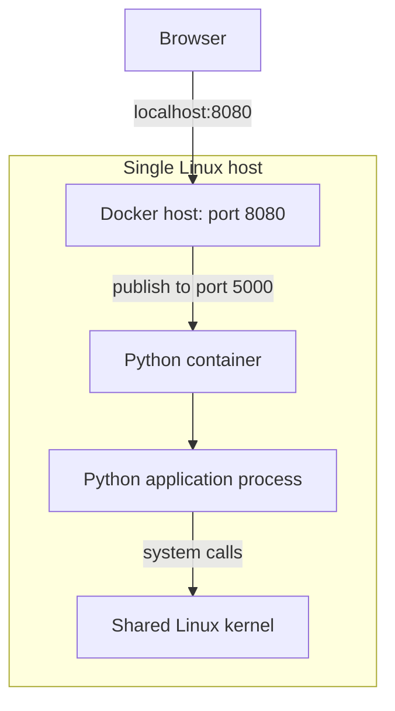

**Visual checkpoint 1:** One host, one container, one application process. Docker gets the process running; the kernel does the actual process and networking work. Nothing here yet guarantees that enough replicas will exist tomorrow or that another host will take over if this host disappears.

---

## 1. The first surprise: running one container is not the same as operating a service

Our first test succeeds. We open the browser, and the Python application responds. It is tempting to conclude that our application is ready for production. But we tested it as one person, not as hundreds of people making requests concurrently.

Suppose a sudden increase in traffic makes the single Python instance too busy. One possible response is to run additional instances of the **same image**. We already know from Docker that one image can create many containers. That means we do not need a new application design just to create another copy.

However, a new question appears: **who decides when we need more copies, and who starts them?**

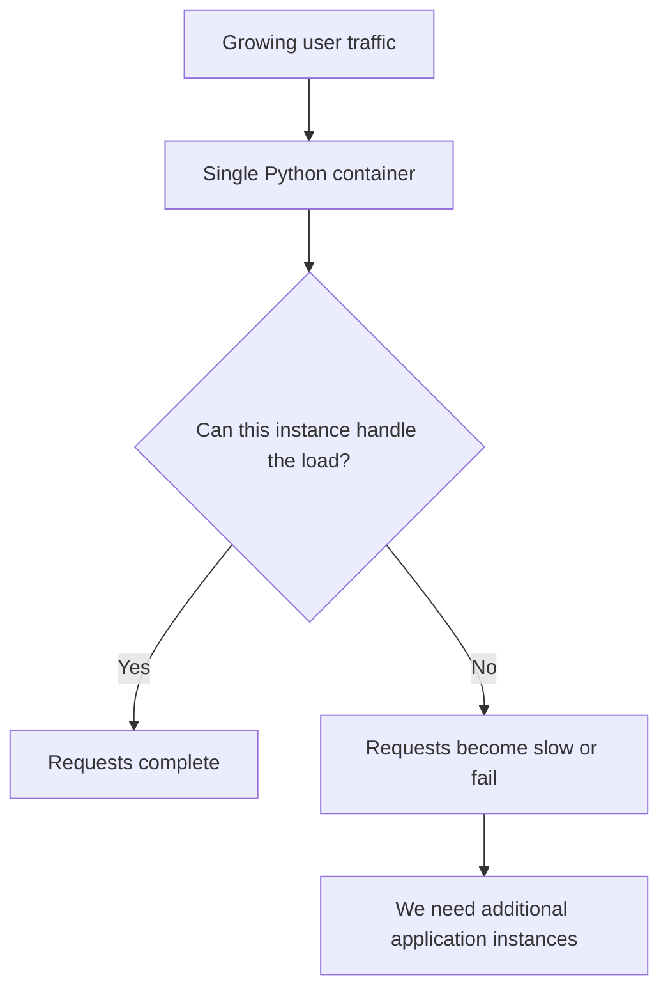

The transcript calls this challenge **autoscaling**. In an ordinary standalone Docker setup, `docker run` does not observe traffic and automatically raise or lower the number of containers for us. We can start more containers manually, or build automation around Docker, but managing that lifecycle is beyond the ordinary single-container workflow.

Notice the distinction:

- **Scaling** means changing the number of running copies.
- **Autoscaling** means automatically deciding when that number should change, based on some measured signal and a defined policy.

The lecture illustrates scaling with 100 users → 10 containers and 200 users → 20 containers. Treat these numbers as an intuition-building example, **not a scaling formula**. Real capacity depends on request cost, concurrency, latency, CPU, memory, and the application architecture. Doubling users does not always mean doubling containers.

**What we now understand:** creating copies is possible; deciding the right number automatically is a separate operational responsibility.

## 2. Adding copies exposes the next problem: where do requests go?

Suppose we start three Python containers. We now have additional compute capacity, but users still enter through a single application address. How will each incoming request find a suitable instance?

With basic Docker commands on one host, we could publish three different host ports:

```text
Host :8080  →  Python container A :5000
Host :8081  →  Python container B :5000
Host :8082  →  Python container C :5000
```

That is valid as a demonstration, but it is not a good public-facing experience. We do not want users to choose a port or know which container is available. We want one stable entry point.

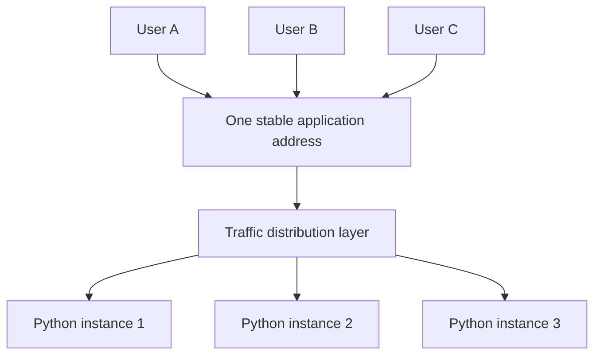

This introduces **load balancing / service traffic distribution**. It answers a different question from scaling:

- Scaling: *How many application instances should exist?*
- Load distribution: *Which available instance should handle a connection or request?*

These mechanisms cooperate, but they are not interchangeable. Starting ten containers without a traffic-routing mechanism may still leave traffic concentrated on one instance.

*Technical bridge:* Docker ecosystems can absolutely use reverse proxies, Docker Compose networks, Swarm services, or external load balancers. The real limitation of standalone Docker is not that load balancing is physically impossible; it is that Docker's basic single-host `run` workflow does not provide a complete declarative multi-host application management system by itself.

**Visual checkpoint 2:** Our mental model has grown from **one process** to **several interchangeable instances behind one entry point**. But all three might still be running on the same physical or virtual host.

## 3. A bigger failure: what if the entire host disappears?

Now imagine that the Linux host running those three Python containers suffers a hardware failure. The application copies might be independent as containers, but they share a **failure domain**: the same machine.

Three containers on one host do not protect us against the loss of that host.

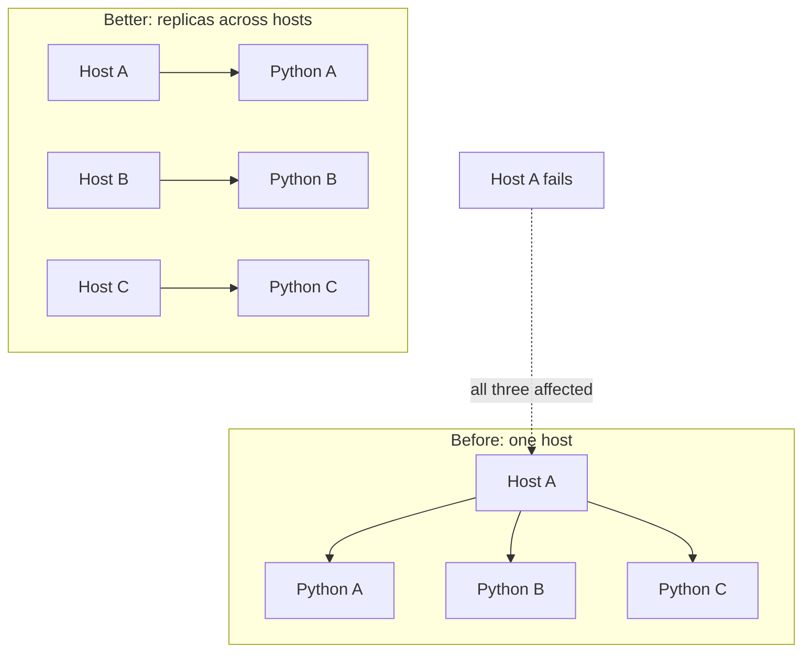

This leads to **multi-host orchestration**. We want a system that sees multiple machines as one pool of resources, decides where application copies should run, and can recover when an individual machine becomes unavailable.

This is our natural introduction to a **Kubernetes cluster**.

A **node** is a machine that participates in that cluster. It may be physical hardware or a virtual machine. A **cluster** is the coordinated environment made up of nodes plus components that manage them. Kubernetes helps us place, monitor, and manage application workloads across those machines.

Distribution improves fault tolerance, but it does not automatically guarantee high availability: replicas must actually be spread appropriately, healthy capacity must remain, and the application and external networking must support the failure. We will revisit those limits.

## 4. What does Kubernetes add that Docker did not give us by itself?

We have uncovered several problems in a logical sequence:

1. Demand changes → we need a changing number of copies.
2. More copies → we need a stable traffic entry point.
3. A host can fail → we need workloads on multiple machines.
4. A copy can stop → we need automatic recovery.
5. A new version arrives → we need a controlled replacement process.

**Kubernetes (K8s) is an open-source container orchestration platform that helps deploy, scale, and manage containerized applications across a cluster.** The abbreviation `K8s` is `K` + eight letters + `s`.

What makes Kubernetes powerful is not that it invents a new kind of container. It still depends on the container and Linux fundamentals we already studied. The difference is **who coordinates those containers over time**.

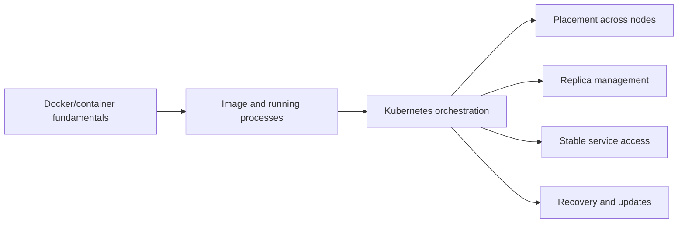

This creates an important division of responsibility:

**Container runtime technology** handles the local task of preparing and running containers on a particular machine. **Kubernetes** coordinates desired application behavior across machines and asks node-level components to run the appropriate workloads. Kubernetes does **not** need Docker Engine on each node; containerd and other compatible runtimes can be used directly through Kubernetes' runtime interface.

The question is no longer just *How do I run this container?* It becomes *How do I continuously keep the application in the state I want?*

---

## 5. The central idea: desired state, observed state, and reconciliation

Imagine we tell an operator: "Our Python application must always have three available copies." A human could check the servers periodically, notice missing copies, and start replacements. But that still depends on someone watching and reacting.

Kubernetes takes a different approach. We **declare the desired state**. Controllers continuously compare that intention with what exists and take actions to reduce the difference. This is called **reconciliation**.

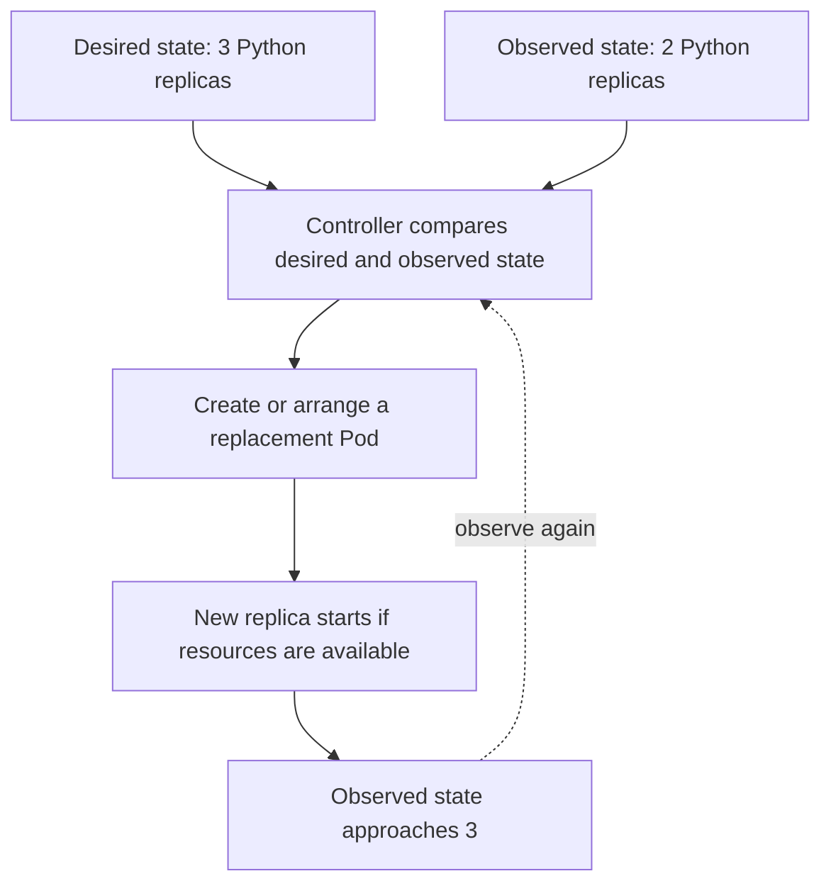

The wording "approaches" is intentional. Kubernetes is **not an instantaneous guarantee**. Starting a replacement takes time; capacity, image availability, configuration, and application health affect whether the cluster can reach its intended state.

It is useful to think of Kubernetes as multiple feedback loops rather than as a system that runs one big deployment script. A feedback loop keeps checking what is actually happening and corrects differences over time.

*Technical bridge:* Kubernetes API objects often have a `spec` describing intention and a `status` describing observed information. Different controllers own different aspects of reconciliation. They are not all a single monolithic "Kubernetes manager."

**Visual checkpoint 3:** We now have the new foundation that makes autoscaling, self-healing, and rollout management possible: **describe what should exist and continually reconcile what does exist**.

## 6. Nodes run the work; Pods are the units Kubernetes places

We have used the phrase "Python containers on nodes" because that connects naturally to Docker. Kubernetes introduces a new object between those two ideas: the **Pod**.

A Pod is the smallest deployable unit Kubernetes manages. It contains one or more containers that share certain resources, including a network namespace. For our beginner Python example, imagine **one Pod containing one Python container**.

That does **not** make Pod and container synonyms. Kubernetes schedules and manages Pods; a Pod can contain more than one closely cooperating container.

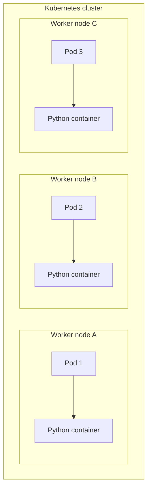

Let's connect this to our previous knowledge. The Python process still executes inside a container. The container still relies on kernel isolation and resource management. But Kubernetes tracks a Pod as the placement unit, and we generally ask a higher-level object to maintain multiple Pods for us.

That higher-level object, for this kind of stateless application, is commonly a **Deployment**.

A Deployment is a declaration of how a set of interchangeable application Pods should be maintained and updated. Behind the scenes, the Deployment works through a ReplicaSet, which maintains the replica count. We do not need to memorize the ReplicaSet internals yet; for now, remember that the Deployment gives us a durable management intent for our Python replicas.

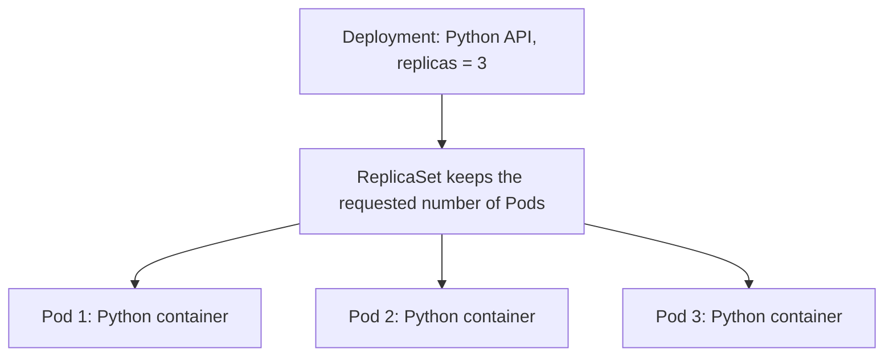

**Do not skip this conceptual step.** If we jump directly from Docker containers to autoscaling, it sounds as though Kubernetes directly clones arbitrary processes. In reality, Kubernetes manages a hierarchy of API objects, and ordinary application scaling changes the number of **Pods**.

## 7. Who decides which node receives a Pod?

The previous diagram introduces three Pods, but it does not tell us how a Pod gets onto a machine. We need to distinguish **management decisions** from **the place where the application actually executes**.

At a high level, a Kubernetes cluster has a **control plane** and **worker nodes**.

The control plane stores and coordinates desired application state. Worker nodes run the Pods. A component called the **scheduler** chooses a suitable node for a new Pod. On that node, an agent called the **kubelet** coordinates with the container runtime to bring the Pod's containers into the required state.

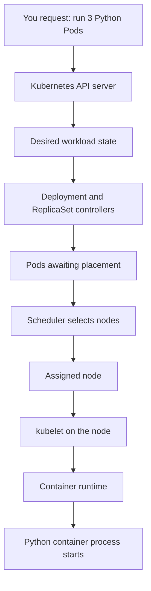

This is a **conceptual ordering of responsibilities**, not a literal chain of direct RPC calls between every box. The control-plane components cooperate through the Kubernetes API and its stored objects; kubelet observes assigned Pod specifications and works with the local runtime.

We are not yet studying Kubernetes internals such as `etcd`, API watches, runtime interfaces, or CNI. Those topics are upcoming layers of the same mental model. Our current goal is simply to understand **why orchestration needs decision-making components in addition to a container runtime**.

A useful distinction is that the control plane is not normally in the path of each end-user HTTP request. It controls *which Pods should exist and how they are configured*. The application traffic is handled by the network data plane.

---

## 8. Kubernetes scaling: manual replicas first, then autoscaling

Let's return to growing user traffic. We now have a Deployment that maintains three copies of the Python Pod. If we change its desired replica count from three to five, Kubernetes works to create two additional Pods.

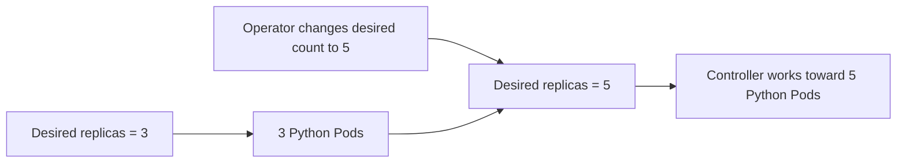

This is **manual scaling through a declarative object**. It already improves on hand-running containers because Kubernetes manages the target count and placement for us.

But our original challenge was *automatic* scaling. For that, Kubernetes provides a **HorizontalPodAutoscaler (HPA)**. Conceptually, the HPA observes configured metrics, calculates a desired replica count within its limits, and updates the target workload's replica count. The Deployment and associated controllers then work to maintain that count.

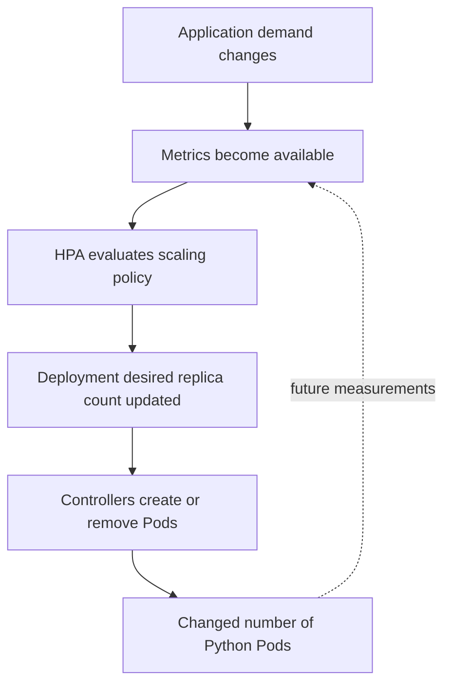

Several details matter if we want a technically accurate mental model:

**First:** Kubernetes does not automatically scale every application just because it is installed. An autoscaling policy and suitable metrics integration are required. CPU-based HPA commonly needs a metrics API provider, and CPU-utilization scaling depends on suitable CPU resource requests.

**Second:** the HPA usually scales **Pods**, not underlying worker nodes. A separate node autoscaling mechanism may be needed when the cluster lacks capacity for new Pods.

**Third:** autoscaling is a control loop with sampling intervals, decision policies, startup time, and possible delays. It is not an instantaneous reaction to exactly 100 or 200 users.

At this point, our earlier distinction becomes clearer. The Deployment maintains a requested count; the HPA can adjust that requested count based on measurements.

## 9. A stable address: Kubernetes Services connect users to changing Pods

We have five Python Pods. How do other applications reach them if their individual Pod IP addresses can change whenever Pods are replaced?

This is the same problem we discovered with Docker port publishing, now at the **cluster** level. We need a stable logical destination in front of a changing group of Pods.

A Kubernetes **Service** provides a stable way to reach a set of backend Pods. A Service typically uses label selectors to identify the Pods that belong to it. The cluster's networking implementation routes Service traffic toward suitable endpoints.

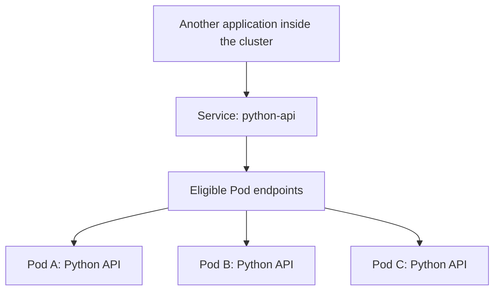

Notice how the abstraction improves the design: the caller depends on **the Service identity**, not the individual Pod identities. If Pod B disappears and a replacement Pod D appears, the set of endpoints can change without requiring the client to discover and hard-code Pod D's address.

A Service is not necessarily an external, internet-facing load balancer. The default `ClusterIP` Service is intended for cluster-internal access. External clients typically need an additional exposure mechanism, such as a supported `LoadBalancer` Service, Ingress, or Gateway.

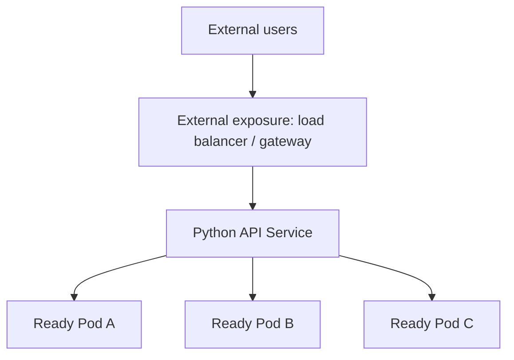

*Technical bridge:* Standard Service traffic distribution often works at the **connection** level or through network flow mechanisms, depending on the implementation. Do not assume Kubernetes always sends exactly one-third of HTTP requests to each of three Pods. Ingress controllers or application-aware proxies can add request-level balancing behavior.

And remember our Docker bridge lesson: the host-port mappings and Linux bridge from local Docker are not identical to the complete multi-node Kubernetes networking model. Kubernetes needs a Pod network that can connect Pods across nodes; Services provide a separate stable access abstraction on top of that network.

**Visual checkpoint 4:** We now have **multiple nodes** running **multiple Pods**, managed by a **Deployment**, reached via a **Service**. Scaling changes Pod count without changing the caller's logical destination.

## 10. Self-healing: there are different kinds of failure

The transcript says Kubernetes can restart or replace failed containers. That is the correct high-level motivation. But to understand it properly, we need to distinguish what actually failed.

### Case A — The application process crashes, but its node is healthy

A container inside a Pod can exit unexpectedly. Depending on the Pod's restart policy, the kubelet may restart that container on the same node.

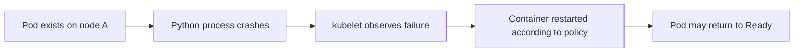

This resembles Docker restart policies, which are important to acknowledge. Docker can also restart individual containers. Kubernetes' added value is coordinating such behavior within a wider declarative workload and cluster system.

### Case B — The Pod is deleted or irrecoverably lost, but the Deployment still wants three

The Deployment's associated ReplicaSet works to maintain the desired number of Pod replicas, so a replacement Pod is created. This is a **new Pod**, not necessarily the same one restarted.

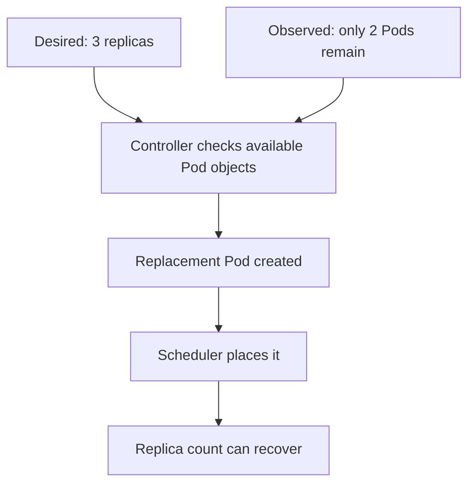

### Case C — The entire node becomes unavailable

Here the issue is bigger than a single process. The control plane must detect the node problem, and the workload controllers can arrange replacement Pods. Those Pods require working nodes and available resources. Node failure detection, eviction, scheduling, and storage constraints all influence recovery time.

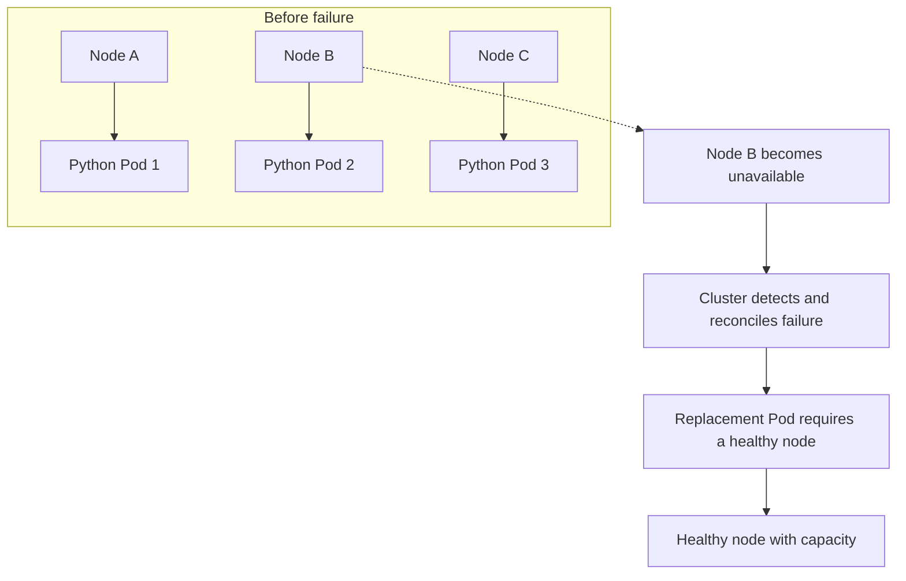

One final distinction: **running** is not the same as **ready to serve traffic**. A container may start successfully while the application is still initializing, unable to reach a dependency, or failing readiness checks. Kubernetes can use readiness information to exclude unready Pods from normal Service endpoints.

Kubernetes does not magically fix broken application logic, missing credentials, bad image versions, or unavailable external databases. Restarting a process does not guarantee the process becomes healthy.

## 11. Rolling updates: changing the image without stopping everything at once

Our Python application currently returns `Hello Docker`. The instructor proposes releasing a new version with a different response. In a single-container Docker setup, we might stop the old container and run a new one. Unless we arrange a more careful rollout ourselves, this introduces a period where no healthy copy is available.

Kubernetes Deployments support a **rolling update**, in which older Pods are gradually replaced with Pods running a newer image.

Instead of one big diagram, watch the system evolve through three snapshots.

### Snapshot A — All instances run the old version

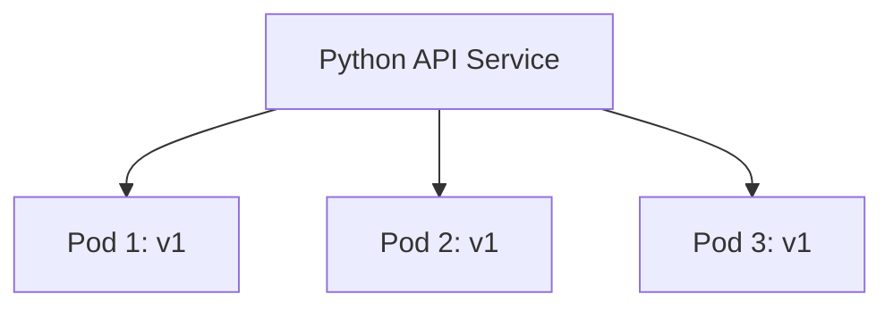

### Snapshot B — A new version starts while old instances remain

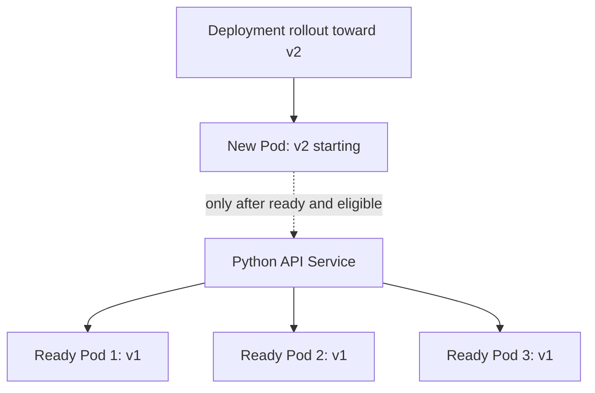

### Snapshot C — More new Pods become available; old Pods leave

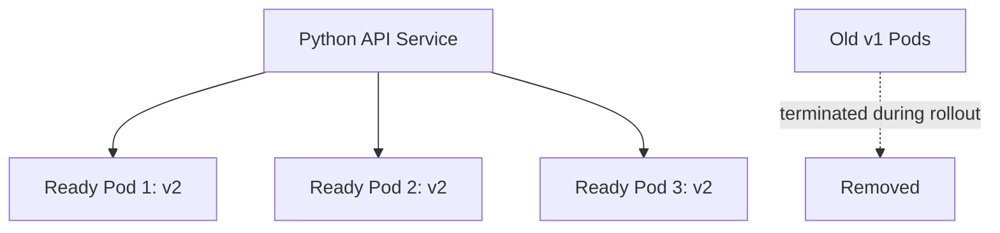

In this idealized example, traffic continues to flow to ready application copies during the transition. But the often-heard promise **"Kubernetes gives zero-downtime deployments"** needs qualifications: correct readiness checks, enough capacity, sensible rollout settings, graceful termination, compatible database changes, and healthy new Pods all matter. A rollout can still cause downtime if those conditions are not met.

Two deployment settings you will encounter later are `maxSurge` (how many extra Pods may exist during a rolling update) and `maxUnavailable` (how many may be unavailable). We only need to recognize their purposes at this stage.

### What about rollback?

If the new version is defective, the Deployment's rollout history can let us request a return to an earlier Pod template revision. This is a **workload configuration / image rollout** mechanism, not an automatic reversal of every possible change. A database migration or external side effect is not undone just because the Pods return to `v1`.

---

## 12. One complete picture: responsibilities, not just a list of features

We can now assemble the system we've been designing. Read this diagram from top to bottom. The **management side** decides what should exist; the **traffic side** handles application requests.

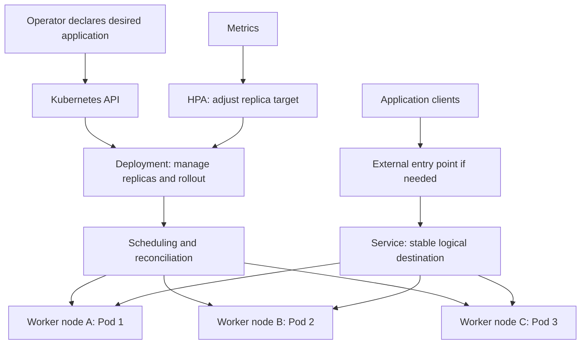

The arrows toward Pods have different meanings. From scheduling/reconciliation they mean **placement or management**; from the Service they mean **application traffic routing**. They are not the same communication path.

Let's follow a specific scenario using the model:

A Python Deployment declares three replicas. The cluster creates three Pods and places them on worker nodes. A Service selects these Pods and gives other applications a stable destination. Traffic increases, and a configured HPA eventually adjusts the desired number to five. The workload controllers create additional Pods if capacity allows. Later, a Pod fails; the appropriate local restart or workload-level replacement mechanism works to recover it. Finally, a new image is rolled out gradually, replacing old Pods according to the Deployment's rollout strategy.

Each capability solves one operational problem. **Kubernetes is useful because those capabilities cooperate in a continuously managed system.**

## 13. A tiny look at how we declare the application (*optional technical bridge*)

The original transcript is an introduction and does not teach the detailed Kubernetes YAML syntax. Still, one small example helps connect the phrase **desired state** to something concrete.

```yaml
apiVersion: apps/v1
kind: Deployment
metadata:
  name: python-api
spec:
  replicas: 3
  selector:
    matchLabels:
      app: python-api
  template:
    metadata:
      labels:
        app: python-api
    spec:
      containers:
        - name: api
          image: example/python-api:v1
          ports:
            - containerPort: 5000
```

Read only three things at first. `kind: Deployment` identifies the type of object. `replicas: 3` declares how many Python Pods we want. `image: ...` selects the packaged application version that each Pod should run. The remaining fields connect the Deployment with its managed Pods and provide their template.

This single object alone does not provide external HTTP access. For the stable cluster-internal identity from the previous section, we can define a Service:

```yaml
apiVersion: v1
kind: Service
metadata:
  name: python-api
spec:
  selector:
    app: python-api
  ports:
    - port: 80
      targetPort: 5000
```

Notice the shared label `app: python-api`. That is the connection between the Service and the selected Pods. Clients inside the cluster can use the Service's stable name and port, while Pods themselves remain replaceable.

The image name above is illustrative, and a production deployment would need additional choices, especially readiness checks, resource settings, security settings, and an appropriate image reference. Do not treat this short YAML as a complete production template.

For a prepared lab cluster, these read-only commands can show the abstractions:

```bash
kubectl get nodes
kubectl get deployments
kubectl get pods -o wide
kubectl get services
```

They are observations, not prerequisites for understanding the chapter. Detailed cluster installation, YAML practice, and component internals belong to the next lessons.

## 14. Where Docker, Compose, Swarm, and Kubernetes fit

At the end of the lecture, the instructor mentions Docker Compose and Docker Swarm. We should place them in the right conceptual boxes rather than study another product in depth now.

| Tool / approach | Main role in our story | Important qualification |
|---|---|---|
| Docker Engine and CLI | Build images and run/manage containers on a host | Basic `docker run` is not a cluster-level orchestrator. |
| Docker Compose | Define and run a multi-container application together, commonly for local development and simpler deployments | It can handle service configuration and networking, but is not a replacement for Kubernetes' full cluster-level control loops. |
| Docker Swarm mode | Docker's built-in orchestration approach for services across multiple machines | Provides capabilities such as replicated services and scheduling; not the focus of this CKA course. |
| Kubernetes | Declarative orchestration of containerized applications across nodes | Manages Pods, controllers, Services and optional autoscaling, subject to configuration and cluster capacity. |

A useful way to avoid confusion is: **Docker images and containers are the application packaging/execution foundation; Kubernetes is a coordination and lifecycle-management layer above that foundation.** They are not direct one-for-one replacements.

## 15. Common misunderstandings corrected before they become habits

**"Kubernetes directly starts Docker containers."** Not quite. Kubernetes typically schedules Pods, and kubelets work with CRI-compatible container runtimes. Docker Engine is not required on every node.

**"More containers automatically means load balancing."** No. The application also needs a stable access path and suitable traffic routing.

**"If I install Kubernetes, autoscaling happens automatically."** No. A configured scaling policy, usable metrics, and sufficient capacity are needed.

**"A Service always balances HTTP requests evenly."** No. Implementation and connection behavior matter; a Service is fundamentally a stable access abstraction over changing endpoints.

**"Kubernetes instantly recreates my application on another node."** No. Detection, reconciliation, scheduling, startup, capacity, and storage can delay or prevent recovery.

**"RollingUpdate guarantees no downtime."** No. It supports carefully controlled replacement, but correct configuration and healthy behavior are necessary.

**"A Pod is the same thing as a container."** No. A Pod is the Kubernetes-managed unit that can hold one or more containers.

**"Kubernetes makes Docker obsolete."** No. Kubernetes and container packaging solve different layers of the application lifecycle. Docker remains useful for image builds and development workflows.

---

## 16. Rebuild the mental model without looking at the diagrams

Here is the entire story in one connected passage.

We started with a Python application running as a Linux process inside a Docker container. Docker gave us a reliable way to package the application and start it. But when demand grew, we needed more instances. When we had more instances, we needed a stable path for traffic. When those instances all ran on one host, a host failure threatened the entire application. When a container failed, someone had to notice and recover it. When a new version arrived, we needed a controlled way to replace the old copies.

Kubernetes addresses that class of operational problems by coordinating containerized workloads across a cluster. We declare the desired state of the application; controllers compare it with observed state and work to reconcile differences. Nodes provide the machines on which the workloads run. Pods are the units placed onto nodes. Deployments maintain replicas and manage updates. Services give changing Pods a stable identity for traffic. Optional autoscalers adjust workload counts using metrics. Kubelets and container runtimes connect those higher-level intentions back to real Linux processes.

**That is the shift from *running containers* to *operating an application over time*.**

### Understanding checks — answer by reasoning, not memorization

1. Our Python container works at `localhost:8080`. What new problem appears when ten copies are started, even before considering autoscaling?
2. Why are three replicas on one node less fault-tolerant than three replicas spread across appropriate nodes?
3. If a Deployment declares three Pods but only two exist, what kind of mechanism restores the desired count?
4. Why is a Service useful even when every Pod has an IP address?
5. Explain why a container restart, a Pod replacement, and node failure recovery are not identical operations.
6. What component or mechanism can adjust a Deployment's desired replica count based on CPU usage? Does that also ensure enough worker nodes exist?
7. What conditions would you check before calling a rolling deployment "zero downtime"?
8. Which part of the system manages intended application state, and which part executes the actual Python process?

### What we intentionally leave for the next lessons

We have **not** yet deep-dived into kube-apiserver, etcd, scheduler internals, controller-manager, kubelet's pod synchronization loop, CRI, CNI, kube-proxy, Kubernetes manifests in depth, or storage controllers. Those will make much more sense now that we know **why** the system needs them.

### Further reading (official documentation)

- [Kubernetes architecture](https://kubernetes.io/docs/concepts/architecture/)
- [Kubernetes objects and desired state](https://kubernetes.io/docs/concepts/overview/working-with-objects/)
- [Kubernetes self-healing](https://kubernetes.io/docs/concepts/architecture/self-healing/)
- [Kubernetes Services and networking](https://kubernetes.io/docs/concepts/services-networking/)
- [Horizontal Pod Autoscaling](https://kubernetes.io/docs/concepts/workloads/autoscaling/horizontal-pod-autoscale/)
- [Deployment rolling updates](https://kubernetes.io/docs/concepts/workloads/controllers/deployment/)

> **Day 6 takeaway:** Docker helped us understand how to package and execute a container. Kubernetes introduces the continuously managed system that keeps containerized applications operating across multiple machines, under changing conditions.
