# CKA Day 7.1 — Kubernetes Pod Internals
## From Linux namespaces to the Pod sandbox: how two independent containers share one kernel networking environment

> **The question that starts this chapter:** “In Docker we learned that every container is an isolated process with namespaces. Now Kubernetes says two containers inside one Pod share the **same network namespace**. Does that mean namespaces exist *inside* other namespaces? Or do the two containers somehow become one process

![[Drawing 2026-10-23 22.41.28.excalidraw]]

**Neither.** An individual Linux process can belong to **one namespace of each relevant namespace type**. Two different processes may belong to **the same network namespace** while belonging to **different PID and mount namespaces**. Kubernetes arranges those memberships using the node's container runtime. The Linux kernel implements and enforces them.

This chapter will build that statement from first principles. We will not begin with a large Kubernetes diagram. We will start with **one Linux process**, add another, give them **one shared network namespace**, introduce the **Pod sandbox**, and finally trace kubelet → containerd → kernel and inspect a real Pod.

**Learning destination.** By the end you should be able to explain, without memorizing definitions:

- Why “one container = one network namespace” was only a convenient default in our earlier Docker examples.
- How two independent application processes use the same IP address, loopback interface, routing table and port space.
- Why the **pause container** is useful and why it is not your application container.
- Where kubelet, CRI, containerd, an OCI runtime and CNI participate—and where they *do not* participate.
- What namespaces, filesystems and resource controls two ordinary Linux Pod containers share or keep separate.
- What happens to these relationships when a container crashes or a Pod sandbox is recreated.

**Example used throughout:** One Pod with **Nginx** serving HTTP on port `80` and a small **inspector/sidecar** process that calls it at `127.0.0.1:80`. “Inspector” means a second ordinary application container in our lab; it is not using Kubernetes' newer special `initContainers` sidecar lifecycle feature.

---

# Part I — Correct the original mental model

## 1. Start before containers: what does a Linux process actually have?

Remember our Day 0 discussion. A program stored on disk is not yet an executing application. Once started, it becomes one or more **Linux processes** (and often threads). Each process has an identity, memory mappings, open file descriptors, credentials and a context the kernel uses to manage it. One part of that context is its **namespace membership**.

Think of namespace membership as a set of references the kernel associates with the executing task. There is not one single universal “container namespace” that all isolation mechanisms live inside. There are **different kinds of namespaces**, each concerned with a different kernel-managed view.

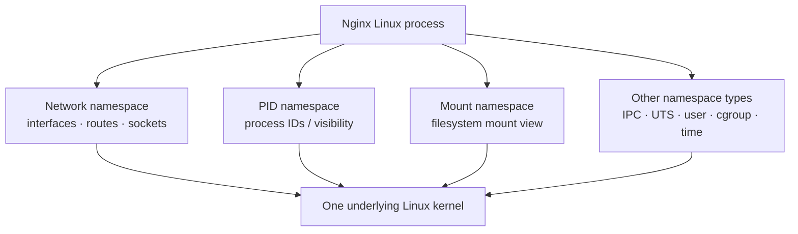

**Visual checkpoint 1:** The boxes are *different categories of kernel state*, not nested containers. An application can be associated with one network namespace, one PID namespace, one mount namespace, etc. (Namespace relationships can be more complicated in Linux, especially hierarchical PID and user namespaces; that is not what creates Pod network sharing.)

When Nginx opens a socket, the kernel interprets that operation in the **network namespace of that process**. When Nginx looks up a process ID, the kernel applies its **PID namespace**. When it opens a filesystem path, the process's mount view and root directory affect resolution.

This gives us the first important correction:

> A **container** is not an extra operating system, a separate kernel or a permanent owner of its own unique network namespace. It is a runtime-managed environment for one or more processes, using Linux isolation and resource-control features.

### 1.1 What about Docker Engine and containerd?

Another hidden assumption can confuse the picture: **the container runtime is not running separately inside each application container**.

In a conventional Linux Kubernetes node, `containerd` is a **node-level service**. It helps create and supervise containers. The application processes subsequently run as normal Linux processes, associated with their configured namespaces, cgroups and mounts. The application does *not* send every network system call through containerd.

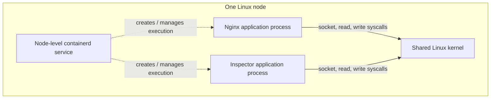

**Visual checkpoint 2:** Runtime management is one relationship; kernel execution is another. The runtime is involved in creating the environment, not in forwarding every request the already-running process makes to the kernel.

## 2. Can two processes really belong to one network namespace?

Yes. Nothing requires namespace membership to be exclusive to one process. Linux processes can inherit namespace membership, and suitably privileged runtime processes can arrange for a newly started task to join an **existing** namespace.

Imagine two unrelated processes running on the same node:

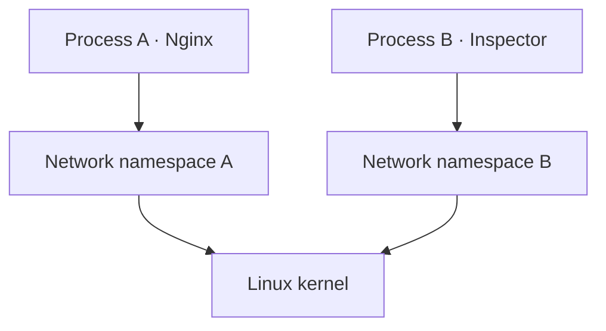

This matches the ordinary separate-container example we saw in Day 3.3. A and B do not naturally share their loopback interface or port space.

Now make **one deliberate change**. Instead of giving B a newly created network namespace, launch B with membership in A's existing one:

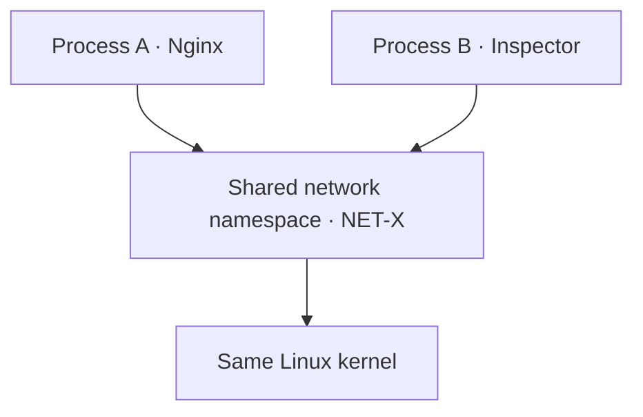

**Visual checkpoint 3:** We did *not* merge processes. The two boxes at the top are still distinct tasks, with independent program code, memory and lifecycles. Only the **network-namespace reference** points to the same kernel object.

### 2.1 What does Linux provide to make this possible?

At a conceptual level, Linux provides operations to **create** namespaces and **join** existing ones:

- `clone()` / `clone3()` can create a child with selected new namespaces.
- `unshare()` lets an executing task establish new namespace contexts for itself (with details varying by namespace type).
- `setns()` can associate a calling thread with an existing namespace, subject to permissions and namespace-specific rules.

An OCI runtime can use relevant kernel primitives to prepare a child process with the intended namespace memberships. **We are not claiming that every container start literally makes exactly one `setns()` call**; implementation details depend on the runtime, configuration and namespace type. The learning point is that the kernel supports namespace creation and sharing *independently for each namespace type*.

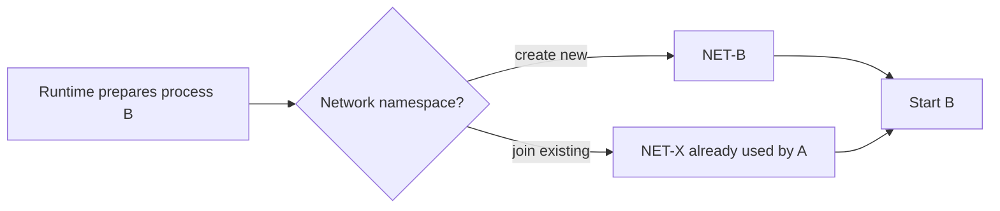

**A useful analogy:** Two employees can use the same meeting room without becoming one employee. Sharing a room does not mean sharing their identity, salary or personal files. In Linux, the “room” is a specific kind of namespace; this is only an analogy, because a namespace is an actual kernel-managed object, not a physical room.

### 2.2 So are namespaces nested?

For **Pod networking**, no nesting is required. The two processes are peers in the **same** network namespace. Linux *does* support hierarchy for some namespace types, notably PID and user namespaces, but that is a separate facility with different semantics. Don't use it to explain shared Pod IPs.

---

# Part II — From two Linux processes to one Kubernetes Pod

## 3. Why would Kubernetes want two processes to share networking?

Our evolving application now has two responsibilities. **Nginx** serves HTTP, while a small **inspector** queries the service and could send diagnostics elsewhere. We want them to be deployed together, on the same node, and to communicate with almost no networking configuration.

If they were two independent Docker bridge containers, each usually has its own network namespace and its own IP address. The inspector would need to reach Nginx over a network address or name; `localhost` would refer back to the inspector's own network namespace.

In Kubernetes, these two containers can form **one Pod**. The Pod is the unit Kubernetes schedules onto a node. Its containers are co-located and share a Pod network identity.

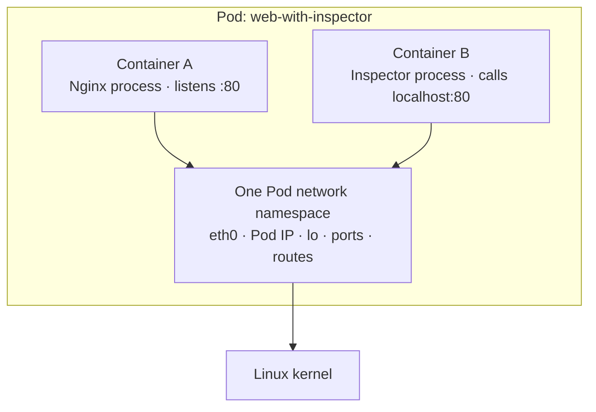

**Visual checkpoint 4:** Kubernetes uses a **Pod-level networking environment**. Container A and B can have separate process namespaces and filesystems and still have the same `localhost` because `localhost` belongs to the shared network namespace.

### 3.1 What exactly is shared within that namespace?

The Linux network namespace contains the network stack resources relevant to these processes, including **interfaces**, **IP addresses**, **routing configuration**, **loopback device** and the **socket/port-binding space**. The Pod has a network identity; both application containers use it.

That explains four otherwise surprising observations:

1. Both containers usually report the **same Pod IP**.
2. If Nginx binds to `0.0.0.0:80`, the inspector can reach it using `127.0.0.1:80`.
3. Two containers in the same Pod cannot ordinarily bind separate listeners to the **same IP:port and protocol** simultaneously (unless special socket-sharing mechanisms are used).
4. The Pod generally receives a network interface setup **once for its sandbox**, not an independent Pod IP for each of its application containers.


### 3.2 Why isn't this one combined application process?

Because sharing network state says nothing about sharing **the processes themselves**. Nginx can crash while the inspector continues running. Their binaries, process memory, open non-network file descriptors and usually their PID namespaces remain distinct. Kubernetes can restart an application container independently, while the Pod's sandbox and shared network environment may remain intact.

This is the point where we can stop imagining containers as miniature virtual machines. A Pod is also not a miniature virtual machine: it is a Kubernetes grouping and lifecycle abstraction, implemented through cooperating node-level components and Linux facilities.

## 4. If networking is shared, what happens to other namespaces?

Let's now add back the namespace types we intentionally hid from the previous diagram.

In a **typical Linux Pod using the ordinary container-based runtime path**:

| Resource / view | Nginx container | Inspector container | Relationship |
|---|---|---|---|
| Linux kernel | Same kernel | Same kernel | Shared with node processes |
| Network namespace | `NET-POD` | `NET-POD` | **Shared** |
| IPC namespace | `IPC-POD` | `IPC-POD` | Typically **shared** for Pod IPC |
| UTS / hostname namespace | Pod hostname context | Same Pod hostname context | Typically **shared** |
| PID namespace | `PID-NGINX` | `PID-INSPECTOR` | **Separate by default** |
| Mount namespace | `MNT-NGINX` | `MNT-INSPECTOR` | Typically **separate** |
| Container root filesystem | Nginx image rootfs | Inspector image rootfs | **Separate** |
| Kubernetes volume | Optional mount path A | Optional mount path B | Can expose **the same volume** if mounted into both |
| Cgroup resources | Container control | Container control | Generally organized under a **Pod-level** resource hierarchy, runtime-dependent |
| User namespace | Depends on Pod/runtime configuration | Depends on Pod/runtime configuration | Don't assume a new user namespace per container |

This table is a teaching model, not a specification for every operating system, runtime, security context or special host-namespace setting.

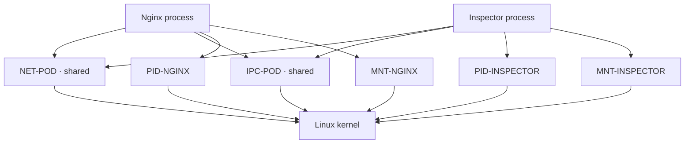

**Visual checkpoint 5:** The *pattern* is the lesson: sharing is **per namespace type**, not all-or-nothing. There is no contradiction in `NET-POD` being common while `PID-NGINX` and `PID-INSPECTOR` are different.

### 4.1 What if we intentionally want the processes to see each other?

Kubernetes lets you opt into a **shared process namespace** using:

```yaml
spec:
  shareProcessNamespace: true
```

In that mode, processes in sibling containers become visible across the Pod's shared PID namespace. It can help debugging, but changes process visibility, PID 1 expectations and security considerations. **It is not required for shared Pod networking.**

### 4.2 What about files shared between containers?

A common mistake is to conclude: “If two containers can read the same volume, they must share a mount namespace.” They do not.

Kubernetes can arrange for one underlying volume to be mounted separately into each container's filesystem view. For example, both may mount an `emptyDir` at `/shared` while keeping separate roots like `/etc/nginx` and `/bin`.

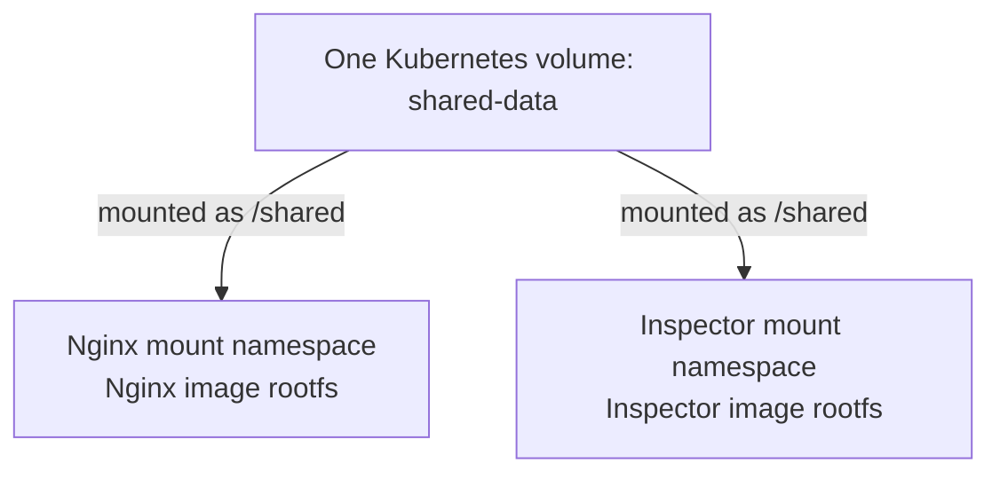

**Visual checkpoint 6:** **Sharing a volume is not the same as sharing an entire mount namespace.** The contents of `/shared` can be common while most of the filesystem views remain separate.

### 4.3 Where do cgroups fit?

Cgroups solve a different problem: **accounting for and controlling resource consumption**, such as CPU and memory. They are *not* interchangeable with namespaces. Container A and B can belong to the same network namespace while having independently enforced container resource limits.

A common Linux hierarchy looks conceptually like this:

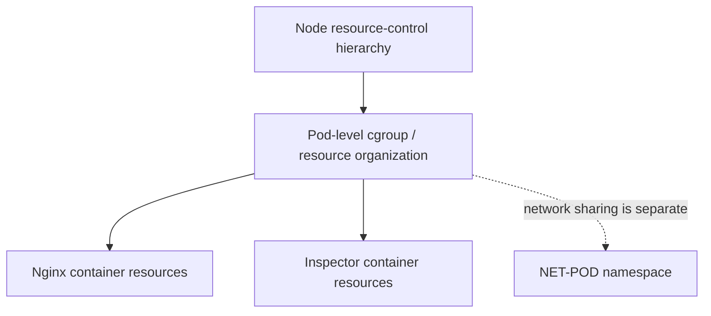

Exact paths, controllers, cgroup v1/v2 behavior and Pod-level limits depend on the environment. **Sharing networking does not require sharing a single CPU/memory limit.** This will matter later when we study requests, limits, QoS and kubelet resource management.

---
# Part III — Who creates this shared Pod networking environment?

## 5. Introduce the missing piece: the Pod sandbox

So far we have proved *that Linux can support the arrangement*. But a new question follows naturally: **Which component actually creates the shared network namespace before Nginx and the inspector are started?**

In the common **Linux + containerd + OCI runtime** implementation, Kubernetes uses a **Pod sandbox**. A conventional implementation of that sandbox contains a tiny infrastructure process from a special image commonly called **`pause`**.

The pause container is **not** the Nginx application, not the inspector, and not a separate network proxy. Its purpose is to be a small, long-lived member of the Pod's isolation context so that the Pod's shared namespaces and other sandbox resources have a lifecycle independent of the ordinary application containers.

### 5.1 Build the picture in two stages

First, imagine the Pod *before the application containers are running*:

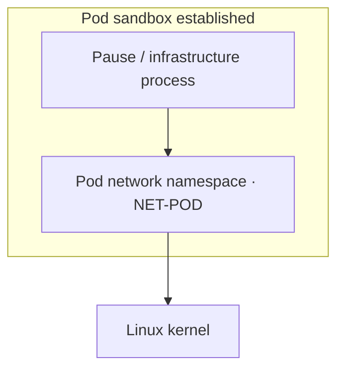

**Visual checkpoint 7:** This is an important new idea: the Pod-level network environment can exist **before Nginx starts**. A sandbox process participates in keeping that environment alive. In concrete containerd setups the runtime may also retain namespace references through namespace handles and other runtime mechanisms; do not interpret pause as the only possible kernel reference or implementation.

Now add our two application containers:

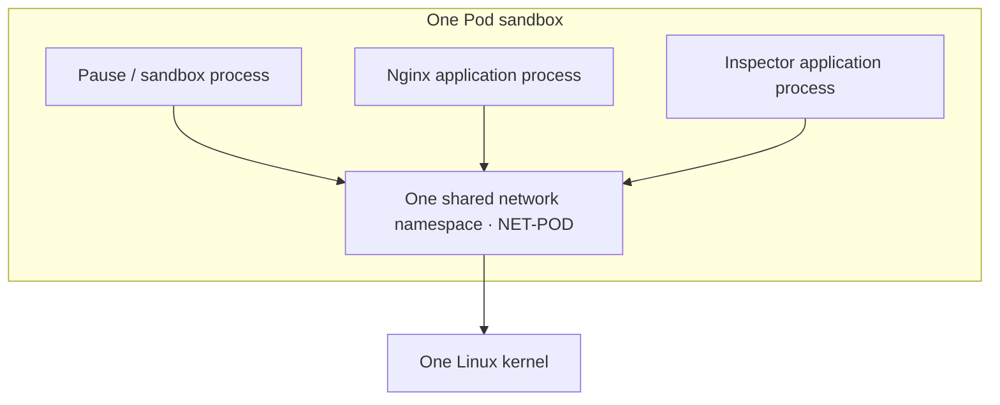

**Visual checkpoint 8:** The sandbox and both application processes now **refer to the same Pod network namespace**. We haven't merged the processes, and there is no inner Pod kernel.

### 5.2 Does Kubernetes always create a pause container?

No universal implementation guarantee should be inferred from this diagram. **The traditional Linux/CRI setup normally uses a pause infrastructure container**, but Pod sandboxes are runtime abstractions. Alternative sandbox implementations, including VM-isolated runtimes, may implement those semantics differently. A Pod configured with `hostNetwork: true` is also different: it uses the host networking context instead of an isolated Pod network namespace.

This chapter deliberately follows the **common non-hostNetwork Linux containerd path** because that is the right foundation for studying CKA, kubelet and Linux Pods.

### 5.3 Why not let Nginx own the network namespace?

Suppose the infrastructure exists only as part of the Nginx application lifecycle. Nginx can crash or be replaced. Kubernetes would then have a harder time retaining a stable networking context for the inspector and any replacement Nginx process.

By arranging the sandbox separately, the runtime can ordinarily keep the Pod's network setup around while **one application container restarts**.

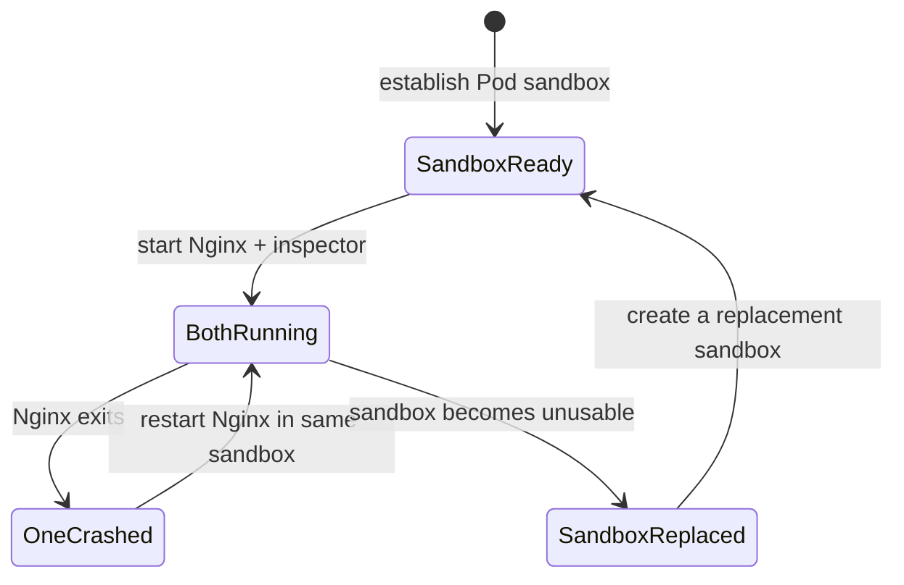

**Visual checkpoint 9:** The simple Nginx-container restart and a Pod-sandbox replacement are **different events**. In the first case the shared network namespace can stay in place. In the second case network namespace identity and network configuration may be rebuilt. We should **not promise** a permanent Pod IP across sandbox loss or Pod replacement.

## 6. How does the sandbox get an IP address and network interface?

Recall Day 3.3: in Linux bridge networking, a **veth pair** can connect a container network namespace to the host networking environment. Kubernetes relies on the same Linux fundamentals, but the **exact network implementation depends on the CNI plugin and cluster configuration**. Some CNIs use veth and bridges, others use direct routing, VPC-native interfaces, overlays or eBPF-based mechanisms.

Our conceptual flow is:

1. The container runtime arranges for a Pod sandbox and its networking context.
2. The runtime's **CNI integration** invokes the configured networking implementation.
3. The network setup establishes the Pod's interface(s), routes and IP assignment appropriate to that environment.
4. Both application containers start with membership in this **existing** Pod network namespace.

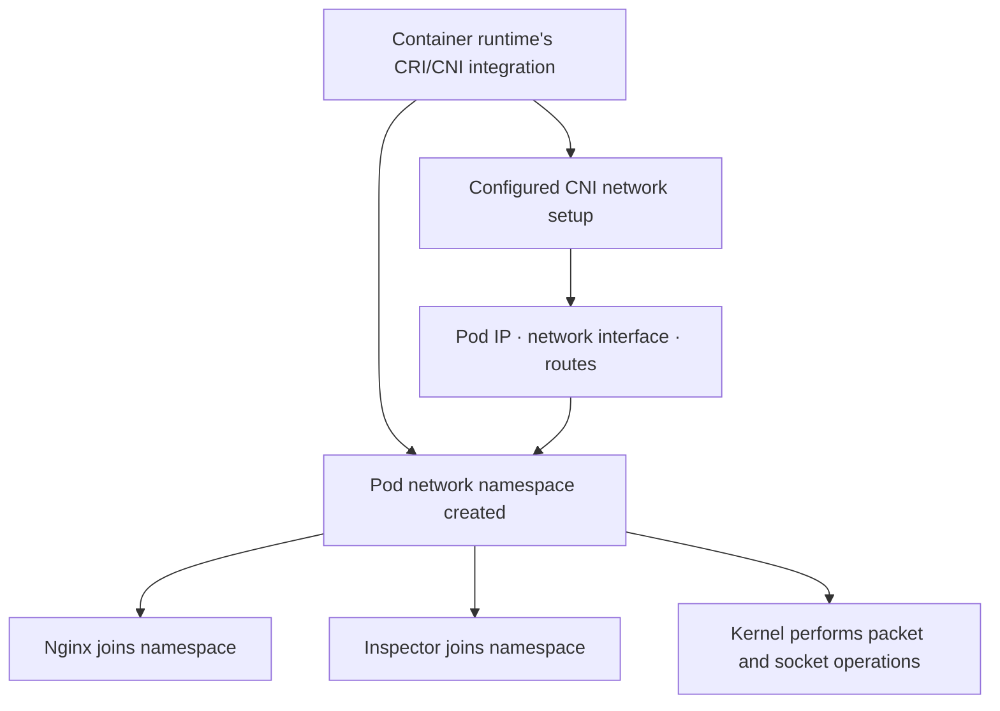

**Visual checkpoint 10:** A CNI plugin is involved in **configuring Pod connectivity**, not in implementing namespaces from scratch. The kernel supplies namespace and packet-processing facilities; the runtime/networking implementation configures them.

### 6.1 Don't confuse three different IP-related questions

**Question A: Who gives the Pod its network context?** The runtime's sandbox/network setup, using Linux facilities and configured CNI integration.

**Question B: Who provides the Pod IP and node/cluster connectivity?** The chosen networking implementation, commonly through CNI and related network agents/controllers.

**Question C: Who processes an actual Nginx → inspector HTTP exchange?** The Linux networking stack for those processes, without a kubelet → containerd call per HTTP request.

This separation becomes essential when studying kubelet, CNI and Kubernetes Services later.

---

# Part IV — Follow the exact responsibilities from Kubernetes to Linux

## 7. Trace one Pod from desired state to Linux processes

We now have enough background to reconstruct the implementation. Imagine a Pod object already exists in Kubernetes and the scheduler has assigned it to `worker-1`.

**At this moment, a stored Pod object is not the same thing as two already-running Linux processes.** The desired state must still be realized on the node.

### Step 1 — kubelet notices the assigned Pod

The **kubelet** on `worker-1` observes Pod specifications assigned to its node using the API server and its local state, then starts working toward the desired configuration.

Kubelet is a **node agent**. Its job is not to directly execute `unshare` on behalf of every application container or manually allocate every virtual network interface.

### Step 2 — kubelet talks to the container runtime through CRI

Kubelet uses the **Container Runtime Interface (CRI)**, a defined gRPC API, to request sandbox and container operations. In our example, a CRI implementation provided by containerd handles the calls.

A useful conceptual set of operations is:

- `RunPodSandbox` — request a Pod sandbox.
- `PullImage` — fetch required application images if needed.
- `CreateContainer` — prepare an application container within the sandbox.
- `StartContainer` — start the container's task.

These are **logical CRI operations**, not a promise of an identical per-process Linux system-call sequence in every runtime. The runtime can manage image pulls, snapshot preparation and sandbox work in different internal orders consistent with the interface.

### Step 3 — containerd establishes the Pod sandbox

In the conventional containerd model, the CRI implementation creates or obtains the Pod network namespace, arranges network setup (through CNI for an ordinary Pod), and starts/manages a sandbox implementation, often a **pause** process.

For a non-hostNetwork Pod, the sandbox networking context becomes the **target namespace** the application containers will join.

### Step 4 — application containers are prepared

The runtime obtains the Nginx and inspector image contents and creates separate container execution environments. Each receives its own intended root filesystem, process execution configuration, cgroup placement, relevant security settings and namespace memberships.

The **network namespace reference** for each points to the Pod's already-existing network namespace rather than to a new independent networking context.

### Step 5 — an OCI runtime starts processes with those settings

For a typical containerd `runc`-based setup, containerd uses runtime/shim components and an OCI runtime to establish kernel isolation and launch the application processes. We intentionally do **not** treat `runc` as a permanent proxy for every application system call. A runtime shim may remain to supervise the task and I/O, while ordinary application syscalls are handled by Linux.

### Step 6 — Nginx and the inspector run normally

At this point Linux has two independent processes, but both refer to `NET-POD`. A `connect()` system call in the inspector can reach an Nginx socket bound in that same network namespace.

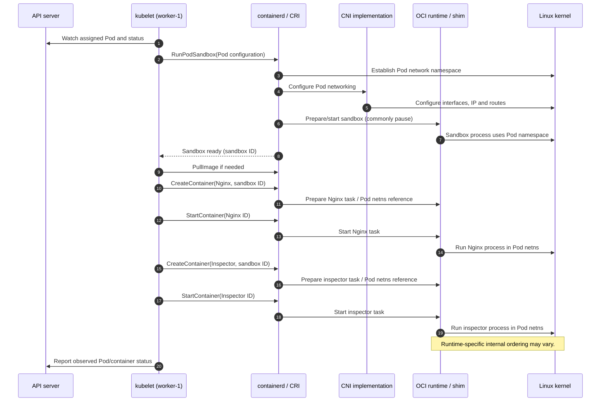

**Visual checkpoint 11:** The diagram is intentionally **logical**: CRI calls, network setup, process creation and status updates are shown by responsibility, not as an authoritative single-threaded trace of every callback. Each application container is created and then started through separate CRI operations. The next diagram isolates that per-container phase explicitly.

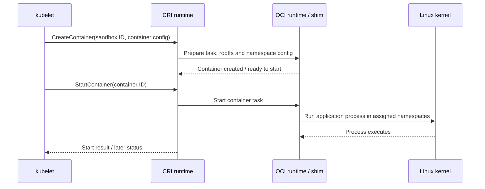

**Why these two drawings?** A simple “kubelet → containerd → Linux” arrow hides the CRI lifecycle and makes it seem as though kubelet itself enters namespaces. An overly detailed implementation trace can make a changing runtime implementation look like a Kubernetes guarantee. Together, the diagrams show **ownership and meaningful transitions** without overclaiming.

## 8. Where, physically, is each component running?

Let's assemble the node-level picture that our earlier lessons were missing.

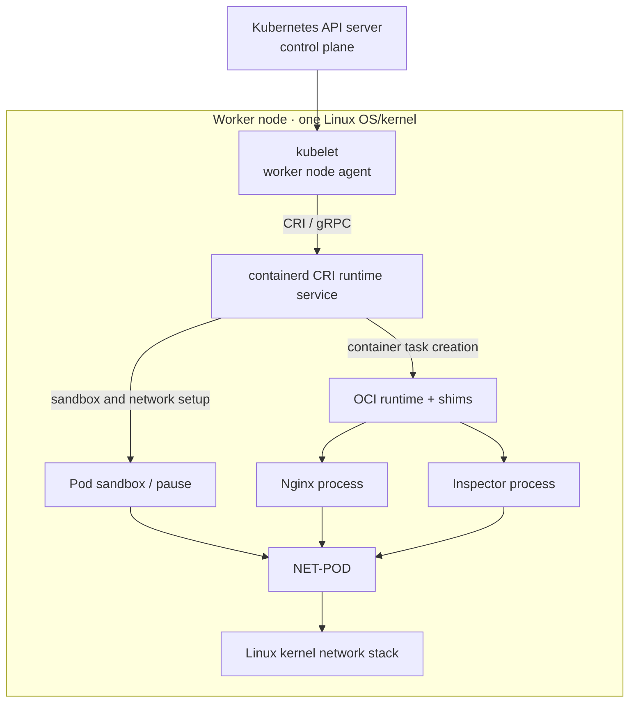

**Visual checkpoint 12:** All these components execute **on the same worker node** in the conventional model, but perform different duties:

| Component | Main question it answers | Not its job |
|---|---|---|
| kubelet | *Which Pod should be running on my node?* | Process every application network packet |
| CRI | *How does kubelet request sandbox/container operations?* | An application-level network namespace itself |
| containerd / CRI service | *How do I realize/manage the requested sandbox and containers?* | Replace the Linux kernel |
| OCI runtime (e.g. runc) | *How do I launch a task with requested isolation and settings?* | Act as a permanent HTTP data proxy |
| CNI implementation | *How is Pod networking configured?* | Execute Nginx's business logic |
| pause / sandbox process | *How can sandbox isolation context outlive app-container restarts?* | Run Nginx or forward every socket operation |
| Linux kernel | *How do namespaces, sockets, mounts and cgroups actually behave?* | Decide desired Deployment replica count |

**A practical boundary to remember:** A Pod's network namespace is **Linux kernel state**, not a YAML object stored in etcd. Kubernetes desired state requests the Pod, kubelet and the runtime realize it on a node, and the Linux kernel enforces it during execution.

---

# Part V — What happens when one container calls localhost?

## 9. Trace one HTTP request without hiding the kernel

The inspector process now executes something equivalent to:

```sh
wget -qO- http://127.0.0.1:80/
```

Inside a single-container Docker bridge lab, `127.0.0.1` meant “this container's own network namespace.” In our Pod, the same address means “the **shared Pod** network namespace.”

Assume Nginx binds to port `80` in this namespace. The request travels logically as follows:

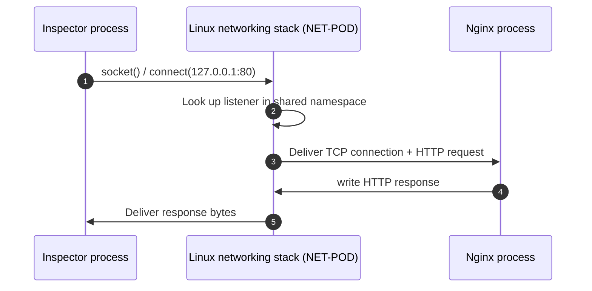

**Visual checkpoint 13:** There is **no kubelet API call**, **no containerd request**, **no Kubernetes Service selection**, and **no traversal through a node-level physical network** required merely to send localhost traffic between these two containers. The kernel serves their sockets inside one network namespace.

Now contrast it with **different Pods**. Separate Pods ordinarily have separate Pod network namespaces and separate IP addresses. For Pod A to reach Pod B, traffic must travel using the configured Pod networking implementation. That's where CNI networking, host routing, virtual interfaces and eventually Services become relevant.

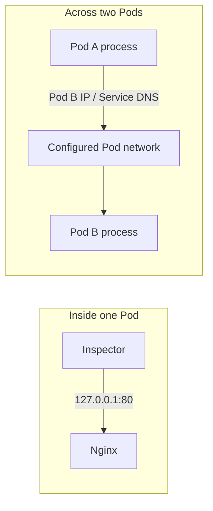

**Visual checkpoint 14:** “Same Pod” and “same cluster” are different networking scopes. A shared network namespace explains localhost **within** a Pod. It does not mean all Pods on a node or in a cluster share localhost.

### 9.1 Two containers, same port: can both bind it?

Suppose Nginx already listens on `0.0.0.0:80`. If the inspector attempts to start another ordinary server with the **same bind address, port and protocol**, the kernel will generally reject the second bind with an `Address already in use` error.

This is true even though the listeners live in separate containers because **the shared port space belongs to the same network namespace**. Special socket options such as `SO_REUSEPORT` complicate the general rule, but they are not how typical unrelated application containers get separate ports in a Pod.

### 9.2 What does this tell us about Pod design?

Containers in one Pod are **cooperating processes**, not two independent network endpoints. A reverse-proxy sidecar and a backend, for example, can use `localhost` for their internal connection. They still need to coordinate who binds which port.

---
# Part VI — Prove the model in a real Kubernetes Pod

## 10. Lab: one Nginx process, one inspector, one network namespace

So far every drawing is a model. Let's now see what Linux actually reports **from inside two different containers**.

### Lab safety and prerequisites

Use a **personal, disposable Kubernetes lab cluster** (for example, kind or minikube), not an important shared or production cluster. You need a functioning `kubectl` context and permission to create and delete Pods. This lab uses standard images but some hardened Pod Security policies may disallow their default execution settings. Do not weaken cluster security controls simply to run the example.

The lab does **not** require privileged containers, `hostNetwork`, host PID access or SSH access to nodes for its essential observations.

### 10.1 Declare the two containers

Save this as `pod-net-lab.yaml`. The YAML is included here so the **Markdown note remains self-contained**; the lab file is only something you create locally if you choose to run it.

```yaml
apiVersion: v1
kind: Pod
metadata:
  name: pod-net-lab
  labels:
    app: pod-net-lab
spec:
  restartPolicy: Always
  containers:
    - name: nginx
      image: nginx:stable-alpine
      ports:
        - containerPort: 80
      resources:
        requests:
          cpu: 50m
          memory: 32Mi
        limits:
          cpu: 250m
          memory: 128Mi

    - name: inspector
      image: busybox:1.36
      command:
        - sh
        - -c
        - 'while true; do sleep 3600; done'
      resources:
        requests:
          cpu: 10m
          memory: 8Mi
        limits:
          cpu: 100m
          memory: 64Mi
```

Notice what is **not** present: no second Pod, no Service, no host port publishing and no explicit network-namespace name. Kubernetes, kubelet and the runtime arrange the common Pod network context for us.

Apply it:

```bash
kubectl apply -f pod-net-lab.yaml
kubectl wait --for=condition=Ready pod/pod-net-lab --timeout=120s
kubectl get pod pod-net-lab -o wide
```

The readiness wait might fail if images cannot be pulled, resources are unavailable, or Pod policy blocks either container. Investigate with `kubectl describe pod pod-net-lab` before continuing.

### 10.2 First observation: localhost reaches another container

From **inspector**, request the Nginx homepage:

```bash
kubectl exec pod-net-lab -c inspector -- \
  wget -qO- http://127.0.0.1:80/
```

Expected: the Nginx default HTML page (or equivalent response for that image version).

Now reason about what just happened. The `wget` process did **not** run inside Nginx's container. It ran in the **inspector** container. Yet `127.0.0.1:80` reached Nginx. That observation is consistent with **one shared network namespace**, rather than one IP namespace per container.

### 10.3 Second observation: compare Linux namespace identities

Linux exposes namespace handles at paths such as `/proc/self/ns/net`, `/proc/self/ns/pid` and `/proc/self/ns/mnt`. Reading the symlink gives a representation such as `net:[402653xxxx]`. For a given namespace type, **the same namespace identity** indicates that the processes share that namespace object.

Run this from the Nginx container:

```bash
kubectl exec pod-net-lab -c nginx -- sh -c '
  for ns in net pid mnt ipc uts; do
    echo "$ns -> $(readlink /proc/self/ns/$ns)"
  done
'
```

Now run the same check from the inspector:

```bash
kubectl exec pod-net-lab -c inspector -- sh -c '
  for ns in net pid mnt ipc uts; do
    echo "$ns -> $(readlink /proc/self/ns/$ns)"
  done
'
```

A **representative** result—not actual output from your environment—would be:

| Namespace | Nginx observation | Inspector observation | Interpretation |
|---|---|---|---|
| `net` | `net:[4026532501]` | `net:[4026532501]` | **Same namespace** |
| `ipc` | `ipc:[4026532502]` | `ipc:[4026532502]` | **Same namespace** |
| `uts` | `uts:[4026532503]` | `uts:[4026532503]` | **Same namespace** |
| `pid` | `pid:[4026532510]` | `pid:[4026532520]` | **Separate by default** |
| `mnt` | `mnt:[4026532511]` | `mnt:[4026532521]` | **Separate** |

**Note:** The numbers above are invented solely to illustrate how to compare namespace identities; they are not promised values, and namespace internals are runtime/OS dependent. The commands report the **exec'ed shell's** namespace memberships, which are appropriate evidence because that process is started inside each container with the container's namespace settings.

This is the practical proof of the core idea:

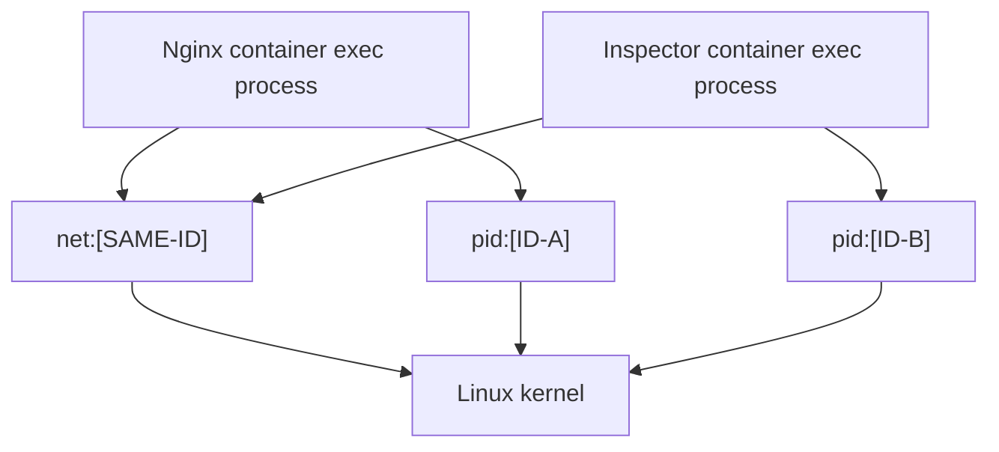

**Visual checkpoint 15:** The `net` arrows converge, while the `pid` arrows do not. This is **different membership per namespace type**, not a namespace inside a namespace.

### 10.4 Third observation: can each container see the other's processes?

Run:

```bash
kubectl exec pod-net-lab -c inspector -- ps
kubectl exec pod-net-lab -c nginx -- ps
```

By default, you should not expect inspector's process listing to expose Nginx processes in the way it would with a shared PID namespace. Each container gets its ordinary process view.

Now connect the observations: **the inspector can reach Nginx over localhost even though it cannot normally see Nginx's processes in its own `ps` output.** This one experiment exposes exactly why networking and PID visibility are **separate namespace choices**.

### 10.5 Optional variation: deliberately share the PID namespace

You can reproduce the original lab with a *second Pod* whose `.spec` includes:

```yaml
spec:
  shareProcessNamespace: true
```

When supported by the runtime and cluster configuration, the processes become visible together; the shared PID namespace may have the sandbox's `pause` process as PID 1. **Do not try to change the existing Pod in place** and assume the setting is freely mutable; create a separate example Pod manifest instead. There is no need to do this variation to prove network namespace sharing.

### 10.6 Optional resource-control observation

Our Pod requested separate CPU and memory limits for Nginx and the inspector. These limits are **cgroup-related**; they do not modify the fact that both containers share networking.

On a Linux node using cgroup v2, you may see relevant data in mounted cgroup files (subject to how the runtime exposes cgroups):

```bash
kubectl exec pod-net-lab -c nginx -- sh -c '
  [ -f /sys/fs/cgroup/cpu.max ] && cat /sys/fs/cgroup/cpu.max || true
  [ -f /sys/fs/cgroup/memory.max ] && cat /sys/fs/cgroup/memory.max || true
'
```

Do not infer an exact CPU quota value without considering the container's cgroup, cgroup-version and runtime setup. This optional check illustrates **resource controls belong to a different mechanism** than namespace membership.

### 10.7 Cleanup

Only after you are finished with the disposable lab:

```bash
kubectl delete pod pod-net-lab
```

This removes that lab Pod. It does **not** delete the cluster, other Pods, images globally or your real application workloads.

## 11. Optional node-side inspection: where is the sandbox?

The previous lab required no node access. To connect those observations to the **container runtime on the Linux node**, use this extra inspection only if you have authorized access to a disposable node and its CRI socket.

First identify the node:

```bash
kubectl get pod pod-net-lab -o wide
```

On the relevant **Linux worker node**, if `crictl` is installed and configured for its runtime:

```bash
sudo crictl pods
sudo crictl ps -a
```

Look for a **Pod sandbox** entry corresponding to `pod-net-lab` and separate container entries such as `nginx` and `inspector`. You can then inspect the selected sandbox:

```bash
sudo crictl inspectp SANDBOX_ID
```

Replace `SANDBOX_ID` with the value shown by `crictl pods`. The available fields vary by CRI runtime and version. You may be able to locate sandbox and namespace metadata, but do not assume a particular JSON field always holds a host PID.

If you have already *reliably identified* an application process's **host PID** via runtime-specific tooling, Linux exposes its namespace identity at:

```bash
sudo readlink /proc/HOST_PID/ns/net
sudo readlink /proc/HOST_PID/ns/pid
sudo readlink /proc/HOST_PID/ns/mnt
```

Again, replace `HOST_PID` with a real number established from that node—not the PID 1 you might see from inside a PID namespace. Comparing the Nginx and inspector **host PID** namespace handles should reproduce the membership relationship.

`nsenter` can run a program inside another task's namespaces, but is not required for this chapter's proof. Avoid modifying node namespaces or firewall state during a beginner lab.

---

# Part VII — Now think about failure and lifecycle

## 12. Container restart versus Pod replacement

Our last unanswered question: if a shared namespace is a kernel object, how does its lifetime relate to restarting Nginx?

### 12.1 Nginx fails; inspector remains alive

Assume kubelet is using an appropriate restart policy and the **Pod sandbox remains healthy**. It can restart the Nginx application container within that *same sandbox*. The new Nginx task can rejoin the existing Pod network namespace. Inspector is still there, and the Pod network environment need not be recreated.

**Important:** The application process ID and container instance change. “Container restarted” does **not** mean Linux revived exactly the old process.

### 12.2 The sandbox itself fails

If the sandbox becomes invalid, kubelet/runtime may need to replace it, rebuilding some networking and process state. The replacement is not merely a new Nginx PID. The **network namespace identity** may change; the application containers may be recreated to use the new sandbox. This is not a universal transparent operation—applications should tolerate disruption.

### 12.3 The Pod object is deleted and replaced by a controller

When a Deployment/ReplicaSet creates a **new Pod object** after an old one is removed, treat it as a **new Pod identity** with a new sandbox and potentially a **different Pod IP**. Stable addressing at the application level is a job for higher-level Kubernetes mechanisms such as Services—not a promise that an individual Pod IP never changes.

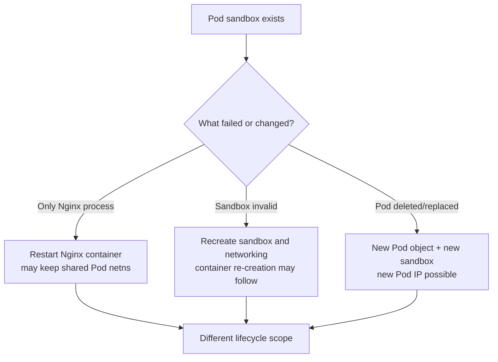

**Visual checkpoint 16:** The scope of the failed object determines the scope of recovery. Don't conflate process restart, container recreation, sandbox recreation and new Pod creation.

## 13. Important variants that change the picture

Our chapter has intentionally focused on the normal Linux application Pod. Real clusters can deviate:

- **`hostNetwork: true`:** The Pod uses host networking instead of the usual isolated Pod network namespace. Its ports may conflict directly with node-level listeners.
- **`shareProcessNamespace: true`:** Containers in the Pod share a PID namespace; without it their PID views are generally separate.
- **`hostPID: true` / `hostIPC: true`:** Special host-namespace settings explicitly alter isolation and carry security implications.
- **Pod user namespaces:** Available in supported configurations, but their use and mapping depend on runtime and cluster support. Never assume every Pod has a unique user namespace automatically.
- **Alternative runtimes:** A VM-based sandbox may use an additional guest kernel; our pause-container diagram is a common container-based Linux implementation, not a universal architecture for all RuntimeClasses.
- **Windows Pods:** Windows container isolation mechanisms are different from this Linux namespace walkthrough.
- **CNI differences:** A Pod IP may be supplied through bridge, veth, VPC-native or other networking designs. Shared network namespace semantics do not dictate one universal physical packet path.

For CKA fundamentals, understand the **normal path first**, then recognize these variants when troubleshooting.

---

# Part VIII — Integrate every layer into one mental model

## 14. Rebuild the architecture from the original question

Let's deliberately retrace the chapter in exactly the order our understanding developed:

**First**, a Linux process has memberships in several namespace types. A namespace is a kernel-managed context, not a miniature copy of Linux.

**Second**, multiple independent processes may be members of one particular namespace. Their other namespace memberships can still differ.

**Third**, a Kubernetes Pod selects a set of co-located containers that share a **network identity**. The shared IP and `localhost` are properties of that common networking context.

**Fourth**, the normal Linux runtime path uses a **Pod sandbox**, commonly maintained by a **pause** process. This is a stable place to establish Pod-scoped networking before applications begin.

**Fifth**, kubelet requests runtime operations using **CRI**. Containerd and its runtime integrations realize the sandbox, networking and application tasks. The Linux kernel executes and enforces the resulting namespaces, sockets, filesystem views and resource controls.

**Finally**, the container processes continue executing independently. Nginx can crash without requiring the inspector to become the same process or the whole Pod to become a single Linux task.

```mermaid
flowchart TB
    API["API server: Pod assigned to worker-1"] --> K["kubelet on worker-1"]
    K -->|"CRI requests"| R["containerd / CRI implementation"]
    R --> S["Pod sandbox / pause context"]
    R -->|"CNI integration"| N["Network setup: Pod IP + interfaces + routes"]
    N --> NET["Shared Pod network namespace"]
    S --> NET
    R --> OCI["OCI runtime / task supervision"]
    OCI --> A["Nginx process<br/>PID-NGINX · MNT-NGINX"]
    OCI --> B["Inspector process<br/>PID-INSPECTOR · MNT-INSPECTOR"]
    A --> NET
    B --> NET
    A --> CA["Nginx cgroup control"]
    B --> CB["Inspector cgroup control"]
    NET --> L["One Linux kernel"]
    CA --> L
    CB --> L
```

**Visual checkpoint 17 — final:** Read it as a chain of *responsibilities* rather than a flat component catalog:

- **Kubernetes API** records what should exist.
- **kubelet** drives node-local reconciliation.
- **CRI/runtime/CNI/OCI pieces** configure and start the requested isolation contexts and processes.
- **The shared Linux kernel** carries out the actual networking and process execution.

The diagram also answers your exact original question: the two container application processes **do not turn into one process**. They are two processes pointing to the **same Pod network namespace**.

## 15. Seven reasoning questions (use these before reviewing answers)

1. If Nginx and the inspector run in different containers, why does `127.0.0.1:80` work between them?
2. Do separate container root filesystems imply separate network namespaces?
3. How can two containers mount the same volume while retaining separate mount namespaces?
4. If the inspector can connect to Nginx via `localhost`, must it be able to list Nginx's processes using `ps`?
5. Does `containerd` have to forward each TCP packet between Nginx and inspector?
6. What changes if only the Nginx process restarts, compared with the whole Pod sandbox being recreated?
7. Does the existence of a Pod sandbox mean every Kubernetes Pod everywhere uses the same pause process architecture?

<details>
<summary>Suggested explanations</summary>

1. Their processes share one network namespace, including its loopback and socket port space.
2. No; mount/root filesystem isolation and network namespace membership are different controls.
3. Kubernetes/runtime mount the same underlying volume into each container's separate filesystem view.
4. No; ordinary Pods share networking but do not share PID namespace by default.
5. No; the Linux kernel processes the socket exchange. Runtime components configure/manage environments.
6. A simple container restart can rejoin the existing sandbox's network namespace. Sandbox loss can require rebuilding networking and recreating containers.
7. No; pause is a common Linux container-based implementation. Sandboxes can be implemented differently.

</details>

## 16. A compact reference you can use later

| You observe... | You should think... | Component / mechanism to inspect |
|---|---|---|
| Two containers have same Pod IP | Shared network namespace | `/proc/self/ns/net`, sandbox setup |
| `localhost` connects across sibling containers | One Pod port/loopback space | Application listen address + Pod netns |
| `ps` output differs across siblings | PID namespace separate by default | `/proc/self/ns/pid`, `shareProcessNamespace` |
| Files differ despite same Pod | Separate roots/mount views | Image filesystems, mount namespaces |
| `/shared` has common data | The same volume was mounted twice | Pod `volumes` and `volumeMounts` |
| Container hits memory limit | Cgroup resource control | Limits, cgroup usage, OOM events |
| One container restarts, Pod IP stays | Sandbox likely persisted | kubelet status, CRI sandbox |
| Pod is replaced, IP changes | A new sandbox/network identity | Pod UID, scheduler, CNI, Services |
| Cross-Pod traffic fails | Different network namespaces; Pod network path | CNI, routes, policies, DNS if name-based |

## 17. What to learn next

Day 7.1 gives us the missing **Linux-to-Pod connection**. The next natural chapter is **kubelet and the Container Runtime Interface in more detail**, where we can trace the node-side reconciliation, the actual sandbox/container requests and how Pod status is reported back to Kubernetes. The network model here will remain the foundation for learning Pod networking, CNI and Kubernetes Services.

---

# Source references and implementation notes

This chapter is an **expanded teaching explanation**, based on our agreed Day 7.1 plan and grounded in official Kubernetes, containerd and Linux documentation. It is not a verbatim summary of the Day 7 lecture transcript. The official sources are useful for checking precise behavior and version-dependent implementation details:

1. [Kubernetes — Pods: resource sharing and networking](https://kubernetes.io/docs/concepts/workloads/pods/)
2. [Kubernetes — Services, Load Balancing, and Networking: Pod network model](https://kubernetes.io/docs/concepts/services-networking/)
3. [Kubernetes — Share Process Namespace between Containers in a Pod](https://kubernetes.io/docs/tasks/configure-pod-container/share-process-namespace/)
4. [Kubernetes — Pod Lifecycle](https://kubernetes.io/docs/concepts/workloads/pods/pod-lifecycle/)
5. [Kubernetes — Sidecar Containers](https://kubernetes.io/docs/concepts/workloads/pods/sidecar-containers/)
6. [containerd — Architecture of the CRI plugin](https://github.com/containerd/containerd/blob/main/docs/cri/architecture.md)
7. [containerd — Sandbox API](https://github.com/containerd/containerd/blob/main/docs/sandbox-api.md)
8. [Linux man-pages — namespaces(7)](https://man7.org/linux/man-pages/man7/namespaces.7.html)
9. [Linux man-pages — setns(2)](https://man7.org/linux/man-pages/man2/setns.2.html)
10. [containerd — crictl troubleshooting guide](https://github.com/containerd/containerd/blob/main/docs/cri/crictl.md)

**Accuracy notes:** On mainstream Linux container runtimes, default Pod network sharing, optional PID sharing and separate root filesystems are stable conceptual expectations. The exact sandbox implementation, CNI packet path, namespace creation calls, pause image details, process hierarchy and cgroup layout can vary; the diagrams intentionally describe responsibilities rather than falsely claiming all clusters use an identical syscall-by-syscall flow.

**Final mental model:** *A Pod does not merge containers into one process. It gives independent application processes selected shared kernel contexts—most importantly, a common network namespace—using node-level runtime machinery. Everything is still executed by the Linux kernel.*
