# CKA — Day 7: Kubernetes Architecture, Built One Thought at a Time

> **Reading approach:** This chapter is one continuous lesson, divided into four learning acts so that the architecture never arrives as an unexplained wall of components. Each Mermaid visual adds one concept to the previous mental model. All diagrams are embedded directly in this `.md` file; no SVGs, PNGs, or external files are needed.
>
> **Transcript:** Day 7 of the Certified Kubernetes Administrator 2025 course by Cloud With VarJosh. The chapter retains the lecture's topics, including Pods, sidecars, Deployments, ReplicaSets, control-plane and node components, the Python/Redis example, Services, kube-proxy, CNI, the full Deployment creation flow, and cluster add-ons.
>
> **Source boundary:** Sections labeled **Teaching bridge** introduce detail needed to connect the ideas; sections labeled **Technical precision** correct or qualify a simplified claim in the lecture. They should not be read as verbatim statements by the instructor.
>
> **Prerequisites from our series:** Day 0 (OS, processes, kernel), Day 3.1 (Linux namespaces and cgroups), Day 3.3 (container networking), and Day 6 (why orchestration exists). You only need a conceptual understanding, not deep Linux internals.

## The one question we will answer

On Day 6 we built a compelling case for an orchestrator. We saw that one Python container was easy to run with Docker, but operating a production application required more: replicas, placement on machines, stable networking, recovery, and updates.

Now suppose you tell Kubernetes:

> "I want **five copies of my Python frontend**. Run them somewhere in the cluster, and keep the application healthy."

That sentence is surprisingly ambitious. Somebody must record the request. Somebody must decide that five Pods should exist. Somebody must select nodes. Somebody on each chosen node must actually start containers. Somebody must expose an application address that survives Pod replacements.

**Day 7 is the story of how Kubernetes divides those responsibilities.** We will begin with the thing that runs, then introduce the thing that manages it, and only then reveal the cluster components that make the complete workflow possible.

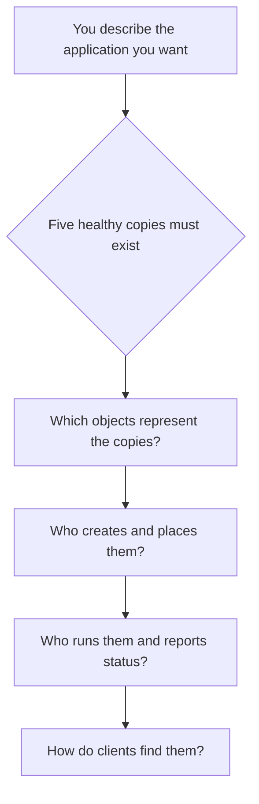

**Visual checkpoint 0:** Those are the *questions*, not the answers. By the end of the chapter, every box will map to a named Kubernetes component.

---

# Act I — What Kubernetes is trying to run

## 1. From our Docker container to the Kubernetes Pod

In Docker we had a container running a Python process. The Linux kernel provided CPU time, memory, filesystems, and networking; the container runtime configured isolation. It would be natural to assume that Kubernetes simply schedules that individual container.

Instead, Kubernetes introduces one small but important unit: the **Pod**. A Pod is the smallest deployable unit managed by Kubernetes. It holds **one or more tightly associated containers** that should be placed and run together.

Let's start with the most common case: a single-container Pod.

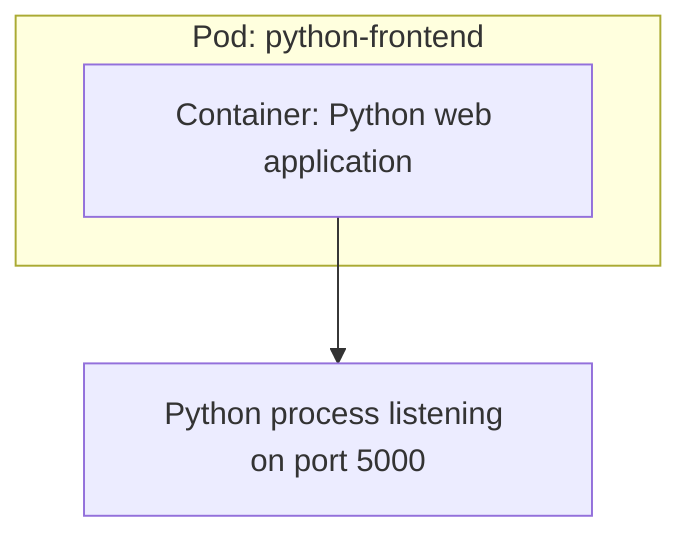

Here the Pod isn't another virtual machine and isn't a new Linux kernel. It is a Kubernetes grouping and lifecycle unit around container processes. In normal Linux Pods, the group has a shared network environment, a shared Pod IP, and any volumes explicitly configured for use by its containers.

We can still build images with a Dockerfile, push them to a registry, and use those images in Pods. **Kubernetes changes how the application is orchestrated; it does not make images irrelevant.**

### Why not simply call every Pod a container?

Because sometimes a workload needs two processes that must always be co-located. Imagine our Python web server has a companion that performs a closely related job: it forwards application logs to a collector, or acts as an application-specific proxy.

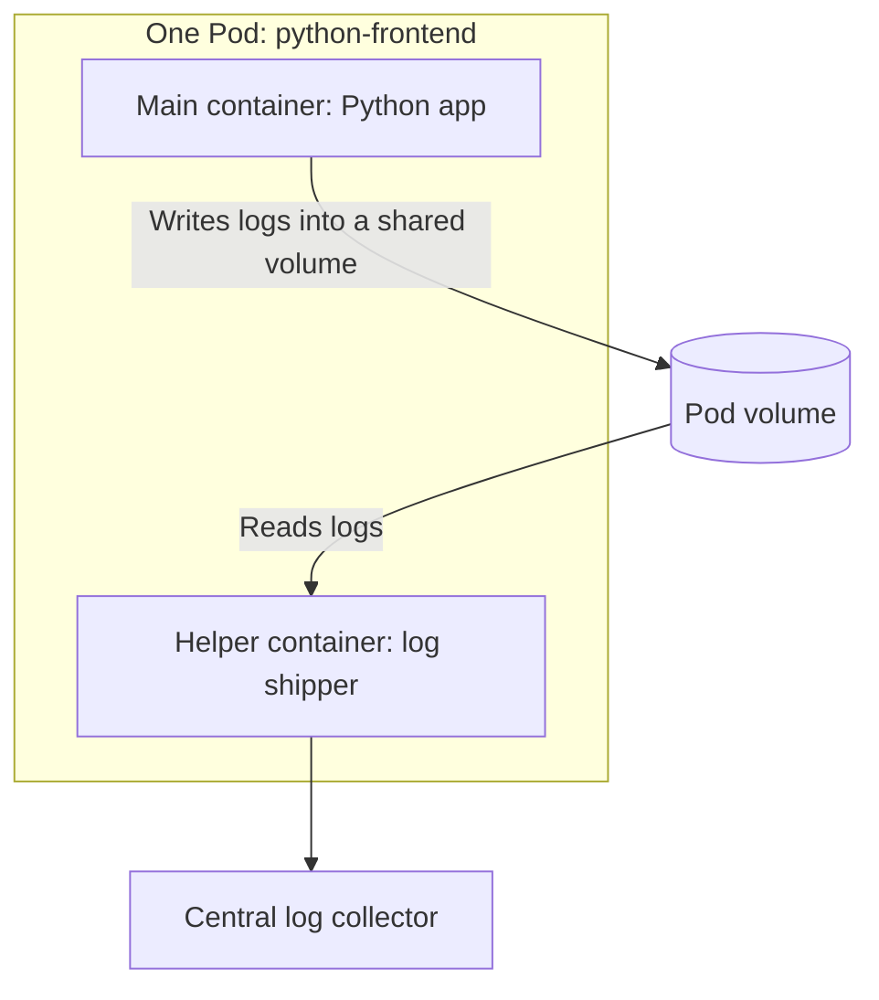

The two containers are separate processes and images, but Kubernetes treats their co-location and lifecycle as one workload unit. This is the broad **sidecar pattern**: a supporting container extends the main application's behavior without becoming the main application itself.

The transcript illustrates four companion responsibilities: **log collection, application monitoring, outbound proxying, and inbound reverse proxying**. Each is a possible sidecar use case, not a requirement that every Pod include a sidecar.

**Teaching bridge:** Kubernetes also has native, restartable sidecar containers represented as `initContainers` with `restartPolicy: Always` on supported versions. Ordinary additional application containers can also implement the sidecar pattern. We do not need to learn the precise sidecar lifecycle syntax yet; the crucial idea is *co-located supporting behavior*.

## 2. A Pod's shared network: connect it to our namespace lesson

Recall Day 3.1: a Linux **network namespace** defines the network stack visible to processes—interfaces, IP addresses, routes, and ports. Different Docker containers normally receive different network namespaces.

For the typical Kubernetes Pod, however, **the containers inside the same Pod share one network namespace**. That changes how they talk to each other.

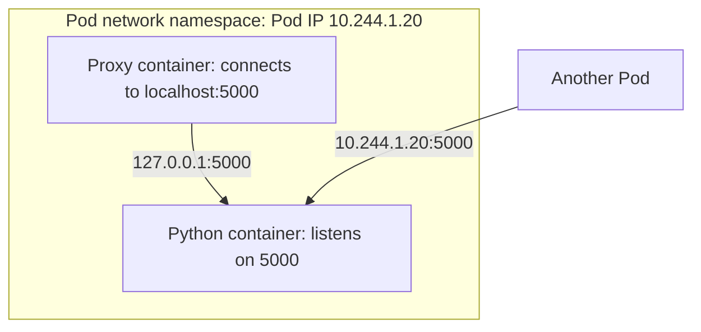

Step through the implications carefully:

1. The Python process listens on TCP port `5000` inside the **Pod** network namespace.
2. The helper can call `http://localhost:5000` because `localhost` refers to that *shared Pod network namespace*, not to a private loopback interface for each container.
3. A different Pod does **not** use its own `localhost` to reach this Python process. It uses the target Pod IP or, more commonly, a Kubernetes Service.
4. Since containers in one Pod share the same IP and port space, two ordinary listeners in that Pod cannot both bind to the same address and port combination at once.

**Technical precision:** Sharing networking is automatic for the Pod's containers in this model. Sharing arbitrary filesystem paths is **not** automatic. Containers have their own image filesystems; they share data when Kubernetes mounts the *same configured volume* into them.

## 3. A Pod's shared storage is explicit, not magic

The lecture imagines a 5 GB volume visible to both containers. What actually makes it visible? The Pod declares a **volume**, and each container declares a **volumeMount** referencing that volume. Kubernetes and the runtime arrange the mounts.

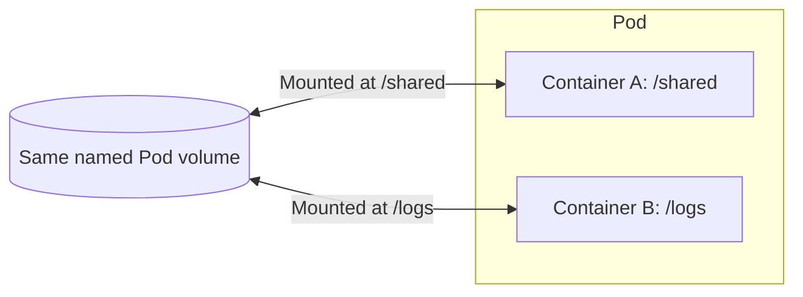

The mount paths can differ while referring to the same backing volume. But the **volume type matters**: an `emptyDir` is generally tied to the Pod's lifetime, while a PersistentVolume-backed mount can survive replacement Pods. A capacity such as 5 GiB is not automatically allocated or guaranteed by declaring an arbitrary Pod volume; requests and enforcement depend on storage type.

This is also why a log-forwarding helper can read a file written by the main container only when the filesystem layout makes that file available to the helper.

**Checkpoint:** We now know **what gets run**: a Pod. We also know why Kubernetes schedules the Pod as a group rather than scattering its containers among unrelated nodes.

---

## 4. Why a bare Pod is not enough for a production application

Suppose we manually create one Pod containing our Python application. The container runtime starts its process and the application responds. But then the node fails or the Pod is deleted. Where is our instruction that there must **always be one replacement Pod**?

A bare Pod records one Pod, not a durable policy to maintain a fixed *population* of Pods. Container processes may be restarted inside a still-existing Pod according to restart policy and kubelet behavior, but a deleted Pod is not automatically recreated solely because we once wrote a Pod manifest.

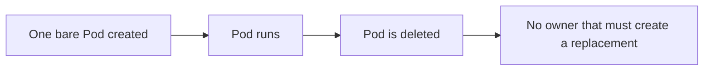

What we actually want is a persistent instruction:

> "I want this **kind of Pod**, and I want **five copies**, even if an individual copy disappears."

That idea introduces a **ReplicaSet**.

## 5. A ReplicaSet manages the number of Pods

A ReplicaSet is a Kubernetes API object whose controller works to maintain a desired number of matching Pods. If the desired replica count is `5`, and only `4` matching Pods exist, its controller attempts to create another Pod.

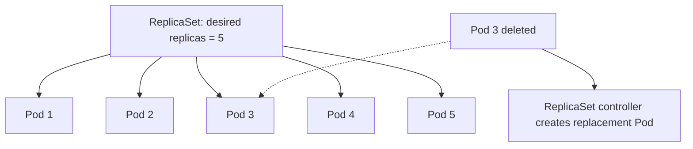

Notice what a ReplicaSet does **not** promise. It doesn't choose which node should receive each new Pod; that's the scheduler's job. It doesn't execute the containers; that's the kubelet and runtime's job. And it doesn't guarantee that all five are ready simply because five Pod objects exist.

ReplicaSet reconciles a **count of Pods**. Other components handle placement and execution. This separation is a recurring architectural pattern in Kubernetes.

### Why do we need a Deployment above a ReplicaSet?

Now we have five replicas. Tomorrow we release `python-frontend:v2` and want to replace v1 gradually, without deleting every copy at once. Merely preserving the count doesn't fully describe the change from *one Pod template* to *another template*.

This is why the **Deployment** exists. A Deployment manages one or more ReplicaSets, coordinates revisions and rolling updates, and provides a higher-level declarative interface for stateless workloads.

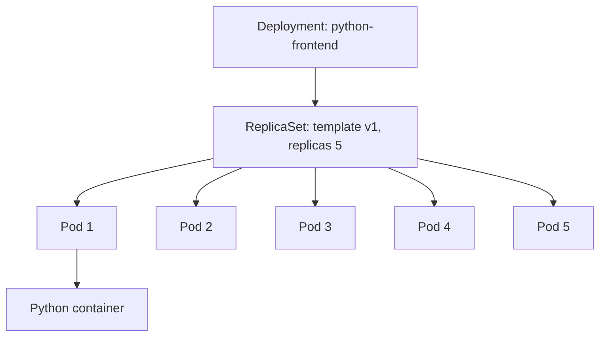

That hierarchy is central enough to repeat once in words:

**Deployment → ReplicaSet → Pod → container process.**

But do not imagine these as nested runtime processes. A Deployment and ReplicaSet are **API objects** with controllers acting on their state; the Pods are API objects describing workloads; their containers finally become actual processes on worker nodes. The ownership arrows represent *management relationships*, not packet paths or direct function calls.

## 6. How a Deployment turns a version change into a rolling update

Assume we have five Pods using image `v1`. We change the Deployment's Pod template to `v2`. Kubernetes can create a **new ReplicaSet** for the changed template and gradually adjust the sizes of old and new ReplicaSets.

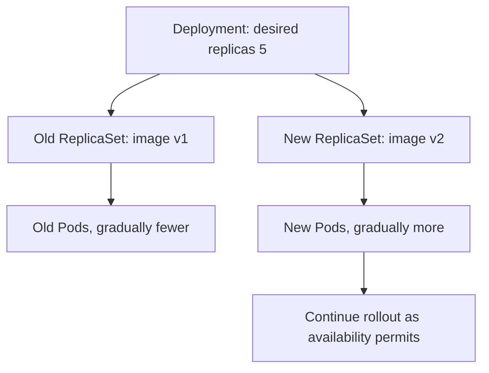

The Deployment's rolling-update strategy includes `maxSurge` and `maxUnavailable`. These influence how many extra Pods may be created and how many desired replicas may be unavailable during an update. The lecture's 'zero downtime' description communicates the goal; it is **not an unconditional guarantee**. Image errors, missing capacity, readiness failures, unhealthy dependencies, and aggressive settings can still cause disruption.

A rollback uses an earlier retained Deployment revision (principally its Pod template), rather than rewriting existing container files in place. Scaling the Deployment does not by itself create a new template revision.

**Visual checkpoint 1 — The first complete answer:**

- **Pod:** the unit Kubernetes places and runs.
- **ReplicaSet:** the controller-managed mechanism that maintains the desired Pod count.
- **Deployment:** the higher-level object that coordinates ReplicaSets and version rollout.

Now we can ask the next unavoidable question: **where do the controllers, scheduler, and container runtime actually run?**

---

# Act II — Unfolding the cluster architecture

## 7. The cluster is a coordination system, not a single giant daemon

Imagine a Kubernetes cluster with two worker nodes. Instead of putting every Kubernetes component into one box immediately, divide it into two responsibilities:

- The **control plane** stores, evaluates, and coordinates the desired cluster state.
- The **worker nodes** provide the environment in which workload processes actually run.

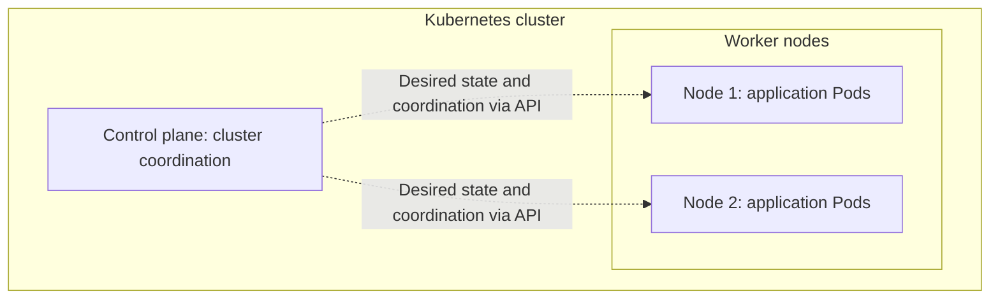

The transcript uses **data plane** as a shorthand for worker nodes and their workload traffic. That's useful conceptually. More precisely, the data plane is the actual workload and network forwarding behavior. Control-plane components can also run on machines that host Pods; the terms describe *roles*, not always separate physical hardware.

In highly available clusters, control-plane components are typically replicated as appropriate. A managed service such as Amazon EKS operates much of that control plane for us. The exact number of API servers or etcd members is provider-specific and should not be treated as a universal Kubernetes requirement.

We will add the control-plane components one by one.

## 8. The API server: one consistent front door

Several actors need to manipulate cluster state: people running `kubectl`, CI/CD systems, controllers, the scheduler, kubelets, and external tooling. If every actor edited a local database directly, there would be no single place to consistently authenticate, validate, and expose the Kubernetes object model.

Kubernetes solves that by making **kube-apiserver** the front door for Kubernetes API operations. `kubectl` does not install application containers directly on a worker node. It sends API requests describing what it wants.

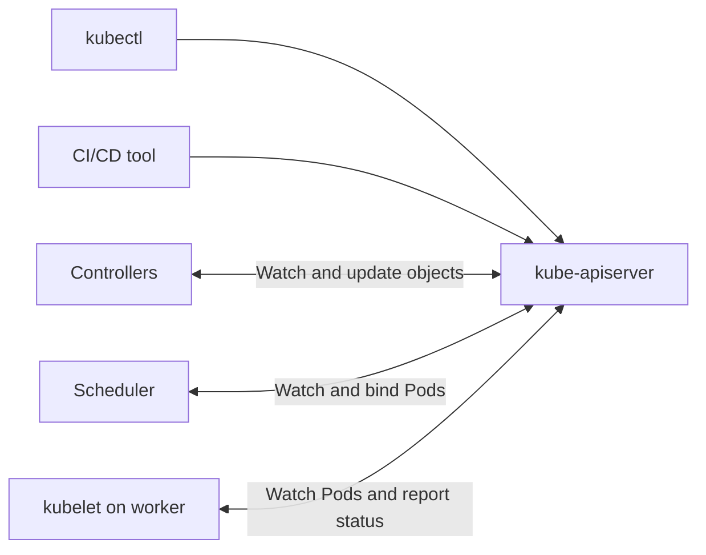

The API server is not a load balancer for ordinary application requests. A browser accessing the Python frontend usually uses a Service, Ingress/Gateway, or other application-facing networking path—not the `kubectl` API request path.

**Teaching bridge:** Typical write requests pass authentication, authorization, admission and validation before accepted state is persisted. Exactly which steps apply depends on the request and cluster configuration. Client-side schema checks are helpful but are not the final authority.

## 9. etcd: where the desired objects are persisted

We have a front door. But where does Kubernetes remember our instruction of 'five replicas' after `kubectl` exits? It persists cluster API state in **etcd**, a distributed, strongly consistent key-value store.

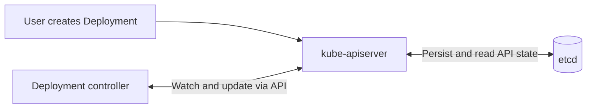

Think of the Deployment's `.spec.replicas: 5` as **desired state**. The Deployment and its derived objects also have status fields reflecting what the cluster has observed. A controller compares the intended state with observed state and acts on differences.

A critical architecture rule from the lecture is worth remembering: **normal Kubernetes clients and controllers interact with etcd through the API server rather than connecting to etcd directly.** This centralizes the cluster's API behavior. For production, etcd needs appropriate availability, backups, and access protection.

etcd is not a log collector or a database that stores every byte of your app's persistent volume. It's the durable store for Kubernetes API state.

## 10. Controllers: turning recorded intention into ongoing action

If etcd stores desired state, that still doesn't make five Pods appear. We need a process that continually asks, 'Does reality match the specification?' That is the job of **controllers**.

The standard **kube-controller-manager** runs multiple control loops, including those responsible for many core Kubernetes resources. A Deployment controller looks at Deployments and ReplicaSets; a ReplicaSet controller looks at ReplicaSets and matching Pods.

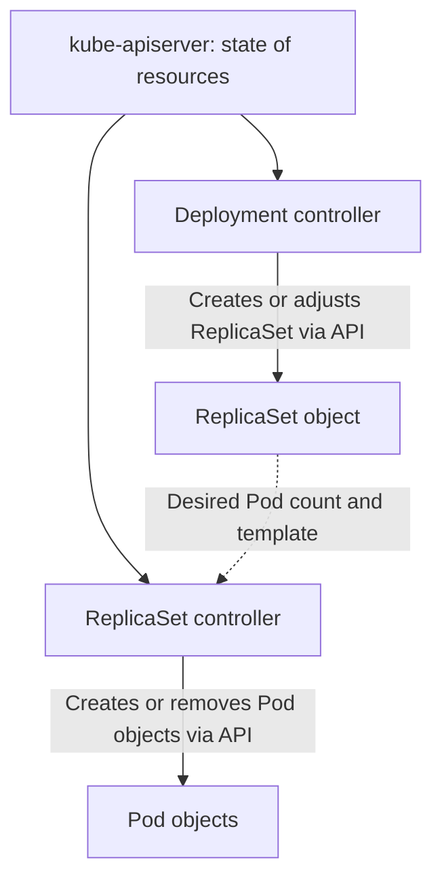

The diagram simplifies the watch and write paths to highlight responsibility. The controllers **read/watch and write through the API server**, rather than invoking each other as a long chain of direct RPC calls.

A controller isn't invoked only once when you run a command. It keeps reconciling through events and loops. That ongoing repetition is why Kubernetes can respond later, after a Pod is deleted or a workload is scaled.

**What is gained?** The operator describes a durable outcome, while independent controllers work toward that outcome over time.

## 11. Scheduler: a Pod object is not a running container

At this point, the ReplicaSet controller has created five **Pod objects**, but they might not have a node assignment. That means they aren't yet running application containers.

The **kube-scheduler** watches for unscheduled Pods and selects a suitable node for each. It evaluates conditions such as requested CPU and memory, node labels and selectors, taints and tolerations, affinities, and placement constraints. Some workloads also require specific devices or storage topology.

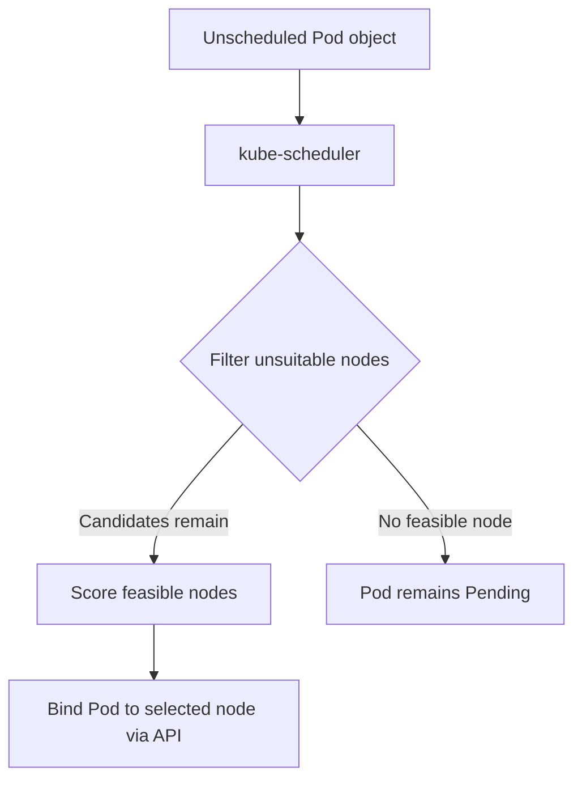

The lecture's GPU and SSD examples fit here: a Pod can require appropriate hardware or constrain where it is allowed to run. The important point is that the scheduler **chooses** a node; it does not directly execute the Pod's containers on that machine.

Also, 'five Pods on five nodes' is not guaranteed. Without appropriate placement constraints, the scheduler may place multiple replicas on a single node. For real resilience, use sufficient nodes and consider pod anti-affinity or topology spread constraints.

## 12. The cloud-controller-manager: cloud integration is a separate job

What if this cluster runs on AWS, Azure, or Google Cloud? Kubernetes may need to discover cloud-backed Nodes, reconcile cloud load balancers for relevant Service types, or handle provider-specific routing metadata. Those interactions require a bridge from Kubernetes APIs to cloud-provider APIs.

**cloud-controller-manager** can implement those cloud-specific controller responsibilities. It is **not required in every on-premises or cloud-independent cluster**, and the exact cloud integration architecture varies.

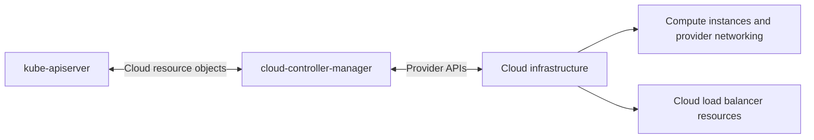

**Technical precision:** The transcript mentions cloud services such as ALB, IAM Identity Center, and KMS as examples of cloud integrations. That doesn't mean the cloud-controller-manager directly manages every such service. In real AWS clusters, separate controllers or integrations commonly handle ALB/Ingress, identity integration, storage encryption, and other provider-specific features. Keep cloud-controller-manager's main role as *cloud-specific cluster integration*, not a universal cloud services manager.

We have now built the control plane. But the scheduler only picked a node. **Who executes containers there?**

## 13. kubelet: the node's local reconciler

Every working node needs an agent responsible for the Pods assigned to that node. That agent is the **kubelet**.

Think back to Day 0's distinction: Kubernetes API objects are descriptions; containers are real processes managed by a Linux operating system. The kubelet bridges those levels. It watches for Pod specifications assigned to its node, reconciles their desired and actual state, instructs the container runtime, and reports Pod/node status to the API server.

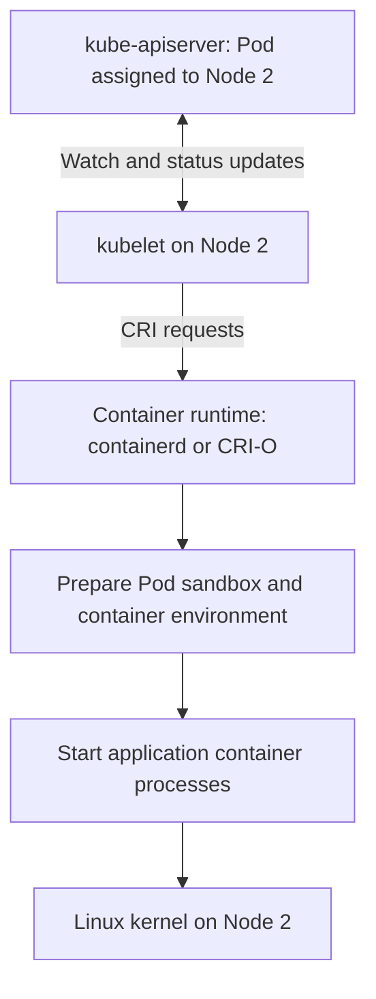

The runtime and Linux kernel do the actual local work. This is a continuation of our Docker foundation: **Kubernetes does not require Docker Engine to launch its Pods.** Kubelet communicates with a compatible runtime using the **Container Runtime Interface (CRI)**. The runtime's implementation handles image retrieval, sandbox/container creation, and lifecycle functions.

Kubelet also participates in health checks. Liveness probes may cause a container restart; readiness probes influence whether the Pod is considered a suitable endpoint for Services; startup probes can prevent premature liveness evaluation for slow-starting applications. These probes are distinct from ReplicaSet Pod-count reconciliation.

## 14. The node runtime, CNI, and the Pod sandbox

One last question: a freshly started container cannot serve traffic without its Pod networking. Who provides an IP address and interface?

A typical Linux container runtime follows a Pod-sandbox workflow. Kubelet requests creation of a Pod sandbox via CRI; the runtime coordinates the underlying low-level runtime and usually invokes configured **CNI plugins** to configure the Pod network. Exact internal ordering varies, but conceptually the tasks include:

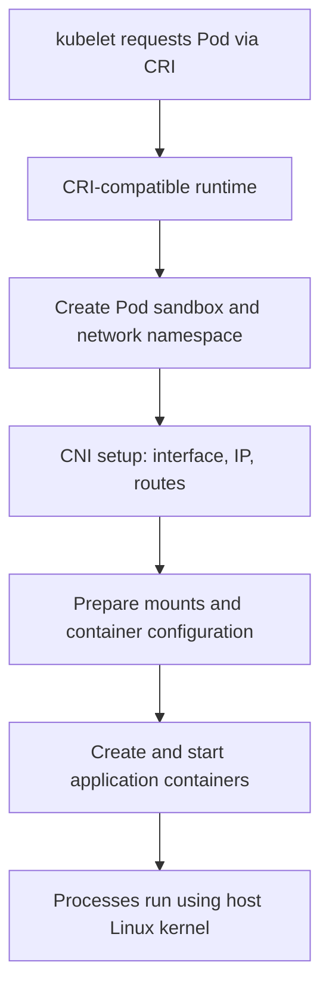

The sandbox gives containers in the Pod a shared network environment. On many Linux runtimes a small sandbox-holding process, sometimes called a **pause container**, helps keep that environment alive. This is a **teaching bridge** beyond the transcript, useful because it explains how two application containers can share one Pod network namespace.

CNI is a specification and plugin-based integration for creating/configuring container networking. Depending on the solution, it can provide interfaces, IP assignment through IPAM, routes, overlays, policy enforcement, or other capabilities. **Not every CNI implementation enforces Kubernetes NetworkPolicy**; a networking solution must explicitly support it.

### The component roles before we add Services

| Component | The question it answers | Not its job |
|---|---|---|
| API server | Where do actors read and change Kubernetes object state? | Run application traffic |
| etcd | Where is API state durably stored? | Run workload containers |
| Deployment controller | Which ReplicaSet versions should exist and be scaled? | Pick nodes |
| ReplicaSet controller | How many matching Pod objects should exist? | Start containers |
| Scheduler | Which node should run an unscheduled Pod? | Pull images and execute processes |
| kubelet | What must run on *this* node? | Pick a node for every Pod |
| Container runtime | How are local Pod sandboxes and containers created? | Decide desired cluster replica count |
| CNI networking implementation | How does a Pod receive usable networking? | Decide the Deployment version |

This table comes **after** the explanation intentionally: it consolidates concepts we've developed, rather than replacing the narrative with definitions.

---
# Act III — How the running Pods become a reachable application

## 15. A Pod IP works, but it's the wrong identity for an application

Let's return to the instructor's **to-do-list application**. It has two tiers:

- A **Python web/frontend tier**, shown with four Pod replicas in the lecture's networking example.
- A **Redis backend tier**, shown with three Pod replicas in that example.

For our later *Deployment creation walkthrough*, we'll return to the lecture's second example of **five Python frontend replicas**. These are two different instructional snapshots; do not merge the four-Pod networking diagram with the five-Pod creation workflow and assume the transcript describes one continuous live system.

Suppose Python Pod A needs to call Redis. Could it store the IP address of Redis Pod 3? Technically, yes, if routing and policy allow it. But that creates a fragile dependency: replacing Pod 3 can give the replacement a different Pod IP.

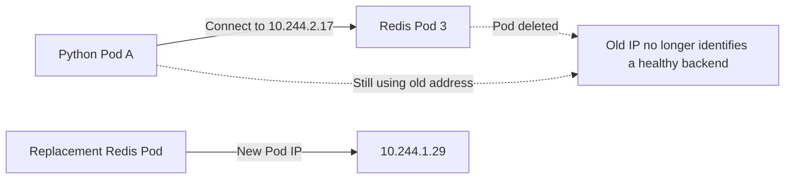

The problem isn't that Pods cannot communicate directly. They can. The problem is that **a specific Pod's IP is not a stable name for a changing group of replicas**.

Kubernetes solves this with a **Service**.

## 16. A Service provides a stable logical destination

A Service object expresses how to reach a set of suitable backend Pods. A common `ClusterIP` Service obtains an address reachable inside the cluster. Its selector matches Pod labels, and the Service's backends are represented through **EndpointSlices**.

Our Python frontend does not need to know which Redis Pod was replaced yesterday. It connects to the Redis Service's stable DNS name, often something like `redis` within the same namespace.

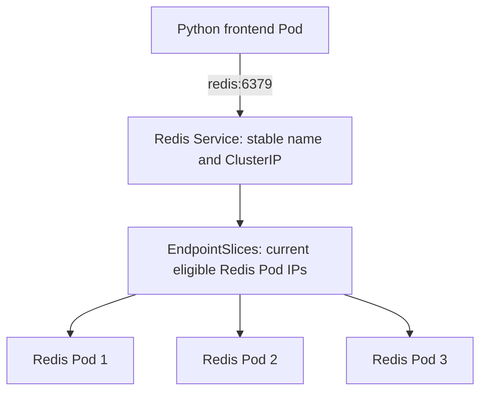

That diagram shows a **logical model**, not an actual network proxy process at each arrow. It introduces three distinct responsibilities:

1. **Service:** stable identity and selection rules.
2. **EndpointSlices:** current backend endpoint information, maintained from matching Pods and their conditions.
3. **Node datapath:** the routing or packet-handling implementation that gets a connection to an eligible backend.

In typical clusters, the Service's DNS name is resolved by cluster DNS (commonly CoreDNS) to the Service IP. The node's Service datapath then steers the connection to an endpoint.

**Teaching bridge:** A Kubernetes Service is a *virtual abstraction*, not necessarily a Pod or a userspace program waiting to read every request. That's why drawing a Service as a normal proxy box can be misleading unless we label it as logical.

### A Redis availability qualification

The lecture illustrates three Redis Pods as improving backend availability. Multiple Redis processes alone do **not** ensure correct Redis data replication, leader election, persistence, or failover. A highly available Redis deployment needs a suitable replication/failover design, and stateful workloads commonly use StatefulSets and persistent storage. We keep the three-Pod illustration to teach **Service endpoint selection**, not to imply that any three-replica Redis Deployment forms a safe distributed database.

## 17. Where kube-proxy fits: don't confuse the object with the traffic implementation

Now our Service has a stable destination and EndpointSlices describe backends. But ordinary Linux packets do not automatically understand the Kubernetes Service API. Something must translate the Service abstraction into working node networking behavior.

In a conventional cluster, **kube-proxy** watches Service and EndpointSlice changes and programs the node's networking datapath (such as kernel packet-filtering/NAT rules) to implement Service forwarding.

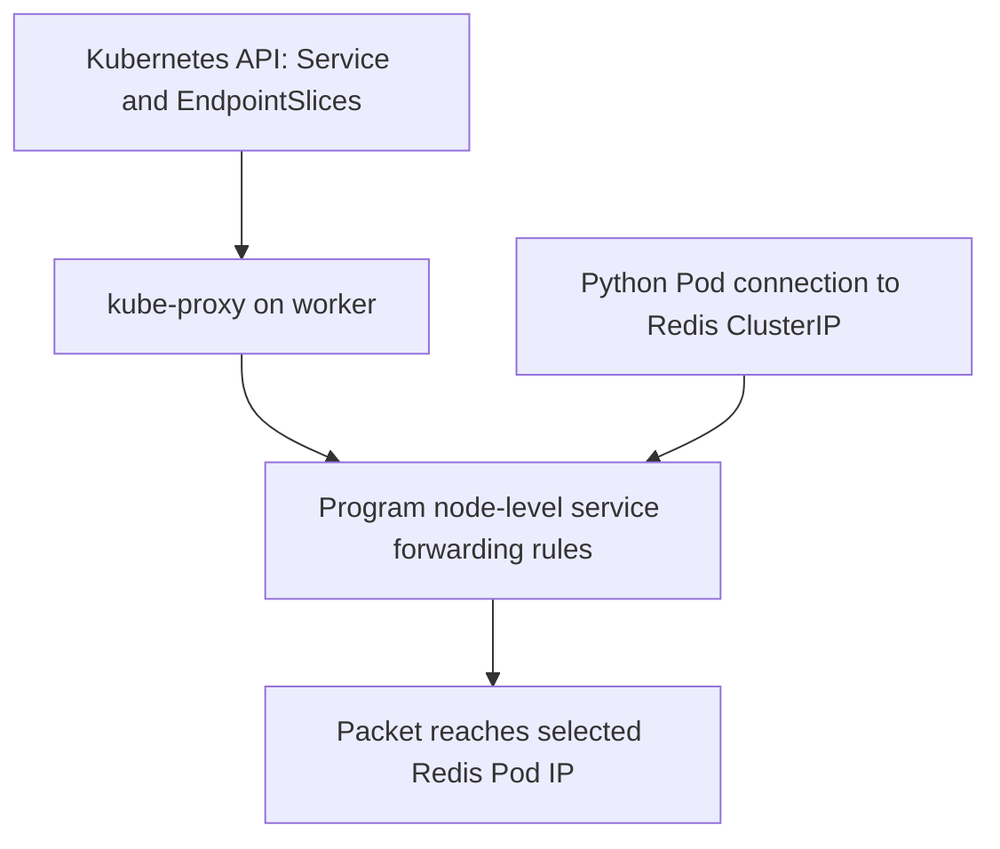

Read that diagram carefully. It does **not** mean every application packet travels into the kube-proxy userspace process. In common kube-proxy modes, kube-proxy **sets up the rules** and the Linux kernel's networking path handles actual packets. Backend selection happens according to the chosen datapath's behavior; it is not necessarily evenly balanced per HTTP request.

The lecture attributes three duties to kube-proxy: routing, load distribution, and health checks. The first two are broadly useful learning shortcuts, but the third needs refinement:

- kube-proxy generally **consumes endpoint readiness information** to avoid unsuitable endpoints; it is **not** normally the component probing each Pod's application health.
- kubelet executes configured readiness probes and reports Pod status; control-plane endpoint controllers reflect eligibility in EndpointSlices.
- The Service datapath uses the resulting backend information when steering connections.

Thus the more accurate chain is:

```mermaid
flowchart LR
    K[kubelet checks Pod readiness] --> API[Pod status in API]
    API --> ES[EndpointSlice controller updates endpoints]
    ES --> KP[kube-proxy observes EndpointSlices]
    KP --> RULES[Node forwarding rules]
```

### Does the reply bypass the Service?

The transcript says the response goes directly from the Redis Pod to the caller and the Service is no longer involved. That communicates an important idea: the Service is not necessarily a separate application proxy receiving each response. However, **connection tracking and reverse translation are still part of the network path when NAT is used**. The precise return path depends on networking mode, policy, and implementation. Avoid visualizing Service as an ordinary middlebox that processes requests but vanishes for replies.

## 18. CNI vs kube-proxy: two problems that sound similar

This is a key junction where learners often lose the mental model. Let's ask the questions in the correct order.

**Question A:** *How can Python Pod A send a packet to Redis Pod 3's Pod IP at all, possibly across nodes?*

That is the **Pod networking** problem. It is addressed by the chosen CNI-backed networking implementation and the routes, interfaces, tunneling or native network datapath it configures.

**Question B:** *How can Python Pod A send to the stable Redis Service destination without tracking changing Redis Pod IPs?*

That is the **Service forwarding** problem. kube-proxy may implement it, or a compatible networking solution may provide an alternative.

```mermaid
flowchart TB
    subgraph Base[Pod-to-Pod reachability]
        P[Python Pod IP] --> NET[CNI-backed Pod network]
        NET --> R[Redis Pod IP]
    end
    subgraph Stable[Service abstraction added above reachability]
        P2[Python Pod] --> S[Redis Service IP]
        S --> DP[Service datapath: kube-proxy or replacement]
        DP --> R2[Selected Redis Pod IP]
    end
```

CNI is not just a single 'network policy enforcer': CNI defines a plugin interface, and an actual implementation may bundle IPAM, node-to-node connectivity, routes, overlays, and policy. Some implementations lack NetworkPolicy support; others provide powerful eBPF datapaths.

**Why can kube-proxy be optional?** Because some network implementations can supply Service forwarding without kube-proxy. Cilium supports kube-proxy replacement under appropriate configuration; Calico can also support alternative forwarding implementations in certain modes. This is an **architecture option**, not a guarantee that installing any particular CNI plugin automatically makes kube-proxy unnecessary.

**Important mental distinction:**

> CNI-backed networking makes **Pod IP reachability** possible. A Service datapath makes a **stable Service destination** work. These layers are related, but they solve different problems.

## 19. The full two-tier example, assembled only after understanding the parts

We can now revisit the lecture's to-do-list example without introducing mystery boxes. The frontend consists of multiple interchangeable Python Pods; Redis has its own backends; the Pods are placed on worker nodes; and Services provide stable destinations.

```mermaid
flowchart TB
    USER[Client / browser] --> ENTRY[Frontend entry path: Ingress, LB, or published Service]
    ENTRY --> FS[Frontend Service]
    FS --> P1[Python Pod 1 on Node A]
    FS --> P2[Python Pod 2 on Node A]
    FS --> P3[Python Pod 3 on Node B]
    FS --> P4[Python Pod 4 on Node B]
    P1 -->|redis:6379| RS[Redis Service]
    P2 --> RS
    P3 --> RS
    P4 --> RS
    RS --> R1[Redis Pod 1]
    RS --> R2[Redis Pod 2]
    RS --> R3[Redis Pod 3]
```

**What this picture does and does not say:**

- The Pods may be spread across workers, but placement is not automatically balanced.
- A client does not necessarily access a `ClusterIP` directly from outside the cluster. The external-entry layer is a separate networking concern.
- Frontend Pods communicate with Redis through a stable Service destination, not by pinning themselves to Redis Pod 3's IP.
- The Redis example is **illustrative of routing**, not proof of safe replicated database design.
- In most implementations, logical arrows to Services are ultimately carried by normal networking and node datapaths.

**Visual checkpoint 2 — Two independent planes in one mental picture:**

```mermaid
flowchart TB
    subgraph Control[Control and coordination]
        API[kube-apiserver]
        CTRL[Controllers]
        SCH[Scheduler]
        API <--> CTRL
        API <--> SCH
    end
    subgraph Runtime[Application execution and data traffic]
        W1[Worker 1: kubelet, runtime, Pods]
        W2[Worker 2: kubelet, runtime, Pods]
        NET[Pod network and Service datapath]
        W1 <--> NET
        W2 <--> NET
    end
    API <-.-> W1
    API <-.-> W2
```

When somebody sends a `kubectl` command, that's the **control path** through the API. When a user sends an HTTP request to the Python service, that's the **application data path**. Both may use the network, but they are **different flows**.

---

# Act IV — Follow one Deployment from YAML to running Pods

## 20. The experiment: request five Python Pods

The lecture's most valuable section is its full Deployment workflow. Let's reconstruct it carefully because this is where every component's responsibility becomes clear.

Our goal is to run **five Pods**, each containing one Python frontend container. Assume a container image has already been built and published to a registry. In a real lab, replace the placeholder below with an image you can pull.

```yaml
apiVersion: apps/v1
kind: Deployment
metadata:
  name: python-frontend
spec:
  replicas: 5
  selector:
    matchLabels:
      app: python-frontend
  template:
    metadata:
      labels:
        app: python-frontend
    spec:
      containers:
        - name: python-frontend
          image: example.invalid/training/python-frontend:v1
          ports:
            - containerPort: 5000
          resources:
            requests:
              cpu: 100m
              memory: 128Mi
```

This is an **illustrative teaching manifest**: `example.invalid/...` is deliberately non-pullable. It expresses the object structure without claiming that the instructor's sample application is available at a public registry. Before a real deployment, substitute your own valid image, adjust the port and requests, and add meaningful probes.

Let's interpret just enough YAML to follow the flow:

- `kind: Deployment` declares the object type.
- `metadata.name` identifies the Deployment.
- `spec.replicas: 5` is our requested **Pod count**.
- `selector.matchLabels` lets the Deployment identify matching Pods/ReplicaSets.
- `template` describes the Pod to replicate, including labels and container specification.
- The image reference tells the runtime what artifact to retrieve when executing a Pod.
- Resource requests are **scheduling inputs**, not an instruction to immediately reserve all CPU as a hard limit.

At this instant, the YAML is still a local file. **No Pods have been created by merely writing the file.**

## 21. Phase 1: the client submits intent, not containers

We submit the file:

```bash
kubectl apply -f python-frontend-deployment.yaml
```

First, `kubectl` parses the file and prepares Kubernetes API operations. It can perform local or server-supported validation, but the **API server is the authoritative boundary** for authentication, authorization, admission, and persistence.

The request arrives at `kube-apiserver`, is processed, and, when accepted, results in a Deployment object persisted as API state in etcd. The API returns a success response **without waiting for five running containers**.

```mermaid
sequenceDiagram
    participant User
    participant CLI as kubectl
    participant API as kube-apiserver
    participant DB as etcd
    User->>CLI: apply Deployment manifest
    CLI->>API: API request with desired spec
    API->>API: Authenticate, authorize, validate/admit
    API->>DB: Persist Deployment object
    DB-->>API: Persistence confirmed
    API-->>CLI: Object created or configured
    CLI-->>User: Command result
    Note over User,DB: Five containers are not running yet
```

The most important insight here is **a successful API write is not the same as a successful workload startup**. The command can return before the scheduler or kubelet has done any work.

If you run `kubectl get deployment python-frontend`, you might see desired replicas of `5` with fewer (perhaps zero) currently available. That's normal while reconciliation proceeds.

## 22. Phase 2: the Deployment controller creates a ReplicaSet

The Deployment controller watches API state. It observes a Deployment whose desired Pod template and ReplicaSet revision are not yet represented by a suitable ReplicaSet.

It reconciles by creating or adjusting a **ReplicaSet** through the API server. The API server persists that ReplicaSet.

```mermaid
sequenceDiagram
    participant API as kube-apiserver
    participant DC as Deployment controller
    participant DB as etcd
    API-->>DC: Watch event: Deployment requires reconciliation
    DC->>API: Create / update ReplicaSet
    API->>DB: Persist ReplicaSet object
    API-->>DC: Accepted ReplicaSet state
```

Notice the ownership relationship emerging:

```mermaid
flowchart TB
    D[Deployment: replicas 5, image v1]
    D --> RS[ReplicaSet: replicas 5, Pod template v1]
    RS --> GAP[Currently 0 matching Pods]
```

A new ReplicaSet object has been recorded. This still does **not** mean five application containers are running. The next controller handles the gap between desired Pod count and existing Pods.

## 23. Phase 3: ReplicaSet controller creates Pod objects

The ReplicaSet controller observes a ReplicaSet asking for five matching Pods while none exist. It creates **five Pod objects** via the API server. Each Pod gets a unique identity and the same intended container image and template details.

```mermaid
sequenceDiagram
    participant RC as ReplicaSet controller
    participant API as kube-apiserver
    participant DB as etcd
    RC->>API: Observe ReplicaSet desired=5, present=0
    loop For each missing Pod
        RC->>API: Create Pod object from template
        API->>DB: Persist new Pod object
    end
    API-->>RC: Five Pod objects now recorded
    Note over RC,DB: Pod objects exist; containers may not exist yet
```

We have to be particularly careful with the word *created*. In Kubernetes, a **Pod object can exist in the API without a Pod sandbox or running container existing on any worker**.

This distinction will matter in every future CKA troubleshooting question. Seeing a Pod named in `kubectl get pods` does not prove that its image was pulled, that its container started, or that its readiness probe passed.

```mermaid
flowchart TB
    RS[ReplicaSet: desired 5]
    RS --> P1[Pod 1: Pending, no node yet]
    RS --> P2[Pod 2: Pending, no node yet]
    RS --> P3[Pod 3: Pending, no node yet]
    RS --> P4[Pod 4: Pending, no node yet]
    RS --> P5[Pod 5: Pending, no node yet]
```

**Visual checkpoint 3:** The desired objects now exist. Next we need to turn their unscheduled specifications into workloads assigned to actual machines.

## 24. Phase 4: the scheduler assigns nodes

The scheduler observes Pod objects that lack a node assignment. It evaluates the cluster and selects feasible nodes based on scheduling rules and resource requests. It then binds each Pod to its selected node through the Kubernetes API.

For illustration, assume this placement:

- Node A: Pod 1, Pod 2, Pod 3
- Node B: Pod 4, Pod 5

```mermaid
flowchart TB
    SCH[kube-scheduler] --> A[Node A chosen for Pods 1, 2, 3]
    SCH --> B[Node B chosen for Pods 4, 5]
    A --> API[kube-apiserver records node assignment]
    B --> API
    API --> DB[(etcd stores updated Pod specs)]
```

This is an **illustrative placement**, not a guarantee that a two-node cluster distributes a five-replica Deployment as 3+2. Scheduling depends on resources, affinities, taints, policies, topology rules and other constraints.

At this moment, the Pod objects have `spec.nodeName` set through the binding process, but execution is still the next stage. We have only moved from **'five unscheduled Pods'** to **'five Pods assigned to nodes'**.

## 25. Phase 5: kubelet and runtime turn the specification into Linux processes

Now the kubelet on Node A learns that Pods 1–3 are assigned to it; Node B's kubelet learns about Pods 4–5. The kubelet compares desired state with local container state and calls its CRI-compatible runtime.

At a useful level of detail, local Pod startup involves:

1. Preparing the Pod sandbox and its shared network environment.
2. Configuring Pod networking through the runtime's configured CNI integration.
3. Preparing container images (pulling if necessary according to pull policy and local availability).
4. Preparing volumes, mounts and container settings.
5. Creating and starting the containers.
6. Observing container exits, running configured probes, and reporting status.

Do not memorize this as a universal immutable line-by-line order; runtimes may interleave image preparation, sandbox setup, and mounts. The **responsibility boundaries** matter more than a simplified exact call schedule.

```mermaid
sequenceDiagram
    participant API as kube-apiserver
    participant K as kubelet on Node A
    participant RT as containerd / CRI-O
    participant CNI as CNI plugin
    participant OS as Linux kernel
    API-->>K: Pods 1 to 3 are assigned here
    K->>RT: CRI request to create Pod sandbox
    RT->>CNI: Configure Pod network
    CNI-->>RT: Interface, IP and route configuration
    K->>RT: Ensure images and start containers
    RT->>OS: Create isolated processes and mounts
    OS-->>RT: Processes running
    RT-->>K: Container state
    K->>API: Publish Pod status and readiness
```

The **shared-kernel foundation** from Day 0 and Day 3.1 is still present. Kubernetes does not invent a different operating system under each Pod. The runtime arranges Linux isolation and resources while each containerized application ultimately makes normal system calls to the host kernel.

### What is the kubelet actually doing after startup?

Kubelet does not disappear after containers start. It continues its node-local reconciliation, tracking container state, managing restarts and probes, handling volumes and reporting status. It can also report node health signals. This is why we describe it as a **node agent / local reconciler**, not merely a one-time 'container start' command.

## 26. Phase 6: readiness and Service endpoints become meaningful

Suppose the processes start but need a few seconds before they can accept real traffic. A Pod might be `Running` before its application is **Ready**. Those are not interchangeable concepts.

If the Pods have readiness probes, kubelet performs the checks and reports readiness. The EndpointSlice controller uses Pod eligibility to maintain the Service's backend list. The Service forwarding datapath learns the current endpoints and sends traffic to eligible backends.

```mermaid
flowchart TB
    P[Container process is running] --> PR[Readiness checks, if configured]
    PR -->|Not ready| NR[Do not normally use as ready Service endpoint]
    PR -->|Ready| STATUS[kubelet updates Pod Ready status]
    STATUS --> ES[EndpointSlices reflect usable backends]
    ES --> DP[Service datapath updates endpoint selection]
    DP --> TRAFFIC[Client connections reach suitable Pods]
```

**Technical precision:** If you omit readiness probes, Kubernetes doesn't magically know whether the application has completed its internal startup. Basic container running status can be treated as sufficient for readiness, depending on the Pod's other conditions. For stronger operational safety, design readiness checks that represent actual ability to serve.

Now our five Python containers are running, and—assuming their readiness conditions pass—the application has five eligible backend Pods. The original declarative instruction has become a running service.

## 27. The whole Deployment workflow in one end-to-end picture

Only now is it useful to see the entire chain together. Every arrow should correspond to a relationship we have already discussed.

```mermaid
flowchart TB
    CLI[kubectl apply -f deployment.yaml] --> API[kube-apiserver]
    API <-->|Persist API objects| DB[(etcd)]
    API -.->|Watch| DC[Deployment controller]
    DC -->|Through API: create/scale| RS[ReplicaSet object]
    API -.->|Watch| RC[ReplicaSet controller]
    RC -->|Through API: create| POD[Five Pod objects]
    API -.->|Watch pending Pods| SCH[kube-scheduler]
    SCH -->|Bind Pods via API| ASSIGN[Assigned Pods]
    ASSIGN --> KA[kubelet: Node A]
    ASSIGN --> KB[kubelet: Node B]
    KA --> RTA[Runtime: Node A]
    KB --> RTB[Runtime: Node B]
    RTA --> PA[Linux container processes on A]
    RTB --> PB[Linux container processes on B]
    PA --> ST[Pod status back to API via kubelet]
    PB --> ST
    ST --> API
```

Read this from top to bottom once, then read it backward:

- Application processes exist because runtimes started them.
- Runtimes received requests from kubelets.
- Kubelets acted on Pods assigned to their nodes.
- The scheduler selected nodes for Pod objects.
- ReplicaSet reconciliation produced the Pod objects.
- Deployment reconciliation produced the appropriate ReplicaSet.
- All of that happened because the API accepted a **desired-state specification**.

The control loop continues after the first successful deployment. **The goal is not one execution of a script; it's ongoing convergence toward declared intent.**

---
# Act V — What happens *after* the five Pods exist?

## 28. Failure case A: a Python process crashes

Imagine Python Pod 2 still exists on Node A, but its main container process crashes. We should not jump immediately to 'the Deployment controller replaces the Pod', because there are **different layers of recovery**.

Kubelet notices local container state and, for a typical Deployment Pod whose `restartPolicy` is `Always`, attempts to restart the failed container inside the **same Pod**. Repeated failures may lead to a `CrashLoopBackOff` waiting pattern.

```mermaid
flowchart TB
    PROCESS[Python process in Pod 2 crashes] --> K[kubelet observes exit]
    K --> R{Pod restart policy and state allow restart?}
    R -->|Yes| RESTART[Restart container within existing Pod]
    R -->|No, or Pod itself removed| HIGHER[Pod-level controller may need replacement]
```

A Deployment's ReplicaSet doesn't have to create a brand-new Pod every time a container crashes. A running Pod can survive multiple restarts of one of its containers. This is an important distinction for troubleshooting.

## 29. Failure case B: a Pod is deleted or a node disappears

Now suppose Pod 2 is actually deleted, or its Node fails and Kubernetes eventually recognizes the Pod as gone/unavailable. The existing ReplicaSet may find that fewer suitable matching Pods exist than its desired count.

The ReplicaSet controller reconciles by creating a **replacement Pod object**. The scheduler must place it, then a kubelet/runtime must start it. Capacity, disruption handling and Node failure detection can delay this process; it is not instant.

```mermaid
flowchart TB
    G[ReplicaSet desired: 5 Pods] --> LOSS[One Pod deleted or lost]
    LOSS --> FOUR[Only 4 matching Pods remain]
    FOUR --> RC[ReplicaSet controller creates new Pod object]
    RC --> S[kube-scheduler selects node]
    S --> K[kubelet and runtime start it]
    K --> FIVE[Target count restored, subject to readiness]
```

And what if the replacement Pod lands on the same vulnerable node? This is why **replica count alone is not high availability**. High availability also depends on placement across failure domains, spare capacity, storage behavior, network access, and application readiness. Kubernetes has placement controls for these requirements, which you'll study later.

## 30. Failure case C: our new version doesn't start

A Deployment's rolling-update controller creates or scales a new ReplicaSet for the updated Pod template. Suppose the image is wrong or the new application fails readiness. Kubernetes may keep older Pods available within the rollout strategy's constraints, while the rollout stops making satisfactory progress.

```mermaid
flowchart TB
    D[Deployment updates to v2] --> NEW[New ReplicaSet for v2]
    NEW --> P[New Pods created]
    P --> CHECK{Containers start and become ready?}
    CHECK -->|Yes| CONT[Continue gradual rollout]
    CHECK -->|No| STALL[Rollout stalls or fails progress checks]
    STALL --> OP[Investigate events, image, probes and capacity]
    OP --> ROLL[Rollback if appropriate]
```

A rollout is **controlled replacement**, not a magical assurance of uptime. The exact outcome depends on the strategy (`maxSurge`, `maxUnavailable`), capacity and actual readiness. A rollback requires usable revision history and will itself perform reconciliation.

### Three failures, three primary actors

| What failed? | First mechanism to investigate | Why |
|---|---|---|
| Container process exited inside an existing Pod | kubelet / runtime, restart policy, probes | Local container lifecycle |
| Pod is deleted or lost, so replica count is short | ReplicaSet controller, then scheduler and kubelet | Desired Pod population |
| Deployment template changed and rollout is unhealthy | Deployment controller / rollout status | Controlled change across ReplicaSets |

The subtle lesson is that Kubernetes is **many cooperating controllers and agents**, each correcting a different type of mismatch.

---

# Act VI — Add-ons and replaceable integrations

## 31. Why add-ons exist at all

The lecture finishes by showing components beyond the core control-plane and node agents. This connects naturally to something we've already observed: Kubernetes defines stable APIs, but many practical features depend on separate implementations.

The word **add-on** is not equivalent to 'unimportant'. It often means that the function can be installed or operated separately, and its implementation can vary by cluster.

```mermaid
flowchart TB
    CORE[Core Kubernetes object and control-loop model] --> NET[Cluster networking implementation]
    CORE --> DNS[Cluster DNS]
    CORE --> MET[Resource metrics pipeline]
    CORE --> STORAGE[Storage interface and drivers]
    CORE --> UI[Optional dashboards and tooling]
```

A functional, practical cluster needs suitable networking, but Kubernetes can support different networking implementations. It does not need every optional dashboard or metrics pipeline just to start a simple Pod.

## 32. Metrics Server and the path to HPA

How could Kubernetes decide to increase Python replicas when CPU usage rises? The control plane needs measured usage, a scaling policy, and a controller that compares usage to the policy.

The **Metrics Server** commonly gathers resource usage metrics from kubelets and exposes them through the `metrics.k8s.io` API. This supports `kubectl top` and CPU/memory-based HPA usage in common setups.

The **HorizontalPodAutoscaler controller**, not the Metrics Server itself, calculates and updates the desired scale of a target resource such as a Deployment. The Deployment and ReplicaSet controllers then do the usual reconciliation to create or remove Pods.

```mermaid
flowchart TB
    K[kubelet resource statistics] --> MS[Metrics Server]
    MS --> API[metrics.k8s.io resource metrics API]
    API --> HPA[HorizontalPodAutoscaler controller]
    RULE[HPA target, e.g. average CPU utilization] --> HPA
    HPA --> SCALE[Update Deployment desired replica count]
    SCALE --> D[Deployment and ReplicaSet reconciliation]
    D --> PODS[Additional or fewer Pods]
```

Suppose HPA has a configured target of 70% CPU utilization. That's not '70% of the machine's total CPU' by definition: utilization for resource-based HPA is typically calculated relative to the containers' **resource requests**. Without suitable requests, CPU utilization metrics can become unusable for that scaling decision. The number of replicas also depends on tolerances, minimum/maximum replicas, metrics availability and stabilization behavior.

**Technical precision:** The transcript suggests Metrics Server supplies 'any other metric'. Metrics Server normally provides **resource CPU/memory metrics**. Custom or external metrics usually require an appropriate separate metrics API/adapter. HPA is a controller, not a built-in promise that Pods scale without an HPA configuration.

## 33. CNI, CRI and CSI: separate extension points

Let's align the three interface names you will hear repeatedly as a CKA learner:

```mermaid
flowchart TB
    K[kubelet] --> CRI[CRI: talk to container runtime]
    CRI --> RT[containerd / CRI-O]
    RT --> CNI[CNI integration: prepare Pod networking]
    K --> CSI[CSI integration: manage container storage volumes]
```

This is a **conceptual map**, not a universal sequence of direct API calls for each driver. CSI work is coordinated through Kubernetes storage controllers, a node driver/agent and kubelet integration; the whole storage control path has more actors than a single arrow.

**CRI** is the Container Runtime Interface—used by kubelet to work with compatible runtimes. **CNI** is the Container Network Interface—an ecosystem of plugin specifications and networking implementations used for Pod networking. **CSI** is the Container Storage Interface—used to integrate storage systems for container volumes.

The extension model explains why distributions and cloud providers can offer different runtimes, network implementations, and storage drivers while retaining a common Kubernetes API model.

## 34. CoreDNS: converting a Service name into something usable

Previously we said the Python frontend can call `redis:6379`. But how does a program find that name?

With cluster DNS—commonly implemented using **CoreDNS**—a Pod can resolve a Service name into the relevant Service address. Short names such as `redis` typically work within the same namespace; fully qualified Service names are useful across namespaces.

```mermaid
sequenceDiagram
    participant APP as Python Pod
    participant DNS as CoreDNS
    participant NET as Service datapath
    participant REDIS as Redis Pod
    APP->>DNS: Resolve redis.default.svc.cluster.local
    DNS-->>APP: Redis Service ClusterIP
    APP->>NET: Connect to ClusterIP:6379
    NET->>REDIS: Forward to eligible Redis Pod
    REDIS-->>APP: Response via network data path
```

DNS and Service forwarding are **distinct steps**. CoreDNS resolves a *name*. The Service datapath sends the *packet* to a backend. This distinction will become especially useful when diagnosing 'DNS works but connections fail' or 'Pod IP works but Service name fails'.

## 35. Kubernetes Dashboard and other optional tooling

A Dashboard is an optional user interface that reads Kubernetes API information and helps visualize object state. It is not the source of truth, not a replacement for the API server, and not required for Kubernetes to operate. Modern clusters may provide other dashboards or observability interfaces instead.

The lecture also mentions third-party tools for logging, monitoring and CI/CD. Like `kubectl`, tools that manage Kubernetes objects generally use the Kubernetes API with appropriate identities and permissions.

```mermaid
flowchart LR
    CLI[kubectl] --> API[kube-apiserver]
    CI[CI/CD tool] --> API
    DASH[Optional dashboard] --> API
    OBS[Monitoring or automation integration] --> API
```

This returns us to the architectural starting point: *one API-driven state model, many independent actors acting on it*.

---

# Act VII — Investigate the architecture from your own cluster

## 36. A non-destructive observation path

The best way to strengthen this mental model is to inspect each layer **in the same order we learned it**. These commands are read-only in their ordinary usage. They assume you have `kubectl` installed and a suitable cluster context.

Start with the cluster's machines and workload objects:

```bash
kubectl cluster-info
kubectl get nodes -o wide
kubectl get deployments -A
kubectl get replicasets -A
kubectl get pods -A -o wide
```

Look for the relationships we built: a Deployment's desired replicas, ReplicaSets under it, and Pods showing node assignment. The output of `kubectl get pods -o wide` gives node names and Pod IPs—two fields from our scheduling and networking stories.

Pick a deployment in a namespace you have permission to inspect. Substitute your actual namespace and object names:

```bash
kubectl -n <namespace> describe deployment <deployment-name>
kubectl -n <namespace> get rs
kubectl -n <namespace> get pods -o wide
kubectl -n <namespace> describe pod <pod-name>
```

Find the Pod's **Events** section. You may see evidence of scheduling, pulling, creation, startup, probes, or errors. Events are not guaranteed to be complete historical audit records; they are operational signals with retention and timing limits.

Now relate Services to Pods:

```bash
kubectl get services -A
kubectl -n <namespace> get endpointslices
kubectl -n <namespace> describe service <service-name>
```

Compare the Service's selector labels with the labels on Pods. Observe endpoint IPs and readiness conditions. On clusters that use kube-proxy, you may find its DaemonSet or Pods in a system namespace; some networking stacks replace it.

Check add-ons that might be present:

```bash
kubectl -n kube-system get pods
kubectl top nodes
kubectl top pods -A
```

If the Metrics API isn't available, `kubectl top` may fail even while the cluster is otherwise running. That is a useful clue about the resource-metrics layer, not necessarily a symptom that every workload is broken.

### Optional small lab: create a Deployment and watch the ownership chain

The following **does write to a Kubernetes cluster**. Only use it in a lab namespace and on a cluster where you have permission to create resources. Verify your context first:

```bash
kubectl config current-context
kubectl create namespace cka-day7-lab
kubectl -n cka-day7-lab create deployment demo-web \
  --image=nginx:1.27 --replicas=3
kubectl -n cka-day7-lab get deployment,rs,pods -w
```

The `nginx:1.27` tag is an illustrative version, not a recommendation for current production deployments. If it is unavailable in your environment, use an accessible image. Stop the watch with Ctrl+C. You can then inspect the Deployment and one Pod. Finally, when you're finished **and only if you created the namespace solely for this exercise**, remove it:

```bash
kubectl delete namespace cka-day7-lab
```

Deleting a namespace deletes its namespaced resources. Never run it against a namespace containing someone else's work.

## 37. Concept checks that measure understanding, not memorization

Pause before reading the answers and reason from the architecture we built.

**Q1. `kubectl apply` reports that a Deployment was created, but zero Pods are Running. Is that contradictory?**

No. The API can accept and persist a Deployment before the Deployment controller, ReplicaSet controller, scheduler and kubelets complete their work. Investigate the objects stage by stage.

**Q2. Five Pod objects exist, but all are `Pending`. Which component should you investigate next?**

First inspect Pod events and whether Pods are scheduled. If `spec.nodeName` is empty, investigate scheduling constraints and available resources. If a node is assigned, investigate kubelet/runtime startup, image pulls, volumes and networking.

**Q3. A Python container crashed and restarted three times, but the Pod name stayed the same. Why?**

The kubelet can restart a container inside an existing Pod according to its restart policy. A new Pod object is not required for every container restart.

**Q4. A Pod was deleted and its owner ReplicaSet has desired replicas of five. What happens?**

The ReplicaSet controller attempts to create a replacement Pod object. The scheduler selects a node, and kubelet/runtime start the replacement subject to available resources and prerequisites.

**Q5. `redis` resolves in DNS, but TCP connections still fail. Does that prove CoreDNS is broken?**

No. DNS resolution and Service packet forwarding are different stages. Investigate selected endpoints, readiness, port configuration, policies, and the Pod network/datapath.

**Q6. If you install a CNI plugin, can you always remove kube-proxy?**

No. Only use a kube-proxy replacement when the chosen networking implementation and configuration actually provide compatible Service forwarding behavior.

**Q7. A Deployment has five replicas spread across one node. Is it protected against that node failing?**

No. Replica count and node-failure-domain distribution are separate requirements. Placement policy and spare capacity matter.

**Q8. Does a Redis Deployment of three Pods automatically give safe replicated database state?**

No. Kubernetes Pod replica management does not implement Redis replication, failover or persistent state management by itself.

## 38. Final synthesis: one thought connected to the next

We began with one simple question: **how does one declarative request become five running Python processes spread across a Kubernetes cluster?**

We first needed a unit of execution. That gave us the **Pod**, whose containers are co-located and share a Pod network namespace. To maintain a population of Pods we introduced the **ReplicaSet**. To manage updates and revisions above ReplicaSets we introduced the **Deployment**.

Those objects alone could not take action. The **API server** accepted and exposed their state; **etcd** stored that state; **controllers** continuously reconciled differences. When the ReplicaSet controller produced Pod objects without node assignments, the **scheduler** selected nodes. When each node's **kubelet** discovered assigned Pods, it asked a **CRI-compatible runtime** to prepare their sandbox, networking, mounts and processes. The **Linux kernel** executed the resulting isolated container processes.

Next we addressed a new problem. Pod IPs can change when Pods are replaced, so we introduced **Services and EndpointSlices**. **CoreDNS** resolved Service names; the configured Service datapath—via **kube-proxy** or an alternative—steered traffic toward suitable backends. **CNI-backed networking** provided the foundational Pod network reachability beneath that abstraction.

Finally, availability required continuous observation, not just successful initial startup. Kubelet handled container-level lifecycle, ReplicaSet reconciliation handled Pod-level population, Deployment reconciled version rollout, and HPA could adjust desired replica counts based on an explicitly configured scaling policy and metrics source.

```mermaid
flowchart TB
    INTENT[Desired state: five Python replicas]
    INTENT --> API[kube-apiserver and etcd]
    API --> D[Deployment reconciliation]
    D --> RS[ReplicaSet reconciliation]
    RS --> P[Pod objects]
    P --> SCH[Scheduler assigns nodes]
    SCH --> K[kubelet on each chosen node]
    K --> RT[Runtime plus CNI and mounts]
    RT --> LINUX[Linux kernel runs processes]
    LINUX --> READINESS[Pod readiness and status]
    READINESS --> ENDPOINT[Service endpoint information]
    ENDPOINT --> SERVICE[Application traffic reaches ready Pods]
    SERVICE --> CHECK[Continuous monitoring and reconciliation]
    CHECK -.-> API
```

**The architecture is not a pile of isolated component definitions. It is one ongoing loop from intent to action, from action to observed state, and from observed state back to correction.** That is the mental model to carry into future CKA lessons about controllers, scheduling, kubelet, Services, networking and storage.

---

## Lecture coverage map and important corrections

This compact index exists for **completeness checking**, not as a substitute for the chapter narrative.

| Lecture topic | Where developed in this chapter | Precision worth retaining |
|---|---|---|
| Pod and multi-container sidecars | §§1–3 | Network namespace shared; storage shared only via configured volumes |
| Deployment and replica management | §§4–6 | ReplicaSet maintains Pods; kubelet can restart containers |
| Control plane vs worker/data plane | §7 | Logical roles, not always separate physical machines |
| Cloud controller manager | §12 | Cloud-specific integrations vary; not a manager of every cloud product |
| kube-controller-manager | §10 | Controllers reconcile via API, not direct calls into etcd |
| etcd and API server | §§8–9 | Persisted API state; control-path entry point |
| Scheduler | §§11,24 | Chooses nodes; does not run containers; placement not inherently even |
| Python frontend + Redis example | §§15–19 | Three Redis Pods don't imply data-level HA |
| Kubernetes Services | §§15–17 | Logical Service, EndpointSlices, real node datapath |
| kube-proxy and CNI | §§17–18 | kube-proxy programs forwarding; readiness determined elsewhere |
| kubelet and runtime | §§13–14,25 | CRI-compatible runtime, CNI integration and Linux processes |
| `kubectl apply` through full Deployment creation | §§20–27 | Deployment → ReplicaSet → Pod object → binding → execution → Ready |
| Metrics Server and HPA | §32 | Resource metrics vs custom metrics; HPA adjusts scale target |
| CNI, CSI and container runtimes | §33 | Different plugin/interface responsibilities |
| CoreDNS and Dashboard | §§34–35 | Cluster DNS vs optional UI |
| Recovery / rollout behavior | §§28–30 | Different failures trigger different reconciliation mechanisms |

## Technical references used to validate added explanations

These links are supplementary to the provided transcript; they are not required for Mermaid rendering or for the Markdown to stand alone.

- [Kubernetes architecture and components](https://kubernetes.io/docs/concepts/overview/components/)
- [Pods and sidecar containers](https://kubernetes.io/docs/concepts/workloads/pods/sidecar-containers/)
- [Deployments](https://kubernetes.io/docs/concepts/workloads/controllers/deployment/)
- [ReplicaSets](https://kubernetes.io/docs/concepts/workloads/controllers/replicaset/)
- [Kubernetes API object model](https://kubernetes.io/docs/concepts/overview/working-with-objects/)
- [Container Runtime Interface (CRI)](https://kubernetes.io/docs/concepts/containers/cri/)
- [Kubelet sync loop](https://kubernetes.io/docs/reference/node/kubelet-sync-loop/)
- [Services and networking](https://kubernetes.io/docs/concepts/services-networking/)
- [EndpointSlices](https://kubernetes.io/docs/concepts/services-networking/endpoint-slices/)
- [Horizontal Pod Autoscaling](https://kubernetes.io/docs/concepts/workloads/autoscaling/horizontal-pod-autoscale/)
- [Cloud controller manager](https://kubernetes.io/docs/concepts/architecture/cloud-controller/)

**End of Day 7.** Suggested next lesson: inspect the API server's objects/controllers in more detail, or follow an individual Pod from scheduling into kubelet and CRI execution.
