# CKA Day 12 - Kubernetes Services: From Changing Pod IPs to Stable Application Networking

> **Learning mode:** A continuous chapter, not a list of Service definitions. We will build one small frontend/backend system, observe it with `kubectl`, break one assumption at a time, and expand the same network diagram until ClusterIP, NodePort, LoadBalancer, and ExternalName make sense.
>
> **Format:** One Markdown file. Every visualization is embedded Mermaid; no SVGs, image folders, or external assets are required. Commands are introduced, reused, and interpreted inside the narrative.
>
> **Source:** Day 12 transcript from *Cloud With VarJosh - CKA 2025*, with explicitly labeled technical clarifications where the recorded explanation simplifies Kubernetes internals. The YAML and lab are educational reconstructions of the instructor's Nginx + HashiCorp HTTP Echo example, not a verbatim copy of files shown on screen.

## Where this lesson fits into our learning journey

In Day 0 we learned that a Linux process asks the kernel for networking services. In Day 3.3 we learned how a veth pair, bridge, routing, and NAT can make independently isolated containers communicate. In Day 7 we introduced Pods, Deployments, kube-proxy, and the idea of desired state. In Day 7.1 we learned that two containers in the **same Pod** can share one Linux network namespace.

Today we move in the opposite direction: **how does one Pod communicate reliably with a different Pod, potentially on another node, when the destination Pod keeps getting replaced?**

That question is the reason Kubernetes Services exist.

By the end, you should be able to reason about a packet's destination at every stage: the name an application calls, the Service IP and port it resolves to, the selected Pod IP and target port, and the Linux networking mechanism that delivers the packet. You should also be comfortable using `kubectl` to verify every link in that reasoning.

### The learning route

1. See why direct Pod IPs are fragile.
2. Introduce a stable Service identity without pretending the Service is another application container.
3. Build a backend Deployment and a ClusterIP Service, then prove they connect.
4. Follow DNS resolution and Service packet forwarding down to the node networking layer.
5. Watch endpoints change while the Service address remains stable.
6. Expose the frontend using NodePort, including the extra Docker mapping required by kind.
7. Add an external load balancer conceptually, then distinguish a different path using ExternalName.
8. Troubleshoot the whole chain with a command sequence you can repeat for your CKA practice.

---

## 1. Our starting point: a working application with a fragile connection

Imagine the system from Day 7. A frontend presents a page to a user; a backend answers requests containing some application logic. For this lesson, the instructor uses Nginx to represent the frontend and `hashicorp/http-echo` to represent the backend. HTTP Echo simply returns a configured message, so we can concentrate on networking rather than application code.

Each tier has several replicas. A Deployment keeps the requested number of Pods running; each Pod gets an IP address from cluster networking.

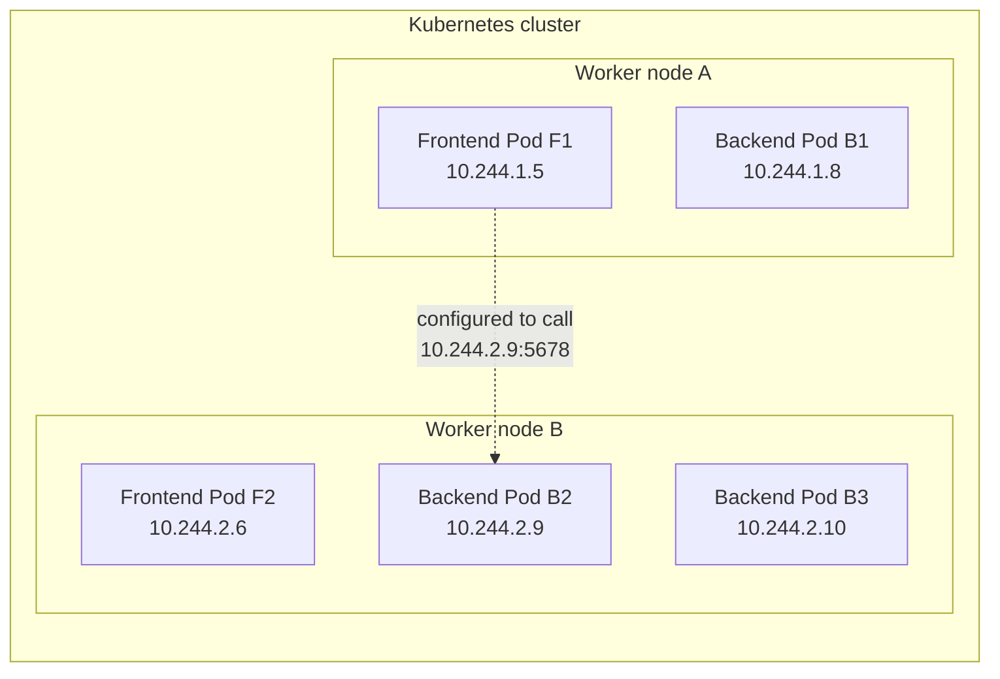

*Diagram 1 - Before Services. All example IPs are illustrative; your cluster assigns its own addresses.*

Right now the frontend is configured to call `10.244.2.9:5678`. This can work when that Pod exists and accepts connections. But suppose B2 fails. Its Deployment and ReplicaSet arrange for a replacement Pod to be created; that new Pod may receive a different IP.

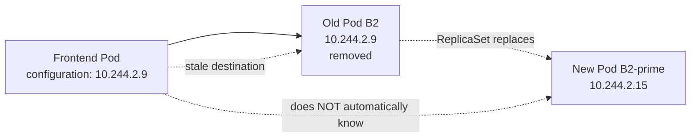

*Diagram 2 - Replica replacement repairs the desired replica count, but it does not rewrite hard-coded addresses in another application.*

This is our first important distinction: **a Deployment maintains Pods; it does not provide a stable application address for other workloads.** A Pod's IP is usable, but it is not the long-lived identity of a replicated application.

We need something that survives Pod replacement, selects the currently eligible backends, and gives clients a stable name. We do not yet need external access. First we will solve internal communication.

### A command worth learning now: inspect the Pods, not just the Deployment

Assuming you already have a cluster and a Deployment from the previous lessons:

```bash
kubectl config current-context
kubectl get deployments
kubectl get pods -o wide
```

Read these in sequence. `current-context` tells you **which cluster** you are inspecting. `get deployments` tells you the desired and available replica counts. `get pods -o wide` reveals individual Pod IPs and the nodes hosting them. The last command is our baseline: later we will repeat it to notice that Pod identities can change even while the Service identity remains unchanged.

If you have not deployed anything yet, that is fine. The next sections create the complete lab.

---

## 2. Insert one stable identity between clients and changing Pods

Let us change only one idea in the diagram. The frontend should call a stable name such as `backend-svc`, not Pod B2's private address. Kubernetes gives us a **Service** object to represent that stable destination.

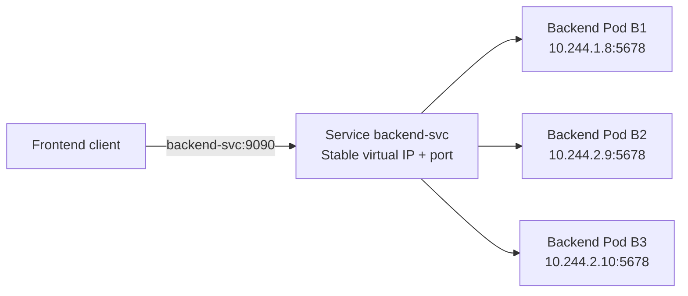

*Diagram 3 - The client now knows one Service identity; Kubernetes can change which ready Pod is selected.*

There are two things to understand before proceeding.

First, a typical ClusterIP Service has a stable virtual IP (for the lifetime of that Service) and an associated DNS name. If a Pod is replaced, the frontend does not need to learn the replacement's new IP.

Second, the box labeled Service above is a **logical destination, not necessarily a running proxy process**. There is no general rule saying that a separate `backend-svc` container receives each request and forwards it. Kubernetes stores a Service object, discovers matching endpoints, and programs networking implementations that can forward matching traffic. We will uncover those mechanisms after the first hands-on example.

### What tells a Service which Pods belong to the backend?

A Deployment normally puts labels on Pods, such as `app: backend`. A Service with a matching selector can discover those Pods. In the instructor's example, both the Deployment and the Service use `app: backend`, but for different reasons:

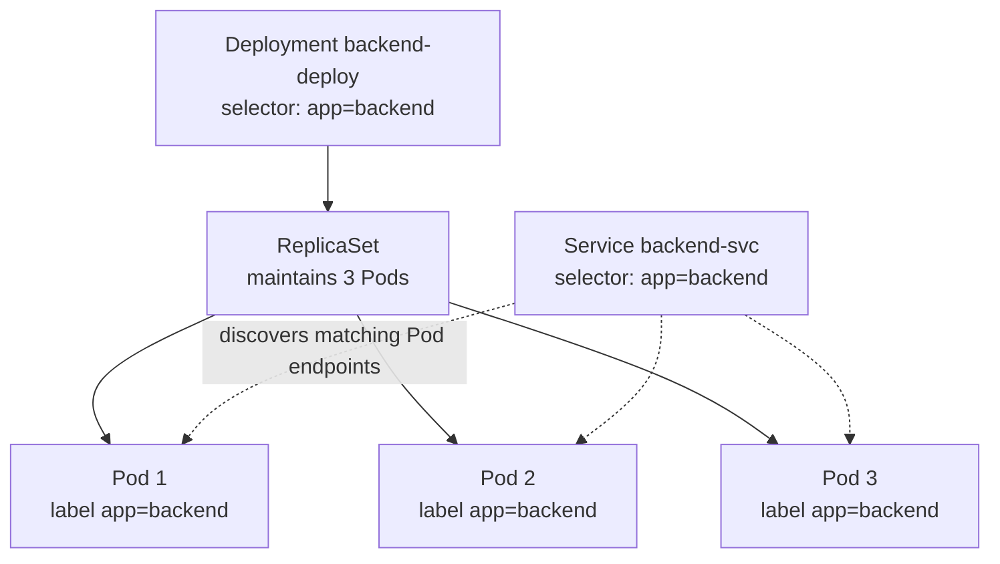

*Diagram 4 - The Deployment/ReplicaSet owns the desired Pod population. The Service independently selects endpoints using labels. The Service does not own or create those Pods.*

This difference is crucial. If the Deployment selector and the Service selector happen to match the same labels, they still perform separate jobs: **replica management versus network discovery**.

Before adding more concepts, let's build and inspect the actual objects.

---

## 3. Create the backend and its first Service

### 3.1 Prepare a dedicated learning cluster

We will use kind, like Day 8. Because NodePort will come later, we can create the kind cluster now with its host-port mapping already prepared. This avoids deleting a working cluster halfway through the lesson. If you already have a suitable kind cluster, keep it and skip creation; you can still use `kubectl port-forward` if the host mapping is unavailable.

Create a file named `kind-services.yaml`:

```yaml
kind: Cluster
apiVersion: kind.x-k8s.io/v1alpha4
nodes:
  - role: control-plane
    extraPortMappings:
      - containerPort: 31000
        hostPort: 31000
        listenAddress: "127.0.0.1"
        protocol: TCP
  - role: worker
  - role: worker
```

We have **not** created a Kubernetes Service with this file. This YAML configures kind itself. We are asking Docker to allow connections to port 31000 of the kind control-plane node container through port 31000 on our laptop. We will connect this to a NodePort Service later.

In a terminal where Docker and kind are installed:

```bash
kind create cluster --name svc-lab --config kind-services.yaml
kubectl config current-context
kubectl get nodes -o wide
```

The expected current context for this dedicated lab is `kind-svc-lab`. The expected architecture is one kind control-plane node plus two worker nodes; wait until all three appear `Ready` before proceeding. If these commands show a different context, **do not apply the next manifests blindly**. Check with:

```bash
kubectl config get-contexts
kubectl config use-context kind-svc-lab
kubectl get nodes -o wide
```

We just reused the Day 8 context commands because they serve a real purpose here: verifying the destination of a write operation.

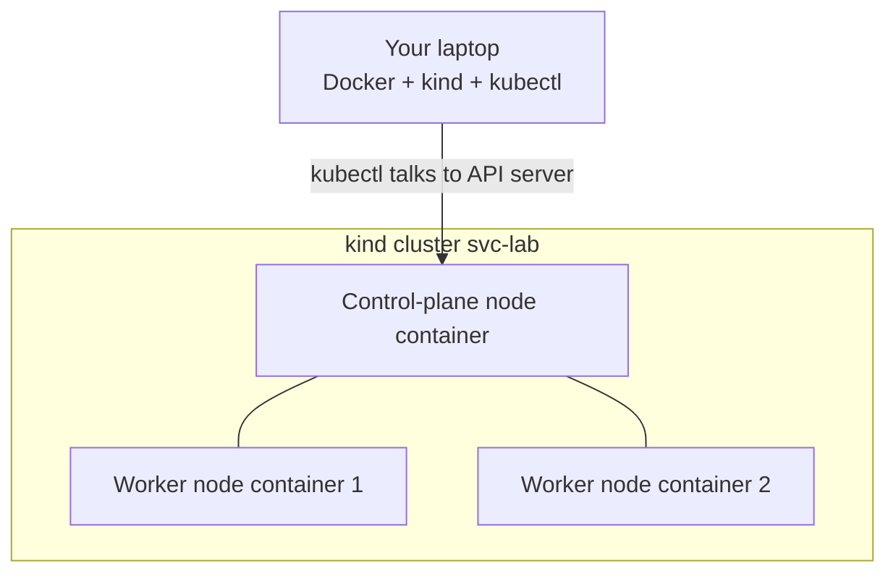

*Diagram 5 - The kind nodes themselves are Docker containers. Later we will distinguish laptop port, kind-node port, Service port, and application port.*

### 3.2 Write a backend Deployment, then add its Service

Create `backend.yaml`. We will deliberately use **one YAML file containing two Kubernetes objects**, separated by `---`, just as in the transcript.

```yaml
apiVersion: apps/v1
kind: Deployment
metadata:
  name: backend-deploy
spec:
  replicas: 3
  selector:
    matchLabels:
      app: backend
  template:
    metadata:
      labels:
        app: backend
    spec:
      containers:
        - name: http-echo
          image: hashicorp/http-echo:0.2.3
          args:
            - "-listen=:5678"
            - "-text=Hello from backend"
          ports:
            - name: http
              containerPort: 5678
          readinessProbe:
            httpGet:
              path: /
              port: 5678
            initialDelaySeconds: 1
            periodSeconds: 3
---
apiVersion: v1
kind: Service
metadata:
  name: backend-svc
spec:
  type: ClusterIP
  selector:
    app: backend
  ports:
    - name: http
      protocol: TCP
      port: 9090
      targetPort: 5678
```

`hashicorp/http-echo` is a small HTTP responder. The official project documents the default listening port as 5678 and allows overriding it with `-listen`. We explicitly set `-listen=:5678` here so the runtime behavior and the Service configuration are unambiguous. This is a lab image, not a production application or secure production baseline.

Don't read the YAML as a dictionary of unrelated fields. Read it as a sentence:

> Create three Pods labeled `app=backend`. Each runs an HTTP server listening on port 5678. Then create a stable internal Service called `backend-svc`, listening on 9090, whose traffic targets port 5678 on Pods with that label.

Now apply it:

```bash
kubectl apply -f backend.yaml
kubectl get deploy backend-deploy
kubectl rollout status deployment/backend-deploy
kubectl get pods -l app=backend -o wide
kubectl get svc backend-svc -o wide
```

You learned `kubectl apply` earlier. This time notice its relationship to the API object hierarchy. The API server stores the Deployment and the Service, the Deployment controller and ReplicaSet controller produce the Pods, and kubelet starts their containers. The Service controller side of the system discovers eligible endpoints from the Pods. These are related but not the same asynchronous workflows.

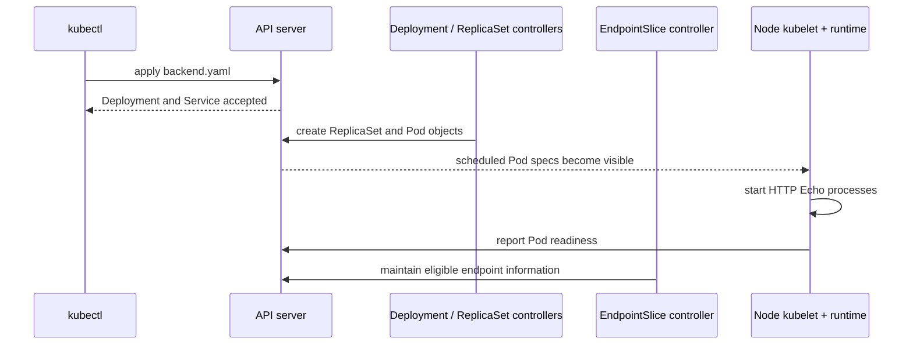

*Diagram 6 - Creation of a Deployment/Service object is not the same event as Pod startup or endpoint readiness. The timeline is intentionally conceptual; controllers reconcile asynchronously.*

### 3.3 Read the Service as three different ports and identities

Our Service YAML uses `port: 9090` and `targetPort: 5678`. The port belongs to the **Service destination**; the target port belongs to the **application endpoint**.

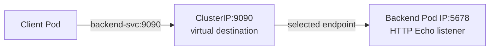

*Diagram 7 - Service port and target port do not have to be equal. The Pod must actually run a process listening at the target port.*

`containerPort: 5678` in the Deployment is informative metadata (and permits named-port references). It does not cause the application to listen. The `-listen=:5678` argument is what starts the server listening on that port. Likewise, `EXPOSE` in a Dockerfile does not publish the container's port to your host. These are the same build-time versus runtime distinctions we learned in Docker Day 3.

Let us inspect the result more closely:

```bash
kubectl get svc backend-svc
kubectl get svc backend-svc -o wide
kubectl describe svc backend-svc
kubectl get pods -l app=backend -o wide
```

Now compare: `CLUSTER-IP` in `kubectl get svc` is the stable virtual destination. `IP` in `kubectl get pods -o wide` lists *current Pod endpoints*. `kubectl describe svc` shows the selector, Service port, target port and endpoint information. The addresses will differ on your machine, and that is expected.

For a direct look at modern endpoint data:

```bash
kubectl get endpointslices -l kubernetes.io/service-name=backend-svc
kubectl get endpointslices -l kubernetes.io/service-name=backend-svc -o yaml
```

The older `Endpoints` API exists for compatibility, but EndpointSlices are the scalable discovery mechanism to learn. The EndpointSlice controller records matching Pod addresses and readiness-related endpoint conditions. We will return to this after our first live request.

---

## 4. Prove a client can reach the Service by name

So far we have observed resources from outside the cluster using `kubectl`. But our original requirement was **Pod-to-Pod communication without a hard-coded Pod IP**. We need a client running *inside* the cluster to prove that.

Create an inspection Pod with BusyBox (a small image commonly used in labs):

```bash
kubectl run netcheck \
  --image=busybox:1.36 \
  --restart=Never \
  --command -- sleep 3600

kubectl get pod netcheck
kubectl wait --for=condition=Ready pod/netcheck --timeout=120s
```

The `kubectl run` command creates a standalone Pod for testing. It is deliberately not part of a Deployment: if it disappears, nothing automatically replaces it. That is fine because it is only our network probe.

### 4.1 First question: how does the Pod learn the Service IP?

```bash
kubectl exec netcheck -- nslookup backend-svc
kubectl get svc backend-svc -o wide
```

Compare the address returned by DNS for `backend-svc` with the Service's `CLUSTER-IP`. In a normal single-stack cluster they should correspond (DNS may present multiple records in a dual-stack setup). This gives us a new fact: the client resolves **the Service identity**, not a particular backend Pod's IP.

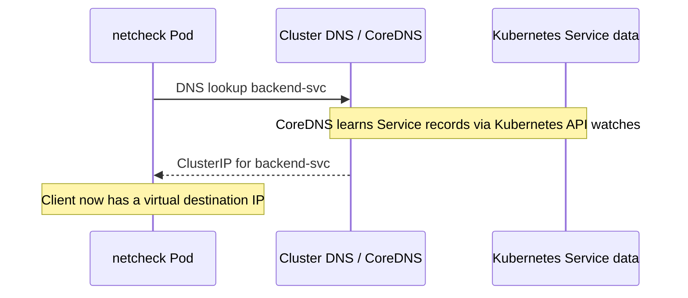

*Diagram 8 - DNS name resolution. A cached answer may avoid a fresh DNS server request; the diagram shows the conceptual resolution path.*

Within the same Kubernetes namespace, the short name `backend-svc` is usually sufficient. A more explicit name is `backend-svc.default.svc.cluster.local` if we used the `default` namespace and the usual `cluster.local` DNS domain. From a different namespace, include at least `backend-svc.default` to avoid looking for a Service in the wrong namespace.

### 4.2 Second question: does that IP actually answer on port 9090?

```bash
kubectl exec netcheck -- wget -qO- http://backend-svc:9090/
```

Expected response content:

```text
Hello from backend
```

This tells us the name resolved, the Service destination was reachable, an eligible backend received the request, and an HTTP response returned. Notice that we never learned which particular Pod answered. The Service decouples client configuration from backend selection.

Now intentionally remove the port from the URL:

```bash
kubectl exec netcheck -- wget -T 3 -qO- http://backend-svc/
```

This requests HTTP on port 80 by default. Our Service exposes port **9090**, not 80, so the request should not succeed as the earlier request did. The exact error can vary. We did not break the Service; we asked the wrong destination port.

This is an example of how to *learn* `kubectl`: observe a fact, form a prediction, run a single command, then explain its output.

### 4.3 What actually happens after the DNS lookup?

A Linux process opens a socket to the resolved Service IP and port. The packet passes through the Pod networking stack and node datapath. The configured Service implementation (commonly rules programmed by kube-proxy, or an equivalent eBPF-based implementation) chooses an eligible endpoint and applies the necessary forwarding or address translation.

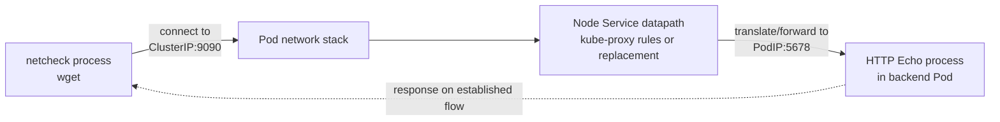

*Diagram 9 - The Service isn't a container hop. The kernel/network datapath implements forwarding to a chosen backend.*

The response follows the connection's return path, with connection tracking and reverse translations where applicable. It should appear to the client as the response to its connection with `backend-svc:9090`. This matters because a diagram that shows a mysterious standalone Service process forwarding every request can mislead you about what you will find on a real node.

Before moving on, repeat the diagnostic trio:

```bash
kubectl get svc backend-svc -o wide
kubectl get pods -l app=backend -o wide
kubectl describe svc backend-svc
```

You are now correlating **one stable Service** with **several changing backend addresses**.

---

## 5. Where do the backend addresses come from? Follow the control plane to the data plane

Let's zoom in on one detail from Diagram 9. How does a node know which backend Pod IPs correspond to the Service? It cannot simply guess.

The Service selector identifies matching Pods. The EndpointSlice controller maintains the relevant endpoint records. Service proxy implementations watch the Service and EndpointSlice information and configure node forwarding behavior. Kubernetes readiness information influences which endpoints should receive normal traffic.

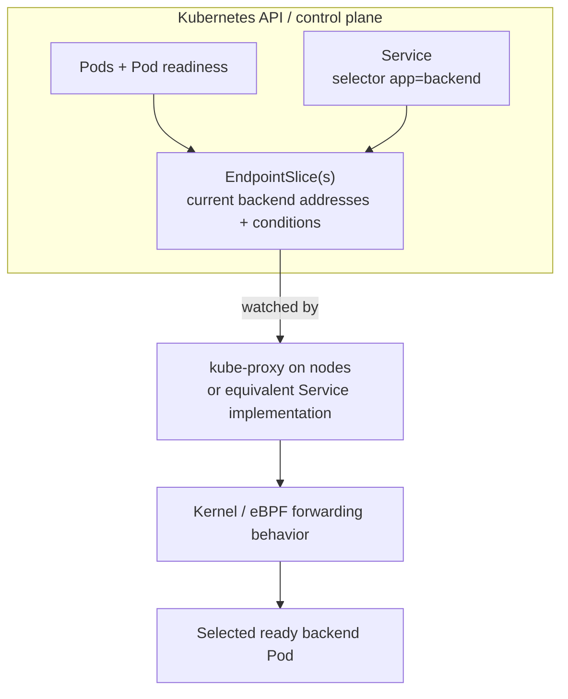

*Diagram 10 - The control plane publishes desired/discovered state. The data plane forwards packets based on that state.*

The important separation is:

- **Discovery and readiness information** are represented through Kubernetes API resources, especially EndpointSlices.
- **Packet delivery** happens in the node and Pod networking datapath, not by asking the API server where to send each packet.

This also corrects a common oversimplification from architecture introductions: kube-proxy is generally **not an active application-health-check agent**. Pod readiness is determined through kubelet/Pod status (including readiness probes, where configured); endpoint conditions reflect this status, and Service implementations use that information to avoid choosing unready endpoints in normal cases. There are special cases for terminating endpoints and `publishNotReadyAddresses`.

### 5.1 Make the system change without changing the Service

Let's scale the backend from three replicas to four:

```bash
kubectl scale deployment/backend-deploy --replicas=4
kubectl rollout status deployment/backend-deploy
kubectl get pods -l app=backend -o wide
kubectl get endpointslices -l kubernetes.io/service-name=backend-svc -o wide
kubectl get svc backend-svc -o wide
```

We learned `kubectl scale` because we needed a controlled change to the number of Pod endpoints. Notice the new Pod IP, then check whether the endpoint collection grows after the Pod becomes ready. Finally, check that the Service IP stays the same.

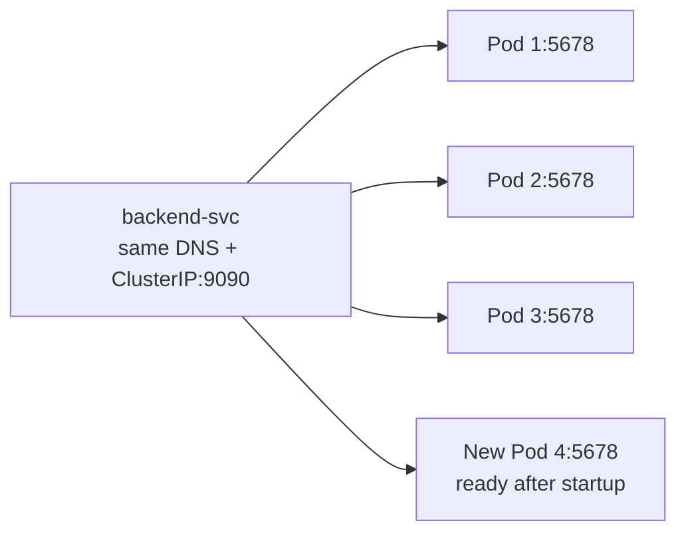

*Diagram 11 - The Service name/IP is unchanged; only the eligible endpoint set expands.*

Now repeat the client command from Section 4:

```bash
kubectl exec netcheck -- wget -qO- http://backend-svc:9090/
```

It should still return `Hello from backend` without any application-configuration change. That is our first complete demonstration of why Services exist.

You can scale back to the instructor's three-replica example:

```bash
kubectl scale deployment/backend-deploy --replicas=3
kubectl rollout status deployment/backend-deploy
kubectl get pods -l app=backend -o wide
kubectl get svc backend-svc -o wide
```

### 5.2 Watch an endpoint disappear

If one backend Pod becomes unavailable, the endpoint information and routing eligibility may change while the stable Service continues to exist. The exact behavior depends on whether the Pod failed readiness, is terminating, or the node itself became unavailable.

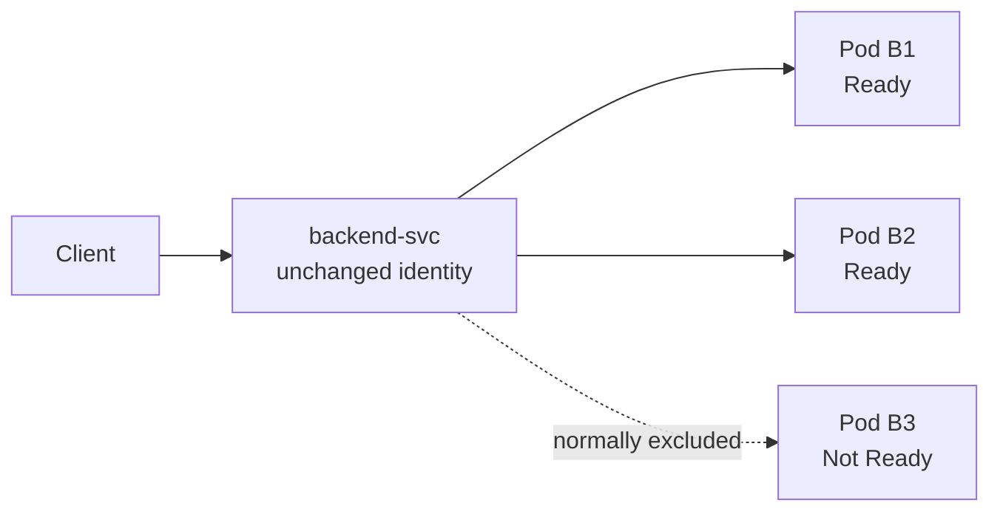

*Diagram 12 - Readiness affects normal Service endpoint selection; Service stability does not mean every matching Pod is always eligible.*

The `readinessProbe` included in our backend Deployment gives Kubernetes a way to observe whether HTTP Echo is serving. Do not confuse `Running` with `Ready`: a process can be running but not yet eligible for Service traffic.

With this, we have answered the first half of the transcript: stable internal networking using ClusterIP. We can now address the second problem: **how can a user outside the cluster reach the frontend?**

## 6. From internal communication to external access: why NodePort exists

Return to the two problems at the beginning. We solved frontend-to-backend communication using `backend-svc`, but users outside the cluster still need a way to reach the frontend. The frontend Pods do have IPs, yet those IPs are normally reachable only within the cluster's networking environment. Exposing every changing Pod IP individually would recreate our original problem at a different boundary.

Kubernetes offers `type: NodePort` for cases where we want an addressable port on the cluster nodes. By default, Kubernetes chooses a port in the range `30000-32767`, or we may request an available value in that range.

Before writing YAML, picture the extra boundary:

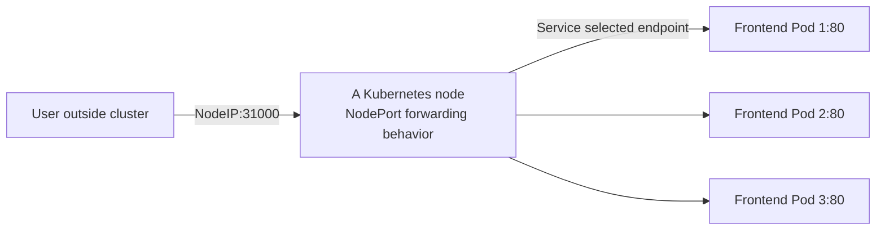

*Diagram 13 - NodePort adds a node-reachable entry point to the same Service-backed frontend. The selected Pod may be on another node, provided the networking and traffic policy support that path.*

A NodePort Service also receives an internal ClusterIP by default. That does **not** mean a packet must travel through a physical "NodePort box" and then through a second physical "ClusterIP box". Those are two ways to identify and handle the same logical Service. The node's datapath can forward a NodePort connection directly to the selected Pod endpoint after matching the configured Service rules.

### 6.1 Build the frontend, then select it with NodePort

Create `frontend.yaml`:

```yaml
apiVersion: apps/v1
kind: Deployment
metadata:
  name: frontend-deploy
spec:
  replicas: 3
  selector:
    matchLabels:
      app: frontend
  template:
    metadata:
      labels:
        app: frontend
    spec:
      containers:
        - name: nginx
          image: nginx:1.27-alpine
          ports:
            - name: http
              containerPort: 80
          readinessProbe:
            httpGet:
              path: /
              port: 80
            initialDelaySeconds: 1
            periodSeconds: 3
---
apiVersion: v1
kind: Service
metadata:
  name: frontend-svc
spec:
  type: NodePort
  selector:
    app: frontend
  ports:
    - name: http
      protocol: TCP
      port: 80
      targetPort: 80
      nodePort: 31000
```

This is almost the same configuration pattern as the backend. The Deployment's label is now `app: frontend`, and the Service selector matches it. Nginx listens on port 80. The Service exposes internal port 80. The new property is `nodePort: 31000`, which asks Kubernetes to configure node entry points at that port.

One caution about the example: the stock Nginx image displays its welcome page. It does **not** contain custom frontend code that calls `backend-svc`. We use a separate `netcheck` Pod to prove backend access. In a real application, the frontend code or server configuration would need to issue that backend request explicitly.

Apply, then inspect:

```bash
kubectl apply -f frontend.yaml
kubectl rollout status deployment/frontend-deploy
kubectl get pods -l app=frontend -o wide
kubectl get svc frontend-svc -o wide
kubectl describe svc frontend-svc
```

Now use `kubectl describe svc` to read all three different port roles in one place:

| Destination identity | Lab value | Meaning |
|---|---|---|
| NodePort | `NodeIP:31000` | Entry point exposed by node Service networking |
| Service port | `frontend-svc:80` | Internal stable Service destination |
| Target port | `PodIP:80` | Nginx's actual application listener |

The numbers happen to match for the latter two. They do **not** need to match. The lesson chose different ports for the backend deliberately so we could see the distinction.

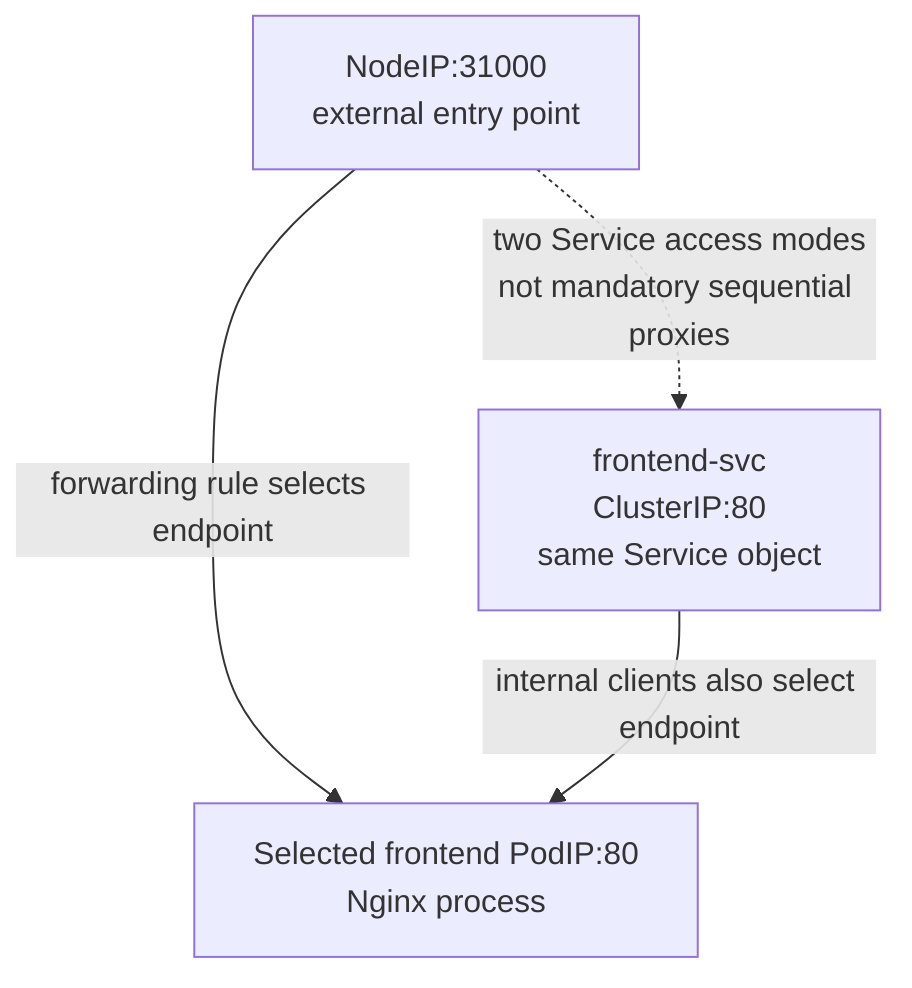

*Diagram 14 - A NodePort Service provides a NodePort and a ClusterIP. Both ultimately use Service endpoint selection; don't mistake the two labels for two physical hops.*

### 6.2 Why does kind need an additional port mapping?

In a cloud VM or bare-metal node, a reachable node IP may already provide a route to the NodePort. A firewall or security group must still allow traffic. But our kind nodes are **Docker containers running inside the laptop**. On Docker Desktop, especially on macOS or Windows, the kind-node container IP may not be directly accessible from the laptop browser.

This is why we added `extraPortMappings` to the kind configuration in Section 3. It creates another independent port mapping on the **Docker boundary**, before traffic reaches the Kubernetes node's NodePort.

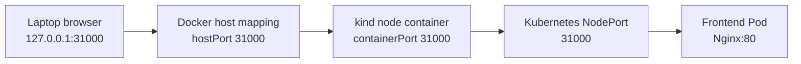

*Diagram 15 - Two separate forwarding domains in a kind lab: Docker host-to-node mapping and Kubernetes NodePort-to-Pod forwarding.*

The key mental separation is:

**Laptop -> Docker node container:** configured by kind's `extraPortMappings`.

**Kubernetes node -> frontend Pod:** configured through the Kubernetes `NodePort` Service and implemented by the cluster's Service datapath.

There is no requirement that Nginx itself listen on 31000. It listens on port 80 inside the selected Pod. Nor does kube-apiserver listen on 31000; it is unrelated to this application traffic.

Because we created the kind cluster with the mapping already present, we can test it now:

```bash
kubectl get svc frontend-svc
kubectl get pods -l app=frontend -o wide
curl -i http://127.0.0.1:31000/
```

The expected result is the Nginx default page, assuming your kind lab was created with the matching port mapping. The `curl -i` flag displays HTTP response headers as well as the body. Repeating `kubectl get svc` tells you that the NodePort is still 31000; `get pods -o wide` reminds you that whichever frontend Pod answered is an independent endpoint.

**If you reused an older kind cluster without `extraPortMappings`, do not delete it just to follow the lab.** You can still reach the Service with:

```bash
kubectl port-forward svc/frontend-svc 8080:80
```

While that command runs, open `http://127.0.0.1:8080/` in another terminal or browser. This is a separate `kubectl`-managed forwarding channel, useful for local diagnostics. It does **not** demonstrate NodePort reachability from the laptop; it simply gives you another way to test the application.

### 6.3 What if the frontend Pod runs on another worker node?

Recall that a Service is not owned by one worker node. Kubernetes can configure NodePort handling on eligible nodes, and the selected ready endpoint might live elsewhere in the cluster. With the common `externalTrafficPolicy: Cluster` behavior, the node receiving external traffic can forward it across the Pod network to a backend on another node.

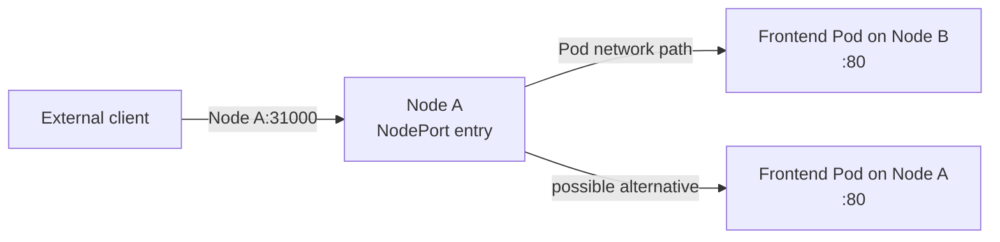

*Diagram 16 - Node receiving the connection and node hosting the selected Pod do not have to be the same.*

Not every node IP is automatically reachable from every external machine. Network routes, security groups, firewall rules, Service proxy settings, and `externalTrafficPolicy` affect the exact behavior. This is why the statement "NodePort is available on every node" describes the usual Service configuration, **not a guarantee of real-world public reachability**.

Now ask yourself: if NodePort works, why wouldn't we simply tell customers to try node A, then node B, then node C? The client would need to know which nodes are healthy and available. We have solved Pod churn, but external entry-point selection is still our responsibility. That motivates a load balancer.

---

## 7. One stable external entry point: LoadBalancer Services

A `LoadBalancer` Service requests an external load balancer from an implementation available to your cluster. In many managed cloud environments, a controller reconciles this request by creating or configuring cloud infrastructure. Kubernetes itself does not magically create an AWS or Azure load balancer on an arbitrary laptop.

We can now add one new box to the previous model:

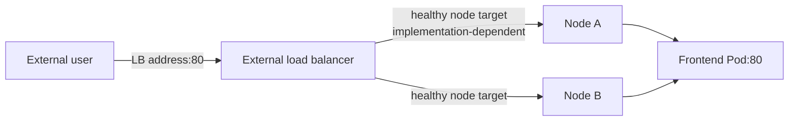

*Diagram 17 - A common load balancer model: a stable external address with node targets, which in turn lead to eligible Pods.*

The user's responsibility changes. The browser does not need to know a list of node IPs or whether a particular node has failed. The external LB uses its provider-specific health checks and target configuration to choose where to send traffic.

### 7.1 Connect this back to NodePort, but don't over-generalize

The transcript teaches LoadBalancer as "LoadBalancer -> NodePort -> ClusterIP -> Pod." That is useful for understanding why Service types build upon each other conceptually, and it is a **common node-target implementation**. But it is not a universal packet path.

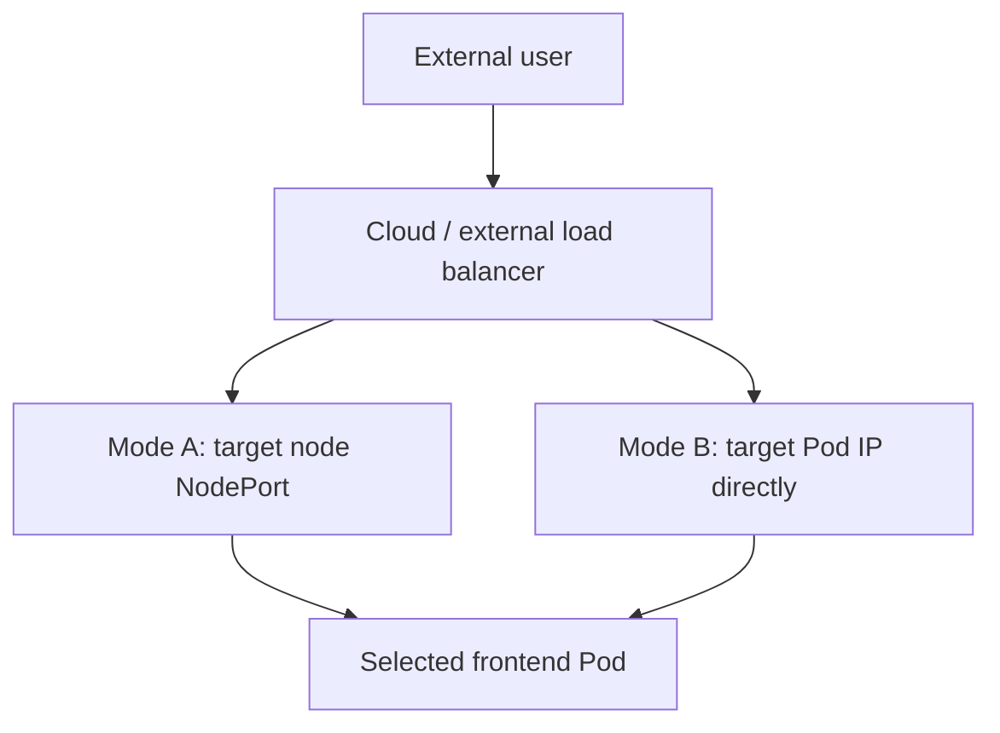

*Diagram 18 - Valid implementations vary. Some load balancers use NodePorts; other supported implementations route to Pod targets directly.*

Kubernetes normally allocates NodePorts for a `LoadBalancer` Service unless configured otherwise. Where the LB implementation supports direct Pod routing, it can be configured with `allocateLoadBalancerNodePorts: false`. This makes it incorrect to say that a LoadBalancer Service **must always** physically send traffic through NodePort and then ClusterIP.

### 7.2 An example manifest, without requiring cloud infrastructure

For learning purposes, save `frontend-lb.yaml`:

```yaml
apiVersion: v1
kind: Service
metadata:
  name: frontend-lb-svc
spec:
  type: LoadBalancer
  selector:
    app: frontend
  ports:
    - name: http
      protocol: TCP
      port: 80
      targetPort: 80
```

This is a **second Service** selecting the same frontend Pods; it does not replace our original `frontend-svc` NodePort example. If you want to inspect how Kubernetes stores the request on kind:

```bash
kubectl apply -f frontend-lb.yaml
kubectl get svc frontend-lb-svc -o wide
kubectl describe svc frontend-lb-svc
```

In ordinary kind installations without a load balancer controller, the external address is generally shown as `<pending>`. That is not necessarily a broken Deployment. It usually means the cluster has accepted the Service request but lacks an implementation to provision and report an external load balancer.

With a configured cloud/load-balancer integration, you would inspect the external address and any provider annotations/events. Different implementations provide internal or internet-facing load balancers, different target types, and different health-check behavior.

### 7.3 Does production use LoadBalancer, or does it use Ingress?

The instructor mentions that production applications often require host-based or URL-path routing. That is correct. But the claim that production systems therefore **do not use LoadBalancer Services** would be misleading.

A common design is:

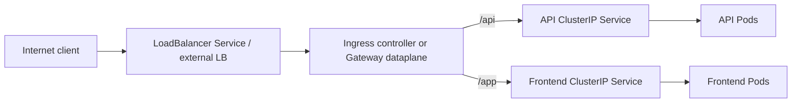

*Diagram 19 - External load balancing and application-layer routing often work together. The external LB can expose an Ingress/Gateway implementation rather than every application individually.*

The core idea is that a basic `LoadBalancer` Service is usually a transport-level exposure mechanism. Ingress and Gateway routing add Layer-7 concepts such as hostnames, paths, and often TLS policy. They are complementary building blocks, not mutually exclusive alternatives. We will study them later; today the distinction is enough.

---

## 8. ExternalName: a different kind of Service altogether

Our final problem is not external **inbound** traffic. It is outbound application configuration: the backend needs to use an external database whose hostname may change.

We could hard-code the database hostname into application configuration, but then every environment may need a different value. One Kubernetes option is an `ExternalName` Service. The application uses an in-cluster DNS name; cluster DNS returns an alias to another DNS name.

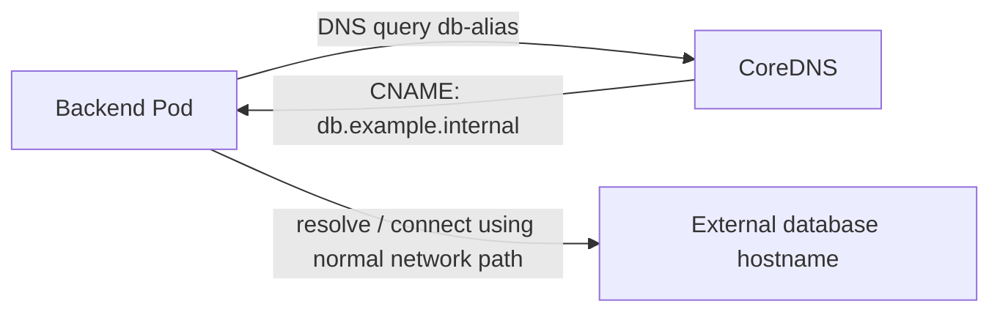

*Diagram 20 - ExternalName is a DNS alias, not a TCP relay. After resolution, the application communicates with the external destination directly through ordinary networking.*

This is **fundamentally different** from a normal ClusterIP Service. There is no Service virtual IP that load-balances across selected Pods. There is no required selector and no endpoint selection. The critical operation is DNS resolution.

Here is the shape of the instructor's database example:

```yaml
apiVersion: v1
kind: Service
metadata:
  name: db-alias
spec:
  type: ExternalName
  externalName: db.example.internal
```

`db.example.internal` is a **placeholder hostname** in this explanation; it will not necessarily resolve in your environment. To do an actual DNS-only lab against a publicly resolvable name, save `externalname-demo.yaml` instead:

```yaml
apiVersion: v1
kind: Service
metadata:
  name: external-demo
spec:
  type: ExternalName
  externalName: example.com
```

Apply it and observe:

```bash
kubectl apply -f externalname-demo.yaml
kubectl get svc external-demo -o wide
kubectl describe svc external-demo
kubectl exec netcheck -- nslookup external-demo
```

The DNS lookup should identify the alias to `example.com` (and may also resolve its addresses, depending on your resolver). `kubectl get svc` will show an ExternalName-style entry rather than an ordinary ClusterIP. This exercise verifies the **DNS mapping**, not that an arbitrary remote database connection is allowed or healthy.

**Technical caution:** ExternalName does not perform network forwarding. HTTP `Host` headers and TLS certificate hostname validation can also make a connection using the alias fail even when DNS resolution succeeds. Database authentication and hostname rules may matter too. For real applications, configuration via an environment variable, ConfigMap, or Secret may be simpler; choose the abstraction based on the actual need.

Now we have all four Service types from the transcript, but they solve **two different categories of problems**: stable access to a set of Pods, and DNS aliasing to an external destination.

---

## 9. Put the four Service types into one coherent mental model

Start with the one stable backend destination we created, then follow how each new problem extended or changed the architecture.

```mermaid
flowchart TD
    C1["Pod inside cluster"] --> CI["ClusterIP<br/>backend-svc:9090"]
    CI --> BE["Backend Pods:5678"]

    C2["External client"] --> NP["NodeIP:31000<br/>NodePort frontend-svc"]
    NP --> FE["Frontend Pods:80"]

    C3["External client"] --> LB["External LB address<br/>LoadBalancer Service"]
    LB --> FE

    C4["Pod needing external service"] --> EN["ExternalName DNS alias"]
    EN -. "CNAME, not proxy" .-> EXT["External DNS hostname"]
```

*Diagram 21 - ClusterIP, NodePort and LoadBalancer are ways of reaching Service-selected backend endpoints. ExternalName is DNS indirection and has different semantics.*

| Type | What the client uses | What Kubernetes provides | Typical purpose |
|---|---|---|---|
| `ClusterIP` | Service DNS or internal virtual IP + `port` | Stable internal identity and endpoint forwarding | Backend or internal API |
| `NodePort` | Reachable node IP + `nodePort` | Node entry point to Service backends; also normally a ClusterIP | Development, direct node exposure, LB targets |
| `LoadBalancer` | Provider-assigned external address + LB port | Request for external LB integration, usually backed by a Service | External TCP/UDP access, or ingress dataplane exposure |
| `ExternalName` | In-cluster DNS alias | CNAME-style name mapping; no Pod proxying | Decouple applications from external hostnames |

Three numbers to keep mentally separate are **NodePort**, **Service port**, and **targetPort**. Three names/IPs to keep separate are **DNS name**, **ClusterIP**, and **Pod IP**. And three layers to keep separate are **API/controller state**, **node Service datapath**, and **application process**.

This triple separation is more useful than memorizing a single all-in-one drawing.

---

## 10. Troubleshooting as a sequence of questions, not a bag of commands

Suppose the application team reports:

> `frontend` can no longer reach `backend-svc:9090`.

Do not immediately inspect every CNI setting. Move from the nearest observable fact to the next missing link.

### 10.1 Am I inspecting the right cluster and namespace?

```bash
kubectl config current-context
kubectl get namespaces
kubectl get svc backend-svc -n default
kubectl get deploy backend-deploy -n default
```

A missing Service might simply be a namespace or context mistake. We learned context switching in Day 8, and now the reason for checking it is obvious: a correct command sent to the wrong cluster can produce a very convincing wrong conclusion.

### 10.2 Does the Service exist, and are its ports what I think they are?

```bash
kubectl get svc backend-svc -o wide
kubectl describe svc backend-svc
kubectl get svc backend-svc -o yaml
```

Check `type`, `selector`, `port`, `targetPort`, and `clusterIP`. If the Service expects port 9090 and the caller uses 80, you do not yet have a DNS or CNI problem.

### 10.3 Does it have any eligible backends?

```bash
kubectl get pods -l app=backend -o wide
kubectl get pods -l app=backend --show-labels
kubectl get endpointslices -l kubernetes.io/service-name=backend-svc -o yaml
```

If no Pods match the selector, fix labels/selectors. If matching Pods exist but endpoints are not ready, inspect Pod readiness and container startup. An empty or ineligible backend set is a different failure from a Service DNS lookup failure.

```mermaid
flowchart TD
    A["Service call fails"] --> B{"Does Service exist<br/>in intended namespace?"}
    B -->|No| C["Check context / namespace / name"]
    B -->|Yes| D{"Do selector and<br/>Pod labels match?"}
    D -->|No| E["Fix selector or labels"]
    D -->|Yes| F{"Are eligible endpoints<br/>present and Ready?"}
    F -->|No| G["Inspect Pod status / readiness"]
    F -->|Yes| H["Test DNS, port, and network path"]
```

*Diagram 22 - Diagnose Kubernetes object state before assuming the Linux packet path is broken.*

### 10.4 Does name resolution work?

```bash
kubectl exec netcheck -- nslookup backend-svc
kubectl exec netcheck -- nslookup backend-svc.default.svc.cluster.local
kubectl get pods -n kube-system
```

This stage checks whether the caller can resolve the name and whether core cluster components are present. Do not infer from a successful DNS lookup that TCP/HTTP networking is working. DNS resolution and application connectivity are different operations.

### 10.5 Does the connection work when the right destination is specified?

```bash
kubectl exec netcheck -- wget -qO- http://backend-svc:9090/
kubectl get svc backend-svc -o wide
kubectl get pods -l app=backend -o wide
```

This repeats our earlier test after verifying configuration. If the Service has ready endpoints and DNS resolves but traffic still fails, move to NetworkPolicy, node datapath, CNI routing, or application-level problems as appropriate. Remember our Day 3.3 bridge and Day 7.1 network namespace lessons: Kubernetes networking ultimately depends on functioning Linux and/or eBPF packet paths.

### 10.6 If internal access works but external NodePort fails

```bash
kubectl get svc frontend-svc -o wide
kubectl describe svc frontend-svc
kubectl get nodes -o wide
curl -i http://127.0.0.1:31000/
```

With kind, now check the **separate Docker mapping**. The browser may not be able to access the node container even though the Kubernetes NodePort is configured correctly. Try `kubectl port-forward svc/frontend-svc 8080:80` as an alternate diagnostic. If port-forward works but the laptop NodePort URL fails, that narrows the issue toward exposure/mapping rather than the Nginx process itself.

For cloud LoadBalancer problems, also examine whether an LB controller exists, whether the external address was provisioned, the provider's health checks and target group configuration, and firewalls/security groups.

---

## 11. Retain the `kubectl` commands through three short practice loops

The purpose of repetition is not to learn syntax by rote. It's to associate each command with a particular question you may need to answer under pressure.

### Loop A - Identify the destination

Use this when someone says, "Which cluster am I looking at, and which Services exist?"

```bash
kubectl config current-context
kubectl get nodes -o wide
kubectl get deployments
kubectl get services -o wide
```

Try predicting which resources should exist before executing the commands. In our dedicated lab, expect `backend-deploy`, `frontend-deploy`, and their Services, plus the optional LoadBalancer/ExternalName examples if you applied them.

### Loop B - Follow the Service to the Pod

Use this when someone says, "Why isn't the Service finding my Pods?"

```bash
kubectl describe svc backend-svc
kubectl get pods -l app=backend --show-labels
kubectl get pods -l app=backend -o wide
kubectl get endpointslices -l kubernetes.io/service-name=backend-svc
```

You are correlating selector, Pod labels, Pod IPs, and discovered endpoints. If you remember the **questions** those commands answer, the order becomes intuitive.

### Loop C - Follow an actual request

Use this when someone says, "The objects look correct, but the application call fails."

```bash
kubectl exec netcheck -- nslookup backend-svc
kubectl exec netcheck -- wget -qO- http://backend-svc:9090/
kubectl get svc backend-svc -o wide
kubectl get pods -l app=backend -o wide
```

The DNS lookup answers "where does the name resolve?" The `wget` call answers "can a connection succeed?" The last two commands tell you what virtual destination and which backend Pod IPs currently exist.

### Practice challenges (try before reading the answers)

**Challenge 1.** The backend Deployment has three Ready Pods. `kubectl describe svc backend-svc` shows no usable endpoints. Is scaling the Deployment the first fix?

No. First compare the Service selector to Pod labels and examine EndpointSlices. More Pods with the same wrong labels do not fix discovery.

**Challenge 2.** `nslookup backend-svc` succeeds but `wget http://backend-svc/` does not. Is CoreDNS necessarily broken?

No. The request omitted the Service port 9090 and defaults to port 80. Correct the destination to `http://backend-svc:9090/` first.

**Challenge 3.** A kind NodePort Service reports `80:31000/TCP`, yet `http://localhost:31000/` fails. Does this prove the Service selector is wrong?

No. Inspect the kind node's Docker host-port mapping separately. Also inspect selected endpoints. You are crossing two networking boundaries.

**Challenge 4.** A LoadBalancer Service on a plain kind cluster has `<pending>` under `EXTERNAL-IP`. Did the backend Pods fail to start?

Not necessarily. Pod readiness and external LB provisioning are independent. Inspect the Deployment and Service separately; an external LB implementation may simply be absent.

**Challenge 5.** The app uses an ExternalName Service pointing to an HTTPS endpoint. DNS resolves, but TLS validation fails. Why?

The client may be using the alias hostname for TLS name verification while the remote certificate covers the destination hostname instead. An ExternalName alias is not an HTTP/TLS reverse proxy.

---

## 12. Final mental-model reconstruction

Let's rebuild the full application only after understanding every piece. Imagine an external user opening the frontend. In our **kind NodePort lab**, the request first reaches `localhost:31000`, passes through Docker's port mapping into the kind node, then through the node's Service datapath to a selected Nginx Pod on port 80.

If the real frontend application then needs backend data, it resolves `backend-svc` using cluster DNS, connects to the ClusterIP on port 9090, and the Service datapath forwards the flow to a ready HTTP Echo endpoint on port 5678. A different backend Pod can answer a later connection. Pod churn can happen without the frontend changing the Service name.

```mermaid
flowchart TB
    U["Browser<br/>localhost:31000"] --> DK["Docker host mapping<br/>31000 -> kind node 31000"]
    DK --> NP["NodePort Service access<br/>frontend-svc:31000"]
    NP --> F["Frontend Pod<br/>Nginx:80"]
    F -. "only if frontend application is configured<br/>to make this call" .-> DNS["CoreDNS<br/>backend-svc -> ClusterIP"]
    DNS -. "name resolution" .-> F
    F --> CI["backend-svc<br/>ClusterIP:9090"]
    CI --> E["EndpointSlice-selected<br/>ready backend Pod:5678"]
    E --> R["HTTP Echo response"]
    R -. "response to application" .-> F
```

*Diagram 23 - The completed learning model. The frontend-to-backend call is conceptual; our stock Nginx image does not implement it. DNS lookup and actual request forwarding are separate operations.*

Notice how much we can now explain without memorizing a diagram: **Deployment/ReplicaSet** determines how many Pods should exist. **Labels and Service selectors** identify a possible backend set. **EndpointSlices** record the current eligible addresses. **CoreDNS** makes a stable Service name resolvable. **The node Service datapath** handles packets to matching backends. **NodePort** offers a node entry point; **LoadBalancer** can provide a managed external entry point; **ExternalName** is a DNS alias to something outside the cluster.

These are not seven unrelated definitions. They are answers to seven successive questions raised by a single application trying to communicate reliably.

### A small final lab: scale and verify without memorizing a checklist

Before closing your cluster, perform this experiment from memory:

1. Find the active context and node list.
2. Identify the backend Service's port, selector, and ClusterIP.
3. Record the addresses of its backend Pods.
4. Scale the backend to four replicas and inspect EndpointSlices.
5. Repeat the internal `wget` request and verify the response without changing the Service name.
6. Scale back to three replicas and confirm the Service address is unchanged.

Only consult the relevant sections when you cannot answer a question. This makes `kubectl` a tool for reasoning rather than a list to memorize.

### Optional cleanup - only for the dedicated lab cluster

**Do not run this against a shared or important cluster.** If you used the dedicated `svc-lab` created in this lesson, you can remove the standalone probe and optionally remove the whole disposable kind cluster.

```bash
kubectl config current-context
kubectl delete pod netcheck --ignore-not-found
# Only when you are finished with the entire disposable svc-lab cluster:
kind delete cluster --name svc-lab
```

`kind delete cluster` deletes all resources in that lab cluster, including Deployments and Services. It is not a replacement for deleting individual Kubernetes objects in a real environment.

---

## Transcript-to-implementation clarifications

These clarifications are intentionally collected in one place so you can distinguish **what the lecture was trying to teach** from **what you should assume in a production-grade mental model**.

| Lecture simplification | More precise model |
|---|---|
| "The Service forwards the request to a Pod." | The Service is an API abstraction. Endpoint discovery and node datapath rules/implementations make traffic reach selected backends. A separate forwarding Service process is not generally involved. |
| "kube-proxy checks Pod health." | kubelet reports Pod readiness; EndpointSlices record eligible endpoints; kube-proxy or a replacement uses endpoint state rather than actively probing each application itself. |
| "NodePort -> ClusterIP -> Pod" | Useful as a conceptual stack of Service capabilities. A packet need not traverse separate NodePort and ClusterIP proxy processes. |
| "Every node can be called from anywhere." | NodePort configuration exists on eligible node addresses, but routing, firewalls, proxy modes, and external traffic policy determine real reachability. |
| "LoadBalancer always requires NodePort." | This is common, not universal. Direct Pod targeting and disabled NodePort allocation are supported with suitable integrations. |
| "Production does not use LoadBalancer Services once Ingress exists." | Ingress/Gateway implementations are often exposed using LoadBalancer Services. These capabilities complement each other. |
| "ExternalName redirects traffic to an external DB." | ExternalName normally provides a DNS CNAME. The application creates the subsequent connection; there is no built-in TCP proxy. |
| "Any `nginx` frontend will call the backend." | Stock Nginx merely serves its default page. Application code or Nginx configuration must explicitly call or proxy to `backend-svc`. |
| "Kubernetes requires Docker Engine on every worker." | Kubernetes uses a CRI-compatible runtime, such as containerd. The unqualified `nginx` image name normally resolves via conventional registry defaults, but Kubernetes does not require Docker Engine to run it. |

### Official references for the clarified details

These links are for optional reading, not dependencies needed to render the Markdown.

- [Kubernetes Services](https://kubernetes.io/docs/concepts/services-networking/service/): Service types, ClusterIP, NodePort, LoadBalancer, ExternalName, and the exact meaning of ports.
- [Kubernetes EndpointSlices](https://kubernetes.io/docs/concepts/services-networking/endpoint-slices/): how backends and readiness conditions are represented.
- [DNS for Services and Pods](https://kubernetes.io/docs/concepts/services-networking/dns-pod-service/): namespace-aware Service discovery.
- [kind configuration](https://kind.sigs.k8s.io/docs/user/configuration/): `extraPortMappings`, including the rule that the kind node's mapped container port must equal the NodePort.
- [HashiCorp HTTP Echo](https://github.com/hashicorp/http-echo): default port 5678 and `-listen` / `-text` arguments.

**End of Day 12.** The durable mental model is now: **a Service gives clients a stable identity; controllers maintain eligible endpoints; the node's networking implementation delivers packets; different Service types alter how that identity is reached.**
