# CKA Day 13 — Imperative Commands: From a Command to a Running Application

> **Learning mode:** Read a problem, predict what Kubernetes needs, run a command, inspect what changed, and only then add the next component. Every diagram is embedded Mermaid: **this is one self-contained Markdown file**. No image assets, extensions, or additional notes are required.
>
> **Source:** Day 13 course transcript. The frontend/backend example, command progression, YAML generation, test Pod, and DNS investigation come from the lesson. Clearly marked **Technical accuracy notes** clarify behaviors that the spoken lesson simplifies.

## The question that drives this chapter

We already know how to create a Deployment and a Service by writing YAML. In Day 12 we deployed an Nginx frontend and an HTTP echo backend. But imagine a production troubleshooting call: someone says, *"The frontend cannot reach the backend."* You need to test the connection quickly, and creating a complete YAML manifest from memory is not the first thing you want to do.

This is where **imperative `kubectl` commands** become useful. Instead of first describing an entire object in a file, you ask Kubernetes to perform a specific operation. The key insight, however, is that imperative commands and declarative YAML are **not competing architectures**. They are different ways to send object definitions to the same Kubernetes API.

We will build the same application from Day 12, without switching examples midway through the chapter:

- Backend: three Pods running `hashicorp/http-echo`, listening on container port **5678**; a ClusterIP Service exposes port **9090**.
- Frontend: three Pods running `nginx`, listening on container port **80**; a NodePort Service exposes port **31000**.
- Temporary test client: a short-lived Pod used to inspect networking and DNS.

The end-to-end shape is this, but **we will earn each connection one step at a time**:

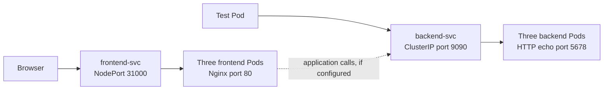

**Important:** The course's stock Nginx image serves its own welcome page. It is not automatically programmed to call the backend. We test backend connectivity from a separate client Pod; this verifies Service networking without pretending that the Nginx default page contains backend logic.

---

## 1. Start with the two ways of expressing intent

Suppose you want three HTTP echo Pods. Declaratively, you could write a Deployment manifest that says `replicas: 3`. Imperatively, you can ask `kubectl` to create that Deployment from flags. Both ultimately cause the API server to store a Deployment object. The Deployment controller subsequently arranges for the necessary Pods to exist.

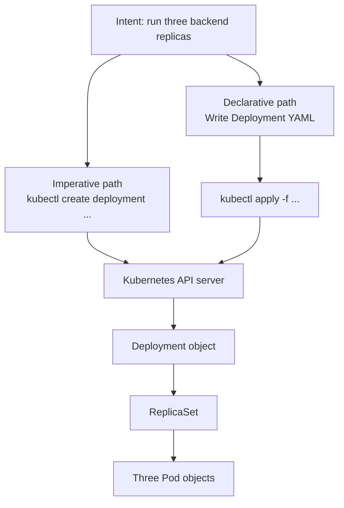

This distinction explains an apparent contradiction in the lesson: **we can use an imperative command to generate declarative YAML**. We will do exactly that, because it is especially useful in a time-limited CKA task.

Before modifying your cluster, verify where the commands will go:

```bash
kubectl config current-context
kubectl get nodes
kubectl get deployments,services
```

The first command tells you which kubeconfig context is active, the second confirms that the target cluster is reachable, and the third lets you see whether the names `backend-deploy`, `frontend-deploy`, `backend-svc`, or `frontend-svc` already exist. **Use a disposable kind practice cluster.** If you still have the Day 12 objects in `default`, creating objects with those names will report `AlreadyExists`; do not delete them blindly.

### Observation habit #1

Before a command, ask: *"Will this command create a live resource, only display information, or generate a local file?"* This one question prevents many avoidable mistakes.

---

## 2. Create our backend Deployment—first as a proposed object

Our first task is simple: **three Pods with the HTTP echo image**. But we also need the Pods to report a known port, and later we will want their labels to match a Service selector.

Start by learning the help interface, not by memorizing flags:

```bash
kubectl create deployment --help
kubectl explain deployment.spec
```

`--help` explains the **command**, while `kubectl explain` explores the **Kubernetes API resource schema**. That difference will repeatedly help you during CKA practice.

Now generate a Deployment manifest without creating a live resource:

```bash
kubectl create deployment backend-deploy \
  --image=hashicorp/http-echo:1.0.0 \
  --replicas=3 \
  --port=5678 \
  --dry-run=client -o yaml > backend.yaml
```

Read the command as a sentence. `create deployment backend-deploy` identifies the kind and name. `--image` chooses the container image, `--replicas=3` specifies the number of Pods, and `--port=5678` puts a `containerPort` field in the generated Pod specification. `--dry-run=client` asks the CLI to construct the proposed object without persisting it to the cluster. `-o yaml` prints YAML, and `>` redirects that output into **a local file**.

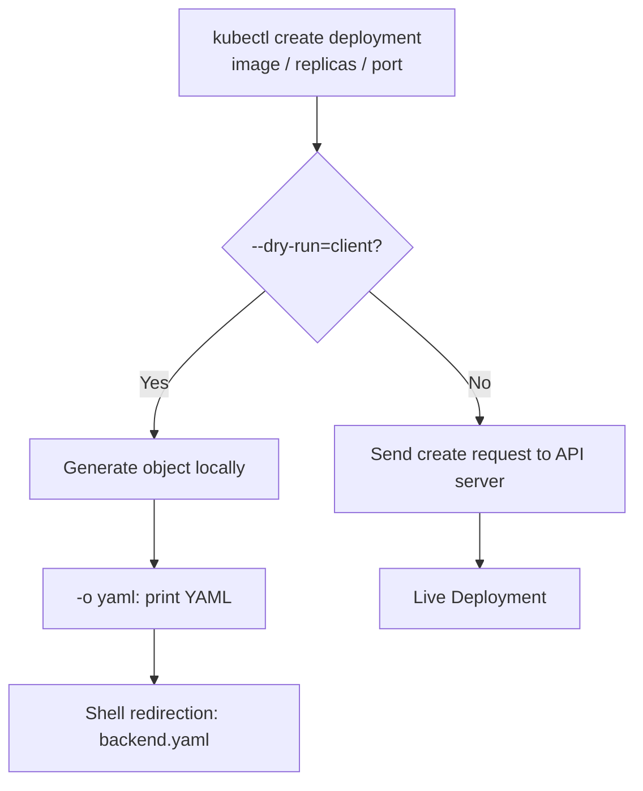

**Notice the boundary:** The `>` symbol belongs to your shell, not Kubernetes. Kubernetes does not know the name of `backend.yaml`; it only writes YAML to standard output, and the shell saves it.

**Technical accuracy note:** Client-side dry-run is not a complete server-side admission check and does not test whether the object will actually start. For a server-mediated dry-run, where appropriate, use `--dry-run=server`—which contacts the API server but does not persist the requested object.

### What should you inspect in the generated file?

Open `backend.yaml` and find three separate label locations:

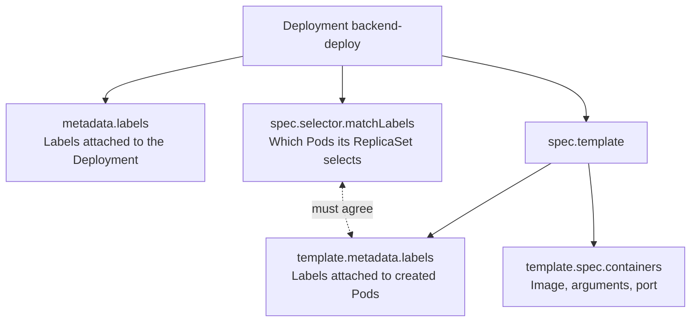

The generated deployment typically uses a label similar to `app: backend-deploy`. Our Day 12 example uses `app: backend`, so we will deliberately make the **Pod template label and Deployment selector agree**. We also need to add the echo server arguments; the Deployment generator does not magically know our intended response text.

Edit `backend.yaml` into this complete, minimal form:

```yaml
apiVersion: apps/v1
kind: Deployment
metadata:
  name: backend-deploy
spec:
  replicas: 3
  selector:
    matchLabels:
      app: backend
  template:
    metadata:
      labels:
        app: backend
    spec:
      containers:
        - name: backend
          image: hashicorp/http-echo:1.0.0
          args:
            - "-listen=:5678"
            - "-text=Hello from backend"
          ports:
            - containerPort: 5678
              protocol: TCP
```

This editing step is important for understanding **the limits of generators**. They create a useful starting point, but you remain responsible for the application arguments, selectors, probes, and any other settings the real workload requires.

The `containerPort` field **does not create a listening socket**. The application must genuinely listen on that port; in our example the `-listen=:5678` argument configures the HTTP echo process to do so. Later the Service will direct traffic to it.

### Create and observe

```bash
kubectl apply -f backend.yaml
kubectl get deployments
kubectl get pods -l app=backend -o wide
kubectl rollout status deployment/backend-deploy
```

`apply` sends the file to the API server. `get deployments` lets us see the replica counts; `get pods -l app=backend` asks only for Pods with that label. `-o wide` adds information such as each Pod's IP and assigned node. `rollout status` waits for this Deployment's rollout to complete or report a problem.

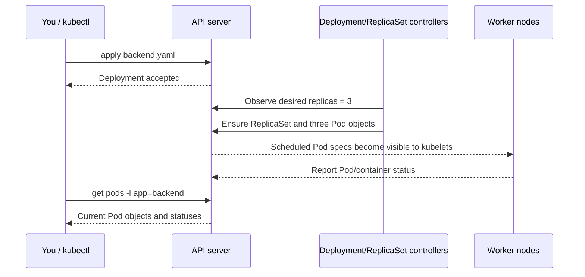

The important separation is between **asking for three replicas** and **actually observing three ready Pods**. Controllers and kubelets make that happen asynchronously.

**Pause and predict:** If the Pods are `Pending`, will creating a Service fix the scheduling problem? No. Check `kubectl describe pod <pod-name>` and its events first.

---

## 3. Now we encounter the Service problem

Three backend Pods now exist. Their IPs are not an appropriate permanent application configuration: a Pod replacement can result in a new IP. We need one logical name—`backend-svc`—that selects the healthy backend endpoints.

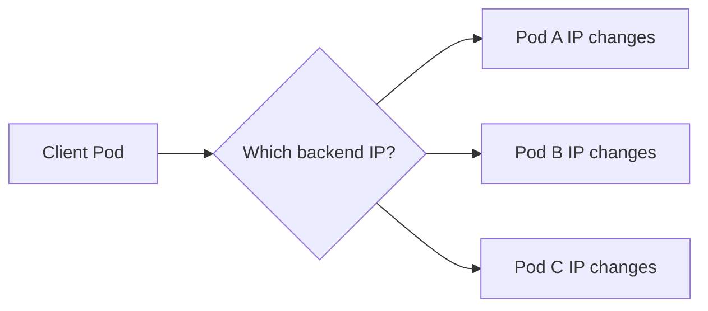

Rather than hardcoding each IP, we create a **ClusterIP Service**, still using the imperative command interface. First check the command's help:

```bash
kubectl expose deployment --help
```

Generate a Service object, but do not apply it yet:

```bash
kubectl expose deployment backend-deploy \
  --name=backend-svc \
  --type=ClusterIP \
  --port=9090 \
  --target-port=5678 \
  --dry-run=client -o yaml
```

Why are the two ports different? Because the client reaches the **Service port 9090**, while the HTTP echo process in the chosen Pod receives traffic on **port 5678**.

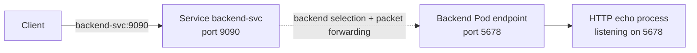

The Service is a Kubernetes API object and a stable virtual network destination—not a newly created proxy container. EndpointSlices record suitable backend addresses, while a Service dataplane implementation performs the traffic redirection.

The generated Service selector is derived from the Deployment selector. Verify it before applying. It should select `app: backend`. Save the following **complete** Service manifest to a separate local file, `backend-svc.yaml`, or append it correctly to the Deployment manifest as shown next.

```yaml
apiVersion: v1
kind: Service
metadata:
  name: backend-svc
spec:
  type: ClusterIP
  selector:
    app: backend
  ports:
    - protocol: TCP
      port: 9090
      targetPort: 5678
```

### One file can contain both Kubernetes resources

The lecture demonstrates that you can keep a Deployment and a Service in a single YAML file. To do that, separate the YAML documents with a line containing `---`.

The safe, incremental terminal form is:

```bash
# backend.yaml currently contains only the Deployment.
printf '\n---\n' >> backend.yaml

# Append the generated Service object.
kubectl expose deployment backend-deploy \
  --name=backend-svc \
  --type=ClusterIP \
  --port=9090 \
  --target-port=5678 \
  --dry-run=client -o yaml >> backend.yaml
```

Before executing, check that `backend.yaml` does **not already contain the Service**; otherwise, append would duplicate it. If you manually added `backend-svc.yaml`, simply run `kubectl apply -f backend-svc.yaml` instead.

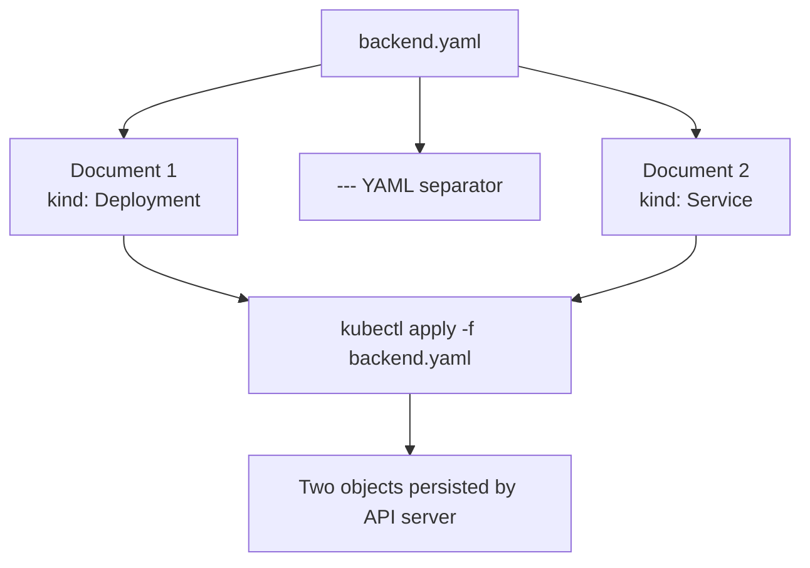

**Shell redirection deserves a second look:** `>` overwrites a file, while `>>` appends. Neither automatically inserts the `---` separator. A common CKA mistake is to append two Kubernetes objects without that separator and then wonder why YAML parsing fails.

### Verify the relationship rather than trusting the manifest

```bash
kubectl apply -f backend.yaml
kubectl get svc backend-svc -o wide
kubectl describe svc backend-svc
kubectl get pods -l app=backend -o wide
kubectl get endpointslices -l kubernetes.io/service-name=backend-svc
```

Keep these commands together in your mind. `get svc` proves that the Service exists; `describe svc` shows its selector and configured ports; `get pods -l app=backend` shows the selected Pods; `get endpointslices` exposes the actual backend endpoint information used by Service discovery.

**Do not expect three endpoints until the Pods are suitable/ready for traffic.** A Service can exist while its matching Pods are not yet available.

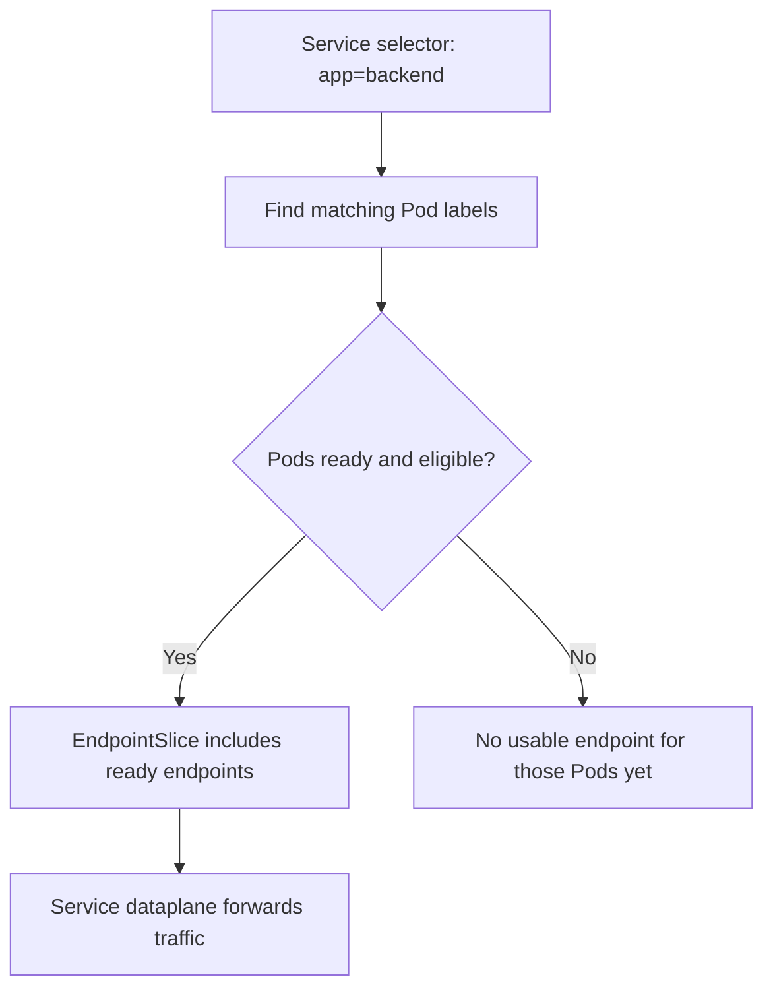

---

## 4. Repeat the pattern for the frontend: repetition is intentional

We could switch topics now, but repeat the same sequence. Practicing the **same command shape with different parameters** turns it into understanding rather than memorization.

The frontend differs in exactly two ways: its application listens on port **80**, and we want the browser to reach it from outside the cluster through a **NodePort**.

First, generate and edit the frontend Deployment:

```bash
kubectl create deployment frontend-deploy \
  --image=nginx:stable-alpine \
  --replicas=3 \
  --port=80 \
  --dry-run=client -o yaml > frontend.yaml
```

Just as before, inspect the generated selector and template labels. Normalize both to `app: frontend` and keep the generated container port. Your minimal frontend Deployment should be:

```yaml
apiVersion: apps/v1
kind: Deployment
metadata:
  name: frontend-deploy
spec:
  replicas: 3
  selector:
    matchLabels:
      app: frontend
  template:
    metadata:
      labels:
        app: frontend
    spec:
      containers:
        - name: frontend
          image: nginx:stable-alpine
          ports:
            - containerPort: 80
              protocol: TCP
```

Apply and observe **before** creating the Service:

```bash
kubectl apply -f frontend.yaml
kubectl get deployments
kubectl get pods -l app=frontend -o wide
kubectl rollout status deployment/frontend-deploy
```

Our cluster now has two independently managed groups of Pods:

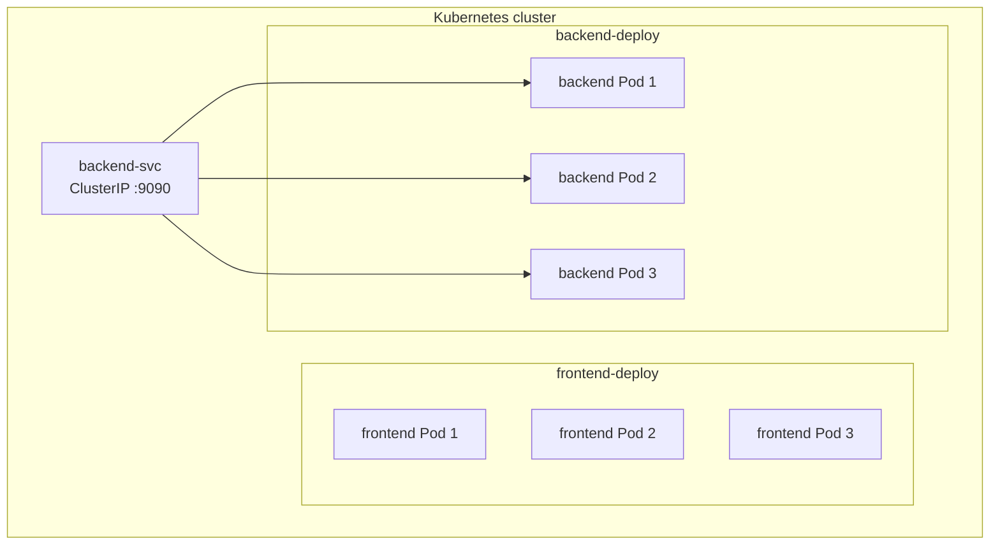

Notice that we have **not** yet exposed the frontend. The existence of running Nginx Pods is not the same as giving your laptop a reachable address for them.

### Add the NodePort Service

Generate its YAML:

```bash
kubectl expose deployment frontend-deploy \
  --name=frontend-svc \
  --type=NodePort \
  --port=80 \
  --target-port=80 \
  --dry-run=client -o yaml
```

The generated manifest usually does not contain a manually selected `nodePort`. If applied without one, Kubernetes allocates a port from the configured range. In the lesson we want exactly **31000**, so add it explicitly inside the same `ports` entry:

```yaml
apiVersion: v1
kind: Service
metadata:
  name: frontend-svc
spec:
  type: NodePort
  selector:
    app: frontend
  ports:
    - protocol: TCP
      port: 80
      targetPort: 80
      nodePort: 31000
```

Save that as `frontend-svc.yaml`. We intentionally use a second local file here so you can see each object clearly. Alternatively, insert `---` and append it to `frontend.yaml` as in the backend exercise.

```bash
kubectl apply -f frontend-svc.yaml
kubectl get svc frontend-svc -o wide
kubectl describe svc frontend-svc
kubectl get pods -l app=frontend -o wide
```

Read the port chain carefully:

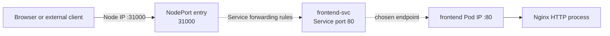

**Technical accuracy note:** This is a useful *logical* chain, not a literal guarantee of three separate network hops. Depending on kube-proxy mode or a replacement dataplane, the NodePort packet can be translated directly toward a chosen Pod endpoint. Also, on **kind**, a NodePort's accessibility from your laptop depends on Docker/kind port mappings. If you used `extraPortMappings` when creating the kind cluster, `http://localhost:31000` may work; if you did not, do not assume it will. On a practice cluster, `kubectl port-forward svc/frontend-svc 8080:80` is an additional way to verify the frontend without recreating kind.

At this point the four objects from Day 12 have been rebuilt through imperative-command-driven workflows:

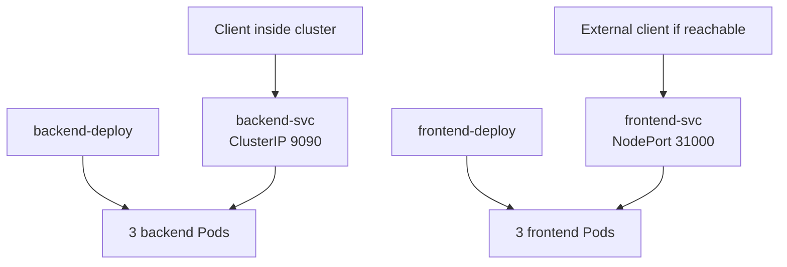

---

## 5. Test the backend from inside the cluster

Now ask an operational question: *"Does the backend Service actually resolve and return an HTTP response?"* A Pod can be `Running` while its application is unreachable, so we need a functional test.

Use an image containing `curl` for the test. The lesson uses an Nginx test Pod, but the availability of `curl` in an arbitrary Nginx image is **not guaranteed**. We therefore use a curl-specific image to make the lab predictable.

```bash
kubectl run test-client \
  --image=curlimages/curl:8.11.1 \
  --restart=Never \
  --rm -it \
  --command -- sh
```

The options matter:

- `kubectl run` creates a **Pod**, not a Deployment.
- `--restart=Never` sets the Pod restart policy to `Never`.
- `-it` attaches an interactive terminal.
- `--rm` asks kubectl to delete the Pod when this attached session exits.
- `--command -- sh` makes `/bin/sh` the process we want to run, rather than relying on the image's default command.

Inside the Pod, run:

```sh
curl -fsS http://backend-svc:9090
```

Expected application response:

```text
Hello from backend
```

Why does it work? We need to look at DNS before we look at packets. The client sends a query for `backend-svc`. Kubernetes DNS resolves the Service's name to its ClusterIP, and the node's Service networking implementation selects an eligible backend endpoint. **DNS does not choose a backend Pod for an ordinary ClusterIP Service; it resolves the Service name.**

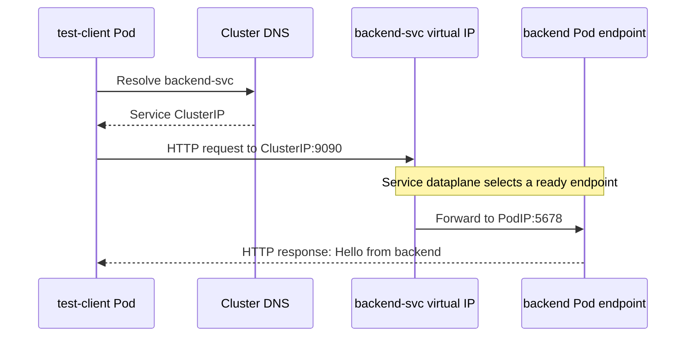

Compare this with a common failure:

```sh
curl -fsS http://backend-svc
```

Without an explicit port, an HTTP client uses port **80**. Our Service listens on **9090**, so the request goes to the wrong destination port. This is not a DNS failure. Always distinguish **name resolution** from **connection to the correct port**.

### Where is this DNS server configured?

While still inside the test Pod:

```sh
cat /etc/resolv.conf
```

You should see a `nameserver` line pointing to the cluster DNS address, plus search domains. **The specific IP depends on your cluster**—do not memorize the video's IP address. Exit and inspect the corresponding Service:

```bash
exit
kubectl -n kube-system get svc kube-dns
kubectl -n kube-system describe svc kube-dns
```

`kube-dns` is the conventional Service name even when CoreDNS is the DNS implementation behind it. CoreDNS Pods and their exact labels can vary by cluster setup.

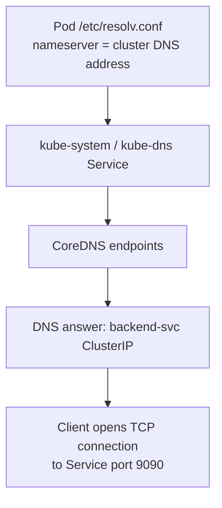

This is why inspecting `/etc/resolv.conf` gives you a bridge between a familiar Linux networking file and the Kubernetes Service model.

---

## 6. Reconstruct what each command taught us

Imperative commands become powerful when you can predict their effects. Let's walk through our application as a sequence of **questions**, not disconnected commands.

**Question 1: Do the desired workloads exist?**

```bash
kubectl get deployments
kubectl get pods -o wide
```

A Deployment's desired replica count is not a proof that all Pods are healthy. Compare `READY` and `AVAILABLE` with the Pod statuses.

**Question 2: Is there a stable destination for each workload?**

```bash
kubectl get svc -o wide
kubectl describe svc backend-svc
kubectl describe svc frontend-svc
```

Verify `TYPE`, `PORT(S)`, `Selector`, and the intended port mapping. The backend should be ClusterIP **9090 → 5678**; the frontend should be NodePort **31000 → Service 80 → Pod 80**.

**Question 3: Are the right Pods selected?**

```bash
kubectl get pods -l app=backend --show-labels
kubectl get pods -l app=frontend --show-labels
kubectl get endpointslices -l kubernetes.io/service-name=backend-svc
```

A Service whose selector does not match your labels may exist and have a valid ClusterIP while exposing no ready backend endpoints.

**Question 4: Does the actual application respond?**

```bash
kubectl run test-client \
  --image=curlimages/curl:8.11.1 \
  --restart=Never --rm -it --command -- sh
# Inside the Pod:
# curl -fsS http://backend-svc:9090
```

Then try observing the DNS path and the system Service as we just practiced. This is the same investigation pattern you can reuse for many applications.

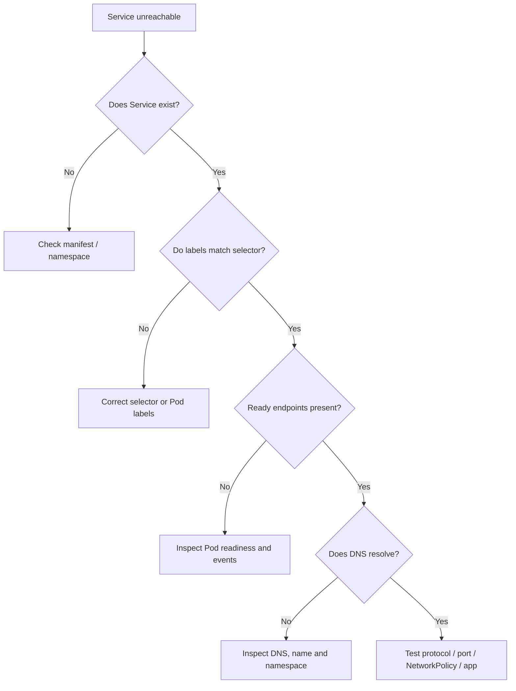

## 7. Technical details worth retaining from this lesson

**`create` versus `apply`.** An imperative `kubectl create deployment` usually asks the API server to create a named object immediately and will fail if it already exists. `kubectl apply -f` manages an object from the manifest; reapplying an unchanged file is generally safe and reports `unchanged` or equivalent. Both interact with the API server.

**`--dry-run=client` versus `--dry-run=server`.** Client-side mode constructs an object without persisting it or performing the API server's admission workflow. Server-side mode sends a non-persisting request to the API server and is useful when you need admission/schema behavior checked against a cluster. Neither proves a Pod will run or an HTTP endpoint will respond.

**Labels do not mean ownership.** `app: backend` is a selector match used by the Deployment's ReplicaSet and the Service, but Kubernetes ownership is represented separately through controller references. Service selection is not the same thing as the Deployment's ownership relationship.

**`kubectl get all` is not literally all objects.** It is a useful convenience command for common resource kinds, but it does not enumerate every Kubernetes object (for example, it is not a comprehensive list of ConfigMaps, Secrets, or all EndpointSlices). Prefer asking for a particular resource when debugging.

**The frontend demonstration is independent of the backend demonstration.** A default Nginx welcome page does not automatically call the HTTP echo server. The temporary client Pod intentionally provides the proof of Service connectivity.

---

## 8. Three rounds of active recall

### Round A — Predict before running

1. What changes if `--dry-run=client` is removed from `kubectl create deployment`?
2. What does `>` do that `kubectl` itself does not do?
3. Why must the Deployment's `spec.selector.matchLabels` agree with the Pod template labels?
4. If the Service port is `9090` and `targetPort` is `5678`, which port should a client use?

### Round B — Observe and reason

Run these again, even if you already ran them:

```bash
kubectl get pods -l app=backend -o wide
kubectl describe svc backend-svc
kubectl get endpointslices -l kubernetes.io/service-name=backend-svc
kubectl get svc frontend-svc
```

Now explain the output without referring to the command explanation above. Can you identify Pod IPs, Service port, target port, label selector, and ready endpoints?

### Round C — Interview-style scenarios

**Scenario 1:** Your backend Deployment says `3/3` replicas, but `backend-svc` has no usable endpoints. Which command will you run next, and what are you checking?

**Scenario 2:** `curl backend-svc` fails, but `curl backend-svc:9090` succeeds. Which layer was the problem: DNS, Kubernetes Service discovery, or the chosen TCP port?

**Scenario 3:** A generated Deployment has `app: backend-deploy`, but you create a Service selecting `app: backend`. Why is the Service empty? How would you repair this without guessing IPs?

**Scenario 4:** Your NodePort exists on a kind cluster, but `localhost:31000` does not work on your Mac. Which boundary—the Pod, the Service, or Docker's host-to-kind-node port mapping—should you inspect?

**Suggested answers:** (1) Removing dry-run creates an API request; (2) the shell saves standard output to a file; (3) the controller must select its intended Pods; (4) `9090`. For scenarios: inspect readiness and endpoint selection; default HTTP port is wrong; match Service selectors to actual Pod labels; and verify kind/Docker host port mapping.

---

## 9. Final mental model

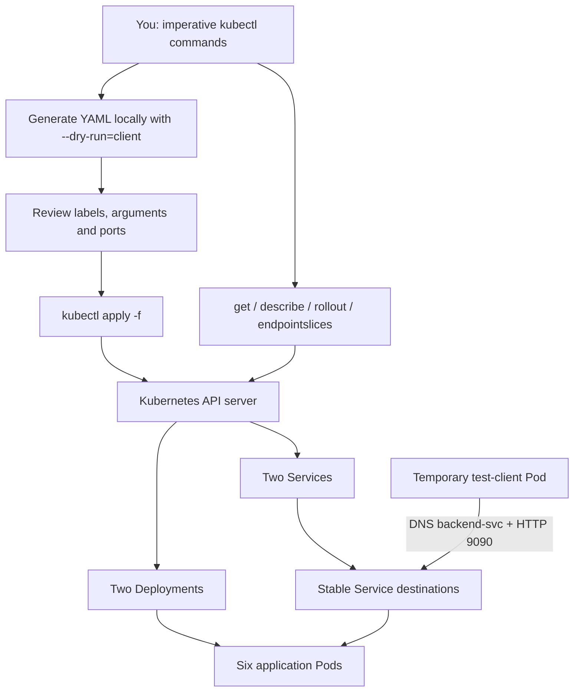

The lesson is not really about remembering a longer list of flags. It is about understanding the difference between **constructing an object**, **asking Kubernetes to store it**, **waiting for controllers to produce real Pods**, and **verifying that those Pods can be reached through a Service**.

Next, Day 14 takes this same application and introduces a new question: *what if many teams or environments share the same cluster and want to reuse the same object names?* That is the motivation for Kubernetes namespaces.

### Official references (optional verification, not required to read this chapter)

- [kubectl create deployment](https://kubernetes.io/docs/reference/kubectl/generated/kubectl_create/kubectl_create_deployment/)
- [kubectl expose](https://kubernetes.io/docs/reference/kubectl/generated/kubectl_expose/)
- [DNS for Services and Pods](https://kubernetes.io/docs/concepts/services-networking/dns-pod-service/)
