# CKA Day 14 — Kubernetes Namespaces: Organizing One Cluster Without Confusing Its Boundaries

> **Learning mode:** One problem, one new concept, one diagram, then a command to verify it. This is a **standalone Markdown chapter**, with embedded Mermaid diagrams and no additional assets, addons, extensions, or companion files.
>
> **Source:** Day 14 course transcript. The progression through namespace discovery, creating `app1-ns`, deploying the frontend/backend stack, namespace-aware `kubectl` commands, kubeconfig context defaults, and cross-namespace DNS testing follows the lecture. Sections marked **Technical accuracy note** correct or qualify simplified claims made in the recording.

## The problem we are about to solve

Until now, our Kubernetes cluster contained a frontend Deployment, a backend Deployment, and their corresponding Services. We learned how to build them and verify their connectivity. But a Kubernetes cluster often serves multiple applications, teams, or environments. What happens when a second team wants its own Deployment called `backend-deploy`? What if the same application has `dev`, `uat`, and `prod` versions?

If every object is created in the `default` namespace, resource names and operational work begin to collide. Searching for an application becomes harder, and enforcing different administrative rules becomes less convenient. The idea behind a Kubernetes namespace is to give **API objects a logical scope within a single cluster**.

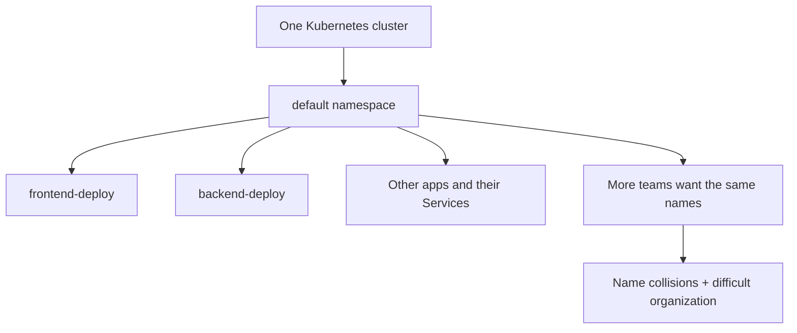

We will use the same application from the preceding lessons:

- `backend-deploy`: three HTTP echo Pods listening on **5678**;
- `backend-svc`: ClusterIP Service on **9090**, selecting `app: backend`;
- `frontend-deploy`: three Nginx Pods listening on **80**;
- `frontend-svc`: NodePort Service on **31000**, selecting `app: frontend`.

This time we will place all four objects in **`app1-ns`** and investigate what the namespace changes—and what it does not change.

---

## 1. A namespace changes where Kubernetes looks for an object

The house-and-rooms analogy from the lecture is a useful starting point, but let's make it precise. The **house** is the cluster; each **room** is a namespace; the **named belongings** are namespaced Kubernetes objects. This analogy describes **organization and API scoping**, not guaranteed physical walls between applications.

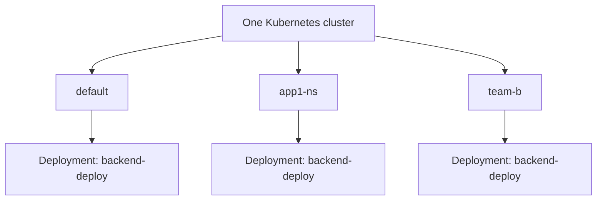

These can be three different Deployment objects, even though all three share the same name. Their full identity is differentiated by **resource type + namespace + name** (within one cluster).

For example, the two operations below refer to different objects:

```bash
kubectl get deployment backend-deploy -n default
kubectl get deployment backend-deploy -n app1-ns
```

If the object does not exist in one of the namespaces, that command will return `NotFound`. This is not a cluster-wide search failure: you asked Kubernetes to look in a particular scope.

**Technical accuracy note — namespaces are not automatic security barriers.** A namespace does **not**, by itself, block Pods from communicating with Pods in other namespaces. NetworkPolicies, authorization (RBAC), quotas, and other controls can be applied using namespace boundaries, but they must be configured separately. You must not mistake resource organization for network or security isolation.

---

## 2. Do not confuse Kubernetes namespaces with Linux namespaces

This is a natural point of confusion after our Docker and Pod-internals lessons. We used the word *namespace* there too, but the two concepts answer completely different questions.

A **Linux network namespace** is a kernel mechanism that changes a process's view of network interfaces, routes, IP configuration, and sockets. A **Kubernetes namespace** is an API-level grouping of namespaced objects inside a cluster. Kubernetes namespaces are not implemented as Linux network namespaces, nor do they create a separate Linux network namespace for every application.

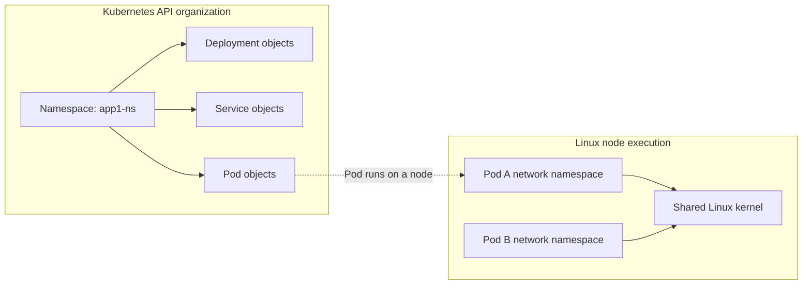

This diagram is intentionally asymmetrical. `app1-ns` exists in Kubernetes API state, while each ordinary Pod has a kernel-level network namespace on its node. **One Kubernetes namespace can contain many Pods, each with its own Pod network namespace.**

### Pause and predict

If two Pods are in different Kubernetes namespaces but there is no network policy denying traffic, are they automatically prevented from talking? **No.** Namespace scope affects object lookup, default DNS searches, and available places to attach policies; it does not inherently block network packets.

---

## 3. First inspect the cluster before creating anything

A good operator does not start by changing the cluster. First inspect its state and verify the active context, especially because the `kubectl` context can point to a remote cluster rather than the intended kind lab.

```bash
kubectl config current-context
kubectl get namespaces
kubectl get pods --all-namespaces
kubectl get deployments,services -A
```

Read these commands as increasingly broad questions. `current-context` asks *"Which cluster/user/namespace configuration will my client use?"* `get namespaces` asks *"Which scopes exist?"* `get pods -A` asks *"Show Pods across all namespaces."*

The `-A` shorthand means `--all-namespaces`. It is used for **namespaced resource kinds**; namespace objects themselves are cluster-scoped, so they don't belong to a particular namespace.

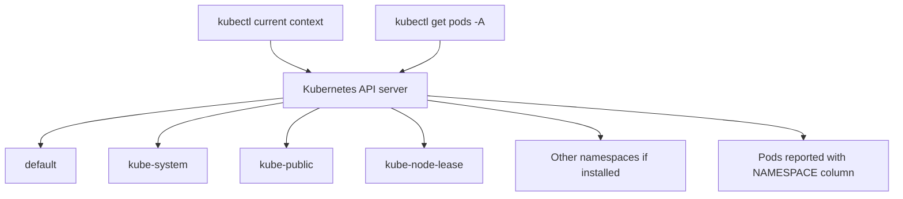

In a typical cluster you will see `default`, `kube-system`, `kube-public`, and `kube-node-lease`. Kind or additional components can create other namespaces, such as one for a local storage provisioner. The exact list is environment-dependent.

The lecture introduces these system namespaces because they are a good way to understand the organizational purpose of namespaces:

| Namespace | Common purpose |
|---|---|
| `default` | Default target for many namespaced commands if no other namespace is selected. |
| `kube-system` | Many cluster infrastructure Pods, Services, and add-ons. Not every control-plane component must be a Pod here. |
| `kube-public` | Conventionally holds certain widely readable cluster information. |
| `kube-node-lease` | Stores node Lease objects used to support node heartbeat/health monitoring. |

The meaning is not that Kubernetes starts a separate mini-cluster for each of these namespaces. All remain part of **one** cluster.

### A useful command from the lesson: `api-resources`

```bash
kubectl api-resources
kubectl api-resources --namespaced=true
kubectl api-resources --namespaced=false
```

This command connects the theoretical statement—*some resources belong to namespaces; others do not*—with the Kubernetes API itself.

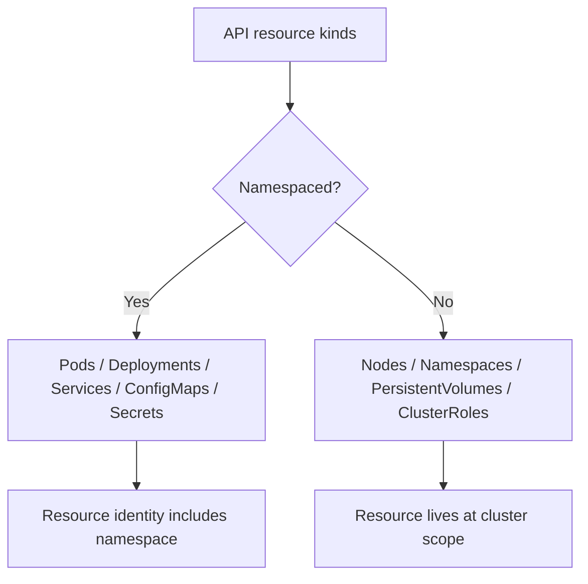

You should now be able to explain why `kubectl get pods -n app1-ns` makes sense, but `kubectl get nodes -n app1-ns` does not give you a distinct subset of nodes: **nodes are cluster-scoped**.

**Technical accuracy note:** `kubectl get all -A` is a convenient command for several commonly used resource types, not an exhaustive inventory of all cluster resources. For genuine auditing or exam questions, request the resource type explicitly.

---

## 4. Create `app1-ns` imperatively, then turn the operation into YAML

Now we know what a namespace represents, so let's create one. The fastest imperative command is:

```bash
kubectl create namespace app1-ns
```

If you execute that exact command, Kubernetes creates the namespace immediately. But Day 13 taught us an even more useful pattern: construct the desired object locally first, inspect it, and apply the manifest.

```bash
kubectl create namespace app1-ns \
  --dry-run=client -o yaml > app1-ns.yaml
```

The first command creates a live namespace. The second command does **not** create it yet; it writes a local YAML document. For this exercise, choose **one** creation path to avoid trying to create the same object twice. We will use the YAML path below.

The generated file should reduce to the following simple structure:

```yaml
apiVersion: v1
kind: Namespace
metadata:
  name: app1-ns
```

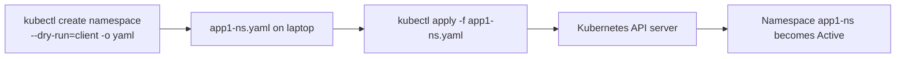

If you used the YAML path, continue:

```bash
kubectl apply -f app1-ns.yaml
kubectl get namespaces
kubectl get namespace app1-ns -o yaml
```

The last command reads the actual cluster object as YAML. Compare it to your original four-line manifest. The API server adds fields such as metadata and status. This distinction between **what you requested** and **what Kubernetes reports** is central to understanding Kubernetes declarative objects.

**Warning about cleanup:** Deleting a namespace deletes its namespaced resources. Do not run `kubectl delete namespace app1-ns` in a shared or important cluster. The entire chapter assumes a disposable practice cluster.

---

## 5. Move the backend into the namespace using `-n`

We now have an empty namespace. Let's populate it with the same backend Deployment and Service we studied in Days 12 and 13. The lesson's first technique is to keep the manifests without a `metadata.namespace` field, and specify the destination on the command line.

Create a local file `backend.yaml` with **both** of the following YAML documents:

```yaml
apiVersion: apps/v1
kind: Deployment
metadata:
  name: backend-deploy
spec:
  replicas: 3
  selector:
    matchLabels:
      app: backend
  template:
    metadata:
      labels:
        app: backend
    spec:
      containers:
        - name: backend
          image: hashicorp/http-echo:1.0.0
          args:
            - "-listen=:5678"
            - "-text=Hello from backend"
          ports:
            - containerPort: 5678
---
apiVersion: v1
kind: Service
metadata:
  name: backend-svc
spec:
  type: ClusterIP
  selector:
    app: backend
  ports:
    - port: 9090
      targetPort: 5678
      protocol: TCP
```

Notice that neither resource declares a namespace in its metadata. We will choose the namespace in the `kubectl` request:

```bash
kubectl apply -f backend.yaml -n app1-ns
```

What is happening conceptually?

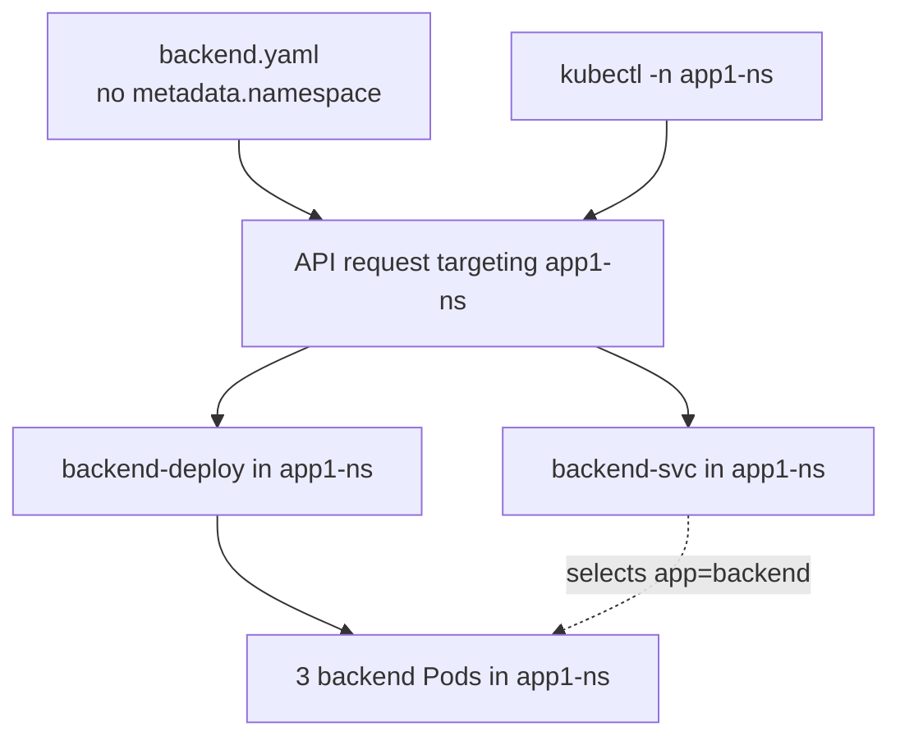

Verify **immediately**:

```bash
kubectl get deployment backend-deploy -n app1-ns
kubectl get svc backend-svc -n app1-ns
kubectl get pods -n app1-ns -l app=backend -o wide
kubectl rollout status deployment/backend-deploy -n app1-ns
```

Do you see the repeated pattern? In Day 13 we used `get`, `describe`, `rollout status`, and labels to inspect a resource. The commands are the same. The **new information is the namespace supplied with `-n`**.

### What if you omit `-n`?

```bash
kubectl get deployment backend-deploy
```

This does **not** mean *"search the entire cluster."* It means *"search the namespace selected by the current kubeconfig context (usually `default`, unless changed)."* If there is no matching Deployment there, you get `NotFound`. If an older `backend-deploy` from Day 13 still exists in `default`, you may see **that older Deployment instead**. This is precisely the kind of operational confusion namespaces help organize—provided you know which one you are querying.

---

## 6. Move the frontend using `metadata.namespace` instead

Day 14 deliberately teaches a second way to select a namespace. Rather than repeat `-n app1-ns` on the apply command, we can store the namespace in each namespaced object's metadata.

Create a local `frontend.yaml` file with the following two documents:

```yaml
apiVersion: apps/v1
kind: Deployment
metadata:
  name: frontend-deploy
  namespace: app1-ns
spec:
  replicas: 3
  selector:
    matchLabels:
      app: frontend
  template:
    metadata:
      labels:
        app: frontend
    spec:
      containers:
        - name: frontend
          image: nginx:stable-alpine
          ports:
            - containerPort: 80
---
apiVersion: v1
kind: Service
metadata:
  name: frontend-svc
  namespace: app1-ns
spec:
  type: NodePort
  selector:
    app: frontend
  ports:
    - port: 80
      targetPort: 80
      nodePort: 31000
      protocol: TCP
```

The two key lines are **`metadata.namespace: app1-ns`**, once for the Deployment and once for the Service. A Pod template is part of the Deployment's spec; we do not add an independent `metadata.namespace` to that template in this example.

Now apply without a namespace flag:

```bash
kubectl apply -f frontend.yaml
kubectl get deployments,services -n app1-ns
kubectl get pods -n app1-ns -o wide
```

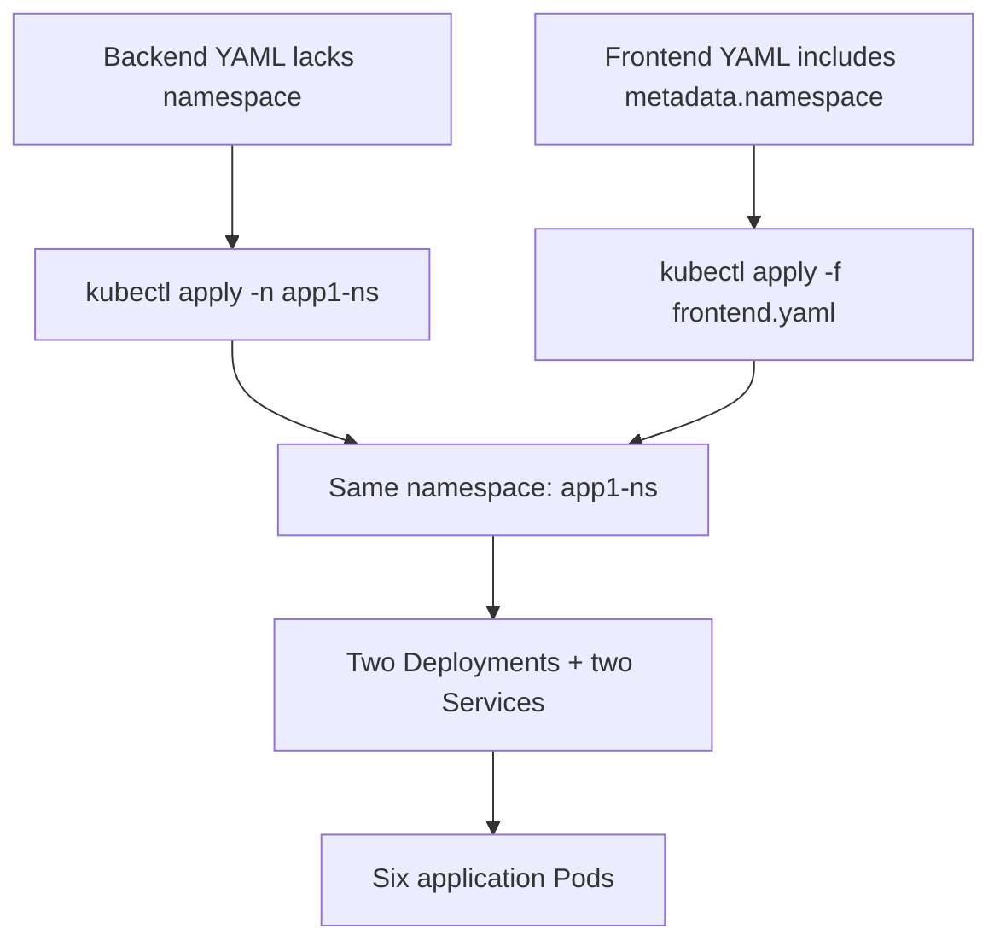

Both methods select the same Kubernetes namespace. For durable, reusable manifests, an explicitly declared namespace can be helpful. When the same manifests must move between environments, supplying the namespace at apply time can be more flexible. **If you provide conflicting namespace instructions between the command and manifest, don't assume the CLI will silently override the mismatch.** Keep them consistent.

### Inspect the result from several angles

```bash
kubectl get all -n app1-ns
kubectl get deployment backend-deploy -n app1-ns -o yaml
kubectl get svc backend-svc -n app1-ns -o wide
kubectl get pods -n app1-ns --show-labels
```

`get all` is a broad convenience view; the other commands give you targeted answers. The `-o yaml` output is particularly useful because it shows the **persisted `metadata.namespace`**, regardless of whether you chose that namespace through the manifest or `-n`.

### The application's architecture has not changed

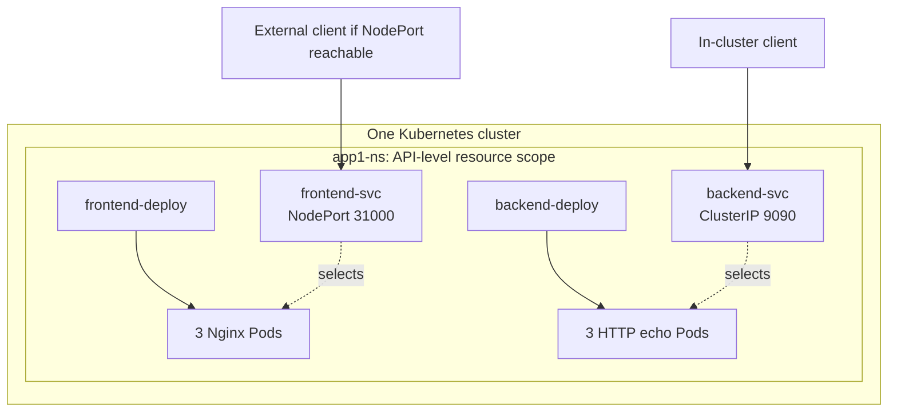

The Service types, Pod networking, and container processes are still what we learned earlier. The new layer is simply **where the API objects are named and administered**.

---

## 7. Why typing `-n app1-ns` repeatedly becomes inconvenient

At this point, an investigation might involve:

```bash
kubectl get pods -n app1-ns
kubectl get svc -n app1-ns
kubectl describe deployment frontend-deploy -n app1-ns
kubectl describe svc backend-svc -n app1-ns
```

You will eventually forget `-n` on one command and receive an apparently contradictory answer. The tool is not confused; your commands are aimed at different namespace scopes. This motivates **kubeconfig contexts**, which we introduced in Day 8.

A context selects a **cluster**, a **user or credential entry**, and an optional **default namespace**. It is a client-side preference, not a new namespace object or a Linux kernel configuration.

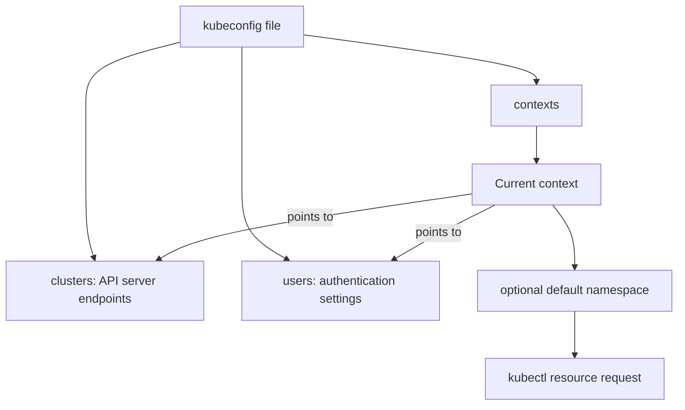

Before changing any context, verify you are still on a practice cluster:

```bash
kubectl config current-context
kubectl config get-contexts
kubectl config view --minify
```

`--minify` restricts the view to the selected context's relevant entries. It is especially helpful when your kubeconfig contains numerous clusters. **Never paste unredacted kubeconfig credentials or private keys into public documentation or chat.**

Now configure the current context to use `app1-ns` as its default namespace:

```bash
kubectl config set-context --current --namespace=app1-ns
```

Run familiar commands again, deliberately omitting `-n`:

```bash
kubectl get pods
kubectl get services
kubectl get deployments
kubectl config view --minify
```

If you configured the correct context, these now refer to `app1-ns`. You have **not moved the Pods**. You only changed which namespace `kubectl` uses as the default when a command doesn't specify one.

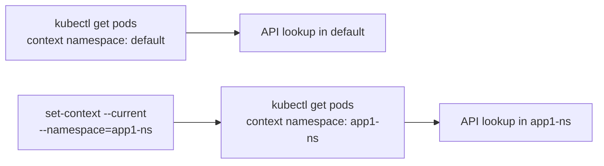

Notice the remarkable result: **the identical text `kubectl get pods` can return different resources after a client-side context setting changes**.

### Restore the familiar default

```bash
kubectl config set-context --current --namespace=default
kubectl get pods
kubectl get pods -n app1-ns
```

The last two commands should now be read as two explicitly different questions. For CKA tasks, `-n` is often safer when you want absolute clarity, even if the context already has a default.

---

## 8. Namespaces alter the default DNS search behavior

Now comes the most useful connection to Day 12. Kubernetes Services have stable DNS names, but their names are **namespaced**. A Service called `backend-svc` in `app1-ns` is not the same DNS target as a Service called `backend-svc` in `default`.

From inside a Pod running in `app1-ns`, the short name `backend-svc` is normally resolved using the Pod's namespace-specific DNS search domain. From inside a Pod running in `default`, the same short name is resolved relative to `default` instead.

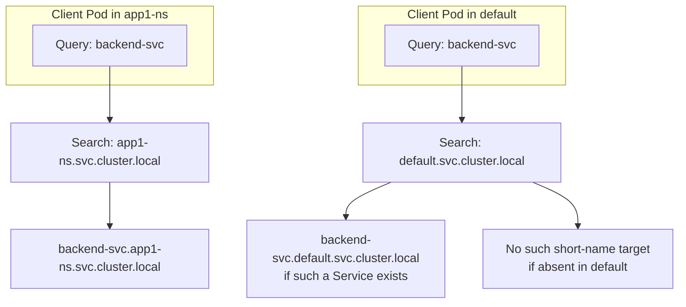

**The important correction to the lecture:** A short name failing to resolve from `default` does **not** prove that cross-namespace network connectivity is denied. It only proves that the default short-name lookup did not identify the Service in `app1-ns`.

The full DNS name of our backend Service is conventionally:

```text
backend-svc.app1-ns.svc.cluster.local
```

This assumes the usual Kubernetes cluster DNS domain `cluster.local`; clusters can be configured differently. The shorter `backend-svc.app1-ns` often works from a Pod using the normal cluster DNS search configuration.

### Test from the application namespace

Run a temporary client in `app1-ns`:

```bash
kubectl run test-client \
  -n app1-ns \
  --image=curlimages/curl:8.11.1 \
  --restart=Never --rm -it \
  --command -- sh
```

From its shell:

```sh
curl -fsS http://backend-svc:9090
cat /etc/resolv.conf
```

Expected HTTP response:

```text
Hello from backend
```

The first command proves the Service is discoverable and functional from that namespace. The second lets you inspect the DNS resolver and search domains that explain the short-name resolution. Run `exit` to remove the temporary client when the interactive session ends.

### Test from a different namespace

Restore your default context if needed, then run:

```bash
kubectl run test-client \
  -n default \
  --image=curlimages/curl:8.11.1 \
  --restart=Never --rm -it \
  --command -- sh
```

Inside the client Pod, try both addresses:

```sh
curl -fsS --max-time 5 http://backend-svc:9090
curl -fsS --max-time 5 http://backend-svc.app1-ns.svc.cluster.local:9090
```

**Interpret the first command carefully.** If `default` has no Service called `backend-svc`, the short-name lookup will usually fail. But if you left the Day 13 `backend-svc` in `default`, the short name may resolve to **that Service instead**. Either behavior illustrates the same rule: a short Service name is resolved relative to the client's DNS search namespace.

The second command explicitly targets the Service in `app1-ns`; in a normal cluster with no blocking network policy, it should work across namespaces. Exit the client Pod afterward.

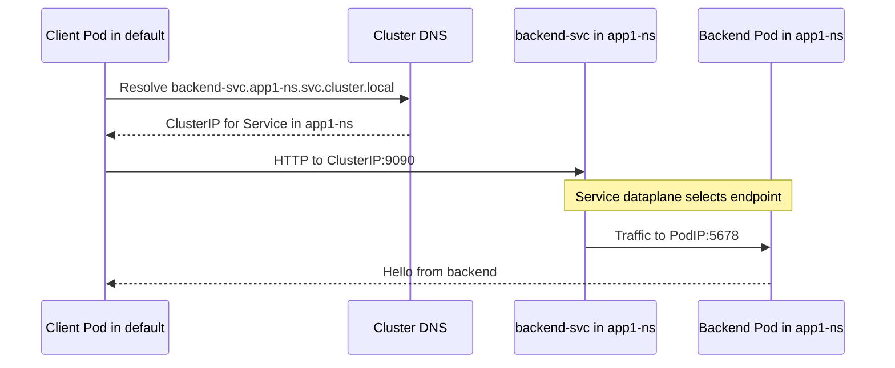

**The crucial mental model:** Kubernetes namespace scoping changes **how API resources are named, selected, and discovered**. It does not, on its own, stop an IP packet from crossing between Pods that reside in different namespaces.

---

## 9. Where do actual isolation, access, and resource limits come from?

The transcript associates namespaces with security and resource management, which is useful as a motivation. The technical details matter, though, because a namespace by itself provides only the *scope* where specific policies can be applied.

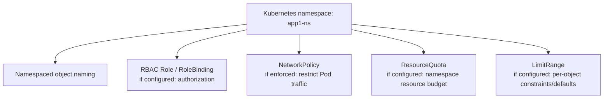

Imagine your HR department and Finance department each use the same cluster. Creating `hr` and `finance` namespaces makes their resource names distinct. **It does not automatically prevent an HR Pod from making an HTTP request to a Finance Service.** A suitable NetworkPolicy implementation and policies would be needed to restrict that network path. Authorization similarly requires RBAC or another authorizer configuration; creating a namespace is not permission enforcement by itself.

For resource budgets, a `ResourceQuota` can place aggregate limits on resource consumption in a namespace. `LimitRange` and requests/limits govern different aspects of workload resource behavior. We are deliberately **not configuring those objects in this chapter**, because they deserve their own lessons. Today we only establish where they fit.

The main benefit of this precision is that it prevents a false conclusion during troubleshooting: *"They're in different namespaces, so network access must be denied."* That inference is wrong unless additional policies or infrastructure constraints actually enforce it.

---

## 10. The operator's namespace investigation routine

At this stage, you know more commands than at the beginning, but they all follow a coherent investigation sequence. Suppose you receive the report: *"The frontend is healthy, but the backend Service cannot be reached."* Begin with the API scope, not with a random Pod IP.

**Step 1: Verify the cluster and namespace selection.**

```bash
kubectl config current-context
kubectl config view --minify
kubectl get namespaces
```

**Step 2: Inspect the requested namespace and workload.**

```bash
kubectl get deployments,services -n app1-ns
kubectl get pods -n app1-ns -o wide
kubectl get pods -n app1-ns --show-labels
```

**Step 3: Verify Service selection and endpoint readiness.**

```bash
kubectl describe svc backend-svc -n app1-ns
kubectl get endpointslices -n app1-ns \
  -l kubernetes.io/service-name=backend-svc
```

**Step 4: Test the correct DNS name from the correct Pod namespace.** Use `backend-svc:9090` within `app1-ns`, and use `backend-svc.app1-ns.svc.cluster.local:9090` from another namespace if needed.

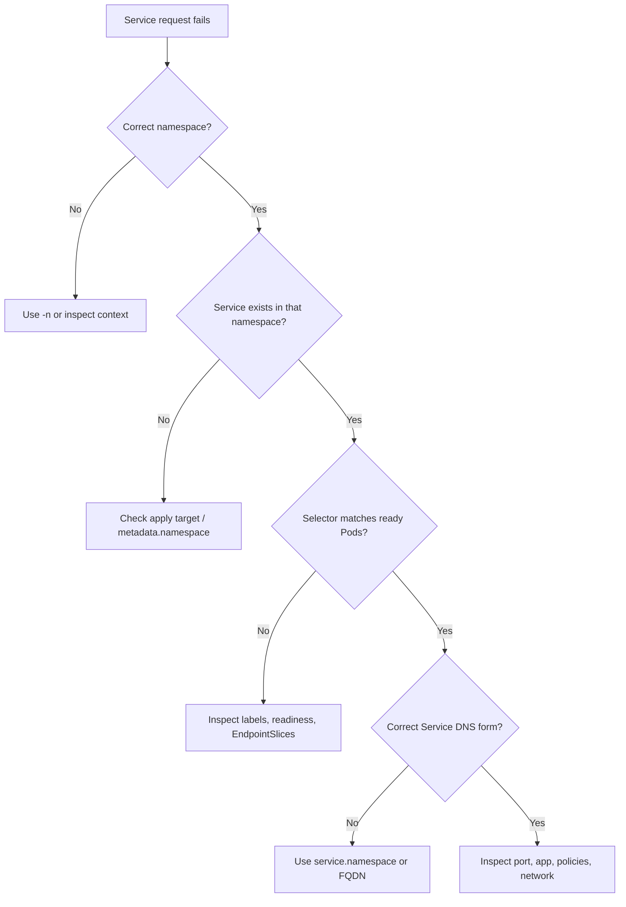

The repeated `kubectl` commands are intentional. You are training a reasoning sequence that transfers to workloads you have never seen before.

---

## 11. A short CKA-style exercise

Without changing anything yet, predict the meaning or result of each command:

```bash
# A. Cluster inventory
kubectl get namespaces
kubectl api-resources --namespaced=false

# B. An explicitly scoped query
kubectl get pods -n app1-ns

# C. Change the current context's default namespace
kubectl config set-context --current --namespace=app1-ns

# D. Repeat the query without -n
kubectl get pods

# E. Inspect both namespaces intentionally
kubectl get pods -n default
kubectl get pods -n app1-ns

# F. Restore the default context preference
kubectl config set-context --current --namespace=default
```

Your explanation should mention **where** the request is sent (current cluster), **which API object scope** is queried (`-n` or context namespace), and **whether the command mutates Kubernetes objects** or only the local kubeconfig. `set-context` changes local client configuration; it does **not** move workloads between namespaces.

### Reasoning questions

1. Can you create a Deployment named `backend-deploy` in both `default` and `app1-ns`? Why?
2. If an object is a `Node`, should it have `metadata.namespace: app1-ns`?
3. If `kubectl get pods` appears empty immediately after you deployed an application, what is the *first* client-side setting to check?
4. Does changing the current context's default namespace alter what a running Pod can see or which namespace it belongs to?
5. Why can `curl backend-svc:9090` fail from `default` while `curl backend-svc.app1-ns.svc.cluster.local:9090` succeeds?
6. Are Pods in `default` automatically network-isolated from Pods in `app1-ns`?
7. What could happen if you run `kubectl delete namespace app1-ns`?

**Answer check:** (1) Yes; names are scoped by namespace. (2) No; nodes are cluster-scoped. (3) Current context and selected namespace. (4) No; it changes `kubectl`'s default query scope. (5) Different DNS search names. (6) No; additional policies are required. (7) Kubernetes deletes the namespaced objects within it; do not try on a non-disposable cluster.

---

## 12. Reconstruct the complete mental model

Let's zoom out. We began with a single cluster containing many namespaced resources. We introduced a namespace to group the objects; we tested two ways to target that namespace; then we saw how kubeconfig controls `kubectl`'s default query scope and how DNS allows workloads to discover Services across namespaces.

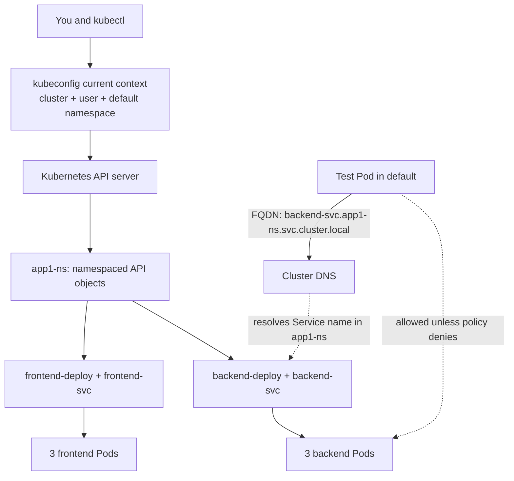

**The mental model to retain:** A Kubernetes namespace is an **API-level scope for managing and naming objects**. `kubectl -n` and kubeconfig contexts choose the scope of a request. Service DNS names incorporate that scope. Linux kernel namespaces and Pod networking operate at a different layer. Security and quota controls can use Kubernetes namespaces, but the namespace object does not automatically enforce those controls.

This prepares you for the next lessons, where we can use namespace-aware commands without continually stopping to reconstruct what a namespace means.

### Official references (optional verification, not required to read this chapter)

- [Kubernetes namespaces](https://kubernetes.io/docs/concepts/overview/working-with-objects/namespaces/)
- [Share a cluster with namespaces](https://kubernetes.io/docs/tasks/administer-cluster/namespaces/)
- [kubectl config set-context](https://kubernetes.io/docs/reference/kubectl/generated/kubectl_config/kubectl_config_set-context/)
- [DNS for Services and Pods](https://kubernetes.io/docs/concepts/services-networking/dns-pod-service/)
