# CKA Day 15 - Manual Scheduling and Static Pods

> A progressive learning chapter, from ordinary scheduling to the kubelet's ability to run Pods without the scheduler. All visualizations are embedded Mermaid; no external assets are required.

## Learning contract

We already know the Day 7 deployment path: an object reaches the API server, a controller creates Pod objects, the scheduler chooses nodes, and the kubelet starts containers. This chapter asks two questions that seem to contradict that model:

1. Can we choose the node ourselves, instead of letting the scheduler choose?
2. If the scheduler and API server themselves can run as Pods, who starts them before Kubernetes is fully operational?

We will resolve the first question with **`spec.nodeName`** and the second with **static Pods**. These are different mechanisms. Keep them separate as we build the picture.

**Lab assumptions.** Commands assume a disposable kind cluster named `cka-lab` with a control-plane node and two workers: `cka-lab-control-plane`, `cka-lab-worker`, and `cka-lab-worker2`. Your names may differ. Always run `kubectl get nodes` first and substitute the exact names from your output. Exercises that write node-local files are for a disposable lab only; never edit control-plane static Pod manifests during ordinary practice.

---

## 1. Start with the scheduling problem we already know

Suppose we create an Nginx Pod and say nothing about where it should live. Kubernetes must decide which node can host it. This is not an arbitrary assignment. The scheduler evaluates eligibility and preferences, including requested CPU and memory, node conditions, taints, node selectors, affinity, and other constraints.

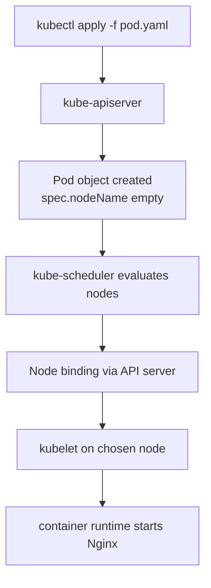

The *Pod object* exists before its containers start. The scheduler is concerned with placement; the kubelet on the chosen node handles the actual Pod setup. Notice that the scheduler does not directly create a Linux process on the worker.

Let's establish a baseline with commands:

```bash
kubectl config current-context
kubectl get nodes -o wide
kubectl get pods -o wide
kubectl run nginx-auto --image=nginx:stable --restart=Never
kubectl get pod nginx-auto -o wide
kubectl get pod nginx-auto -o jsonpath='{.spec.nodeName}{"\n"}'
```

The last command is a small but important observation tool. It extracts the **actual node assignment** from the Pod's spec. We will reuse it when we skip the scheduler. Wait until the Pod is scheduled before expecting a nonempty node name.

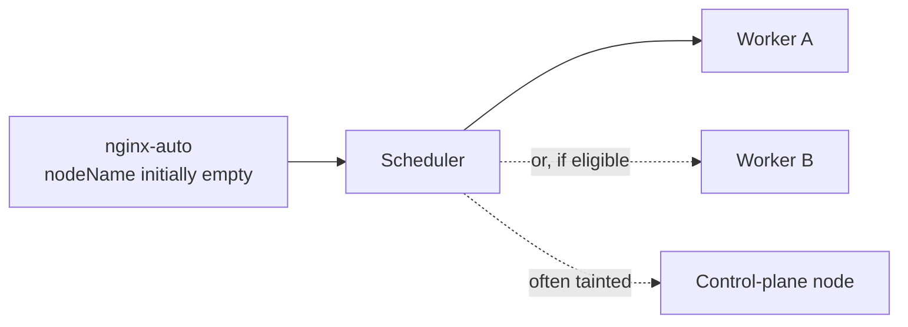

The scheduler may put two Pods on the same worker even when two workers are available. Even distribution is not the default guarantee. This matters later when interpreting lab results: **observe the chosen node instead of assuming it**.

## 2. What changes when we choose the node manually?

Imagine one worker is exhibiting unusual behavior and we want to reproduce a problem specifically there. We know exactly which node to target. One approach is to put `nodeName` in the Pod spec.

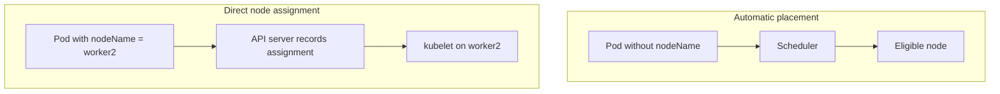

These flows produce the same *kind* of runtime object, a Pod, but the placement decision came from different actors. The critical rule is:

**If `spec.nodeName` is already populated, the default scheduler skips that Pod.** The named node's kubelet can then attempt to run it. This overrides normal `nodeSelector` and node-affinity scheduling decisions; it is not the same as asking the scheduler to prefer a node.

Write `manual-pod.yaml`:

```yaml
apiVersion: v1
kind: Pod
metadata:
  name: nginx-manual
spec:
  nodeName: cka-lab-worker2  # REPLACE with an actual node name
  containers:
    - name: nginx
      image: nginx:stable
      ports:
        - containerPort: 80
```

First see the YAML and identify where `nodeName` lives. It is under **Pod `spec`**, not `metadata`, not `containers`, and not the Deployment's outer spec.

Now execute and inspect:

```bash
kubectl apply -f manual-pod.yaml
kubectl get pods -o wide
kubectl describe pod nginx-manual
kubectl get pod nginx-manual -o jsonpath='{.spec.nodeName}{"\n"}'
```

You should see the specified worker as `NODE`. The Pod may need time to pull an image. If it fails, inspect events; explicitly selecting a node does not guarantee the node can run the Pod.

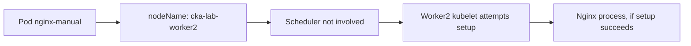

### Why this is useful, but not the default solution

The transcript uses manual scheduling for debugging, hardware-specific testing, and the case where the scheduler is unavailable. These are useful motivations. However, this technique removes important scheduling protections. The scheduler does not first filter out nodes with insufficient requested resources or check all the constraints on your behalf.

For ongoing application placement, **node labels with `nodeSelector` or required node affinity** are normally safer, because the scheduler remains responsible for evaluating placement. We will learn those mechanisms in Days 16 and 17.

## 3. The surprising taint example

In a typical kubeadm-created control plane, the control-plane node has a `NoSchedule` taint. Ordinary application Pods without a matching toleration generally won't be placed there by the scheduler.

```bash
kubectl describe node cka-lab-control-plane
```

Look for the `Taints:` field. In many environments it shows `node-role.kubernetes.io/control-plane:NoSchedule` (the exact setup varies).

Now connect two facts:

- `NoSchedule` affects the **scheduler's** normal placement decision.
- `spec.nodeName` bypasses the normal scheduler decision.

Therefore, a manually assigned Pod may run on a control-plane node despite a `NoSchedule` taint, assuming the kubelet and other node conditions permit it. **A `NoExecute` taint is different:** a Pod without an appropriate toleration may be evicted. We will investigate the three effects properly in Day 16.

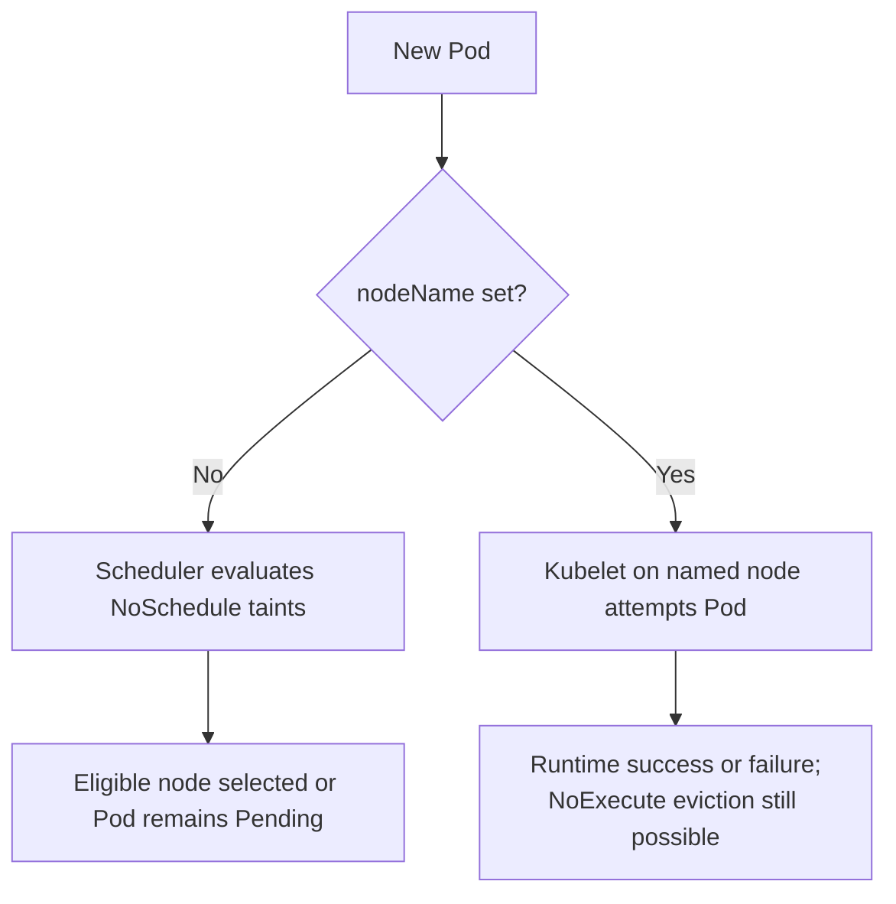

**Safe exercise:** Read the control-plane taint, but do not make it your first target for manual Pod placement. Use a lab worker until this behavior is familiar.

## 4. What if the node name is wrong?

One more experiment reveals something subtle. Creating a Pod object and running its containers are different events.

Write `wrong-node.yaml`:

```yaml
apiVersion: v1
kind: Pod
metadata:
  name: nginx-wrong-node
spec:
  nodeName: cka-lab-no-such-node
  containers:
    - name: nginx
      image: nginx:stable
```

```bash
kubectl apply -f wrong-node.yaml
kubectl get pod nginx-wrong-node -o wide
kubectl describe pod nginx-wrong-node
kubectl get node cka-lab-no-such-node
```

`kubectl apply` can acknowledge the Pod object although the named node does not exist. The Pod cannot run on that nonexistent node. Depending on version and controller behavior, it may remain pending or be removed; do not treat a specific final phase as guaranteed. What you must understand is that **a successful API request does not prove successful execution**.

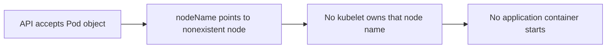

Clean up the experiment:

```bash
kubectl delete -f wrong-node.yaml
```

---

## 5. A new puzzle: Who started the control plane?

We have seen the ordinary path: API server accepts a Pod, scheduler chooses a node, kubelet starts it. But in kubeadm-style clusters, core control-plane programs often run as containers:

- kube-apiserver
- kube-controller-manager
- kube-scheduler
- etcd (in stacked-etcd setups)

Who starts the API server before an API server exists? Who schedules the scheduler before scheduling exists?

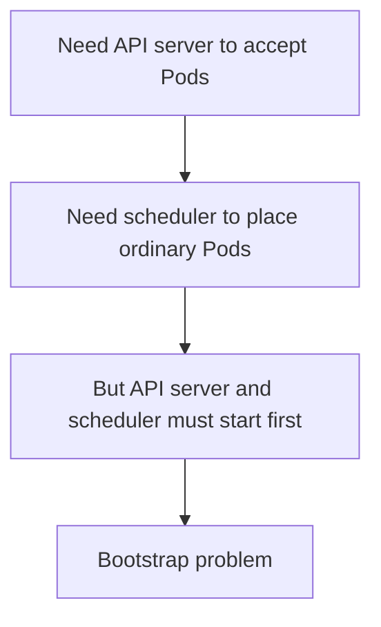

The solution is not a special cloud-only process. It comes from something we already learned in Day 7.1: **the kubelet is a node-local agent**. It can supervise a Pod using a local manifest, without first receiving that Pod definition through the API server.

This is a **static Pod**.

## 6. Static Pods: a separate source of desired state

A normal Pod commonly comes from the Kubernetes API. A static Pod comes from a manifest file that the node's kubelet watches. The kubelet reads the local file, creates the runtime objects, and continues supervising them.

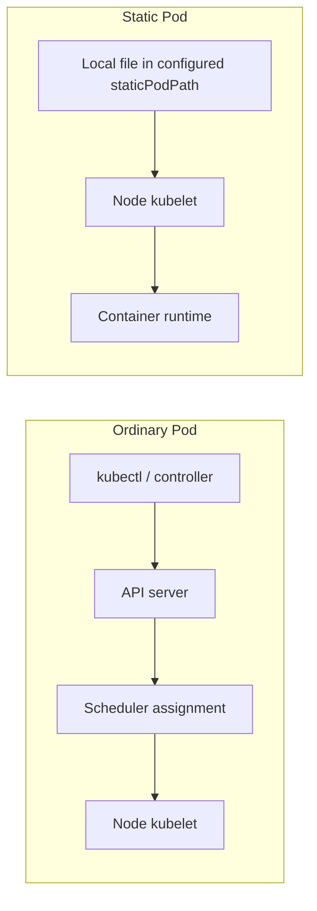

Unlike the direct `nodeName` example, this static Pod is not initially created as an ordinary API object. Its **source of truth is the node-local manifest**.

In kubeadm setups, the conventional manifest directory is `/etc/kubernetes/manifests`, but the actual watched path comes from the kubelet's `staticPodPath` configuration. Do not assume that every Kubernetes distribution uses the same directory.

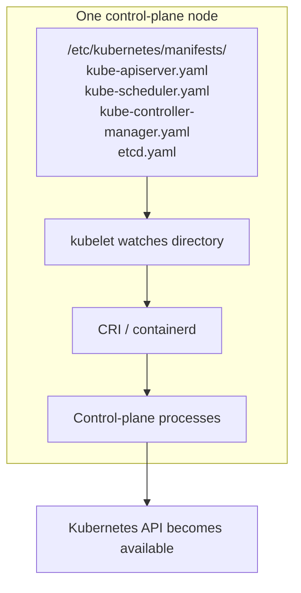

**Important scope:** The transcript demonstrates a kubeadm-style control plane inside kind. Not every managed Kubernetes service exposes these components as static Pods on a node you can access. The model is accurate for this specific bootstrap pattern, not a claim about every Kubernetes installation.

## 7. Why kind adds one more layer to our mental picture

In our local lab, kind itself uses Docker containers as Kubernetes nodes. That sounds strange: Nginx runs in a Pod, the Pod runs on a worker, and that worker is itself a Docker container.

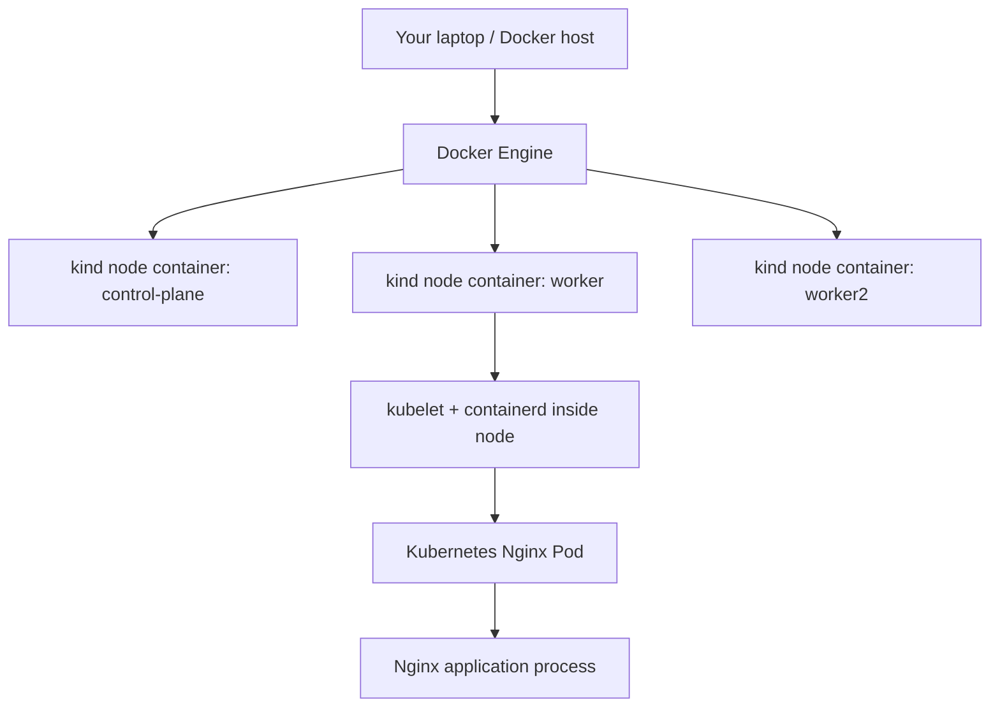

This is a development technique, not the generic architecture of a production worker node. The **node container** is not the **application container**. One is kind's simulated node boundary; the other is the actual workload managed by kubelet/containerd.

For this lab, Docker gives us convenient access to the node filesystem:

```bash
docker ps --format 'table {{.Names}}\t{{.Status}}'
docker exec cka-lab-worker sh -c 'grep staticPodPath /var/lib/kubelet/config.yaml || true'
docker exec cka-lab-control-plane ls /etc/kubernetes/manifests
```

The `ls` output on a kubeadm-style control-plane node will normally include control-plane manifest files. **Do not modify or delete those files.** A typo or accidental removal could break the entire local control plane.

## 8. Create a harmless static Pod on a lab worker

We can test the mechanism on a worker instead of touching critical control-plane manifests. First verify that the worker's kubelet is configured to watch `/etc/kubernetes/manifests`. If it is not, stop and use the actual configured `staticPodPath` rather than guessing.

Create `static-web.yaml` on your laptop:

```yaml
apiVersion: v1
kind: Pod
metadata:
  name: static-web
  namespace: default
  labels:
    exercise: day15-static
spec:
  containers:
    - name: nginx
      image: nginx:stable
      ports:
        - containerPort: 80
```

Now, for the first time in the chapter, **do not use `kubectl apply`**. Copy the manifest onto a kind worker's kubelet-monitored directory:

```bash
docker cp static-web.yaml cka-lab-worker:/etc/kubernetes/manifests/static-web.yaml
```

The worker's kubelet periodically notices the file and creates the static Pod. Check the result:

```bash
kubectl get pods -o wide
kubectl get pods -l exercise=day15-static -o wide
```

Expect a mirror Pod name similar to `static-web-cka-lab-worker`. The node suffix is significant. If it doesn't appear, inspect kubelet configuration and logs in the disposable lab; don't start changing control-plane manifests.

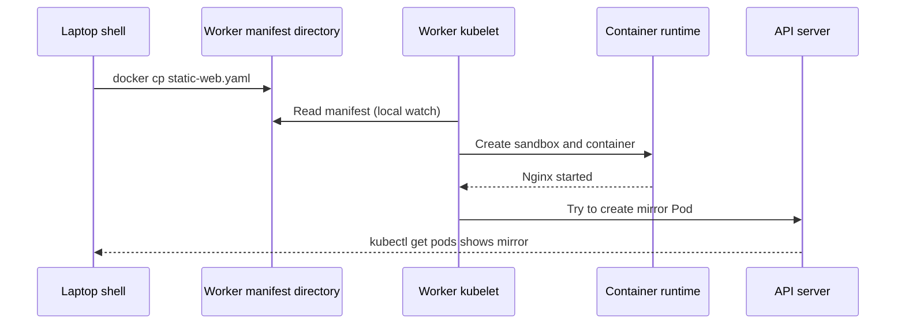

This is the answer to the bootstrap puzzle: the kubelet can supervise local Pod definitions **before the central control plane is operational**.

## 9. Why can kubectl see a static Pod?

This is the next useful contradiction. If the API server did not create the static Pod, how can `kubectl get pods` show it?

The kubelet **tries to publish a mirror Pod** to the API server. A mirror Pod is an API-visible representation of the node-local static Pod, not its source of truth.

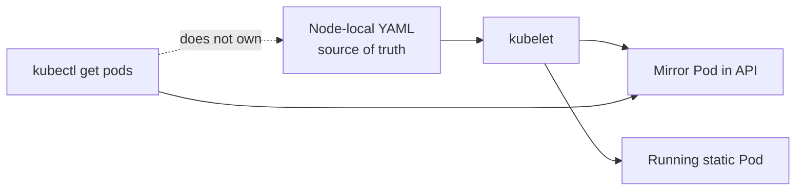

Inspect the representation:

```bash
kubectl get pod static-web-cka-lab-worker -o yaml
kubectl describe pod static-web-cka-lab-worker
```

Look for the `kubernetes.io/config.mirror` annotation. A mirror Pod can be listed or described, but changing or deleting that API representation is **not** how you permanently change the static Pod. The kubelet will try to recreate a deleted mirror Pod while the local file remains.

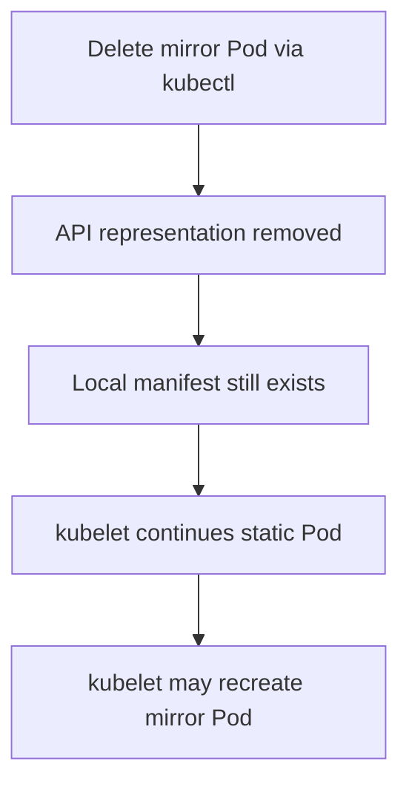

**Distinction:** A static Pod cannot depend on API objects such as a ConfigMap, Secret, or ServiceAccount through its spec in the same way as an ordinary Pod. This makes static Pods suitable for essential bootstrap workloads, but limited as a general application deployment method.

## 10. What actually removes the static Pod?

The genuine configuration lives in the file watched by the kubelet. Remove **only your lab file**:

```bash
docker exec cka-lab-worker rm /etc/kubernetes/manifests/static-web.yaml
kubectl get pods -l exercise=day15-static -o wide
```

Eventually the kubelet recognizes that the desired local Pod is gone, stops its containers, and removes its mirror representation.

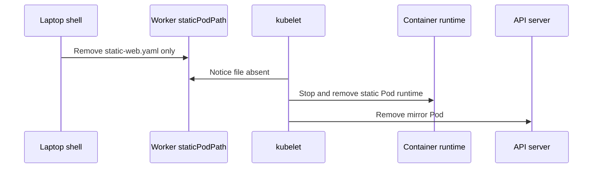

**Operational caution:** The kubelet processes files in its static manifest directory, not merely files ending in `.yaml`. Do not leave backup files in that directory; keep backups elsewhere. Never remove kube-apiserver, scheduler, controller-manager, or etcd manifests to test deletion behavior.

## 11. Compare three Pod creation paths

At this point we can bring the three methods together. They all result in a container process, but their configuration and placement authority differ.

| Question | Ordinary Pod | Pod with `nodeName` | Static Pod |
|---|---|---|---|
| Who supplies the Pod spec? | API user / controller | API user / controller | Node-local file |
| Does scheduler pick its node? | Usually yes | No | No |
| Who starts containers? | Node kubelet/runtime | Named-node kubelet/runtime | Local kubelet/runtime |
| What is the source of desired state? | API object / controller | API object / controller | Local manifest |
| Can kubectl usually see it? | Yes | Yes | Mirror Pod, if published |
| How do we remove it? | Delete API resource / controller | Delete API resource / controller | Remove local manifest |

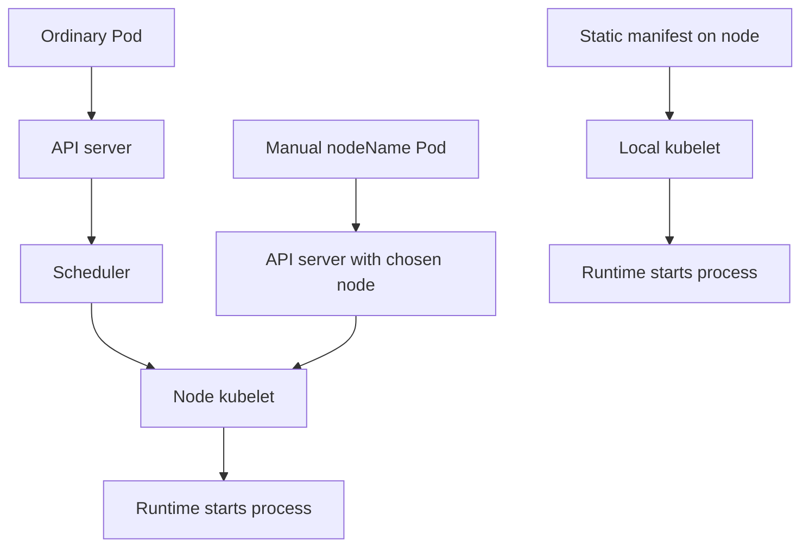

The **node kubelet** is the common executor. Kubernetes has more than one way to tell that kubelet which Pod it should supervise.

## 12. Practice: investigate, predict, and clean up

Before running any command, predict whether it touches the API server, a scheduler decision, or a node-local file.

```bash
# Observe cluster and Pod placement.
kubectl get nodes -o wide
kubectl get pods -o wide
kubectl describe pod nginx-manual

# Extract the assigned node name from the Pod object.
kubectl get pod nginx-manual -o jsonpath='{.spec.nodeName}{"\n"}'

# Look for static Pod mirror annotations on the control plane.
kubectl get pods -n kube-system -o yaml

# Remove only Pods created in the first lab.
kubectl delete pod nginx-auto nginx-manual --ignore-not-found
```

If you used an alternate namespace, include `-n NAMESPACE`. If you used a different node naming scheme, substitute it. Do not delete any control-plane mirror Pods to "clean" the lab.

### Troubleshooting reasoning

**Symptom:** `kubectl apply -f manual-pod.yaml` succeeds, but Pod is not running. Check `.spec.nodeName`, `kubectl get nodes`, and `kubectl describe pod`. API acceptance and node execution are distinct.

**Symptom:** `kubectl get pods` doesn't show a static Pod. Confirm you copied the file to the actual configured `staticPodPath`, then inspect the local kubelet/runtime; the mirror Pod requires API access and permissions.

**Symptom:** Deleting a static Pod via `kubectl` appears ineffective. The mirror representation is not authoritative. Check for the node-local manifest.

## 13. Final mental model

The scheduler is not the component that launches Linux processes. It normally chooses **where** a Pod should execute. The kubelet and runtime are responsible for **making it execute** on the chosen node.

Manual scheduling answers, "What if I choose the node instead?" Static Pods answer, "What if the kubelet learns about the Pod from its own filesystem instead of the API?"

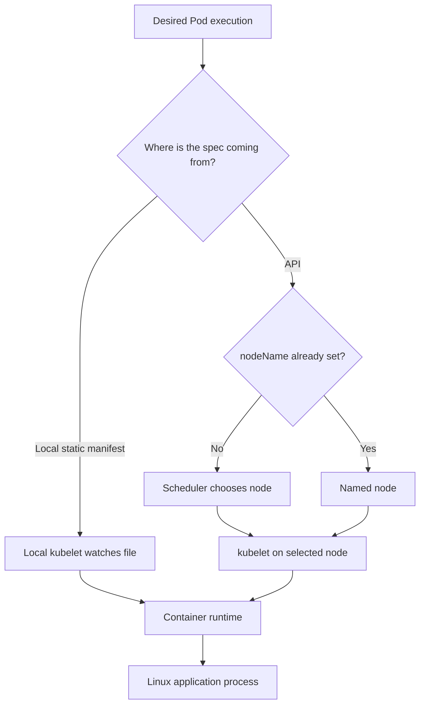

### Check your understanding

1. Why doesn't a `nodeName` Pod need the scheduler?
2. Why does `nodeName` not guarantee the workload can run?
3. How could kube-apiserver run as a container before kube-apiserver was usable?
4. What is the difference between a static Pod and its mirror Pod?
5. Why must the static Pod manifest be removed from the node rather than only from the API?
6. In kind, how is a *node container* different from an Nginx application container?

**Next chapter:** Day 16 examines what the scheduler does when some nodes must reject ordinary workloads. That leads naturally to taints and tolerations.

### Official references

- [Assigning Pods to Nodes](https://kubernetes.io/docs/concepts/scheduling-eviction/assign-pod-node/)
- [Static Pods](https://kubernetes.io/docs/concepts/workloads/pods/static-pods/)
- [Create Static Pods](https://kubernetes.io/docs/tasks/configure-pod-container/static-pod/)

*Transcript alignment: Day 15, manual scheduling and static Pods. Added accuracy notes: direct `nodeName` can bypass `NoSchedule` but not necessarily `NoExecute` eviction; nonexistent nodes need not remain indefinitely Pending; static Pods depend on configured kubelet manifest paths; the mirror Pod is not the authoritative Pod spec.*
