# CKA Day 16 - Taints and Tolerations

> An incremental guide to how nodes reject Pods, how Pods declare exceptions, and why permission to use a node is not a requirement to use it. Embedded Mermaid diagrams and inline command labs; one standalone Markdown file.

## The question that follows Day 15

We learned that the scheduler usually places Pods on nodes after filtering candidates. But a cluster can have workers with very different responsibilities. Some nodes may be reserved for special workloads, while others may be undergoing maintenance. How do we communicate that a node should **not accept arbitrary new Pods**?

The answer from this lesson is **taints and tolerations**. A taint belongs to a **Node**. A toleration belongs to a **Pod**. They do not describe what CPU or disk hardware physically exists; they describe a scheduling and eviction rule that Kubernetes should enforce.

We will use the same small kind lab throughout. Replace example names with the output of `kubectl get nodes`: `cka-lab-control-plane`, `cka-lab-worker`, and `cka-lab-worker2` (assuming the kind cluster is named `cka-lab`). Practice only on a disposable cluster, because we will modify node scheduling rules.

---

## 1. Before any taints: all eligible workers are possible

Picture an Nginx Pod without placement instructions. The scheduler considers eligible nodes. In our simple case the workers have no custom taints or selectors yet, so either worker might be chosen.

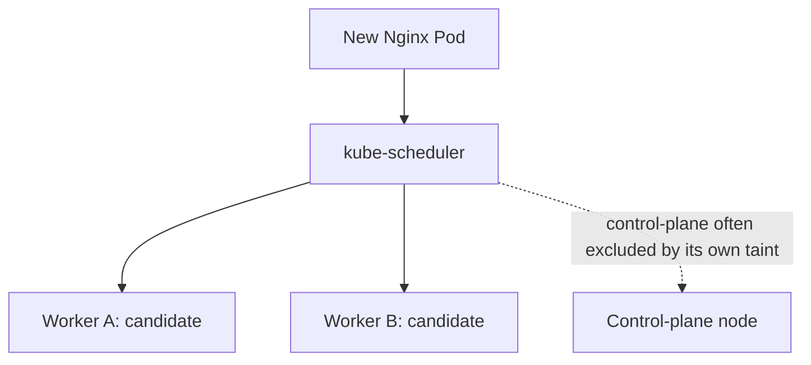

The scheduler considers more than taints, including resources and node health. A diagram of two candidates is not a promise that replicas will be evenly distributed. For now, we only need to know that **both workers can be considered**.

Observe your actual lab:

```bash
kubectl config current-context
kubectl get nodes -o wide
kubectl describe node cka-lab-worker
kubectl describe node cka-lab-worker2
```

Look for the `Taints:` field. You are not changing anything yet. Repeat `kubectl describe node` later, after we add restrictions, and compare the same field.

## 2. The node needs a way to say "keep out"

Suppose Worker A is reserved for a class of storage-sensitive workloads. In the transcript, the instructor demonstrates a taint `storage=SSD:NoSchedule`; we will use lower-case `ssd` consistently in commands, with exactly the same meaning.

A taint has three parts:

```text
key=value:effect
storage=ssd:NoSchedule
```

- **Key**: what property or rule the administrator is representing (`storage`).
- **Value**: which category is assigned (`ssd`).
- **Effect**: what Kubernetes should do when a Pod does not tolerate the taint (`NoSchedule`).

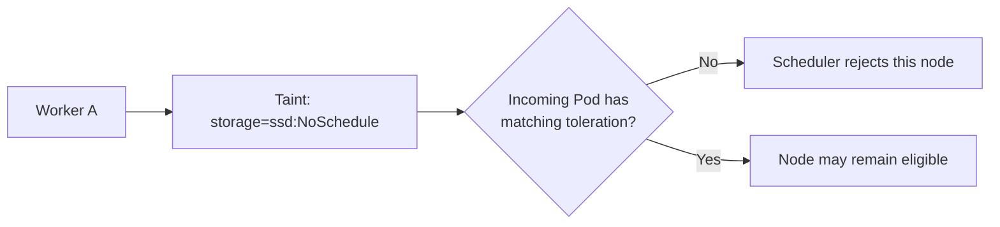

Notice the last phrase: **may remain eligible**, not *must be selected*. A matching toleration removes a taint-based objection. It is not a command to select that node.

## 3. Apply the first taint and observe the difference

First verify node names:

```bash
kubectl get nodes
```

Then use the imperative command introduced in the video:

```bash
kubectl taint nodes cka-lab-worker storage=ssd:NoSchedule
kubectl describe node cka-lab-worker
```

The second command should show a `Taints:` entry containing `storage=ssd:NoSchedule`. We have not created a new namespace, Pod, or Service. We changed **the Node object's scheduling metadata**.

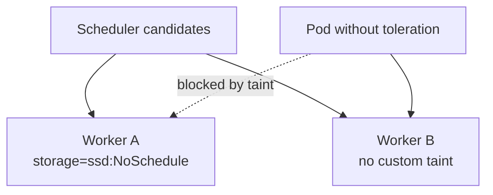

Run `kubectl get nodes` after the change. Both nodes can still show `Ready`. A taint does **not** mean a node is physically broken or offline. It signals placement rules.

## 4. Reserve the second worker too: why does a normal Pod remain Pending?

We will add a different taint to Worker B so that the example contains no ordinary untainted worker:

```bash
kubectl taint nodes cka-lab-worker2 storage=hdd:NoSchedule
kubectl describe node cka-lab-worker2
```

Now create a Pod that has no relevant toleration:

```bash
kubectl run ordinary-nginx --image=nginx:stable --restart=Never
kubectl get pods -o wide
kubectl describe pod ordinary-nginx
```

If the control-plane node also carries its conventional `NoSchedule` taint, this Pod should stay **Pending** because none of the three nodes is eligible. If the control plane is intentionally untainted in your setup, placement may differ; verify its `Taints:` field rather than assuming the transcript's result.

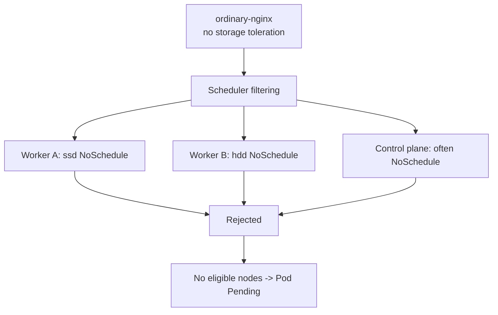

**Read the evidence, not just the phase:** `kubectl describe pod ordinary-nginx` typically contains a `FailedScheduling` event explaining why candidate nodes were rejected. That event is far more useful for troubleshooting than simply memorizing that `Pending` means "not running."

## 5. Give a Pod permission: a toleration

Now suppose our Nginx application is allowed onto Worker A. A matching toleration belongs under the **Pod spec**. If we use a Deployment, it belongs under `spec.template.spec` because we are configuring the Pods the Deployment will create.

Write `ssd-app.yaml`:

```yaml
apiVersion: apps/v1
kind: Deployment
metadata:
  name: ssd-app
spec:
  replicas: 3
  selector:
    matchLabels:
      app: ssd-app
  template:
    metadata:
      labels:
        app: ssd-app
    spec:
      tolerations:
        - key: "storage"
          operator: "Equal"
          value: "ssd"
          effect: "NoSchedule"
      containers:
        - name: nginx
          image: nginx:stable
          ports:
            - containerPort: 80
```

Read the toleration as a sentence: "If a node has the `NoSchedule` taint with key `storage` and value `ssd`, this Pod can tolerate that restriction."

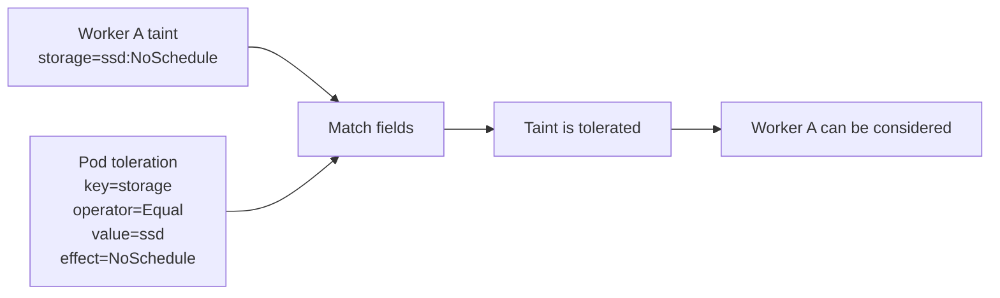

Now apply and inspect:

```bash
kubectl apply -f ssd-app.yaml
kubectl get deployment ssd-app
kubectl get pods -l app=ssd-app -o wide
kubectl describe deployment ssd-app
```

In a three-node kind cluster with both workers tainted as above and a tainted control plane, these replicas can normally land on Worker A because the Pod tolerates `ssd` but not `hdd`. The normal scheduler still makes the placement decision and must consider CPU, memory, and other constraints.

**Repeat the key command** after changing `replicas: 3` to `replicas: 5` and reapplying. New Pods will have the same toleration; that does not guarantee Worker A has unlimited capacity.

```bash
kubectl apply -f ssd-app.yaml
kubectl get pods -l app=ssd-app -o wide
```

## 6. A matching toleration is permission, not attraction

This subtle distinction is the most important idea in Days 16-18.

Imagine we remove Worker B's taint. A Pod with an `ssd` toleration is now eligible for **both** Worker A (it tolerates the taint) and Worker B (there is no taint to tolerate). It does not necessarily prefer Worker A.

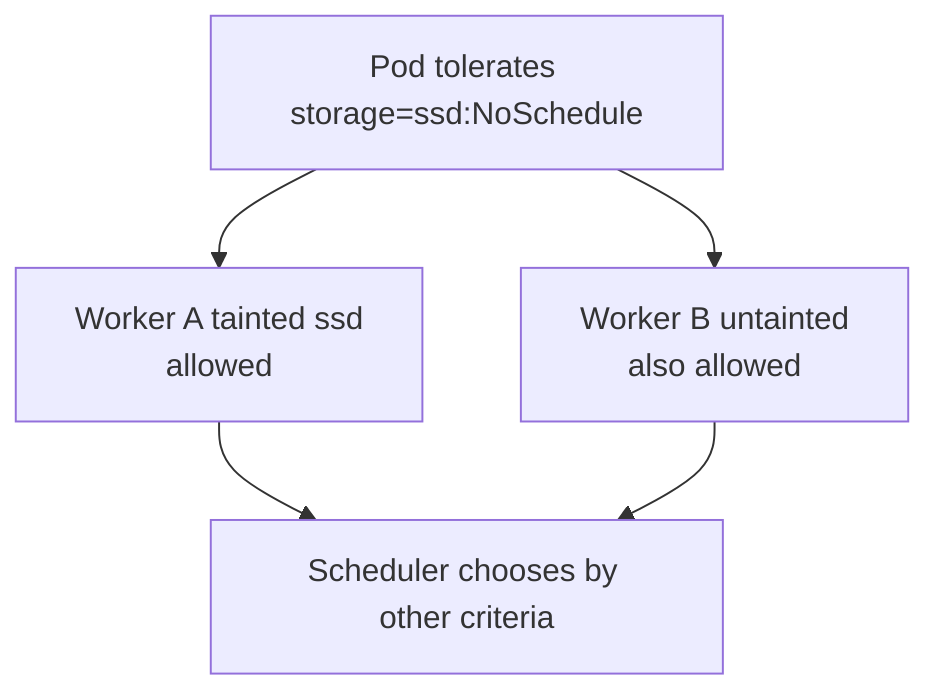

Tolerations tell us which taints **do not disqualify** a Pod. When we later require a Pod to run specifically on SSD-labeled nodes, we will add `nodeSelector` or node affinity. This is why taints and affinity are complementary, not competing features.

## 7. The `Exists` operator: match a key without caring about its value

So far we matched an exact value: `ssd`. In the transcript the instructor then demonstrates a more permissive rule. A Pod may tolerate **any** `storage=...:NoSchedule` taint by using `Exists`:

```yaml
spec:
  tolerations:
    - key: "storage"
      operator: "Exists"
      effect: "NoSchedule"
```

This is a **Pod-spec fragment**, not a complete resource to apply directly. Use it under `spec` of a Pod or under `spec.template.spec` of a Deployment.

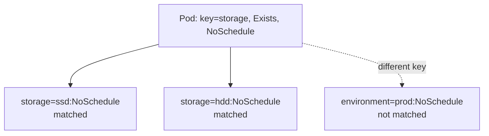

Compare the two operators carefully:

| Toleration | `storage=ssd:NoSchedule` | `storage=hdd:NoSchedule` |
|---|---|---|
| `Equal`, value `ssd` | Matches | Does not match |
| `Exists`, key `storage` | Matches | Matches |

Notice that `Exists` is **not** equivalent to "schedule this Pod onto both nodes." It merely clears the `storage` restrictions; other constraints can still reject a node.

## 8. Multiple taints: every remaining hard objection matters

Now suppose the administrator adds an environment restriction to each worker:

```bash
kubectl taint nodes cka-lab-worker environment=prod:NoSchedule
kubectl taint nodes cka-lab-worker2 environment=dev:NoSchedule
kubectl describe node cka-lab-worker
kubectl describe node cka-lab-worker2
```

Worker A now has **two** taints: `storage=ssd:NoSchedule` and `environment=prod:NoSchedule`.

A Pod that tolerates only storage still cannot run there. Its other unmatched `NoSchedule` taint remains in force. Add a second toleration:

```yaml
spec:
  tolerations:
    - key: "storage"
      operator: "Exists"
      effect: "NoSchedule"
    - key: "environment"
      operator: "Equal"
      value: "prod"
      effect: "NoSchedule"
```

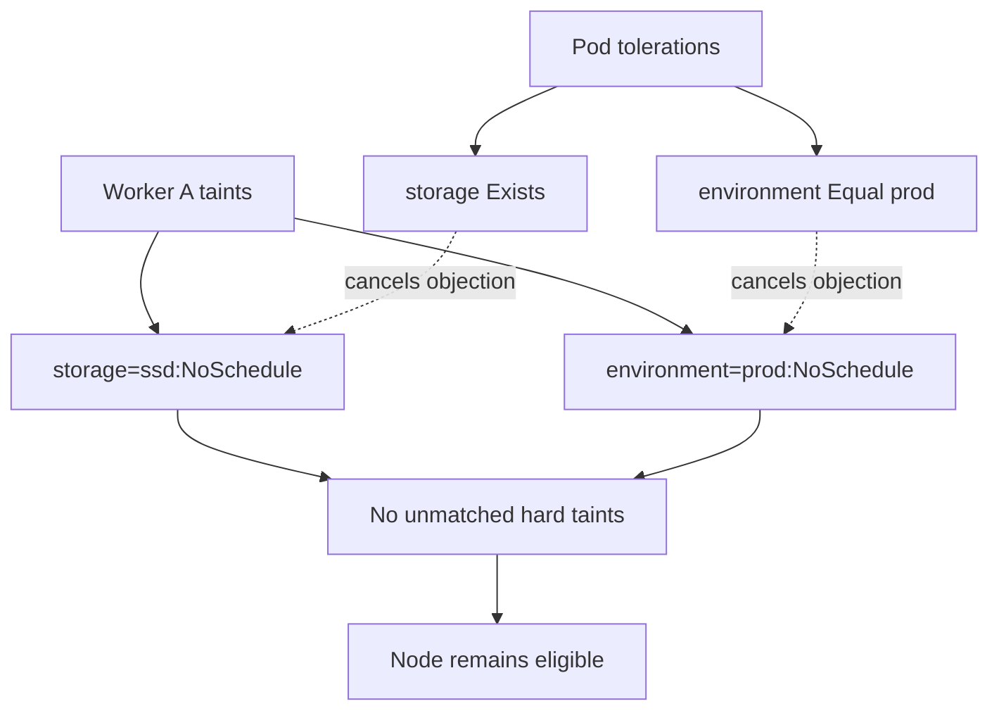

A useful mental algorithm is: collect the node's taints; subtract every taint tolerated by the Pod; then look at what remains. Any remaining `NoSchedule` taint blocks new scheduling there. This same logic extends to other taint effects.

**Why the YAML is a list:** a Pod can have multiple tolerations because a node can carry multiple taints. The order of list entries is not important for matching.

## 9. Understand all three taint effects

Until now we have used `NoSchedule`. The video introduces two more effects, and they change the story from simple admission to an already-running Pod's lifetime.

### 9.1 `NoSchedule`: block new placement

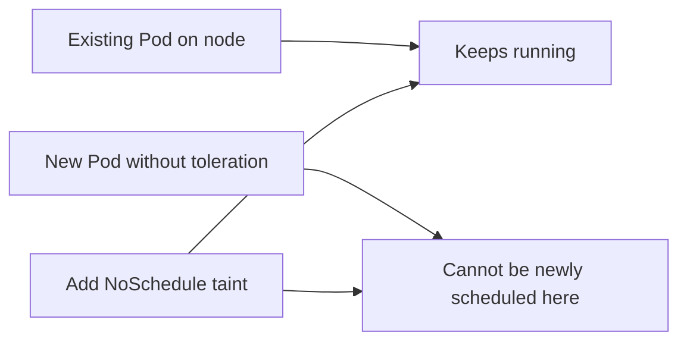

`NoSchedule` does not evict an already-running Pod merely because the taint was added. If that Pod is later replaced, the **replacement is a new scheduling decision** and can be blocked.

### 9.2 `PreferNoSchedule`: a soft warning

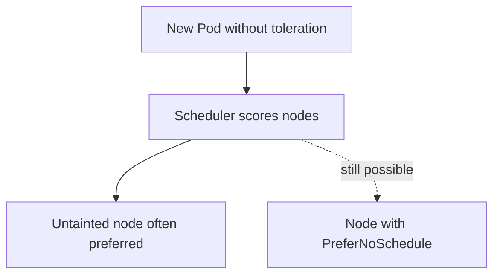

Kubernetes tries to avoid the tainted node, but may still place the Pod there. That behavior is not guaranteed to follow a fixed first-choice/second-choice ordering; other scheduler scores matter.

### 9.3 `NoExecute`: affect existing Pods too

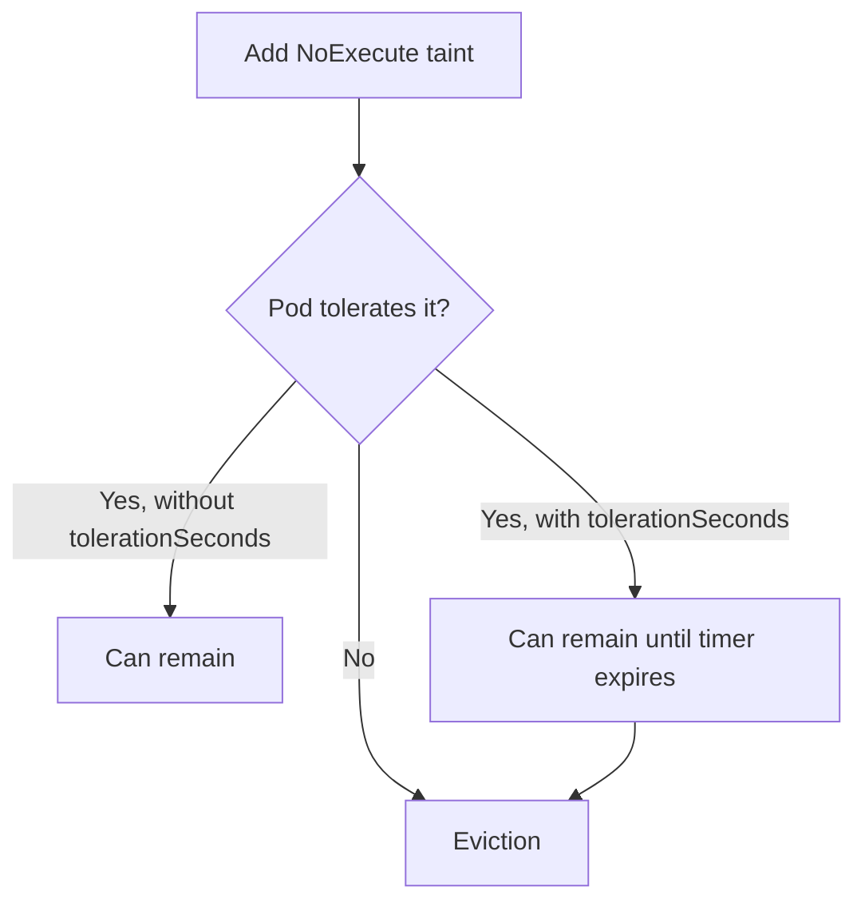

`NoExecute` also prevents new Pods without a suitable toleration from staying on that node. A time-limited toleration might look like this:

```yaml
tolerations:
  - key: "maintenance"
    operator: "Equal"
    value: "true"
    effect: "NoExecute"
    tolerationSeconds: 60
```

This fragment means: after the `maintenance=true:NoExecute` taint applies, the Pod may tolerate it for **60 seconds** and then becomes eligible for eviction, unless the taint is removed first. The exact progress of eviction is asynchronous; don't expect it to occur on a perfectly timed boundary.

**Safety:** Do not experiment with `NoExecute` on a node running important workloads. In this guide, understand its behavior conceptually unless you have a disposable cluster and intend to test eviction.

## 10. How multiple tolerations interact with node health

Kubernetes itself can add taints for node conditions such as `node.kubernetes.io/not-ready`, `node.kubernetes.io/unreachable`, or resource pressure. That's why taints aren't only administrator-written rules for storage tiers. They are part of the cluster's normal scheduling and failure behavior.

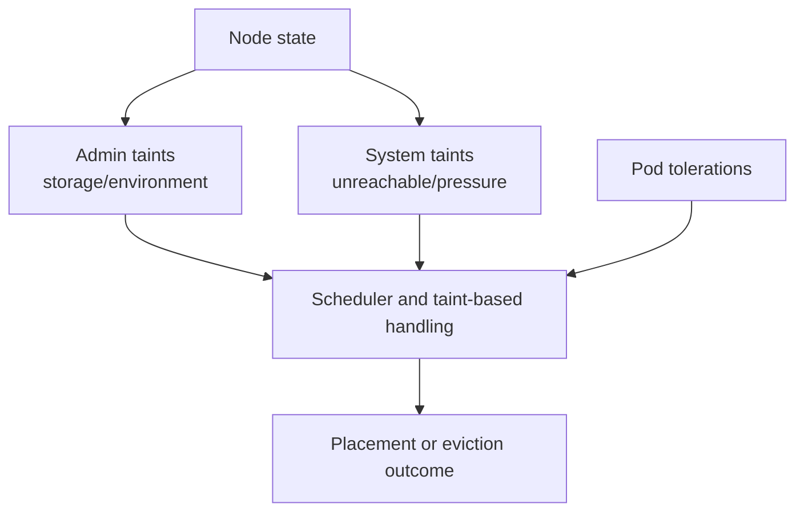

Do not broadly tolerate every system taint just to make a Pending Pod run. First inspect the Pod's scheduling events and decide whether tolerating that condition would be safe.

## 11. The scheduler still handles the final choice

Let's rebuild the actual decision process. Taint matching is one filter within a much larger scheduler pipeline. It does not allocate GPUs, verify storage performance, or ensure that the node has enough memory.

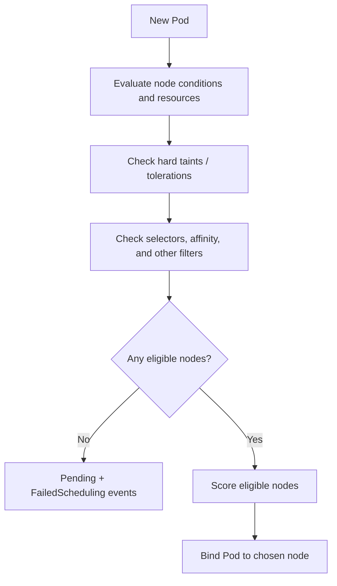

A custom taint such as `storage=ssd` is merely a label-like rule chosen by an administrator; it does **not** prove that SSD hardware exists. We need accurate node inventory and, for specific hardware, appropriate resource requests and placement constraints.

## 12. A repeatable investigation pattern

A CKA exercise rarely says, "Please admire the taint in YAML." Usually it gives you a Pod stuck in Pending state. Learn this sequence by repeating it after every lab change:

```bash
# 1. See the Pod and placement.
kubectl get pods -o wide

# 2. Read scheduler events.
kubectl describe pod ordinary-nginx

# 3. Inspect node taints and conditions.
kubectl describe node cka-lab-worker
kubectl describe node cka-lab-worker2

# 4. Inspect Pod's actual tolerations.
kubectl get deployment ssd-app -o yaml

# 5. Confirm results after a change.
kubectl get pods -l app=ssd-app -o wide
```

In the Deployment YAML, remember where to look: `spec.template.spec.tolerations`, not `spec.tolerations` at the Deployment's top level.

### Cleanup: return lab workers to their original state

Only run these if you added the exact taints shown in this chapter:

```bash
kubectl delete deployment ssd-app --ignore-not-found
kubectl delete pod ordinary-nginx --ignore-not-found

kubectl taint nodes cka-lab-worker storage=ssd:NoSchedule-
kubectl taint nodes cka-lab-worker2 storage=hdd:NoSchedule-
kubectl taint nodes cka-lab-worker environment=prod:NoSchedule-
kubectl taint nodes cka-lab-worker2 environment=dev:NoSchedule-

kubectl describe node cka-lab-worker
kubectl describe node cka-lab-worker2
```

If a command reports a taint was not found, inspect the node; you may have already removed it. Do **not** remove the control-plane taint as part of cleanup: it was not created by this lab.

## 13. Final mental model

Day 15 taught us that the scheduler normally selects a node. Day 16 adds an important question before selection: **which nodes refuse this Pod?** A node taint says "avoid me unless you have the matching exception." A Pod toleration supplies that exception.

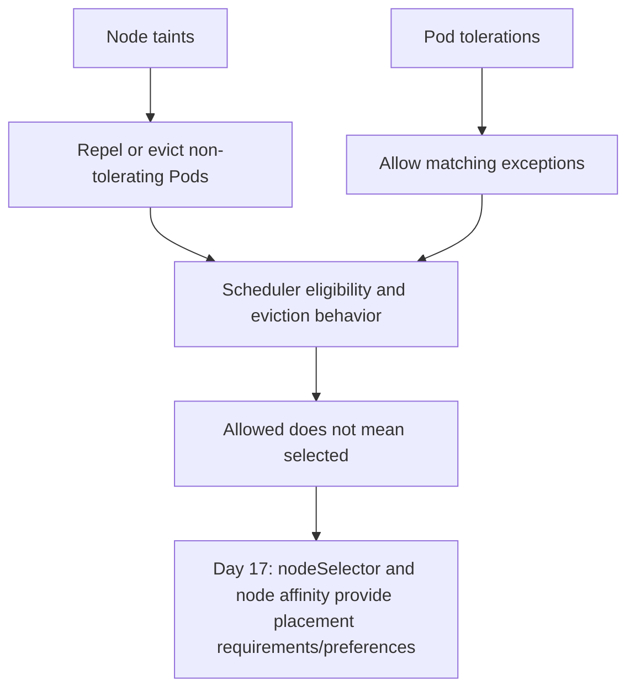

### Check your understanding

1. Why does an `ssd` toleration not prove that the Pod will run on the SSD-designated worker?
2. Why can a Pod remain Pending even when all nodes are Ready?
3. How does `Exists` differ from `Equal`?
4. With two `NoSchedule` taints and one matching toleration, what happens?
5. Which taint effect can evict already-running Pods?
6. Why is a manually assigned `nodeName` Pod a special case when reasoning about `NoSchedule`?

**Next:** Day 17 will let Pods *request* or *prefer* particular node labels, solving the placement problem tolerations alone cannot solve.

### Official reference

- [Taints and Tolerations](https://kubernetes.io/docs/concepts/scheduling-eviction/taint-and-toleration/)
- [Assigning Pods to Nodes](https://kubernetes.io/docs/concepts/scheduling-eviction/assign-pod-node/)

*Transcript alignment: Day 16, node taints, Pod tolerations, `Equal`/`Exists`, multiple taints, and the three effects. Added accuracy notes: tolerations do not attract Pods; scheduler results are not predetermined by colors or replica counts; `NoExecute` has time-bounded tolerance behavior; custom `storage` taints do not verify hardware.*
