# CKA Day 17 - Node Selectors and Node Affinity

> A continuous learning chapter about requesting where Pods should run. Build from simple equality matching to expressive required and preferred rules, while learning kubectl by observing the same worker nodes. All diagrams are embedded Mermaid.

## The problem left unresolved by Day 16

Taints told nodes to reject certain Pods; tolerations allowed specific Pods through. But we finished with an awkward possibility: a Pod that tolerates an SSD-designated node might still be scheduled on an untainted HDD node. Its toleration expresses **permission**, not **preference or requirement**.

This chapter adds the complementary mechanism: **Pod-driven node selection**. A Pod can say, "I require nodes labeled `storage=ssd`" or "I would prefer SSD nodes, but an HDD node is acceptable."

We'll follow a single Nginx Deployment through several increasingly expressive placement requests. Our disposable kind cluster has `cka-lab-worker` and `cka-lab-worker2`. Run `kubectl get nodes` and replace the names if your cluster is different. This lab assumes Day 16's custom taints have been removed; otherwise, the results will differ because taints and affinity are both enforced.

---

## 1. Start with heterogeneous workers

Imagine Worker A is an SSD tier and Worker B an HDD tier. The instructor also uses environment labels such as `env=prod`. We will use exactly those kinds of metadata, while noting an important distinction: **labels describe nodes; they do not check the underlying hardware**.

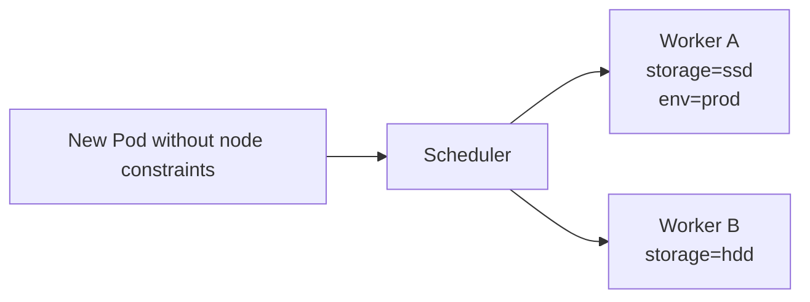

Before adding anything, inspect the labels already attached to real nodes:

```bash
kubectl get nodes
kubectl get nodes --show-labels
kubectl describe node cka-lab-worker
kubectl describe node cka-lab-worker2
```

You will see built-in labels such as `kubernetes.io/os=linux` and, depending on the cluster, topology or node-role labels. We are going to add **custom** labels for the exercise.

```bash
kubectl label nodes cka-lab-worker storage=ssd
kubectl label nodes cka-lab-worker2 storage=hdd
kubectl get nodes -L storage
```

The `-L storage` flag creates a compact column showing the chosen label. Repeat it throughout the lab rather than scanning the full label list every time.

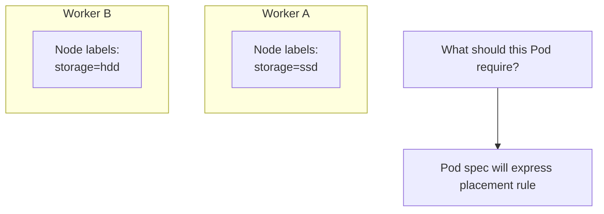

## 2. The simplest placement requirement: nodeSelector

Suppose our application genuinely needs the SSD node class. We can add a `nodeSelector` beneath the **Pod spec**. That tells the scheduler to consider only nodes whose labels match **every key/value pair**.

A standalone Pod fragment looks like this:

```yaml
spec:
  nodeSelector:
    storage: ssd
```

For a Deployment, we nest the same field under `spec.template.spec`. Write a complete `selector-app.yaml`:

```yaml
apiVersion: apps/v1
kind: Deployment
metadata:
  name: selector-app
spec:
  replicas: 3
  selector:
    matchLabels:
      app: selector-app
  template:
    metadata:
      labels:
        app: selector-app
    spec:
      nodeSelector:
        storage: ssd
      containers:
        - name: nginx
          image: nginx:stable
          ports:
            - containerPort: 80
```

Stop and distinguish the two different **selectors** in this manifest:

- The Deployment's `spec.selector.matchLabels` chooses the Pods managed by its ReplicaSet.
- The Pod's `spec.template.spec.nodeSelector` filters **Nodes** eligible to run those Pods.

Same general idea of label matching; very different objects being selected.

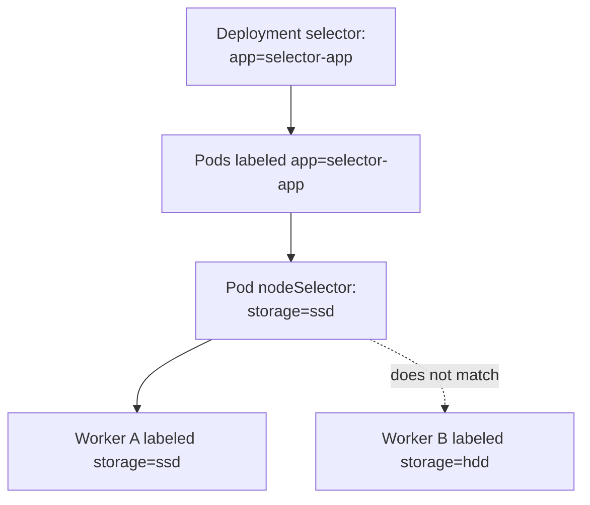

Run the chapter's first deployment:

```bash
kubectl apply -f selector-app.yaml
kubectl get deployments
kubectl get pods -l app=selector-app -o wide
kubectl get nodes -L storage
```

With the labels as configured and sufficient resources, all three replicas should be placed on Worker A. If they remain Pending, inspect events before drawing conclusions:

```bash
kubectl describe pod <POD_NAME>
```

Replace `<POD_NAME>` with one of the actual Pod names from `kubectl get pods`. Avoid typing the placeholder literally.

## 3. Why multiple nodeSelector fields act as AND

Now we add another requirement: the node must be both SSD **and** production-designated. Change the Pod spec:

```yaml
nodeSelector:
  storage: ssd
  env: prod
```

At this moment, neither node has `env=prod`. The first worker has `storage=ssd`, but that is insufficient.

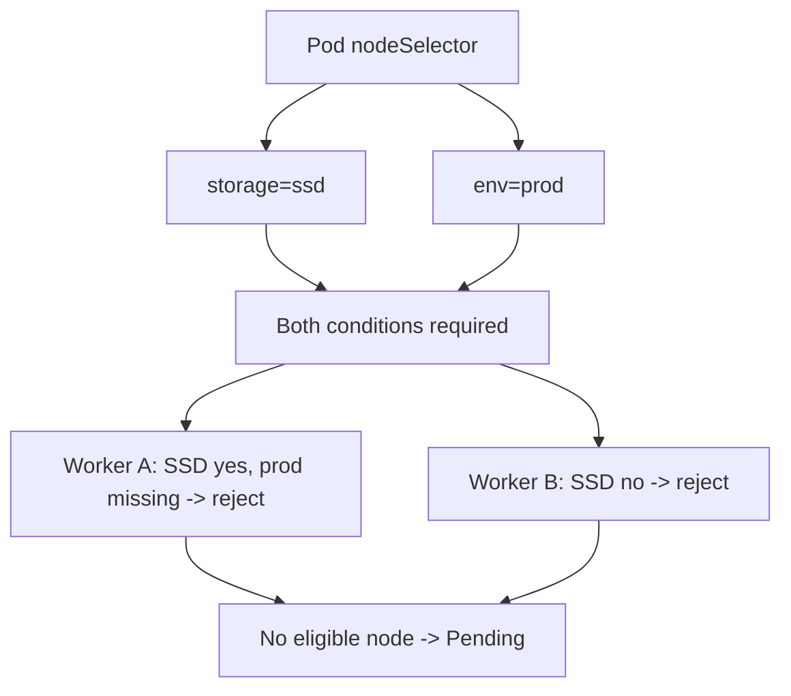

Reapply the edited file. Since the Deployment Pod template changed, a new rollout will create Pods with the updated selector. Observe the new Pods and events:

```bash
kubectl apply -f selector-app.yaml
kubectl get pods -l app=selector-app -o wide
kubectl describe deployment selector-app
```

Now add the missing label and watch the scheduler make progress:

```bash
kubectl label nodes cka-lab-worker env=prod
kubectl get nodes -L storage,env
kubectl get pods -l app=selector-app -o wide
```

The Pod that previously lacked any eligible node can now be scheduled on Worker A. The key idea is not that we "restarted the scheduler." The scheduler was already watching for placement opportunities and node updates.

## 4. What if the node loses a label after the Pod is running?

Remove `env=prod` from Worker A **after** the Pods are running:

```bash
kubectl label nodes cka-lab-worker env-
kubectl get nodes -L storage,env
kubectl get pods -l app=selector-app -o wide
```

Existing Pods generally remain on the node. Node selectors are checked during scheduling, not continuously enforced as an eviction rule. However, if a Pod is replaced, its new Pod object must be scheduled again and may become Pending.

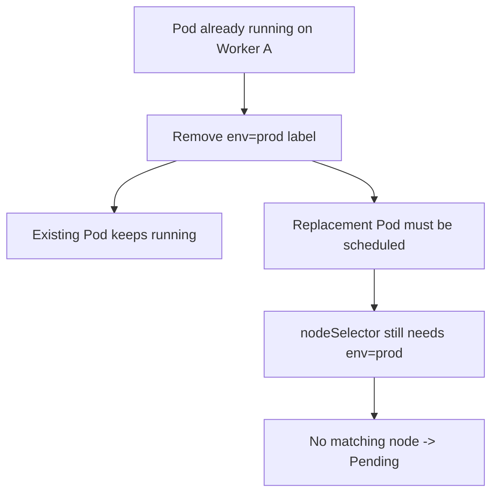

This matches the "ignored during execution" intuition we will see explicitly in node affinity. It does not mean Kubernetes magically migrates already-running Pods when you change node labels.

Restore the label and delete the Deployment before the next exercise:

```bash
kubectl label nodes cka-lab-worker env=prod
kubectl delete deployment selector-app
```

## 5. The first limitation: nodeSelector cannot express OR

Consider a developer request: "Use either SSD or HDD nodes, but avoid anything else." A `nodeSelector` map cannot express `storage=ssd OR storage=hdd`. One key has one exact required value.

This leads naturally to **node affinity**, which supports richer expressions. We need a syntax that can encode both alternatives and multiple conditions.

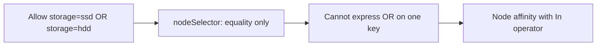

## 6. Required node affinity: a hard rule, but more expressive

Let's introduce the complete required rule slowly. In a Pod spec, we create an `affinity` section, then a `nodeAffinity` section, then `requiredDuringSchedulingIgnoredDuringExecution`.

```yaml
spec:
  affinity:
    nodeAffinity:
      requiredDuringSchedulingIgnoredDuringExecution:
        nodeSelectorTerms:
          - matchExpressions:
              - key: storage
                operator: In
                values:
                  - ssd
                  - hdd
```

This is a **Pod-spec fragment**. Do not apply it as a standalone Kubernetes object. Under a Deployment, it belongs at `spec.template.spec.affinity`.

Read the expression as a sentence: "Schedule only if the node has a `storage` label whose value is in the set [`ssd`, `hdd`]." It is a strict requirement, just like `nodeSelector`, but it allows multiple acceptable values.

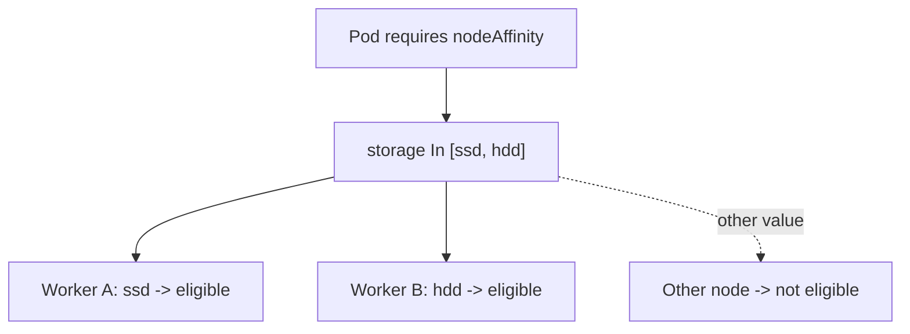

Write `affinity-app.yaml`:

```yaml
apiVersion: apps/v1
kind: Deployment
metadata:
  name: affinity-app
spec:
  replicas: 4
  selector:
    matchLabels:
      app: affinity-app
  template:
    metadata:
      labels:
        app: affinity-app
    spec:
      affinity:
        nodeAffinity:
          requiredDuringSchedulingIgnoredDuringExecution:
            nodeSelectorTerms:
              - matchExpressions:
                  - key: storage
                    operator: In
                    values: [ssd, hdd]
      containers:
        - name: nginx
          image: nginx:stable
```

Observe the eligible nodes and resulting placement:

```bash
kubectl apply -f affinity-app.yaml
kubectl get pods -l app=affinity-app -o wide
kubectl get nodes -L storage,env
```

Both workers now qualify *by the node-affinity rule*. Their final number of Pods is not guaranteed to be equal; other scheduler factors still affect placement.

## 7. Required affinity can express AND and OR at different levels

This is where YAML indentation matters because its nested lists encode logic. Study this slowly:

```yaml
nodeSelectorTerms:
  - matchExpressions:
      - key: storage
        operator: In
        values: [ssd]
      - key: env
        operator: In
        values: [prod]
  - matchExpressions:
      - key: storage
        operator: In
        values: [hdd]
      - key: env
        operator: In
        values: [dev]
```

The scheduler reads the rule as:

**(storage=ssd AND env=prod) OR (storage=hdd AND env=dev).**

- Expressions **inside one `nodeSelectorTerm`** are ANDed.
- Separate `nodeSelectorTerms` are ORed.

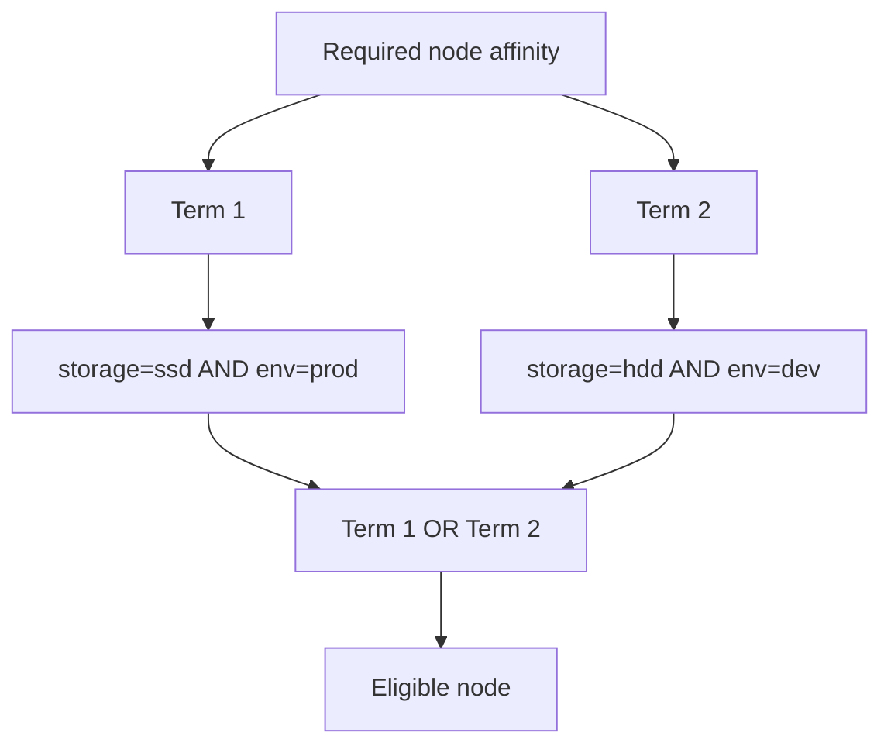

This adds precisely the logical flexibility that `nodeSelector` lacked. `nodeSelector` and required node affinity are not competing layers of execution; if both are defined, **both must match**.

**Hands-on extension:** Add `env=dev` to Worker B, replace the earlier required rule in `affinity-app.yaml` with the two-term version, and reapply. Then use `kubectl get pods -o wide` and `kubectl get nodes -L storage,env` to see which nodes remain eligible.

## 8. Why a hard rule is sometimes too strict

A production application might prefer fast storage but be able to function on slower storage. An SSD-only required rule would make the Pod Pending during an SSD capacity shortage, even if HDD nodes were free. That isn't the availability behavior the application owner wants.

We need a **preference**, not an absolute requirement.

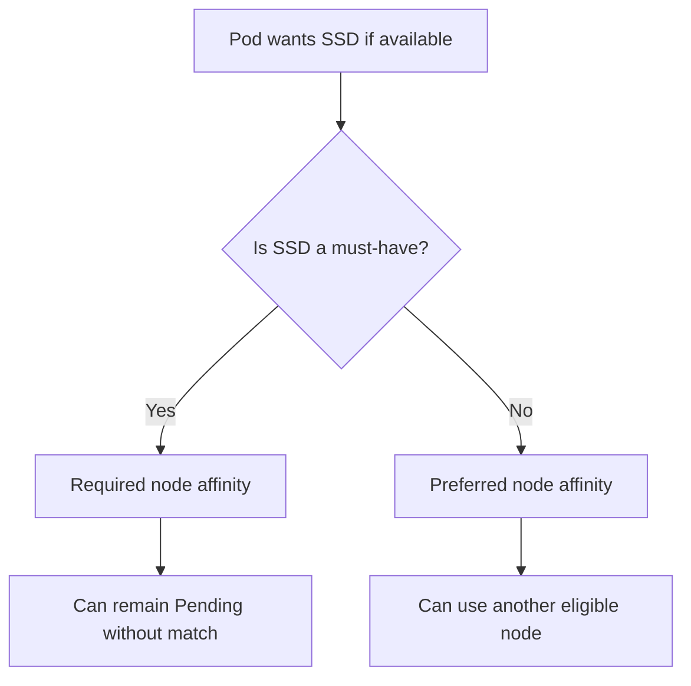

## 9. Preferred affinity: scoring rather than excluding

The second affinity mode is `preferredDuringSchedulingIgnoredDuringExecution`. It assigns weights (1 through 100) to preferences. A matching preference adds to a candidate node's scheduler score; it is **not** a probability or a guaranteed allocation ratio.

Example Pod-spec fragment:

```yaml
affinity:
  nodeAffinity:
    preferredDuringSchedulingIgnoredDuringExecution:
      - weight: 10
        preference:
          matchExpressions:
            - key: storage
              operator: In
              values: [ssd]
      - weight: 5
        preference:
          matchExpressions:
            - key: storage
              operator: In
              values: [hdd]
```

This says SSD is more desirable than HDD *according to these affinity rules*. It does not say 10 Pods must be SSD and 5 must be HDD. Other scoring plugins, resource availability, and cluster state influence the final decision.

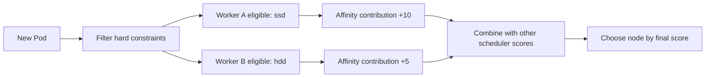

### Full preferred-affinity Deployment

Write `affinity-preferred.yaml`:

```yaml
apiVersion: apps/v1
kind: Deployment
metadata:
  name: affinity-preferred
spec:
  replicas: 8
  selector:
    matchLabels:
      app: affinity-preferred
  template:
    metadata:
      labels:
        app: affinity-preferred
    spec:
      affinity:
        nodeAffinity:
          preferredDuringSchedulingIgnoredDuringExecution:
            - weight: 10
              preference:
                matchExpressions:
                  - key: storage
                    operator: In
                    values: [ssd]
            - weight: 5
              preference:
                matchExpressions:
                  - key: storage
                    operator: In
                    values: [hdd]
      containers:
        - name: nginx
          image: nginx:stable
```

```bash
kubectl apply -f affinity-preferred.yaml
kubectl get pods -l app=affinity-preferred -o wide
kubectl scale deployment affinity-preferred --replicas=12
kubectl get pods -l app=affinity-preferred -o wide
```

The transcript observed a roughly 70/30 distribution in one experiment. Treat that as one lab observation, **not** a behavior Kubernetes guarantees from weights 10 and 5. If every replica lands on one node, first investigate node eligibility and current scoring context before assuming affinity malfunctioned.

## 10. Combining required and preferred affinity

Sometimes the application has a non-negotiable condition **and** an optimization. For example, it must run on Linux, but prefers SSD storage. Combine both rule families inside the same nodeAffinity structure.

```yaml
affinity:
  nodeAffinity:
    requiredDuringSchedulingIgnoredDuringExecution:
      nodeSelectorTerms:
        - matchExpressions:
            - key: kubernetes.io/os
              operator: In
              values: [linux]
    preferredDuringSchedulingIgnoredDuringExecution:
      - weight: 80
        preference:
          matchExpressions:
            - key: storage
              operator: In
              values: [ssd]
```

The scheduler first filters for Linux nodes. Among *eligible* nodes it scores the SSD preference. No amount of preferred weight can make a node pass a failed hard requirement.

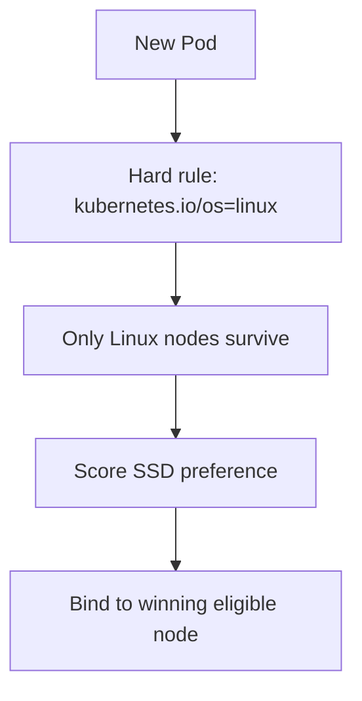

## 11. Other node-affinity operators

The transcript introduces additional match-expression operators. They all evaluate **node label data**, not live hardware probes.

| Operator | Meaning | Example |
|---|---|---|
| `In` | Value is among listed values | `storage In [ssd, hdd]` |
| `NotIn` | Value is outside listed values | `env NotIn [dev]` |
| `Exists` | Label key is present | `high-memory Exists` |
| `DoesNotExist` | Label key is absent | `dedicated DoesNotExist` |
| `Gt` | Integer label value greater than threshold | `cpu-class Gt [4]` |
| `Lt` | Integer label value less than threshold | `disk-class Lt [500]` |

For `Gt`/`Lt`, the **label value** must be parseable as an integer; this does not inspect actual node CPU capacity or disk size. Use resource requests to describe real Pod consumption, not labels such as `cpu-class=8` as a substitute.

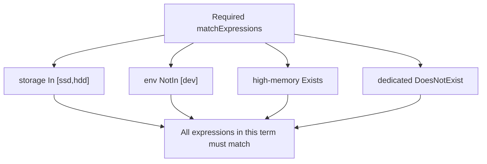

The operators `NotIn` and `DoesNotExist` can produce *node-avoidance* behavior. That is not the same thing as **inter-Pod anti-affinity**, which reasons about other Pods' labels and topology. The video focuses on **node** constraints; we won't jump into inter-Pod affinity here.

## 12. One last correction: a label alone does not reserve a node

Adding `storage=ssd` to Worker A does not stop ordinary Pods with no `nodeSelector` or affinity from being scheduled there. Node labels are descriptors; they don't repel workloads.

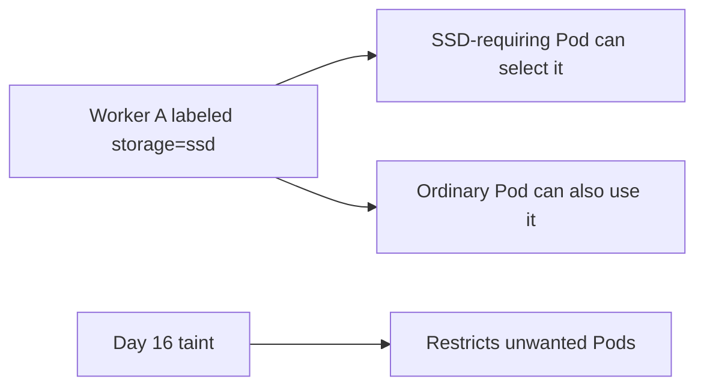

This is exactly why our next lesson compares taints with affinity and eventually uses both together. For now, keep the two ideas distinct:

**Taint**: the node repels Pods lacking an exception. **Node affinity**: the Pod requires or prefers a node with matching labels.

## 13. A CKA investigation routine you can repeat

Whenever a Pod is Pending and you suspect node selection, investigate in the same order:

```bash
# 1. Find Pod phase and assignment.
kubectl get pods -o wide

# 2. Identify scheduling failure events.
kubectl describe pod <POD_NAME>

# 3. Observe actual node labels.
kubectl get nodes --show-labels
kubectl get nodes -L storage,env

# 4. Inspect the Pod template, not just the Deployment metadata.
kubectl get deployment affinity-app -o yaml

# 5. Re-check after label or Pod-template changes.
kubectl get pods -o wide
```

`kubectl describe pod` often includes the most actionable message: an unsatisfied node affinity rule, a taint not tolerated, or a resource constraint. Avoid changing affinity syntax without first reading the scheduling event.

### Clean up this lab

Run only for resources and custom labels created by this chapter:

```bash
kubectl delete deployment selector-app affinity-app affinity-preferred --ignore-not-found
kubectl label nodes cka-lab-worker storage- env-
kubectl label nodes cka-lab-worker2 storage- env-
kubectl get nodes -L storage,env
```

If a label is already absent, kubectl may report that fact; check the output. Do not delete built-in node labels.

## 14. Final mental model

We have now extended the scheduler's decision from "which node will accept me?" to "which kind of node do I need?" The distinction between **hard filtering** and **soft scoring** makes node affinity intuitive.

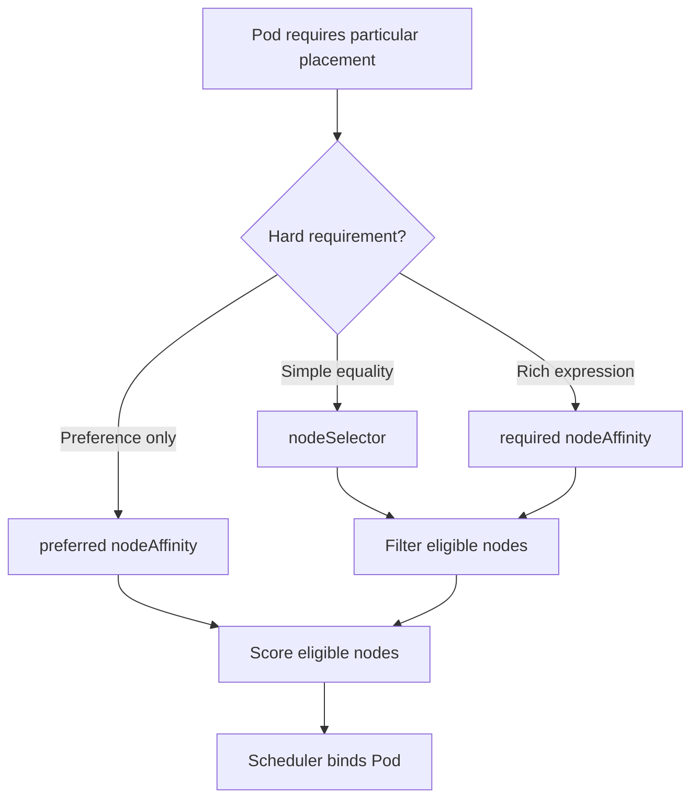

### Check your understanding

1. Why is `nodeSelector` under the Pod's spec, not the Deployment's selector?
2. Why do two fields inside `nodeSelector` mean AND?
3. How can required node affinity express `(ssd AND prod) OR (hdd AND dev)`?
4. Why can a Pod remain Pending even though the cluster has Ready nodes?
5. What does `IgnoredDuringExecution` mean if labels change after scheduling?
6. Why don't weights of 10 and 5 guarantee a 2:1 Pod distribution?
7. What additional mechanism would you use if ordinary Pods must be kept off the SSD nodes?

**Next:** Day 18 combines the direction of a taint with the requirements of affinity to make dedicated-node placement more predictable.

### Official reference

- [Assigning Pods to Nodes](https://kubernetes.io/docs/concepts/scheduling-eviction/assign-pod-node/)

*Transcript alignment: Day 17, nodeSelector, required/soft node affinity, AND/OR expressions, weighted preferences, and match operators. Added accuracy notes: preference weights are not percentages; labels are not hardware measurements; node selector alone does not exclude other Pods; node anti-selection and inter-Pod anti-affinity are distinct.*
