# CKA Day 18 - Taints and Tolerations vs Node Affinity

> A synthesis chapter. We will place the same four Pods under different rules and discover why node repulsion and Pod attraction are separate controls. Every diagram is embedded Mermaid, and all lab commands and YAML are inside this file.

## The question we could not fully answer in Days 16 and 17

Day 16 showed how a Node taint can repel new Pods unless they have a matching toleration. Day 17 showed how a Pod can require or prefer Nodes with matching labels. Both affect scheduling, so why do we need both mechanisms?

We can answer by looking at **two opposite questions**:

1. **Node's perspective:** Who is allowed to use this node? This is answered by **taints** and their matching **tolerations**.
2. **Pod's perspective:** Which nodes are suitable for this workload? This is answered by **node selectors / node affinity**.

The two mechanisms solve different halves of a placement problem. We will not start with a giant architecture diagram. Instead, let's progressively create a concrete example and investigate one Pod at a time.

**Lab:** This chapter uses two workers in a disposable kind cluster: `cka-lab-worker` and `cka-lab-worker2`. Your cluster and node names may differ. Run `kubectl get nodes` before executing the examples. The control plane is assumed to have its conventional `NoSchedule` taint; verify this on your cluster. Custom node taints and labels must not be applied to production nodes as a practice exercise.

---

## 1. Establish the two-node world

Worker A has SSD-category storage and Worker B has HDD-category storage. For our scheduling lab, we represent those categories as **labels**, then taint Worker A to reserve it for eligible Pods.

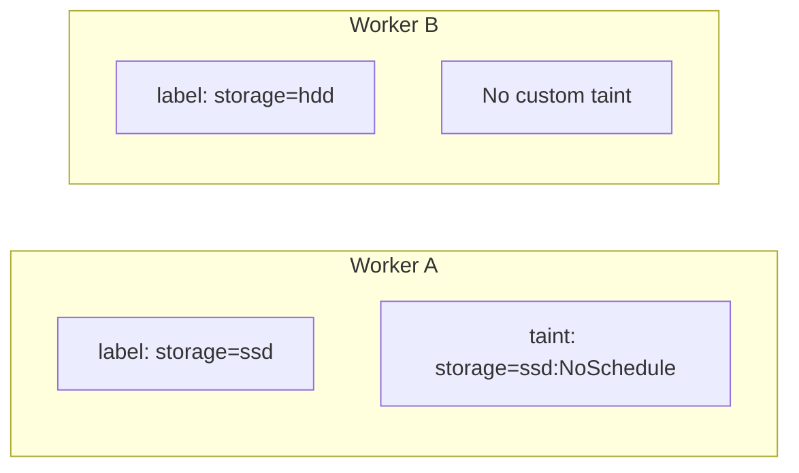

This is the original lecture's setup in consistent lowercase notation. First, confirm the node names and whether any custom rules remain from earlier exercises:

```bash
kubectl get nodes -o wide
kubectl get nodes --show-labels
kubectl describe node cka-lab-worker
kubectl describe node cka-lab-worker2
```

Only if you are using a disposable lab and these custom labels/taints are not already present, apply them:

```bash
kubectl label nodes cka-lab-worker storage=ssd
kubectl label nodes cka-lab-worker2 storage=hdd
kubectl taint nodes cka-lab-worker storage=ssd:NoSchedule
kubectl get nodes -L storage
kubectl describe node cka-lab-worker
```

**Label versus taint:** `storage=ssd` is just metadata used for matching; it does not certify a physical SSD. `storage=ssd:NoSchedule` is a scheduling rule that repels Pods without a matching toleration. The text is similar; the mechanisms are different.

## 2. A Pod with only a toleration

Our first Pod carries exactly the exception needed to pass Worker A's taint:

```yaml
spec:
  tolerations:
    - key: storage
      operator: Equal
      value: ssd
      effect: NoSchedule
```

At first glance, we might predict that it must run on Worker A. But that prediction is wrong. Worker B has no taint, so the Pod does not need any exception to run there.

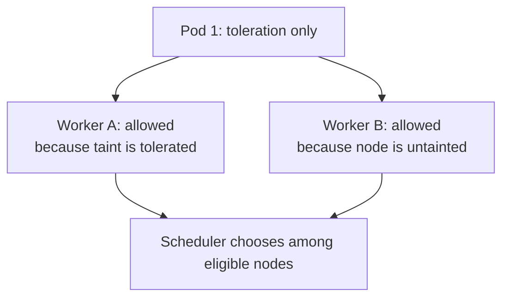

This is the first lesson: **a toleration is not a demand to run on the matching node**. It only says, "This particular taint should not exclude me."

## 3. A Pod with only required node affinity

Our second Pod has a hard requirement to use an SSD-labeled node:

```yaml
spec:
  affinity:
    nodeAffinity:
      requiredDuringSchedulingIgnoredDuringExecution:
        nodeSelectorTerms:
          - matchExpressions:
              - key: storage
                operator: In
                values: [ssd]
```

This time Worker B fails the affinity test, because it is labeled `storage=hdd`. Worker A passes the affinity test, **but Worker A is tainted and the Pod has no toleration**.

The actual scheduler result is that **neither node is eligible**.

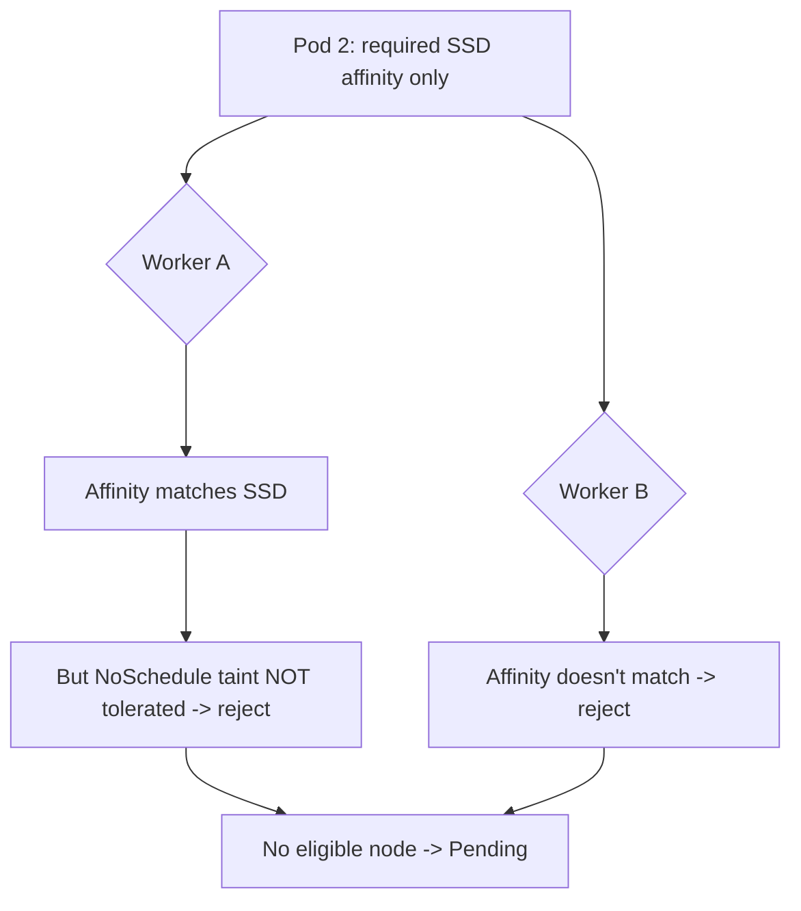

**Important clarification of the transcript:** In its early comparison, the lecture describes an affinity-only Pod as able to run on the SSD node even though that node has a `NoSchedule` taint. Under normal scheduler behavior, that is not correct. **Required node affinity does not override an unmatched `NoSchedule` taint.** All applicable hard scheduling constraints must be satisfied.

This is precisely why we need both mechanisms, not just one.

## 4. A Pod with neither mechanism

Our third Pod does not request SSD and cannot tolerate Worker A's storage taint. Worker B is available and untainted.

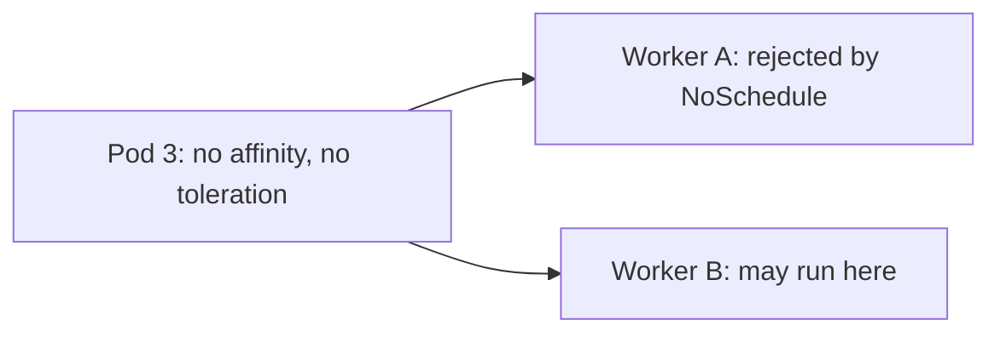

Notice a second important asymmetry: **the HDD label on Worker B does not prevent an arbitrary Pod from using it**. Labels alone never repel workloads. If we wanted Worker B to be reserved too, we would give it a taint as well.

## 5. The combined Pod: permission and suitability

Our fourth Pod has both the matching toleration and the required affinity rule:

```yaml
spec:
  tolerations:
    - key: storage
      operator: Equal
      value: ssd
      effect: NoSchedule
  affinity:
    nodeAffinity:
      requiredDuringSchedulingIgnoredDuringExecution:
        nodeSelectorTerms:
          - matchExpressions:
              - key: storage
                operator: In
                values: [ssd]
```

Worker A passes both checks. Worker B is untainted but fails the required SSD affinity rule. In this two-worker lab, **only Worker A is eligible** (assuming it is healthy and has sufficient resources).

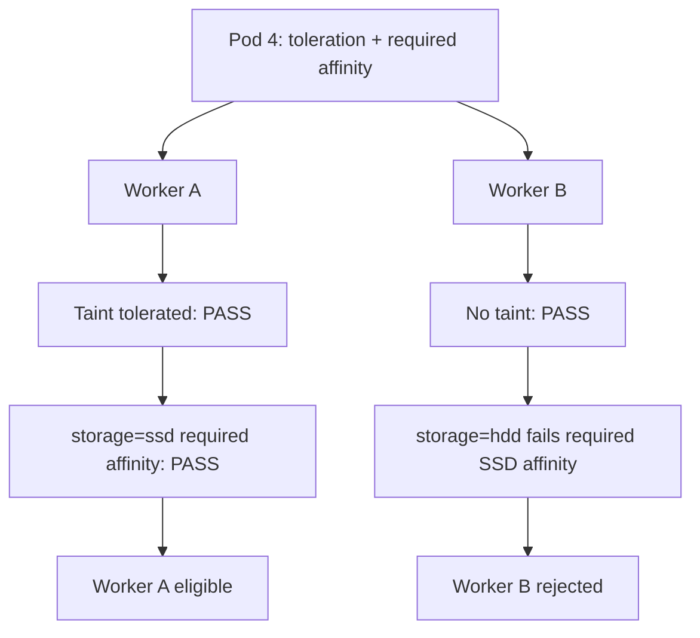

This is the chapter's central result. **Toleration removes a barrier. Required affinity narrows the eligible destination set.**

## 6. Observe all four cases together

Let's run a concrete lab rather than relying on diagrams. Write a single file `day18-placement.yaml` that holds four Pod definitions separated with `---`. This is still one manifest file, included inline in the chapter.

```yaml
apiVersion: v1
kind: Pod
metadata:
  name: toleration-only
  labels:
    lesson: day18
spec:
  tolerations:
    - key: storage
      operator: Equal
      value: ssd
      effect: NoSchedule
  containers:
    - name: nginx
      image: nginx:stable
---
apiVersion: v1
kind: Pod
metadata:
  name: affinity-only
  labels:
    lesson: day18
spec:
  affinity:
    nodeAffinity:
      requiredDuringSchedulingIgnoredDuringExecution:
        nodeSelectorTerms:
          - matchExpressions:
              - key: storage
                operator: In
                values: [ssd]
  containers:
    - name: nginx
      image: nginx:stable
---
apiVersion: v1
kind: Pod
metadata:
  name: no-rules
  labels:
    lesson: day18
spec:
  containers:
    - name: nginx
      image: nginx:stable
---
apiVersion: v1
kind: Pod
metadata:
  name: both-rules
  labels:
    lesson: day18
spec:
  tolerations:
    - key: storage
      operator: Equal
      value: ssd
      effect: NoSchedule
  affinity:
    nodeAffinity:
      requiredDuringSchedulingIgnoredDuringExecution:
        nodeSelectorTerms:
          - matchExpressions:
              - key: storage
                operator: In
                values: [ssd]
  containers:
    - name: nginx
      image: nginx:stable
```

Before applying, predict the **eligible nodes**, not the exact placement outcome for the Pods with more than one option.

| Pod | Worker A: SSD + taint | Worker B: HDD, no taint | Expected behavior |
|---|---|---|---|
| `toleration-only` | Eligible | Eligible | Can run on either |
| `affinity-only` | Blocked by taint | Blocked by affinity | Pending (in this lab) |
| `no-rules` | Blocked by taint | Eligible | Typically Worker B |
| `both-rules` | Eligible | Blocked by affinity | Typically Worker A |

Now observe:

```bash
kubectl apply -f day18-placement.yaml
kubectl get pods -l lesson=day18 -o wide
kubectl describe pod affinity-only
kubectl describe pod both-rules
```

The `kubectl describe pod affinity-only` output is the critical debugging artifact. It can show both the unsatisfied affinity condition and the untolerated taint in scheduling events. This demonstrates that scheduling checks are **combined**, not arranged such that one magically overrules the other.

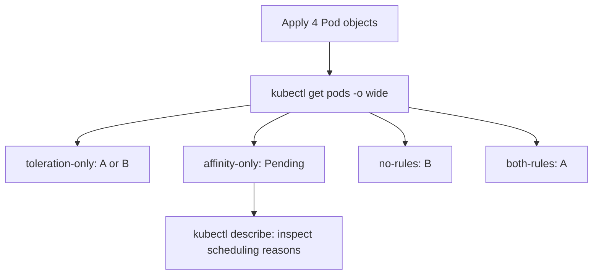

If a Pod remains Pending unexpectedly, check resource availability, other taints, and actual labels. Those constraints still apply even if this exercise's two custom rules look right.

## 7. Turn Worker B into a dedicated node too

The transcript next proposes giving both nodes taints. Let's extend our model without inventing a new example. Worker A remains `storage=ssd:NoSchedule`. Worker B now receives `storage=hdd:NoSchedule`.

```bash
kubectl taint nodes cka-lab-worker2 storage=hdd:NoSchedule
kubectl describe node cka-lab-worker2
```

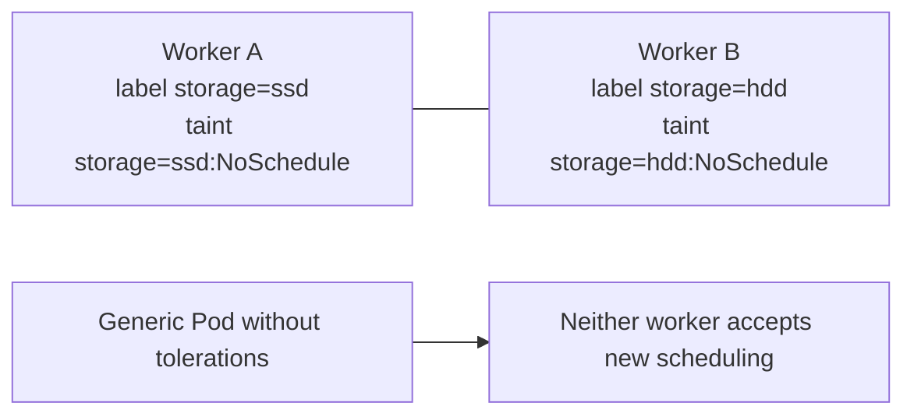

**A subtle lifecycle point:** `NoSchedule` does not evict Pods already running on Worker B. For example, `no-rules` may continue to run there until it is deleted. But a **new** `no-rules` Pod cannot be scheduled onto either worker now.

We can demonstrate this by replacing only that standalone test Pod:

```bash
kubectl delete pod no-rules
kubectl apply -f day18-placement.yaml
kubectl get pods -l lesson=day18 -o wide
kubectl describe pod no-rules
```

`kubectl apply` recreates the missing `no-rules` object from the file; it doesn't imply a Deployment controller is replacing it. Because it has no toleration for either taint, the new Pod should stay Pending in this lab.

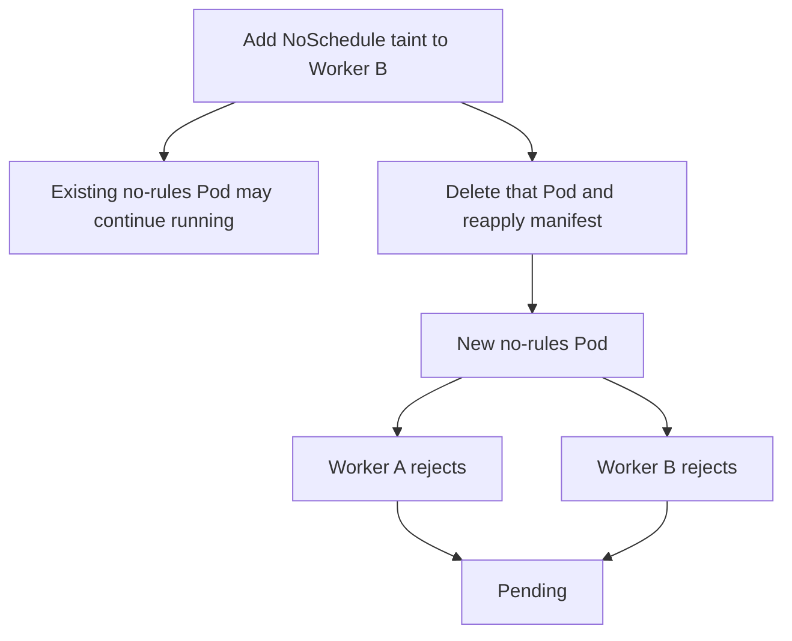

## 8. How to reserve two different node pools properly

Suppose we have two teams: SSD workloads and HDD workloads. We want each workload to run only on its own pool, and unrelated workloads to be refused by both pools.

The pattern is symmetric:

- SSD nodes: label `storage=ssd`, taint `storage=ssd:NoSchedule`.
- HDD nodes: label `storage=hdd`, taint `storage=hdd:NoSchedule`.
- SSD Pods: tolerate SSD taint **and** require SSD node label.
- HDD Pods: tolerate HDD taint **and** require HDD node label.
- Generic Pods without tolerations: neither dedicated pool is eligible.

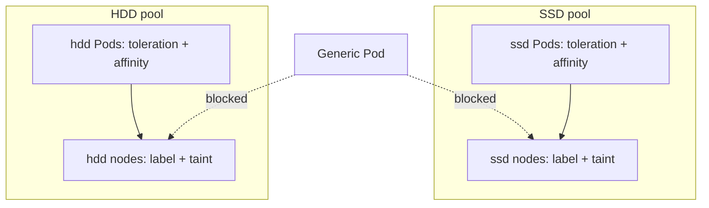

This is often what people mean when they say "dedicated nodes." But note the boundary: this mechanism governs **ordinary scheduler placement**. It is not a security boundary by itself, and it does not replace appropriate RBAC, admission policy, resource limits, or runtime isolation.

## 9. The complete scheduler decision, reconstructed

We can now write a general eligibility algorithm for a Pod and a candidate Node:

1. **Node state and available resources:** Can the node host the Pod at all?
2. **Taints:** Does the Pod tolerate every remaining hard taint that matters for scheduling?
3. **Hard placement rules:** Does it satisfy `nodeSelector` and required node affinity?
4. **Other hard constraints:** Are any other placement requirements violated?
5. **Soft scoring:** Among eligible candidates, which node best satisfies preferences and the scheduler's other scoring criteria?

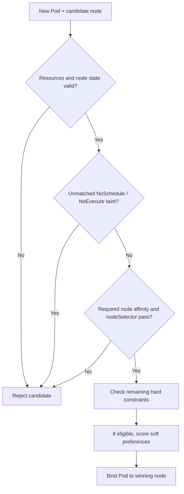

This is a learning abstraction, not an exact dump of scheduler plugin execution order. Its purpose is to show that **one passing rule cannot override a different failing hard rule**.

## 10. What changes with preferred affinity or PreferNoSchedule?

So far every relevant rule was strict. The transcript's earlier lessons also covered soft behaviors:

- `preferredDuringSchedulingIgnoredDuringExecution` gives a node an **affinity preference score**, without requiring the match.
- `PreferNoSchedule` asks the scheduler to **avoid an untolerated tainted node if practical**, without absolutely excluding it.

These soft rules enter the **scoring** phase, not the mandatory eligibility tests.

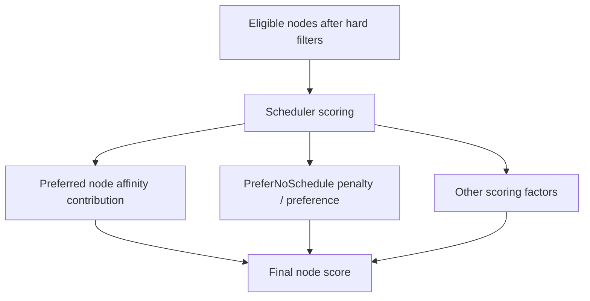

Do not mistake a preference for a quota. Weight 10 vs 5 does not mean Kubernetes will allocate exactly twice as many Pods to one pool.

## 11. Three important exceptions to an oversimplified mental model

### 11.1 `nodeName` bypasses normal scheduler placement

Day 15 taught us that a Pod with `.spec.nodeName` set is not passed through the default scheduler's ordinary selection process. That means a `NoSchedule` taint and node affinity rules do not have their usual scheduler filtering effect on this specific bypass path. However, node-local execution can still fail, and a `NoExecute` taint can still lead to eviction. This is why manual placement is not a general replacement for careful scheduling policy.

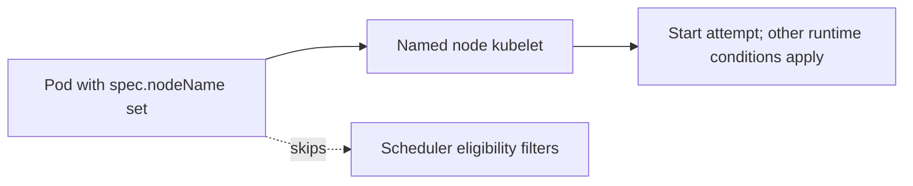

### 11.2 `NoExecute` can evict already-running Pods

The dedicated-node examples use `NoSchedule`, which does not evict existing Pods. A `NoExecute` taint is different; Pods without matching tolerations can be evicted. An administrator using `NoExecute` should understand the consequences for existing workloads before applying it.

### 11.3 Taints and labels are not a hardware or security guarantee

A user can type `storage=ssd` even on a node with HDD hardware. Kubernetes does not automatically validate arbitrary custom label truthfulness. Actual device resources and security separation involve other mechanisms. Here we are mastering scheduling intent, not hardware attestation.

## 12. A reproducible troubleshooting decision tree

Let's imagine a Pod that should run on SSD nodes stays Pending. Instead of immediately editing YAML, ask one question at a time:

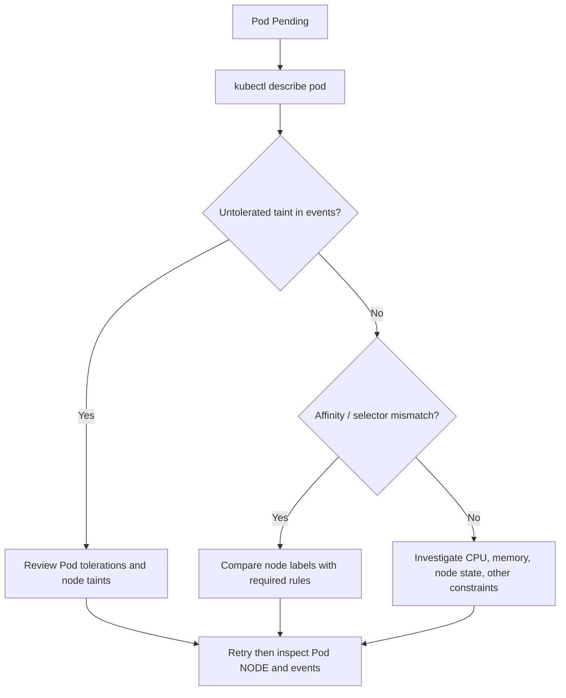

Commands to practice until they become familiar:

```bash
kubectl get pods -l lesson=day18 -o wide
kubectl describe pod affinity-only
kubectl describe pod both-rules
kubectl get nodes -L storage
kubectl describe node cka-lab-worker
kubectl describe node cka-lab-worker2
kubectl get pod both-rules -o yaml
```

Look for `spec.tolerations`, `spec.affinity.nodeAffinity`, the assigned `spec.nodeName`, and the Events section. These four observations let you reconstruct why a Pod is or is not running on a particular node.

## 13. Cleanup, then reconstruct the lesson from memory

Remove the Pods and node modifications introduced by this lesson:

```bash
kubectl delete -f day18-placement.yaml
kubectl taint nodes cka-lab-worker storage=ssd:NoSchedule-
kubectl taint nodes cka-lab-worker2 storage=hdd:NoSchedule-
kubectl label nodes cka-lab-worker storage-
kubectl label nodes cka-lab-worker2 storage-
kubectl get nodes -L storage
```

Do not remove preexisting taints or labels from non-lab clusters. If a particular key was already configured before starting, restore its original value rather than blindly deleting it.

Now try rebuilding the scenario on paper: two nodes, one tainted SSD node, one untainted HDD node, and four Pods with different combinations of toleration and affinity. The goal is to predict **eligibility**, then use `kubectl` to find out actual placement.

## 14. Final mental model: repel and select

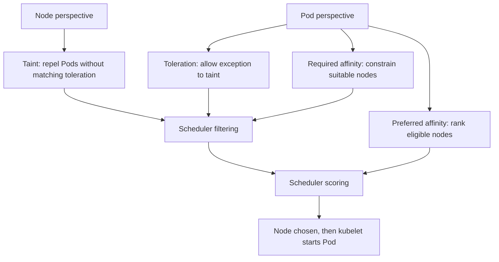

The key sentence to retain is:

**Tolerations say where the Pod is allowed despite a taint. Required affinity says where it is suitable to run. Use both when you need both exclusion of unrelated workloads and a positive placement requirement.**

### Check your understanding

1. Why can `toleration-only` run on an untainted HDD node?
2. Why does `affinity-only` remain Pending when the sole SSD node is tainted?
3. Why does `both-rules` normally run on the SSD worker in our two-node lab?
4. What changes if both nodes are tainted?
5. Why does adding `NoSchedule` not instantly remove an existing Pod?
6. Can preferred node affinity override a failed required node affinity rule?
7. Why should you not treat this technique as security isolation or a hardware guarantee?
8. What does `spec.nodeName` change about the scheduler's role?

**Next lesson:** Resource requests and limits explain a different dimension of scheduling: not just *where a Pod is permitted to run*, but *whether a node has enough allocatable resources* and what happens when containers consume CPU and memory.

### Official references

- [Taints and Tolerations](https://kubernetes.io/docs/concepts/scheduling-eviction/taint-and-toleration/)
- [Assigning Pods to Nodes](https://kubernetes.io/docs/concepts/scheduling-eviction/assign-pod-node/)

*Transcript alignment: Day 18 compares tolerations, node affinity, untolerated workloads, dedicated nodes, and their combined use. Explicit technical correction: required affinity alone does not bypass an untolerated `NoSchedule` taint. Added clarification: placement rules are constraints and preferences, not absolute security or hardware guarantees.*
