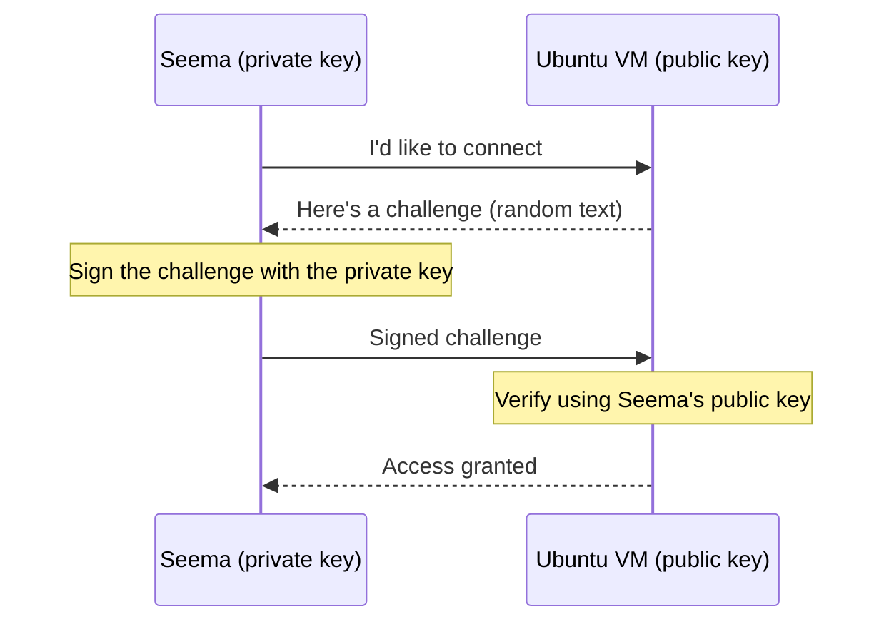
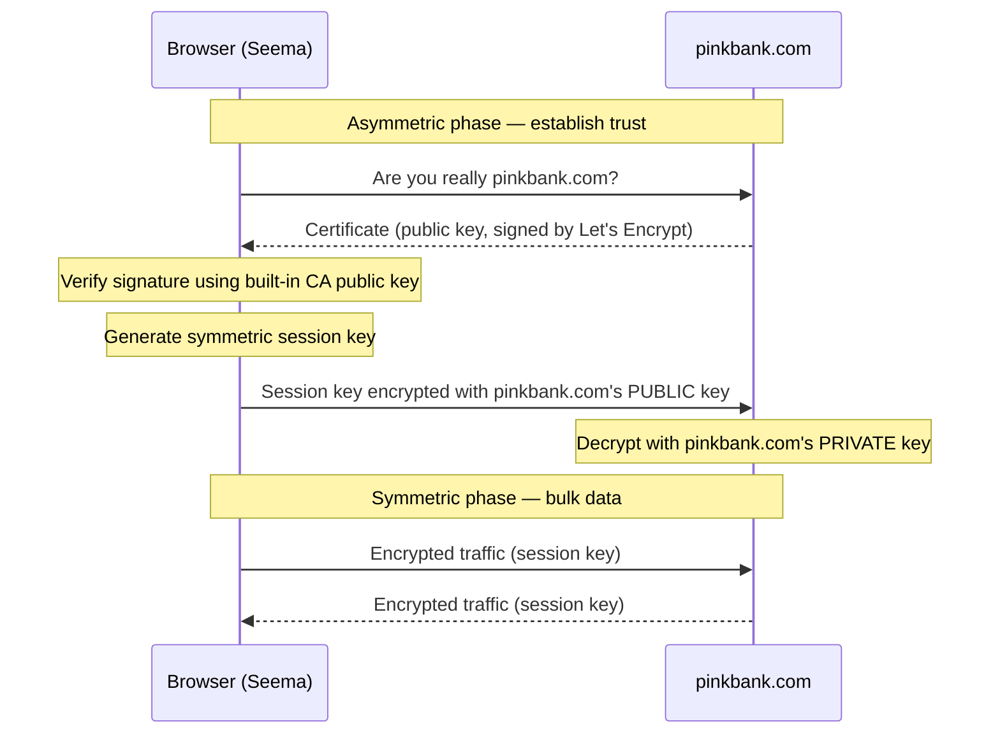

# Encryption & TLS — Symmetric, Asymmetric, In-Transit & At-Rest — Complete Notes (Day 30)

> Source: Day 30 of a Certified Kubernetes Administrator (CKA) 2025 course.
> Topic: Encryption fundamentals — **symmetric vs asymmetric**, **in-transit vs at-rest**, and **how TLS actually works** (the four scenarios).
> Why it matters now: the course is entering security. This lecture is the foundation for **TLS inside Kubernetes** (next lecture: kubelet, API server, etcd) and for **encryption at rest for Secrets**.
> Prerequisite: Day 24 (storage), Day 26 (Secrets — base64 is *not* encryption), Day 29 (DaemonSets/Jobs — not needed here, but the security arc starts after).

---

## 1) What Is Encryption?

> **Encryption converts humanly readable data into an unreadable format.**

The standard framing says "plaintext → ciphertext." The instructor objects to that wording on one point: **"text" is too narrow.**

- Encryption isn't only for text — it applies to **images, videos, documents — any data**.
- So read it as: **anything unencrypted = plaintext; anything encrypted = ciphertext.**

### Why do we need it?

**Scenario:** Seema wants to log into her bank, `pinkbank.com`, and types her credentials.

```
Seema  ──── username + password ────►  pinkbank.com
                     ▲
                     │
              Hacker on the wire reads it
```

If the credentials travel as plaintext, **anyone positioned on the network path can read them**. That's unacceptable — so the data must travel in an unreadable form.

### The two places data lives

| | **In transit** | **At rest** |
|---|---|---|
| Meaning | Data **moving** from one system to another | Data **stored** on a disk |
| Example | Seema → pinkbank.com over the internet | The disk inside Seema's laptop |
| Threat | Eavesdropping on the wire | **Stolen laptop / stolen drive** |
| Protection | **TLS** | **Disk/volume encryption (symmetric)** |

The stolen-laptop example: if the drive is encrypted, a thief **cannot read your data without the key** — even if they remove the drive and attach it elsewhere.

> **Encryption at rest and in transit are separate problems with separate solutions, and production systems need both.** That's the thesis of the whole lecture.

---

## 2) Symmetric Encryption — One Key

> **Symmetric encryption uses a single key for both encryption and decryption.**

Names for that one key (all mean the same thing): **shared key**, **secret key**, **session key**.

```
plaintext ──[ same key ]──► ciphertext ──[ same key ]──► plaintext
```

### The defining problem: key distribution

> **Symmetric encryption requires secure key sharing.**

If Seema encrypts her credentials with a key, how does pinkbank.com decrypt them? **It needs the same key.** But sending that key over the internet means an attacker could intercept **the key** — and then read everything.

> This is *the* central problem of symmetric encryption, and it's exactly what Scenario 4 (TLS) solves — using asymmetric encryption to deliver a symmetric key safely.

### Properties

| Property | Detail |
|---|---|
| **Speed** | **Fast** — which is why it handles **bulk data** |
| **Best for** | Large volumes: disks, databases, file transfers |
| **Weakness** | **Key compromise breaks everything** — whoever holds the key reads the data |
| **Scaling problem** | Every pair of parties needs its own shared secret |

### Algorithms

| Algorithm | Notes |
|---|---|
| **AES** (Advanced Encryption Standard) | **The standard.** Variants: **128 / 192 / 256-bit**. **AES-256 is the most secure** — and it's what **cloud providers use behind the scenes for data at rest** |
| **ChaCha20** | Used in **Android / mobile** security |
| **Blowfish, Twofish, DES** | **Legacy** — do not choose for new work |

> As a DevOps/cloud engineer, **AES is what you'll meet daily** — usually without knowing it, because the cloud does it for you.

### Use cases

1. **Secure data transfer — post-TLS-handshake.** Once the handshake completes, the actual traffic is encrypted **symmetrically** (Chunk 7).
2. **Disk and storage encryption.** AWS **EBS**, **EFS**; Azure **Disk** — all encrypted symmetrically, with keys managed by **AWS KMS** / **Azure Key Vault**.
3. **Encrypted backups and snapshots.**
4. **Database encryption.**

> Notice the pattern: all four are **bulk data** problems. Symmetric is fast, so it goes where the volume is.

---

## 3) Asymmetric Encryption — Two Keys

Also called **public key cryptography**.

```
Key pair
 ├── public key   → share with anyone
 └── private key  → NEVER leaves its owner
```

### The two facts that make it work

1. **Anything encrypted with a public key can only be decrypted by the matching private key.**
2. **Anything signed with a private key can be verified by anyone holding the matching public key.**

These two sentences explain SSH, TLS, JWTs, and code signing. Everything else is application.

### Properties

| Property | Detail |
|---|---|
| **Speed** | **Slow** — far slower than symmetric |
| **Best for** | **Key exchange**, identity, signatures — small payloads |
| **Strength** | No shared secret to distribute; the private key never travels |
| **Weakness** | Too slow for bulk data |

> That's the trade: symmetric is fast but needs a shared secret; asymmetric solves the secret-sharing problem but is too slow for data. **TLS combines them** — which is Scenario 4.

### Algorithms

| Algorithm | Notes |
|---|---|
| **Ed25519** | **Modern default** — for **SSH keys** and **JWT signing**. What `ssh-keygen` produces by default |
| **RSA** | Older, still widely deployed |
| **ECC** (elliptic curve) | Also in use; compact keys, strong security |

### Use cases

1. **SSH** — logging into Linux boxes; private + public key pair, daily DevOps work.
2. **TLS handshake** — proving a server's identity and exchanging a session key.
3. **JWT signing**, certificates, code signing (the same "sign with private, verify with public" mechanic).

---

## 4) The Two Approaches — In Transit vs At Rest

### In transit — data while it moves

| Case | How it's protected |
|---|---|
| **Client ↔ server** (you → `github.com`) | **TLS** |
| **Pod ↔ pod** | **NOT encrypted by default.** You add encryption with a **service mesh** using **mTLS** (mutual TLS) |
| **Kubernetes components** (kubelet, API server, etcd) | **TLS** — detailed in the next lecture |

> **The pod-to-pod fact is the one people miss:** by default, traffic between two pods inside your cluster is **plaintext**. On a shared node, or a shared network, that's a real exposure. Service meshes (e.g. **Istio**) exist partly to fix exactly this with mTLS.

**TLS is not just for HTTP.** It secures **SMTP, POP3, FTPS** and other application-layer protocols too. HTTPS is just the most visible instance.

### At rest — data while it sits

| Where | Protection |
|---|---|
| **Block / file / object storage** | Symmetric encryption (cloud-managed) |
| **PersistentVolumes** in Kubernetes | Depends on the CSI driver / StorageClass |
| **Databases** | Symmetric (TDE or storage-level) |
| **etcd** — the cluster's backing store | **Encrypted by default in cloud**; **you must arrange it on-prem** |

> **etcd deserves emphasis:** *all* data about your cluster lives there — including **Secrets**. If etcd is unencrypted, every Secret is readable by anyone with disk access. On-prem, encrypting etcd is **your job**.

### How each is implemented

| | Mechanism |
|---|---|
| **At rest** | **Symmetric** — typically **AES-256** |
| **In transit** | **TLS** — asymmetric handshake to establish a **symmetric session key**, then symmetric for the data |

**Kubernetes encryption at rest** (the `EncryptionConfiguration`) covers resources like **Secrets** and **PVs** — it is symmetric encryption of API objects inside etcd.

> Summary: two places, two mechanisms, and **you need both** in production.

---

## 5) Scenario 1 — Disk Encryption (Symmetric)

**Setup:** Seema's laptop uses **Windows BitLocker**, with a **symmetric key** protecting the hard disk.

**The login flow:**

1. Power on → enter the **BitLocker PIN**.
2. Then enter the normal **login credentials**.
3. Work as usual.

**The theft test:**

```
Laptop stolen
   ├── attacker boots it      → needs the BitLocker PIN → blocked
   └── attacker removes the drive and attaches it elsewhere
                              → no symmetric key → sees only GIBBERISH
```

> **This is symmetric encryption protecting data at rest**, and it's the cleanest demonstration of why it matters: the data is safe *because the key isn't on the disk in usable form*.

**Why symmetric here?** The disk holds **terabytes** — bulk data. Speed is the requirement, and only one party (the laptop) needs the key.

---

## 6) Scenario 2 — Encrypting Credentials with a Symmetric Key (and Why It Breaks)

**Setup:** Seema encrypts her login details with a symmetric key and sends them to pinkbank.com.

**The failure:**

```
Seema ──[ encrypted credentials ]──► Pink Bank
                                        │
                              "I have no key — can't decrypt"
```

And the other half is worse:

```
Seema ──[ the symmetric key ]──► Pink Bank
                 ▲
          Hacker intercepts the key
                 │
                 ▼
     Now the hacker can decrypt the credentials
```

> **You cannot send the key over the same channel you're trying to protect.** Sending it defeats the entire purpose; not sending it makes the ciphertext useless.

**So symmetric encryption alone cannot bootstrap a secure channel between two parties who have never met.** This is the gap that Scenario 3 and Scenario 4 fill:

- **Asymmetric** gives you a way to exchange something securely with a stranger.
- **TLS** then uses asymmetric crypto **only** to deliver a symmetric **session key** — then switches to fast symmetric for the data.

**Keep this scenario in mind** — the TLS handshake is essentially its resolution.

---

## 7) Scenario 3 — SSH with Asymmetric Encryption

**Setup:** An Ubuntu VM on AWS, Seema's laptop, and an attacker on the internet.

### Step 1 — Generate a key pair

```bash
ssh-keygen
# Generating public/private ed25519 key pair.

ssh-keygen -t rsa          # RSA instead of the Ed25519 default
ssh-keygen -h              # see all options
```

You're prompted for a **passphrase** (optional — the lecture declines it; in production a passphrase protects a stolen key file).

**What you get:**

```
~/.ssh/id_ed25519        ← PRIVATE key (no extension — easy to miss)
~/.ssh/id_ed25519.pub    ← PUBLIC key
```

Or name it yourself, and it lands in the **current working directory**:

```bash
ssh-keygen -f mykey
# ./mykey   and   ./mykey.pub
```

| Flag | Effect |
|---|---|
| `-t ed25519` | key type (default on modern OpenSSH) |
| `-f mykey` | output filename — **relative path = current directory** |
| `-C "comment"` | label the key (e.g. your email) |

### Step 2 — Copy the **public** key to the server

```bash
ssh-copy-id user@<ubuntu-vm>
# appends the public key to the remote user's ~/.ssh/authorized_keys
```

> `~` = the **home directory of that user**. The public key sits in `~/.ssh/authorized_keys`; that's the only place it needs to live.

### Step 3 — What actually happens at login (the important part)

Most people assume the private key travels. **It does not.**

```
1. Seema connects ────────────────────────────► Ubuntu VM
2.                         ◄──── challenge ─────           (random text)
3. Seema SIGNS the challenge with her PRIVATE key
   (the key never leaves her machine)
4. Seema sends the SIGNATURE ────────────────► Ubuntu VM
5. Server verifies the signature using Seema's PUBLIC key
6. Match ──► login allowed
```

> **Private key never moves. It signs; it doesn't travel.**

And the verification is **specific to that pair**: *"any other public key will not work. Only the public key associated with this private key can verify it."*



### The key-hygiene lesson (do not skip this)

The instructor generated keys **inside the course's git repository** and immediately flagged the hazard:

> **A committed key stays in git history forever — even after you delete the file.** Anyone who clones the repo can read `git log` and recover it.

Practical rules:

1. **Never generate keys inside a git-tracked directory.**
2. Add a **`.gitignore`** for key patterns — but remember the private key has **no extension**, so pattern-matching is fragile. Location discipline is the real defense.
3. **Assume any leaked key is compromised** — rotate it, don't just delete it.

---

## 8) Scenario 4 — TLS (Asymmetric Meets Symmetric)

The payoff of the whole lecture.

### First, the naming history

| | What it is |
|---|---|
| **HTTP** | Unencrypted |
| **HTTPS** | HTTP **+ security** |
| **SSL** | The *old* protocol that encrypted HTTP — **deprecated** |
| **TLS** | What actually encrypts HTTP today |

> People still say **"SSL certificate"** — it's a **TLS certificate** now. Habit, not accuracy.

### What TLS is

> **TLS (Transport Layer Security) provides authentication and encryption.**

- **Not HTTP-only.** TLS also secures **SMTP, POP3, FTPS** and other application-layer protocols.
- **Authentication** is the half people forget: TLS doesn't just hide the data, it proves *who you're talking to*.

### The certificate

A **certificate** is a signed document that binds an identity to a public key. It contains:

- **your public key**
- **when it was issued**
- **when it expires**
- subject (the domain), issuer, and more

You can inspect any live site's certificate in a browser: padlock → **connection is secure** → certificate. The lecture's example: `github.com`'s certificate issued by **Sectigo**, with issue and expiry dates visible.

### Who signs certificates? Certificate Authorities

> **CAs are trusted authorities that sign certificates, and they are trusted by all popular browsers.**

Examples: **Let's Encrypt**, **Sectigo**, **Verisign**, **Google CA**, **AWS CA**.

**Why can a browser trust them?** Because:

> **Popular browsers ship with the public keys of all the popular CAs pre-installed.**

That one fact is the root of trust for the entire web. No pre-shared secret with pinkbank.com is needed — only with its CA.

### The steps of the handshake

**Step 1 — Pinkbank.com obtains a certificate.**

```
Pink Bank  ── generates key pair (public + private)
Pink Bank  ── creates a CSR (Certificate Signing Request)
Let's Encrypt ── validates DOMAIN OWNERSHIP (is this really pinkbank.com?)
Let's Encrypt ── signs the certificate with the CA's PRIVATE key
```

> **Domain validation matters:** otherwise anyone could claim `pinkbank.com`. The CA verifies ownership (typically by having you publish a DNS record or file — mechanics beyond this course).
>
> And notice the parallel to Scenario 3: **a private key signs, and a public key verifies.** Here the *CA's* private key signs, and anyone with the **CA's public key** can verify.

**Step 2 — Client asks, server presents.**

```
Seema's browser:  "I want a secure connection. Are you really pinkbank.com?"
pinkbank.com:     "Yes. Here is my certificate."   (signed by Let's Encrypt)
```

**Step 3 — Browser verifies.**

```
Browser: "This certificate is signed by Let's Encrypt.
          I have Let's Encrypt's public key built in.
          Signature valid → I trust that you are pinkbank.com."
```

**Step 4 — Browser creates the session key and encrypts it.**

```
Browser generates a SYMMETRIC session key
Browser encrypts it with PINKBANK.COM's PUBLIC KEY (from the certificate)
Browser sends the encrypted session key ─────────► pinkbank.com
```

> **"But how does the browser have pinkbank.com's public key?"** Because **it's inside the certificate** — the certificate *belongs to* pinkbank.com and contains its public key; the CA only **signed** it.

**Step 5 — Server decrypts with its private key.**

```
pinkbank.com decrypts the session key using its PRIVATE key
→ Only pinkbank.com could do this
→ Both sides now share the SAME symmetric session key
```

**Step 6 — Everything after is symmetric.**

```
browser ⇄ pinkbank.com : all traffic encrypted with the session key
                          → fast + secure
```

### The full picture



### Why this solves Scenario 2

| Scenario 2 (failed) | Scenario 4 (TLS) |
|---|---|
| Send the symmetric key in the clear | Send it **encrypted with the server's public key** |
| Attacker intercepts → reads key → reads data | Attacker intercepts → gets **ciphertext only** |
| No way to bootstrap trust | Trust bootstrapped via **CA-signed certificate** |

> **The hacker cannot decrypt the session key because the private key exists only on pinkbank.com.**

### The one-line definitions

> **HTTPS = encryption in transit + authentication via TLS certificates.**

> **TLS = asymmetric encryption to authenticate and exchange a key, then symmetric encryption for the data.**

> *"Once you understand the foundations, Kubernetes security will be a cakewalk."*

---

## 9) Key Files & Extensions

| Extension | What it is |
|---|---|
| `.pub` | **Public** key (SSH) — safe to share |
| `.crt` / `.cer` / `.pem` | **Certificate** (often contains a public key) — safe to share |
| `.key` | **Private** key — **never share, never commit** |
| `.csr` | **Certificate Signing Request** — what you send to a CA |
| `.p12` / `.pfx` | Bundle: certificate **+ private key** (+ chain) — treat as secret |

> The lecture's warning: the **private** key frequently has **no extension at all** (`id_ed25519`, `mykey`) — so don't rely on `.gitignore` patterns to catch it.

---

## 10) Key Takeaways

1. **Encryption turns readable data into unreadable data** — and it applies to *all* data, not just text.
2. **Two places to protect:** **in transit** (moving) and **at rest** (stored). Production needs **both**.
3. **Symmetric = one key** (shared/secret/session) — **fast**, used for **bulk data**, but **key distribution is the hard problem**.
4. **AES-128/192/256**; **AES-256** is the strongest and is what cloud providers use for data at rest. ChaCha20 for mobile. Blowfish/Twofish/DES are legacy.
5. **Asymmetric = public + private key pair** — **slow**, used for **key exchange, identity, signatures**. Ed25519 is the modern default; RSA/ECC also used.
6. **The two rules:** encrypt with a **public** key → only the **private** key decrypts; sign with a **private** key → anyone with the **public** key verifies.
7. **At-rest encryption is symmetric** (AES-256) — disks, EBS/EFS, Azure Disk, backups, snapshots, databases.
8. **In-transit encryption is TLS** — and **TLS itself is a hybrid**: asymmetric handshake, symmetric data.
9. **Pod-to-pod traffic is NOT encrypted by default.** Use a **service mesh with mTLS** (e.g. Istio) if you need it.
10. **Kubernetes components talk TLS** (kubelet, API server, etcd) — next lecture.
11. **etcd holds all cluster data, including Secrets.** Cloud encrypts it by default; **on-prem, you must**.
12. **SSH never sends the private key.** The server sends a **challenge**; the client **signs** it; the server **verifies with the public key**.
13. **Never generate or commit keys inside a git repo** — history is forever.
14. **A certificate contains your public key**, plus issuance/expiry dates and issuer.
15. **CAs sign certificates, and browsers ship CA public keys** — that's the root of trust.
16. **TLS flow:** certificate → verify signature → generate **session key** → encrypt with server's **public** key → server decrypts with its **private** key → symmetric traffic.
17. **"SSL certificate" is a habit; it's TLS.**
18. **HTTPS = encryption in transit + authentication**, not encryption alone.

---

## 11) Essential Commands

```bash
# --- SSH key pair ---
ssh-keygen                          # Ed25519 by default
ssh-keygen -t rsa                   # RSA
ssh-keygen -f mykey                 # name it (created in CWD)
ssh-keygen -f ~/.ssh/mykey -C "me@example.com"

# copy the PUBLIC key to a server
ssh-copy-id user@host               # → ~/.ssh/authorized_keys

# inspect a key
ls -l ~/.ssh/                       # id_ed25519 (private), id_ed25519.pub (public)
ssh-keygen -l -f ~/.ssh/id_ed25519.pub    # fingerprint

# --- Certificates ---
openssl x509 -in cert.crt -text -noout          # full details: subject, issuer, dates
openssl x509 -in cert.crt -noout -dates         # validity window
openssl req -new -key my.key -out my.csr        # create a CSR

# inspect a live site's certificate
openssl s_client -connect github.com:443 -servername github.com </dev/null 2>/dev/null | openssl x509 -noout -subject -issuer -dates
curl -vI https://github.com 2>&1 | Select-String -Pattern "subject|issuer|expire"

# --- Symmetric (illustrative) ---
openssl enc -aes-256-cbc -in plain.txt -out cipher.bin -pass pass:mysecret
openssl enc -d -aes-256-cbc -in cipher.bin -out out.txt  -pass pass:mysecret
```

---

## 12) Quick Self-Check

1. Why does the instructor object to the phrase "plaintext to ciphertext"?
2. Name the two places data needs protecting, and the mechanism for each.
3. One key for both directions — which encryption type, and what's its speed advantage?
4. What is *the* problem with symmetric encryption, and which scenario demonstrates it?
5. Why is asymmetric encryption not used for bulk data?
6. What are the two rules of public key cryptography?
7. Which algorithm is the modern default for SSH keys and JWT signing?
8. Which AES key size do cloud providers use for data-at-rest encryption?
9. Is pod-to-pod traffic encrypted by default? What adds encryption?
10. Why must etcd be encrypted, and who is responsible on-prem?
11. In SSH, does the private key ever leave your machine? Describe what replaces it.
12. What exactly is in a certificate?
13. Why can a browser trust a certificate from a CA it has never contacted before?
14. What's the difference between an SSL certificate and a TLS certificate?
15. Walk the TLS handshake in five steps.
16. Why can't an attacker on the wire use the intercepted session key?
17. HTTPS provides two things. What are they?
18. What's the risk in generating a key inside a git repository, even if you delete it later?

---

## What's Next (Day 31)

- **TLS in Kubernetes, part 1** — client vs server roles, `ssh-keygen`/`openssl`, **SSH mutual authentication** (session key derivation, host key verification, challenge-response), **1-way TLS with TLS 1.3 / ECDHE**, and **public vs private vs self-signed CAs**.
- Then part 2 — **mTLS in Kubernetes** and the **kubeconfig** file.

---

*End of Day 30 notes.*
