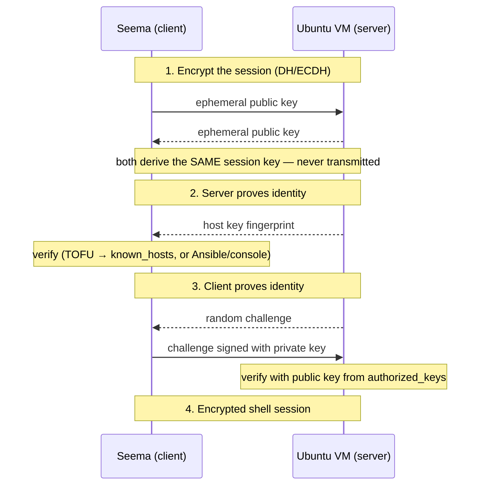

# TLS in Kubernetes — Part 1: Client/Server, Public Key Crypto & Certificate Authorities (Day 31)

> Source: Day 31 of a Certified Kubernetes Administrator (CKA) 2025 course — **part 1 of a 4-part TLS masterclass**.
> Topic: Who is client vs server, how public key cryptography underpins SSH and TLS, **mutual authentication in SSH**, **1-way TLS with TLS 1.3 / ECDHE**, and the three kinds of certificate authority (**public, private, self-signed**).
> Prerequisite: Day 30 (symmetric/asymmetric encryption, in-transit vs at-rest, the TLS handshake).
> Next: part 2 — **mTLS in Kubernetes** and the **kubeconfig** file.

---

## 1) Who Is the Client and Who Is the Server?

> **A client is the one that initiates a request. A server is the one that responds.**

That's the whole rule. It has **nothing to do with hardware**, size, or importance.

| Scenario | Client (initiates) | Server (responds) |
|---|---|---|
| Varun downloads from an S3 bucket | **Varun** | S3 |
| Seema checks her balance at pinkbank.com | **Seema** | pinkbank.com |
| `kubectl get pods` | **Seema / kubectl** | **API server** |

### The interesting case — one entity, two roles

```
kubectl  ──(1) get pods──►  API server  ──(2) what pods exist?──►  etcd
   client                      "server" in (1)
                               "client" in (2)
```

- In **(1)**, the API server is the **server** — Seema initiated the request.
- But the pod list isn't *in* the API server; it must ask **etcd**. In **(2)**, the API server **initiates** → the API server is now the **client** and etcd is the **server**.

> **The API server is both, depending on the direction of the request.** Role is a property of the conversation, not the component.

This matters for certificates: in Kubernetes, **every component needs both a server certificate and a client certificate**, because every component plays both roles (next lecture).

---

## 2) Public Key Cryptography — the Foundation

> Public key cryptography is used by **application-layer protocols** for **security (authentication)** and **secure key exchange**.

Note: it's **not** just SSH and HTTP. The list also includes **FTPS, SFTP, IMAP, SMTP**.

But as a DevOps engineer, you'll live in two:

| Protocol | Tool | What it protects |
|---|---|---|
| **SSH** | `ssh-keygen` | Shell access to Linux hosts |
| **HTTPS** (TLS) | `openssl` | Web/API traffic |

> Recall Day 30's two rules:
> 1. Encrypt with a **public** key → only the matching **private** key decrypts.
> 2. Sign with a **private** key → anyone with the matching **public** key can verify.

---

## 3) The Two Tools: `ssh-keygen` and `openssl`

### `ssh-keygen` — for SSH key pairs

```bash
ssh-keygen                    # Ed25519 by default
ssh-keygen -t rsa             # choose RSA
ssh-keygen -f mykey           # choose filename/location
```

- **Private key stays with the client.** The **public key goes to the server.**
- Alternatives: **PuTTYgen** on Windows, `openssh` tooling on Unix — but `ssh-keygen` is the popular one.

### `openssl` — for TLS certificates

> **OpenSSL is the utility used to generate TLS certificates.**

### "Why is it called OpenSSL and not OpenTLS?"

| | |
|---|---|
| **SSL** | **Secure Sockets Layer** — the **predecessor** of TLS |
| **TLS** | **Transport Layer Security** — the **successor**, an enhanced version |
| **Latest** | **TLS 1.3** |

Historically you used OpenSSL to make **SSL** certificates. TLS arrived, OpenSSL matured, and today the same tool makes **TLS** certificates. **The name stuck.**

> This is also why people say "SSL certificate" when they mean **TLS certificate** (Day 30).

### The nuance about what `openssl` generates

Administrators say *"openssl generates a key pair."* That's **right, but imprecise**. Precisely, it generates:

```
1. a PRIVATE key                      (stays secret)
2. a CERTIFICATE containing:
     ├── the PUBLIC key               (in the certificate)
     ├── metadata                     (issue date, expiry, subject...)
     └── a CA signature               (who vouched for it)
```

> **The private key secures the communication. The certificate verifies the server's identity to clients.**

### Other tools in this space

| Tool | Notes |
|---|---|
| **HashiCorp Vault** | Confirmed: `openssl`, **Vault**, **Cloudflare SSL**, and **certbot** (Let's Encrypt's client) are the names to know |
| **certbot** | Let's Encrypt's automation tool |
| **mkcert** | Self-signed certs for local development |

---

## 4) File Formats — What to Expect on Disk

| File | Contents | Shareable? |
|---|---|---|
| `.pub` | **SSH public** key | ✅ yes |
| **`.crt`** / `.pem` | **Certificate** (holds the public key + metadata + CA signature) | ✅ yes |
| `.key` / *no extension* | **Private key** | ❌ **never** |
| **`.csr`** | **Certificate Signing Request** | ✅ yes (it's a request) |

> **`.crt` is the extension you'll see most** for certificates.

### The CSR, in plain English

> **A CSR is like a form you fill out to get your certificate signed.**

It carries your identity information and your public key, and you hand it to a CA. The CA validates it, then signs — producing the certificate.

**Private keys are recognizable by their absence of a helpful name:** `.key`, `-key` in the filename, or **no extension at all** (`id_ed25519`). That's why Day 30's git warning matters — you can't reliably `.gitignore` what has no extension.

---

## 5) Authentication: One-Way TLS vs Mutual TLS

Public key cryptography enables two things — **authentication (identity verification)** and **secure key exchange**. This section is about the first.

### One-way TLS (what you use every day)

```
Browser  ──►  pinkbank.com
                │
                ▼
         "Here is my certificate"        ← server presents
Browser verifies via CA trust store
                │
Browser presents NOTHING                ← client does not authenticate
```

> **Only the server presents a certificate. The client is simply trusted.**

Same for S3: **the bucket presents the certificate**, not Varun.

**This is 1-way TLS** — and it's the entire public web.

### Mutual TLS (mTLS) — what Kubernetes uses

```
etcd  ◄──►  API server
              │
    both present certificates
    both verify the other
```

> **Kubernetes works on two-way TLS — mutual TLS (mTLS).**

- When etcd acts as server, it presents its certificate to the API server **and** the API server presents its own to etcd.
- When Seema accesses the API server, the API server presents its certificate **and** Seema presents hers.

**Both sides prove identity.** Details (and generating a certificate for a user) come in part 4 of the series.

### The ordering rule — and why it exists

> **It is always the server that proves its identity first.** In **both SSH and TLS**.

```
1. Server proves who it is
2. THEN client proves who it is
```

**Why?** Because *"we do not want clients sending sensitive information to servers that are not trusted."*

Your password, your token, your certificate — none of it should travel to an unverified endpoint. So the server goes first, always.

> This single rule explains the order of every handshake you will ever debug.

### SSH is mutual by default

> **SSH is mutual authentication by default** — unlike HTTPS.

Both sides prove identity: first the server proves it is the Ubuntu VM, then the client proves she is Seema.

---

## 6) Mutual Authentication in SSH — Server Side

### The setup

```
AWS
 └── Ubuntu VM
       └── openssh-server   (installed by default on Unix VMs)
             └── host key pairs   ← generated automatically
```

> **When any SSH server is installed, private/public key pairs are generated automatically for every algorithm the OS supports.**

So if the VM supports **RSA, ECDSA, and Ed25519**, you get **three host key pairs** — automatically, before anyone connects.

Why three? Because **the client might only support some of them**, and the server offers what it has. That's also why `known_hosts` can hold **multiple entries for one host** (one per algorithm).

### Client-side prep (the two steps)

```bash
# Step 1 — Seema generates her own key pair
ssh-keygen                     # → id_ed25519 (private) + id_ed25519.pub

# Step 2 — Seema copies the PUBLIC key to the server
ssh-copy-id seema@ubuntu-vm    # → appends to ~/.ssh/authorized_keys
```

- `authorized_keys` **can hold many public keys** — that's why `ssh-copy-id` **appends** rather than overwrites.
- The **private key never leaves** Seema's machine.

---

## 7) SSH — Encryption First, Then Authentication

> **With SSH, encryption happens at the very beginning.**

This is the structural difference from the TLS flow most people learn: **the tunnel is encrypted before either side authenticates.**

### Step 1 — Derive a session key (both sides participate)

```
Seema (client)                                Ubuntu VM (server)
   │                                              │
   ├── generate ephemeral key pair ───────────────┤
   │                                              │
   ├── exchange PUBLIC keys (in the clear) ──────►│
   │◄─────────────────────────────────────────────┤
   │                                              │
   └──── both derive the SAME session key ────────┘
              (Diffie-Hellman / ECDH)
```

| Term | Meaning |
|---|---|
| **Session key** | A **symmetric** key — one key for both encrypt and decrypt |
| **Ephemeral key pair** | A temporary key pair, generated per connection, discarded after |
| **Diffie-Hellman (DH)** | The algorithm that lets two parties derive a shared secret |
| **ECDH** | **Elliptic Curve Diffie-Hellman** — the modern variant |

### The question everyone asks

> *"They only exchanged **public** keys. How do both end up with the **same** session key?"*

**Answer:** that's the mathematical genius of **Diffie and Hellman**. Each side combines its own **ephemeral private key** with the other side's **ephemeral public key**, and both arrive at **the identical value** — without ever transmitting it.

```
Seema:     f(my_private,  your_public)   ─┐
                                          ├──►  SAME session key
Server:    f(my_private,  your_public)   ─┘
```

### Why this is so strong

> **The session key is never transmitted — not even encrypted.**

Since it never crosses the network, **it cannot be captured**. The instructor's phrasing: *"the possibility of anyone eavesdropping on your SSH connection is near zero."*

Everything after this point — including all authentication messages — travels **inside the encrypted tunnel**.

---

## 8) SSH — How the *Server* Proves Its Identity

### The mechanism: host key fingerprint

```
Ubuntu VM  ──►  "My ED25519 host key fingerprint is SHA256:abc123..."
```

The server sends the **fingerprint of its host public key** (`SSH-ED25519` replaced in the generic `SSH-<ALGO>` name).

Check a fingerprint yourself:

```bash
ssh-keygen -l -f /etc/ssh/ssh_host_ed25519_key.pub
```

### The problem: Seema doesn't have the server's public key

So how can she verify the fingerprint?

### Host key verification methods (the lecture's six)

| # | Method | How it works |
|---|---|---|
| 1 | **Trust On First Use (TOFU)** | You see *"The authenticity of host … can't be established. Are you sure you want to continue connecting?"* → you press **yes** |
| 2 | **Phone a friend** | A colleague who already has access logs in and reads the fingerprint to you; you compare |
| 3 | **Out-of-band management** | Take the VM's **console** and read the fingerprint there |
| 4 | **Ansible** (most common in practice) | Automation copies the host public key into `known_hosts`, so the prompt never appears |
| 5 | **Manual preload** | Copy the public key and paste it into `known_hosts` while provisioning |
| 6 | **Centralized trust models** | Enterprise: an **OpenSSH certificate authority** signs host keys |

> **Method 1 is what 99% of us actually do** — and the lecture admits it, with the screenshot everyone recognises: *"Are you sure you want to continue connecting?"*

### `known_hosts` — the memory of trust

Pressing **yes** stores the host identification **and its public key** in:

```
~/.ssh/known_hosts
```

Contents look like:

```
<ip-or-hostname>  ssh-ed25519  AAAAC3Nza...
<ip-or-hostname>  ecdsa-sha2-nistp256  AAAAE2Vj...
```

Two entries, **one host** — because two algorithms were used on two connections (Ed25519 and ECDSA).

> **"Known hosts" literally means: hosts Seema already knows.** After the first acceptance, **subsequent connections don't prompt.**

### When does it prompt again?

| Trigger | Why |
|---|---|
| **A different server impersonates the host** | Different public key → **different fingerprint** → warning. *This is the protection working.* |
| **Ephemeral public IP changed** | Idle VM stopped/started → new IP → **same key, different identification** → prompt again |

> That second case is a **false alarm**, not an attack: the key didn't change, only the server's *identity string* (the IP) did. Cloud users hit this constantly.

---

## 9) SSH — How the *Client* Proves Its Identity

Now the other direction, **after** the server is trusted (per the ordering rule).

```
1. Server ──► Seema:  "Here is a random challenge"
2. Seema signs the challenge with her PRIVATE key
3. Seema ──► Server:  signed challenge
4. Server verifies using Seema's PUBLIC key (in authorized_keys)
5. Match ──► login allowed
```

> **The private key never leaves Seema.** It **signs**; it doesn't travel.

And the verification is pair-specific: only the public key **matching that private key** validates the signature. Any other key fails.

### The complete SSH picture



---

## 10) 1-Way TLS with TLS 1.3 — and the Flaw It Fixed

### The setup (Day 30 recap, one level deeper)

```
pinkbank.com        →  key pair (via openssl)
Let's Encrypt CA    →  key pair (certificate + private key)

pinkbank.com  ──CSR──►  Let's Encrypt
                        ├── validates domain ownership
                        └── signs the certificate with the CA's PRIVATE key
```

### The handshake as the lecture presents it

```
1. Browser:  "I want a secure connection. Are you really pinkbank.com?"
2. Server:   "Yes — here is my certificate."         (signed by Let's Encrypt)
3. Browser:  verifies the signature using Let's Encrypt's
             certificate from its TRUST STORE → trust established
4. Browser:  generates a session key
             encrypts it with pinkbank.com's PUBLIC key (from the certificate)
5. Server:   decrypts with its PRIVATE key → now both share the session key
6. Both:     encrypt all traffic with that session key (fast, symmetric)
```

**Why the browser can verify:** *all modern browsers ship the certificates of the popular public CAs in their **trust store**.* Verification finishes **at the browser level** — no network call to Let's Encrypt.

**Why the browser has pinkbank's public key:** because **it's inside the certificate** the server just presented.

### The flaw in that design

> **If the server's private key leaks, everything encrypted with the matching public key can be decrypted** — including the captured session key.

An attacker who records traffic *and later* obtains the private key can decrypt **all past sessions**. The lecture's framing:

> *"If something is highly unlikely to happen, security teams assume it will surely happen."*

That's the right mindset: design so the unlikely event **doesn't matter**.

### The fix — ECDHE (ephemeral key exchange)

TLS **1.2** and **1.3** use the same idea SSH already used:

```
1-3. (same as above: certificate presented and verified)
4.   Browser and server exchange EPHEMERAL public keys  ← ECDHE
     ("E" = ephemeral)
5.   Both DERIVE the same session key independently
     → the session key is NEVER transmitted, not even encrypted
6.   All traffic encrypted with it
```

**Properties:**

- The session key exists **only** on Seema's browser and pinkbank.com.
- **Even if pinkbank's private key leaks later, past traffic stays safe** — because the private key was never used to transport the session key.
- This property is called **forward secrecy**.

> The lecture's summary: *"even if the private key of pinkbank.com gets leaked… no one can decrypt the communication that is happening between Seema and pinkbank.com."*

### Technical accuracy note

The lecture describes the "encrypt the session key with the server's public key" step as part of the modern flow. Two clarifications worth keeping straight:

- That step is the **RSA key-transport** approach used by **TLS ≤ 1.2** (RSA key exchange) — that's the design **with** the flaw described.
- **TLS 1.3 removed RSA key transport entirely.** It *always* uses **(EC)DHE**, and the server's certificate/private key is used to **authenticate** (sign the handshake transcript), **not** to encrypt the session key.
- So both statements are true of different versions: the flaw belongs to older TLS; the ECDHE fix is what TLS 1.2 (in ECDHE mode) and TLS 1.3 do.

**Takeaway that survives the nuance:** *the certificate authenticates; the ephemeral exchange derives. Never transport the session key.*

---

## 11) The Three Kinds of Certificate Authority

### First: what is PKI?

> **PKI (Public Key Infrastructure)** = digital signatures + key pairs + certificate authorities + certificates + CSRs — **all of it together**.

When someone says "we need PKI," they mean the whole apparatus, not one component.

### 1. Public CA

| Property | Detail |
|---|---|
| **Used for** | **Production, public-facing** sites |
| **Trusted by** | **All major browsers and operating systems — by default** |
| **Examples** | **DigiCert, Verisign, Sectigo**, **Let's Encrypt** |
| **Operating inside** | Public key infrastructure (CAs, certs, key pairs, CSRs) |

> **You cannot simply declare yourself a public CA.** Public CAs must satisfy **compliance/audit standards** (browser root programs) before browsers will trust them — which is why the trust store ships with the big names.

### 2. Private CA

| Property | Detail |
|---|---|
| **Used for** | **Internal applications and infrastructure services** |
| **Trusted by** | **NOT trusted by browsers unless explicitly added to the trust store** ← the key point |
| **Tools** | **OpenSSL** (the instructor's favourite), **HashiCorp Vault**, **Smallstep CA**, **AWS Private CA**, **Cloudflare SSL** |
| **Kubernetes relevance** | **Cluster internals, service meshes, internal HTTPS** |

**The scenario:** a 20-person company with an internal site `app1.in.internal`. You would **not** go to a public CA for that — the audience is internal.

```
app1.in.internal   → key pair
private CA         → key pair (created with openssl)
app1 → CSR → private CA signs it → certificate
```

**The catch:** users' browsers don't have your private CA in their trust store, so they see *"this website cannot be trusted."* You *know* it's legitimate — but the browser doesn't.

**The fix — automate trust distribution:**

| Platform | Mechanism |
|---|---|
| **Windows** | **Group Policy** → push the CA cert into the OS/browser trust stores |
| **macOS** | **MDM** |
| **Linux** | Copy the CA cert into the system CA directory (e.g. `/usr/local/share/ca-certificates/` + `update-ca-certificates`) — **Ansible** works well here |

Once the CA is trusted, **the TLS process is identical** to the public-CA case. Only the trust anchor changed.

> **This is exactly what Kubernetes does**: it runs its own **private CA**, and every component is given the CA certificate so it can verify the others. That's the next lecture.

### 3. Self-signed certificates

> **A certificate signed by its own private key — no CA involved.**

```
Shweta generates a key pair for app2.test
Shweta signs the certificate with her OWN private key
→ self-signed
```

| Property | Detail |
|---|---|
| **Used for** | **Development and testing only — never production** |
| **Trusted by default?** | **No** — the browser shows a security warning |
| **Advantages** | **Simple and quick to generate** |
| **Tools** | **OpenSSL**, **mkcert**, **Cloudflare SSL** |

**The warning you'll see:** *"Attackers might be trying to steal your information… this connection is not private."*

**Why devs use them:** to check how a site behaves over HTTPS locally, with zero CA ceremony. `.test` is the reserved TLD for exactly this.

> **Never in production.** The lecture is emphatic: *"You will never ever see these in production implementations."*

---

## 12) Public vs Private vs Self-Signed — One Table

| | **Public CA** | **Private CA** | **Self-signed** |
|---|---|---|---|
| **Signed by** | A commercial/audited CA | **Your own** CA | **Itself** |
| **Trusted by browsers out of the box** | **Yes** | **No** — must distribute | **No** |
| **Use case** | Public websites, APIs | **Internal** apps, **K8s internals**, service meshes | **Dev/test only** |
| **Cost/effort** | Money + domain validation | Automation to distribute trust | Free, instant |
| **Examples** | DigiCert, Sectigo, Let's Encrypt | OpenSSL, Vault, Smallstep, AWS Private CA | OpenSSL, mkcert |
| **Production?** | ✅ | ✅ (with trust distribution) | ❌ **never** |

---

## 13) Key Takeaways

1. **Client initiates, server responds.** Role depends on the direction of the request — the **API server is both** (server to kubectl, client to etcd).
2. **Public key cryptography** underpins **SSH and HTTPS** (and FTPS, SFTP, IMAP, SMTP) for **authentication** and **secure key exchange**.
3. **`ssh-keygen`** makes SSH key pairs; **`openssl`** makes TLS certificates — and it's "OpenSSL" because **SSL preceded TLS** (TLS 1.3 is current).
4. Precisely, `openssl` produces a **private key** and a **certificate** (public key + metadata + CA signature) — not just "a key pair."
5. **`.crt`/`.pem` = certificate (public, shareable); `.key` or no extension = private key (never share); `.csr` = the request form.**
6. **1-way TLS**: only the **server** presents a certificate (the entire public web). **mTLS**: **both** sides do — **Kubernetes runs on mTLS**.
7. **The server always proves its identity first** — in SSH and TLS — because clients must not send sensitive data to unverified servers.
8. **SSH is mutual authentication by default**, and **encrypts first**: both sides generate **ephemeral keys**, exchange public keys, and derive a **session key via DH/ECDH**.
9. **The session key is never transmitted** — that's why SSH traffic is practically un-eavesdroppable.
10. **Servers prove identity via host key fingerprints.** Six verification methods: **TOFU**, phone a friend, out-of-band console, **Ansible**, manual preload, centralized **SSH CA**.
11. **`known_hosts` stores host + public key.** It prompts again on a **changed fingerprint** (attack!) or a **changed IP** (ephemeral cloud IPs — false alarm).
12. **Clients prove identity by signing a server-issued challenge** with their private key; the server verifies with the public key in `authorized_keys`.
13. **The old TLS flaw:** the session key was encrypted with the server's public key — so a **leaked private key** could decrypt captured traffic.
14. **TLS 1.2 (ECDHE) / 1.3 fix it:** derive the session key via **ephemeral** exchange, **never transmit it**, giving **forward secrecy**.
15. **Browsers verify certificates locally** using **CA certificates in their trust store** — no network call needed.
16. **PKI** = CAs + certificates + key pairs + CSRs + signatures, as one system.
17. **Public CA** = audited, browser-trusted. **Private CA** = internal, needs trust distribution (GPO / MDM / Linux CA store). **Self-signed** = dev/test only.
18. **Kubernetes uses a private CA**, which is why the next lecture is about distributing that CA certificate to every component.

---

## 14) Essential Commands

```bash
# --- SSH key pair ---
ssh-keygen                                   # Ed25519 default
ssh-keygen -t rsa -b 4096                    # RSA, 4096-bit
ssh-keygen -f mykey                          # custom filename (CWD)
ssh-keygen -l -f ~/.ssh/id_ed25519.pub       # fingerprint

# copy the public key to a server (appends to authorized_keys)
ssh-copy-id user@host

# --- Host key verification ---
ssh-keygen -l -f /etc/ssh/ssh_host_ed25519_key.pub   # server-side fingerprint
ssh-keygen -F host                                   # look up host in known_hosts
ssh-keyscan host >> ~/.ssh/known_hosts               # preload (Ansible-style)
ssh -o StrictHostKeyChecking=no user@host            # ⚠ bypasses TOFU (be careful)

# --- Certificates ---
openssl req -new -newkey rsa:2048 -nodes -keyout my.key -out my.csr   # key + CSR
openssl req -x509 -newkey rsa:2048 -nodes -keyout my.key -out my.crt \
        -days 365 -subj "/CN=app2.test"                  # SELF-SIGNED cert
openssl x509 -in my.crt -text -noout                     # inspect
openssl x509 -in my.crt -noout -dates -issuer -subject
openssl s_client -connect example.com:443 -servername example.com </dev/null \
        2>/dev/null | openssl x509 -noout -issuer -subject -dates

# --- Linux trust store (private CA distribution) ---
#   copy CA to /usr/local/share/ca-certificates/my-ca.crt
sudo update-ca-certificates
```

---

## 15) Quick Self-Check

1. Define client and server in one sentence. Why is the API server *both*?
2. Which tool generates SSH key pairs, and which generates TLS certificates?
3. Why is the tool called **OpenSSL** if we use TLS now?
4. What exactly does `openssl` generate — be precise about the "key pair" shorthand.
5. Match the extensions: `.crt`, `.key`, `.csr`, no extension.
6. What is a CSR in plain English?
7. One-way TLS vs mTLS — which does the public web use? Which does Kubernetes use?
8. **Who proves identity first, and why?**
9. In SSH, when does encryption happen — before or after authentication?
10. How do two parties end up with the same session key by exchanging only public keys?
11. Is the SSH session key ever transmitted? Why does that matter?
12. Name the six host key verification methods.
13. What is stored in `known_hosts`, and what causes a repeat prompt? (Give both causes.)
14. How does a client prove its identity to an SSH server?
15. What was the flaw in the "encrypt the session key with the server's public key" design?
16. What does ECDHE change, and what property does it give you?
17. Why do browsers trust a Let's Encrypt certificate without contacting Let's Encrypt?
18. Public vs private vs self-signed CA — which is trusted by default, and which must never reach production?
19. How do you make an internal site's private-CA certificate trusted on Windows, macOS, and Linux?
20. Which CA type does Kubernetes itself use, and what must every component receive?

---

## What's Next (Day 32 — Part 2)

- **mTLS in Kubernetes** — how the cluster's private CA issues and verifies certificates for every component, and how the **kubeconfig** file carries client credentials.

---

*End of Day 31 notes.*
