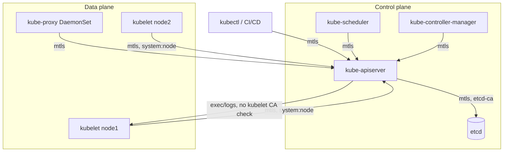

# Private CAs & mTLS Inside Kubernetes — Part 3 (Day 33)

> Source: Day 33 of a Certified Kubernetes Administrator (CKA) 2025 course — **part 3 of the 4-part TLS masterclass**.
> Topic: Who is client vs server in the cluster, how **private CAs** secure every hop, the **root → intermediate → leaf** chain, and a method to **dissect mTLS for any component** without memorising paths.
> Prerequisite: Day 07 (component roles, static pods), Day 31 (one-way TLS, CAs), Day 32 (mTLS, kubeconfig).
> Next: part 4 — granting a user access using **CSRs**.

---

## 1) Reading the Diagram: Tails Are Clients, Heads Are Servers

The lecture's whole architecture diagram is a set of arrows:

| Arrow | Meaning |
|---|---|
| Has a **tail** | That end is the **client** (it initiates) |
| Has a **head** | That end is the **server** (it responds) |
| **Heads on both ends** | That component acts as **both** |

> **Anything that initiates communication is a client. Anything that responds is a server.** Same rule as Day 31 — now applied to every component at once.

### Clients — every one of these initiates to the API server

| Component | Why it's a client (what it asks the API server) |
|---|---|
| **`kubectl`** (and CI/CD, third-party tooling) | "Fetch information / create resources" |
| **`kube-scheduler`** | "Are there any workloads that need scheduling?" |
| **`kube-controller-manager`** | "Does desired state match current state?" |
| **`cloud-controller-manager`** | "How do I interact with cloud services?" (load balancers, KMS, etc.) |
| **`kube-proxy`** | "Which Services exist, and what are their **endpoints** (pods)?" |
| **`kubelet`** | "Here are the **health statistics of pods and nodes**" |
| **`kube-apiserver`** | "…to etcd" and "…to the kubelet for `exec`/`logs`" |

> **Every component is a client to the API server.** That's why the API server is the hub.

### Servers — only three in the picture

| Server | When |
|---|---|
| **`kube-apiserver`** | For **everything** — it's the **entry point** to the cluster |
| **`etcd`** | When the API server reads/writes cluster state |
| **`kubelet`** | When you run **`kubectl exec`** or **`kubectl logs`** — the API server connects *to* the kubelet, which in turn connects to the pod |

### The API server's client moments (the surprising ones)

```
kubectl exec  →  apiserver  →  kubelet  →  pod
```

- `kubectl exec` / `kubectl logs` are **proxied through the API server**, so the **API server becomes the client** and the **kubelet becomes the server**.
- And of course, to answer *any* query, the API server is a **client to etcd**.

> That's the asymmetry worth internalising: **the API server is almost always the server — except toward etcd and kubelet.**

### Does `etcd` ever act as a client?

> **Only to other etcd peers**, never to the API server.

In an HA control plane with **multiple etcd members**, etcd nodes are **peers** — they gossip and replicate among themselves. So etcd is a client **to etcd**, and nothing else.

> This is exactly why the API server's mTLS problem has an answer: the API server is the only one initiating to etcd, so etcd only needs a **server** certificate for that relationship.

### Two components drawn in a different colour — why?

| Component | Why it's optional |
|---|---|
| **`cloud-controller-manager`** | **On-prem deployments don't have one** at all |
| **`kube-proxy`** | Some **CNIs** do the same job (service routing) themselves, making kube-proxy **redundant** |

---

## 2) Why the Roles Matter: mTLS Is Two-Sided

Because Kubernetes uses **mTLS on every hop**, you must know **who presents first** and **who verifies what**.

> **The server always proves its identity first**, then the client.

```
scheduler ──► apiserver
   1. apiserver presents its certificate       (server first)
   2. scheduler verifies it (has the K8s CA)
   3. scheduler presents its certificate       (client second)
   4. apiserver verifies it (has --client-ca-file)
   5. connection proceeds
```

If you can't say **which component is the server** on a given hop, you can't predict **which certificate is presented first** — and you can't debug an authorization failure. That's why this section precedes the dissection.

---

## 3) Private CAs in Kubernetes

> **Secure communication between components is achieved using TLS certificates — typically signed by a *private* certificate authority.**

### Who creates them?

> **Most Kubernetes setups autogenerate a private CA during initialisation.**

| Setup | CA handling |
|---|---|
| **kubeadm** (what kind uses underneath) | Auto-generates |
| **minikube** | Auto-generates |
| **Managed** — EKS, AKS, GKE, OpenShift | Auto-generates (and you often can't see it) |
| **Kubernetes the hard way** | **You build the entire chain yourself** |

### "Why learn this if it's all automated?"

The instructor's two reasons, both practical:

1. **The exam may ask:** *"Where is the certificate for this component?"* / *"Why is authentication failing for this component?"* If it does, **you must know where to look**.
2. **The job involves it:** when you're asked *"give Seema access to the cluster"* (Day 34), you need to understand certificates, TLS, and mTLS — **not just run commands**.

> *"If you do not just want to run commands but also understand what those commands are doing."*

### Why **multiple** CAs instead of one?

A reasonable objection: *"Why deal with several CAs when one would do?"*

**Because IT infrastructure is about isolation — reducing the blast radius.**

> The AWS analogy: work is segregated into **separate accounts** so that if account one is compromised, **account two is unaffected**. Kubernetes does the same thing with CAs.

On the kind cluster, there are **three**:

| # | CA | Scope | Why separate |
|---|---|---|---|
| **1** | **Kubernetes CA** (`ca.crt`) | Control plane components | The main cluster CA |
| **2** | **etcd CA** (`etcd/ca.crt`) | etcd only | **If the Kubernetes CA is compromised, etcd stays safe** — etcd is *"the spine of the cluster"*; if the spine breaks, the cluster ceases to exist |
| **3** | **Per-node kubelet CA** (`<node>-ca.crt`) | Each node | **kubelet runs on every node**, so each node gets its own CA — one compromised node doesn't compromise the others |

> **That's the design principle: separate CAs per trust domain, so a single leaked key can't bring down everything.**

### Public CAs vs private CAs in a cluster

| Traffic | CA |
|---|---|
| **External / public-facing** — Ingress controllers, LoadBalancers, **Gateway API** | **Public CA** (customers must trust it without configuration) |
| **Internal cluster traffic** — every component on the diagram | **Private CA** — always |

> Kubernetes **internals never use public CAs.** Public CAs exist so *the outside world* can verify you.

---

## 4) The Dissection Method (don't memorise paths)

> The lecture's promise: *"you will not be memorizing the paths… you will understand how to dissect mTLS."*

### Step 1 — Find the component's configuration source

| Component type | Where its config lives | How to read it |
|---|---|---|
| **`kube-apiserver`, `kube-scheduler`, `kube-controller-manager`, `etcd`** | **Static pod manifests** → `/etc/kubernetes/manifests/<name>.yaml` | `cat` the manifest |
| **`kubelet`** | **systemd-managed process**, not a pod | `ps -ef \| grep kubelet` → read the flags |
| **`kube-proxy`** | Runs as a **DaemonSet** | Inspect the pod spec |
| **`kubectl` / any client** | **kubeconfig** | `kubectl config view` (Day 32) |

> Day 15 callback: control plane components are **static pods**, which is why their manifests sit in a plain directory on the node's filesystem. That's also why there's no Deployment object for them.

### Step 2 — Read the flags that matter

| Flag pattern | Means |
|---|---|
| **`--tls-cert-file` / `--tls-private-key-file`** | The **serving certificate** this component presents when it is the **server** |
| **`--client-ca-file`** | The **CA bundle it trusts** for verifying **clients** |
| **`--etcd-certfile` / `--etcd-cafile`** | Its **client** certificate and trusted CA **for talking to etcd** |
| **`--kubelet-client-certificate`** | Its **client** certificate for talking to **kubelet** |
| **`--cert-file` / `--trusted-ca-file`** (etcd) | etcd's serving cert and its client-verifying CA |
| **`--kubeconfig`** (scheduler, controller-manager, kubelet) | The file carrying **its own** client cert + the CA to verify the API server |

### Step 3 — Inspect any certificate

```bash
openssl x509 -in <cert-file> -text -noout
```

Read three fields:

| Field | Tells you |
|---|---|
| **Issuer** | Which **CA** signed it → which CA that component trusts |
| **Subject** (CN) | **Whose** certificate it is (`kube-apiserver`, `kube-scheduler`, node name…) |
| **Subject Alternative Name (SAN)** | Every **name/IP** this certificate is valid for |

> *"No `-out`"* — i.e. `-noout` — **suppresses printing the encoded certificate body**, keeping the output readable.

### Step 4 — If the file is base64 in a kubeconfig, decode first

```bash
echo -n '<base64 blob>' | base64 --decode | openssl x509 -text -noout
```

Because **kubeconfig embeds certificates as base64** (Day 32), verification data usually arrives encoded.

### Two ways to inspect the same certificate

| Method | When |
|---|---|
| **`openssl x509 -text`** in a shell | The exam and production route |
| An online **SSL decoder** / browser padlock | Quick visual check while learning (browser shows the same issuer/subject/validity) |

> The certificate the API server presents is valid for about **one year** in most setups — another thing to notice when you inspect it.

---

## 5) The Root → Intermediate → Leaf Chain

This is the piece Day 31 set up but didn't name. It explains **why browsers hold "root" certificates** and why the Kubernetes CA is described as **self-signed**.

### The three layers

```
Root CA  (self-signed — issuer == subject)
   │  signs
   ▼
Intermediate CA  (signs on a daily basis)
   │  signs
   ▼
Leaf certificate  (belongs to the actual server: pinkbank.com, github.com)
```

| Layer | Role |
|---|---|
| **Leaf** | The server's own certificate. *"The certificate that amazon.com has is called a leaf certificate."* |
| **Intermediate CA** | **Signs the leaf.** This key is used **constantly** |
| **Root CA** | **Signs the intermediate.** Its key is used **almost never** |

### Why a root CA at all? (the key insight)

> **The intermediate CA's private key is used constantly, so the chance of it leaking increases.**

If there were no root, and that intermediate key leaked:

- An attacker could **sign a certificate for a malicious site**;
- Every browser trusts that intermediate → **the malicious site is trusted**;
- And **millions of that CA's customers** are exposed at once.

**The fix:** put a **root** above the intermediate. The root's private key is used **only to sign the intermediate's certificate**, then locked away:

> *"Stored somewhere where there is no internet access — probably in a physical **HSM** (Hardware Security Module), in an **air-gapped** environment."*

**Air-gapped** = no internet access at all. That's why the root key is practically unleakable — and why a root compromise is a global news event.

### What browsers actually store

> Browsers store the **root CA certificate**, not the intermediate.

| CA | Root certificate name |
|---|---|
| **Let's Encrypt** | **ISRG Root** |
| **Sectigo** | **UserTrust** |
| **Google Trust Services** | **GTS Root** |

The intermediate's certificate is **delivered by the server**, alongside the leaf. So the verification chain is:

```
leaf (pinkbank.com)  →  signed by intermediate (delivered too)
intermediate         →  signed by root (already in browser's trust store)
root                 →  self-signed (trust anchor)
```

> If a server forgets to send the intermediate, modern browsers **fetch it automatically** — but a client that can't will fail to verify. That's a classic real-world TLS failure: **"missing intermediate certificate."**

### How to see it yourself

- **Browser**: padlock → **connection is secure** → certificate → the **Details / certification path** tab shows **leaf → intermediate → root** (e.g. GitHub: `github.com` → `Sectigo` → `UserTrust`).
- **Chrome root store**: Settings → search "certificates" → **Chrome Root Store** → you can find `UserTrust ECC`, `ISRG Root`, `GTS Root` in the list.
- **CLI**: `openssl s_client -connect github.com:443 -showcerts`

### And the "self-signed" warning, resolved

> **A certificate is self-signed when its issuer and subject are the same.**

A **root CA certificate is always self-signed** — by definition there's nobody above to sign it. So:

| Seen online as | Reality |
|---|---|
| *"Self-signed"* + *"accepted for trusted roots"* | **Correct and expected** — it's a **root** CA |
| *"Self-signed"* + *"not trusted"* | A **dev/test** self-signed cert (Day 31) |

**Same word, opposite verdicts** — the difference is whether that self-signed cert is in a trust store.

> In Kubernetes, `ca.crt` is exactly this: a **self-signed root** that every component is given, so everything can verify everything. When you `openssl x509` it, **issuer == subject == `kubernetes`** — and that's why it can be trusted as an anchor.

---

## 6) Example 1 — Scheduler → API Server

**Roles: scheduler = client, API server = server.** So the **API server presents first.**

### Step 1 — What does the API server present?

```bash
# on the control plane node (kind: docker exec into it)
cat /etc/kubernetes/manifests/kube-apiserver.yaml | Select-String tls-cert-file
```

```
--tls-cert-file=/etc/kubernetes/pki/apiserver.crt
--tls-private-key-file=/etc/kubernetes/pki/apiserver.key
```

### Step 2 — Who issued it?

```bash
openssl x509 -in /etc/kubernetes/pki/apiserver.crt -text -noout
```

| Field | Value |
|---|---|
| **Issuer** | **`kubernetes`** (CN of the Kubernetes CA) |
| **Subject** | `CN=kube-apiserver` |
| **SAN** | `kubernetes`, `kubernetes.default`, `kubernetes.default.svc`, `kubernetes.default.svc.cluster.local`, `localhost`, the **node IP**, and the **`10.96.x.x` service IP** |
| Validity | ~**1 year** |

### Reading the SANs

> *"Why is the API server called `kubernetes`?"* — because it is the **central hub**: *everything traverses via the API server*. So "kubernetes" and "the API server" are effectively the same address.

The SAN list decodes as:

| SAN entry | Where it comes from |
|---|---|
| `kubernetes`, `kubernetes.default`, `kubernetes.default.svc`, …`.svc.cluster.local` | The **`kubernetes` Service** in the `default` namespace |
| **`10.96.0.1`** | The **Service IP** of `kubernetes` (verify: `kubectl get svc -n default`) |
| **`172.18.0.3`-style node IP** | The control-plane node's IP (verify: `kubectl get nodes -o wide`) |
| `localhost` | Local access, and the same cert serves the kubelet/etcd paths |

> SANs are why `kubectl` can reach the API server by **several different names** without a certificate error. If you connect by an address **not** in the SAN, TLS verification fails — a common cause of "x509: certificate is valid for …, not …".

### Step 3 — How does the scheduler verify it?

The scheduler uses a **kubeconfig**:

```bash
cat /etc/kubernetes/scheduler.conf
```

```yaml
users:
  - name: system:kube-scheduler
    user:
      client-certificate-data: <base64>     # scheduler's client cert
      client-key-data: <base64>
clusters:
  - name: kubernetes
    cluster:
      certificate-authority-data: <base64>  # ← the K8s CA certificate
      server: https://...
```

Decode the embedded CA:

```bash
echo -n '<certificate-authority-data>' | base64 --decode | openssl x509 -text -noout
```

```
Issuer:  CN=kubernetes
Subject: CN=kubernetes        ← issuer == subject → SELF-SIGNED ROOT
```

> **That's the whole trust mechanism:** the scheduler carries the Kubernetes **root CA** certificate, so it can verify that the API server's certificate was signed by it — **locally, offline, no network call**. Exactly like a browser with a CA in its trust store.

### Step 4 — The scheduler now presents its own certificate

```bash
cat /etc/kubernetes/scheduler.conf | Select-String client-certificate-data
echo -n '<base64>' | base64 --decode | openssl x509 -text -noout
```

| Field | Value |
|---|---|
| **Subject** | `CN=kube-scheduler` |
| **Issuer** | `kubernetes` |
| **Path** | embedded in `/etc/kubernetes/scheduler.conf` (kubeadm writes `kube-scheduler.crt`) |

### Step 5 — How does the **API server** verify the scheduler?

Look for the client CA in the API server's manifest:

```bash
cat /etc/kubernetes/manifests/kube-apiserver.yaml | Select-String client-ca-file
```

```
--client-ca-file=/etc/kubernetes/pki/ca.crt
```

```bash
openssl x509 -in /etc/kubernetes/pki/ca.crt -text -noout
# Issuer: kubernetes   Subject: kubernetes   → self-signed root, trusted
```

> **`--client-ca-file` is the API server's trust anchor for *incoming clients*.** The scheduler's certificate was signed by `kubernetes`, which is in that file → verified. **mTLS complete.**

### Example 1 summary

| Direction | Certificate path | Issuer / CA | Verified using |
|---|---|---|---|
| **API server → scheduler** (server) | `/etc/kubernetes/pki/apiserver.crt` | `kubernetes` (CA: `/etc/kubernetes/pki/ca.crt`) | `certificate-authority-data` inside `/etc/kubernetes/scheduler.conf` |
| **Scheduler → API server** (client) | client cert inside `/etc/kubernetes/scheduler.conf` (CN `kube-scheduler`) | `kubernetes` | `--client-ca-file=/etc/kubernetes/pki/ca.crt` |

---

## 7) Example 2 — API Server → etcd

**Roles: API server = client, etcd = server.** So **etcd presents first.**

### Step 1 — etcd's serving certificate

```bash
cat /etc/kubernetes/manifests/etcd.yaml | Select-String "cert-file|cacert|trusted-ca"
```

```
--cert-file=/etc/kubernetes/pki/etcd/server.crt
--key-file=/etc/kubernetes/pki/etcd/server.key
--trusted-ca-file=/etc/kubernetes/pki/etcd/ca.crt
```

```bash
openssl x509 -in /etc/kubernetes/pki/etcd/server.crt -text -noout
```

| Field | Value |
|---|---|
| **Issuer** | **`etcd-ca`** |
| **Subject** | the **control-plane node name** (e.g. `my-second-cluster-control-plane`) — *not* the string "etcd" |

> Why is the subject the node name? Because **etcd runs as the node itself** in this setup (a static pod on the control plane). The node *is* the etcd host.
>
> **And this is the second CA:** etcd's certificates are signed by `etcd-ca`, **not** by `kubernetes`. That's the isolation from Section 3.

### Step 2 — How does the API server verify etcd?

```bash
cat /etc/kubernetes/manifests/kube-apiserver.yaml | Select-String etcd-cafile
```

```
--etcd-cafile=/etc/kubernetes/pki/etcd/ca.crt
```

```bash
openssl x509 -in /etc/kubernetes/pki/etcd/ca.crt -text -noout
# Issuer: etcd-ca   Subject: etcd-ca   → self-signed root
```

> **The etcd CA is itself a self-signed root** — as every root CA must be. The API server trusts it because `--etcd-cafile` points at it.

### Step 3 — API server presents *its* certificate to etcd

```bash
cat /etc/kubernetes/manifests/kube-apiserver.yaml | Select-String etcd-certfile
```

```
--etcd-certfile=/etc/kubernetes/pki/apiserver-etcd-client.crt
```

```bash
openssl x509 -in /etc/kubernetes/pki/apiserver-etcd-client.crt -text -noout
```

| Field | Value |
|---|---|
| **Subject** | **`CN=kube-apiserver-etcd-client`** ← the name gives it away |
| **Issuer** | **`etcd-ca`** (it must be — etcd only trusts `etcd-ca`) |

### Step 4 — etcd verifies it

```
--trusted-ca-file=/etc/kubernetes/pki/etcd/ca.crt
```

Same chain: API server's client cert is signed by `etcd-ca`, etcd trusts `etcd-ca` → verified.

### The naming convention insight

> **The certificate name tells you the relationship:** `apiserver-etcd-client.crt` = *"the API server, as a client, to etcd."* There's a matching `apiserver-kubelet-client.crt`.
>
> But — **don't rely on the name in an exam.** *"This nomenclature may change in the exam."* Use the **flag** (`--etcd-certfile`) to know what a certificate is *for*.

### Example 2 summary

| Direction | Certificate path | Issuer / CA | Verified using |
|---|---|---|---|
| **etcd → API server** (server) | `/etc/kubernetes/pki/etcd/server.crt` | `etcd-ca` (`etcd/ca.crt`) | `--etcd-cafile` |
| **API server → etcd** (client) | `/etc/kubernetes/pki/apiserver-etcd-client.crt` | `etcd-ca` | etcd's `--trusted-ca-file` |

---

## 8) Example 3 — API Server → Kubelet (the interesting one)

**Roles: API server = client, kubelet = server** — for `exec`/`logs`/`port-forward`.

### Kubelet is a process, not a pod

> **kubelet runs as a systemd-managed process on every node** — not as a pod, not as a static pod.

So you can't `cat` a manifest. Instead, read its **process arguments**:

```bash
ps -ef | grep kubelet
```

You'll see flags like:

```
--kubeconfig=/etc/kubernetes/kubelet.conf
--config=/var/lib/kubelet/config.yaml
--cert-dir=/var/lib/kubelet/pki
--bootstrap-kubelet.conf=/etc/kubernetes/bootstrap-kubelet.conf
```

| Flag | Meaning |
|---|---|
| `--kubeconfig` | How kubelet **as a client** talks to the API server |
| `--cert-dir` | Where its **certificates** live |
| `--bootstrap-kubelet.conf` | The **bootstrap** credentials used *before* it has a certificate |

### Kubelet's serving certificate

```bash
ls /var/lib/kubelet/pki/
# kubelet.crt   kubelet.key   kubelet-client-<date>.pem   kubelet-client-current.pem

openssl x509 -in /var/lib/kubelet/pki/kubelet.crt -text -noout
```

| Field | Value |
|---|---|
| **Issuer** | **`<node-name>-ca`** (e.g. `my-second-cluster-worker2-ca`) |
| **Subject** | the node name |

> **This is the third CA — and it is per node.** Check another worker node and you'll see a **different** CA name (`…-worker-ca`). Each node's kubelet serving certificate is signed by **its own** private CA.
>
> Why: **kubelet runs on every node**, so per-node CAs keep one node's compromise isolated (Section 3's blast-radius argument).

### The surprise: the API server does **not** verify kubelet's serving cert

Look for a kubelet CA flag in the API server manifest:

```bash
cat /etc/kubernetes/manifests/kube-apiserver.yaml | Select-String kubelet
```

```
--kubelet-client-certificate=/etc/kubernetes/pki/apiserver-kubelet-client.crt
--kubelet-client-key=/etc/kubernetes/pki/apiserver-kubelet-client.key
--kubelet-preferred-address-types=...
```

> **There is no `--kubelet-ca-file`.** The API server has **no CA configured to verify kubelet's serving certificate.**

Instead, verification happens through a different mechanism:

> **The API server relies on RBAC node authorization and NodeRestriction admission** for secure communication with the kubelet. **It does not validate kubelet's TLS server certificate.**

The instructor calls this **"asymmetric mTLS"**:

| Direction | Verified how |
|---|---|
| **Kubelet → API server** (kubelet as client) | Normal mTLS — kubelet presents its **client** cert (CN `system:node:<node>`), API server verifies against `--client-ca-file` and authorizes via the **Node authorizer** + **NodeRestriction** |
| **API server → kubelet** (API server as client) | API server presents **its own client cert**; the kubelet verifies it. The API server **does not** verify kubelet's **server** cert — trust comes from RBAC/NodeRestriction |

> Practical consequence: a rogue kubelet could present any serving certificate, and the API server wouldn't care. What stops abuse is **authorization** — which node may act as which node — not certificate validation on that hop.

### How kubelet got a certificate in the first place — bootstrap tokens

Kubelet starts with **no certificate**. So how does it authenticate to *request* one?

```
1. kubelet starts with a BOOTSTRAP TOKEN (not a certificate)
2. it authenticates to the API server using that token
3. it submits a CSR (Certificate Signing Request)
4. the API server signs it → kubelet gets kubelet.crt
5. from then on, it uses that certificate
```

Enabled in the API server by:

```
--enable-bootstrap-token-auth=true
```

> **Set that to `false` and node bootstrap authentication fails** — new nodes can't join. This is exactly the mechanism that makes **Cluster Autoscaler / Karpenter** work: nodes come and go, and each **registers itself** with the control plane before the scheduler can place pods on it.

### How does the API server present *its* certificate to kubelet?

```bash
cat /etc/kubernetes/manifests/kube-apiserver.yaml | Select-String kubelet-client-certificate
```

```bash
openssl x509 -in /etc/kubernetes/pki/apiserver-kubelet-client.crt -text -noout
```

| Field | Value |
|---|---|
| **Subject** | `CN=kube-apiserver-kubelet-client`, **`O=system:masters`** |
| **Issuer** | **`kubernetes`** |

> That `O=system:masters` is significant: it's the **superuser group**, which is why the API server can talk to any kubelet.

### How does kubelet verify the API server?

Kubelet's kubeconfig (`/etc/kubernetes/kubelet.conf`) carries the trust anchor:

```bash
cat /etc/kubernetes/kubelet.conf | Select-String client-ca
echo -n '<base64>' | base64 --decode | openssl x509 -text -noout
# Issuer: kubernetes  Subject: kubernetes  → self-signed root
```

> Same pattern as the scheduler: **kubelet holds the Kubernetes root CA**, so it can verify the API server's certificate.

### Example 3 summary

| Direction | Certificate | Issuer / CA | Verified using |
|---|---|---|---|
| **Kubelet → API server** (server) | `/var/lib/kubelet/pki/kubelet.crt` | **`<node>-ca`** (per node) | ❌ **NOT verified by CA** — covered by **RBAC node authorizer + NodeRestriction** |
| **Kubelet → API server** (client) | client cert in `/etc/kubernetes/kubelet.conf` (CN `system:node:<node>`) | `kubernetes` | `--client-ca-file` + Node authorizer |
| **API server → kubelet** (client) | `/etc/kubernetes/pki/apiserver-kubelet-client.crt` (O `system:masters`) | `kubernetes` | kubelet's `client-ca-file` via `/etc/kubernetes/kubelet.conf` |

---

## 9) The Whole Picture — One Table

| Hop | Server (presents first) | Server cert | Client | Client cert | CA(s) involved |
|---|---|---|---|---|---|
| **kubectl → API server** | API server | `apiserver.crt` | kubectl | your client cert (kubeconfig) | **kubernetes** |
| **scheduler → API server** | API server | `apiserver.crt` | scheduler | `kube-scheduler` cert | **kubernetes** |
| **controller-manager → API server** | API server | `apiserver.crt` | controller-manager | `system:kube-controller-manager` | **kubernetes** |
| **API server → etcd** | etcd | `etcd/server.crt` | API server | `apiserver-etcd-client.crt` | **etcd-ca** |
| **API server → kubelet** | kubelet | `kubelet.crt` | API server | `apiserver-kubelet-client.crt` | **per-node CA** (kubelet side, *not* verified) + **kubernetes** (API server side) |
| **kubelet → API server** | API server | `apiserver.crt` | kubelet | `system:node:<node>` | **kubernetes** |



---

## 10) Key Takeaways

1. **Tails are clients, heads are servers.** Two heads = both roles.
2. **Every component is a client to the API server**; only **three** things are servers: **API server, etcd, kubelet**.
3. The **API server is a client** only toward **etcd** and **kubelet** — that's why `kubectl exec`/`logs` are proxied through it.
4. **etcd is a client only to other etcd peers** — never to the API server.
5. **mTLS is two-sided on every hop**, and **the server proves first** — so you must know who the server is to know which cert comes first.
6. **All Kubernetes internals use a private CA.** Public CAs are for **external** exposure (Ingress, LoadBalancers, Gateway API).
7. **Most clusters auto-generate a private CA at init** (kubeadm/kind/minikube/managed). **Kubernetes the hard way** = you build the chain yourself.
8. **Multiple CAs exist for blast-radius isolation** — the Kubernetes CA, the **etcd CA**, and a **per-node kubelet CA**.
9. **`--client-ca-file`** is how the API server verifies incoming clients; **`--tls-cert-file`** is what it presents as a server.
10. **Control plane components are static pods** → `/etc/kubernetes/manifests/`. **kubelet is a systemd process** → `ps -ef`. **kube-proxy is a DaemonSet** → pod spec.
11. **Read the flags, not the filename** — certificate names are intuitive but the exam may rename them.
12. **`openssl x509 -text -noout`** gives issuer (which CA), subject (whose), and **SAN** (which names/IPs it's valid for).
13. **The root → intermediate → leaf chain** explains trust: browsers store **roots**, servers deliver **leaves + intermediates**.
14. **Root CA keys are kept offline in HSMs, air-gapped** — used only to sign the intermediate — because the intermediate key is used constantly and might leak.
15. **Self-signed = issuer == subject.** A **root CA is self-signed by definition** — *"self-signed, accepted for trusted roots"* is correct, not a warning.
16. **The Kubernetes CA (`ca.crt`) is a self-signed root** — that's why every component can verify every other one with it.
17. **The etcd CA is separate and self-signed** — API server trusts it via `--etcd-cafile`; API server presents an **etcd-ca-signed** client cert (`apiserver-etcd-client.crt`).
18. **kubelet's serving certificate is per-node and signed by a per-node CA.**
19. **The API server does not verify kubelet's serving cert** — it relies on **RBAC node authorization + NodeRestriction**. The instructor calls this **asymmetric mTLS**.
20. **Kubelet bootstraps with a token**, not a certificate: token → authenticate → **CSR** → signed cert. Enabled by `--enable-bootstrap-token-auth=true`; it's what lets autoscaled nodes join.
21. **API server → kubelet uses `apiserver-kubelet-client.crt`** with **`O=system:masters`**.

---

## 11) Essential Commands

```bash
# --- Get onto a kind node ---
docker ps
docker exec -it <control-plane-container> bash
# (on VMs: ssh into the control plane node)

# --- Control plane components are static pods ---
ls /etc/kubernetes/manifests/
cat /etc/kubernetes/manifests/kube-apiserver.yaml

# --- Find the flags that matter ---
cat /etc/kubernetes/manifests/kube-apiserver.yaml | Select-String "tls-cert-file|client-ca-file|etcd-|kubelet"
cat /etc/kubernetes/manifests/etcd.yaml       | Select-String "cert-file|trusted-ca-file"
cat /etc/kubernetes/scheduler.conf            | Select-String "client-certificate-data|certificate-authority-data"

# --- Inspect any certificate ---
openssl x509 -in /etc/kubernetes/pki/apiserver.crt -text -noout
openssl x509 -in /etc/kubernetes/pki/ca.crt        -noout -subject -issuer -dates
openssl x509 -in /etc/kubernetes/pki/etcd/server.crt -text -noout
openssl x509 -in /var/lib/kubelet/pki/kubelet.crt  -text -noout

# --- Decode a base64 cert from a kubeconfig ---
echo -n '<blob>' | base64 --decode | openssl x509 -text -noout

# --- Kubelet (process, not pod) ---
ps -ef | grep kubelet
ls /var/lib/kubelet/pki/
cat /etc/kubernetes/kubelet.conf | Select-String client-ca

# --- Chain inspection over the wire ---
openssl s_client -connect <host>:443 -showcerts

# --- Verify SANs / IPs ---
kubectl get nodes -o wide
kubectl get svc -n default            # kubernetes service → 10.96.0.1
```

---

## 12) Quick Self-Check

1. How do you tell a client from a server in an architecture diagram?
2. Which three components act as **servers**? Which two does the API server talk to as a **client**?
3. Why is `kube-proxy` considered optional? Why is `cloud-controller-manager`?
4. Who proves identity first, and why does that matter for debugging?
5. Name the three private CAs in a kubeadm/kind cluster and the isolation reason for each.
6. Where do you find the configuration of the API server, scheduler, and etcd? And of the kubelet?
7. Which flag makes the API server present its serving certificate? Which makes it verify clients?
8. What does `openssl x509 -text -noout` tell you, and what are the three fields you read first?
9. Why does the API server's certificate list `kubernetes.default.svc` and `10.96.0.1` in its SANs?
10. Explain the root/intermediate/leaf chain and **why the root key is kept air-gapped**.
11. A cert's issuer and subject are identical. Is it malicious? When is that *expected*?
12. Which CA signed the etcd server certificate, and which flag does the API server use to trust it?
13. Which certificate does the API server present to etcd, and what is its CN?
14. What CA signs kubelet's serving certificate, and why is it per node?
15. How does the API server verify kubelet's **serving** certificate? What does it rely on instead?
16. How does a brand-new node get its first certificate? Which flag enables it?
17. In `apiserver-kubelet-client.crt`, what does `O=system:masters` mean?
18. Which kubeconfig does the scheduler use, and which does the kubelet use?

---

## 13) Homework (from the lecture's task list)

Fill in the **CA** and the **certificate path** for these three hops, using the dissection method:

| # | Client | Server | What to find |
|---|---|---|---|
| 1 | `kube-controller-manager` | `kube-apiserver` | Its client cert + how the API server verifies it |
| 2 | `kubectl` (Seema) | `kube-apiserver` | Same, from the **user's** kubeconfig |
| 3 | `kube-proxy` | `kube-apiserver` | **Hint:** kube-proxy is a **DaemonSet**, so inspect the **pod**, not a static manifest |

> Hints: controller-manager's kubeconfig is `/etc/kubernetes/controller-manager.conf`; kube-proxy's is usually `/var/lib/kube-proxy/kubeconfig.conf`; kubectl's is `~/.kube/config`. All three verify the API server with the **Kubernetes CA**, and all three are verified by `--client-ca-file`.

---

## What's Next (Day 34 — Part 4)

- **Granting a user access** — creating a CSR, getting it **approved and signed**, and wiring the resulting certificate into a kubeconfig (plus the RBAC that decides what that user may actually do).

---

*End of Day 33 notes.*
