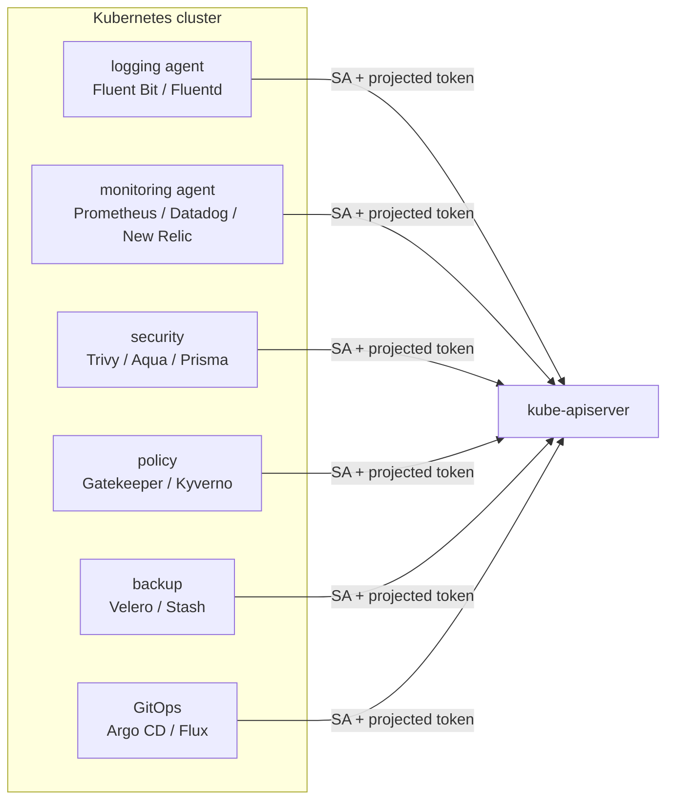
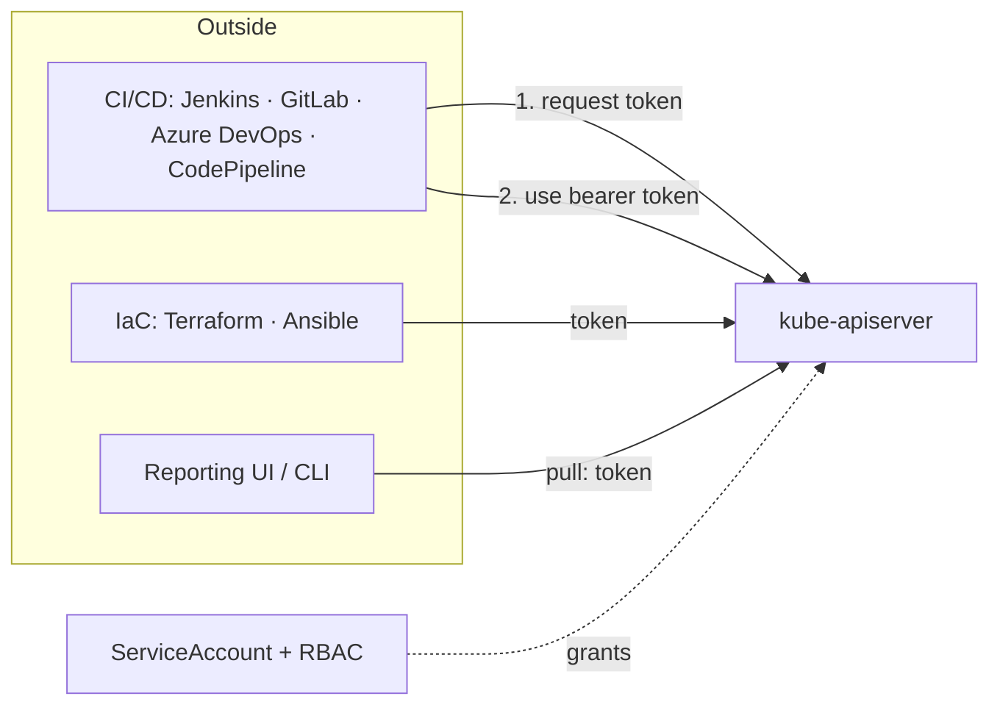

# ServiceAccounts & Kubernetes Authentication (Day 37)

> Source: Day 37 of a Certified Kubernetes Administrator (CKA) 2025 course.
> Topic: How **workloads** (and tools) prove who they are — **ServiceAccounts**, **projected tokens**, the **TokenRequest API**, legacy perpetual tokens, and every **authentication method** Kubernetes supports.
> Prerequisite: Day 34 (users via CSR), Day 36 (RBAC — how an SA gets permissions), Day 26 (downwardAPI), Day 32 (kubeconfig).
> Next: **Admission controllers** (Day 38).

---

## 1) Kubernetes Has No User Store

> **Kubernetes has no internal user store.** There is no `kubectl create user`.

| | Linux | Kubernetes |
|---|---|---|
| Users | Local `/etc/passwd` store, `useradd` | **No store at all** |
| How identity is established | The OS looks it up | **Externally** — a certificate CN, or a token |
| Can you "create a user"? | Yes | **No** — you create *credentials*, not users |

> A Kubernetes "user" is just **a name that appears in a credential** — the CN of a client certificate (Day 34) or a claim in a token. Nothing is stored.

But **ServiceAccounts are real objects** — that's the exception, and this lecture's subject.

---

## 2) One Rule Before Anything Else

> **No matter which authentication method is used, it is always the Kubernetes API server that performs the authentication.**

Clients never verify each other's credentials directly. Every method — password file, token file, certificate, bearer token, OIDC — terminates at **the API server**, which then hands the identity to **authorization** (Day 35/36).

```
credential of any kind  ──►  API server  ──►  identity  ──►  authorization (RBAC/webhook)
```

---

## 3) The Authentication Methods

### 3.1 Static password file — *legacy, removed*

A **CSV** file holding credentials in **plain text**:

```
password,user,uid,"group1,group2"
p@ssw0rd,varun,1001,devs
```

Wired in with a flag in the API server manifest:

```
--basic-auth-file=/path/to/users.csv
```

- **API server must be restarted** for any change (it's a static file).
- **Passwords are not encrypted** — anyone with access to the API server box reads them.
- **Never rotated.**
- **Never production.**

> ⚠️ **Version note:** **basic authentication was removed from Kubernetes (1.19)** — the flag no longer exists on the 1.31 cluster used in this course. The lecture covers it for **historical context and exam awareness**; do not expect it to work.
>
> *"I have personally never used it… when I was a junior admin I always received TLS certificates."*

### 3.2 Static token file — *legacy, removed*

Same idea, **token instead of password**:

```
token,user,uid,"group1,group2"
```

- Generate the token with `openssl rand -hex 32` (or any generator).
- Wire it in with `--token-auth-file=/path/to/tokens.csv`.
- The API server reads the file and, on a request **bearing that token**, authenticates the matching user.
- Same drawbacks: **static, requires restart, unrotated**.

> Also deprecated/removed on modern clusters. Section 2's rule still applies — the **API server** did the validation.

**Both of these are drawn in red in the lecture for one reason: you will never use them in production.**

### 3.3 Service account bearer tokens — **the preferred non-human method**

> Whenever you create a ServiceAccount, it has a **token** associated with it (auto-generated or manually requested).

**Token vs Bearer token — the definition that matters:**

| Term | Meaning |
|---|---|
| **Token** | Generic: *any* credential used to authenticate a user or system |
| **Bearer token** | A **specific HTTP authorization** mechanism: *whoever bears it is granted access* — possession **is** authentication |

> **All ServiceAccount tokens are bearer tokens.** Because the Kubernetes API is **RESTful** and speaks HTTP verbs (Day 35), the `Authorization: Bearer <token>` header is the natural fit.

These tokens are **JWTs** — JSON Web Tokens — **signed by the API server**.

> **Why service accounts and not user accounts for automation?** Because monitoring, logging, CI/CD and security tooling all need **their own identity** — see Section 4.

### 3.4 Certificates — humans *and* tools

- Covered in depth in Days 30–34.
- **DevOps engineers** overwhelmingly use **TLS certificates** through a **kubeconfig**.
- **Interactive tools** — Kubernetes Dashboard, **Lens**, Octant, Rancher — also read your **kubeconfig**, which carries the certificate under the hood.
- **Control plane and data plane components** use certificates for **mTLS** (Day 33).

> So certificates serve **both** a bot and a human. It's the only method that comfortably covers both.

### 3.5 External identity providers — **do not manage users yourself**

> The idea: **outsource authentication.** Users log in with an identity they **already have**.

**The consumer-app version:** let users sign in with **Google** instead of creating yet another password. Benefits:

1. **Less friction** — no new account to remember.
2. **You offload authentication** to an entity that already does it well.

That's **SSO — Single Sign-On**: one identity, many systems.

**The infrastructure version:** for your **Kubernetes cluster** or **AWS accounts**, you do *not* want consumers' Google/Amazon identities. You want **corporate identities you control**:

| Identity store | Notes |
|---|---|
| **Microsoft Active Directory** | The most widely used directory — still extremely relevant |
| **Okta** | Private identity service |
| **Ping** | Private identity service |
| **Azure AD** | Cloud directory |

> **Identity store** = where identities live. Okta/Ping are services where you create identities and **integrate them into your infrastructure**, including Kubernetes.

**Who uses what (from the instructor's experience):**

| Persona | Typical method |
|---|---|
| **DevOps / infrastructure engineers** | **Certificates** via kubeconfig |
| **Developers, SREs** | **Corporate identities** (Okta, Ping, Azure AD, AD) |

> But: *"do not take what I'm saying as written on stone."* You'll also find admins using external IdPs, and clusters using certificates only. **Analyze the requirement** — if your org already uses corporate identities for cloud, compliance/auditing will push you to integrate Kubernetes too.

### 3.6 The three external-identity mechanisms

| Mechanism | Works with | API server flag |
|---|---|---|
| **OIDC** (OpenID Connect) | **Google, GitHub, Azure AD, Okta, Amazon** | `--oidc-issuer-url`, `--oidc-client-id`, `--oidc-username-claim`, `--oidc-groups-claim` |
| **LDAP / Kerberos** | Enterprise directories — **Active Directory** | ❌ **No native support** — use an **authentication proxy** (or webhook) |
| **Webhook token authentication** | **Any** external system you can call | `--authentication-token-webhook-config-file` |

> **Webhook token auth is the mirror image of webhook *authorization* (Day 35):** there, the API server outsourced **authorization**; here it outsources **authentication**.

### 3.7 The external-IdP flow

```
1. User logs in to the IdP (e.g. Okta) with username + password
2. The IdP — the identity provider, which owns the identity store — issues a token
3. The token is presented to the API server
4. THE API SERVER validates the token (always the API server)
5. Allow → request continues; Deny → 401
```

> Step 4 is why Section 2 exists: **the IdP issues, but Kubernetes validates.**

### 3.8 Summary table

| Method | Used by | Production? |
|---|---|---|
| Static password file | — | ❌ **removed from Kubernetes** |
| Static token file | — | ❌ deprecated |
| **ServiceAccount bearer tokens** | **All non-human tooling** | ✅ **everywhere** |
| **Certificates** | **Humans + bots**, admins, interactive tools | ✅ **extensively** |
| **External IdP (OIDC/LDAP/webhook)** | **Developers, SREs** (and sometimes admins) | ✅ common in enterprises |

---

## 4) Who Interacts With the Cluster?

### Humans

| Human | How they connect |
|---|---|
| Administrators, developers, SREs | `kubectl` + **kubeconfig** → **TLS certificates** and/or **external IdP** |

### Non-humans

> **Monitoring, logging, security, policy enforcement, CI/CD, backups, secret management** — all **non-human**.

| Where it runs | Identity mechanism |
|---|---|
| **Inside** the cluster (DaemonSet/Deployment agents) | **ServiceAccounts** + **projected tokens** |
| **Outside** the cluster (CI/CD, Terraform, Ansible) | **ServiceAccounts** + **explicitly requested tokens** |

### Why not just use a human account for automation?

> **Audit logs.** If Jenkins runs under a human's credentials, the audit log says *"Varun created a deployment."* **That is a lie.**

With a ServiceAccount, it says *"the `jenkins` service account created a deployment"* — **truthful, attributable, and revocable** without touching a human's access.

> *"Whenever you run any tooling, any non-human interaction, use service accounts."*

---

## 5) ServiceAccounts — the Mechanics

### Every namespace has a `default` ServiceAccount

> Even if you create a namespace called `prod`, it gets a ServiceAccount literally named **`default`**.

**And every pod gets it mounted automatically** — regardless of whether the pod came from a Deployment, StatefulSet, Job, DaemonSet, or a bare `kubectl run`.

### To opt out

```yaml
spec:
  automountServiceAccountToken: false
```

Set it on the **pod** — or on the **ServiceAccount** itself, where it becomes the **default for every pod using that SA**.

### "But why would a pod need a ServiceAccount at all?"

> **A pod is a client of the API server**, and every client must authenticate.

Pods talk to the API server for real reasons:

- Fetching **ConfigMap** data (Day 28)
- Reading **Secrets**
- Reporting status, watching resources (agents)

And the pod proves its identity using the **token** associated with its ServiceAccount. (Compare Day 33: scheduler↔API server proved identity via **mTLS**; a pod proves it via a **token**.)

---

## 6) CLI — The Default SA and the 1.24 Change

```bash
kubectl get pods
kubectl get sa
# NAME      SECRETS   AGE
# default   0         12d
```

> **`SECRETS: 0`** — and that number is the story.

### Before Kubernetes 1.24

```bash
kubectl describe sa default
# Name: default
# Mountable secrets: default-token-xxxxx
# Tokens: default-token-xxxxx
```

A ServiceAccount had a **secret**, and the **secret** contained the **token** — a **three-layer** chain:

```
ServiceAccount  →  Secret  →  Token
```

**The drawback:** that token **lived as long as the ServiceAccount**. It never changed. To rotate it, an admin had to **recreate the ServiceAccount** — which breaks every pod and binding referencing it.

> **That's a security risk**, not just an inconvenience: a leaked token stayed valid forever.

### Since Kubernetes 1.24 — projected tokens

> **Projected tokens are rotated**, have an **expiration date**, and are **projected into pods** by kubelet. Rotation is **automatic** — no API calls from you.

---

## 7) Inspecting a Projected Token

### The pod's volume

```bash
kubectl get pod my-pod -o yaml
```

```yaml
volumes:
  - name: kube-api-access-xxxxx
    projected:
      sources:
        - serviceAccountToken:
            path: token                 # the token file
            expirationSeconds: 3607
        - configMap:
            name: kube-root-ca.crt
            items:
              - key: ca.crt
                path: ca.crt            # the cluster CA certificate
        - downwardAPI:
            items:
              - path: namespace         # which namespace the pod is in
                fieldRef:
                  fieldPath: metadata.namespace
      defaultMode: 420
```

> **Three sources, one volume.** This is a **`projected`** volume — a Day 26 concept (ConfigMap + downwardAPI) plus a new one: **`serviceAccountToken`**.
>
> That's why they're called **projected tokens**: multiple sources **projected** into a single mount.

### Where it's mounted

```yaml
containers:
  - name: app
    volumeMounts:
      - name: kube-api-access-xxxxx
        mountPath: /var/run/secrets/kubernetes.io/serviceaccount
        readOnly: true
```

### Look inside

```bash
kubectl exec -it my-pod -- bash
cd /var/run/secrets/kubernetes.io/serviceaccount
ls
# ca.crt   namespace   token
```

| File | Contains |
|---|---|
| **`ca.crt`** | The **cluster CA certificate** — so the pod can **verify the API server** |
| **`namespace`** | The pod's namespace (`default` here) |
| **`token`** | The **JWT bearer token** for this pod's ServiceAccount |

### Decode the token

Copy `cat token` into **jwt.io**:

```json
{
  "aud": ["https://kubernetes.default.svc.cluster.local"],
  "exp": 1748778321,                       ← EXPIRES
  "iat": 1748774721,
  "iss": "https://kubernetes.default.svc.cluster.local",
  "kubernetes.io": {
    "namespace": "default",
    "pod":  { "name": "my-pod", "uid": "..." },
    "serviceaccount": { "name": "default", "uid": "..." }
  },
  "sub": "system:serviceaccount:default:default"
}
```

**Three things to notice:**

| Observation | Meaning |
|---|---|
| **`exp` is ~1 hour out** | This is a **short-lived** token |
| **`kubernetes.io` block** | It's **bound** to this pod and this SA — the identity is in the token |
| **The signature** | Signed by the **API server's private key** (more in Section 9) |

> **Rotation is invisible to you.** No cron job, no sidecar, no API call — Kubernetes replaces the token before it expires.

---

## 8) The Three Kinds of ServiceAccount Tokens

### 8.1 Bound ServiceAccount tokens (projected) — **the default**

| Property | Detail |
|---|---|
| **Issued by** | The **TokenRequest API**, automatically, when a pod using an SA is created |
| **Lifetime** | **~1 hour** |
| **Signed by** | The **API server's private key** |
| **Scoped** | To that ServiceAccount — and bound to the pod |
| **Rotated** | **Automatically** by Kubernetes |
| **When to use** | **The recommended default** for pods talking to the API server |

**How renewal works:** when the token nears expiry, the kubelet calls the **TokenRequest API** and gets a new one — **no human involvement**.

### 8.2 Manually requested tokens — **for external systems**

```bash
kubectl create token jenkins-sa -n jenkins
kubectl create token jenkins-sa -n jenkins --duration=10m
kubectl create token -h          # see duration options
```

- **Default validity: 1 hour**; `--duration` overrides it.
- Requires the ServiceAccount to **already exist**, with permissions already granted.
- Used for anything **outside** the cluster: **CI/CD (Jenkins, GitLab, Azure DevOps), Terraform, GitHub Actions**, other automation.

> **Why must external systems request explicitly?** Because Kubernetes **can't manage tokens for something it doesn't run.** A pod is scheduled by kubelet — kubelet can project and rotate. A Jenkins server in another network is invisible to Kubernetes; it must **ask** for a token and **ask again** when it expires.

**The external flow:**

```
1. Admin creates an SA (e.g. jenkins-sa) in a namespace
2. Admin grants permissions via RBAC (ClusterRole/ClusterRoleBinding)
3. The external tool requests a token via the TokenRequest API
   (kubectl create token, or the API directly)
4. The tool uses the token as a bearer token
5. Before expiry, it requests a new one
```

Most tools **can't** do step 5 on their own (Jenkins is the lecture's example) — so you either **build automation** around it (a sidecar/job that refreshes and stores the token) or accept the legacy approach below.

### 8.3 Legacy perpetual tokens via Secret — **not recommended**

```yaml
apiVersion: v1
kind: Secret
metadata:
  name: jenkins-sa-secret
  namespace: jenkins
  annotations:
    kubernetes.io/service-account.name: jenkins-sa     # ← THIS associates them
type: kubernetes.io/service-account-token
```

> **The annotation is the whole mechanism** — it links the Secret to the ServiceAccount, and Kubernetes populates `.data.token`.

- **The token never expires.**
- This is **exactly** the pre-1.24 behaviour, recreated by hand.
- **Deprecated. Not recommended.**

**Why it's still around:** some tools can't rotate tokens, and the legacy route is **extremely convenient**. The instructor's balanced take:

> *"A lot of environments still use this because it is convenient, and it is still secure **if** your tokens are highly secure and encrypted… you'll still see this in small production implementations. But enterprises will never use this — they'll use the two modern methods."*

**1.24 comparison (from the notes):**

| | **Before 1.24** | **1.24+** |
|---|---|---|
| Token creation | Autogenerated | **TokenRequest API** |
| Storage | **In a Secret in etcd** | **Not stored** — projected dynamically |
| Lifetime | **Long-lived, no expiry** | **~1 hour, expiring** |
| Mounting | Via Secret volume | Via **projected volume** |
| Risk if leaked | **Indefinite reuse** | Time-bound, scoped |

> **The security principle:** a credential that never expires is a credential that eventually leaks. **Rotation is the fix.**

---

## 9) The Pod → API Server Authentication Flow

```
Pod (client)                                    API server (server)
   │                                                  │
   │  1. "I need ConfigMap data"                      │
   ├─────────────────────────────────────────────────►│
   │                                                  │
   │◄──── 2. API server presents ITS certificate ─────┤   (server first!)
   │                                                  │
   │  3. Pod verifies it using ca.crt                 │
   │     (it has the CA — that's why ca.crt is there) │
   │                                                  │
   │  4. Pod presents its token ─────────────────────►│
   │                                                  │
   │                     5. API server verifies the    │
   │                        token's SIGNATURE using    │
   │                        its own public key         │
   │                                                  │
   │  6. Authentication complete → authorization (RBAC)│
   │◄──── 7. ConfigMap data (if authorized) ───────────┤
```

### Why the token is trustworthy

> **The token is signed by the API server's private key.** Anything signed by that key can be verified with the corresponding **public key**, which the API server holds.

Steps 2–3 are Day 31/33's rule again: **the server proves first** — a pod never sends its token to an unverified endpoint. And **`ca.crt` in the mounted directory is what makes step 3 possible.**

> **The three files are a complete TLS+bearer setup:** `ca.crt` to verify the server, `token` to prove the client, `namespace` as context.

---

## 10) Internal vs External Tooling

### Inside the cluster



| Tooling | Typical workload | Identity |
|---|---|---|
| Monitoring agents | **DaemonSet** | SA + projected token |
| Logging (Fluent Bit/D) | **DaemonSet** | SA + projected token |
| Security (Trivy, Aqua, Prisma) | DaemonSet or Deployment | SA + projected token |
| Policy (Gatekeeper, Kyverno) | **Deployment** | SA + projected token |
| Backup (Velero, Stash) | **Deployment** | SA + projected token |
| GitOps (Argo CD, Flux) | Deployment | SA + projected token |

### And the control plane? **kubeconfig, not service accounts**

> Inside the cluster you *also* have **kube-proxy, kubelet, API server, scheduler, etcd, controller-manager** — and **these use kubeconfig files**, because Kubernetes uses **mTLS** between components (Day 33).

So "internal ⇒ service account" is **too simple**. Correctly:

| Internal | Identity |
|---|---|
| **Control plane / data plane components** | **kubeconfig / certificates** (mTLS) |
| **Add-on tooling** (logging, monitoring, security, backups, GitOps) | **ServiceAccounts + projected tokens** |

### Outside the cluster



| External tool | Mechanism |
|---|---|
| **CI/CD** — Jenkins, GitLab, Azure DevOps, AWS CodePipeline | Create an SA **in the cluster**, grant RBAC, **request tokens** |
| **Infrastructure/configuration** — Terraform, Ansible | Same |
| **Interactive tools** — `kubectl`, Lens, Rancher, IDE plugins | **Typically kubeconfig**, sometimes tokens |
| **Reporting UI/CLI** | Either the agent **pushes** data out, or the UI **pulls** from the API server — if it pulls, **it needs a token too** |

> **The push/pull nuance:** a monitoring agent may **push** metrics to an external dashboard, or the dashboard may **pull** from the API server. Only the **pull** direction needs API credentials. That's why the diagram has arrowheads on **both** sides.

### The thing you don't have to build by hand

> Tools like Prometheus, Fluent Bit, Velero, Gatekeeper, Vault **ship Helm charts**. Those charts create the namespace, ServiceAccount, ClusterRole, ClusterRoleBinding — everything.

But **you still need to understand what got created**, because when it breaks, *"the Helm chart didn't work"* is not a diagnosis. Knowing that a projected token sits at `/var/run/secrets/kubernetes.io/serviceaccount/token` **is** the diagnosis.

---

## 11) Demo — Create and Secure a Jenkins ServiceAccount

### Step 1 — Namespace + ServiceAccount

```bash
kubectl create ns jenkins
kubectl create sa jenkins-sa -n jenkins
# serviceaccount/jenkins-sa created
```

> **Best practice:** the tool gets **its own namespace**. Deploying Prometheus? Create a `prometheus` namespace and put its SA, Deployment, and RBAC there. Same for Jenkins.

### Step 2 — ClusterRole + ClusterRoleBinding

```yaml
apiVersion: rbac.authorization.k8s.io/v1
kind: ClusterRole
metadata:
  name: jenkins-cluster-role
rules:
  - apiGroups: [""]                            # core group
    resources: ["pods", "services", "endpoints"]
    verbs: ["get", "list", "watch", "create", "update", "patch", "delete"]
  - apiGroups: ["apps"]
    resources: ["deployments", "replicasets"]
    verbs: ["get", "list", "watch", "create", "update", "patch", "delete"]
---
apiVersion: rbac.authorization.k8s.io/v1
kind: ClusterRoleBinding
metadata:
  name: jenkins-cluster-role-binding
subjects:
  - kind: ServiceAccount
    name: jenkins-sa
    namespace: jenkins
    # apiGroup: ""  ← empty for ServiceAccounts (core group) — Day 36
roleRef:
  kind: ClusterRole
  name: jenkins-cluster-role
  apiGroup: rbac.authorization.k8s.io
```

**Why ClusterRole + ClusterRoleBinding?** Because Jenkins deploys across **all namespaces** (Day 36's pattern). If it only deployed to one, you'd use a Role + RoleBinding.

```bash
kubectl apply -f cr.yaml
```

### Step 3 — The legacy perpetual token

```bash
kubectl apply -f secret.yaml
kubectl get sa jenkins-sa          # now shows a SECRET
kubectl describe secret jenkins-sa-secret
# Data
# token:  eyJhbGciOiJSUzI1NiIs...
```

Decode at **jwt.io**:

```json
{ "kubernetes.io": { "namespace": "jenkins",
                     "serviceaccount": { "name": "jenkins-sa" } } }
```

> **No `exp` claim.** *"This token will never expire."* Perfectly illustrates the deprecated approach — and exactly why it was retired.

### Step 4 — The recommended approach

```bash
kubectl create token jenkins-sa -n jenkins                # 1 hour
kubectl create token jenkins-sa -n jenkins --duration=10m # explicit
```

Decode it → **`exp` is present**, about an hour out. ✅

### Step 5 — Use the token against the API

```bash
# from kubectl config view
curl -k https://<api-server>:<port>/api/v1/namespaces/default/pods \
     -H "Authorization: Bearer <token>"
```

- **`-k`** because your laptop lacks the cluster CA (Day 35) — in production you'd pass `--cacert ca.crt`.
- The **path** is Day 35's API path: `/api/v1/namespaces/default/pods`.
- Narrow it to one namespace to keep the output manageable.

**The result is the RBAC-limited view.** With this SA you can touch exactly the resources and verbs in the ClusterRole — **nothing else**.

> **Cleaning up the trust gap:** to do this **properly**, supply `--cacert`. Then you get real mTLS-style verification on the client side too.

### On Jenkins and rotation

> **Jenkins cannot refresh tokens by itself.** Practical workarounds:
> - A **sidecar/automation** that periodically calls the TokenRequest API and updates Jenkins' credential store.
> - Or accept the **legacy perpetual token** with tight controls (a real trade-off many shops make).

---

## 12) Key Takeaways

1. **Kubernetes has no user store** — no `kubectl create user`. Identities exist only inside credentials (cert CN, token claims).
2. **ServiceAccounts *are* objects**, and they're how workloads get identity.
3. **The API server always performs authentication** — whatever the credential type.
4. **Static password and token files are legacy/removed** — plaintext, restart-to-change, unrotated. Never production.
5. **A token is generic; a bearer token is an HTTP mechanism** where possession alone grants access. **All SA tokens are bearer tokens.**
6. **SA tokens are JWTs signed by the API server** — which is what makes them verifiable.
7. **Certificates serve both humans and bots** — admins via kubeconfig; interactive tools (Lens, Dashboard, Rancher) read your kubeconfig too.
8. **External IdPs** (OIDC — Google/GitHub/Azure AD/Okta; LDAP/Kerberos for AD; webhook token auth) outsource authentication — **but the API server still validates**.
9. **LDAP/Kerberos have no native support** — use an auth proxy or webhook.
10. **Use ServiceAccounts for ALL non-human access** — because audit logs must name the **automation**, not a human.
11. **Every namespace has a `default` SA**, auto-mounted into every pod; disable with `automountServiceAccountToken: false`.
12. **Pods need SA tokens** because pods are API clients (ConfigMaps, Secrets, watches).
13. **Since 1.24, SAs have no auto-created Secret** (`SECRETS: 0`) — the old Secret→token chain is gone.
14. **Projected tokens combine three sources**: `serviceAccountToken`, `configMap` (ca.crt), `downwardAPI` (namespace).
15. **The mount path is `/var/run/secrets/kubernetes.io/serviceaccount/`** with `ca.crt`, `namespace`, `token`.
16. **Bound (projected) tokens: ~1 hour, signed, scoped, auto-rotated** — the recommended default for pods.
17. **External systems must request tokens explicitly** (`kubectl create token`, default 1h) because Kubernetes doesn't manage them.
18. **Legacy perpetual tokens** via a Secret with the `kubernetes.io/service-account.name` annotation never expire — deprecated, still seen in small shops, **never in enterprises**.
19. **The pod-auth flow mirrors mTLS**: server cert first → pod verifies with `ca.crt` → pod presents token → server verifies signature.
20. **Internal ≠ only service accounts.** Control plane/data plane components use **kubeconfig/mTLS**; add-on tooling uses **SAs**.
21. **External tooling flow:** create SA → grant RBAC → token request → bearer token → refresh before expiry.
22. **A non-expiring credential is a future breach.** Rotation is the fix, and it's why 1.24 changed the default.

---

## 13) Essential Commands

```bash
# --- ServiceAccounts ---
kubectl create sa jenkins-sa -n jenkins
kubectl get sa -n jenkins
kubectl describe sa jenkins-sa -n jenkins
kubectl get sa -A

# --- Namespace context (so -n isn't needed) ---
kubectl config set-context --current --namespace=jenkins

# --- Tokens: modern ---
kubectl create token jenkins-sa -n jenkins                      # 1 hour default
kubectl create token jenkins-sa -n jenkins --duration=10m
kubectl create token jenkins-sa -n jenkins --duration=86400s    # 24 hours

# --- Tokens: legacy (Secret) ---
kubectl apply -f secret.yaml
kubectl get secret jenkins-sa-secret -n jenkins
kubectl describe secret jenkins-sa-secret -n jenkins            # shows the token
kubectl get secret jenkins-sa-secret -o jsonpath='{.data.token}' | base64 -d

# --- Inspect the pod's projected token ---
kubectl get pod <pod> -o yaml | Select-String -Pattern "projected|serviceAccountToken" -Context 0,6
kubectl exec -it <pod> -- ls /var/run/secrets/kubernetes.io/serviceaccount
kubectl exec -it <pod> -- cat /var/run/secrets/kubernetes.io/serviceaccount/token

# --- Use a token against the API ---
curl -k https://<api-server>:<port>/api/v1/namespaces/default/pods \
     -H "Authorization: Bearer <token>"

# --- Verify what the SA can do ---
kubectl auth can-i --list --as=system:serviceaccount:jenkins:jenkins-sa -n default
kubectl auth can-i create deployments \
  --as=system:serviceaccount:jenkins:jenkins-sa -n default
```

### The legacy Secret

```yaml
apiVersion: v1
kind: Secret
metadata:
  name: jenkins-sa-secret
  namespace: jenkins
  annotations:
    kubernetes.io/service-account.name: jenkins-sa
type: kubernetes.io/service-account-token
```

### Disabling auto-mount

```yaml
# on the Pod
spec:
  automountServiceAccountToken: false

# or on the ServiceAccount (default for all its pods)
apiVersion: v1
kind: ServiceAccount
metadata:
  name: no-api-access
automountServiceAccountToken: false
```

---

## 14) Quick Self-Check

1. Can you create a user in Kubernetes? What do you create instead?
2. What does "no user store" mean for how identity actually works?
3. Who always performs authentication, regardless of method?
4. Why are static password/token files unusable in production — give three reasons.
5. Distinguish **token** from **bearer token**. Are all SA tokens bearer tokens?
6. What signs an SA token, and how does the API server verify it?
7. Which method covers **both** humans and bots, and why?
8. What is an identity store? Name three.
9. What is the flow when an external IdP is used — and who validates the token?
10. Which two identity protocols have **no native** Kubernetes support, and what do you use instead?
11. Why shouldn't a CI/CD pipeline use a human's credentials? Use the phrase "audit log" in your answer.
12. What SA exists in every namespace, and what mounts it into pods?
13. How do you stop a pod from getting API access?
14. Why does a pod need a ServiceAccount at all?
15. What changed in Kubernetes **1.24** regarding SA Secrets?
16. Name the three sources in a projected volume, and the three files they produce.
17. What is `ca.crt` for, inside the pod?
18. How long is a projected token valid, and who rotates it?
19. Why must external systems request tokens explicitly?
20. What annotation links a Secret to a ServiceAccount? What's the risk of that token?
21. In the pod→API-server flow, who proves identity first, and what does the pod use to verify the server?
22. Which internal components use kubeconfig instead of service accounts, and why?

---

## What's Next (Day 38)

- **Admission controllers** — what happens **after** authentication and authorization: mutating and validating admission, and how policy is actually enforced at the API server.

---

*End of Day 37 notes.*
