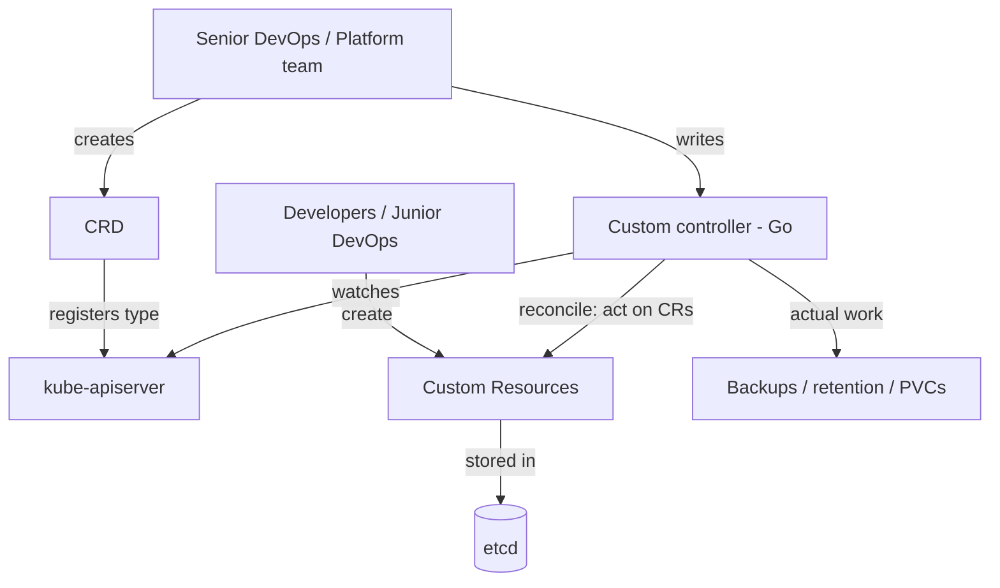

# Custom Resources & CRDs — Extending the Kubernetes API (Day 39)

> Source: Day 39 of a Certified Kubernetes Administrator (CKA) 2025 course.
> Topic: **Custom Resources**, **CustomResourceDefinitions**, and **custom controllers** — how Kubernetes lets you define your own resource types, and why a CRD alone does nothing.
> Prerequisite: Day 07 (API server, schema validation), Day 35 (API groups, `/api` vs `/apis`), Day 38 (admission webhooks as the "built-in hook that calls custom code").
> Next: **Kubernetes Operators** (Day 40).

---

## 1) The Requirement That Starts Everything

Everything so far has used **default resources**: Deployments, Pods, ReplicaSets, PVs, PVCs — all visible in `kubectl api-resources` on a fresh cluster.

Now the scenario:

> **Team lead:** *"I want something in my cluster so my developers can define their **backup policies**. Each policy should specify: **(1) a schedule**, **(2) the PVC to back up**, **(3) a retention period** (say, keep for a month then delete)."*

### Why a CronJob doesn't work

| Requirement | CronJob |
|---|---|
| **Schedule** | ✅ yes |
| **Target PVC** | ❌ no field for it |
| **Retention policy** | ❌ no field for it |

> CronJob answers *"when"* and nothing else. You need a resource that **bundles all three concerns** — and no built-in resource does.

**So you create a custom resource.** That's the whole motivation.

---

## 2) Default vs Custom Resources

| | **Default resources** | **Custom resources** |
|---|---|---|
| **Availability** | Ship with the cluster — `kubectl api-resources` | **You** (or an operator/vendor) create them |
| **API group** | **Core *and* named groups** | **Named groups only** |
| **Created by** | Kubernetes itself | **You, your automation, or third-party tools** |
| **Requires core code change** | n/a | **None** — that's the point |
| **`kubectl` support** | Full | **Full** (`get`, `describe`, short names, completion) |
| **Declarative?** | When it has a controller | **Only when paired with a controller** |

### Core vs named groups (Day 35 callback)

```
/api   → CORE group     (v1)          — e.g. pods, services, secrets
/apis  → NAMED groups   (/apis/<group>/<version>)
```

> **Default resources can live in either.** Custom resources **only ever** appear under `/apis` — because the core group is frozen for backwards compatibility (Day 35).

### Who creates custom resources in the wild?

> **Prometheus, Velero, Fluent Bit, and most modern tooling** register custom resources to extend the API.

Examples you'd see: `ServiceMonitor` (Prometheus), `Backup`/`Restore` (Velero), `ClusterFlow` (logging), `Certificate` (cert-manager).

> **This is Kubernetes' extensibility story:** *"a system that allows you to define your own resources based on your custom requirements."*

---

## 3) Controllers — the Other Half

### What a controller is

> **A controller ensures the desired state matches the current state** — through a **control loop** that observes, compares, and reconciles.

```
observe current state ──► compare with desired state ──► drift? ──► reconcile
              ▲                                          │
              └──────────────── repeat ──────────────────┘
```

### Which resources have controllers?

| **Have controllers** (state can drift) | **No controllers** (static) |
|---|---|
| Deployments, StatefulSets, DaemonSets, Jobs, ReplicaSets, HPAs | **ConfigMaps**, **Secrets**, standalone **Pods** |

**Worked example — Deployment:**

```
You declare replicas: 4
       │
Deployment controller ── works with ──► ReplicaSet controller
       │
ensures 4 replicas exist, always — recreates any that die
```

> A Deployment *can drift* (a pod dies) → it needs something to **reconcile**. A ConfigMap **cannot drift** — it's data, evaluated at creation time and simply consumed by a workload.

### The rule of thumb

> **If a resource defines a desired state that can drift, it gets a controller. If it's static/metadata-driven, it doesn't.**

> **Exception worth naming:** the **namespace controller** plays a *different* role — it manages the **lifecycle** of a namespace (setup, and the deletion process). Not every controller is a reconciler.

### Applying this to custom resources

If your custom resource just **stores configuration**, you may not need a controller.

But an **actual backup policy** — where backups must *happen* on schedule, failures must be retried, retention must be enforced — **needs a controller**:

```
BackupPolicy custom resource (declarative intent)
              │
              ▼
Custom controller: "backup is due at 01:00" → trigger it → enforce retention
```

> **A CR without a controller is inert data.** With one, it becomes **declarative** — a control loop makes reality match the declaration.

---

## 4) Where Does the Schema Come From?

Why must a Deployment manifest look the way it does? Because **someone defined the fields**:

- `spec.replicas`
- `spec.selector`
- `spec.template`
- `spec.template.spec.containers`

### Two ways to see a built-in resource's schema

**1. The API reference docs** — the Kubernetes API reference lists every field for every type.

**2. `kubectl explain`** — the exam-friendly way:

```bash
kubectl explain deployment
# KIND: Deployment  VERSION: apps/v1
# FIELDS:
#   apiVersion  <string>
#   kind        <string>
#   metadata    <Object>
#   spec        <Object>     ← 4 top-level fields

kubectl explain deployment.metadata
kubectl explain deployment.spec
kubectl explain deployment.spec.replicas
```

> **The dot notation drills down.** `kubectl explain deployment.metadata` lists what's allowed inside `metadata` — `name`, `namespace`, `annotations`, `labels`… all things you've already used.

### The point

> **If built-in resources have a defined schema, custom resources need one too — and the CRD is it.**

A **CRD defines the fields, the kind, and the API version** of your custom resource. It's the **template**.

---

## 5) The Three Terms

| Term | What it is | Example |
|---|---|---|
| **Custom Resource (CR)** | An **instance** — the actual object a developer creates | `BackupPolicy` named `mysql-backup` |
| **CRD (CustomResourceDefinition)** | The **schema + registration** — what fields exist, what kind, what group/version | `backuppolicies.opscloud.withvarun` |
| **Custom controller** (**optional**) | The **control loop** that acts on CRs | A Go program that runs backups |

```
CRD  →  registers a new type with the API server  →  CR  →  controller acts on it
```

### The hierarchy

> **1. Define a CRD → 2. Create CRs → 3. (Optionally) add a controller.**

### The elegant parallel with Day 38

> **To extend Kubernetes, something built-in must exist to invoke the extension.**

- **Admission controllers:** the built-in `MutatingAdmissionWebhook` / `ValidatingAdmissionWebhook` plugins are the **built-in hook** that calls your **custom** admission controllers.
- **Custom resources:** the built-in **`CustomResourceDefinition` object** is the **built-in hook** that lets you register **custom** types.

Without a native mechanism to register extensions, the API could never be extended. Both halves of Day 38 and Day 39 are that same design principle.

**Proof it's a normal object:**

```bash
kubectl api-resources | Select-String customresourcedefinition
# customresourcedefinitions   crd,customresourcedefinitions   apiextensions.k8s.io/v1   false   CustomResourceDefinition
```

> A CRD is **itself a Kubernetes object** — which is exactly how you can "create a new kind of object" using `kubectl apply`.

### Who does what in a real org

| Role | Creates |
|---|---|
| **Senior DevOps engineer** (Shweta) | The **CRD**, and the **controller** (with developers) |
| **Junior DevOps / developers** (Apurva) | **Custom resources** — instances for their own use |

> **The built-in analogy:** for Deployments, the definitions and controllers **already existed** — you only ever created instances. With CRDs, your team builds **all three layers** once, then developers only create instances.

---

## 6) Demo Part 1 — The CRD

### The manifest (`crd.yaml`)

```yaml
apiVersion: apiextensions.k8s.io/v1        # the CRD API group
kind: CustomResourceDefinition
metadata:
  name: backuppolicies.opscloud.withvarun  # MUST be <plural>.<group>
spec:
  group: opscloud.withvarun                # the API group for this CR
  scope: Namespaced
  names:
    plural: backuppolicies                 # kubectl get backuppolicies
    singular: backuppolicy
    kind: BackupPolicy                     # kind: BackupPolicy in the CR
    shortNames: ["bp"]                     # kubectl get bp
  versions:
    - name: v1
      served: true                         # served by the API
      storage: true                        # persisted in etcd
      schema:
        openAPIV3Schema:
          type: object
          properties:
            spec:
              type: object
              properties:
                schedule:
                  type: string
                  description: "Cron-format backup schedule, e.g. 0 1 * * *"
                retentionDays:
                  type: integer
                  description: "Number of days to retain backups"
                targetPVC:
                  type: string
                  description: "Name of the PVC to back up"
              required: ["schedule", "targetPVC"]
```

### Field by field

| Field | Meaning |
|---|---|
| **`apiVersion: apiextensions.k8s.io/v1`** | The CRD's own group — **not** your custom group |
| **`kind: CustomResourceDefinition`** | The built-in object you're using to define a new one |
| **`metadata.name`** | ⚠️ **MUST be `<plural>.<group>`** — `backuppolicies.opscloud.withvarun` |
| **`spec.group`** | Your **named API group** — appears in the CR's `apiVersion` |
| **`spec.scope`** | `Namespaced` or `Cluster` |
| **`names.plural` / `singular`** | How `kubectl` addresses it |
| **`names.kind`** | The `kind:` in the custom resource |
| **`names.shortNames`** | `bp` — like `cm` for ConfigMaps, `ep` for Endpoints |
| **`versions[].name`** | `v1` — the version segment |
| **`versions[].served`** | Is this version **served** by the API? |
| **`versions[].storage`** | Is this version **stored in etcd**? |
| **`schema.openAPIV3Schema`** | The **field definitions** — your CR's schema |

### The exam trap the instructor flags

> **`metadata.name` must equal `<plural>.<group>`.**

If an exam question renames the plural to `policy` but leaves `metadata.name: backuppolicies.opscloud.withvarun`, **`kubectl apply` fails** — the name must be **`policy.opscloud.withvarun`**.

> *"These are the kinds of questions you'll see in the exam — 'try to apply this, why isn't it working?' Unless you understand the structure, you can't solve it."*

### `served` vs `storage`

| | Meaning |
|---|---|
| **`served: true`** | This version is **available through the API** — you can `kubectl get` it |
| **`storage: true`** | This version is **persisted in etcd** — exactly **one** version may be the storage version |

**The versioning lifecycle:**

```
v1alpha1  →  v1beta1  →  v1  →  v2alpha1  →  v2beta1  →  v2  →  …
 (unstable)  (testing)  (GA)      (next iteration begins)
```

> You can serve **several versions at once** and mark **one** as storage — that's the upgrade path for CRD-based APIs.

### The schema is a validation contract

> **The schema validates the object.** If a developer creates a `BackupPolicy` that doesn't comply, **creation fails**.

Two validations happen (Day 07/Days 35–38):

1. **`kubectl` validates client-side** — catches obvious problems before sending.
2. **The API server validates server-side** — the authoritative check.

> Schemas are what make a CRD a **contract** rather than a suggestion. `retentionDays: "seven"` (a string) fails against `type: integer`.

### Apply it

```bash
kubectl apply -f crd.yaml
# customresourcedefinition.apiextensions.k8s.io/backuppolicies.opscloud.withvarun created

kubectl get crd
# NAME                                 CREATED AT
# backuppolicies.opscloud.withvarun    ...
# (plus any others — e.g. an app-config CRD from earlier experimentation)

kubectl describe crd backuppolicies.opscloud.withvarun
```

> **Tab completion works for the CRD name** — because `kubectl` already knows it. Nothing about CRDs is "unofficial"; the CLI treats them exactly like built-ins.

### The cluster now recognises a new type

```bash
kubectl api-resources | Select-String backuppolicies
# backuppolicies   bp   opscloud.withvarun/v1   true   BackupPolicy
```

| Column | Value | Where it came from |
|---|---|---|
| Name | `backuppolicies` | `names.plural` |
| Short | **`bp`** | `names.shortNames` |
| API version | `opscloud.withvarun/v1` | `group` + `versions[].name` |
| Namespaced | `true` | `spec.scope: Namespaced` |
| Kind | `BackupPolicy` | `names.kind` |

> **From this moment, `BackupPolicy` is a first-class Kubernetes type.** It didn't exist a minute ago; no Kubernetes upgrade occurred; no core code changed.

---

## 7) Demo Part 2 — The Custom Resource

### How a developer would discover it

```bash
kubectl api-resources | Select-String backuppolicies
```

That's the **whole discovery workflow** — the same one you use for built-ins. Then they write:

```yaml
apiVersion: opscloud.withvarun/v1        # group + version from the CRD
kind: BackupPolicy                       # names.kind
metadata:
  name: mysql-backup
  namespace: default
spec:
  schedule: "0 1 * * *"                  # daily at 01:00
  retentionDays: 7
  targetPVC: mysql-data-pvc
```

| Field | Value |
|---|---|
| `schedule` | `0 1 * * *` — **cron format**, daily at 1 a.m. (Day 29's cron syntax) |
| `retentionDays` | 7 |
| `targetPVC` | `mysql-data-pvc` — the PVC to protect |

### Apply and use it — with normal `kubectl`

```bash
kubectl apply -f cr.yaml
# backuppolicy.opscloud.withvarun/mysql-backup created

kubectl get bp                    # short name
# NAME           AGE
# mysql-backup   10s

kubectl describe bp mysql-backup  # or: describe backuppolicies mysql-backup
```

> **Full `kubectl` citizenship:** short names, `get`, `describe`, tab completion, `-o yaml`, `-n`. *"It is fully compatible with your `kubectl` client."*

**Bonus:** `kubectl explain backuppolicy` also works — the schema you wrote becomes documentation.

### And here's the catch

> **This alone does nothing.**

```bash
kubectl get pvc                   # mysql-data-pvc exists, or doesn't
# ... no backup happens. Ever.
```

> *"If we had this PVC, the backup won't be triggered because there is no controller that is doing that."*

**The CR is a declaration. Nothing is watching it.** It sits in etcd as data — and the instructor deliberately leaves the demo there, because:

---

## 8) You Are Not Expected to Write the Controller

> **Controllers are written in Go**, and **you will not be asked to write one in the exam.**

| In scope (exam) | Out of scope |
|---|---|
| Write a **CRD** (schema, names, group, versions) | Write a **controller** in Go |
| Create a **CR** against that CRD | Implement reconcile logic, retries, backups |
| Read a CRD and explain what CRs it accepts | Package it as an operator |

**The split in a real team:**

```
Senior DevOps  →  CRD + controller (with developers)
Developers     →  CRs, for their own workloads
```

> That's exactly the Shweta/Apurva division from Section 5. And it's why understanding **all three layers** matters even though you only build the first one.

---

## 9) Designing Your Own Groups and Types

The instructor's advice: **group by domain**, not by resource.

| Group | Contains |
|---|---|
| **`opscloud.withvarun`** | Operational resources — `BackupPolicy`, `CostCenter`, `EnvironmentBinding` |
| **`app.cloud.withvarun`** | Application-specific resources |

### Examples worth stealing

| Custom resource | What it would carry |
|---|---|
| **BackupPolicy** | schedule, retention, target PVC |
| **CostCenter** | billing/allocation metadata for teams |
| **EnvironmentBinding** | which Secrets and ConfigMaps belong to an application environment |

> **Broaden your imagination — this is organisation-specific.** If your cluster needs something Kubernetes doesn't model, that's the signal to define a type for it.

### Why grouping by domain pays off

```
opscloud.withvarun/v1
  ├── BackupPolicy
  ├── CostCenter
  └── EnvironmentBinding
```

One group, one RBAC story (`apiGroups: ["opscloud.withvarun"]`), one versioning lifecycle, one place to look. Compare with cramming twelve unrelated types into a group called `stuff`.

---

## 10) Shape of the Whole System



### Without a controller

```
CRD  →  CR  →  etcd  →  (nothing happens)
```

### With a controller

```
CRD  →  CR  →  etcd  →  controller observes → reconciles → real backups happen
                              ▲                    │
                              └──── control loop ───┘
```

> **CRDs make types. Controllers make things happen.** Day 40's **Operators** are exactly this pair, packaged for complex operations (backups, failovers, upgrades).

---

## 11) Key Takeaways

1. **Default resources** ship with the cluster and appear in `kubectl api-resources`; **custom resources** are registered by you or a tool.
2. **Custom resources only live in named API groups** (`/apis/...`) — never the core group (`/api/v1`), which is frozen for compatibility.
3. **CRDs extend the Kubernetes API with no core code changes** — that's Kubernetes' extensibility.
4. **A CronJob can't express schedule + target PVC + retention.** Bundling multiple concerns is the classic reason to make a CR.
5. **A controller keeps desired state == current state** via a **control loop** (observe → compare → reconcile).
6. **Resources that can drift get controllers** (Deployments, StatefulSets, DaemonSets, Jobs, ReplicaSets, HPAs); **static ones don't** (ConfigMaps, Secrets, standalone Pods).
7. **A custom resource needs a CRD first** — the CRD is the schema/registration.
8. **The three terms:** **CR** (instance) → **CRD** (definition) → optional **custom controller**.
9. **The CRD is itself a built-in object** (`apiextensions.k8s.io/v1`) — the same "built-in hook invokes the extension" pattern as admission webhooks.
10. **`metadata.name` must be `<plural>.<group>`** — the single most common CRD mistake in exams.
11. **`names.plural`/`singular`/`kind`/`shortNames`** decide how the type is addressed and what `kind:` appears in CRs.
12. **`scope: Namespaced`** or `Cluster` — the same concept as Day 36's scoping.
13. **`served: true`** = available via the API; **`storage: true`** = persisted in etcd (exactly one storage version).
14. **Version lifecycle:** `v1alpha1 → v1beta1 → v1 → v2alpha1 → …`; multiple versions can be served at once.
15. **The `openAPIV3Schema` is a validation contract** — non-conforming CRs are rejected, client-side by `kubectl` and server-side by the API server.
16. **After `apply`, the type is first-class:** `kubectl get/create/describe`, short names, tab completion, and `kubectl explain` all work.
17. **A CR without a controller does nothing.** It's inert data in etcd.
18. **You are not expected to write a controller** for the CKA — controllers are Go programs.
19. **Group by domain** (`opscloud.withvarun`) so related types share one group, one RBAC rule, one lifecycle.
20. **Operators = CRD + controller**, packaged — Day 40.

---

## 12) Essential Commands

```bash
# --- Discover what exists ---
kubectl api-resources
kubectl api-resources | Select-String backuppolicies
kubectl api-resources -o wide                       # adds VERBS

# --- Built-in schema exploration ---
kubectl explain deployment
kubectl explain deployment.metadata
kubectl explain deployment.spec.replicas
kubectl explain backuppolicy                        # works for CRDs too

# --- Work with CRDs ---
kubectl apply -f crd.yaml
kubectl get crd
kubectl describe crd backuppolicies.opscloud.withvarun
kubectl get crd -o yaml | Select-String "group|plural|kind"

# --- Work with custom resources ---
kubectl apply -f cr.yaml
kubectl get bp
kubectl get backuppolicies
kubectl describe bp mysql-backup
kubectl delete bp mysql-backup

# --- Watch the new type appear ---
kubectl api-resources | Select-String backuppolicies   # before and after
```

### The CRD

```yaml
apiVersion: apiextensions.k8s.io/v1
kind: CustomResourceDefinition
metadata:
  name: backuppolicies.opscloud.withvarun     # <plural>.<group>
spec:
  group: opscloud.withvarun
  scope: Namespaced
  names:
    plural: backuppolicies
    singular: backuppolicy
    kind: BackupPolicy
    shortNames: ["bp"]
  versions:
    - name: v1
      served: true
      storage: true
      schema:
        openAPIV3Schema:
          type: object
          properties:
            spec:
              type: object
              properties:
                schedule:      { type: string }
                retentionDays: { type: integer }
                targetPVC:     { type: string }
              required: ["schedule", "targetPVC"]
```

### The custom resource

```yaml
apiVersion: opscloud.withvarun/v1
kind: BackupPolicy
metadata:
  name: mysql-backup
  namespace: default
spec:
  schedule: "0 1 * * *"
  retentionDays: 7
  targetPVC: mysql-data-pvc
```

---

## 13) Quick Self-Check

1. What are "default resources"? How do you list them?
2. Why can't a CronJob satisfy the team lead's backup-policy requirement? List the three needs.
3. Which API groups can host default resources? Which can host custom ones — and why?
4. What does "custom resources extend the Kubernetes API without core code changes" actually mean in practice?
5. Name three real tools that ship custom resources.
6. Define a controller in one sentence.
7. Which resources have controllers and which don't? What's the underlying rule?
8. Why does a ConfigMap not need a controller?
9. Where do built-in resource schemas come from? Name two ways to inspect one.
10. What does `kubectl explain deployment.metadata` show you, and why is that useful?
11. Define CR, CRD, and custom controller — and give the creation order.
12. Why is a CRD described as a built-in hook for extending the API? What was the Day 38 parallel?
13. What must `metadata.name` of a CRD equal — and what breaks if it doesn't?
14. Which CRD fields decide: the `kind:` in a CR, the group/version, and the `kubectl get` short name?
15. Difference between `served` and `storage` in a CRD version?
16. Sketch the version lifecycle of a CRD-based API.
17. What enforces the `openAPIV3Schema`, and what happens to a non-conforming CR?
18. After applying a CRD, what `kubectl` capabilities does the new type immediately have?
19. You created a `BackupPolicy` and no backup ran. Why — and is that a bug?
20. Are you expected to write a controller for the CKA? Who writes them, and in what language?
21. Why group `BackupPolicy`, `CostCenter`, and `EnvironmentBinding` under one group?
22. What do Operators combine, and how does that differ from a bare CRD?

---

## What's Next (Day 40)

- **Kubernetes Operators** — CRDs paired with controllers to automate complex operational tasks: backups, failovers, upgrades.

---

*End of Day 39 notes.*
