# Kubelet Internals & Node Lifecycle — Complete CKA Master Guide

> **Complete 42-chapter edition.** Follow chapters in order; inspect diagrams alongside node/API evidence.

# Kubelet Internals & Node Lifecycle — CKA Master Guide

> **Learning mode:** Incremental, architecture-first, and hands-on.  
> **Status:** Complete 42-chapter study edition; follow the parts in order.  
> **Audience:** Beginner to CKA candidate; Linux worker nodes and kubeadm-style examples.  
> **Version note:** Concepts reflect contemporary Kubernetes. Validate flags, feature gates, and default values against the version used by your CKA exam and cluster. Managed Kubernetes distributions can differ in paths and service management.

## How to use this guide

Read **one chapter at a time**. For each chapter: (1) understand the *why*, (2) trace the diagram, (3) run the commands in a disposable cluster or lab, (4) answer the checkpoint questions, and (5) continue. We build from visible Kubernetes objects toward node-level implementation details. Commands marked `sudo` need host access. **Do not stop kubelet on a production node.**

### Learning map

```mermaid
flowchart LR
  A[Part 1: Node and kubelet basics] --> B[Part 2: API server and scheduling]
  B --> C[Part 3: Pod and CRI internals]
  C --> D[Part 4: CNI and CSI]
  D --> E[Part 5: Probes and health]
  E --> F[Part 6: Resources and eviction]
  F --> G[Part 7: Metrics and scaling]
  G --> H[Part 8: Security]
  H --> I[Part 9: Node recovery]
  I --> J[Part 10: Debugging]
  J --> K[Part 11: CKA labs]
  K --> L[Part 12: Final revision]
```

## Full table of contents

### Part 1 — Kubernetes Node & Kubelet Fundamentals **[Written]**
1. Kubernetes Architecture Refresher
2. Understanding the Worker Node
3. What Exactly Is Kubelet?
4. Kubelet Architecture and Reconciliation
5. Installing and Running Kubelet

### Part 2 — Kubelet Communication with Control Plane **[Complete]**
6. Node Registration, Bootstrap, Certificates and Identity
7. Kubelet ↔ API Server: Watches, Status, Leases and Authentication
8. Scheduling vs Execution: Pod Binding and `spec.nodeName`
9. Desired vs Actual State and Reconciliation Boundaries

### Part 3 — Pod Creation & Container Runtime Internals **[Complete]**
10. Pod Lifecycle, Conditions and Container States
11. Kubelet Sync Loop, Pod Workers and Pod Admission
12. CRI, gRPC, containerd and CRI-O
13. Pod Sandbox, Pause Container and Linux Namespaces
14. Images, Container Start/Stop, Restart and Garbage Collection
15. Init Containers, Native Sidecars, Static Pods and Mirror Pods

### Part 4 — Networking & Storage **[Complete]**
16. Pod Networking and the Kubelet–CRI–CNI Boundary
17. kubelet vs kube-proxy, Services and DNS
18. Volume Manager, Secrets, ConfigMaps, Projected Volumes
19. CSI Node Plugin and Volume Mount/Unmount Lifecycle

### Part 5 — Probes, Health and Recovery **[Complete]**
20. Liveness, Readiness, Startup: Types and Semantics
21. Probe Workers, Timing, Thresholds and Container Status
22. Restarts, CrashLoopBackOff, OOMKilled and Exit Codes
23. Readiness, EndpointSlices and Service Traffic

### Part 6 — Resource Management **[Complete]**
24. CPU, Memory, cgroups, QoS, Throttling and OOM
25. CPU/Memory/Topology Managers, Device Plugins and GPUs
26. Eviction Manager and Node-Pressure Signals
27. Node Allocatable, Reservations, Ephemeral Storage and Swap

### Part 7 — Metrics & Autoscaling **[Complete]**
28. cAdvisor, Kubelet Metrics and Resource Observation
29. Kubelet → Metrics Server → HPA and Replica Execution
30. Kubelet with VPA, KEDA, Requests and Pod Resizing

### Part 8 — Security **[Complete]**
31. Kubelet Client and Serving Certificates, CSR, RBAC, Node Authorizer and NodeRestriction
32. ServiceAccounts, Pod Security, Seccomp and Runtime Enforcement

### Part 9 — Node Health & Maintenance **[Complete]**
33. Node Conditions, Leases, NotReady, Taints and Controllers
34. Cordon, Drain, Uncordon, PDBs and Termination
35. Kubelet/Runtime/API Failure Modes and Graceful Node Shutdown
36. Kubelet Configuration, Version Skew and kubeadm Upgrades

### Part 10 — Troubleshooting **[Complete]**
37. `systemctl`, `journalctl`, `crictl`, `kubectl describe` and Debug Strategy
38. Diagnosis Trees: Pending, ContainerCreating, Pull, Probe, CNI, CSI, Node NotReady

### Part 11 — CKA Labs **[Complete]**
39. Inspect a Node and Kubelet Configuration
40. Trace Pod Startup and Health/Resource Behavior
41. Drain, Repair a Broken Kubelet and Confirm Recovery

### Part 12 — Reference & Revision **[Complete]**
42. Architecture Atlas, Responsibility Matrix, Exam Checklist and Practice Tasks

### Supporting appendices **[Complete]**
- A. Static Pod manifest paths and mirror Pods
- B. Important node filesystem paths (`/var/lib/kubelet`, `/etc/kubernetes`, `/run/containerd`)
- C. kubelet secure endpoint, metrics endpoints and access boundaries
- D. Node shutdown, garbage collection and certificate rotation
- E. Sample failure investigation worksheets and lab reset instructions
- F. Kubernetes version compatibility and official references

---

# Part 1 — Kubernetes Node & Kubelet Fundamentals

## Chapter 1 — Kubernetes Architecture Refresher

### 1.1 Start with a problem, not an acronym

You want **three copies of an Nginx application** available somewhere in a cluster. A human can run three processes manually, but who ensures they stay up if a process dies, and who determines on which machines to run them? Kubernetes separates this into two responsibilities:

- **Control plane:** stores desired state, selects machines, and continuously works toward that state.
- **Node components:** turn an assigned Pod specification into real running processes and report what happened.

**Kubelet is the per-node agent that bridges these two worlds.** It does not independently decide the overall replica count or choose the best node for a new Pod.

### 1.2 Architecture: who lives where?

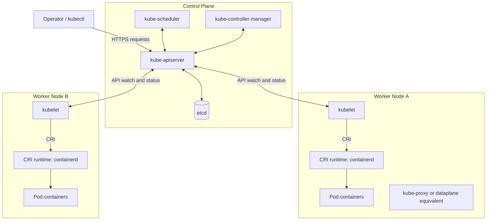

**What the arrows mean:** `kubectl` creates or changes *API objects*; the scheduler assigns pending Pods; kubelet notices Pods assigned to its node and instructs the runtime; kubelet sends observed status to the API server. The scheduler generally does **not** connect directly to kubelet to start a container.

### 1.3 Desired vs actual state: numerical example

Say you create a Deployment with `replicas: 3`.

| Moment | Desired replicas | Actual available Pods | Responsible action |
|---|---:|---:|---|
| Deployment created | 3 | 0 | Deployment/ReplicaSet controllers create Pod objects |
| Pods unassigned | 3 | 0 | Scheduler selects suitable nodes |
| Pods assigned | 3 | 0 | Kubelets observe assigned Pod specs |
| Containers starting | 3 | 1–2 | Kubelets coordinate runtime startup |
| All healthy | 3 | 3 | Kubelets continually supervise Pod containers |
| One container crashes | 3 | May be 2 ready | Kubelet may restart it per restart policy |
| Entire node fails | 3 | May be 1–2 | Node/control-plane controllers ultimately handle replacement Pods; other kubelets start replacements |

> **Precision:** A container failure *within an existing Pod* is often handled by that node's kubelet. A failed node and a need for **replacement Pod objects** involves control-plane controllers, not a kubelet migrating a Pod to another node.

### 1.4 CKA commands

```bash
kubectl get nodes -o wide
kubectl get pods -A -o wide
kubectl get deployments -A
kubectl get --raw /readyz
```

**Observe:** the `NODE` column in `kubectl get pods -o wide` is the scheduled host. If a Pod has no assigned node, kubelet on a worker has not yet been given that Pod to execute.

**Checkpoint:** Who decides replica counts? Who schedules a Pod? Who starts its containers? Why is kubelet needed on every worker node?

---

## Chapter 2 — Understanding the Worker Node

### 2.1 A node is a Linux machine with several cooperating processes

A typical kubeadm-style Linux node contains:

- **Linux kernel:** processes, network namespaces, cgroups, mounts, sockets and devices.
- **systemd:** often starts and supervises `kubelet` and `containerd` as system services.
- **kubelet:** supervises Pods bound to this node; communicates with API server and runtime.
- **Container runtime:** containerd/CRI-O implements CRI and controls container lifecycles.
- **Networking implementation:** CNI plugin is used during Pod networking setup; a service dataplane such as kube-proxy or an eBPF implementation handles Service routing.
- **CSI node plugin (when present):** works with the volume system to make storage available to Pods.

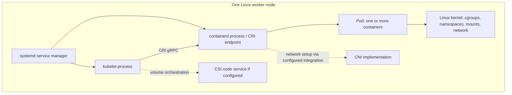

**Critical boundary:** kubelet typically does not execute an OCI container by itself; it asks the runtime via CRI. Do not confuse *kubelet*, *containerd*, *runc*, *CNI*, and *kube-proxy* — their jobs are different.

### 2.2 Node vs Pod vs container

| Object / thing | What it represents | Created/maintained by |
|---|---|---|
| Node API object | Record for an available machine and its status | Kubelet and control plane |
| Pod API object | Unit of scheduling and a desired set of containers | User or controllers |
| Pod sandbox | Runtime-created execution/network boundary for Pod containers | CRI runtime, under kubelet direction |
| Container | Running application process environment | Runtime, under kubelet direction |
| Service | Stable abstraction for reaching eligible Pods | Kubernetes controllers + service dataplane |

### 2.3 Realistic example

You have 2 worker nodes. A Deployment wants 4 replicas. The scheduler might assign 2 Pods per node. **Each kubelet only handles the Pods assigned to its own node**; it does not supervise every Pod in the entire cluster.

### 2.4 Inspect a node

```bash
kubectl describe node <node-name>
kubectl get node <node-name> -o jsonpath='{.status.nodeInfo.containerRuntimeVersion}{"\n"}'
kubectl get pods -A --field-selector spec.nodeName=<node-name> -o wide
```

Look for `Capacity`, `Allocatable`, `Conditions`, `Taints`, and `Non-terminated Pods` in the describe output. These are the clues used later for scheduling, node health and eviction investigations.

**Checkpoint:** Does kube-proxy launch containers? Is CNI the same as CRI? Which worker node's kubelet will manage a Pod assigned to Node B?

---

## Chapter 3 — What Exactly Is Kubelet?

### 3.1 Definition

**Kubelet is a continuously running Kubernetes node agent that ensures Pod containers described in Pod specifications are running and healthy on its node**, as far as local execution conditions allow. It also reports node and Pod status, executes probes, manages volume lifecycle and resource/eviction-related activities.

Kubelet typically consumes assigned Pod specs from the API server. It can also run **static Pods** from a local manifest directory, which is important on kubeadm control-plane nodes.

### 3.2 Responsibilities and non-responsibilities

| Kubelet DOES | Kubelet DOES NOT |
|---|---|
| Observe Pods assigned to its node | Decide desired Deployment replica count |
| Request Pod sandbox/container operations through CRI | Decide the best node for each unscheduled Pod |
| Run configured startup/liveness/readiness probes | Act as the Prometheus server or HPA controller |
| Update Pod status and Node status/Lease | Implement all Service routing itself |
| Coordinate Pod volumes and node resources | Replace the container runtime |
| Restart eligible failed containers | Move an existing Pod wholesale to another node |
| Supervise static Pods from configured sources | Operate etcd as part of its normal node-agent role |

### 3.3 Example: liveness failure

A container is running but its `/healthz` endpoint fails the liveness probe enough times. Kubelet notices the failures and initiates a **container restart** according to probe and restart semantics. It does **not** ask the scheduler to select a different node for that existing Pod.

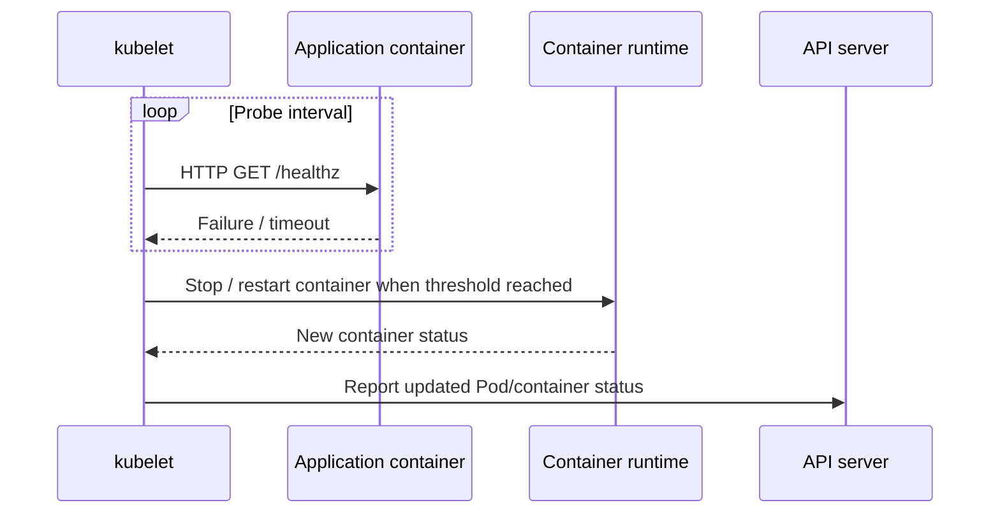

> **Later:** readiness failures do **not** have the same effect as liveness failures. Readiness affects traffic eligibility; liveness may restart the container.

### 3.4 Kubelet and static Pods: an early preview

Kubeadm control-plane nodes often have files such as `/etc/kubernetes/manifests/kube-apiserver.yaml`. The local kubelet monitors that directory and starts those static Pods even before normal API-driven scheduling is usable. The API server can show a *mirror Pod* for observability, but the local manifest remains the authority for that static Pod.

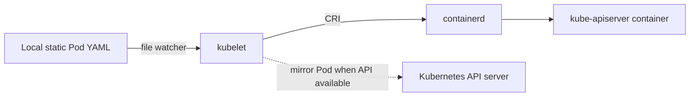

**Checkpoint:** If API server is down, can a kubeadm kubelet still supervise its local API server static Pod? Why does that avoid a control-plane bootstrapping cycle?

---

## Chapter 4 — Kubelet Architecture and Reconciliation

> This chapter is a **conceptual map**. Internal Go packages and exact implementation vary by Kubernetes release. We will inspect real code paths only after learning the Pod lifecycle.

### 4.1 Why a continuous loop?

Suppose the API says: "This Pod should have one Nginx container running." The local runtime says: "That container exited." Kubelet must notice the mismatch and work toward the desired state. It cannot do a one-time launch and walk away.

This is **reconciliation**: repeatedly comparing desired state with observed state and taking steps to close the gap.

### 4.2 Major logical functions

| Logical area | What it is responsible for |
|---|---|
| Pod source / configuration processing | Obtain desired Pod specs from API watch and local static sources |
| Pod manager | Track Pods known to the kubelet |
| Pod workers / synchronization | Serially process operations relevant to particular Pods and reconcile state |
| Container runtime manager | Turn Pod needs into CRI operations and interpret runtime status |
| Probe manager | Execute startup, liveness and readiness probes |
| Status manager | Publish current Pod status to the API server |
| Volume manager | Prepare, mount and tear down required volumes |
| Eviction / resource-related managers | Respond to node pressure and enforce relevant local policies |

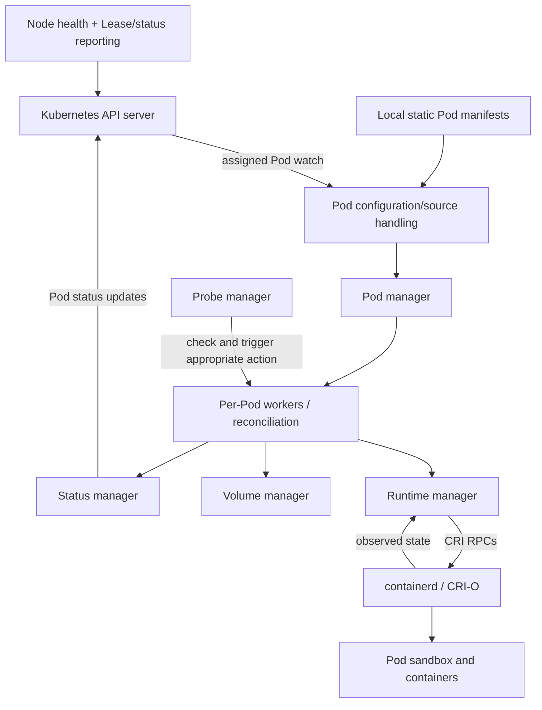

**Diagram interpretation:** The boxes are logical responsibilities, not necessarily separate processes. In a typical deployment, these are internal subsystems of the kubelet process; the container runtime runs separately.

### 4.3 A concrete 6-step reconciliation example

1. API server has a Pod with `spec.nodeName: worker-a`.
2. Kubelet on `worker-a` sees that Pod through its configured watch.
3. Its Pod synchronization machinery discovers there is no running sandbox/container yet.
4. Kubelet coordinates needed volume preparation and requests `RunPodSandbox`, `CreateContainer`, and `StartContainer` through CRI (actual operations depend on Pod state and configuration).
5. Container runtime creates necessary runtime objects; kubelet observes resulting states and starts relevant probes.
6. Kubelet reports status back to the API server and continues observing/reconciling.

**Subtle point:** Kubelet makes CRI requests; it does not generally pull images itself or run `runc` directly. The CRI image service/runtime performs those actions.

### 4.4 Three control loops not to mix up

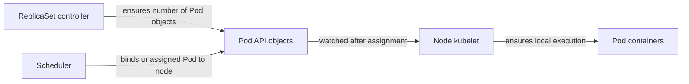

- **ReplicaSet controller:** "Do I have the correct number of Pods?"
- **Scheduler:** "Which node should run an unscheduled Pod?"
- **Kubelet:** "Are this node's assigned Pod containers running as specified?"

**Checkpoint:** Which controller recreates Pod API objects? Which component does `CreateContainer` go through? What happens if kubelet's runtime reports a crashed container?

---

## Chapter 5 — Installing and Running Kubelet

### 5.1 Three software layers

On a common kubeadm-based Linux node:

1. **Package/binary:** `kubelet` executable installed on the host.
2. **Service manager:** systemd starts and restarts the kubelet process.
3. **Kubelet configuration:** API connection details, container runtime endpoint, node identity and behavior settings are provided through flags, a configuration file and kubeconfig.

**`kubeadm` is not the kubelet daemon.** Kubeadm performs initialization/join/upgrade tasks and writes much of the bootstrapping configuration. Kubelet is the process that stays running afterward.

### 5.2 Typical kubeadm node files (paths can vary)

| Path | Typical purpose |
|---|---|
| `/usr/bin/kubelet` | Kubelet binary on package-based installations |
| `/var/lib/kubelet/config.yaml` | KubeletConfiguration file |
| `/etc/kubernetes/kubelet.conf` | Kubeconfig used by kubelet to contact the API server |
| `/etc/kubernetes/bootstrap-kubelet.conf` | Bootstrap kubeconfig during certain join/bootstrap flows |
| `/var/lib/kubelet/pki/` | Kubelet client/server certificates and keys, as applicable |
| `/var/lib/kubelet/` | Kubelet-managed on-disk state such as Pod volume directories |
| `/etc/kubernetes/manifests/` | Common kubeadm static Pod manifest path on control-plane nodes |
| `/run/containerd/containerd.sock` | Common containerd CRI socket; distribution dependent |
| `/etc/systemd/system/kubelet.service.d/` | Common kubelet systemd drop-in location |

**Do not assume these paths are identical on EKS managed node groups, other cloud managed nodes, or non-kubeadm distributions.**

### 5.3 Node startup flow

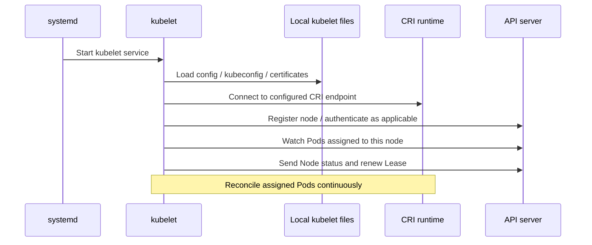

Bootstrap and node-registration ordering has implementation details and error handling; this diagram is a mental model, not a strict instruction trace for every distribution.

### 5.4 Commands: inspect the service

Run on a kubeadm-managed node (for a managed cluster, use its supported node-debug workflow):

```bash
sudo systemctl status kubelet --no-pager
sudo systemctl cat kubelet
sudo journalctl -u kubelet -n 100 --no-pager
sudo journalctl -u kubelet -f
ps -ef | grep '[k]ubelet'
sudo cat /var/lib/kubelet/config.yaml
```

Interpretation:

- `systemctl status`: is the service running and what was its recent failure state?
- `systemctl cat`: where do launch flags and environment files come from?
- `journalctl`: what did kubelet report about API connectivity, certificates, runtime, volumes, network, Pod lifecycle or probes?
- `config.yaml`: what policies and endpoints did this kubelet load?

### 5.5 Commands: cross-check Node and Lease from the API side

```bash
kubectl get nodes -o wide
kubectl describe node <node-name>
kubectl -n kube-node-lease get lease <node-name> -o yaml
kubectl get pods -A --field-selector spec.nodeName=<node-name>
```

The kubelet normally renews a Node Lease to provide a lightweight heartbeat. The control plane combines Node status and Lease health when determining node availability. A running kubelet process is **not proof** that the Node is Ready: its runtime, network plugin or API connectivity may be unhealthy.

### 5.6 Safe hands-on lab — Read-only inspection

**Scenario:** You are asked, "Which kubelet process runs on this node, how does it know the API server URL, and which Pods does it supervise?"

1. `kubectl get nodes` — note a node name.
2. Log in to a *lab* node or use an approved node-debug mechanism.
3. Run `sudo systemctl cat kubelet` — find how `--config` and kubeconfig are supplied.
4. Inspect `/var/lib/kubelet/config.yaml` and applicable kubeconfig metadata; do **not** copy client keys or bearer tokens into notes.
5. `kubectl get pods -A --field-selector spec.nodeName=<node-name> -o wide` — enumerate assigned Pods.
6. `sudo journalctl -u kubelet -n 50 --no-pager` — correlate node activity with recent logs.
7. `kubectl -n kube-node-lease get lease <node-name>` — check heartbeat object.

**Expected outcome:** You can identify kubelet as a node-level service, show its configured API server connection, and explain why the Pods on that node are its execution responsibility.

### 5.7 Early troubleshooting mini-cases

| Symptom | First question | Initial command |
|---|---|---|
| Node `NotReady` | Is kubelet running, and why is the node unhealthy? | `systemctl status kubelet`; `kubectl describe node` |
| No new Pod containers start | Does kubelet reach CRI? | `journalctl -u kubelet`; `crictl info` |
| Node vanished or never registered | Is API connectivity/bootstrap identity working? | `journalctl -u kubelet`; check kubeconfig/cert validity securely |
| Pod is assigned but stays `ContainerCreating` | Are runtime, network or volumes failing? | `kubectl describe pod`; kubelet logs |
| Probe restarts a container | Which probe fails and after how many attempts? | `kubectl describe pod`; kubelet logs |

Do not use `systemctl restart kubelet`, certificate deletion, kubeadm reset, or manifest edits casually on a production cluster. We'll cover safe repair procedures in Parts 9–11.

### 5.8 Part 1 recap: the minimum mental model

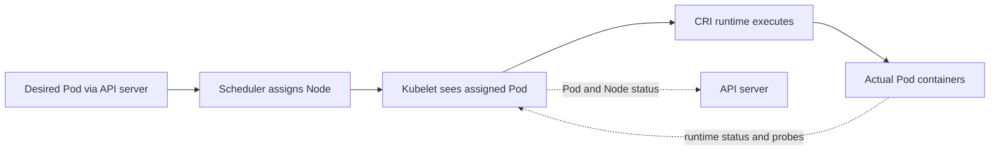

**Remember these five statements:**

1. The API server stores cluster objects; kubelet is not the datastore.
2. The scheduler assigns Pods to nodes; kubelet does not select the node for a normal unscheduled Pod.
3. Kubelet watches assigned Pod specs and reconciles them with reality.
4. Kubelet talks to container runtimes through CRI rather than launching application containers itself.
5. Node health, Pod status, local probes and restarts are part of kubelet's continuing work.

### Part 1 knowledge check

1. What is the difference between *Pod object exists* and *Pod container is running*?
2. Does `kubectl scale deployment nginx --replicas=5` cause kubelet to scale a Deployment directly?
3. What is kubelet's relationship to kube-apiserver and the scheduler?
4. Why can a kubeadm control-plane static Pod be supervised without the Kubernetes API being healthy?
5. What can `systemctl status kubelet` tell you that `kubectl get node` cannot, and vice versa?
6. Does the normal kubelet directly invoke CNI plugins, or does networking involve the runtime and configured CNI integration?
7. What is the first difference between kubelet and kube-proxy?
8. Why might kubelet be running but the Node remain NotReady?

**Answers (check only after attempting):**

<details>
<summary>Reveal suggested answers</summary>

1. An API object is desired specification; container execution is observed runtime state.
2. No. Deployment/ReplicaSet controllers create Pod objects; scheduler assigns new Pods; kubelet runs Pods on its node.
3. API server supplies assigned specs and accepts status; scheduler assigns Pods by updating the API.
4. The kubelet can read a local manifest file and launch it via CRI without receiving it from the API.
5. systemd provides local process/service health and logs; Node API provides reported cluster-level conditions and capacity.
6. Typically the runtime's sandbox networking setup invokes the configured CNI integration; avoid equating kubelet with CNI.
7. kubelet supervises local Pod execution; kube-proxy (where deployed) participates in service traffic routing.
8. Problems with runtime, network readiness, credentials, API connectivity or node pressure can prevent Ready conditions.

</details>

---


---

# Part 2 — API Server, Node Registration and Reconciliation

> **How to learn:** Read the concept, trace the control flow, execute commands in a disposable cluster, then test yourself.

## Architecture visualization

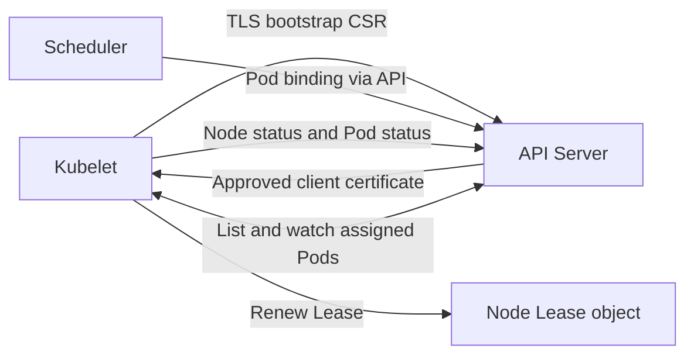

## Chapter 6 — Node Registration, Bootstrap, Certificates and Identity

### 1. Core concept

A kubelet must prove which node it represents. New kubeadm nodes start with bootstrap credentials, request a client certificate, and ultimately authenticate as system:node:<node-name> in group system:nodes.

### 2. End-to-end mechanics

The kubelet reads bootstrap kubeconfig, creates a CertificateSigningRequest (CSR), waits for permitted approval/signing, then uses its client certificate in kubelet.conf. With --register-node it creates its Node object if necessary. Certificate renewal is independent of Pod scheduling; Node authorizer and NodeRestriction constrain node-scoped privileges.

### 3. Concrete example

A new worker joins but remains NotReady: distinguish absent Node registration, pending CSR, missing CNI, and an unhealthy runtime.

### 4. CKA inspection / lab

```bash
kubectl get csr
kubectl get nodes -o wide
sudo ls -l /var/lib/kubelet/pki/
sudo grep -n "client-certificate\|client-key" /etc/kubernetes/kubelet.conf
```

### 5. Common misconception / caution

Do not assume all CSRs are automatically approved or that every certificate is stored at an identical path.

### 6. Knowledge checks

- Which component owns the decision, and which component implements it?
- Which Kubernetes API object or Linux artifact would confirm your hypothesis?
- What changes if this component becomes temporarily unavailable?

## Chapter 7 — Kubelet and API Server: Watches, Status and Leases

### 1. Core concept

Kubelet mostly consumes assigned Pod specifications by listing and watching the API Server; the API Server is the hub. The Scheduler does not remote-execute on kubelet.

### 2. End-to-end mechanics

Kubelet watches Pods selected for its node and updates Pod status via the status subresource. It reports Node conditions/capacity through Node status and renews a lightweight Lease in kube-node-lease for heartbeat efficiency. Watch reconnects/relisting handle disconnections. The API Server can also contact the kubelet secure endpoint for log, exec and port-forward paths through the Kubernetes architecture.

### 3. Concrete example

If the API Server is briefly unavailable, already running Pods generally continue running, but status reporting and receiving new desired-state changes are interrupted.

### 4. CKA inspection / lab

```bash
kubectl get lease -n kube-node-lease
kubectl describe node "$NODE"
kubectl get pods -A --field-selector spec.nodeName="$NODE"
```

### 5. Common misconception / caution

Do not describe Pod assignment as a direct Scheduler-to-kubelet RPC.

### 6. Knowledge checks

- Which component owns the decision, and which component implements it?
- Which Kubernetes API object or Linux artifact would confirm your hypothesis?
- What changes if this component becomes temporarily unavailable?

## Chapter 8 — Scheduling vs Execution: Pod Binding and spec.nodeName

### 1. Core concept

Scheduler selects a node for an unscheduled Pod; kubelet starts workloads only after they have been assigned to that node.

### 2. End-to-end mechanics

Controllers create Pod objects, Scheduler evaluates placement (requests, affinity, topology, taints and volumes), binds the Pod using Kubernetes API, and kubelet detects the assignment. Direct spec.nodeName assignment bypasses ordinary scheduler selection and should be used carefully. Admission on a node can still reject an assigned Pod if local requirements cannot be met.

### 3. Concrete example

A Pod with an unbound PVC stays Pending even when kubelet is healthy; look at scheduling events before restarting kubelet.

### 4. CKA inspection / lab

```bash
kubectl get pod POD -o wide
kubectl describe pod POD
kubectl get events --sort-by=.lastTimestamp | tail -n 25
```

### 5. Common misconception / caution

Pending is a Pod phase, not proof of a kubelet fault.

### 6. Knowledge checks

- Which component owns the decision, and which component implements it?
- Which Kubernetes API object or Linux artifact would confirm your hypothesis?
- What changes if this component becomes temporarily unavailable?

## Chapter 9 — Desired vs Actual State and Reconciliation Boundaries

### 1. Core concept

Kubernetes is convergent: controllers repeatedly compare observations with specifications and close the gap.

### 2. End-to-end mechanics

Deployment controller handles ReplicaSets, ReplicaSet controller creates Pods, Scheduler binds Pods, kubelet reconciles assigned Pods, runtime creates containers, and kubelet publishes observed status. Each controller owns a particular boundary; none performs the whole workflow.

### 3. Concrete example

If a container dies while Pod desired state still requires it and restartPolicy permits, kubelet restarts the container without creating a new Pod object.

### 4. CKA inspection / lab

```bash
kubectl get deploy,rs,pod -o wide
kubectl get pod POD -o jsonpath="{.metadata.uid} {.status.containerStatuses[*].restartCount}"
```

### 5. Common misconception / caution

Do not confuse replacing a Pod (controller) with restarting a container within the same Pod (kubelet).

### 6. Knowledge checks

- Which component owns the decision, and which component implements it?
- Which Kubernetes API object or Linux artifact would confirm your hypothesis?
- What changes if this component becomes temporarily unavailable?


---

# Part 3 — Pod Creation, CRI and Runtime Internals

> **How to learn:** Read the concept, trace the control flow, execute commands in a disposable cluster, then test yourself.

## Architecture visualization

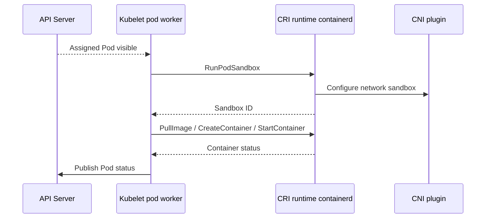

## Chapter 10 — Pod Lifecycle, Conditions and Container States

### 1. Core concept

Pod phase, Pod conditions, and individual container states are different layers of status.

### 2. End-to-end mechanics

Phases include Pending, Running, Succeeded, Failed and Unknown. Conditions include PodScheduled, Initialized, ContainersReady, Ready and potentially PodReadyToStartContainers depending on feature support. Container states are Waiting, Running and Terminated; a Running Pod may still have readiness=false. Readiness gates add custom constraints.

### 3. Concrete example

Running Pod + Ready=false means application containers may be running yet excluded from Service endpoints.

### 4. CKA inspection / lab

```bash
kubectl get pod POD -o yaml
kubectl describe pod POD
kubectl get pod POD -o jsonpath="{.status.conditions}"
```

### 5. Common misconception / caution

CrashLoopBackOff and ImagePullBackOff are container waiting reasons, not official Pod phases.

### 6. Knowledge checks

- Which component owns the decision, and which component implements it?
- Which Kubernetes API object or Linux artifact would confirm your hypothesis?
- What changes if this component becomes temporarily unavailable?

## Chapter 11 — Kubelet Sync Loop, Pod Workers and Pod Admission

### 1. Core concept

Assigned Pod discovery initiates per-Pod work, while kubelet synchronizes desired and observed Pod state over time.

### 2. End-to-end mechanics

Internally kubelet coordinates Pod workers, runtime checks, status manager, probe manager, volume manager, and housekeeping. Admission checks node-level constraints such as resources and topology. Pod workers serialize work for a Pod; syncPod drives volume mounting, sandbox/container setup and status updates. Exact internal method names vary by Kubernetes version.

### 3. Concrete example

A Pod is scheduled but rejected by kubelet because local resource or topology requirements are incompatible: examine events and kubelet logs rather than assuming scheduling guarantees creation.

### 4. CKA inspection / lab

```bash
sudo journalctl -u kubelet -n 150 --no-pager
kubectl describe pod POD
```

### 5. Common misconception / caution

Do not treat the kubelet sync loop as a fixed, single 30-second interval for all operations.

### 6. Knowledge checks

- Which component owns the decision, and which component implements it?
- Which Kubernetes API object or Linux artifact would confirm your hypothesis?
- What changes if this component becomes temporarily unavailable?

## Chapter 12 — CRI, gRPC, containerd and CRI-O

### 1. Core concept

Kubelet speaks the Container Runtime Interface (CRI) to a compliant runtime such as containerd or CRI-O.

### 2. End-to-end mechanics

CRI exposes RuntimeService operations (RunPodSandbox, CreateContainer, StartContainer, StopContainer, status) and ImageService operations (PullImage, ListImages). The runtime manages low-level OCI execution (for containerd typically via containerd-shim and runc). CNI is commonly invoked by the runtime during sandbox setup. CRI socket paths are distribution-specific.

### 3. Concrete example

If kubelet cannot talk to the CRI endpoint, node may report runtime-not-ready and Pod sandboxes cannot launch.

### 4. CKA inspection / lab

```bash
sudo crictl info
sudo crictl pods
sudo crictl ps -a
sudo systemctl status containerd
```

### 5. Common misconception / caution

docker CLI is not the authoritative inspection tool for modern Kubernetes nodes using containerd CRI.

### 6. Knowledge checks

- Which component owns the decision, and which component implements it?
- Which Kubernetes API object or Linux artifact would confirm your hypothesis?
- What changes if this component becomes temporarily unavailable?

## Chapter 13 — Pod Sandbox, Pause Container and Linux Namespaces

### 1. Core concept

A Pod sandbox provides the shared execution context for the Pod, commonly including networking and a pause/infra container.

### 2. End-to-end mechanics

Kubelet asks CRI RunPodSandbox; the runtime creates the sandbox, configures network namespace through CNI, and returns sandbox ID. Application containers are then created in the sandbox context. Linux namespaces isolate network, mount, PID and IPC according to Pod/container settings; cgroups control resources. HostNetwork and other options change namespace usage.

### 3. Concrete example

Two containers in a Pod typically share Pod IP and network namespace and can communicate on localhost; they do not automatically share all mount namespaces.

### 4. CKA inspection / lab

```bash
sudo crictl pods
sudo crictl inspectp SANDBOX_ID
sudo lsns -t net
```

### 5. Common misconception / caution

Do not assume the pause container processes network packets or performs CNI configuration itself.

### 6. Knowledge checks

- Which component owns the decision, and which component implements it?
- Which Kubernetes API object or Linux artifact would confirm your hypothesis?
- What changes if this component becomes temporarily unavailable?

## Chapter 14 — Images, Container Lifecycle and Garbage Collection

### 1. Core concept

Kubelet asks the runtime to pull images and create/start/stop containers; the runtime performs the concrete OCI work.

### 2. End-to-end mechanics

Before starting an app container kubelet assembles configuration, env, mounts, security settings and pulls image through CRI ImageService. Restart policy governs per-container restarts. Image GC and container GC reclaim space; container log rotation and ephemeral-storage accounting affect DiskPressure. Termination first runs preStop (if configured) and graceful stop within grace-period budgeting, then forcefully stops if needed.

### 3. Concrete example

An invalid image reference produces ErrImagePull then ImagePullBackOff; kubelet does not keep spawning identical Pods to fix it.

### 4. CKA inspection / lab

```bash
kubectl describe pod POD
sudo crictl images
sudo crictl ps -a
kubectl logs POD --previous
```

### 5. Common misconception / caution

Pull policy Always does not imply downloading all unchanged image layers each time.

### 6. Knowledge checks

- Which component owns the decision, and which component implements it?
- Which Kubernetes API object or Linux artifact would confirm your hypothesis?
- What changes if this component becomes temporarily unavailable?

## Chapter 15 — Init Containers, Native Sidecars, Static Pods and Mirror Pods

### 1. Core concept

Container startup ordering and Pod source matter; static Pods are locally supervised by kubelet rather than authored by workload controllers.

### 2. End-to-end mechanics

Init containers complete sequentially; app containers start after successful initialization. Native sidecars are init containers with restartPolicy Always and can stay running alongside app containers. Static Pod manifests come from a local directory (commonly /etc/kubernetes/manifests for kubeadm control plane); kubelet creates mirror Pods in the API for visibility when reachable. Mirror objects cannot be managed as ordinary controller-owned Pods.

### 3. Concrete example

Breaking /etc/kubernetes/manifests/kube-apiserver.yaml can affect a kubeadm control plane because kubelet supervises the API Server as a static Pod.

### 4. CKA inspection / lab

```bash
sudo ls -l /etc/kubernetes/manifests/
kubectl get pod -A -o wide | grep kube-apiserver
sudo journalctl -u kubelet -n 80
```

### 5. Common misconception / caution

Do not manually edit static Pod manifests on live control-plane nodes without a recovery plan.

### 6. Knowledge checks

- Which component owns the decision, and which component implements it?
- Which Kubernetes API object or Linux artifact would confirm your hypothesis?
- What changes if this component becomes temporarily unavailable?


---

# Part 4 — Node Networking and Storage

> **How to learn:** Read the concept, trace the control flow, execute commands in a disposable cluster, then test yourself.

## Architecture visualization

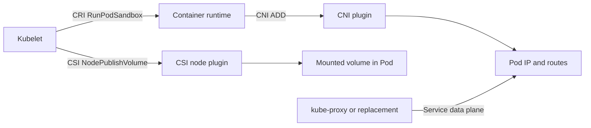

## Chapter 16 — Pod Networking and the Kubelet–CRI–CNI Boundary

### 1. Core concept

Kubelet requests a Pod sandbox; runtime integration normally calls the CNI plugin to configure that sandbox networking.

### 2. End-to-end mechanics

CNI ADD configures interfaces, routes, IPAM and potentially policies. CNI DEL cleans it up. Pod-to-Pod reachability depends on the selected plugin, routing/overlay and policies. kubelet supplies Pod metadata to CRI, but is not a general-purpose packet router. CNI readiness can gate Node readiness and sandbox creation.

### 3. Concrete example

When sandbox creation errors mention CNI plugin not initialized, inspect CNI daemon Pods, config under /etc/cni/net.d and runtime logs.

### 4. CKA inspection / lab

```bash
kubectl get pods -n kube-system -o wide
sudo ls /etc/cni/net.d
sudo crictl info | head -n 50
```

### 5. Common misconception / caution

CNI does not necessarily run as a single kubelet sub-process; invocation is runtime-specific.

### 6. Knowledge checks

- Which component owns the decision, and which component implements it?
- Which Kubernetes API object or Linux artifact would confirm your hypothesis?
- What changes if this component becomes temporarily unavailable?

## Chapter 17 — kubelet vs kube-proxy, Services and DNS

### 1. Core concept

Kubelet starts and supervises Pods; kube-proxy or a replacement dataplane implements Service traffic handling.

### 2. End-to-end mechanics

Service VIP handling may use iptables, IPVS or eBPF depending on architecture. EndpointSlice controllers update endpoint membership according to Pod readiness and selection. CoreDNS resolves cluster names. Neither kube-proxy nor CoreDNS schedules Pods, and kubelet does not choose a Service backend for each request.

### 3. Concrete example

Pod is Ready but Service unreachable: inspect Service selector, EndpointSlice, dataplane and DNS rather than only kubelet.

### 4. CKA inspection / lab

```bash
kubectl get svc,endpointslice -A
kubectl get pod POD --show-labels
kubectl get endpointslice -l kubernetes.io/service-name=SERVICE
```

### 5. Common misconception / caution

NetworkPolicy can block traffic even when endpoints and kubelet readiness are correct.

### 6. Knowledge checks

- Which component owns the decision, and which component implements it?
- Which Kubernetes API object or Linux artifact would confirm your hypothesis?
- What changes if this component becomes temporarily unavailable?

## Chapter 18 — Volume Manager, Secrets, ConfigMaps and Projected Volumes

### 1. Core concept

Kubelet ensures declared volumes are prepared and mounted into containers on its node.

### 2. End-to-end mechanics

Kubelet volume manager tracks desired/actual mounted volumes and reconciles attach/mount/unmount operations. Secret, ConfigMap, downwardAPI and serviceAccountToken projections have distinct lifecycle semantics; updates to mounted ConfigMaps/Secrets are eventually propagated in most volume scenarios, but subPath mounts do not update live. Environment variables sourced from Secrets are not automatically refreshed in running processes.

### 3. Concrete example

A Secret mounted at /etc/config can eventually reflect updates, while the same Secret injected as an env var requires container restart to refresh.

### 4. CKA inspection / lab

```bash
kubectl describe pod POD
kubectl get secret NAME -o yaml
kubectl get pod POD -o jsonpath="{.spec.volumes}"
```

### 5. Common misconception / caution

Never paste decoded production Secret contents into CKA notes or shared diagnostics.

### 6. Knowledge checks

- Which component owns the decision, and which component implements it?
- Which Kubernetes API object or Linux artifact would confirm your hypothesis?
- What changes if this component becomes temporarily unavailable?

## Chapter 19 — CSI Node Plugin and Mount Lifecycle

### 1. Core concept

CSI separates Kubernetes storage management from vendor-specific node mount logic.

### 2. End-to-end mechanics

External controller components may provision/attach; kubelet communicates with CSI node driver through node-local plugin sockets and NodeStageVolume/NodePublishVolume according to driver capabilities. Mount points become visible in the container after preparation. NodeUnpublishVolume/NodeUnstageVolume clean up. VolumeAttachment and topology may affect scheduling.

### 3. Concrete example

Multi-attach error with RWO volume during node move: verify old attachment, node health and whether volume is eligible for attach before editing PVs.

### 4. CKA inspection / lab

```bash
kubectl get pvc,pv
kubectl describe pod POD
kubectl get volumeattachments.storage.k8s.io
```

### 5. Common misconception / caution

Do not assume kubelet itself implements a cloud block-storage protocol.

### 6. Knowledge checks

- Which component owns the decision, and which component implements it?
- Which Kubernetes API object or Linux artifact would confirm your hypothesis?
- What changes if this component becomes temporarily unavailable?


---

# Part 5 — Probes, Health and Container Recovery

> **How to learn:** Read the concept, trace the control flow, execute commands in a disposable cluster, then test yourself.

## Architecture visualization

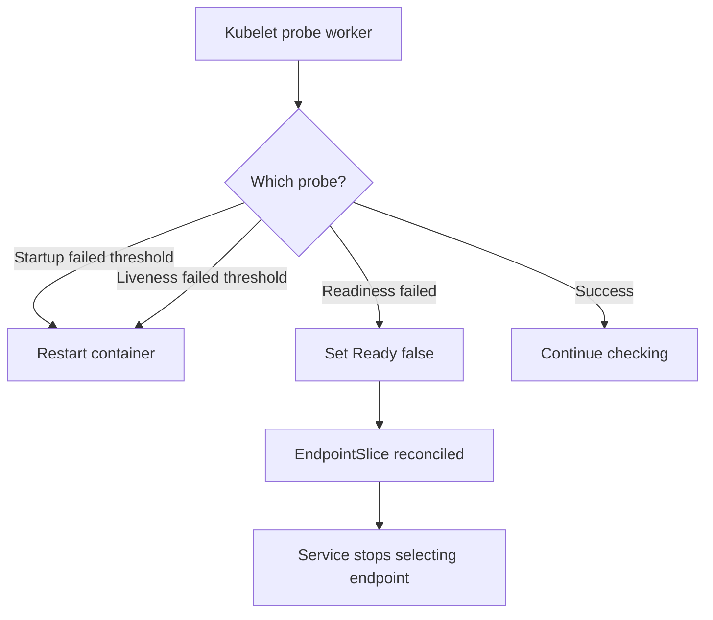

## Chapter 20 — Liveness, Readiness and Startup Probes

### 1. Core concept

Kubelet runs configured probes locally; each answers a different operational question.

### 2. End-to-end mechanics

Startup probe blocks liveness/readiness evaluation until startup succeeds. Liveness failure threshold leads kubelet to restart the container. Readiness failure marks container unready, which propagates to Pod readiness and endpoint selection but does not itself restart the container. Probe types: HTTP GET, TCP socket, exec and gRPC.

### 3. Concrete example

If app takes 90 seconds to initialize, startupProbe can protect it while liveness remains strict after startup.

### 4. CKA inspection / lab

```bash
kubectl describe pod POD
kubectl get pod POD -o jsonpath="{.status.containerStatuses[*].ready}"
```

### 5. Common misconception / caution

Readiness does not mean the app is safe to kill; liveness should not depend on fragile external services.

### 6. Knowledge checks

- Which component owns the decision, and which component implements it?
- Which Kubernetes API object or Linux artifact would confirm your hypothesis?
- What changes if this component becomes temporarily unavailable?

## Chapter 21 — Probe Timing, Thresholds and Internal Execution

### 1. Core concept

Probe scheduling uses initialDelaySeconds, periodSeconds, timeoutSeconds, successThreshold and failureThreshold.

### 2. End-to-end mechanics

Each container/probe combination is handled by kubelet probe workers. A failureThreshold of 3 with periodSeconds 10 means failure is recognized after repeated failed observations, not instantaneously; scheduling time and timeout alter exact timestamps. Liveness and startup successThreshold must be 1. A readiness failure may be checked more frequently while not ready.

### 3. Concrete example

period=10, failureThreshold=3, timeout=1: three consecutive failures can trigger liveness restart on roughly a tens-of-seconds timescale, not a strict 30-second SLA.

### 4. CKA inspection / lab

```bash
kubectl describe pod POD | grep -A 10 "Liveness:\|Readiness:\|Startup:"
kubectl get events --sort-by=.lastTimestamp | tail
```

### 5. Common misconception / caution

Do not equate probe failure with container exit; kubelet may kill a running process due to liveness failure.

### 6. Knowledge checks

- Which component owns the decision, and which component implements it?
- Which Kubernetes API object or Linux artifact would confirm your hypothesis?
- What changes if this component becomes temporarily unavailable?

## Chapter 22 — Container Restarts, CrashLoopBackOff and OOMKilled

### 1. Core concept

Container restart and Pod replacement are distinct recovery mechanisms.

### 2. End-to-end mechanics

For restartPolicy Always, a failed app container can be restarted in the same Pod, subject to backoff. Backoff increases after repeated failures and resets after sufficiently stable execution; implementation/tunables can vary. OOMKilled generally denotes memory cgroup or system OOM action, not liveness failure. Inspect lastState, exitCode, signal, events and previous logs.

### 3. Concrete example

Pod UID unchanged, restartCount=8, lastState.terminated.reason=OOMKilled: investigate memory limit and working set rather than scheduler placement.

### 4. CKA inspection / lab

```bash
kubectl describe pod POD
kubectl logs POD -c CONTAINER --previous
kubectl get pod POD -o jsonpath="{.status.containerStatuses[*].lastState}"
```

### 5. Common misconception / caution

Restarting kubelet itself is not a general cure for CrashLoopBackOff.

### 6. Knowledge checks

- Which component owns the decision, and which component implements it?
- Which Kubernetes API object or Linux artifact would confirm your hypothesis?
- What changes if this component becomes temporarily unavailable?

## Chapter 23 — Readiness, EndpointSlices and Service Traffic

### 1. Core concept

Readiness is a node-local probe result with cluster-wide consequences.

### 2. End-to-end mechanics

Kubelet updates Pod Ready condition; EndpointSlice controller observes Pod status through API and updates Service endpoints; kube-proxy or dataplane implements routing. There may be propagation delay. Terminating endpoints and graceful shutdown matter during rolling updates. An unready Pod may still be directly reachable by IP while Service excludes it.

### 3. Concrete example

Three replicas: one fails readiness. Service should generally use two ready endpoints, but Deployment still reports three running Pods.

### 4. CKA inspection / lab

```bash
kubectl get pods -l app=web
kubectl get endpointslice -l kubernetes.io/service-name=web -o yaml
```

### 5. Common misconception / caution

Service endpoints are not updated directly by kubelet.

### 6. Knowledge checks

- Which component owns the decision, and which component implements it?
- Which Kubernetes API object or Linux artifact would confirm your hypothesis?
- What changes if this component becomes temporarily unavailable?


---

# Part 6 — CPU, Memory and Node Resource Management

> **How to learn:** Read the concept, trace the control flow, execute commands in a disposable cluster, then test yourself.

## Architecture visualization

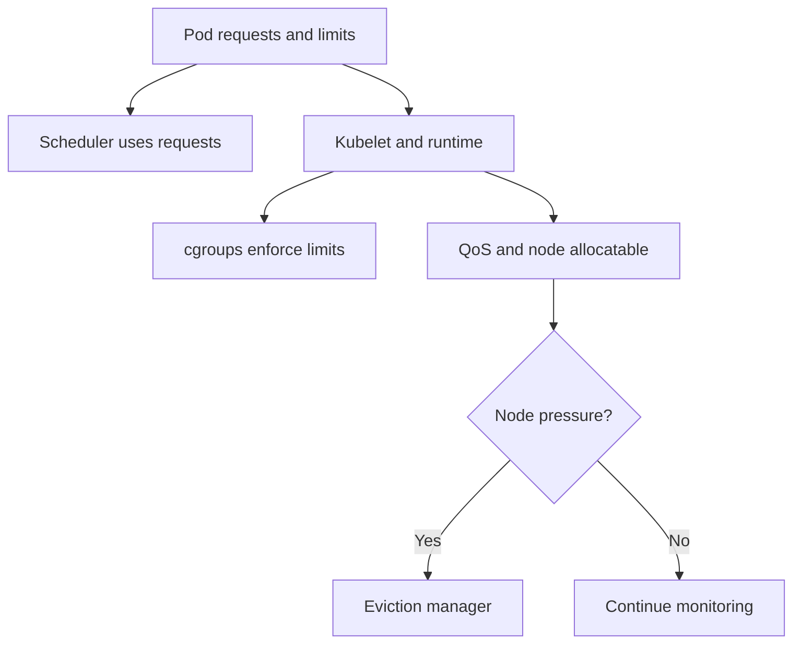

## Chapter 24 — CPU, Memory, cgroups, QoS and OOM

### 1. Core concept

Scheduling uses requests while runtime controls enforcement and usage accounting.

### 2. End-to-end mechanics

CPU requests influence scheduling and relative CPU shares/weights; CPU limits may cause throttling through cgroups. Memory limits cause enforcement and potential OOM kills; memory requests aid scheduling and eviction ranking. QoS classes include Guaranteed, Burstable and BestEffort. Resource cgroup behavior depends on cgroup v1/v2 and runtime.

### 3. Concrete example

A container requests 500m, limit 1 core, uses 750m: CPU utilization vs request is 150%, which is legal absent other constraints.

### 4. CKA inspection / lab

```bash
kubectl describe node NODE
kubectl top pods -A
kubectl describe pod POD | grep -A 8 "Requests:\|Limits:"
```

### 5. Common misconception / caution

Neither CPU request nor memory request is an automatic hard upper bound.

### 6. Knowledge checks

- Which component owns the decision, and which component implements it?
- Which Kubernetes API object or Linux artifact would confirm your hypothesis?
- What changes if this component becomes temporarily unavailable?

## Chapter 25 — CPU Manager, Memory Manager, Topology and Device Plugins

### 1. Core concept

Specialized kubelet managers optimize placement and allocation for performance-sensitive Pods.

### 2. End-to-end mechanics

CPU Manager static policy can allocate exclusive CPU cores to eligible Guaranteed containers meeting requirements. Topology Manager coordinates NUMA alignment hints; Memory Manager manages NUMA-aware memory reservations when enabled; Device Manager allocates advertised devices through device plugins (for example GPUs). Configuration is kubelet/node-specific.

### 3. Concrete example

GPU requested but unallocatable: verify device plugin daemon, node allocatable resources, device health and topology constraints.

### 4. CKA inspection / lab

```bash
kubectl describe node NODE | grep -A 15 Allocatable
sudo grep -E "cpuManagerPolicy|topologyManagerPolicy|memoryManagerPolicy" /var/lib/kubelet/config.yaml
```

### 5. Common misconception / caution

Do not assume the default kubelet enables static CPU pinning or NUMA-aware policies.

### 6. Knowledge checks

- Which component owns the decision, and which component implements it?
- Which Kubernetes API object or Linux artifact would confirm your hypothesis?
- What changes if this component becomes temporarily unavailable?

## Chapter 26 — Eviction Manager and Node Pressure

### 1. Core concept

Kubelet can evict Pods to protect node health when measured resources cross configured thresholds.

### 2. End-to-end mechanics

MemoryPressure, DiskPressure and PIDPressure are important conditions. Hard/soft eviction thresholds, grace periods, QoS, priority and usage relative to requests affect selection. Node-pressure eviction differs from API-initiated eviction via drain and from OOM at a container memory limit. Local ephemeral storage usage includes writable layers/logs/emptyDir based on configuration.

### 3. Concrete example

Disk fills due to container logs: Node shows DiskPressure, new scheduling is restricted via taints and kubelet may reclaim images or evict Pods.

### 4. CKA inspection / lab

```bash
kubectl describe node NODE
sudo journalctl -u kubelet | grep -i eviction | tail -n 30
sudo df -h
```

### 5. Common misconception / caution

Do not assume a PodDisruptionBudget blocks kubelet node-pressure evictions.

### 6. Knowledge checks

- Which component owns the decision, and which component implements it?
- Which Kubernetes API object or Linux artifact would confirm your hypothesis?
- What changes if this component becomes temporarily unavailable?

## Chapter 27 — Node Allocatable, kubeReserved and systemReserved

### 1. Core concept

Node capacity is not equal to resources available for regular Pods.

### 2. End-to-end mechanics

Allocatable deducts reservations (such as kube/system-reserved and eviction reserved memory where configured). Scheduler uses allocatable in scheduling calculations; kubelet enforces node allocatable through appropriate cgroup settings when configured. CPU/memory pressure can arise even if requests fit on paper due to bursty actual usage.

### 3. Concrete example

Node capacity 8 CPU, kube/system reservations 1 CPU => approx 7 CPU allocatable, subject to the specific configured reservations.

### 4. CKA inspection / lab

```bash
kubectl get node NODE -o jsonpath="{.status.capacity.cpu} {.status.allocatable.cpu}"
sudo cat /var/lib/kubelet/config.yaml | grep -A 8 -E "kubeReserved|systemReserved|evictionHard"
```

### 5. Common misconception / caution

Avoid treating requests as usage or allocatable as guaranteed free runtime CPU.

### 6. Knowledge checks

- Which component owns the decision, and which component implements it?
- Which Kubernetes API object or Linux artifact would confirm your hypothesis?
- What changes if this component becomes temporarily unavailable?


---

# Part 7 — Metrics, HPA, VPA and KEDA Interactions

> **How to learn:** Read the concept, trace the control flow, execute commands in a disposable cluster, then test yourself.

## Architecture visualization

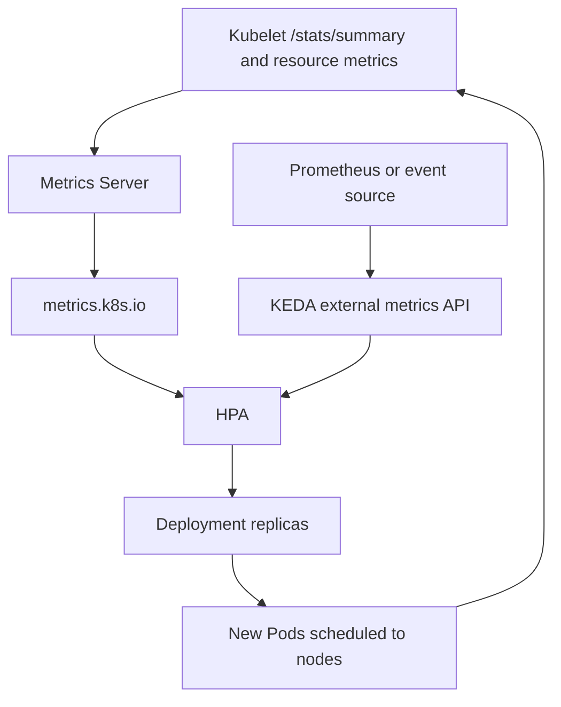

## Chapter 28 — Kubelet Metrics, cAdvisor and Stats Endpoints

### 1. Core concept

Kubelet exposes information about containers and node resources; consumers retrieve it through various APIs.

### 2. End-to-end mechanics

Metrics Server retrieves recent CPU and memory data from kubelet serving endpoints, typically /metrics/resource in modern versions. Kubelet gathers resource observations through runtime and cAdvisor-related integrations. Other endpoints include /stats/summary and /metrics/cadvisor for suitable monitoring setups. Authn/authz and certificates affect scraping.

### 3. Concrete example

kubectl top node works only if Metrics Server and its kubelet scrape path are healthy; it does not depend on KEDA.

### 4. CKA inspection / lab

```bash
kubectl top nodes
kubectl get apiservice v1beta1.metrics.k8s.io
kubectl describe apiservice v1beta1.metrics.k8s.io
```

### 5. Common misconception / caution

Metrics Server is not a long-term metrics database.

### 6. Knowledge checks

- Which component owns the decision, and which component implements it?
- Which Kubernetes API object or Linux artifact would confirm your hypothesis?
- What changes if this component becomes temporarily unavailable?

## Chapter 29 — Metrics Server, HPA and Kubelet Responsibilities

### 1. Core concept

Kubelet provides usage observations; HPA performs replica calculations; scheduler places additional Pods.

### 2. End-to-end mechanics

HPA queries metrics.k8s.io and compares observed usage to configured targets, computes desired replicas with tolerance and policies, writes scale subresource of Deployment; controllers create new Pods; scheduler binds; kubelet on each target node starts them. Kubelet has no knowledge of HPA target formula itself.

### 3. Concrete example

Five Pods averaging 90% CPU against 60% target => ceil(5*90/60)=8 requested replicas, capped by HPA max.

### 4. CKA inspection / lab

```bash
kubectl describe hpa HPA
kubectl top pods -l app=web
kubectl get pods -o wide -l app=web
```

### 5. Common misconception / caution

Metrics Server providing CPU metrics does not automatically configure an HPA CPU target.

### 6. Knowledge checks

- Which component owns the decision, and which component implements it?
- Which Kubernetes API object or Linux artifact would confirm your hypothesis?
- What changes if this component becomes temporarily unavailable?

## Chapter 30 — VPA, KEDA and Pod Resource Resizing

### 1. Core concept

KEDA and VPA influence desired workloads; kubelet still owns actual per-node execution and enforcement.

### 2. End-to-end mechanics

KEDA scaler metrics can flow via external.metrics.k8s.io to HPA; HPA creates more Pods indirectly through controllers. VPA recommends/updates requests; depending on cluster features and configuration, resource changes involve eviction/recreation or supported in-place resizing, which kubelet reconciles with runtime. VPA is a separately installed controller suite, not built into kubelet.

### 3. Concrete example

A VPA-increased CPU request changes the utilization denominator for resource-based HPA even if actual CPU usage stays fixed.

### 4. CKA inspection / lab

```bash
kubectl get scaledobjects -A
kubectl get vpa -A 2>/dev/null || true
kubectl get hpa -A
```

### 5. Common misconception / caution

Do not enable competing HPA CPU utilization and VPA CPU request controls without understanding interactions.

### 6. Knowledge checks

- Which component owns the decision, and which component implements it?
- Which Kubernetes API object or Linux artifact would confirm your hypothesis?
- What changes if this component becomes temporarily unavailable?


---

# Part 8 — Kubelet and Workload Security

> **How to learn:** Read the concept, trace the control flow, execute commands in a disposable cluster, then test yourself.

## Architecture visualization

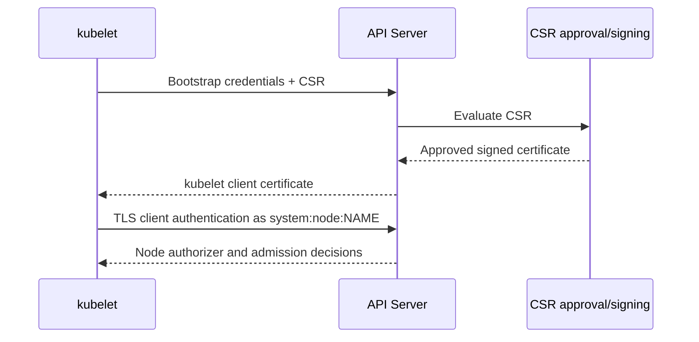

## Chapter 31 — Kubelet Authentication, Authorization and Certificate Rotation

### 1. Core concept

There are two directions to secure: kubelet authenticating to API Server, and clients authenticating to kubelet secure serving API.

### 2. End-to-end mechanics

Kubelet usually presents a client certificate for the API Server. Incoming requests to kubelet HTTPS port 10250 require appropriate authentication and authorization (commonly webhook modes). Node authorizer restricts node-scoped API requests; NodeRestriction admission limits kubelet mutation of Node/Pod objects. CSR auto-approval and server certificate rotation policies depend on deployment.

### 3. Concrete example

If kubectl logs or exec fail due to kubelet serving certificate issues, API Server may be healthy while kubelet secure endpoint is broken.

### 4. CKA inspection / lab

```bash
sudo grep -E "authentication:|authorization:|rotateCertificates:" /var/lib/kubelet/config.yaml
sudo journalctl -u kubelet | grep -i certificate | tail
```

### 5. Common misconception / caution

10250 is a secured kubelet API; never recommend exposing it publicly.

### 6. Knowledge checks

- Which component owns the decision, and which component implements it?
- Which Kubernetes API object or Linux artifact would confirm your hypothesis?
- What changes if this component becomes temporarily unavailable?

## Chapter 32 — ServiceAccounts, Tokens and SecurityContext

### 1. Core concept

The identity used by kubelet itself differs from the service account identity delivered to application Pods.

### 2. End-to-end mechanics

ServiceAccount projected tokens are Kubernetes API credentials mounted into Pods (often audience-bound and time-limited). Kubelet requests/refreshes projected tokens for mounted volumes. SecurityContext specifies user IDs, capabilities, privilege escalation, seccomp and filesystem settings that kubelet passes to runtime. Pod Security Admission happens through the API admission chain, not inside kubelet.

### 3. Concrete example

A Pod using a projected service account token can receive rotation without shipping a long-lived token secret, while the workload must reread the file when using it.

### 4. CKA inspection / lab

```bash
kubectl get sa -A
kubectl get pod POD -o jsonpath="{.spec.serviceAccountName}"
kubectl get pod POD -o jsonpath="{.spec.securityContext}"
```

### 5. Common misconception / caution

Do not confuse kubelet node certificate with application ServiceAccount JWT.

### 6. Knowledge checks

- Which component owns the decision, and which component implements it?
- Which Kubernetes API object or Linux artifact would confirm your hypothesis?
- What changes if this component becomes temporarily unavailable?


---

# Part 9 — Node Health, Maintenance and Recovery

> **How to learn:** Read the concept, trace the control flow, execute commands in a disposable cluster, then test yourself.

## Architecture visualization

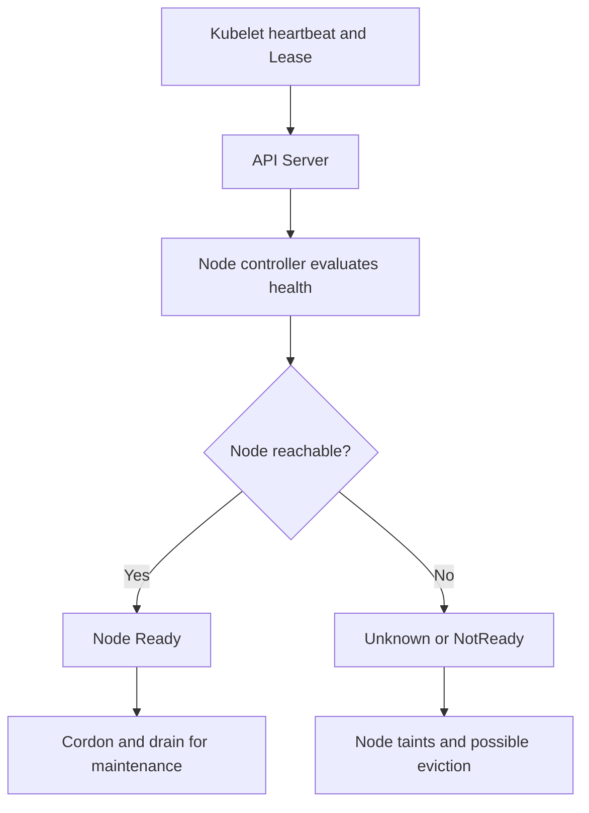

## Chapter 33 — Node Conditions, Leases and Node Controller

### 1. Core concept

Node health is a collaboration: kubelet reports; node controller interprets missing updates.

### 2. End-to-end mechanics

Ready, MemoryPressure, DiskPressure, PIDPressure and NetworkUnavailable may be set depending on the environment. Kubelet renews Lease and periodically updates node status; node controller detects stale heartbeats, changes conditions, applies taints and can initiate consequences for workloads. Node shutdown notifications differ from disconnected-node detection.

### 3. Concrete example

Node reports Unknown while SSH still works: suspect API network, cert, kubelet status loop or control-plane reachability.

### 4. CKA inspection / lab

```bash
kubectl describe node NODE
kubectl get lease NODE -n kube-node-lease -o yaml
sudo journalctl -u kubelet -n 100
```

### 5. Common misconception / caution

NotReady is not always caused by kubelet being stopped.

### 6. Knowledge checks

- Which component owns the decision, and which component implements it?
- Which Kubernetes API object or Linux artifact would confirm your hypothesis?
- What changes if this component becomes temporarily unavailable?

## Chapter 34 — Cordon, Drain, Uncordon and Graceful Shutdown

### 1. Core concept

Node maintenance is about safely avoiding new placements, then voluntarily removing eligible Pods.

### 2. End-to-end mechanics

Cordon sets node unschedulable; drain evicts/delete Pods with options and respects PodDisruptionBudgets for eviction API. DaemonSet Pods are skipped with appropriate flag; static Pods cannot be deleted via API. Uncordon restores scheduling. Kubelet graceful node shutdown can respond to OS shutdown signals when enabled/configured, respecting priority and grace budgets.

### 3. Concrete example

To upgrade a worker: cordon, drain (review special Pods), change binaries and kubelet config, verify Ready, uncordon.

### 4. CKA inspection / lab

```bash
kubectl cordon NODE
kubectl drain NODE --ignore-daemonsets --delete-emptydir-data
kubectl uncordon NODE
```

### 5. Common misconception / caution

Drain is disruptive. Run only against a disposable CKA lab or approved maintenance node.

### 6. Knowledge checks

- Which component owns the decision, and which component implements it?
- Which Kubernetes API object or Linux artifact would confirm your hypothesis?
- What changes if this component becomes temporarily unavailable?

## Chapter 35 — Failure Modes: kubelet, Runtime, API and Network

### 1. Core concept

Failures at different boundaries cause different observable symptoms.

### 2. End-to-end mechanics

Stopped kubelet: existing containers may continue under runtime but probes/status and reconciliation stop; node eventually NotReady. Runtime failure: CRI calls fail and kubelet reports runtime readiness issues. API failure: existing containers generally continue but cluster status/updates stop. CNI failure: new sandbox network setup fails while existing network may persist. Node lost: controller handles taints/eviction semantics after timers.

### 3. Concrete example

A workload on a disconnected node can remain serving locally while API reports Node Unknown; avoid assuming Pod termination happened immediately.

### 4. CKA inspection / lab

```bash
sudo systemctl is-active kubelet containerd
sudo journalctl -u kubelet -n 100
kubectl get nodes -o wide
```

### 5. Common misconception / caution

Treat fault injection as lab-only; never stop critical host services in production casually.

### 6. Knowledge checks

- Which component owns the decision, and which component implements it?
- Which Kubernetes API object or Linux artifact would confirm your hypothesis?
- What changes if this component becomes temporarily unavailable?

## Chapter 36 — kubeadm Upgrade, Kubelet Config and Version Skew

### 1. Core concept

A safe upgrade treats control plane, worker components, kubelet config and runtime as separate concerns.

### 2. End-to-end mechanics

Inspect actual release-specific kubeadm upgrade instructions and version skew policies. kubeadm can manage kubelet config and flags; distro package updates and systemd restarts are separate steps. Back up state and account for drain/PDBs. Changing kubelet config requires validation and service restart; deprecated flags/options vary by release.

### 3. Concrete example

If the control plane is already upgraded, workers can be rolled one at a time using prescribed kubeadm steps and health validation.

### 4. CKA inspection / lab

```bash
kubectl version
kubeadm version
kubelet --version
sudo systemctl cat kubelet
```

### 5. Common misconception / caution

Do not memorize one kubeadm upgrade command sequence as version-independent.

### 6. Knowledge checks

- Which component owns the decision, and which component implements it?
- Which Kubernetes API object or Linux artifact would confirm your hypothesis?
- What changes if this component becomes temporarily unavailable?


---

# Part 10 — Troubleshooting and Incident Diagnosis

> **How to learn:** Read the concept, trace the control flow, execute commands in a disposable cluster, then test yourself.

## Architecture visualization

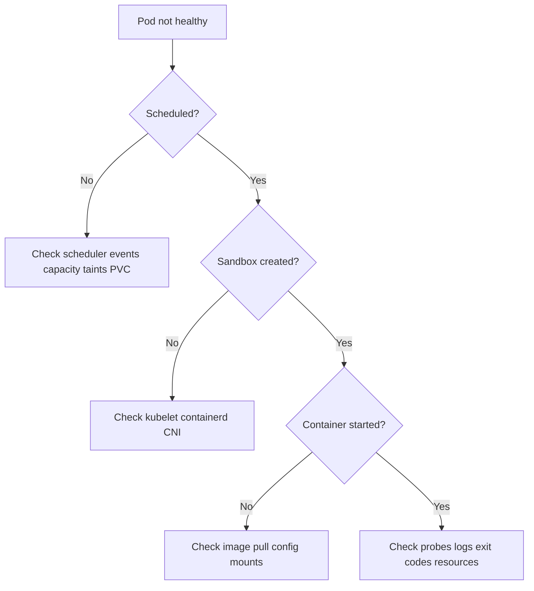

## Chapter 37 — Troubleshooting Toolkit and Evidence Collection

### 1. Core concept

Begin with API-visible symptoms, then move to node-level evidence and runtime only when indicated.

### 2. End-to-end mechanics

Use kubectl describe/status/events for desired state, journalctl/systemctl for kubelet, crictl for runtime, ss/df/free for OS pressure, and node debugging for remote environments. Always compare time windows and node names. crictl requires proper runtime endpoint when auto detection is ambiguous.

### 3. Concrete example

Pod stuck ContainerCreating: check events; if sandbox network failure, inspect CNI; if volume mount error, inspect CSI; avoid blind pod deletion.

### 4. CKA inspection / lab

```bash
kubectl get pods -A -o wide
kubectl describe pod POD -n NAMESPACE
sudo journalctl -u kubelet --since "10 min ago" --no-pager
sudo crictl ps -a
```

### 5. Common misconception / caution

Do not start by deleting all Pods or restarting every DaemonSet.

### 6. Knowledge checks

- Which component owns the decision, and which component implements it?
- Which Kubernetes API object or Linux artifact would confirm your hypothesis?
- What changes if this component becomes temporarily unavailable?

## Chapter 38 — Diagnosis Scenarios and Decision Trees

### 1. Core concept

Correct diagnosis identifies the first failing boundary, not the last visible symptom.

### 2. End-to-end mechanics

Pending unscheduled -> scheduler/events, taints, requests, affinity/PVC; ContainerCreating -> sandbox/CNI/CSI/image; ImagePullBackOff -> registry auth/network; CrashLoopBackOff -> process/logs/probes/OOM; Node NotReady -> kubelet/CRI/network/pressure/certs. Distinguish Ready=false from process crash and application-level health.

### 3. Concrete example

Pod has failed readiness but no restarts: inspect readinessProbe endpoint and Service endpoints rather than changing restartPolicy.

### 4. CKA inspection / lab

```bash
kubectl get events -A --sort-by=.lastTimestamp | tail -n 30
kubectl describe node NODE
kubectl get endpointslice -A
```

### 5. Common misconception / caution

CKA questions often reward targeted first checks, not broad troubleshooting scripts.

### 6. Knowledge checks

- Which component owns the decision, and which component implements it?
- Which Kubernetes API object or Linux artifact would confirm your hypothesis?
- What changes if this component becomes temporarily unavailable?


---

# Part 11 — Hands-on CKA Practical Labs

> **How to learn:** Read the concept, trace the control flow, execute commands in a disposable cluster, then test yourself.

## Architecture visualization

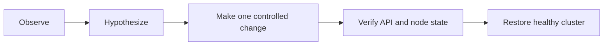

## Chapter 39 — CKA Lab: Inspect and Verify Kubelet

### 1. Core concept

Practice read-only observation before editing host configuration.

### 2. End-to-end mechanics

Identify node, ssh/debug to host, inspect systemd unit, kubelet.conf, config.yaml, runtime socket, certificates, Node condition, Lease and Pods assigned to the node. Correlate one Pod name with its runtime sandbox/container IDs. Record differences between Kubernetes API and node filesystem.

### 3. Concrete example

Deliverable: table connecting each node file to its purpose plus a screenshot or text output of Node Ready and Lease renewTime.

### 4. CKA inspection / lab

```bash
kubectl get nodes -o wide
sudo systemctl status kubelet
sudo cat /var/lib/kubelet/config.yaml
sudo crictl pods
```

### 5. Common misconception / caution

Do not paste secret-bearing kubeconfigs in shared notes.

### 6. Knowledge checks

- Which component owns the decision, and which component implements it?
- Which Kubernetes API object or Linux artifact would confirm your hypothesis?
- What changes if this component becomes temporarily unavailable?

## Chapter 40 — CKA Lab: Pod Lifecycle, Probes and Resources

### 1. Core concept

Use controlled workloads to verify kubelet decisions visibly.

### 2. End-to-end mechanics

Deploy an nginx Pod with readiness/liveness/startup probes, alter endpoint behavior and observe events, Ready changes and restartCount. Deploy a Burstable Pod and inspect requests/limits. Test init ordering, graceful deletion and mounted ConfigMap updates. Capture status and logs after each deliberate change.

### 3. Concrete example

Deliverable: timeline showing readiness failure (Service endpoint removal) versus liveness failure (container restart).

### 4. CKA inspection / lab

```bash
kubectl apply -f probe-lab.yaml
kubectl get pod -w
kubectl describe pod probe-lab
kubectl logs probe-lab --previous
```

### 5. Common misconception / caution

Never load-test or exhaust memory on shared/production nodes.

### 6. Knowledge checks

- Which component owns the decision, and which component implements it?
- Which Kubernetes API object or Linux artifact would confirm your hypothesis?
- What changes if this component becomes temporarily unavailable?

## Chapter 41 — CKA Lab: Node Operations and Recovery

### 1. Core concept

Practice changes on a disposable multi-node cluster with recovery access.

### 2. End-to-end mechanics

Cordon and drain a worker, examine PDB and DaemonSet messages, stop kubelet only in a controlled fault lab, observe status and restore it, inspect CNI/CRI health and uncordon. Avoid risking the sole control-plane machine. Verify workload redistribution and node health.

### 3. Concrete example

Deliverable: pre-check, operation, observed Node and Pod effects, recovery, final health evidence.

### 4. CKA inspection / lab

```bash
kubectl cordon WORKER
kubectl drain WORKER --ignore-daemonsets --delete-emptydir-data
kubectl uncordon WORKER
kubectl get nodes
```

### 5. Common misconception / caution

Drain may fail intentionally because PDBs protect availability; diagnose rather than forcing.

### 6. Knowledge checks

- Which component owns the decision, and which component implements it?
- Which Kubernetes API object or Linux artifact would confirm your hypothesis?
- What changes if this component becomes temporarily unavailable?


---

# Part 12 — Architecture Reference and CKA Revision

> **How to learn:** Read the concept, trace the control flow, execute commands in a disposable cluster, then test yourself.

## Architecture visualization

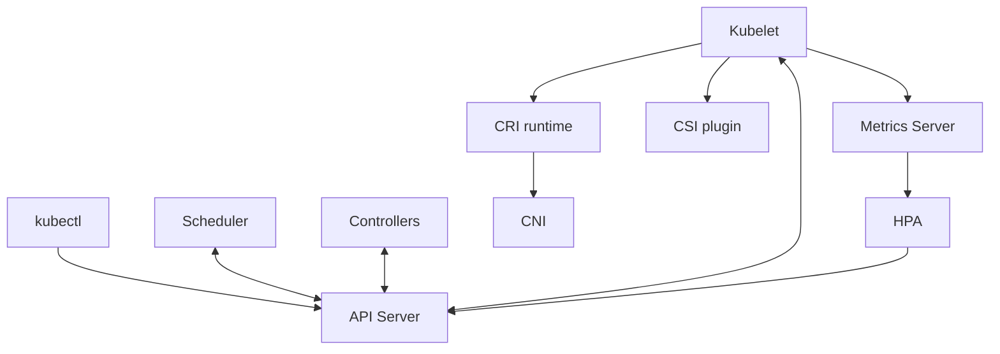

## Chapter 42 — Complete Kubelet Architecture, Revision and Exam Checklist

### 1. Core concept

Kubelet is the node agent that makes the assigned Pod specification real and keeps it healthy.

### 2. End-to-end mechanics

Recall execution chain: kubectl/controller -> API Server -> Scheduler binding -> kubelet watch -> volumes -> CRI sandbox/CNI -> init/app containers -> probes/status -> API Server; for scaling add kubelet metrics -> Metrics Server -> HPA -> replica controller -> scheduler -> kubelet. For nodes also recall Lease and Node status, eviction, certificate bootstrap, systemd and CRI troubleshooting.

### 3. Concrete example

CKA speed drill: distinguish scheduling failure from runtime, networking, storage, probes and application failures in less than two minutes using events and two relevant commands.

### 4. CKA inspection / lab

```bash
kubectl get nodes -o wide
kubectl get pods -A -o wide
kubectl get events -A --sort-by=.lastTimestamp
sudo systemctl status kubelet
sudo crictl ps -a
```

### 5. Common misconception / caution

Do not infer which subsystem failed from a single kubectl STATUS string.

### 6. Knowledge checks

- Which component owns the decision, and which component implements it?
- Which Kubernetes API object or Linux artifact would confirm your hypothesis?
- What changes if this component becomes temporarily unavailable?


## Reference documentation

- https://kubernetes.io/docs/concepts/architecture/nodes/
- https://kubernetes.io/docs/reference/command-line-tools-reference/kubelet/
- https://kubernetes.io/docs/concepts/workloads/pods/pod-lifecycle/
- https://kubernetes.io/docs/tasks/debug/debug-cluster/
- https://kubernetes.io/docs/tasks/administer-cluster/kubeadm/kubeadm-upgrade/
- https://kubernetes.io/docs/concepts/scheduling-eviction/node-pressure-eviction/
